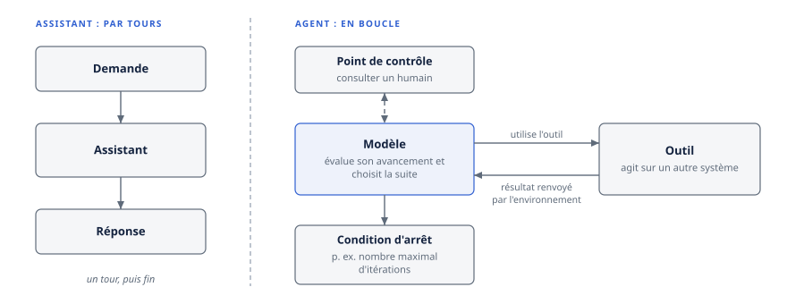
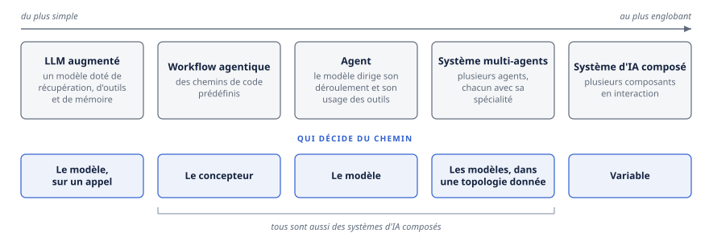
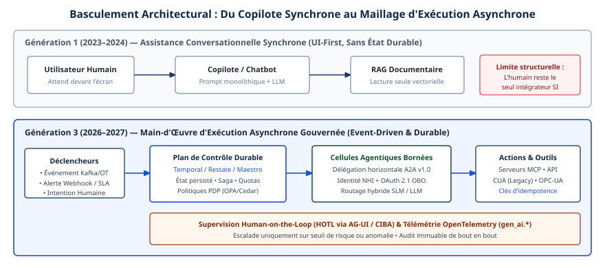
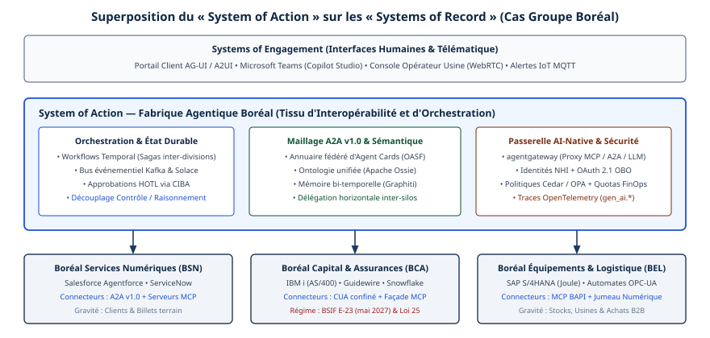

# Chapitre 1 — L'entreprise agentique

*Question directrice : qu'est-ce qui distingue une entreprise agentique d'une entreprise qui utilise des assistants ?*

> **État de référence :** cadre de gouvernance de Singapour pour l'IA agentique, version 1.5 (20 mai 2026, mise à jour le 5 juin 2026); page de l'initiative du NIST sur les standards d'agents, mise à jour le 9 novembre 2026; étude MAP, version 4 (4 juin 2026). Les numéros entre crochets renvoient aux sources en fin de chapitre : [1] à [10] sont primaires, dont [8] lue par son résumé seulement; [11] et [12] sont secondaires.

Une organisation peut installer un assistant sur chaque poste sans rien changer à son fonctionnement. L'assistant rédige, résume, répond; la personne lit, décide et agit. Les systèmes d'enregistrement ne voient passer que des humains.

L'entreprise agentique commence quand ce dernier point cesse d'être vrai : un logiciel dirigé par un modèle de langage ouvre lui-même le billet, modifie la commande, déclenche le paiement, puis confie la suite à un autre logiciel du même genre. Le mot « agentique » est devenu une étiquette commerciale, et il n'existe pas de consensus sur ce qu'est un agent [4]. Ce chapitre fixe donc le vocabulaire, puis propose une définition vérifiable.

Ce qui distingue une entreprise agentique n'est ni le nombre de ses agents ni la puissance de ses modèles. C'est le fait de déléguer des actions, et non plus seulement des réponses, à des logiciels dont elle borne l'autonomie et dont elle répond. Dès que cette délégation dépasse une équipe, deux conditions s'imposent : que les agents se branchent sur les systèmes et les uns sur les autres sans intégration sur mesure, et que leur travail commun soit coordonné de façon fiable. Ce sont l'interopérabilité et l'orchestration, les deux objets de ce compendium.

---

## 1.1 De l'assistant à l'agent

### Une boucle plutôt qu'un échange

Un assistant fonctionne par tours : une demande, une réponse. Un agent fonctionne en boucle. La description la plus dépouillée vient d'Anthropic : un agent est, le plus souvent, un modèle de langage qui utilise des outils dans une boucle, en se réglant sur ce que l'environnement lui renvoie [1]. À chaque étape, il obtient un résultat d'outil ou d'exécution, évalue son avancement et choisit la suite. Il peut s'arrêter à un point de contrôle pour consulter un humain; une condition d'arrêt, par exemple un nombre maximal d'itérations, sert à garder la maîtrise.



Le cadre de gouvernance de Singapour, faute de définition admise, retient des traits communs : une part de planification, de décision et d'action indépendantes, sur plusieurs étapes, vers un but fixé par l'utilisateur [4].

### Quatre propriétés

Quatre propriétés séparent l'agent de l'assistant. Aucune n'est binaire; chacune se règle.

**L'autonomie.** C'est le degré auquel le système décide lui-même de la marche à suivre. Elle dépend des instructions données, procédure détaillée ou jugement propre, et de la place laissée à l'humain [4]. La section 1.3 y revient.

**Les outils.** Un outil permet à l'agent d'agir sur un autre système : écrire dans un fichier ou une base, piloter un appareil, exécuter une transaction [4]. C'est par les outils que l'erreur d'un modèle cesse d'être une mauvaise phrase pour devenir une mauvaise écriture. Leur branchement est l'objet de MCP (chapitre 5).

**La mémoire.** Ce sont les informations conservées et accessibles au modèle, à court ou à long terme, tirées d'interactions passées ou de sources externes [4]. Elle donne à l'agent une continuité que l'assistant n'a pas, et ouvre des risques propres (chapitre 14).

**La délégation.** L'agent agit pour le compte d'une personne ou d'une organisation, et peut à son tour confier du travail : un agent superviseur appelle un agent spécialisé comme il appellerait un outil [4]. La délégation à un agent qu'on ne contrôle pas est l'objet d'A2A (chapitre 6). Elle pose une question que l'assistant ne posait pas : sous quelle identité, et avec quelle part de l'autorité de son mandant, l'agent agit-il (chapitre 29) ?

### Les composants, y compris ceux qui retiennent

Le cadre de Singapour décompose un agent en huit composants [4]. Six le rendent capable : le modèle, les instructions, la mémoire, la planification et le raisonnement, les outils, et les protocoles, dont MCP et A2A, par lesquels il communique avec des outils et d'autres agents. Deux le rendent sûr : les contrôles (contrôles d'accès, garde-fous, approbations humaines) et la journalisation avec la surveillance.

Ces deux derniers ont rejoint les composants de base dans la version 1.5 [4] : ce qui borne et ce qui trace l'agent fait désormais partie de sa définition.

### Ce que l'autonomie coûte

Les systèmes agentiques échangent souvent de la latence et du coût contre une meilleure exécution de la tâche, et leur autonomie accroît le risque d'erreurs qui se composent d'une étape à l'autre [1][4]. Le routage entre modèles déplace une part de ce coût (chapitre 44). D'où la recommandation d'Anthropic : chercher la solution la plus simple, et n'ajouter de la complexité que si elle se justifie. Pour bien des applications, un seul appel de modèle, enrichi de récupération et d'exemples, suffit [1].

---

## 1.2 Taxonomie

Cinq termes reviennent dans tout l'ouvrage, du plus simple au plus englobant.



| Terme | Définition retenue | Qui décide du chemin | Source |
|---|---|---|---|
| LLM augmenté | Un modèle doté de récupération, d'outils et de mémoire | Le modèle, sur un appel | [1] |
| Workflow agentique | Des modèles et des outils orchestrés selon des chemins de code prédéfinis | Le concepteur | [1] |
| Agent | Un système où le modèle dirige lui-même son déroulement et son usage des outils | Le modèle | [1] |
| Système multi-agents | Plusieurs agents qui travaillent ensemble, chacun avec sa spécialité, ses outils et ses permissions | Les modèles, dans une topologie donnée | [4] |
| Système d'IA composé | Un système fait de plusieurs composants en interaction : appels multiples à des modèles, récupérateurs, outils externes | Variable | [2] |

### Workflow ou agent : qui choisit les étapes

La distinction d'Anthropic est la plus utile en pratique, parce qu'elle tient à un seul critère [1]. Dans un workflow, le chemin est écrit d'avance et le modèle intervient à des étapes fixées. Dans un agent, le modèle choisit ses étapes. Les workflows conviennent aux tâches bien définies; les agents, aux cas qui demandent de la souplesse.

Cet ouvrage suit cet usage : « agent » désigne un système où le modèle choisit ses étapes, « workflow agentique » un système au chemin prédéfini, « système agentique » l'ensemble. Le cadre de Singapour observe d'ailleurs qu'en entreprise la plupart des mises en œuvre sont hybrides : des règles déterministes, et une part d'autonomie [4]. Le chapitre 17 place cette frontière sur quatre positions : workflow, étapes agentiques, agent borné, agent ouvert.

### Système multi-agents

Répartir le travail entre plusieurs agents permet de les spécialiser et de les faire travailler en parallèle. Cela permet aussi de borner séparément les outils et les permissions de chacun, au lieu de confier beaucoup d'outils à un seul [4]. Le cadre de Singapour retient trois patrons simples (séquentiel, superviseur, essaim), sans en tenir aucun pour universel.

Un relevé de 2026, connu ici par des sources secondaires, classe les topologies en centralisées, décentralisées et hiérarchiques, avec un axe adaptatif [11] (chapitre 16).

### Système d'IA composé

C'est la catégorie la plus large. Le terme vient d'un billet du laboratoire BAIR de Berkeley, en février 2024, qui constatait un déplacement : les meilleurs résultats venaient de moins en moins d'un modèle seul, et de plus en plus d'un système, qui peut chercher des données à jour, appliquer des contrôles d'accès et vérifier ses sorties [2]. La contrepartie : des difficultés nouvelles de conception, d'optimisation et d'exploitation.

Tout workflow agentique, tout agent et tout système multi-agents est un système d'IA composé. L'inverse est faux : un pipeline de génération augmentée par récupération est composé sans être agentique. La notion rappelle que la qualité se joue dans l'assemblage autant que dans le modèle.

---

## 1.3 Niveaux d'autonomie : premier aperçu

### Deux axes, pas un

Le cadre de Singapour sépare deux notions que le langage courant confond [4]. L'**espace d'action** est l'étendue de ce que l'agent peut faire. Il dépend des outils accordés et des permissions sur ces outils : bac à sable, systèmes internes ou externes; lecture ou écriture. L'**autonomie** est le degré auquel l'agent décide comment atteindre le but. Elle dépend des instructions et de la part laissée à l'humain.

Un agent peut décider seul dans un espace minuscule, ou demander une approbation à chaque pas dans un espace vaste. Le risque se lit sur les deux axes à la fois.

Un article publié par le Knight First Amendment Institute ajoute une idée : l'autonomie est une décision de conception, que le développeur peut fixer indépendamment de la capacité du modèle [5].

### Trois échelles

L'échelle de Feng et ses coauteurs définit cinq niveaux d'après le rôle de l'utilisateur [5]. Celle de Singapour, qui cite la précédente, en retient quatre [4]. Celle de la Cloud Security Alliance (CSA), calquée sur les niveaux de conduite automatisée SAE J3016, en compte six [6].

| Rôle de l'humain | Feng et coll. [5] | Singapour [4] | CSA [6] |
|---|---|---|---|
| Exécute tout; l'IA informe | — | — | 0, aucune autonomie |
| Dirige, ou approuve chaque action | L1, opérateur | L'agent propose, l'humain opère | 1, assistée |
| Partage le travail; approuve un plan ou les étapes importantes | L2, collaborateur | L'agent et l'humain collaborent | 2, supervisée |
| Est consulté pour ses préférences | L3, consultant | — | — |
| N'intervient qu'aux limites : actions critiques, blocages | L4, approbateur | L'agent opère, l'humain approuve | 3, conditionnelle |
| Observe; traite les anomalies ou audite après coup | L5, observateur | L'agent opère, l'humain observe | 4, autonomie élevée |
| Supervision stratégique seulement | — | — | 5, autonomie complète |

L'alignement des lignes est une lecture propre à ce chapitre : les trois échelles ne se recouvrent qu'approximativement. Le chapitre 22 les compare en détail.

### Quatre enseignements

**Le niveau se fixe par agent et par classe d'action, pas pour l'entreprise.** Un même agent peut lire sans approbation et ne payer qu'avec approbation. La CSA envisage aussi qu'un agent redescende de niveau dès qu'une anomalie est détectée [6].

**Les niveaux élevés ne sont pas la cible.** L'auteur de l'échelle de la CSA juge le niveau 5 inapproprié en entreprise aujourd'hui, et estime que le niveau 4 devrait exiger une autorisation de la direction et une acceptation de risque documentée. Il ajoute que les limites d'autonomie doivent être appliquées techniquement, et non seulement écrites dans une politique [6].

**L'approbation humaine ne passe pas à l'échelle.** Le cadre de Singapour reconnaît qu'une supervision continue de tous les agents devient impraticable, et qu'elle nourrit le biais d'automatisation. Il recommande de réserver l'approbation à des points de contrôle significatifs, comme les actions irréversibles ou à fort enjeu [4].

**La pratique est prudente.** L'étude MAP repose sur vingt études de cas et sur une enquête de 306 répondants, dont 86 décrivent des systèmes déployés, dans 26 domaines [7]. Parmi ces systèmes, 68 % exécutent moins de dix étapes avant une intervention humaine (« au plus dix » selon le résumé), et 74 % dépendent surtout d'une évaluation humaine. Chaque proportion repose sur quelques dizaines de réponses.

---

## 1.4 Définition opérationnelle de l'entreprise agentique

Aucune des sources lues ne définit l'entreprise agentique. McKinsey parle d'« organisation agentique » et décrit, d'après les résumés consultés, de petites équipes orientées résultats et des structures aplaties [12] (chapitre 41). La définition qui suit est une proposition de cet ouvrage.

> Une entreprise agentique est une organisation qui confie couramment à des agents logiciels des actions sur ses systèmes et auprès de ses partenaires, dans des limites d'autonomie explicites, sous des identités propres et sous une imputabilité humaine désignée, et qui compose ces agents entre eux par-delà les frontières d'équipe, de plateforme et d'organisation.

### Ce qui change par rapport aux assistants

| Dimension | Entreprise qui utilise des assistants | Entreprise agentique |
|---|---|---|
| Unité de travail | Une réponse | Une tâche menée à terme |
| Déclencheur | Une personne | Une personne, un événement ou un autre agent |
| Effet | Du texte; la personne agit | Des écritures dans les systèmes |
| Identité | Celle de l'utilisateur | Une identité d'agent, liée à un mandant |
| Intégration | Connecteurs propres à chaque produit | Protocoles ouverts et registres |
| Contrôle | Relecture par l'utilisateur | Espace d'action borné, garde-fous, points d'approbation |
| Imputabilité | L'utilisateur | Une chaîne désignée : propriétaire, superviseur, fournisseur |

La colonne de droite décrit un état plus exigeant, pas un état meilleur.

### Sept critères vérifiables

La définition se décline en sept questions, auxquelles on répond par une preuve et non par une déclaration.

1. **Action.** Des agents écrivent-ils dans des systèmes d'enregistrement, en production ?
2. **Limites.** Chaque agent a-t-il un espace d'action et un niveau d'autonomie déclarés, appliqués par des moyens techniques ?
3. **Identité.** Chaque agent agit-il sous une identité distincte de celle d'un employé ou d'un compte partagé (chapitre 29) ?
4. **Imputabilité.** Une personne nommée répond-elle de chaque agent, et une piste d'audit permet-elle de reconstituer ce qu'il a fait ?
5. **Inventaire.** L'organisation sait-elle quels agents et quels outils sont en service, et qui les a approuvés (chapitre 39) ?
6. **Composition.** Des agents de sources différentes coopèrent-ils par des interfaces standard, sans intégration propre à chaque paire ?
7. **Mesure.** Les résultats des agents sont-ils évalués en continu, et pas seulement leur disponibilité (chapitre 33) ?

Le premier critère fait l'agent; les quatre suivants le rendent gouvernable; le sixième fait de l'ensemble une question d'entreprise; le septième autorise à élargir l'autonomie, ou à la retirer (chapitre 34). Une organisation qui satisfait au premier sans les suivants n'est pas agentique, elle est exposée. Le cadre de Singapour nomme ce risque : une prolifération d'agents sans gestion centralisée, avec des problèmes de provenance et d'incompatibilité entre générations [4].

Les critères s'appliquent par domaine d'affaires : une entreprise peut être agentique dans son service à la clientèle et pas dans sa finance. Le chapitre 43 les ordonne en cinq stades, chacun assorti d'une preuve de sortie.

---

## 1.5 Thèse de l'ouvrage

### L'argument

Un agent, dans une équipe, branché sur cinq outils, n'a besoin d'aucun standard. La difficulté vient avec le nombre, et elle prend deux formes.

**La première est le branchement.** Sans protocole commun, chaque application d'IA écrit son connecteur pour chaque système, et le nombre d'intégrations croît comme le produit des deux (chapitre 5). Le même raisonnement vaut entre agents de fournisseurs différents (chapitre 6), entre organisations (chapitre 45), puis pour l'identité, la découverte et le sens des données. L'interopérabilité désigne l'ensemble de ces accords, que le chapitre 3 ordonne en cinq niveaux.

**La seconde est la coordination.** Brancher des agents ne suffit pas à les faire coopérer. La taxonomie MAST, tirée de traces de sept cadriciels multi-agents, recense quatorze modes d'échec en trois catégories : conception du système, désalignement entre agents, vérification de la tâche [8] (chapitre 21). L'étude MAP rapporte que la fiabilité est la première difficulté des équipes, et qu'elles y répondent surtout par la conception du système [7]. L'orchestration désigne cette conception : qui fait quoi, dans quel ordre, avec quelle reprise en cas d'échec et quelle intervention humaine.

Une architecture de référence proposée par Megagon Labs illustre le lien entre les deux [3]. Elle place au centre un registre d'agents et un registre de données, que des planificateurs consultent pour décomposer une demande en plan, sous des exigences de coût, de précision et de latence (chapitre 23). Sans description commune des agents et des données, pas de planification; sans planification, la description ne sert à rien.

La thèse en découle : **l'interopérabilité et l'orchestration sont les conditions de la mise à l'échelle.** Des agents interopérables mais mal orchestrés échouent ensemble. Des agents bien orchestrés mais fermés restent prisonniers d'une plateforme (chapitre 27).

### Ce que la preuve permet de dire

La thèse est un argument, pas un constat, et trois résultats de l'ouvrage la bornent. Aucun cas documenté ne montre MCP, A2A ou un système multi-agents en production (chapitre 42). Sur six bancs d'essai, l'écart moyen entre multi-agents et agent unique est à peu près nul : la coordination aide les tâches décomposables et nuit aux autres (chapitre 16). Et la capacité humaine de supervision borne la mise à l'échelle autant que la technique (chapitre 41). Les deux conditions sont donc nécessaires par raisonnement, non démontrées par la mesure, et elles ne suffisent pas.

### Un terrain qui se structure

L'Agentic AI Foundation héberge dix projets, dont MCP et A2A, ainsi que des formats de contexte et des passerelles [10]. L'initiative du NIST vise des agents qui fonctionnent de façon sûre pour le compte des utilisateurs et qui interopèrent; elle repose sur trois piliers : des normes menées par l'industrie, des protocoles menés par la communauté, et l'investissement en recherche [9]. C'est une démarche de consultation, sans texte normatif à ce jour (chapitre 11). Les protocoles expriment toutefois peu l'organisation et le droit (chapitre 3) : une part durable du travail reste à l'entreprise.

### Ce que la thèse ne dit pas

Elle ne dit pas que plus d'agents, ou plus d'autonomie, vaut mieux. Les sources lues convergent sur l'inverse : commencer simple [1], borner l'espace d'action [4], réserver l'autonomie élevée à des cas autorisés [6]. Elle dit que, pour une organisation qui choisit de déléguer des actions, la valeur plafonne tant que les agents ne peuvent ni se brancher ni se coordonner de façon gouvernée (état de l'adoption : chapitre 4).

---

## Grille de décision

| Décision | Option par défaut | Quand s'en écarter |
|---|---|---|
| Forme de la solution | La plus simple qui suffit : appel unique enrichi, puis workflow, puis agent | Chemin impossible à prévoir, et valeur qui justifie le coût et la latence |
| Un agent ou plusieurs | Un seul | Tâche décomposable en sous-tâches indépendantes, ou besoin de cloisonner outils et permissions (chapitre 16) |
| Espace d'action initial | Lecture seule, puis écriture dans les systèmes internes | Écriture externe : seulement avec identité propre et piste d'audit |
| Niveau d'autonomie | Fixé par agent et par classe d'action; approbation pour l'irréversible et le fort enjeu | Actions réversibles et à faible enjeu, dans un périmètre appliqué techniquement |
| Contrôles et journalisation | Exigés dès la conception, comme composants de l'agent | Prototype en bac à sable, sans accès à un système réel |
| Branchement des outils et des agents | Protocoles ouverts et registre | Parc très restreint dans une seule équipe |

---

## Points à retenir

- Un assistant produit une réponse et laisse l'humain agir. Un agent agit : il utilise des outils en boucle et choisit ses étapes.
- Quatre propriétés règlent le passage : autonomie, outils, mémoire, délégation.
- « Workflow agentique » et « agent » se distinguent par un critère : qui décide du chemin. La plupart des mises en œuvre d'entreprise sont hybrides.
- L'espace d'action et l'autonomie sont deux axes distincts. L'autonomie est une décision de conception, indépendante de la capacité du modèle.
- Les agents en production restent courts et surveillés : selon l'étude MAP, 68 % exécutent moins de dix étapes avant une intervention humaine.
- Une entreprise est agentique quand elle délègue des actions dans des limites explicites, sous des identités propres et une imputabilité désignée, et qu'elle compose ses agents par-delà ses frontières. Sept critères le vérifient.
- L'interopérabilité permet aux agents de se brancher; l'orchestration, de coopérer de façon fiable. Les deux conditionnent la mise à l'échelle : c'est un argument, qu'aucun cas documenté ne confirme encore.

---

## Sources

Pages primaires lues le 11 novembre 2026; [4], [6] à [10] relues le 12 novembre 2026 :

1. [Anthropic — Building effective agents (19 décembre 2024)](https://www.anthropic.com/engineering/building-effective-agents)
2. [BAIR — The Shift from Models to Compound AI Systems (18 février 2024)](https://bair.berkeley.edu/blog/2024/02/18/compound-ai-systems/)
3. [Kandogan et coll. — Orchestrating Agents and Data for Enterprise: A Blueprint Architecture for Compound AI (arXiv 2504.08148)](https://arxiv.org/html/2504.08148)
4. [IMDA — Model AI Governance Framework for Agentic AI, version 1.5](https://www.imda.gov.sg/-/media/imda/files/about/emerging-tech-and-research/artificial-intelligence/mgf-for-agentic-ai.pdf) — pages 1 à 12.
5. [Feng, McDonald et Zhang — Levels of Autonomy for AI Agents (arXiv 2506.12469)](https://arxiv.org/html/2506.12469)
6. [Cloud Security Alliance — Leveling Up Autonomy in Agentic AI (28 janvier 2026)](https://cloudsecurityalliance.org/blog/2026/01/28/levels-of-autonomy)
7. [Pan et coll. — Measuring Agents in Production (arXiv 2512.04123, version 4)](https://arxiv.org/abs/2512.04123) — résumé, puis première moitié du texte à l'audit.
8. [Cemri et coll. — Why Do Multi-Agent LLM Systems Fail? (arXiv 2503.13657, version 3)](https://arxiv.org/abs/2503.13657) — résumé seulement.
9. [NIST — AI Agent Standards Initiative](https://www.nist.gov/caisi/ai-agent-standards-initiative)
10. [Agentic AI Foundation — projets](https://aaif.io/projects)

Sources secondaires :

11. [Zhu et coll. — LLM-Based Multi-Agent Orchestration: A Survey](https://www.preprints.org/manuscript/202604.2147) — article non lu (accès refusé); taxonomie reprise du plan initial. [Fiche Zenodo des annexes](https://zenodo.org/records/19774440), lue.
12. [McKinsey — The agentic organization](https://www.mckinsey.com/capabilities/people-and-organization/our-insights/the-agentic-organization-contours-of-the-next-paradigm-for-the-ai-era) — page non lue (délai dépassé); contenu repris du plan initial.

## Limites de ce chapitre

- Les pages [1] à [3] et [5] à [10] ont été lues au moyen d'un outil qui extrait et condense le contenu. Seul [4] a été lu en texte intégral, sur ses douze premières pages, puis interrogé en entier à l'audit.
- MAP a été relue à l'audit sur la première moitié de son texte : son résumé dit « au plus dix étapes », son corps « moins de dix ». Les sous-échantillons comptent de 22 à 69 réponses selon le chapitre 4 (31 pour l'évaluation). Les parts des échecs selon MAST ne sont pas reprises, seul le résumé ayant été lu (chapitre 21).
- La fiche Zenodo annonce [11] à paraître dans *Future Internet*; le 12 novembre 2026, aucune parution n'a été trouvée (chapitre 16). Le rattachement de [3] à ICDEW 2025 ne figure pas sur la page lue; le chapitre 23 cite une version antérieure de la même architecture (arXiv 2406.00584).
- La section « Ce que la preuve permet de dire » et les renvois reprennent les points à retenir des chapitres cités, vérifiés à l'audit, sans relecture de leurs sources.
- La définition de l'entreprise agentique, ses sept critères, le tableau de la section 1.4 et l'alignement des trois échelles d'autonomie sont des propositions de ce chapitre, non des résultats tirés d'une source.
- L'argument du produit des intégrations est repris du chapitre 5, qui le rattache à la connaissance générale. La référence à SAE J3016 vient du billet de la CSA; la norme n'a pas été consultée.
- Aucun chiffre d'adoption n'est cité; ils relèvent du chapitre 4.

## Mise en œuvre — De l'assistance conversationnelle à la main-d'œuvre d'exécution asynchrone {.volet}

:::: {.encadre .executive}
::: {.encadre-titre}
**Synthèse exécutive**
:::

- **Enjeu stratégique.** Les assistants conversationnels synchrones (génération 2023–2024) plafonnent à des gains de productivité individuelle marginaux, de 5 à 12 %. L’employé garde seul la coordination des applications, la vérification des règles d’affaires et les saisies entre systèmes. Le palier suivant exige une main-d’œuvre numérique d’exécution asynchrone, intégrée aux flux d’événements de l’entreprise.
- **Décisions d’architecture structurantes.**
  1. **Irréversible à moyen terme.** Superposer une strate *System of Action* explicite au-dessus des systèmes d’enregistrement existants (ERP, CRM, cœurs patrimoniaux), plutôt que d’enfouir une logique d’orchestration propriétaire dans un seul progiciel.
  2. **Structurante dès le jour 1.** Imposer la séparation fonctionnelle en cinq archétypes d’acteurs (interface, spécialiste de domaine, travailleur de tâche, orchestrateur, méta-gouverneur) et interdire le « super-agent » universel. Cette règle va au-delà de ce que retient l’exposé, qui recommande la solution la plus simple et garde un seul agent par défaut (section 1.1 et grille de décision).
  3. **Réversible par conception.** Le choix des modèles fondationnels (LLM de frontière ou SLM spécialisés) derrière chaque agent, à condition d’en isoler les contrats par MCP (outils) et A2A v1.0 (pairs).
- **Indicateurs de gouvernance associés.** Quatre indicateurs : le délai de traversée de bout en bout, le taux de résolution autonome sans reprise manuelle, le taux d’escalade pertinente en supervision humaine sur exception (*Human-on-the-Loop*, HOTL) et le coût complet par résultat métier validé.
::::

## 1.6 Trois générations d’architecture (2023–2027)

Entre 2023 et 2025, les entreprises ont adopté les grands modèles de langage presque uniquement sous la forme du clavardage synchrone : un volet conversationnel greffé aux suites bureautiques, aux portails intranet ou aux consoles de service à la clientèle. Ce modèle du copilote a familiarisé des millions de travailleurs du savoir avec ces outils, mais il a rencontré dès 2025 un plafond de création de valeur, que les directions financières ont documenté. Accélérer la rédaction d’un courriel ou la synthèse d’une note ne réduit pas le temps de cycle d’un processus qui passe 92 % de sa durée en files d’attente inter-départementales, en vérifications de conformité et en rapprochements de données entre quatre progiciels incompatibles.

Les exigences de 2027 découlent des impasses techniques de trois générations d’architecture successives.



### Génération 1 (2023–2024) : le copilote synchrone

Le copilote répond à une requête dans une boucle bloquante, lancée par un utilisateur devant son écran. Le système combine une consigne système, l’historique immédiat de la session et quelques fragments de texte tirés d’une base vectorielle par similarité cosinus (génération augmentée par récupération naïve).

Trois propriétés l’écartent des opérations critiques :

1. **Couplage temporel à l’attention humaine.** Rien ne se produit tant qu’un employé n’ouvre pas la fenêtre de dialogue, et l’exécution s’arrête quand il ferme son navigateur. Or la vie opérationnelle suit des événements asynchrones : rupture de stock à 2 h du matin, alerte de capteur industriel, expiration d’un délai contractuel, réception d’un avis de règlement EDI. Ils exigent une prise en charge immédiate, sans présence humaine préalable.
2. **Cécité transactionnelle.** Limité à la lecture de documents, pour éviter les erreurs d’écriture, le copilote laisse à l’opérateur la traduction de sa recommandation en transactions dans SAP, Salesforce ou ServiceNow. L’humain sert de convertisseur manuel (copier-coller) entre du texte non structuré et des formulaires structurés, ce qui ramène les délais, les erreurs de saisie et la fatigue cognitive.
3. **Absence d’état et d’imputabilité.** Chaque conversation repart d’une page quasi blanche. Aucune machine à états ne garantit que deux employés qui posent le même problème à deux heures d’intervalle verront appliquer la même politique d’entreprise.

### Génération 2 (2025) : l’agent monolithique outillé

La deuxième génération a doté le modèle de l’appel de fonctions et de la boucle autonome décrite à la section 1.1 (schéma ReAct) : un agent unique reçoit un objectif et enchaîne les appels d’API jusqu’à l’achèvement supposé de la tâche. Les grands éditeurs SaaS ont lancé en parallèle leurs premiers agents natifs, à l’intérieur de leurs frontières applicatives.

En production, cette approche monolithique a rencontré quatre limites d’ingénierie :

- **Surcharge d’outils.** Au-delà de quinze à vingt-cinq définitions d’outils hétérogènes, aux schémas JSON complexes, la précision de sélection des outils et de remplissage des paramètres chute fortement, et la consommation de jetons de contexte augmente à chaque tour de boucle.
- **Fragilité de l’état en mémoire vive.** Dans un processus applicatif ordinaire (conteneur HTTP ou fonction sans serveur à durée de vie limitée), une boucle qui échoue au huitième tour sur une expiration réseau (HTTP 504) perd son fil d’exécution. En cas de réessai aveugle, elle réexécute des actions non idempotentes déjà commises aux tours précédents.
- **Privilèges excessifs.** Pour qu’un seul agent traite un dossier de bout en bout, les équipes lui accordaient l’union des permissions de toutes les étapes (lecture CRM, écriture ERP, envoi de courriel externe). Une injection de prompt avait alors un impact maximal (OWASP ASI03).
- **Enfermement dans les silos des éditeurs.** Un agent construit dans le studio d’un éditeur CRM excellait sur ses objets natifs, mais devenait aveugle quand la résolution exigeait d’inspecter un automate d’usine ou le système central d’un assureur externe.

### Génération 3 (2026–2027) : agents spécialisés, asynchrones et durables

La troisième génération, objet de ce compendium, remplace le modèle omniscient par des agents étroitement spécialisés, coordonnés par des protocoles ouverts (MCP vers les outils, A2A v1.0 entre pairs; section 1.5). Un moteur d’exécution durable persiste chaque transition d’état, et l’humain supervise sur exception quantifiée (HOTL). Ce sont les principes éprouvés des systèmes distribués critiques, adaptés au raisonnement probabiliste. Le tableau suivant compare les trois générations.

| Dimension technique | Gén. 1 : Copilote RAG (2023–2024) | Gén. 2 : Agent monolithique (2025) | Gén. 3 : Fabrique multi-agents (2026–2027) |
|:-------------------|:---------------------|:-----------------------|:----------------------------------|
| Déclencheur primaire | Requête humaine interactive | Requête humaine ou tâche planifiée simple | Événement métier (Kafka/Solace), alerte OT, webhook, délégation A2A ou intention humaine |
| Portée d’exécution | Tour par tour, quelques secondes | Boucle unique en mémoire (secondes à minutes) | Asynchrone durable : secondes, heures ou semaines, avec mise en veille |
| Topologie cognitive | 1 modèle généraliste + index vectoriel | 1 grand modèle + 20 à 50 outils en vrac | Flotte spécialisée : routage hybride SLM + LLM de raisonnement (12 outils cohérents au plus par agent) |
| Gestion des pannes | Message d’erreur affiché à l’utilisateur | Perte d’état ou doublons d’effets de bord | Journalisation déterministe (Temporal/Restate), clés d’idempotence et compensation par saga |
| Interopérabilité | Copier-coller manuel par l’opérateur | Adaptateurs propriétaires par cadriciel | Double couche normalisée : MCP (vertical) + A2A v1.0 / AGNTCY (horizontal) |
| Identité et accès | Session interactive de l’utilisateur | Clé d’API statique ou compte de service global | Identité NHI (SPIFFE/DID) + délégation OAuth 2.1 OBO (RFC 8693) à portée atténuée |
| Rôle de l’humain | Exécuteur et validateur à 100 % | Approbateur préalable fréquent (goulot) | Superviseur HOTL sur seuil de risque (CIBA) et propriétaire métier de la politique |
| Unité de pilotage FinOps | Licence mensuelle par siège | Facture brute de jetons d’API | Coût complet par résultat métier validé, plafonné par saga |

---

## 1.7 Taxonomie fonctionnelle des acteurs numériques en entreprise

Traiter tous les agents comme des entités identiques, qui ne diffèrent que par leur consigne système, est une erreur de cadrage récurrente. Une architecture de microservices distingue les passerelles d’entrée, les services transactionnels, les travailleurs asynchrones et les contrôleurs de sécurité; de même, une entreprise agentique mature repose sur cinq archétypes fonctionnels. Chacun a ses contraintes propres de latence, de choix de modèle, de droits d’identité et de protocoles. Cette taxonomie va au-delà de ce que retient l’exposé : un seul agent par défaut, qu’on quitte pour une tâche décomposable en sous-tâches indépendantes ou pour cloisonner outils et permissions (section 1.1 et grille de décision). Sur six bancs d’essai, l’écart moyen entre multi-agents et agent unique est à peu près nul (section 1.5).

### 1. Agents d’interface et de médiation

Placés à la périphérie des canaux humains (portails web réactifs via AG-UI et A2UI, clients collaboratifs d’entreprise, lignes vocales temps réel sur WebRTC), ces agents ont pour seule mission de capter l’intention, de désambiguïser la demande avec courtoisie, de maintenir la fluidité de l’échange (souvent sous les 500 millisecondes de délai avant le premier jeton) et de restituer l’état d’avancement.

**Invariant d’architecture.** Un agent d’interface est exposé aux entrées non fiables des utilisateurs, externes ou internes; il ne détient donc jamais de connecteur d’écriture direct vers un système d’enregistrement. Il émet uniquement des intentions structurées vers le plan d’orchestration, ou invoque des pairs par A2A après filtrage de sécurité.

### 2. Agents spécialistes de domaine

Ces agents portent le métier : Agent Conformité Garantie, Agent Planification Stocks SAP, Agent Diagnostic Vibratoire, Agent Rapprochement Comptable. Selon le principe de gravité des données, chaque spécialiste réside au plus près du domaine qu’il maîtrise, s’appuie sur l’ontologie de ce domaine (Apache Ossie) et ne manipule qu’un ensemble resserré de cinq à douze outils MCP très cohérents.

**Invariant d’architecture.** Un spécialiste publie ses capacités dans l’annuaire interne par une Agent Card A2A v1.0 versionnée et exige, à chaque invocation, un jeton OAuth 2.1 dont la portée correspond exactement à l’opération demandée. Il ignore les interfaces graphiques finales et les divisions étrangères à son mandat.

### 3. Agents de tâche et d’extraction

Souvent invisibles de l’extérieur, ces travailleurs éphémères accomplissent des opérations cognitives atomiques à fort volume : extraire les clauses pénales d’un contrat PDF complexe, normaliser une nomenclature d’ingénierie mal formatée, classifier la sévérité d’un journal d’erreur, traduire une alerte technique.

**Invariant d’architecture.** Sans état persistant entre deux appels, ils s’exécutent par défaut sur des petits modèles de langage spécialisés (SLM), hébergés à faible coût, voire localement pour des raisons de confidentialité. L’escalade vers un modèle frontière est réservée aux cas où leur score de confiance calibré tombe sous un seuil prédéfini.

### 4. Agents orchestrateurs et planificateurs

Quand un objectif transversal ne se résout pas par une séquence figée connue d’avance (par exemple réorganiser un plan d’approvisionnement après la fermeture soudaine d’un port maritime), un agent planificateur décompose le problème en graphe de sous-tâches, choisit les agents spécialistes dans le registre OASF/A2A, synthétise leurs retours partiels et adapte le plan aux imprévus.

**Invariant d’architecture.** L’orchestrateur cognitif propose et révise le plan. L’exécution du graphe, les délais d’attente, le suivi budgétaire et la persistance d’état relèvent d’un moteur d’exécution durable déterministe (Temporal, Restate, Microsoft Agent Framework). L’orchestrateur n’appelle pas directement les bases de données sous-jacentes : il délègue aux spécialistes.

### 5. Méta-gouverneurs et agents critiques

Placés en coupure ou en observation parallèle sur les flux sensibles (L3 et L4), ces acteurs évaluent les plans et les sorties des autres agents avant tout engagement irréversible : vérification de cohérence factuelle par rapport aux pièces sources (détection d’hallucination), contrôle du respect du mandat commercial, détection des tentatives de manipulation sociale visant un approbateur humain (OWASP ASI09).

**Invariant d’architecture.** Un agent critique ne remplace jamais une règle déterministe programmable en Cedar ou OPA : un plafond monétaire de 10 000 \$ CAD, par exemple, se vérifie toujours par du code déterministe. Il complète ces règles sur les dimensions sémantiques que les expressions booléennes n’expriment pas, et il utilise un modèle d’une famille distincte de celle de l’agent évalué, pour éviter des angles morts corrélés.

Les niveaux L0 à L4 employés ici et dans la suite forment l’échelle propre à l’ouvrage : L2 y désigne l’approbation préalable et L3 la supervision sur exception (HOTL). Ces numéros ne se transposent pas aux échelles de l’exposé (Feng et coll., Singapour, CSA), qui ne se recouvrent qu’approximativement : chez Feng et coll., L3 est « consultant », et chez la CSA, 3 est « conditionnelle » (section 1.3).

| Archétype d’acteur | Profil de modèle cible | Protocoles principaux | Niveau d’autonomie | Risque principal à confiner |
|:----------------|:------------------|:-----------------------|:---------------|:-------------------------|
| 1. Interface et médiation | Modèle rapide multimodal / temps réel | Entrée : AG-UI, A2UI, WebRTC; Sortie : A2A | L1 (aucune écriture directe) | Injection de prompt directe (ASI01), fuite de contexte en sortie |
| 2. Spécialiste de domaine | SLM affiné pour le domaine ou LLM intermédiaire | Entrée : A2A v1.0; Sortie : MCP (5–12 outils) | L2 à L3 borné | Abus d’outils (ASI02), empoisonnement de serveur MCP (ASI04) |
| 3. Travailleur de tâche | SLM compact haute cadence (lot / flux) | Appel interne RPC / file Kafka + schéma JSON strict | L0 / L1 sans état | Dérive silencieuse de qualité d’extraction sur nouveaux formats |
| 4. Orchestrateur cognitif | LLM de raisonnement (calcul à l’inférence) | Entrée : Événement / A2A; Sortie : A2A sous exécution durable | L3 à L4 encadré | Boucles coûteuses, défaillances en cascade (ASI08), escalade de privilèges |
| 5. Méta-gouverneur / critique | Modèle indépendant + moteur Cedar/OPA | Inspection en ligne par la passerelle (agentgateway) / HOTL | Droit de veto et d’escalade | Faux négatifs par collusion de biais avec le modèle producteur |

:::: {.encadre .sectoriel}
::: {.encadre-titre}
**Secteur financier — qualification des archétypes sous la ligne directrice E-23 du BSIF (1er mai 2027)**
:::

Pour les banques, assureurs et sociétés de fiducie sous réglementation fédérale canadienne, la ligne directrice E-23 révisée du BSIF (Gestion du risque de modèle), en vigueur le 1er mai 2027, fait de cette taxonomie un outil de conformité prudentielle.

Dans un système monolithique où un seul « super-agent » interagit avec le client, évalue le risque de crédit et déclenche la mise en place contractuelle, tout le composant hérite de la cote de matérialité maximale. Chaque modification mineure de la consigne d’accueil exige alors une validation indépendante lourde. Le découpage en cinq archétypes permet :

1. **D’isoler la matérialité du risque de modèle.** L’agent d’interface (L1) et le travailleur d’extraction documentaire reçoivent une cote de risque modérée, avec un cycle d’évolution agile. L’agent spécialiste d’octroi ou d’indemnisation (L2/L3) relève d’une gouvernance E-23 complète : documentation des hypothèses, tests de stabilité $\text{pass}^k$, surveillance de la dérive.
2. **D’appliquer la séparation des tâches (SoD) par construction.** En associant des identités NHI distinctes à l’agent qui propose un règlement et au méta-gouverneur (ou au superviseur humain HOTL) qui l’autorise, l’institution prouve cryptographiquement qu’aucun composant probabiliste unique ne peut à la fois instruire et décaisser un dossier.
::::

---

## 1.8 Le *System of Action* au-dessus des systèmes d’enregistrement

Pendant deux décennies, l’urbanisation des systèmes d’information a suivi la stratification popularisée par Gartner : à la base, les systèmes d’enregistrement (ERP, grand livre comptable, SIRH, référentiels maîtres), garants de l’intégrité transactionnelle ACID; au milieu, les systèmes de différenciation, qui hébergent les processus propres à l’entreprise; au sommet, les systèmes d’engagement (portails web, applications mobiles, outils collaboratifs), optimisés pour l’interaction humaine.

Dans cette architecture centrée sur l’interface, chaque système d’enregistrement suppose qu’un humain authentifié clique sur une suite d’écrans pour accomplir une transaction. Même les API REST ajoutées par la suite reflètent souvent la structure granulaire des écrans : vingt appels GET et PATCH successifs sur des tables normalisées pour modifier une commande complexe.

En 2027, l’entreprise agentique insère entre les systèmes d’engagement et les systèmes d’enregistrement une strate horizontale : le *System of Action*, ou fabrique d’exécution agentique.



Pour que cette superposition reste saine, évolutive et auditable sur dix ans, l’architecte d’entreprise doit faire respecter trois lois d’ingénierie.

### Loi 1 : invariants des systèmes d’enregistrement et cohérence *Read-Your-Writes*

Un agent ne contourne jamais la couche de validation métier d’un système d’enregistrement en écrivant dans ses tables relationnelles. Si SAP S/4HANA ou Guidewire impose treize contrôles d’intégrité comptable et fiscale à l’émission d’un avoir, le serveur MCP qui expose cette capacité doit appeler l’API transactionnelle officielle (BAPI, OData métier ou service de domaine), pour que les invariants déterministes du progiciel s’appliquent intégralement. Le *System of Action* décide quoi demander; le système d’enregistrement reste le gardien de son registre.

Les réplicas analytiques alimentés par capture de changements (CDC) accusent un décalage de 15 à 60 secondes. Toute mutation réussie doit donc retourner un jeton de version d’état faisant foi (numéro de document ERP ou `commitLsn`), propagé dans la saga. Sans cette garantie *Read-Your-Writes*, un second agent qui interroge aussitôt l’entrepôt analytique observe un état périmé et déclenche des réservations en double ou de fausses alertes de rupture.

### Loi 2 : MCP à la verticale, A2A à l’horizontale

Une confusion fréquente en début de projet consiste à exposer un agent autonome complexe comme un simple « outil MCP » d’un autre agent, ou à envelopper une requête SQL dans un serveur A2A. La pile AAIF de la Linux Foundation, qui héberge MCP (chapitre 5) et A2A (chapitre 6), pose une règle de séparation :

- **MCP pour la connectivité verticale, déterministe ou semi-structurée.** L’agent invoque une fonction typée, lit une ressource documentaire ou exécute une action bornée au comportement prévisible (rechercher un contrat, réserver une pièce en stock, calculer un tarif). Le serveur MCP ne négocie pas d’objectif ouvert; il exécute une primitive documentée.
- **A2A v1.0 pour la délégation horizontale d’objectifs entre pairs autonomes.** L’agent confie un sous-problème qui exige lui-même un raisonnement en plusieurs étapes, une gestion d’état asynchrone potentiellement longue, une négociation de modalités ou le franchissement d’une frontière organisationnelle ou de sécurité (par exemple demander à la division financière d’instruire une exception de garantie complexe).

Cette règle va au-delà de ce que retient l’exposé : selon le cadre de Singapour, un agent superviseur appelle un agent spécialisé comme il appellerait un outil (section 1.1), et la délégation à un agent qu’on ne contrôle pas est l’objet d’A2A (chapitre 6).

### Loi 3 : tout appel mutatif circule dans une enveloppe idempotente et budgétée

Dans un graphe multi-agents distribué, soumis aux coupures réseau, aux expirations de jetons et aux réessais des moteurs durables, envoyer une commande nue telle que `{"action": "reserve_part", "sku": "COMP-882", "qty": 1}` est à proscrire. Chaque délégation A2A ou invocation d’outil MCP à effet de bord doit transporter des métadonnées explicites d’idempotence, de traçabilité OpenTelemetry, de chaîne d’identité et de budget économique.

Les trois extraits suivants traduisent ces lois en code et en contrats de protocole.

#### Extrait 1.1 — Descripteur de capacités horizontal (A2A v1.0 Agent Card)

Exposé au point de terminaison standardisé `/.well-known/agent-card.json` et indexé dans l’annuaire interne compatible OASF, ce descripteur permet à un orchestrateur de découvrir dynamiquement l’agent spécialiste Garantie de la division financière, sans couplage fort à son implémentation interne :

``` json
{
  "protocolVersion": "1.0",
  "name": "boreal-bca-warranty-adjudicator",
  "displayName": "Agent Spécialiste Garantie & Couverture Bris (BCA)",
  "version": "2.4.1",
  "description": "Évalue l'admissibilité contractuelle, les franchises et les plafonds de couverture pour les équipements industriels sous contrat Boréal Capital & Assurances.",
  "url": "https://agentgateway.internal.boreal.ca/a2a/bca/warranty",
  "provider": {
    "organization": "Boréal Capital & Assurances (Division réglementée BSIF)",
    "ownerEmail": "coe-risques-modeles@boreal.ca"
  },
  "capabilities": {
    "streaming": true,
    "pushNotifications": true,
    "stateTransitionHistory": true
  },
  "supportsAuthenticatedExtendedCard": true,
  "securitySchemes": {
    "borealOboAuth": {
      "type": "oauth2",
      "flows": {
        "urn:ietf:params:oauth:grant-type:token-exchange": {
          "tokenUrl": "https://login.boreal.ca/oauth2/v2.1/token",
          "scopes": {
            "bca.warranty.evaluate": "Évaluer une couverture sans engager de décaissement",
            "bca.warranty.preauthorize": "Pré-autoriser une prise en charge sous plafond L3 (<= 5000 CAD)"
          }
        }
      }
    }
  },
  "security": [{ "borealOboAuth": ["bca.warranty.evaluate"] }],
  "defaultInputModes": ["application/json"],
  "defaultOutputModes": ["application/json"],
  "skills": [
    {
      "id": "adjudicate-equipment-failure-coverage",
      "name": "Instruction d'admissibilité de garantie sur alerte télématique",
      "description": "Croise le numéro de série, le code défaut télématique et les avenants actifs sur IBM i / Guidewire afin de statuer sur la couverture et la franchise applicable.",
      "tags": ["warranty", "bsif-e23-tier2", "equipment", "adjudication"],
      "inputSchema": "https://schemas.boreal.ca/ossie/v2/warranty-claim.json",
      "outputSchema": "https://schemas.boreal.ca/ossie/v2/warranty-decision.json"
    }
  ],
  "signatures": [
    {
      "protected": "eyJhbGciOiJFUzI1NiIsImtpZCI6ImJvcmVhbC1hZGxjLXNpZ25lci0yMDI3In0",
      "signature": "MEUCIQDf9b1K8m2pL7vR4xN0qW3zY6cT5uJ8hG1kA2sE9nP4dQIgV3mX7zL1cK9pQ2wR8tB5nF6jH0yD4sG8uM1eA3vC7oE"
    }
  ]
}
```

Quatre garanties intéressent l’architecte et le CISO : l’URL pointe vers la passerelle centralisée agentgateway, et non vers un pod applicatif; le schéma de sécurité impose un échange de jeton RFC 8693 à portée fine; les schémas d’entrée et de sortie renvoient au référentiel sémantique partagé (`ossie/v2`); le bloc `signatures` (JWS RFC 7515 sur JSON canonisé) empêche l’usurpation de capacités (OWASP ASI07).

#### Extrait 1.2 — Contrat d’outil vertical (MCP JSON-RPC 2.0 orienté intention métier)

À l’étage inférieur, quand l’agent spécialiste Logistique doit réserver une pièce critique dans SAP S/4HANA, le serveur MCP n’expose pas les trente tables internes du module MM/SD. Il expose un outil métier atomique, idempotent, doté d’un contrat de compensation explicite :

``` json
{
  "jsonrpc": "2.0",
  "id": "req-99412",
  "method": "tools/call",
  "params": {
    "name": "sap_reserve_critical_spare_part",
    "arguments": {
      "idempotencyKey": "saga-inc-2027-088412-step-reserve",
      "equipmentSerialNumber": "BOR-CMP-90441",
      "materialCode": "ROTOR-KIT-HX9",
      "quantity": 1,
      "destinationPlantOrDepot": "CA-QC-MTL-02",
      "requiredByTimestamp": "2027-03-15T18:00:00Z",
      "workOrderReference": "SN-WO-773190",
      "ttlHoldMinutes": 240
    },
    "_meta": {
      "traceparent": "00-4bf92f3577b34da6a3ce929d0e0e4736-00f067aa0ba902b7-01",
      "compensationTool": "sap_release_spare_part_reservation"
    }
  }
}
```

Si le serveur MCP reçoit ce message deux fois après un basculement réseau du moteur d’orchestration, la clé `idempotencyKey` garantit que SAP S/4HANA retourne la réservation existante, sans décrémenter une seconde fois le stock disponible. Le paramètre `ttlHoldMinutes` implémente un bail temporel : si la saga échoue et que la compensation elle-même tarde, le verrou de stock expire au bout de quatre heures.

#### Extrait 1.3 — Enveloppe TypeScript normative d’exécution bornée (ActionEnvelope)

Pour industrialiser ces garanties, la plateforme fournit un contrat typé obligatoire, qui enveloppe toute tâche déléguée dans le *System of Action* :

``` typescript
export type AutonomyLevel = "L0" | "L1" | "L2" | "L3" | "L4";

export interface DelegationHop {
  readonly actorSpiffeId: string;       // ex: spiffe://boreal.ca/ns/bsn/sa/orchestrator-maint
  readonly delegatedScope: string[];    // Portées OAuth 2.1 effectivement retenues à ce saut
  readonly issuedAtIso: string;
}

export interface ExecutionBudget {
  readonly maxTotalCostCad: number;     // Plafond dur FinOps pour la saga (ex: 1.50 $ CAD)
  readonly consumedCostCad: number;     // Coût cumulé mesuré en temps réel
  readonly maxRemainingHops: number;    // Protection déterministe anti-boucle inter-agents (TTL)
  readonly deadlineEpochMs: number;     // Échéance SLA au-delà de laquelle l'action est abandonnée
}

export interface CompensationDescriptor {
  readonly requiredOnAbort: boolean;
  readonly mcpServerUri?: string;
  readonly toolName?: string;
  readonly correlationKey: string;
}

export interface ActionEnvelope<TPayload> {
  readonly envelopeVersion: "2027.1";
  readonly sagaId: string;
  readonly stepIdempotencyKey: string;
  readonly autonomyCeiling: AutonomyLevel;
  readonly initiatingSubjectId: string; // Employé, client ou source télématique certifiée
  readonly delegationChain: ReadonlyArray<DelegationHop>;
  readonly budget: ExecutionBudget;
  readonly telemetry: {
    readonly traceId: string;
    readonly parentSpanId: string;
    readonly businessProcessCode: string;
  };
  readonly compensation: CompensationDescriptor;
  readonly payload: TPayload;
}
```

Ce contrat de quarante lignes élimine par construction trois causes d’incident en production : `maxRemainingHops` interdit toute boucle infinie de délégation entre pairs; `maxTotalCostCad` permet à la passerelle d’interrompre une exécution déviante avant le dépassement du budget; `delegationChain` conserve la généalogie complète que les auditeurs de sécurité exigent.

:::: {.encadre .sectoriel}
::: {.encadre-titre}
**Industrie manufacturière et énergie (IT/OT) — asymétrie entre lecture et écriture**
:::

Dans une banque ou un éditeur logiciel, l’erreur non détectée d’un agent L3 se solde au pire par une écriture comptable à contre-passer ou un billet mal acheminé. Dans une usine d’assemblage, une raffinerie ou un poste électrique connecté en OPC UA, une consigne erronée envoyée au mauvais moment peut endommager une broche d’usinage de 400 000 \$ CAD ou mettre en danger la sécurité physique d’un technicien.

Le *System of Action* applique donc, en environnement cyber-physique, une asymétrie entre lecture et écriture OT :

- En lecture et diagnostic (L1), des agents spécialistes interrogent en continu les serveurs OPC UA, les courtiers MQTT Sparkplug et les historiens de procédés, pour corréler dérives thermiques, spectres vibratoires et ordres de fabrication MES.
- En action corrective (L2/L3), aucun agent LLM n’est autorisé à écrire directement dans un registre d’automate programmable (PLC). Le *System of Action* soumet la modification proposée (par exemple réduire de 12 % la cadence d’une ligne en attendant le remplacement d’un roulement) à un jumeau numérique déterministe, qui valide les contraintes cinématiques et thermiques. Il transmet ensuite la consigne, sous forme de recette pré-homologuée, au système SCADA/MES, avec confirmation locale de l’opérateur si la zone est occupée.
::::

:::: {.encadre .sectoriel}
::: {.encadre-titre}
**Éditeurs SaaS B2B — concevoir un produit prêt pour les agents en 2027**
:::

Pour les éditeurs de logiciels B2B, l’arrivée du *System of Action* chez leurs grands comptes change les critères d’achat. En 2027, une application SaaS qui n’offre qu’une interface web humaine et une API REST granulaire mal documentée passe pour un silo coûteux à intégrer : le client doit recourir à des agents qui pilotent l’interface graphique, fragiles.

Une plateforme SaaS B2B moderne expose désormais trois surfaces de première classe sur le même noyau métier :

1. Une interface graphique humaine, enrichie de flux réactifs AG-UI / A2UI.
2. Un serveur MCP distant officiel (sur Streamable HTTP, protégé par OAuth 2.1 avec découverte dynamique de métadonnées), qui expose des outils métier idempotents à forte valeur sémantique plutôt que de simples opérations CRUD.
3. Une façade A2A v1.0, par laquelle les orchestrateurs des entreprises clientes délèguent des tâches spécialisées à l’agent natif de l’éditeur, avec une facturation transparente à l’usage ou au résultat.
::::

---

## 1.9 Cycle d’exécution asynchrone : régimes temporels et supervision sur exception

Passer d’un assistant synchrone à une main-d’œuvre d’exécution oblige à concevoir explicitement la gestion du temps. Une requête HTTP classique dure de 50 millisecondes à 30 secondes; les processus d’entreprise s’étalent sur quatre ordres de grandeur temporels, qui ne peuvent partager ni les mêmes protocoles de transport, ni les mêmes mécanismes de persistance.

| Régime temporel | Horizon de durée | Exemples types en entreprise | Transport et infrastructure d’état requis |
|:----------------|:----------------|:-------------------------------|:------------------------------------|
| T1 — Temps réel interactif | 150 ms à 2 s | Guidage vocal d’un technicien (WebRTC), autocomplétion contextuelle, filtrage de sécurité en ligne | Flux persistants (WebRTC, WebSockets, AG-UI SSE), SLM à faible latence, affinité stricte de KV-cache |
| T2 — Opérationnel court | 2 s à 3 min | Triage enrichi d’incident, vérification multi-sources d’un dossier client complet | MCP sur Streamable HTTP, délégation A2A avec streaming d’état intermédiaire |
| T3 — Asynchrone tactique | 3 min à 24 h | Réapprovisionnement inter-dépôts, analyse de conformité d’un appel d’offres de 400 pages | Courtiers Kafka/Solace, webhooks A2A signés, moteur durable (Restate / Temporal) |
| T4 — Longue durée (saga) | 1 jour à plusieurs semaines | Instruction de sinistre assurance, intégration fournisseur B2B, litige commercial complexe | Exécution durable avec mise en veille sur disque (`awakeables`), approbation asynchrone CIBA, revalidation d’état au réveil |

Le régime T4 appelle une vigilance particulière. Quand un workflow agentique se réveille après soixante-douze heures d’attente d’une signature cliente ou d’une expertise externe, l’environnement a changé : le stock vérifié trois jours plus tôt a pu être consommé, la politique tarifaire a pu évoluer, les droits de l’employé initiateur ont pu être révoqués après un changement de poste. Toute reprise après une suspension longue (`resume`) doit donc revalider explicitement les préconditions critiques et les jetons d’autorisation avant de poursuivre son graphe d’actions.

### Critère d’escalade en supervision sur exception (HOTL)

Le cadre de Singapour reconnaît qu’une supervision continue de tous les agents devient impraticable et nourrit le biais d’automatisation (section 1.3). Les ordres de grandeur suivants le confirment. Pour une entreprise qui traite 15 000 événements opérationnels par jour, une approbation préalable devant chaque écriture (niveau L2) échoue de deux façons :

1. **Engorgement de la file d’attente.** Une tâche que la flotte d’agents traite en 12 secondes, mais qui attend 14 heures dans la boîte de réception d’un gestionnaire débordé, ne produit presque aucun gain de vélocité.
2. **Complaisance cognitive (OWASP ASI09).** Les études en facteurs humains montrent qu’un opérateur contraint d’approuver 200 propositions par jour, correctes à 98 % et rédigées de façon persuasive, prend en quelques semaines l’habitude d’approuver par réflexe, en moins de trois secondes par dossier. L’organisation cumule alors la lenteur du processus manuel et l’absence de filet de sécurité réel sur les 2 % de cas critiques.

La maturité opérationnelle en 2027 repose donc sur le passage à la supervision sur exception (HOTL, niveau L3), régie par une fonction de score de risque à la fois déterministe et sémantique :

$$\text{Escalade}_{\text{HOTL}}(x) = \mathbb{I}\!\left( \text{Impact}(x) > S_{\text{fin}} \;\lor\; \text{Incertitude}(x) > S_{\text{inc}} \;\lor\; \text{AlertePolitique}(x) = 1 \right)$$

Les 85 à 92 % de transactions courantes qui respectent à la fois les seuils financiers ($S_{\text{fin}}$), une cohérence inter-sources élevée ($S_{\text{inc}}$ bas) et zéro alerte des règles Cedar/OPA s’exécutent sans interruption en L3, sous télémétrie complète. Seuls les 8 à 15 % de dossiers atypiques, ambigus ou à fort enjeu financier sont routés vers un superviseur humain reposé. L’interface A2UI lui présente non pas un récit généré par un modèle, mais le différentiel exact des preuves contradictoires qui ont déclenché l’escalade.

Pour contrer l’érosion progressive de la vigilance en exploitation, la plateforme injecte en outre environ 2 % de dossiers canaris d’étalonnage, à anomalie connue, dans la file de supervision. Toute baisse du taux d’interception ou du temps médian d’examen sous le plancher ergonomique déclenche un réétalonnage du seuil $S_{\text{inc}}$ et une rotation des files.

---

## 1.10 Application au fil rouge : premier flux transversal chez Groupe Boréal

Au Groupe Boréal Inc. (14 500 employés, 6,8 G\$ CAD de chiffre d’affaires consolidé), l’audit d’urgence mené à la fin de 2026 a recensé 47 initiatives dispersées, dont 19 agents non déclarés. Il avait été déclenché après qu’un agent prototype d’achat eut bouclé onze heures un dimanche sur des erreurs HTTP 429 mal gérées, en consommant 41 000 \$ CAD de jetons. Le premier chantier de la Fabrique Agentique Boréal vise le goulet d’étranglement inter-divisions le plus coûteux du groupe.

:::: {.encadre .filrouge}
::: {.encadre-titre}
**Fil rouge — Groupe Boréal : de 46 heures de silos manuels à 18 minutes d'exécution fédérée**
:::

**Processus ciblé** : prise en charge prédictive d’une anomalie critique sur un compresseur industriel haute pression, installé chez un client manufacturier québécois sous contrat de disponibilité garantie 99,5 %.

**Pourquoi l’existant échouait (T4 2026, 46 heures en moyenne)** :

1. La plateforme télématique de Boréal Services Numériques (BSN) détectait une harmonique vibratoire anormale sur un roulement et ouvrait automatiquement un billet dans ServiceNow.
2. Un agent local ServiceNow résumait l’alerte, mais s’arrêtait là : il ne pouvait savoir ni si le contrat de crédit-bail et d’assurance bris, géré sur l’IBM i (AS/400) de Boréal Capital & Assurances (BCA), couvrait le remplacement préventif sans franchise, ni si le kit rotor ROTOR-KIT-HX9 était disponible au dépôt de Montréal, dans le SAP S/4HANA de Boréal Équipements & Logistique (BEL).
3. Trois coordonnateurs humains s’échangeaient des courriels internes et des captures d’écran pendant près de deux jours. Durant cette période, 14 % des compresseurs subissaient une casse complète, qui coûtait six fois plus cher en indemnisation et pénalités SLA.

**Architecture cible déployée (premier lot de la Fabrique Agentique Boréal, T1 2027)** : l’équipe d’architecture refuse de construire un « méga-agent » ayant accès à ServiceNow, à l’AS/400 et à SAP. Elle superpose un flux durable Temporal (*System of Action*) qui orchestre quatre acteurs spécialisés, strictement cloisonnés :

1. **Déclenchement événementiel (régime T3).** L’alerte vibratoire qualifiée est publiée sur le bus Kafka, avec le schéma normalisé de l’équipement. Le moteur Temporal instancie une saga identifiée `saga-inc-2027-088412`, dotée d’une enveloppe `ActionEnvelope` plafonnée à 1,20 \$ CAD de budget d’inférence et à 4 sauts maximum.
2. **Qualification technique (travailleur SLM de BSN).** Un travailleur d’analyse spectrale (SLM spécialisé, hébergé sur le cluster interne) confirme la signature d’usure du roulement (confiance 0,96, coût 0,004 \$ CAD) et identifie la nomenclature de rechange requise.
3. **Délégation horizontale en parallèle (A2A v1.0).** Le workflow Temporal invoque simultanément, par agentgateway, deux spécialistes de domaine :
    - L’agent spécialiste Garantie de BCA (Extrait 1.1) consulte les contrats répliqués et encapsulés sous contrôle BSIF E-23, confirme une couverture intégrale jusqu’à 4 500 \$ CAD et émet un jeton de pré-autorisation signé.
    - L’agent spécialiste Stocks de BEL invoque l’outil MCP idempotent `sap_reserve_critical_spare_part` (Extrait 1.2) pour bloquer pendant 4 heures l’exemplaire disponible au dépôt de Montréal-Est.
4. **Affectation terrain et notification client.** Une fois les deux réponses positives journalisées dans Temporal, l’agent Planification Terrain (ServiceNow FSM) réserve le créneau du lendemain matin pour un technicien certifié haute pression. Une notification A2A informe Salesforce Agentforce, afin que le directeur de compte dispose du contexte complet si le client l’appelle.
5. **Supervision sur exception (HOTL).** Si le coût estimé de l’intervention dépasse 5 000 \$ CAD, ou si le contrat comporte une clause d’exclusion ambiguë (8,4 % des dossiers observés), le moteur Cedar bloque l’engagement automatique, Temporal suspend la saga sans consommer de CPU, et une demande d’approbation asynchrone CIBA / A2UI est transmise au souscripteur BCA compétent.

**Résultats mesurés sur les 60 premiers jours de production pilote** :

- **Délai médian de bout en bout (hors cas d’escalade HOTL)** : 11 minutes (18 minutes au 95e centile), contre 46 heures auparavant.
- **Coût complet d’inférence et d’infrastructure d’orchestration** : 0,38 \$ CAD par incident résolu, contre plus de 65 \$ CAD de temps administratif interne de ressaisie.
- **Taux de casses machines évitées avant panne franche** : hausse de +31 points, avec piste d’audit complète OpenTelemetry et séparation cryptographique des privilèges entre les trois divisions.
::::

---

## 1.11 Décision d’architecture et points de contrôle

La fiche ADR-001 formalise l’invariant fondateur qu’un comité d’architecture d’entreprise doit entériner avant d’autoriser le déploiement d’agents mutatifs. Sa règle de spécialisation en cinq archétypes va au-delà de ce que retient l’exposé : un seul agent par défaut (section 1.1 et grille de décision). La liste de contrôle qui suit donne les critères d’homologation correspondants.

:::: {.encadre .adr}
::: {.encadre-titre}
**ADR-001 — Superposition d'un System of Action découplé et séparation stricte MCP / A2A**
:::

- **Statut** : acceptée \| Périmètre : architecture d’entreprise \| Révision : semestrielle
- **Contexte** : l’organisation exploite plusieurs systèmes d’enregistrement hétérogènes (SaaS multi-éditeurs, bases patrimoniales, systèmes industriels) et voit se multiplier des initiatives agentiques locales, incapables de coopérer sans recréer des couplages point à point fragiles et sur-privilégiés.
- **Options évaluées** :
  1. *Centralisation dans un progiciel unique.* Forcer tous les agents métier dans le studio d’un seul éditeur SaaS (CRM ou ITSM). Rejetée : verrouillage fournisseur critique, latence et coûts prohibitifs hors du domaine natif, inadaptation aux systèmes patrimoniaux et IT/OT.
  2. *Maillage libre d’agents généralistes.* Laisser des agents autonomes, dotés de larges bouquets d’API, s’appeler librement en langage naturel. Rejetée : fiabilité composée insuffisante, dérives budgétaires, audit réglementaire impossible (BSIF E-23, Loi 25, EU AI Act).
  3. *Architecture stratifiée à System of Action fédéré.* Garder les agents spécialistes près de la gravité de leurs données, imposer MCP pour l’accès vertical aux outils et aux ressources, imposer A2A v1.0 pour la délégation horizontale entre domaines par une passerelle contrôlée, et ancrer les flux à plusieurs étapes dans un moteur d’exécution durable. Retenue.
- **Décision** : tout système agentique de niveau L2, L3 ou L4 s’inscrit dans la strate *System of Action* et respecte : (a) la spécialisation en cinq archétypes fonctionnels; (b) l’interdiction d’écrire directement en base en contournant la logique métier des systèmes d’enregistrement; (c) l’usage exclusif de MCP (vertical) et d’A2A v1.0 (horizontal), avec transport obligatoire d’une `ActionEnvelope` idempotente et budgétée.
- **Conséquences** :
  - *Positives* : indépendance envers les fournisseurs de modèles, confinement du rayon d’impact en sécurité par domaine, auditabilité native de bout en bout, réutilisation des serveurs MCP et des spécialistes A2A dans toute l’entreprise.
  - *Négatives et coûts assumés* : investissement initial de plateforme (passerelle native pour l’IA, moteur d’exécution durable, registre d’agents) et discipline de conception des schémas d’outils idempotents.
- **Condition de révision** : réévaluation semestrielle lors des mises à jour majeures des spécifications de la Linux Foundation AAIF.
::::

### Liste de contrôle de mise en production

Vérifiez que votre programme répond sans ambiguïté aux huit exigences suivantes :

1. **Qualification du niveau d’autonomie.** Chaque cas d’usage candidat est-il classé sur l’échelle L0 à L4, selon la règle du maillon le plus élevé sur l’ensemble de la chaîne ? Cette règle va au-delà de ce que retient l’exposé, qui fixe le niveau par agent et par classe d’action (section 1.3).
2. **Séparation des archétypes.** Aucun agent exposé à des entrées utilisateur non fiables (interface) ne possède-t-il de connecteur d’écriture direct vers un système d’enregistrement ?
3. **Granularité cognitive bornée.** Chaque agent spécialiste de domaine manipule-t-il un ensemble cohérent d’au plus douze outils MCP, orientés intention métier, plutôt qu’un catalogue brut de points de terminaison CRUD ?
4. **Orthogonalité protocolaire.** La frontière entre l’appel d’outil déterministe (MCP) et la délégation d’objectif à un pair autonome (A2A v1.0) est-elle respectée, sans détournement ?
5. **Idempotence et baux temporels.** Tout outil mutatif exige-t-il une clé d’idempotence déterministe et prévoit-il une opération de compensation ou un bail d’expiration (TTL) ?
6. **Plafonds d’enveloppe.** Chaque exécution transporte-t-elle un plafond de sauts (`maxRemainingHops`), une échéance temporelle et un budget maximal en devises ?
7. **Calibrage HOTL.** Les seuils d’escalade vers un superviseur humain reposent-ils sur des critères de risque explicites, afin d’éviter à la fois l’engorgement opérationnel et la complaisance d’approbation (OWASP ASI09) ?
8. **Propriétaire nominatif.** Chaque agent spécialiste et chaque flux orchestré ont-ils un responsable métier et technique clairement identifié dans le registre d’entreprise ?
