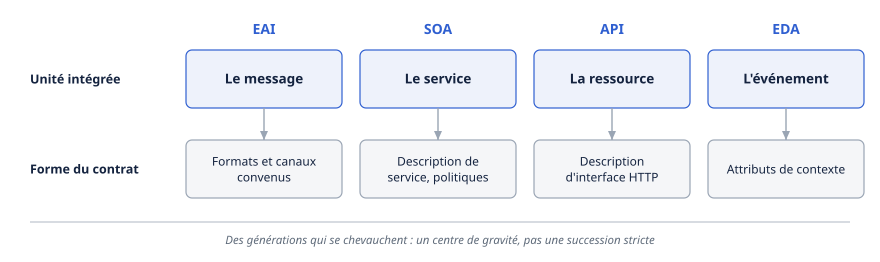

# Chapitre 2 — Généalogie

*Question directrice : qu'avons-nous déjà appris de l'intégration d'entreprise et des systèmes multi-agents ?*

> **État de référence :** quatrième version de la prépublication « Web of Agents » (24 mai 2026), textes de référence de chaque génération d'intégration, spécification FIPA ACL de 2002. Les numéros entre crochets renvoient aux sources en fin de chapitre; toutes sont des pages primaires lues pour ce chapitre, sauf [12], marquée secondaire.

Les protocoles d'agents de 2026 se présentent comme une rupture. Leurs problèmes, eux, ont un passé. Faire coopérer des logiciels qui n'ont pas été conçus ensemble et qui n'appartiennent pas au même propriétaire, c'est l'objet de l'intégration d'entreprise depuis plus de vingt ans. Faire dialoguer des programmes autonomes, c'est celui des systèmes multi-agents depuis les années 1990. Les deux lignées ont laissé des normes, des registres, des langages de contrat et quelques échecs instructifs.

Trois questions reviennent à chaque génération : comment décrire une capacité, comment la trouver, et qui répond de son usage quand elle traverse une frontière de propriété. Une seule chose change vraiment avec les modèles de langage : l'endroit où loge le sens. Il était dans la plateforme, puis dans les données; il est maintenant dans le modèle [1]. Ce déplacement supprime le coût d'accord préalable qui a freiné les générations précédentes, et retire du même coup les garanties formelles qu'elles offraient. L'architecte a donc intérêt à reprendre les réponses éprouvées pour ce qui se répète, et à réserver son effort à ce qui est neuf.

---

## 2.1 EAI, SOA, API, EDA : quatre générations d'intégration

### Le problème de départ

Le texte de référence sur les patrons d'intégration pose le problème en termes qui n'ont pas vieilli [2]. Une entreprise fait tourner des applications écrites à l'interne ou achetées, sur plusieurs plateformes, en plusieurs lieux, parfois chez des partenaires. Certaines ne peuvent pas être modifiées et n'ont jamais été pensées pour s'intégrer. Quatre styles permettent de les relier : le transfert de fichiers, la base de données partagée, l'invocation de procédure distante et la messagerie.

Les auteurs pèsent ces styles selon le couplage, la technologie requise et son risque de verrouillage, le format et la fraîcheur des données, et l'asynchronisme. Ils privilégient la messagerie, tout en précisant que le bon style dépend de chaque point d'intégration.

Ces styles se retrouvent chez les agents : un appel d'outil est une invocation distante, et une mémoire commune à plusieurs agents est une base de données partagée, avec son couplage (chapitre 14).

### Quatre unités d'intégration

Chaque génération a déplacé l'unité que l'on intègre et la forme du contrat qui la décrit.

| Génération | Unité | Forme du contrat | Texte de référence lu |
|---|---|---|---|
| EAI | Le message | Formats et canaux convenus | Patrons d'intégration, 2003 [2] |
| SOA | Le service | Description de service, politiques | Modèle de référence OASIS, 2006 [3] |
| API | La ressource | Description d'interface HTTP | REST, 2000 [4]; OpenAPI 3.2, 2025 [5] |
| EDA | L'événement | Attributs de contexte | CloudEvents [6] |

Les dates montrent que ces générations se chevauchent : la thèse qui définit REST précède de six ans le modèle de référence de la SOA. Le mot « génération » désigne un centre de gravité, pas une succession stricte.

**SOA : nommer la frontière de propriété.** Le modèle de référence d'OASIS définit l'architecture orientée services comme une manière d'organiser et d'utiliser des capacités réparties qui peuvent relever de domaines de propriété différents [3]. Il en tire un vocabulaire encore utile, dont la *description de service*, qui réunit ce qu'il faut savoir pour utiliser un service : son existence, ses fonctions, ses contraintes et la façon d'interagir avec lui.

Le modèle sépare aussi deux notions que les débats sur les agents confondent souvent. Une *politique* exprime le point de vue d'un seul participant, qui la fait respecter. Un *contrat* est un accord entre plusieurs parties. Et une contrainte qu'on ne peut pas faire respecter n'est pas une politique.

En pratique, cette génération s'est incarnée dans SOAP, WSDL, la famille WS-\*, les annuaires UDDI et les bus de services. Un relevé de 2025 en dresse le bilan : producteurs et consommateurs ont été découplés, au prix d'une forte complexité d'exploitation, d'adaptateurs fragiles et d'une configuration qui proliférait à mesure que les interfaces changeaient [10].

**API : l'architecture du web comme contrainte.** REST est un ensemble de contraintes, non un protocole [4]. Deux d'entre elles pèsent sur les protocoles d'agents. L'absence d'état veut que chaque requête porte tout ce qu'il faut pour être comprise. Elle améliore la visibilité, la fiabilité et la mise à l'échelle; elle coûte des données répétées et un moindre contrôle du serveur sur le comportement de l'application. Le système en couches permet d'insérer des intermédiaires (mandataires, passerelles, caches partagés) qui encapsulent les services patrimoniaux, répartissent la charge et appliquent la sécurité aux frontières de l'organisation, au prix d'une latence accrue.

La description d'interface a suivi. OpenAPI se définit comme une description standard, indépendante du langage, des API HTTP : elle doit permettre de comprendre un service et de l'appeler sans accès au code, à une documentation supplémentaire ou au trafic réseau [5]. Dans la partie lue, elle ne définit ni mécanisme de découverte ni registre d'API.

**EDA : l'événement sans destinataire.** CloudEvents part d'un constat : les producteurs décrivent leurs événements chacun à sa façon, et les consommateurs doivent réapprendre à les lire [6]. Un événement y est l'enregistrement de ce qui s'est produit, avec son contexte; il ne nomme pas de destinataire. Des intermédiaires le routent à partir de quatre attributs obligatoires : `id`, `source`, `specversion` et `type`; l'identifiant d'affaires s'y ajoute (chapitre 19).

### Ce que l'intégration lègue aux agents

**La frontière de propriété structure l'architecture.** Le modèle d'OASIS en fait une considération motrice, et précise que la confiance, l'autorité et la délégation exigent des cadres additionnels, auxquels la description de service peut seulement renvoyer [3]. Vingt ans plus tard, l'identité et la délégation des agents sont toujours des chantiers ouverts (chapitres 29 et 30).

**L'absence d'état est un arbitrage connu.** La révision de juillet 2026 de MCP a supprimé la session pour faire d'un serveur distant une charge HTTP ordinaire (chapitre 5). Elle refait, avec les mêmes gains et les mêmes coûts, le choix décrit en 2000.

**Les intermédiaires portent la sécurité et le patrimoine.** Encapsuler un système patrimonial derrière une couche qui applique la sécurité à la frontière est une propriété du style en couches. Les passerelles d'agents en sont la forme actuelle (chapitres 24 et 25).

---

## 2.2 Systèmes multi-agents classiques : KQML, FIPA-ACL, protocoles de négociation

La recherche sur les systèmes multi-agents a normalisé, il y a plus de vingt ans, une bonne part de ce que les protocoles actuels redécouvrent.

### KQML

KQML est issu d'un programme de la DARPA sur le partage de connaissances. Son projet de spécification le présente comme un langage de haut niveau permettant à des systèmes à base de connaissances de partager leur savoir à l'exécution [7]. Ses messages sont des *performatifs*, classés par familles : information, requête, notification, mise en réseau, facilitation. Selon le relevé de 2025, l'enveloppe portait déjà des paramètres de contenu, de langage et d'ontologie, mais l'absence de sémantique formelle des performatifs et la lourdeur des encodages ont gêné les déploiements à grande échelle [10].

### FIPA-ACL

La Foundation for Intelligent Physical Agents (FIPA), association sans but lucratif enregistrée à Genève, comptait 56 membres en juin 2002 [8]. Sa spécification de structure de message, au statut de norme depuis le 3 décembre 2002, définit treize paramètres en cinq catégories.

| Catégorie | Paramètres |
|---|---|
| Type d'acte de communication | `performative` |
| Participants | `sender`, `receiver`, `reply-to` |
| Contenu | `content` |
| Description du contenu | `language`, `encoding`, `ontology` |
| Contrôle de la conversation | `protocol`, `conversation-id`, `reply-with`, `in-reply-to`, `reply-by` |

Seul `performative` est obligatoire. Quatre détails restent instructifs [8].

- Le contenu s'exprime dans un **langage formel**, et `ontology` désigne l'ontologie qui donne leur sens aux symboles du contenu. Les deux parties doivent donc partager, avant d'échanger, un langage et un vocabulaire.
- Tout message rattaché à un protocole appartient à une **conversation** : l'initiateur attribue un `conversation-id` globalement unique, que les réponses reprennent, et `reply-by` fixe l'échéance du prochain message attendu.
- Un agent qui ne comprend pas un paramètre peut répondre `not-understood`. Les paramètres hors norme prennent le préfixe `X-`, sans sémantique garantie.
- Un paramètre peut être omis quand le contexte le laisse déduire, mais les mises en œuvre qui le font ne sont pas assurées d'interopérer.

L'identifiant de conversation et l'échéance annoncent la tâche des protocoles actuels et son cycle de vie (chapitres 5 et 6); ce rapprochement est propre à ce chapitre.

La sémantique de ces messages s'appuyait sur la théorie des actes de langage et sur une logique des états mentaux : chaque performatif avait des préconditions et des effets formels [1]. La spécification en donne un exemple : un `inform` adressé à trois agents signifie que l'émetteur veut que chacun en vienne à croire le contenu [8].

### Protocoles d'interaction et négociation

Les concepteurs de FIPA savaient qu'une telle sémantique ne suffisait pas à conduire un échange. La spécification avertit qu'employer le langage sans le cadre d'un protocole d'interaction est une entreprise « extremely ambitious » [8]. D'où une bibliothèque de protocoles : requête, interrogation, abonnement, courtage, recrutement, enchères anglaise et hollandaise, et le Contract Net [12]. Dans ce dernier, un initiateur diffuse un appel de propositions; chaque participant propose ou refuse; l'initiateur accepte ou rejette; le participant retenu exécute la tâche, puis en rapporte le résultat ou l'échec [12]. Le Dataspace Protocol retrouve cette forme pour négocier un accord entre organisations, par une machine à sept états (chapitre 45).

### Pourquoi cela n'a pas pris

Trois explications se dégagent des sources. La première est un **désaccord de substrat** : la complexité de FIPA et son inadéquation aux services HTTP sans état ont empêché son adoption sur le web ouvert, et les passerelles construites pour y remédier ont masqué le problème sans le résoudre [1]. La deuxième est le **coût de l'accord préalable** : la gestion des ontologies et la verbosité des encodages ont confiné l'usage aux milieux universitaire et de défense [10]. La troisième tient aux agents eux-mêmes : le goulot n'était pas le réseau mais les nœuds, faute d'un raisonnement assez général pour produire des applications qui auraient justifié des normes aussi lourdes [1].

Un fait illustre la limite. JADE, le cadriciel conforme à FIPA le plus déployé, est resté cantonné à des environnements contrôlés, et l'expérience Agentcities a montré que même des agents conformes avaient besoin d'ententes hors bande pour interopérer [1]. La conformité à une norme de messages ne garantit pas l'interopérabilité : restent le sens, l'organisation et le droit (chapitre 3).

---

## 2.3 Web sémantique et « web des agents »

La tentative suivante a voulu rendre les données du web compréhensibles par des machines, plutôt que de normaliser les messages entre agents. La vision formulée en 2001 par Berners-Lee, Hendler et Lassila reposait sur RDF et OWL [1].

RDF décrit des ressources par des triplets (sujet, prédicat, objet) [9]. Les ressources portent des IRI globaux que quiconque peut réutiliser, et des vocabulaires partagés donnent leur sens à ces identifiants. Une sémantique déclarative permet à un raisonneur d'en tirer des conclusions et d'y détecter des contradictions.

Le sens réside ici dans les données, annotées une fois pour tous. La prépublication « Web of Agents » en fait la deuxième de trois générations [1] :

1. **les systèmes multi-agents de l'ère FIPA** (vers 1995-2005), où l'effort sémantique loge dans la plateforme;
2. **les agents du web sémantique** (vers 2001-2012), où il loge dans les données;
3. **les agents fondés sur les modèles de langage** (années 2020), où il loge dans le modèle appris.

La deuxième génération a buté sur un défaut d'incitation. L'annotation à grande échelle coûtait trop cher, aucun modèle économique ne la finançait, et l'inférence supportait mal le bruit et les incohérences du web [1].

Ce qui a survécu est instructif : Schema.org, Open Graph, DBpedia et Wikidata, soit des déploiements propres à un domaine ou centralisés, et non un graphe universel [1]. L'annotation tient là où quelqu'un a intérêt à la payer. Une entreprise est dans cette situation pour son propre domaine, ce qui justifie les couches sémantiques du chapitre 12. Parmi les protocoles actuels, ANP prolonge cette lignée, avec ses descriptions d'agents en JSON-LD, ses vocabulaires Schema.org et ses identifiants décentralisés [10] (chapitre 7).

---

## 2.4 Ce que les LLM changent : le langage naturel comme interface, le non-déterminisme

### Le sens passe dans le modèle

Avec les modèles de langage, le raisonnement, la planification et l'interprétation du but entrent dans un modèle appris. Le sens devient implicite : il s'infère d'une description en langage naturel au lieu de se lire dans une ontologie partagée [1]. MCP n'impose aucune ontologie; le sens d'un outil tient dans un texte non structuré.

La prépublication résume l'écart selon ses quatre dimensions [1].

| Dimension | FIPA ACL | MCP et A2A |
|---|---|---|
| Fondement sémantique | Procédural, formel | Implicite, émergent |
| Communication | Performatifs | RPC léger (JSON-RPC 2.0) |
| Siège de l'intelligence | La plateforme | L'agent et son modèle |
| Découverte | Registre centralisé | Registre centralisé (MCP), fichier de métadonnées (A2A) |

### Ce que cela résout

Le coût d'accord préalable disparaît. Il n'y a plus d'ontologie à négocier ni de données à annoter : l'agent s'appuie sur ce que le modèle a tiré du texte à l'échelle du web [1]. Un agent peut employer un outil qu'il n'a jamais vu (chapitre 3).

Le second gain est d'alignement. MCP et A2A ont choisi la simplicité et les standards du web plutôt qu'une pile propre aux agents. La prépublication y voit la leçon de l'échec de FIPA : une norme ne réussit que si son substrat technique est celui dans lequel on déploie à son époque [1].

### Ce que cela coûte

Le prix est payé en vérifiabilité. Chaque migration de l'effort sémantique échange des garanties formelles contre de l'adaptabilité, et la prépublication situe la frontière de recherche dans des sous-ensembles vérifiables de la sémantique interprétée par le modèle [1]. Le patron Simplex en est une forme d'ingénierie : un composant simple et vérifié borne le composant appris (chapitre 46). Deux conséquences en découlent.

**La lecture d'une description n'est pas prouvable.** Rien n'établit que l'interprétation qu'un modèle fait de la description d'un outil correspond à l'intention de son auteur [1]. Avec FIPA, deux agents pouvaient mal mettre en œuvre une sémantique définie; ici, la sémantique n'est écrite nulle part. La description devient du même coup une surface d'attaque (chapitre 31).

**Le plan n'est plus spécifié.** La planification passe de formalismes explicites à des approches apprises, entrelacées avec l'action, moins vérifiables [1]. S'y ajoute le non-déterminisme : une même demande peut produire deux suites d'appels différentes. Un contrat d'interface décrit alors ce qu'un agent *peut* appeler, pas ce qu'il *va* faire. Trois réponses en découlent : des points de contrôle déterministes autour de la boucle de raisonnement (chapitre 17), des outils idempotents ou compensables (chapitre 18), et l'évaluation continue en complément du test de conformité (chapitre 33).

---

## 2.5 Ce qui se répète : registres, contrats, gouvernance

### Registres

Chaque génération a réinventé un annuaire central : le Directory Facilitator de FIPA, lié à une plateforme; UDDI pour les services web, de 1999 à 2007; les points d'accès SPARQL et Schema.org; aujourd'hui le registre MCP [1]. La prépublication parle d'un piège de la centralisation : selon elle, tout mécanisme de découverte centralisé a échoué à l'échelle du web ouvert, et le registre MCP connaîtra le sort d'UDDI s'il reste centralisé.

Cette prédiction vaut pour le web ouvert. Elle ne dit rien d'un périmètre borné, où un seul propriétaire tient l'index et peut en imposer l'usage. La leçon pratique est de séparer les deux cas : un registre centralisé à l'intérieur de l'entreprise, des mécanismes distribués ou fédérés entre organisations (chapitre 8). Le registre MCP se conçoit d'ailleurs comme une source pour des agrégateurs plutôt que comme un annuaire universel (chapitre 5).

### Contrats

La description d'une capacité traverse les générations sous des noms différents : description de service [3], description OpenAPI [5], Agent Card, description d'outil. Sa fonction ne varie pas.

La distinction d'OASIS entre politique et contrat reste le bon instrument d'analyse. Une description d'outil ou une annotation est la déclaration d'une seule partie. Elle n'est pas un contrat, et elle n'est une politique que si son auteur peut la faire respecter [3]. Un garde-fou formulé dans un prompt, que le modèle peut ne pas suivre, n'en est pas une au sens de ce modèle. Il doit s'appliquer hors du modèle, à un point de passage obligé.

### Gouvernance

Le modèle de 2006 renvoyait la confiance, l'autorité et la délégation à des cadres extérieurs [3]. Les protocoles de 2026 font de même. Une analyse du 30 juin 2026 confronte cinq protocoles (MCP, A2A, ACP, ANP et ERC-8004) à six dimensions de gouvernance; d'après son résumé, le vote et la conservation de la dissidence sont absents des cinq, et la gouvernance d'une communauté d'agents y apparaît comme une couche manquante au-dessus des standards, non comme une fonction à leur ajouter [11] (chapitre 11).

La prépublication nomme sept défis persistants [1] : l'identité d'agents éphémères, la découverte à l'échelle, l'absence de substrat économique, la réputation qu'on remet à zéro en créant une nouvelle instance, la sémantique invérifiable des outils, le consentement qui se propage par délégation vers des organisations que le mandant n'a jamais approuvées, et l'attribution de la responsabilité. Aucun n'est un problème de format de message. Sa conclusion : la suite dépend moins de la conception des protocoles que de l'infrastructure sociotechnique qui les entoure, dont la gouvernance neutre des standards, la réglementation et les réseaux de paiement.

---

## Grille de décision

| Décision | Option par défaut | Quand s'en écarter |
|---|---|---|
| Accord sur le sens | Schéma et description en langage naturel | Domaine borné à fort enjeu : vocabulaire ou ontologie maintenus (chapitre 12) |
| Coordination entre agents | Protocole d'interaction explicite : tâche, états, échéance | Échange exploratoire sans effet de bord |
| Découverte | Registre centralisé dans le périmètre de l'entreprise | Entre organisations : fichiers `/.well-known`, fédération |
| Déclarations d'un tiers (descriptions, annotations) | Traitées comme unilatérales | Tiers lié par un accord et soumis à un contrôle effectif |
| Garde-fous | Appliqués hors du modèle, à un intermédiaire | — |
| Choix d'un standard | Celui qui épouse le substrat en place (HTTP, fournisseur d'identité, passerelle) | Besoin qu'aucun standard aligné ne couvre |

---

## Points à retenir

- Décrire une capacité, la trouver, répondre de son usage au-delà d'une frontière de propriété : ces questions sont celles de l'intégration d'entreprise depuis plus de vingt ans.
- FIPA avait normalisé dès 2002 l'enveloppe de message, l'identifiant de conversation et les échéances, et décrit des protocoles de négociation. L'échec est venu du désaccord avec le substrat du web et du coût de l'accord préalable.
- Le web sémantique a buté sur un défaut d'incitation. L'annotation tient là où quelqu'un a intérêt à la payer, comme une entreprise pour son propre domaine.
- Le changement réel est le déplacement du sens, de la plateforme aux données puis au modèle. Il supprime le coût d'accord préalable et retire les garanties formelles.
- Un contrat d'interface dit désormais ce qu'un agent peut appeler, non ce qu'il fera.
- Chaque génération a réinventé un registre central. Il convient à un périmètre borné; à l'échelle du web ouvert, les précédents sont des échecs.
- Une contrainte qu'on ne peut pas faire respecter n'est pas une politique : la règle de 2006 vaut pour les garde-fous.
- Confiance, autorité et délégation étaient hors du modèle de référence de la SOA; elles restent hors des protocoles d'agents.

---

## Sources

Pages primaires lues le 11 novembre 2026 :

1. [Petrova et coll. — From Multi-Agent Systems and the Semantic Web to Agentic AI: A Unified Narrative of the Web of Agents (arXiv 2507.10644, v4)](https://arxiv.org/abs/2507.10644)
2. [Enterprise Integration Patterns — Introduction to Integration Styles (2003)](https://www.enterpriseintegrationpatterns.com/patterns/messaging/IntegrationStylesIntro.html)
3. [OASIS — Reference Model for Service Oriented Architecture 1.0 (12 octobre 2006)](https://docs.oasis-open.org/soa-rm/v1.0/soa-rm.html)
4. [Fielding — Architectural Styles and the Design of Network-based Software Architectures, chapitre 5 (2000)](https://ics.uci.edu/~fielding/pubs/dissertation/rest_arch_style.htm)
5. [OpenAPI Specification v3.2.0 (19 septembre 2025)](https://spec.openapis.org/oas/v3.2.0.html)
6. [CloudEvents — spécification, branche principale (1.0.3 en cours)](https://github.com/cloudevents/spec/blob/main/cloudevents/spec.md)
7. [Specification of the KQML Agent-Communication Language (projet)](https://research.cs.umbc.edu/kqml/kqmlspec/spec.html)
8. [FIPA ACL Message Structure Specification, SC00061G (3 décembre 2002), copie miroir](https://www.ppgia.pucpr.br/~fabricio/ftp/Aulas/Mestrado/AS/Aula3/SC00061G_FIPA_ACL.pdf)
9. [W3C — RDF 1.1 Primer (24 juin 2014)](https://www.w3.org/TR/rdf11-primer/)
10. [Ehtesham et coll. — A survey of agent interoperability protocols (arXiv 2505.02279)](https://arxiv.org/html/2505.02279)
11. [Kang et Diponegoro — Governance Gaps in Agent Interoperability Protocols (arXiv 2606.31498, 30 juin 2026)](https://arxiv.org/abs/2606.31498) — résumé seulement.

Source secondaire :

12. [FIPA Interaction Protocols — notes de cours, San José State University](https://www.cs.sjsu.edu/~pearce/modules/lectures/abs/jadeweb/fipaIPs.htm) — page non signée.

## Limites de ce chapitre

- Les pages ont été lues par un outil d'extraction qui condense leur contenu; seule la spécification FIPA [8] a été lue en texte intégral. Le dernier dixième de [1] n'a pas été lu. De [5], seule l'introduction a été lue; de [7], l'en-tête et la table des matières.
- L'audit du 12 novembre 2026 a relu à la source [1] (version 4), [5], [6], [10] et le résumé de [11]; les faits attribués y figurent. Le tableau de 2.4 suit [1] pour la communication; le tableau de [1] ne classe pas la découverte de MCP, dont le registre centralisé vient de son texte.
- Le site de FIPA refusait les requêtes. Les spécifications du Contract Net, de la gestion d'agents et des actes de communication n'ont pas été lues : les protocoles d'interaction sont décrits d'après [12], l'annuaire d'après [1].
- L'article de 2001 sur le web sémantique, UDDI et la théorie des actes de langage ne sont connus ici que par [1], dont viennent aussi les dates d'UDDI et des trois générations.
- Viennent de la connaissance générale : le découpage en quatre générations d'intégration, repris du plan initial; le non-déterminisme des modèles de langage; l'ancienneté donnée aux deux lignées.
- Sont des lectures de ce chapitre : le rapprochement entre FIPA et les tâches des protocoles actuels, celui entre le Contract Net et le Dataspace Protocol, la portée limitée donnée à la prédiction sur le registre MCP, l'application de la distinction politique-contrat aux garde-fous.
