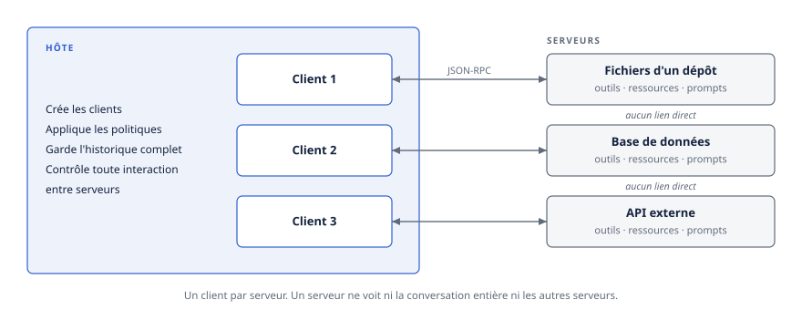
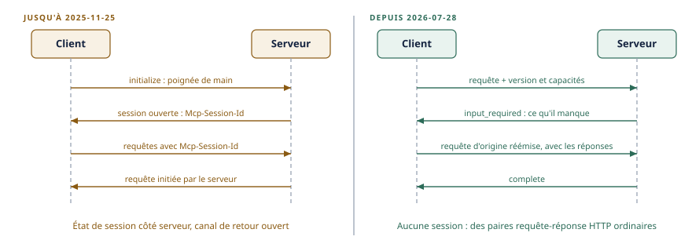
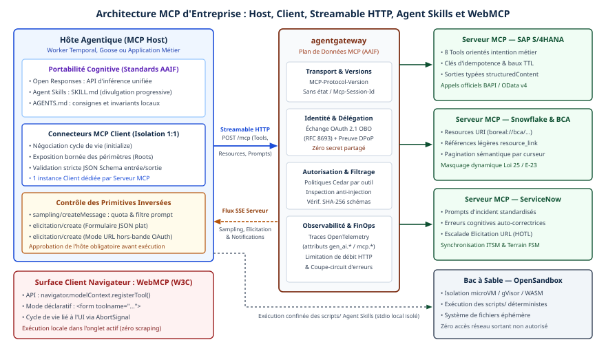
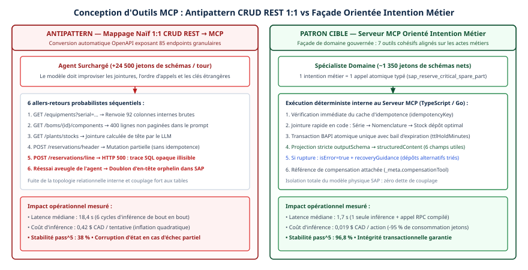

# Chapitre 5 — MCP : le protocole agent-outil

*Question directrice : que standardise MCP, et que laisse-t-il à l'entreprise ?*

> **État de référence :** spécification `2026-07-28` et feuille de route du 22 août 2026. Les numéros entre crochets renvoient aux sources en fin de chapitre; toutes sont des pages primaires lues pour ce chapitre, sauf [14], marquée secondaire.

Un agent qui ne peut rien lire ni rien faire hors de sa fenêtre de contexte n'est qu'un interlocuteur. Dès qu'on veut qu'il consulte un dossier client, interroge un entrepôt de données ou ouvre un billet, il faut le brancher sur un système. Sans standard, chaque branchement est un développement sur mesure : chaque application d'IA écrit son connecteur pour chaque système, et le nombre d'intégrations croît comme le produit des deux.

Le Model Context Protocol (MCP) remplace ce produit par une somme. Un système expose ses capacités une fois, sous la forme d'un serveur MCP; toute application qui parle le protocole peut s'en servir. Lancé par Anthropic à la fin de 2024 et donné à l'Agentic AI Foundation dès sa création, le 9 décembre 2025, MCP est l'un des dix projets que cette fondation de la Linux Foundation héberge [13] (chapitre 11).

MCP relie un agent à ses outils. Déléguer un objectif à un autre agent relève d'A2A, et la frontière entre les deux se trace selon le contrôle que l'appelant garde sur ce qui s'exécute de l'autre côté (chapitre 6).

Ce chapitre décrit ce que le protocole fixe, puis ce qu'il laisse aux décisions d'entreprise. La révision du 28 juillet 2026, qui a déplacé plusieurs éléments d'une liste à l'autre, sert de fil conducteur.

---

## 5.1 Le modèle : hôte, client, serveur

### Trois rôles

MCP distingue trois rôles [1].

L'**hôte** est l'application d'IA elle-même : un assistant de bureau, un environnement de développement, une plateforme d'agents. Il crée les clients, applique les politiques de sécurité et de consentement, coordonne l'appel au modèle de langage et agrège le contexte.

Le **client** est un connecteur créé par l'hôte. Chaque client parle à un seul serveur. Un hôte branché sur dix serveurs fait donc tourner dix clients, et c'est cette relation un pour un qui maintient une frontière de sécurité entre les serveurs.

Le **serveur** expose des capacités ciblées : les fichiers d'un dépôt, une base de données, une API externe. Il peut être un processus local ou un service distant.

Le protocole repose sur JSON-RPC. Il décrit les messages qui circulent entre client et serveur, pas le fonctionnement interne de l'hôte.



### Quatre principes de conception

La spécification énonce quatre principes [1], et chacun a une conséquence pratique.

1. **Un serveur doit être très facile à construire.** La complexité d'orchestration reste dans l'hôte. C'est ce qui explique la prolifération rapide des serveurs, et aussi leur qualité inégale.
2. **Les serveurs doivent être composables.** Chacun fait une chose; l'hôte les combine.
3. **Un serveur ne voit ni la conversation entière ni les autres serveurs.** L'historique complet reste dans l'hôte, qui contrôle toute interaction entre serveurs. Cette isolation est la principale garantie structurelle du protocole.
4. **Les fonctionnalités s'ajoutent progressivement.** Le cœur est minimal; le reste se négocie par capacités déclarées.

### Ce qu'un serveur expose

Un serveur offre trois primitives [1].

Les **outils** (`tools`) sont des fonctions que le modèle peut invoquer : interroger une base, appeler une API, lancer un calcul. Chaque outil porte un nom, une description, un schéma d'entrée en JSON Schema et, s'il y a lieu, un schéma de sortie [4]. La spécification qualifie les outils de « contrôlés par le modèle » : c'est le modèle qui décide de les appeler, à partir de leur description.

Les **ressources** (`resources`) sont des données identifiées par un URI, que le client peut lire et auxquelles il peut s'abonner.

Les **prompts** sont des gabarits que le serveur met à la disposition de l'application.

C'est sur les outils que portent presque toutes les questions de gouvernance.

### Ce qu'un serveur peut demander en retour

Un serveur peut avoir besoin de quelque chose du client en cours de traitement. L'**élicitation** lui permet de demander une information à l'utilisateur, par formulaire ou par redirection vers une page web; depuis juillet 2026, cette demande passe par le patron d'allers-retours décrit en 5.2 [2]. Deux autres mécanismes historiques, l'échantillonnage (`sampling`, où le serveur demande une complétion au modèle de l'hôte) et les racines (`roots`, où le client indique au serveur les répertoires accessibles), sont **dépréciés** depuis la révision de juillet 2026, de même que la journalisation par le protocole [2]. Ils fonctionnent encore pendant la fenêtre de dépréciation, mais une nouvelle mise en œuvre ne devrait pas les adopter.

La spécification propose des substituts : passer les répertoires en paramètres d'outil ou en configuration, appeler directement l'API du fournisseur de modèle, journaliser sur la sortie d'erreur standard ou avec OpenTelemetry. Le mouvement est cohérent : le protocole se recentre sur l'accès aux outils et rend à l'infrastructure ce qui relève d'elle.

### La négociation de capacités

Client et serveur déclarent ce qu'ils savent faire. Depuis juillet 2026, le client joint ses capacités à **chaque requête**, et le serveur publie les siennes en réponse à une méthode dédiée, `server/discover`, que tout serveur doit mettre en œuvre [1][2]. Chaque partie doit s'en tenir à ce qui a été déclaré. Ce déplacement, de la poignée de main initiale vers la requête, est le changement central de la révision.

---

## 5.2 La révision 2026-07-28 : un protocole sans état

Jusqu'à la version `2025-11-25`, une connexion MCP commençait par une poignée de main (`initialize`), établissait une session identifiée par un en-tête, et gardait un état côté serveur. Ce modèle convenait à un serveur local lancé par un assistant de bureau. Il convenait mal à un service distant derrière un répartiteur de charge.

La révision du 28 juillet 2026 supprime cet état [2]. Sept changements en découlent.



| Changement | Avant | Depuis 2026-07-28 |
|---|---|---|
| Poignée de main | `initialize` obligatoire | Supprimée; version et capacités voyagent dans chaque requête |
| Session | En-tête `Mcp-Session-Id` | Supprimée; l'état passe par des identifiants explicites |
| Découverte | Implicite, dans la poignée de main | `server/discover`, obligatoire côté serveur |
| Notifications | Flux GET permanent, `resources/subscribe` | `subscriptions/listen`, un flux par abonnement explicite |
| Requêtes du serveur vers le client | Messages initiés par le serveur | Réponse « entrée requise », puis nouvel essai du client |
| Reprise de flux | `Last-Event-ID` | Supprimée; une requête interrompue est réémise |
| Tâches longues | Expérimentales, dans le cœur | Extension officielle distincte |

### L'état devient un argument

Sans session, un serveur ne peut plus relier implicitement deux appels. La spécification recommande un patron simple : un outil de création renvoie un identifiant (un panier, une transaction, un contexte de navigation), et les appels suivants le reçoivent en argument [4]. C'est le modèle qui transporte l'identifiant d'un appel à l'autre.

Trois précautions accompagnent ce patron. Sur un serveur authentifié, l'identifiant est un nom, pas un droit : le serveur doit vérifier l'autorisation de l'appelant à chaque appel. L'identifiant doit être opaque, pour ne pas inviter à le deviner. Sa durée de vie doit figurer dans la description de l'outil, pour que le modèle la connaisse au moment de créer l'état.

### Les allers-retours multiples

Un serveur ne peut plus envoyer de requête de sa propre initiative. S'il lui manque une information, il renvoie un résultat de type `input_required` qui énumère ce qu'il lui faut; le client rassemble les réponses et **réémet la requête d'origine** avec elles [2][3]. Tout résultat porte désormais un champ `resultType` obligatoire, qui vaut `complete` ou `input_required`.

Ce patron, appelé Multi Round-Trip Requests, a un effet d'architecture important : toute interaction reste une paire requête-réponse HTTP ordinaire. Il n'y a plus de canal de retour à maintenir ouvert.

### Des en-têtes pour les intermédiaires

La révision copie dans des en-têtes HTTP certains champs du corps JSON-RPC [3] :

```http
POST /mcp HTTP/1.1
MCP-Protocol-Version: 2026-07-28
Mcp-Method: tools/call
Mcp-Name: execute_sql
Mcp-Param-Region: us-west1
```

`Mcp-Method` est obligatoire sur toute requête; `Mcp-Name` l'est pour un appel d'outil, une lecture de ressource ou l'obtention d'un prompt. Un serveur peut en outre désigner, par la propriété `x-mcp-header` du schéma d'entrée, des paramètres d'outil que le client est alors tenu de refléter dans des en-têtes `Mcp-Param-*` [3].

L'intention est explicite : permettre aux répartiteurs de charge, aux passerelles et aux outils d'observabilité de router et d'inspecter une requête sans analyser son corps. Une passerelle peut ainsi appliquer une limite de débit par outil, ou router par région, sur la seule foi des en-têtes.

Cette commodité crée un risque classique : deux composants qui se fient à deux sources de vérité différentes. La spécification le traite de front. Tout serveur qui lit le corps **doit** rejeter une requête dont les en-têtes ne correspondent pas au corps, avec un statut 400 et une erreur `HeaderMismatch` [3]. Un intermédiaire qui applique une politique sur la foi des en-têtes devrait en outre refuser une requête dont la version annoncée précède cette validation, ou qui n'en annonce aucune [3]. La spécification déconseille aussi de refléter un paramètre sensible, puisque les en-têtes sont visibles des intermédiaires [4].

### Le cache entre dans le protocole

Les listes d'outils, de prompts, de ressources et de modèles de ressources, ainsi que les lectures de ressources, portent maintenant deux champs obligatoires : `ttlMs`, une durée de fraîcheur, et `cacheScope`, qui vaut `public` ou `private` et indique si un intermédiaire partagé peut mettre la réponse en cache [2]. Les serveurs devraient aussi renvoyer leurs outils dans un ordre déterministe, pour faciliter le cache côté client et améliorer le taux de succès du cache de prompts du modèle quand la liste d'outils est injectée dans le contexte [2].

Ce second motif intègre au protocole une considération de coût d'inférence : l'économie des jetons pèse désormais sur la conception des standards (chapitres 13, 40 et 44). Une passerelle qui filtre les listes selon l'appelant les rend toutefois propres à chaque requête, ce qui réduit l'effet du cache (chapitre 24).

### La traçabilité

La révision documente enfin la propagation du contexte de trace OpenTelemetry dans les métadonnées de requête [2]. Un appel d'outil peut donc s'inscrire dans une trace distribuée qui commence chez l'agent et se poursuit dans le système appelé. Les conventions sémantiques qui décrivent ces traces ne sont, elles, pas encore stables, et celles qui visent MCP renvoient encore à la session supprimée (chapitre 33).

### Ce que cela change pour l'entreprise

Un serveur MCP distant devient une charge HTTP ordinaire. Il se déploie derrière un répartiteur sans affinité de session, se met à l'échelle horizontalement, se place derrière une passerelle d'API existante. La contrepartie est qu'une requête en cours est perdue si son flux de réponse se rompt : le client doit la réémettre avec un nouvel identifiant [2]. Les outils qui produisent des effets doivent donc être conçus pour supporter une réémission, ce qui ramène à l'idempotence et aux patrons de compensation du chapitre 18. Pour une consigne envoyée à un équipement, une réémission automatique devient même dangereuse (chapitre 28).

---

## 5.3 Le transport

MCP définit deux transports.

**Streamable HTTP** sert aux serveurs distants. Le serveur expose un point d'accès unique qui accepte des requêtes POST. Chaque message du client est un POST distinct. Le serveur répond soit par un objet JSON, soit par un flux d'événements (SSE) limité à cette requête, qui transporte des notifications de progression puis la réponse finale [3]. Fermer le flux vaut annulation de la requête.

**stdio** sert aux serveurs locaux, lancés comme sous-processus par l'hôte et joints par l'entrée et la sortie standard.

Deux exigences de sécurité s'attachent au transport HTTP [3]. Le serveur doit valider l'en-tête `Origin` de toute connexion entrante, pour bloquer les attaques par réassociation DNS (DNS rebinding), et répondre 403 si l'origine est invalide. Un serveur local devrait n'écouter que sur l'adresse de bouclage. Sans ces protections, un site web distant peut atteindre un serveur MCP qui tourne sur le poste d'un employé.

L'ancien transport HTTP+SSE de 2024, déprécié depuis la révision `2025-03-26`, relève désormais de la politique de dépréciation : il peut être retiré dans une révision future [2][3].

**La suite.** La coexistence de deux transports a un coût : chaque fonctionnalité fondée sur HTTP doit être repensée pour stdio, et les SDK entretiennent deux chaînes. La feuille de route vise un modèle unique, où Streamable HTTP serait parlé aussi sur l'entrée et la sortie standard, probablement au moyen de HTTP/2 [12]. Elle prévoit également d'étendre le cache aux ETags, ce qui permettrait de versionner des résultats, y compris ceux d'appels d'outils. Ce sont des orientations et non des engagements, la feuille de route le précise elle-même.

---

## 5.4 Le travail de longue durée

Un appel d'outil ne rend pas toujours la main en une seconde. Un pipeline d'intégration continue, un traitement par lots ou une approbation humaine durent des minutes, parfois des heures. Tenir une connexion ouverte tout ce temps n'est pas viable : les intermédiaires imposent des délais, et une déconnexion fait tout perdre.

### L'extension Tasks

La réponse de MCP est une extension officielle, `io.modelcontextprotocol/tasks` [7]. Quand un serveur juge qu'une requête sera longue, il renvoie un identifiant de tâche durable au lieu du résultat. Le client interroge ensuite l'état de la tâche avec `tasks/get`, fournit au besoin une information avec `tasks/update`, et peut demander l'annulation avec `tasks/cancel`.

| État | Signification |
|---|---|
| `working` | Traitement en cours |
| `input_required` | Le serveur attend une information du client |
| `completed` | Terminé; le résultat est disponible |
| `failed` | Une erreur s'est produite |
| `cancelled` | Annulé |

**C'est le serveur qui décide.** Le client déclare une fois qu'il accepte les tâches; le serveur choisit, requête par requête, de répondre directement ou par une tâche. Le client doit donc traiter les deux formes de résultat.

**L'identifiant survit à la connexion.** La tâche est créée durablement avant l'envoi de la réponse. Un client qui redémarre peut reprendre l'interrogation, à condition d'avoir conservé l'identifiant.

**L'annulation est coopérative.** Le serveur prend acte de la demande, mais n'est pas tenu d'arrêter le travail. Une tâche annulée peut tout de même se terminer.

L'état `input_required` fait de cette extension le support naturel de l'humain dans la boucle : une tâche s'arrête à un point d'approbation, expose la demande, puis reprend (chapitre 22).

### Un statut à surveiller

L'extension est au stade **bêta**, avec pour destination déclarée l'intégration au cœur du protocole [8]. À ce stade, des changements incompatibles restent permis, même s'ils sont censés être rares. Les tâches avaient d'ailleurs une première forme expérimentale dans le cœur, que la révision de juillet a retirée et redessinée [2]. Une entreprise qui bâtit dessus doit prévoir une adaptation.

### Notifications et événements

Par défaut, le client interroge le serveur à intervalles. S'il préfère être averti, il ouvre un flux `subscriptions/listen` en précisant les types de notifications qu'il veut recevoir : changement de la liste d'outils, de prompts ou de ressources, mise à jour d'une ressource suivie [2]. L'extension Tasks y ajoute ses propres notifications d'état (`notifications/tasks`), qui portent l'état complet et dispensent d'un `tasks/get` tant que le flux reste ouvert [7]. La spécification ne prévoit aucun rattrapage des notifications manquées pendant une rupture : à la reconnexion, un `tasks/get` reste nécessaire [16].

La feuille de route range ce sujet parmi ses cinq priorités, sous le nom de primitives de messagerie agentique [12]. Elle reconnaît un risque : avoir trois réponses différentes à la question « le serveur n'a pas fini », sans cycle de vie, modèle d'annulation ni surface d'erreur communs. Les travaux en cours portent sur des événements poussés par le serveur, y compris par webhooks, afin d'éviter une interrogation coûteuse. Le chapitre 19 replace ces mécanismes dans l'orchestration événementielle.

---

## 5.5 L'autorisation

C'est la partie du protocole où l'écart entre ce qui est fixé et ce qui est laissé à l'entreprise est le plus grand.

### Facultative, mais stricte

L'autorisation est **facultative** dans MCP [5]. Un serveur peut n'en exiger aucune, même si le transport HTTP recommande d'authentifier toute connexion [3]. Quand elle est mise en œuvre sur HTTP, elle suit OAuth 2.1 selon un profil précis. Sur stdio, la spécification recommande de ne pas l'appliquer et de tirer les identifiants de l'environnement.

Le serveur MCP joue le rôle de serveur de ressources OAuth, le client MCP celui de client OAuth, et un serveur d'autorisation, hébergé ou non avec le serveur MCP, émet les jetons. Le profil impose quelques règles fermes :

- le serveur MCP **doit** publier ses métadonnées de ressource protégée (RFC 9728), qui indiquent au client quel serveur d'autorisation utiliser;
- le client **doit** préciser la ressource visée dans ses demandes de jeton (RFC 8707);
- le serveur MCP **doit** vérifier qu'un jeton a été émis pour lui, et **ne doit ni accepter ni relayer** un autre jeton.

Cette dernière règle interdit le passage de jeton en aval : un serveur MCP ne peut pas réutiliser le jeton reçu pour appeler une autre API. Elle empêche qu'un jeton émis pour un service serve à en atteindre un autre, mais oblige à prévoir un échange de jeton distinct pour atteindre les systèmes derrière le serveur (chapitre 25). L'autorisation de MCP s'arrête d'ailleurs au serveur : le système qu'il pilote, un robot par exemple, garde sa propre sécurité (chapitre 46).

Les portées se demandent progressivement. Le serveur indique dans sa réponse 401 ou 403 les portées nécessaires à l'opération; le client en fait l'union avec celles déjà obtenues et relance une autorisation. Le principe du moindre privilège est ainsi inscrit dans le flux lui-même.

### L'enregistrement des clients

Un client doit obtenir un identifiant auprès du serveur d'autorisation. Trois voies existent : les Client ID Metadata Documents, où l'identifiant du client est une URL HTTPS qui pointe vers ses métadonnées; le préenregistrement; et l'enregistrement dynamique (RFC 7591). La révision de juillet 2026 recommande la première et **déprécie** la troisième, conservée pour les serveurs d'autorisation qui n'offrent pas la première [2][5]. Elle lie aussi les justificatifs du client au serveur d'autorisation qui les a émis, sans réemploi auprès d'un autre, et oblige le client à vérifier l'émetteur (`iss`) d'une réponse d'autorisation quand il est présent (RFC 9207) [2].

### Le modèle grand public ne suffit pas

Le flux de base suppose qu'une personne, devant un navigateur, consent à ce qu'un client accède à un serveur. C'est le bon modèle pour une application grand public. En entreprise, il crée trois difficultés : chaque employé doit autoriser chaque serveur un à un, l'équipe de sécurité ne peut pas imposer une politique uniforme, et le départ d'un employé exige de révoquer ses accès service par service [6].

### L'autorisation gérée par l'entreprise

L'extension Enterprise-Managed Authorization, au stade **stable**, répond à ces difficultés en plaçant le fournisseur d'identité de l'organisation au centre de la décision [6][8].

Le flux tient en quatre étapes. L'employé ouvre une session dans le client MCP avec son identité d'entreprise. Le client échange l'assertion d'identité obtenue (jeton OpenID ou assertion SAML) contre un jeton particulier, l'Identity Assertion JWT Authorization Grant (ID-JAG), auprès du fournisseur d'identité, qui évalue alors sa politique. Le client présente cet ID-JAG au serveur d'autorisation du serveur MCP, qui le valide et émet un jeton d'accès. Le client appelle enfin le serveur MCP. L'employé n'est jamais redirigé vers une page de consentement propre au serveur.

Quatre bénéfices en résultent : une politique centralisée dans les outils d'identité existants, une authentification unique, une évaluation des règles (groupe, rôle, accès conditionnel) avant toute émission de jeton, et une révocation centralisée.

Deux réserves s'imposent. D'abord, l'ID-JAG est défini par un brouillon du groupe de travail OAuth de l'IETF, et les produits suivent des révisions différentes de ce brouillon; la documentation de l'extension recommande de vérifier la révision visée par chaque fournisseur [6]. Ensuite, la prise en charge est inégale. Le 12 novembre 2026, la page de l'extension recense douze produits; quelques-uns, dont Okta, Ping Identity et Descope, émettent et acceptent des ID-JAG en version de production, tandis que d'autres n'en sont qu'à l'accès anticipé ou à l'expérimental [6]. La liste se dit non exhaustive : un produit absent n'est pas pour autant incompatible. Les conditions commerciales comptent aussi : chez Okta, l'émission incluse dans l'offre d'authentification unique est plafonnée à 250 ID-JAG par utilisateur, par application et par mois, et un volume supérieur exige un produit distinct [6].

Une autre extension stable, OAuth Client Credentials, couvre l'authentification de machine à machine, sans utilisateur [8].

### L'identité des agents, chantier ouvert

Les concepteurs du protocole le disent sans détour : l'autorisation de MCP suppose une personne devant un navigateur au moment du consentement, alors que l'appelant est de plus en plus un agent, c'est-à-dire une charge de travail infonuagique qui agit pour un utilisateur absent ou qui lance des sous-agents censés recevoir une autorité plus étroite que la sienne [12]. En pratique, beaucoup de serveurs s'appuient encore sur des clés d'API collées à la main et sur des jetons de rafraîchissement de longue durée.

Un groupe de travail sur l'identité des agents est en formation. Son programme comprend la preuve de possession des jetons (DPoP), la fédération d'identités de charges de travail, l'ID-JAG et l'échange de jetons (RFC 8693), en coordination avec les groupes OAuth et WIMSE de l'IETF. L'attestation de présence humaine, qui distinguerait un client interactif d'un agent sans surveillance, est à l'étude [12]. Le chapitre 29 traite ce chantier dans son ensemble; le chapitre 30, la délégation à autorité réduite et l'attestation de présence humaine.

---

## 5.6 Extensions et gouvernance

### Un cœur minimal, des extensions optionnelles

La révision de juillet 2026 officialise un cadre d'extensions [2][8]. Une extension est un ajout facultatif au protocole, identifié par un préfixe de fournisseur et un nom; les extensions officielles portent le préfixe `io.modelcontextprotocol`. Client et serveur annoncent celles qu'ils prennent en charge dans leurs capacités.

Chaque extension passe par trois stades.

| Stade | Changements permis | Ce qu'on peut en attendre |
|---|---|---|
| Expérimental | N'importe lesquels, sans préavis | Rien; le concept peut disparaître |
| Bêta | Tous, les ruptures devant rester rares | Un usage réel est bienvenu; les ruptures sont documentées |
| Stable | Seulement avec une nouvelle révision du protocole | Comportement figé pour une révision donnée |

Pour devenir stable, une extension doit présenter deux mises en œuvre indépendantes et interopérables, l'une côté client et l'autre côté serveur, ainsi qu'un scénario de conformité.

À la date de rédaction, les extensions officielles sont les suivantes [8] :

- **OAuth Client Credentials** et **Enterprise-Managed Authorization** (stables);
- **MCP Apps** (stable), qui permet à un serveur d'afficher des éléments d'interface interactifs dans la conversation;
- **MCP Tasks** (bêta, destinée au cœur);
- **Skills over MCP** (bêta sans destination déclarée, bien que sa proposition SEP-2640 soit au statut Final [15]), pour découvrir et lire des Agent Skills depuis un serveur;
- **Server Cards** (bêta), pour découvrir les métadonnées d'un serveur avant de s'y connecter.

Deux règles pèsent sur les choix d'entreprise. Une extension est **toujours désactivée par défaut** et exige une activation explicite. Et un SDK n'est pas tenu de mettre en œuvre les extensions pour être conforme. Bâtir sur une extension, c'est donc vérifier sa prise en charge des deux côtés, chez chaque fournisseur. Si une seule partie la prend en charge, elle doit se rabattre sur le comportement du cœur ou rejeter la requête.

### Qui décide

MCP est constitué en série de LF Projects, LLC, structure de la Linux Foundation, qui doit aussi approuver tout changement de gouvernance; ses contributions de code et de spécification sont publiées sous licence Apache 2.0 [9]. Sa gouvernance technique est hiérarchique, sur le modèle de projets comme Python ou PyTorch : des contributeurs, des mainteneurs responsables d'un composant, des mainteneurs principaux qui orientent l'ensemble, et deux mainteneurs en chef qui ont le dernier mot.

Un point mérite l'attention d'un acheteur : les sièges appartiennent à des **personnes, non à des entreprises**. Aucun siège n'est réservé à un fournisseur. Cela ne supprime pas l'influence des employeurs, mais l'autorité formelle ne se négocie pas entre sociétés.

Toute modification de la spécification passe par une proposition écrite, la Specification Enhancement Proposal (SEP). Le travail se répartit entre des groupes d'intérêt, qui formulent les problèmes, et des groupes de travail, qui produisent les solutions. Une entreprise qui veut peser sur le protocole a donc une voie d'entrée claire : rejoindre le groupe de travail concerné et y faire porter sa proposition, les SEP soutenues par un groupe et alignées sur la feuille de route étant traitées en priorité [12].

### Une politique de dépréciation

La révision de juillet adopte une politique de cycle de vie des fonctionnalités : trois états (active, dépréciée, retirée), un registre des fonctionnalités dépréciées et une fenêtre de dépréciation d'**au moins douze mois** [2]. C'est une garantie utile pour planifier : une fonctionnalité dépréciée en juillet 2026 ne peut pas disparaître avant l'été 2027.

### Des SDK classés par niveau

Les SDK officiels sont classés en trois niveaux [10]. Le premier exige la réussite de 100 % des tests de conformité applicables, la prise en charge des nouveautés avant la publication d'une révision, un tri des signalements en deux jours ouvrables et la correction des bogues critiques en sept jours. Le deuxième exige 80 % de réussite et les nouveautés dans les six mois. Le troisième n'impose aucun seuil.

Un SDK peut être rétrogradé si ses tests échouent pendant quatre semaines consécutives. Le niveau d'un SDK est donc un critère de sélection vérifiable et révisable.

---

## 5.7 Le registre

Un protocole ne suffit pas à trouver un serveur. Le registre MCP est le dépôt central officiel de métadonnées sur les serveurs accessibles publiquement [11]. Son nom prête à confusion.

**Il est en préversion.** La page officielle prévient que des changements incompatibles ou des remises à zéro des données peuvent survenir avant la disponibilité générale.

**Il contient des métadonnées, pas du code.** Chaque serveur y est décrit par un fichier `server.json` : nom unique, emplacement (un paquet npm, une image, une URL), instructions d'exécution. Le code reste dans les registres de paquets habituels.

**Il authentifie les espaces de noms.** Les noms suivent un format de DNS inversé, lié à un compte GitHub ou à un domaine vérifié. Seul le propriétaire légitime peut publier sous son espace.

**Il ne vérifie pas le code.** L'analyse de sécurité est déléguée aux registres de paquets sous-jacents et aux agrégateurs en aval; les mainteneurs peuvent seulement retirer à la main un serveur indésirable ou malveillant. Le registre garantit qui publie, pas ce qui est publié.

**Il ne prend pas en charge les serveurs privés.** Un serveur accessible seulement sur un réseau interne n'y a pas sa place; la page recommande d'héberger pour cela son propre registre privé.

**Il n'est pas conçu pour être interrogé directement par les applications.** Il alimente des agrégateurs, tels que des places de marché, qui ajoutent curation et évaluations. Une spécification OpenAPI permet à d'autres registres d'offrir la même interface.

La conséquence pour l'entreprise est nette : il lui faut **son propre registre**. Celui-ci recense les serveurs internes, que le registre public exclut, et une sélection approuvée de serveurs publics. S'il met en œuvre l'interface standard, les applications hôtes compatibles peuvent le consulter sans adaptation. La base de code du registre officiel n'est toutefois pas prévue pour l'autohébergement. Le chapitre 8 compare les modèles de découverte, et le chapitre 24 situe ce registre par rapport aux passerelles.

---

## 5.8 Ce que MCP ne règle pas

Minimal par choix, le protocole laisse plusieurs questions d'entreprise sans réponse normative.

| Question | Ce que dit la spécification | Ce qui revient à l'entreprise |
|---|---|---|
| Faut-il une autorisation ? | Elle est facultative [5] | L'exiger sur tout serveur distant |
| Qui approuve un serveur ? | Rien; le registre n'authentifie que l'éditeur [11] | Un processus d'approbation et un registre interne |
| Le code du serveur est-il sûr ? | Analyse déléguée [11] | Analyse, épinglage de versions, surveillance |
| Peut-on se fier aux annotations d'un outil ? | Non, sauf si le serveur est de confiance [4] | Définir ce qu'est un serveur de confiance |
| Un humain valide-t-il les appels ? | « Devrait », sans obligation [4] | Une politique par classe d'action |
| Les appels sont-ils journalisés ? | Le client « devrait » le faire [4] | Une piste d'audit imposée, hors protocole |
| Deux serveurs ont un outil de même nom | Le client « devrait » lever l'ambiguïté [4] | Une convention de nommage à la passerelle |
| Quelle identité porte l'agent ? | Chantier en cours [12] | Une solution transitoire (chapitre 29) |
| Comment se comporte une passerelle ? | Non défini | Un choix de produit et de configuration (chapitres 24 et 44) |

Trois de ces lacunes appellent un commentaire.

**Les annotations ne sont pas une garantie.** Un outil peut se déclarer en lecture seule ou non destructif. La spécification exige que le client tienne ces annotations pour non fiables, sauf si elles viennent d'un serveur de confiance [4]. La description même d'un outil est du texte injecté dans le contexte du modèle, donc un vecteur d'attaque : c'est le mécanisme de l'empoisonnement d'outil, étudié au chapitre 31.

**La validation humaine est recommandée, pas imposée.** Le texte dit qu'il devrait toujours y avoir un humain en mesure de refuser une invocation, que l'application devrait montrer les entrées avant l'appel et demander confirmation pour les opérations sensibles [4]. Ce sont des « devrait ». Un hôte peut être conforme et n'en rien faire.

**La gouvernance d'entreprise n'est pas dans le cœur.** D'après un résumé de presse, la feuille de route de mars 2026 laissait délibérément ouverts les pistes d'audit, le comportement des passerelles et la portabilité de la configuration [14]. La feuille de route d'août n'en fait pas des livrables [12]. Une prépublication de juin 2026, non évaluée par les pairs, arrive à une conclusion voisine pour l'ensemble des protocoles d'agents : certaines exigences de gouvernance n'y sont pas exprimables (chapitre 11).

### Ce qui vient

La feuille de route du 22 août 2026 retient cinq priorités pour les six à douze mois suivants [12] :

1. **Primitives de messagerie agentique** : événements poussés par le serveur, composition des tâches et des abonnements.
2. **Transport unifié** : HTTP sur stdio, cache par ETags.
3. **Identité d'agent et sécurité d'entreprise** : DPoP, délégation, fédération d'identités de charges.
4. **Primitives améliorées** : forme des résultats d'outils, découverte progressive, annotations.
5. **Expérience des SDK** : contrat des extensions, génération d'artefacts à partir de la spécification.

La **découverte progressive** répond à un problème que toute entreprise rencontre vite. Un hôte branché sur des dizaines de serveurs charge des centaines de descriptions d'outils dans le contexte du modèle, ce qui coûte des jetons et dégrade le choix de l'outil. L'idée est que le client apprenne les outils d'un serveur au fur et à mesure de ses besoins, au lieu d'ingérer le catalogue entier, en accord avec les travaux sur le cache (chapitres 13 et 40).

La feuille de route avertit qu'elle reflète une réflexion en cours et non des engagements fermes : c'est une indication de direction.

---

## Grille de décision

| Décision | Option par défaut | Quand s'en écarter |
|---|---|---|
| Version cible du protocole | `2026-07-28` pour tout nouveau serveur distant [N] | Clients imposés qui ne parlent qu'une version à poignée de main : prévoir la double compatibilité |
| Transport | Streamable HTTP pour le distant, stdio pour le local [N] | Aucun cas pour HTTP+SSE, déprécié |
| Autorisation | Obligatoire sur tout serveur distant, avec vérification de l'audience [N] | Serveur local sans données sensibles |
| Modèle d'autorisation | Enterprise-Managed Authorization si le fournisseur d'identité et les clients la prennent en charge [É] | Sinon, flux OAuth de base avec préenregistrement des clients |
| Enregistrement des clients | Client ID Metadata Documents [N] | Enregistrement dynamique seulement si le serveur d'autorisation n'offre rien d'autre |
| Politique à la passerelle | Sur les en-têtes `Mcp-*` des requêtes `2026-07-28` [N] | Version antérieure ou absente : refuser, ou analyser le corps |
| État entre appels | Identifiants explicites, opaques, vérifiés à chaque appel [N] | — |
| Opérations longues | Extension Tasks, en acceptant son statut bêta [É] | Opération courte : flux de réponse avec notifications de progression |
| Effets de bord | Outils idempotents ou compensables [S] | — |
| Découverte | Registre interne à interface standard [É] | Très petit parc : configuration statique |
| SDK | Niveau 1 [É] | Langage sans SDK de niveau 1 : niveau 2 avec plan de suivi |
| Extensions | Stables seulement en production [É] | Bêta si le bénéfice justifie un coût d'adaptation prévu |
| Annotations d'outils | Ignorées pour toute décision de sécurité [N] | Serveur interne dont le code est maîtrisé |

---

## Points à retenir

- MCP standardise la manière dont une application d'IA découvre et appelle des outils. Il laisse l'orchestration à l'hôte et la délégation entre agents à A2A (chapitre 6).
- Depuis la révision `2026-07-28`, le protocole est sans état. Un serveur distant est une charge HTTP ordinaire, que les passerelles peuvent router par en-têtes, à condition que le serveur valide la concordance des en-têtes et du corps.
- L'autorisation est facultative dans la spécification. C'est à l'entreprise de la rendre obligatoire.
- L'extension Enterprise-Managed Authorization confie la décision d'accès au fournisseur d'identité. Elle est stable, mais repose sur un brouillon de l'IETF et sa prise en charge varie selon les produits.
- L'identité des agents reste un chantier ouvert, de l'aveu même des mainteneurs.
- Le registre officiel est en préversion, n'authentifie que l'éditeur et exclut les serveurs privés. Un registre interne est nécessaire.
- Les tâches longues passent par une extension encore en bêta.
- Validation humaine, journalisation et confiance dans les annotations sont des recommandations. Les rendre effectives est une décision de gouvernance, pas une propriété du protocole.
- Les dépréciations disposent d'une fenêtre minimale de douze mois, et les SDK d'un classement vérifiable : deux appuis concrets pour planifier.

---

## Sources

Pages primaires lues le 11 novembre 2026; [2], [3], [6], [7], [8], [9], [11] et [12] relues le 12 novembre 2026 pour l'audit :

1. [Architecture — spécification 2026-07-28](https://modelcontextprotocol.io/specification/2026-07-28/architecture/index.md)
2. [Changements clés — spécification 2026-07-28](https://modelcontextprotocol.io/specification/2026-07-28/changelog.md)
3. [Transport Streamable HTTP](https://modelcontextprotocol.io/specification/2026-07-28/basic/transports/streamable-http.md)
4. [Outils](https://modelcontextprotocol.io/specification/2026-07-28/server/tools.md)
5. [Autorisation](https://modelcontextprotocol.io/specification/2026-07-28/basic/authorization.md)
6. [Extension Enterprise-Managed Authorization](https://modelcontextprotocol.io/extensions/auth/enterprise-managed-authorization.md)
7. [Extension Tasks](https://modelcontextprotocol.io/extensions/tasks/overview.md)
8. [Vue d'ensemble des extensions](https://modelcontextprotocol.io/extensions/overview.md)
9. [Gouvernance](https://modelcontextprotocol.io/community/governance.md)
10. [Niveaux de SDK](https://modelcontextprotocol.io/community/sdk-tiers.md)
11. [Le registre MCP](https://modelcontextprotocol.io/registry/about)
12. [Feuille de route, mise à jour du 22 août 2026](https://modelcontextprotocol.io/development/roadmap.md)
13. [Agentic AI Foundation — projets](https://aaif.io/projects)

Source secondaire :

14. [The New Stack — feuille de route d'entreprise des mainteneurs de MCP](https://thenewstack.io/mcp-maintainers-enterprise-roadmap/) — résumé de recherche seulement, page non lue.

Pages primaires lues le 12 novembre 2026 :

15. [Extension Skills](https://modelcontextprotocol.io/extensions/skills/overview.md)
16. [Abonnements — spécification 2026-07-28](https://modelcontextprotocol.io/specification/2026-07-28/basic/patterns/subscriptions.md)

## Limites de ce chapitre

- La date de lancement de MCP par Anthropic (fin 2024) et sa description comme réponse au problème des intégrations en N × M viennent de la connaissance générale, non d'une page lue. La date du don à l'AAIF est reprise du chapitre 11.
- Les pages de la spécification sur les ressources, les prompts et l'élicitation n'ont pas été lues; ces primitives sont décrites à partir de la page d'architecture et du journal des changements.
- Les pages [1], [4], [5], [10] et [13] n'ont pas été relues pendant l'audit. Les affirmations sur les annotations, les paramètres sensibles et les collisions de noms d'outils, sur l'union des portées et sur les seuils des niveaux de SDK reposent sur une lecture condensée du 11 novembre.
- La liste des produits qui prennent en charge l'ID-JAG, relue le 12 novembre 2026, change vite et se revérifie avant tout choix.
- Aucune donnée d'adoption (nombre de serveurs, part des entreprises) n'est citée, faute de source primaire vérifiée.

## Mise en œuvre — Connectivité verticale : outils, ressources, compétences et web {.volet}

:::: {.encadre .executive}
::: {.encadre-titre}
**Synthèse exécutive**
:::

- **Enjeu stratégique** : Raccorder les agents aux systèmes d’enregistrement par conversion mécanique des API REST existantes abaisse la précision sous les 45 %, augmente la facture de jetons et expose à des écritures partielles non compensées.
- **Décisions architecturales structurantes** :
  1.  *Irréversible à moyen terme* : Imposer MCP sur Streamable HTTP derrière agentgateway comme unique standard vertical côté serveur, sans transport hérité ni clé statique, avec OAuth 2.1 OBO.
  2.  *Structurante dès la conception* : Proscrire le mappage `OpenAPI -> MCP` 1:1 au profit de façades orientées intention métier (5 à 12 outils par spécialiste), dotées d’un `outputSchema`, de clés d’idempotence et d’erreurs cognitives qui guident la correction.
  3.  *Réversible et modulaire* : Empaqueter le savoir-faire procédural dans Agent Skills (`SKILL.md` à divulgation progressive) et instrumenter les portails web internes avec WebMCP, pour éviter 80 à 90 % du recours aux agents de capture d’écran (CUA).
- **Indicateurs de gouvernance associés** : Empreinte de schémas d’outils par session ($< 2\,000$ jetons), précision d’appel au premier essai ($\text{pass}^5 \ge 95\,\%$), latence verticale MCP P95 et couverture d’idempotence des outils mutatifs.
::::

## 5.9 Architecture de production : hôte, client, passerelle et serveur

Les rôles d’hôte, de client et de serveur sont décrits à la section 5.1. En production, l’hôte est un travailleur Temporal, un hôte Goose, un environnement de développement ou un poste opérateur. Une passerelle s’intercale entre le client et le serveur, et le serveur prend la forme d’une façade de domaine, comme le montre la figure ci-dessous.

- **La passerelle (agentgateway)** : Coupure réseau obligatoire, elle inspecte les trames JSON-RPC 2.0, valide OAuth 2.1 et DPoP, exécute l’échange *On-Behalf-Of* (RFC 8693), filtre les outils selon les politiques Cedar et émet les traces OpenTelemetry (`gen_ai.*`). Exiger DPoP et l’échange *On-Behalf-Of* à la passerelle va au-delà de ce que retient la section 5.5 : l’option par défaut y est l’Enterprise-Managed Authorization (ID-JAG) si le fournisseur d’identité et les clients la prennent en charge, sinon le flux OAuth de base, et DPoP comme l’échange de jetons (RFC 8693) figurent au programme d’un groupe de travail en formation. Le serveur aval suit le profil d’autorisation de la section 5.5 : il publie ses métadonnées sur `/.well-known/oauth-protected-resource` (RFC 9728) et refuse tout passage de jeton, c’est-à-dire la réutilisation du jeton reçu pour appeler une autre API. Un jeton dont l’audience (`aud`) ne le désigne pas est rejeté, ce qui empêche qu’un jeton émis pour un service serve à en atteindre un autre.
- **Le serveur de domaine** : Une façade sans planification autonome, qui traduit des intentions d’affaires bornées en transactions sur le système d’enregistrement sous-jacent.



### Règles de transport

Les transports sont décrits à la section 5.3. Trois règles s’appliquent en entreprise.

- **`stdio` confiné** : Admis sur le poste développeur ou à l’intérieur d’une microVM OpenSandbox, il est interdit sur le réseau d’entreprise, faute de coupure d’authentification centralisée et de gestion des secrets.
- **HTTP+SSE de 2024 écarté** : Son flux `GET /sse` couplé à `POST /messages` empêchait l’équilibrage sans affinité de session, saturait les pare-feu et interdisait la mise à l’échelle à zéro.
- **Streamable HTTP par défaut** : Tout passe par le point d’accès unique (`POST /mcp`). Une exécution longue, qui exige des notifications de progression (`notifications/progress`), répond en `text/event-stream` (SSE) limité à cette requête (section 5.3). Un serveur à qui il manque une information renvoie un résultat `input_required` (section 5.2). La reprise par Last-Event-ID est supprimée : une requête interrompue est réémise avec un nouvel identifiant (section 5.2).

:::: {.encadre .tip}
::: {.encadre-titre}
**Astuce**
:::

**Streamable HTTP sans état sur Kubernetes** : Les serveurs MCP s’exploitent sans état de session gardé dans la mémoire d’un pod précis : depuis la révision `2026-07-28`, la session et l’en-tête Mcp-Session-Id sont supprimés, et l’état passe par des identifiants explicites (section 5.2). Ils valident MCP-Protocol-Version à chaque appel. Avec l’idempotence déportée dans Redis/Valkey et l’identité portée par le jeton OAuth 2.1 de chaque requête, le parc passe de 2 à 50 pods sans interruption.
::::

#### Extrait 5.1 — Appel d’outil MCP sans état sur Streamable HTTP et sortie structurée (structuredContent)

Un travailleur Boréal appelle un outil d’un serveur MCP d’inventaire, à travers agentgateway, selon la révision `2026-07-28`. Il n’y a plus de poignée de main `initialize` : la version, les capacités et l’identité du client voyagent dans le champ `_meta` de chaque requête, les en-têtes `Mcp-Method` et `Mcp-Name` reprennent le corps pour les intermédiaires, et la découverte passe par `server/discover` (sections 5.1 et 5.2) :

``` http
POST /mcp/bel-inventory HTTP/1.1
Host: agentgateway.internal.boreal.ca
Authorization: DPoP eyJhbGciOiJFUzI1NiIsInR5cCI6ImF0K2p3dCJ9...
DPoP: eyJ0eXAiOiJkcG9wK2p3dCIsImFsZyI6IkVTMjU2In0...
MCP-Protocol-Version: 2026-07-28
Mcp-Method: tools/call
Mcp-Name: bel_find_compatible_spare_stock
Content-Type: application/json
Accept: application/json, text/event-stream

{
  "jsonrpc": "2.0",
  "id": "call-408",
  "method": "tools/call",
  "params": {
    "name": "bel_find_compatible_spare_stock",
    "arguments": {
      "materialCode": "ROTOR-KIT-HX9",
      "plantCode": "CA-QC-MTL-02"
    },
    "_meta": {
      "io.modelcontextprotocol/protocolVersion": "2026-07-28",
      "io.modelcontextprotocol/clientCapabilities": {
        "elicitation": { "form": {}, "url": {} }
      },
      "io.modelcontextprotocol/clientInfo": {
        "name": "boreal-temporal-maint-worker",
        "version": "3.2.0"
      }
    }
  }
}
```

Le résultat porte le champ `resultType`, obligatoire depuis cette révision, un résumé lisible et un objet JSON validé (`structuredContent`) :

``` json
{
  "jsonrpc": "2.0",
  "id": "call-408",
  "result": {
    "resultType": "complete",
    "content": [
      {
        "type": "text",
        "text": "1 kit ROTOR-KIT-HX9 disponible immédiatement au dépôt CA-QC-MTL-02 (allée B14)."
      }
    ],
    "structuredContent": {
      "materialCode": "ROTOR-KIT-HX9",
      "plantCode": "CA-QC-MTL-02",
      "availableUnrestrictedQty": 1,
      "unitOfMeasure": "EA",
      "estimatedPickReadyMinutes": 25,
      "schemaRef": "https://schemas.boreal.ca/ossie/v2/stock-availability.json"
    },
    "isError": false
  }
}
```

`structuredContent` s’appuie sur le `Tool.outputSchema` publié lors de `tools/list`. Le moteur d’orchestration aval ou le composant graphique A2UI consomme les champs typés sans analyser de texte.

------------------------------------------------------------------------

## 5.10 Primitives MCP : usages et garde-fous

Les primitives sont définies à la section 5.1. Le tableau plus bas fixe l’usage et le garde-fou de chacune; les points suivants en précisent les mécanismes. Les racines et l’échantillonnage sont toutefois dépréciés depuis la révision de juillet 2026 : ils fonctionnent encore pendant la fenêtre de dépréciation, mais une nouvelle mise en œuvre ne devrait pas les adopter (section 5.1). Les garde-fous qui les concernent valent tant qu’on les utilise.

- **Outils** : Les annotations (`readOnlyHint`, `destructiveHint`, `idempotentHint`, `openWorldHint`) restent des indices non fiables face à un serveur tiers; seule la politique Cedar appliquée sur agentgateway autorise l’exécution. La passerelle bloque aussi toute notification `notifications/tools/list_changed` dont l’empreinte SHA-256 de schéma n’a pas été scellée au préalable au registre d’homologation, ce qui neutralise les attaques par mutation différée (OWASP ASI04).
- **Ressources et `resource_link`** : Les entités sont exposées sous un URI canonique (`boreal://bca/contracts/CTR-9921`), avec abonnement optionnel par un flux `subscriptions/listen` (section 5.4). Plutôt que d’injecter un rapport de 180 Ko dans la réponse à `tools/call`, l’outil retourne un pointeur `resource_link` (URI, type MIME, taille), que `resources/read` ne lit qu’au besoin.
- **Prompts** : L’équipe propriétaire du progiciel maintient des procédures d’investigation paramétrées et versionnées, pour uniformiser les pratiques d’analyse.
- **Racines (`roots`)** : L’hôte restreint le serveur à des racines d’espaces ou à des compartiments (`file:///workspace/bel`, `s3://boreal-audit/`).
- **Échantillonnage** : Le serveur sollicite une synthèse auprès de l’hôte (`sampling/createMessage`) sans détenir de clé d’API de modèle. Pour contrer l’injection indirecte (OWASP ASI01), l’hôte exécute tout échantillonnage dans un contexte isolé, sans outils mutatifs et sous un plafond `maxTokens`.
- **Élicitation** : Elle sert à obtenir une donnée manquante ou un accord formel. Le serveur ne peut plus envoyer de requête de sa propre initiative : il renvoie un résultat `input_required` qui énumère ce qu’il lui faut, et le client réémet la requête d’origine avec les réponses (section 5.2). Elle procède selon deux modes. Le mode formulaire (`form`) présente un schéma JSON plat (`requestedSchema`), rendu par l’hôte (`accept`, `decline`, `cancel`). Le mode URL (`url`) est une redirection hors bande, obligatoire pour tout secret, consentement OAuth tiers, signature clinique ou validation financière, qui ne doivent pas transiter par le contexte du modèle.

| Primitive MCP | Direction de contrôle | Usage en entreprise | Vecteur de menace principal | Garde-fou obligatoire en production |
|:-----------|:----------------|:------------------------|:----------------------|:-------------------------|
| **Outils** | Le serveur expose, le modèle invoque | Recherches métier agrégées, actions transactionnelles idempotentes | Abus d’outil (ASI02), description empoisonnée (ASI04) | Empreinte SHA-256 du schéma et politique Cedar par outil sur agentgateway |
| **Ressources** | Le serveur expose, l’application sélectionne | Lecture par URI de contrats, de schémas, de journaux | Exfiltration en masse ou saturation du contexte | `resource_link` systématique pour toute charge $> 8\text{ Ko}$ |
| **Prompts** | Le serveur expose, l’hôte déclenche | Procédures d’analyse standardisées par domaine | Dérive ou altération non revue d’un gabarit | Revue de code Git et signature des versions du serveur MCP |
| **Racines** (dépréciées) | Le client déclare au serveur | Cloisonnement des répertoires ou des projets autorisés | Traversée de chemin côté serveur | Vérification canonique côté serveur (`realpath` ou préfixe d’URI) |
| **Échantillonnage** (déprécié) | Le serveur sollicite, l’hôte exécute | Synthèse ou classification locale demandée par un connecteur | Détournement de quota FinOps, injection de prompt inverse | Exécution sur SLM isolé sans outils, quota dur de jetons par appel |
| **Élicitation** | Le serveur sollicite, l’humain valide | Collecte d’un paramètre manquant ou consentement sensible | Hameçonnage interne par formulaire trompeur | Mode `url` exigé sur domaine certifié pour tout secret ou approbation critique |

:::: {.encadre .sectoriel}
::: {.encadre-titre}
**Santé & Sciences de la vie — Exposition granulaire de dossiers cliniques HL7 FHIR R4 via MCP audité (Loi 25, HIPAA)**
:::

Dans un centre hospitalier universitaire ou un réseau intégré de soins, au Québec et en Amérique du Nord, brancher un agent d’aide à la préparation de consultation sur l’entrepôt clinique complet d’un dossier santé électronique (DSE) contrevient au principe de nécessité minimale de la Loi 25 et de HIPAA, et compromet la sécurité des patients.

L’architecture de référence déployée en 2027 place le serveur HL7 FHIR R4 derrière un serveur MCP clinique, qui applique quatre verrous :

1.  **Jeton SMART-on-FHIR échangé en OAuth 2.1 OBO** : Sans compte de service global, le serveur MCP reçoit un jeton restreint au praticien actif et à l’identifiant exact du patient pris en charge (`launch/patient`, portées `patient/Observation.rs`, `patient/MedicationRequest.rs`).
2.  **Projection clinique déterministe et pseudonymisation** : Les outils MCP (`fhir_get_active_medications_summary`, `fhir_list_recent_lab_trends`) retirent à la source les identifiants administratifs directs inutiles au raisonnement médical (numéro d’assurance maladie, adresse postale, téléphone) et retournent des structures `structuredContent` normalisées en codes LOINC et SNOMED CT.
3.  **Pointeurs `resource_link` sur l’imagerie et les comptes rendus longs** : Les notes opératoires volumineuses sont retournées sous forme de liens URI `fhir://DocumentReference/...`, lus à la demande, avec journalisation unitaire dans la piste d’audit médico-légale (FHIR AuditEvent).
4.  **Validation médicale hors bande par élicitation en mode URL** : Aucun agent ne crée directement d’ordonnance active. Il prépare un brouillon (`status: draft`) et déclenche une élicitation URL, qui ouvre le module certifié de prescription électronique du DSE pour signature biométrique du clinicien.
::::

------------------------------------------------------------------------

## 5.11 Outils orientés intention métier

L’erreur la plus coûteuse des premiers déploiements MCP, en 2025–2026, est la génération automatique d’outils à partir de spécifications OpenAPI ou Swagger existantes. Pointé sur un progiciel de 90 routes REST conçues pour une interface web, un utilitaire de conversion livre un serveur MCP « en un après-midi », mais inutilisable en production, comme le montre la figure ci-dessous.



Deux phénomènes expliquent l’échec d’un mappage CRUD 1:1. D’abord, chaque définition d’outil injectée dans la session consomme $t_i$ jetons d’instructions et de schémas JSON, répétés à chaque tour $k \in \{1, \dots, K\}$ de la boucle de raisonnement. Le surcoût fixe de contexte d’une tâche s’écrit :

$$T_{\text{schémas}}(N_{\text{outils}}, K) = K \cdot \sum_{i=1}^{N_{\text{outils}}} t_i$$

Avec $N_{\text{outils}} = 85$ points d’accès moyens ($t_i \approx 290$ jetons) et une transaction de $K = 6$ appels séquentiels pour reconstituer une jointure métier, l’agent consomme 147 900 jetons à relire le catalogue d’outils, avant de compter les données retournées. Ensuite, si la probabilité que le modèle choisisse le bon point d’accès et renseigne sans erreur ses clés étrangères internes vaut $p = 0,85$ à chaque étape, la fiabilité d’une séquence de $K = 6$ appels tombe à $p^6 \approx 0,377$ (37,7 %), en deçà du seuil d’exploitation industrielle.

| Dimension d’ingénierie | Antipatron : mappage CRUD REST 1:1 | Patron cible : outils MCP orientés intention métier |
|:-----------------------|:------------------------------------|:----------------------------------------|
| **Granularité du catalogue** | 40 à 150 points d’accès calqués sur les tables physiques | 5 à 12 outils cohésifs, alignés sur les actes métiers du domaine |
| **Empreinte de contexte par tour** | 12 000 à 35 000 jetons de schémas JSON bruyants | 800 à 1 800 jetons nets, discriminants |
| **Exécution des jointures** | Probabiliste : le modèle enchaîne 5 GET et croise en mémoire | Déterministe : jointure compilée en TypeScript ou en Go dans le serveur MCP |
| **Intégrité des mutations** | Écritures partielles orphelines en cas d’échec à l’étape $k$ | Atomique et idempotente (`idempotencyKey` et bail TTL, ou compensation) |
| **Couplage au progiciel** | Fuite des colonnes internes SQL ou ERP dans les prompts | Encapsulation par les types canoniques Apache Ossie |
| **Volume des réponses** | Tableaux JSON bruts non bornés, qui saturent le contexte | Pagination par curseur opaque et projection des seuls attributs utiles |
| **Traitement des erreurs** | Codes HTTP 400/500 ou traces techniques, qui provoquent des boucles | Erreurs cognitives structurées (`recoveryGuidance`), qui guident la correction |

### Pagination et erreurs cognitives

Un serveur MCP de production applique deux disciplines :

1.  **Pagination par curseur signé et plafond de cardinalité** : Un outil de recherche limite sa réponse à 15–20 entrées condensées ($\le 16\text{ Ko}$) et retourne un `nextCursor` opaque, accompagné de `totalMatched`. Au-delà de plusieurs centaines de lignes, le message invite l’agent à resserrer ses filtres métiers plutôt qu’à paginer en boucle.
2.  **Séparation entre faute protocolaire JSON-RPC et rejet métier `isError: true`** : Une erreur JSON-RPC (-32603) signale une panne technique. Un refus fonctionnel (rupture locale, révision d’article obsolète, clôture comptable) retourne un `result` marqué `isError: true`, avec une directive `recoveryGuidance` qui permet au modèle de se corriger dès le tour suivant.

#### Extrait 5.2 — Serveur MCP TypeScript orienté domaine avec pagination et erreurs cognitives auto-correctrices

L’outil de recherche de pièces de BEL applique ces deux disciplines :

``` typescript
import { McpServer } from "@modelcontextprotocol/sdk/server/mcp.js";
import { z } from "zod";

const server = new McpServer({
  name: "boreal-bel-spare-parts-mcp",
  version: "2.1.0"
});

const SearchStockInput = z.object({
  equipmentSerialNumber: z.string().describe("Numéro de série équipement (ex: BOR-CMP-90441)"),
  failureSymptomCode: z.string().optional().describe("Code défaut télématique normalisé"),
  preferredRegion: z.enum(["CA-QC", "CA-ON", "US-NE", "EU-FR"]),
  pageSize: z.number().int().min(1).max(20).default(10),
  cursor: z.string().optional().describe("Curseur opaque issu d'un appel précédent")
});

const SearchStockOutput = z.object({
  compatibleParts: z.array(z.object({
    materialCode: z.string(),
    descriptionFr: z.string(),
    plantCode: z.string(),
    availableQty: z.number(),
    leadTimeHours: z.number()
  })),
  pagination: z.object({
    totalMatched: z.number(),
    returnedCount: z.number(),
    nextCursor: z.string().nullable()
  })
});

server.registerTool(
  "bel_find_compatible_spare_stock",
  {
    title: "Recherche de pièces compatibles disponibles par équipement",
    description:
      "Résout la nomenclature exacte d'un équipement par son numéro de série et retourne les stocks disponibles dans la région cible. Utiliser avant toute réservation.",
    inputSchema: SearchStockInput.shape,
    outputSchema: SearchStockOutput.shape,
    annotations: {
      readOnlyHint: true,
      destructiveHint: false,
      idempotentHint: true,
      openWorldHint: false
    }
  },
  async (args, extra) => {
    const equipment = await sapCatalogRepo.lookupSerial(args.equipmentSerialNumber);

    // Erreur cognitive exploitable : guide immédiatement l'agent sans boucle aveugle
    if (!equipment) {
      const candidates = await sapCatalogRepo.fuzzyMatchSerial(args.equipmentSerialNumber, 3);
      return {
        isError: true,
        content: [{
          type: "text",
          text: JSON.stringify({
            errorCode: "EQUIPMENT_SERIAL_NOT_FOUND",
            retryable: true,
            providedSerial: args.equipmentSerialNumber,
            closestValidSerials: candidates,
            recoveryGuidance:
              "Le numéro de série fourni est introuvable dans SAP S/4HANA. Vérifiez le préfixe divisionnaire (ex: BOR-CMP-) parmi closestValidSerials ou interrogez le contrat client avant de réessayer."
          })
        }]
      };
    }

    const page = await sapInventoryService.queryCompatibleStock({
      bomId: equipment.activeBomId,
      symptomCode: args.failureSymptomCode,
      region: args.preferredRegion,
      limit: args.pageSize,
      cursor: args.cursor,
      traceId: extra?._meta?.traceparent as string | undefined
    });

    const payload = {
      compatibleParts: page.items,
      pagination: {
        totalMatched: page.totalCount,
        returnedCount: page.items.length,
        nextCursor: page.nextCursor ?? null
      }
    };

    return {
      isError: false,
      structuredContent: payload,
      content: [{
        type: "text",
        text: `${page.items.length}/${page.totalCount} pièce(s) compatible(s) trouvée(s) en zone ${args.preferredRegion}.`
      }]
    };
  }
);
```

:::: {.encadre .sectoriel}
::: {.encadre-titre}
**Industrie Manufacturière & Énergie (IT/OT) — Serveurs MCP en lecture seule sur OPC UA et historiens d'usine**
:::

Pour raccorder des agents de diagnostic industriel aux ateliers sans menacer l’intégrité des automates programmables (PLC), les ingénieurs IT/OT placent un serveur MCP d’observation dans la zone démilitarisée industrielle (IDMZ, niveau 3.5 du modèle Purdue) :

- Le serveur MCP interroge un réplica de l’historien de procédés (OSIsoft PI / AVEVA, InfluxDB) et une passerelle OPC UA configurée en lecture seule, matériellement et cryptographiquement.
- Plutôt que d’exposer des millions de points bruts à 100 Hz, qui satureraient la fenêtre de contexte, les outils MCP calculent localement, en Rust ou Python, les descripteurs physiques pertinents (valeur efficace RMS, kurtosis vibratoire, dérive thermique sur 30 minutes, corrélation avec les changements d’outil MES) et ne renvoient au modèle que le vecteur d’anomalie condensé.
::::

------------------------------------------------------------------------

## 5.12 Compétences et navigateur : Agent Skills, AGENTS.md, Open Responses et WebMCP

Des outils MCP ne suffisent pas sans doctrine d’emploi formalisée, mais figer toutes les procédures de l’entreprise dans un prompt système permanent de 35 000 jetons pèse sur le budget FinOps et dilue l’attention du modèle. La pile AAIF et W3C y répond par trois standards cognitifs et une interface navigateur.

### Agent Skills : divulgation progressive en trois paliers

Un paquet Agent Skills (AAIF) est un répertoire versionné et portable, centré sur `SKILL.md` et accompagné au besoin de `scripts/` et de `references/`. Il se charge en trois paliers :

- **Palier 1 — Découverte au repos (\~60–90 jetons)** : Seul l’en-tête YAML (`name`, et `description` des conditions d’activation) est préchargé, ce qui permet d’indexer 25 compétences métiers sous les 2 000 jetons.
- **Palier 2 — Activation ciblée** : Lorsque la mission correspond, l’hôte injecte le corps procédural de `SKILL.md` ($< 2\,500$ jetons), qui dicte l’enchaînement des outils MCP et les seuils de contrôle.
- **Palier 3 — Références à la demande et scripts confinés** : Les barèmes détaillés restent dans `references/`. Les calculs déterministes de `scripts/` s’exécutent dans OpenSandbox, hors de la fenêtre de contexte.

`AGENTS.md` consigne à la racine de chaque dépôt les invariants permanents de l’espace de travail. Open Responses monte dynamiquement les serveurs MCP requis, avec une liste blanche stricte (`allowedTools`).

#### Extrait 5.3 — Paquet portable Agent Skills (SKILL.md) et montage filtré sous Open Responses

La compétence de triage d’écart de stock de BEL tient dans le `SKILL.md` suivant :

``` markdown
---
name: boreal-sap-stock-discrepancy-triage
description: Diagnostique et résout un écart entre le stock théorique SAP S/4HANA et le comptage physique dépôt chez BEL. Activer lors d'une alerte d'inventaire négatif, d'un écart de préparation WMS ou avant d'autoriser un ajustement de stock L2/L3.
metadata:
  owner: coe-supply-chain@boreal.ca
  version: "1.4.0"
  compliance: ["SOX-INV-04"]
---

# Procédure normalisée — Triage d'écart de stock (BEL)

1. **Vérification des mouvements en transit** : Appeler `bel_find_compatible_spare_stock` puis `sap_list_pending_goods_movements` sur les 48 dernières heures avant de conclure à une perte sèche.
2. **Rapprochement statistique** : Exécuter dans `OpenSandbox` le script `scripts/reconcile_wms_sap_delta.py` sur l'export JSON retourné.
3. **Règle financière SOX** :
   - Écart absolu <= 750 $ CAD et cause identifiée (erreur d'emplacement interne) : préparer la régularisation via `sap_propose_inventory_adjustment`.
   - Écart > 750 $ CAD ou numéro de série réglementé : consulter `references/sox-escalation-matrix.md` et déclencher une approbation superviseur `HOTL`.
```

Lorsqu’un travailleur active cette compétence par Open Responses, il restreint la surface d’outils MCP exposée au modèle :

``` json
{
  "specVersion": "open-responses/1.0",
  "storeStateRemotely": false,
  "instructions": "Applique strictement la compétence activée boreal-sap-stock-discrepancy-triage.",
  "mcpServers": [
    {
      "serverLabel": "sap-bel-inventory",
      "serverUrl": "https://agentgateway.internal.boreal.ca/mcp/bel-inventory",
      "allowedTools": [
        "bel_find_compatible_spare_stock",
        "sap_list_pending_goods_movements",
        "sap_propose_inventory_adjustment"
      ]
    }
  ],
  "input": [
    {
      "type": "message",
      "role": "user",
      "content": "Alerte WMS dépôt CA-QC-MTL-02 : 0 unité physique trouvée en B14 pour ROTOR-KIT-HX9 alors que SAP affiche 1 EA (valeur 1 840 $ CAD)."
    }
  ]
}
```

### WebMCP : l’application web comme serveur d’outils côté client

Piloter une application web interne par un agent de capture d’écran (CUA) souffre d’une latence élevée (15–40 s), d’un surcoût visuel et d’une fragilité aux refontes CSS. La spécification WebMCP, incubée au W3C Web Machine Learning Community Group, permet à la page active d’exposer au navigateur des outils JavaScript typés. Exécutés dans l’onglet de l’opérateur, ces outils héritent de sa session authentifiée et pilotent l’état de l’interface en direct. Ils se désinscrivent automatiquement par `AbortSignal` au changement de vue, sous isolation stricte d’origine (`Permissions-Policy: tools=(self)`).

| Standard vertical | Lieu d’exécution | Ce qu’il normalise | Coût en contexte | Cas d’emploi privilégié |
|:------------|:-------------------|:-------------------------|:------------------|:-------------------------|
| **Serveur MCP** | Service distant (Streamable HTTP) | Accès transactionnel aux API, bases et systèmes (outils, ressources) | \~150–250 jetons par outil exposé | Flux de travail asynchrone sans humain, ou accès sécurisé entre systèmes |
| **Agent Skills** | Hôte et OpenSandbox | Savoir-faire procédural métier et scripts déterministes associés | \~70 jetons au repos; \~1 800 actif | Standardiser une méthode métier complexe de façon portable |
| **`AGENTS.md`** | Racine du dépôt ou espace de travail | Invariants locaux, commandes de vérification, frontières interdites | \~300–800 jetons fixes par espace | Guider les agents d’ingénierie, de données et d’audit documentaire |
| **WebMCP** | Onglet actif du navigateur client (W3C) | Fonctions d’interface typées et formulaires annotés dans la session humaine | Outils exposés sur la seule vue active | Co-navigation rapide humain-agent, sans extraction du DOM ni CUA |

#### Extrait 5.4 — Instrumentation hybride WebMCP (API impérative registerTool + formulaire déclaratif)

Dans la console web des répartiteurs de Boréal Services Numériques, l’enregistrement suivant rend l’écran de planification terrain pilotable par l’assistant navigateur de l’opérateur :

``` typescript
// Enregistrement impératif lié au montage/démontage du composant de carte terrain
export function mountDispatchMapWebMcpTools(dispatchStore: DispatchViewStore): () => void {
  const controller = new AbortController();
  const modelCtx =
    (navigator as unknown as { modelContext?: ModelContextContainer }).modelContext ??
    (document as unknown as { modelContext?: ModelContextContainer }).modelContext;

  if (!modelCtx?.registerTool) {
    return () => {};
  }

  modelCtx.registerTool(
    {
      name: "bsn_filter_nearby_certified_technicians",
      description:
        "Filtre en direct sur la carte opérateur les techniciens certifiés haute pression disponibles dans un rayon donné autour du site client actif.",
      inputSchema: {
        type: "object",
        properties: {
          maxRadiusKm: { type: "number", minimum: 5, maximum: 250 },
          requiredCertification: { type: "string", enum: ["HP-COMP-L2", "ELEC-HV", "CRYO"] },
          availableWithinHours: { type: "number", minimum: 1, maximum: 72 }
        },
        required: ["maxRadiusKm", "requiredCertification"],
        additionalProperties: false
      },
      execute: async (input: Record<string, unknown>) => {
        const matches = await dispatchStore.applyMapFilter(input);
        return {
          content: [{
            type: "text",
            text: `${matches.length} technicien(s) affiché(s) sur la carte (plus proche : ${matches[0]?.etaMinutes ?? "N/A"} min).`
          }]
        };
      }
    },
    { signal: controller.signal } // Désinscription automatique dès fermeture de la vue
  );

  return () => controller.abort();
}
```

Pour les écrans de saisie simples, WebMCP offre aussi une syntaxe HTML déclarative, sans code JavaScript supplémentaire. L’attribut `toolautosubmit="false"` laisse à l’opérateur le clic final de validation :

``` html
<form id="sla-credit-note" action="/api/bsn/credits" method="post"
      toolname="bsn_prepare_sla_credit_draft"
      tooldescription="Pré-remplit une demande d'avoir commercial après un dépassement SLA vérifié"
      toolautosubmit="false">
  <input type="text" name="ticketId" toolparamdescription="Identifiant du billet ServiceNow (ex: INC009412)" required />
  <input type="number" name="creditAmountCad" min="0" max="2500" step="0.01"
         toolparamdescription="Montant proposé en dollars canadiens selon barème contractuel" required />
  <textarea name="justification" toolparamdescription="Synthèse factuelle de l'écart SLA mesuré" required></textarea>
  <button type="submit">Valider et soumettre l'avoir</button>
</form>
```

------------------------------------------------------------------------

## 5.13 Application au fil rouge : connectivité verticale au Groupe Boréal

:::: {.encadre .filrouge}
::: {.encadre-titre}
**Fil rouge — Groupe Boréal : Industrialisation des serveurs MCP SAP S/4HANA, Snowflake et ServiceNow**
:::

**Problème rencontré début 2027** : Lors des premiers essais d’intégration chez BEL et BSN, un prestataire avait généré automatiquement un serveur MCP qui exposait 112 opérations OData brutes de SAP S/4HANA. Une équipe analytique de BCA laissait un agent exécuter du SQL généré à la volée sur Snowflake, avec un compte de service partagé. Résultat : 29 000 jetons consommés par tour, un taux de réussite $\text{pass}^5$ plafonné à 54 % sur les réservations complexes, et un veto immédiat du CISO devant le risque d’injection SQL sémantique et d’accès transversal aux tables clients soumises à la Loi 25.

**Architecture verticale mise en production (T1–T2 2027)** : L’équipe plateforme remplace ces prototypes par trois serveurs MCP orientés domaine, en Streamable HTTP sans état derrière agentgateway. Un registre Git interne de compétences et l’instrumentation WebMCP les complètent :

1.  **Serveur MCP SAP S/4HANA (BEL — 8 outils métiers)** : Il encapsule la vérification de nomenclature, la réservation idempotente à bail temporel (`ttlHoldMinutes`) et la proposition d’ajustement d’inventaire par les BAPI officielles, avec les erreurs cognitives de l’Extrait 5.2.
2.  **Serveur MCP Snowflake & Contrats (BCA — 6 outils + ressources URI)** : Le SQL libre généré par le modèle est interdit. Le serveur n’expose que des vues paramétrées gouvernées sous OAuth 2.1 OBO, avec masquage dynamique des champs nominatifs (Loi 25), pagination par curseur (max 15 lignes) et renvoi de pointeurs `resource_link` pour les annexes PDF.
3.  **Serveur MCP ServiceNow ITSM/FSM (BSN — 7 outils + prompts + élicitation URL)** : Il gère le cycle de vie des billets télématiques, l’affectation de techniciens et le déclenchement d’élicitations URL sécurisées dès qu’un geste commercial dépasse le plafond automatique.
4.  **Catalogue de 14 paquets Agent Skills et WebMCP sur le portail BSN** : Les procédures d’audit de stock et de garantie sont formalisées en `SKILL.md` portables, et 9 outils WebMCP sont ajoutés à la console web des répartiteurs BSN, ce qui élimine un projet coûteux d’automatisation par capture d’écran.

**Gains mesurés en production après 90 jours** :

- **Empreinte de contexte** : -94,3 % sur les schémas et métadonnées par tour (de 29 000 à 1 650 jetons) et -78 % sur le volume total de jetons consommés par tâche verticale complète.
- **Fiabilité d’exécution ($\text{pass}^5$ sous OpenEnv)** : de 54 % à 96,8 %, grâce aux outils d’intention agrégés, aux sorties `structuredContent` et aux messages `recoveryGuidance`.
- **Poste répartiteur (WebMCP)** : préparation d’un dossier d’affectation complexe ramenée de 38 secondes (prototype CUA visuel) à 1,4 seconde, avec validation finale humaine garantie (`toolautosubmit="false"`).
- **Conformité de sécurité** : 100 % des appels tracés nominalement par employé ou par saga initiatrice, par OAuth 2.1 OBO et DPoP sur agentgateway; zéro secret applicatif stocké dans les agents.
::::

------------------------------------------------------------------------

## 5.14 Décision d’architecture et liste de contrôle

:::: {.encadre .adr}
::: {.encadre-titre}
**ADR-005 — Standardisation de l'exposition d'outils métiers sur MCP Streamable HTTP orienté domaine, Agent Skills et WebMCP**
:::

- **Statut** : Acceptée \| Périmètre : Tous les connecteurs systèmes, compétences métiers et portails web internes \| Révision : Semestrielle
- **Contexte** : L’exposition brute d’API REST granulaires ou de requêtes SQL libres aux modèles de langage augmente les coûts de jetons, dégrade la fiabilité des séquences à plusieurs étapes, couple les agents aux schémas physiques des progiciels et ouvre des vulnérabilités d’autorisation. Les agents de capture d’écran (CUA) appliqués à nos propres applications web internes ajoutent une latence et une fragilité évitables.
- **Options évaluées** :
  1.  *Convertisseurs automatiques OpenAPI-vers-MCP sur les API existantes* : Rejetée — surcharge cognitive (\> 50 outils), jointures probabilistes fragiles, absence d’idempotence native.
  2.  *Bibliothèques d’outils codées en dur dans chaque cadriciel d’agent* : Rejetée — aucune réutilisation entre Python, TypeScript et studios SaaS; gouvernance de sécurité dispersée.
  3.  *Façades MCP orientées domaine sur Streamable HTTP + paquets Agent Skills + WebMCP pour le Web interne* : Retenue.
- **Décision** :
  1.  Tout accès vertical côté serveur passe par un serveur MCP en Streamable HTTP (mode sans état privilégié) derrière agentgateway, authentifié en OAuth 2.1 OBO et limité à 15 outils au maximum par serveur, orientés intention métier. Cette authentification va au-delà de ce que retient la section 5.5, où l’option par défaut est l’Enterprise-Managed Authorization (ID-JAG) si le fournisseur d’identité et les clients la prennent en charge, sinon le flux OAuth de base.
  2.  Chaque outil mutatif exige une clé d’idempotence explicite. Chaque outil déclare un `outputSchema`, retourne `structuredContent` et produit des erreurs métier qui guident la correction (`isError: true` + `recoveryGuidance`). Les charges volumineuses ($> 8\text{ Ko}$) transitent par `resource_link`.
  3.  Les procédures opérationnelles transversales sont externalisées dans des paquets Agent Skills (`SKILL.md` à divulgation progressive), dont les scripts s’exécutent sous OpenSandbox.
  4.  Toute nouvelle vue d’application web interne fréquemment assistée par agent expose ses actions par WebMCP plutôt que de recourir à un CUA par capture d’écran, réservé aux systèmes patrimoniaux fermés traités au chapitre 25.
- **Conséquences** :
  - *Positives* : Précision d’appel supérieure à 95 %, économie de jetons, sécurité par moindre privilège et portabilité des compétences métiers.
  - *Négatives / Coûts assumés* : Travail explicite de conception produit pour façonner les façades MCP de domaine, plutôt que de générer des connecteurs bruts.
- **Condition de révision** : Semestrielle, selon l’évolution des spécifications MCP (AAIF) et l’avancement du standard WebMCP au sein du W3C.
::::

### Liste de contrôle de mise en production

Avant sa mise en production, chaque connecteur vertical satisfait aux huit vérifications suivantes :

1.  **Streamable HTTP et identité** : Le serveur MCP fonctionne-t-il sur Streamable HTTP derrière agentgateway, avec vérification de MCP-Protocol-Version et jeton OAuth 2.1 OBO, sans `stdio` sur le réseau ni clé d’API partagée ?
2.  **Sobriété et cohésion du catalogue** : Le serveur expose-t-il au plus 12 à 15 outils conçus autour d’intentions métiers complètes, sans conversion 1:1 de tables CRUD ?
3.  **Validation et idempotence** : Chaque outil valide-t-il son `inputSchema`, publie-t-il son `outputSchema` (`structuredContent`) et exige-t-il une `idempotencyKey` pour toute opération à effet de bord ?
4.  **Protection de la fenêtre de contexte** : Les recherches sont-elles toutes paginées par curseur borné, et les documents de plus de 8 Ko retournés sous forme de pointeurs `resource_link` ?
5.  **Erreurs cognitives exploitables** : Les rejets fonctionnels retournent-ils `isError: true` avec un champ `recoveryGuidance` précis qui permet au modèle de se corriger sans boucler ?
6.  **Confinement de l’échantillonnage et de l’élicitation** : Si l’échantillonnage, déprécié (section 5.1), est encore utilisé, les demandes `sampling/createMessage` sont-elles isolées, sans outils et sous quota strict, et toute collecte de secret ou d’approbation sensible passe-t-elle par le mode URL hors bande de l’élicitation (résultat `input_required`, section 5.2) ?
7.  **Divulgation progressive des compétences** : Les procédures complexes sont-elles structurées en paquets Agent Skills (`SKILL.md` concis, `scripts/` confinés dans OpenSandbox) plutôt qu’empilées dans une consigne système monolithique ?
8.  **Priorité à WebMCP sur le Web interne** : Aucune automatisation par capture d’écran n’est-elle commandée pour un portail web interne capable d’exposer ses actions par WebMCP (`toolautosubmit="false"` pour les mutations sensibles) ?
