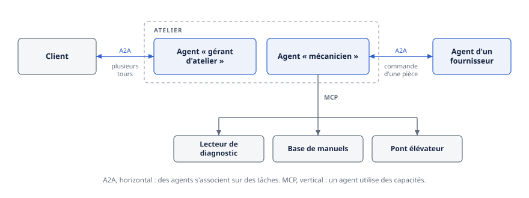
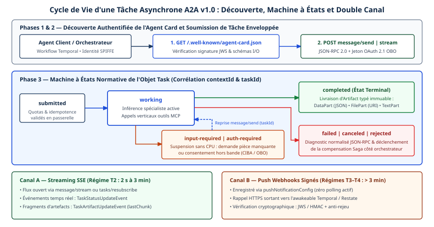
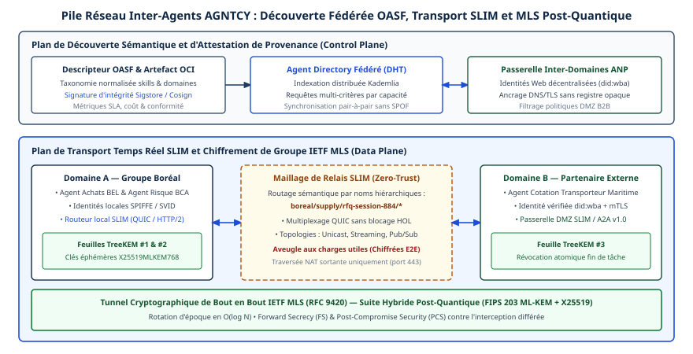

# Chapitre 6 — A2A : le protocole agent-agent

*Question directrice : comment déléguer une tâche à un agent qu'on ne contrôle pas ?*

> **État de référence :** spécification A2A `1.0`, dans sa version corrective `1.0.1` du 28 mai 2026. Les numéros entre crochets renvoient aux sources en fin de chapitre, toutes primaires : [1] à [9] lues à la rédaction, [10] à [12] lues à l'audit.

Le chapitre précédent décrivait comment un agent atteint un outil. Un outil est un objet simple : il a une signature, il reçoit des arguments, il rend un résultat. L'agent qui l'appelle sait ce qu'il va obtenir.

Déléguer à un autre agent est une affaire différente. L'autre agent raisonne, planifie, utilise ses propres outils, peut poser des questions, peut refuser, peut prendre des heures. Il appartient souvent à une autre équipe, à un autre éditeur ou à une autre organisation, qui n'a aucune intention d'exposer son fonctionnement interne. On ne lui passe pas des arguments : on lui confie un objectif.

Le protocole Agent2Agent (A2A) standardise cette délégation. Sa thèse centrale tient en un mot, l'**opacité** : pour le client, l'agent distant est une boîte noire dont les rouages, la mémoire et les outils restent cachés [3]. Tout le protocole découle de ce choix. Puisqu'on ne voit pas l'intérieur, il faut un document qui décrit l'agent de l'extérieur, un objet qui suit le travail confié, et des moyens d'en recevoir des nouvelles.

---

## 6.1 Origine et gouvernance

A2A a été lancé par Google en avril 2025, avec l'appui d'une cinquantaine d'organisations [8]. Son parcours institutionnel compte cinq jalons.

| Date | Étape | Preuve |
|---|---|---|
| Avril 2025 | Lancement par Google | [8] |
| 23 juin 2025 | Don à la Linux Foundation | [11] |
| 29 août 2025 | Fusion annoncée avec ACP, le protocole d'IBM | [10] |
| 12 mars 2026 | Version 1.0, première spécification stable | [8][12] |
| 27 août 2026 | Entrée à l'Agentic AI Foundation, au stade « Growth » | [7] |

La dernière étape place A2A dans la même fondation que MCP. Le billet du projet, daté du 27 août 2026, présente A2A comme la pièce qui standardise la manière dont des agents autonomes se trouvent, se délèguent des tâches et collaborent entre cadriciels et fournisseurs [7]. L'Agentic AI Foundation recense aujourd'hui les deux protocoles parmi ses dix projets [9].

Ce regroupement compte pour un acheteur. Deux protocoles complémentaires gouvernés séparément peuvent diverger; sous un même toit, la coordination devient possible, sans être garantie. La feuille de route publiée au premier anniversaire du projet mentionne d'ailleurs une spécification d'interopérabilité et une consolidation des registres [8].

En août 2025, le billet annonçant la fusion d'ACP situait au comité de pilotage technique des représentants d'AWS, de Cisco, de Google, d'IBM, de Microsoft, de Salesforce, de SAP et de ServiceNow, IBM y entrant à cette occasion [10]. Le communiqué d'avril 2026 nomme ces huit mêmes entreprises comme soutiens du protocole, sans décrire le comité [8].

---

## 6.2 Le modèle

### Trois acteurs

A2A distingue l'**utilisateur**, personne ou service qui a un objectif; le **client A2A**, application ou agent qui agit pour lui et engage la communication; et le **serveur A2A**, ou agent distant, qui expose un point d'accès, traite les tâches et rend des résultats [3].

Un agent peut tenir les deux rôles. Il est serveur pour celui qui lui délègue une tâche, et client quand il en délègue une partie à un troisième. C'est ainsi que se forment les chaînes de délégation, dont les conséquences pour l'autorisation sont traitées au chapitre 30.

### L'Agent Card : décrire sans dévoiler

L'Agent Card est un document JSON qui présente un agent à ses clients potentiels. Tout serveur A2A doit en rendre une disponible [1].

| Champ | Rôle |
|---|---|
| `name`, `description`, `version` | Identité de l'agent |
| `supportedInterfaces` | Points d'accès : URL, protocole de liaison, version du protocole, locataire |
| `capabilities` | Flux, notifications poussées, extensions, carte étendue |
| `skills` | Compétences offertes : identifiant, nom, description, étiquettes, exemples |
| `defaultInputModes`, `defaultOutputModes` | Types de contenu acceptés et produits |
| `securitySchemes`, `securityRequirements` | Mécanismes d'authentification exigés |
| `provider` | Organisation responsable |
| `signatures` | Signatures cryptographiques de la carte |

La carte décrit **ce que l'agent sait faire**, pas comment il le fait. Une compétence (`skill`) est une description en langage naturel, avec étiquettes et exemples, non une signature de fonction typée. Cette différence avec un outil MCP est voulue : on s'adresse à un agent par un message, pas par un appel typé.

Deux mécanismes complètent la carte publique.

La **carte étendue** permet à un agent de ne publier qu'une description sommaire, et de réserver une version plus détaillée aux clients authentifiés. L'opération qui la renvoie doit exiger une authentification, et son contenu peut varier selon l'identité de l'appelant [1].

La **signature** de la carte, introduite en version 1.0, repose sur JWS et sur une mise en forme canonique du JSON. Un client devrait vérifier au moins une signature avant de se fier à une carte; une clé expirée ou révoquée ne doit pas servir à la vérification [1]. La signature répond à une question simple : cette carte vient-elle bien de l'organisation qu'elle nomme ? Elle ne dit rien de la qualité ni de l'honnêteté de l'agent.

### La tâche : l'unité de travail

La tâche (`Task`) est l'objet central du protocole. C'est une unité de travail à état, dotée d'un identifiant unique généré par le serveur et d'un cycle de vie défini [1][3]. La version 1.0 préfixe ses états par `TASK_STATE_` (`TASK_STATE_COMPLETED`) [2]; le tableau les abrège.

| État | Nature | Signification |
|---|---|---|
| `SUBMITTED` | En cours | Reçue, pas encore commencée |
| `WORKING` | En cours | En traitement |
| `INPUT_REQUIRED` | Interrompu | L'agent attend une information du client |
| `AUTH_REQUIRED` | Interrompu | L'agent attend une autorisation |
| `COMPLETED` | Terminal | Terminée avec succès |
| `FAILED` | Terminal | Échec |
| `CANCELED` | Terminal | Annulée |
| `REJECTED` | Terminal | Refusée par l'agent |

Deux états distinguent A2A d'un simple suivi de tâche asynchrone.

`REJECTED` reconnaît qu'un agent autonome peut **refuser** un travail. Un outil échoue ou réussit; un agent peut décliner, parce que la demande sort de son mandat ou contrevient à sa politique.

`AUTH_REQUIRED` reconnaît qu'un agent peut découvrir en cours de route qu'il lui faut une autorisation qu'il n'a pas : un jeton pour un système tiers, ou l'approbation d'une personne. La section 6.6 y revient.

Une tâche dans un état terminal n'accepte plus de message. Les tâches liées se regroupent par un identifiant de contexte (`contextId`), qui porte le fil d'une collaboration sur plusieurs échanges [3]. Le serveur peut le générer ou accepter celui que fournit le client [1].

### Messages, parties et artefacts

Un **message** est un tour de communication. Il a un rôle, utilisateur ou agent, et contient une ou plusieurs **parties** (`Part`) : du texte, des octets bruts, une URL ou des données structurées [1].

Un **artefact** est un livrable produit par la tâche : un document, une image, un jeu de données. La spécification pose ici une règle qui a des conséquences de conception : les messages ne doivent pas être tenus pour un mécanisme de livraison fiable de l'information critique; les artefacts sont le moyen à privilégier pour rendre des résultats [1]. Les messages servent à converser, les artefacts à livrer.

---

## 6.3 Les modes d'interaction

A2A définit onze opérations [1]. Elles forment quatre groupes : envoyer un message, avec ou sans flux; consulter, lister, annuler une tâche ou s'y abonner; gérer les configurations de notification poussée; obtenir la carte étendue.

Trois modes d'interaction en découlent [3].

**Requête-réponse.** Le client envoie un message et attend. Par défaut, l'opération est bloquante : elle rend la main quand la tâche atteint un état terminal ou interrompu. Un paramètre, `returnImmediately`, permet au client de reprendre la main tout de suite et d'interroger la tâche plus tard. Le serveur peut aussi répondre par un simple message, sans créer de tâche, quand la demande ne le justifie pas.

**Flux.** Le client garde une connexion ouverte et reçoit des mises à jour en continu : changements d'état, fragments d'artefacts. Les événements doivent être livrés dans l'ordre où ils ont été produits. Plusieurs flux peuvent suivre la même tâche en parallèle, et un client peut se réabonner à une tâche en cours [1].

**Notifications poussées.** Pour les tâches longues ou les clients déconnectés, le client enregistre un webhook; l'agent y envoie une requête POST à chaque mise à jour significative. L'agent doit tenter la livraison au moins une fois; les nouvelles tentatives sont permises à la section 4.3.3, mais recommandées à la 13.2. Le client doit accuser réception par un statut 2xx et devrait traiter les notifications de manière idempotente, des doublons étant possibles [1].

Les notifications poussées ouvrent une surface d'attaque particulière : un client malveillant peut demander à un agent d'appeler une adresse interne. La spécification y répond. L'agent doit joindre à ses appels les éléments d'authentification configurés et devrait valider les adresses de rappel, en rejetant les plages privées, de bouclage et locales au lien; le client doit vérifier que la notification porte sur une tâche attendue et devrait en vérifier la source [1].

L'annulation, comme dans MCP (chapitre 5), est une demande dont le succès n'est pas garanti.

---

## 6.4 Ce que la version 1.0 a stabilisé

La version 1.0, publiée le 12 mars 2026, est la première spécification stable du protocole [8][12]. Un correctif, 1.0.1, a suivi le 28 mai 2026 : préférence pour le type de média `application/a2a+json` dans la liaison HTTP, erreurs de transcodage, valeurs d'état corrigées [12]. La version 1.0 rompt avec la version 0.3 sur de nombreux points, ce qui en fait à la fois un jalon et un chantier de migration.

### Une architecture en trois couches

La spécification se structure en trois couches [1] :

1. un **modèle de données canonique**, indépendant de tout protocole, exprimé en Protocol Buffers;
2. des **opérations abstraites**, indépendantes de la liaison;
3. des **liaisons de protocole** : JSON-RPC, gRPC et HTTP+JSON.

Le fichier de définition Protocol Buffers est la source normative; les SDK et les autres représentations en sont dérivés. Les trois liaisons doivent offrir un comportement équivalent, et un agent déclare dans sa carte celles qu'il prend en charge [1][2]. Une liaison sur mesure reste possible, à condition de mettre en œuvre toutes les opérations et de documenter ses correspondances.

Une entreprise peut ainsi exposer le même agent en gRPC pour ses échanges internes à haut débit, et en HTTP+JSON pour ses partenaires, sans maintenir deux modèles.

### Les ajouts

| Ajout | Ce qu'il apporte |
|---|---|
| Cartes signées | Vérification cryptographique de l'origine d'une Agent Card |
| Multilocation | Un champ `tenant` permet de servir plusieurs agents depuis un même point d'accès |
| Versionnement | Chaque interface déclare sa version; le client envoie un en-tête `A2A-Version` |
| Liste des tâches | Nouvelle opération, avec filtres et pagination par curseur |
| Extensions versionnées | Identifiées par URI, déclarées obligatoires ou non, demandées par l'en-tête `A2A-Extensions` |
| Sécurité | TLS mutuel parmi les mécanismes déclarables; flux OAuth implicite et par mot de passe abandonnés au profit du code d'autorisation avec PKCE; flux par code d'appareil ajouté |

Le versionnement suit une règle simple : seuls comptent les numéros majeur et mineur. Un agent peut prendre en charge plusieurs versions en exposant plusieurs interfaces. Une version non prise en charge provoque une erreur explicite, et un en-tête vide est interprété comme la version 0.3 [1].

### Les ruptures

La liste des changements incompatibles est longue [2] : opérations renommées, types de parties fusionnés en un seul, énumérations réécrites, pagination par curseur, chemins HTTP modifiés, format des erreurs remplacé. Un agent écrit pour la version 0.3 ne parle pas la version 1.0 sans adaptation.

Le projet recommande une migration en trois temps : une couche de compatibilité qui lit les deux formats, une période de double prise en charge, puis l'abandon de l'ancien format [2]. Il suggère de traiter d'abord l'analyse des parties, des événements de flux et des cartes, puis la pagination et les énumérations dans le mois, et enfin la vérification des signatures et les nouvelles erreurs dans les trois mois.

L'enseignement dépasse A2A : un protocole adopté avant sa version stable fait payer cette avance. Les organisations qui ont déployé A2A en 2025 ont une dette de migration que n'ont pas celles qui arrivent en 2026.

---

## 6.5 L'absorption d'ACP

En mars 2025, IBM Research avait lancé son propre protocole de communication entre agents, l'Agent Communication Protocol (ACP), pour animer sa plateforme BeeAI, donnée à la Linux Foundation le même mois [10]. Pendant quelques mois, deux standards ouverts se sont disputé le même terrain.

Le 29 août 2025, LF AI & Data a annoncé la fusion d'ACP dans A2A, sous l'égide de la Linux Foundation : l'équipe d'ACP cessait le développement actif de son protocole et apportait sa technologie à A2A. Un adaptateur rend conformes à A2A les agents construits avec le cadriciel BeeAI, et un guide de migration accompagne les utilisateurs d'ACP [10]. D'après des résumés de recherche, le dépôt d'ACP a depuis été archivé.

Cet épisode est le signal le plus net de convergence dans la couche agent-agent. Il n'a pas tout unifié : ANP poursuit une approche décentralisée, et AGNTCY bâtit une infrastructure autour de MCP et d'A2A plutôt qu'un concurrent (chapitre 7); la Chine a publié une série nationale non obligatoire, GB/Z 185-2026, dont la description d'agent serait proche de l'Agent Card selon une analyse (chapitre 11). Mais dans l'écosystème ouvert d'origine occidentale, la question « quel protocole entre agents ? » a aujourd'hui une réponse par défaut.

---

## 6.6 Composer MCP et A2A

### Vertical et horizontal

La documentation d'A2A résume la relation entre les deux protocoles par une image : MCP est **vertical**, il approfondit un agent en lui donnant des outils et des données; A2A est **horizontal**, il relie des agents par-delà les frontières d'équipe, de service ou d'organisation [5]. La formule proposée est qu'avec A2A des agents s'associent sur des tâches, alors qu'avec MCP un agent utilise des capacités.

L'exemple canonique est celui d'un atelier de réparation automobile. Le client décrit un bruit suspect à un agent « gérant d'atelier », par A2A, et le dialogue de diagnostic se poursuit sur plusieurs tours. Un agent « mécanicien » utilise MCP pour ses outils : lecteur de diagnostic, base de manuels, pont élévateur. Pour commander une pièce, le mécanicien s'adresse par A2A à l'agent d'un fournisseur.



| Critère | MCP | A2A |
|---|---|---|
| Cible | Un outil, une ressource | Un agent autonome |
| Ce qu'on transmet | Des arguments typés | Un objectif, par message |
| Description | Schéma d'entrée et de sortie | Compétences en langage naturel |
| Visibilité | L'outil est décrit précisément | L'agent est opaque |
| Durée typique | Courte; tâches longues par extension | Longue; la tâche est au cœur |
| Peut refuser ? | Non, il échoue ou réussit | Oui, état `REJECTED` |
| Frontière habituelle | Dans le périmètre d'un agent | Entre équipes ou organisations |

### La frontière est moins nette qu'il n'y paraît

Trois observations nuancent cette répartition; hormis ce qui est cité, elles relèvent de l'analyse de ce chapitre.

**Un agent peut se présenter comme un outil.** La documentation d'A2A le reconnaît : un agent distant peut exposer certaines compétences bien définies sous une forme compatible avec MCP, ce qui fonctionne surtout quand ces compétences s'appellent de manière ponctuelle et sans état [5]. Elle ajoute que la force d'A2A est ailleurs, dans la collaboration souple et à état. En pratique, le choix entre « exposer comme outil » et « exposer comme agent » est une décision d'architecture, pas une évidence.

**Les deux protocoles se rapprochent.** Depuis sa révision de juillet 2026, MCP encadre des extensions officielles, notamment deux en bêta : Tasks, dont les états recoupent ceux d'A2A, et Server Cards, pour la découverte (chapitres 5 et 8). A2A, de son côté, sait livrer des résultats structurés. Les deux s'appuient sur HTTP pour l'accès distant et déclarent leurs capacités.

**Le critère utile est l'opacité, pas la technique.** La bonne question n'est pas « est-ce un agent ou un outil ? », mais « qui contrôle ce qui se passe de l'autre côté ? ». Si l'appelant maîtrise ou connaît précisément le comportement attendu, un outil convient. S'il délègue un objectif à un système qui décide lui-même de la manière de l'atteindre, c'est une délégation entre agents, avec ce qu'elle implique de négociation, de refus possible et de vérification du résultat.

### L'autorisation en cours de tâche

Dans MCP, le serveur réclame des portées supplémentaires au moment de l'appel (chapitre 5). A2A prévoit qu'une autorisation manque au milieu d'un travail long : l'agent doit alors faire passer la tâche à l'état `AUTH_REQUIRED` et expliquer ce qu'il lui faut [1]. Le client peut alors négocier, refuser, s'adresser à un tiers ou satisfaire la demande par un autre canal. Si le client est lui-même un agent, il peut à son tour faire passer sa propre tâche dans le même état : la demande d'autorisation **remonte la chaîne de délégation** jusqu'à quelqu'un qui peut y répondre.

Trois règles encadrent ce mécanisme. Les justificatifs doivent être obtenus hors du protocole, sauf mécanisme négocié par ailleurs, et devraient transiter par un canal sûr. Un agent ne doit pas traiter le passage à l'état `AUTH_REQUIRED` comme une autorisation en soi : la portée de ce qui est accordé doit être définie par la mise en œuvre, par l'émetteur du justificatif ou par une extension. Enfin, un justificatif obtenu dans cet état ne vaut pas d'office pour les messages suivants de la tâche [1]. Le protocole fournit donc le signal, pas la sémantique. Ce que vaut une approbation donnée trois maillons plus haut reste à définir par l'entreprise (chapitre 30).

---

## 6.7 Adoption et limites

### Ce qu'on sait de l'adoption

Le bilan publié par la Linux Foundation en avril 2026 donne quelques repères [8] : plus de 150 organisations soutiennent le protocole, contre une cinquantaine un an plus tôt; le dépôt principal a dépassé 22 000 étoiles; des SDK existent en cinq langages; Microsoft a intégré A2A à Azure AI Foundry et à Copilot Studio, et AWS à Amazon Bedrock AgentCore Runtime.

Le même communiqué affirme l'existence de déploiements en production dans la chaîne logistique, les services financiers, l'assurance et les opérations informatiques. Il **ne nomme aucune organisation**. Le soutien déclaré d'un éditeur et l'usage réel par ses clients sont deux choses différentes, et les sources disponibles ne permettent pas de mesurer le second.

### Ce qu'A2A ne règle pas

| Question | Ce que dit la spécification | Ce qui revient à l'entreprise |
|---|---|---|
| Comment trouver un agent ? | Un emplacement `/.well-known/agent-card.json`; aucune API de registre [4] | Un registre d'agents et sa gouvernance (chapitre 8) |
| Comment le client obtient-il ses identifiants ? | Hors protocole [6] | Le choix du mécanisme et la distribution des secrets (chapitre 29) |
| Qui a le droit de faire quoi ? | Le serveur doit autoriser chaque opération; la logique lui appartient [1][6] | La politique, par compétence et par appelant |
| Que vaut une approbation en cours de tâche ? | Le signal existe; sa portée n'est pas définie [1] | La sémantique de la délégation (chapitre 30) |
| Le résultat est-il correct ? | Rien; l'agent est opaque | La vérification des livrables (chapitres 21 et 32) |
| L'agent est-il digne de confiance ? | La signature atteste l'origine de la carte [1] | L'évaluation et l'approbation des agents tiers |
| Qui répond d'un dommage ? | Rien | Le contrat entre organisations (chapitre 36) |

**La découverte reste artisanale.** La spécification standardise le format de la carte et son emplacement, pas la manière d'interroger un catalogue. La documentation décrit trois stratégies : l'emplacement bien connu, les registres organisés et la configuration directe. Elle précise qu'aucune API standard de registre n'est prescrite et que la communauté explore la question [4]. Chaque plateforme propose donc son registre, ce qui recrée de la fragmentation à l'étage supérieur.

**L'opacité a un prix.** Elle protège la propriété intellectuelle et simplifie l'intégration, mais elle prive le client de tout moyen de constater comment un résultat a été obtenu. Dans un système multi-agents, où les échecs naissent de la spécification, du désalignement entre agents et de la vérification (chapitre 21), déléguer à une boîte noire exige de contrôler ce qu'elle rend. Quand l'agent distant sert un intérêt contraire, comme dans une négociation entre entreprises, A2A transporte l'échange mais ne protège ni les secrets ni le règlement : ces protections relèvent de composants déterministes ou contractuels (chapitre 45).

**La sécurité est renvoyée aux standards du web.** A2A ne définit pas d'identité propre : l'authentification se fait à la couche HTTP, par les mécanismes déclarés dans la carte, et l'identité ne voyage pas dans les messages [6]. C'est un choix sain, qui permet de réutiliser l'infrastructure existante. Il laisse cependant entière la question de l'identité d'un agent qui agit pour le compte d'un utilisateur d'une autre organisation (chapitres 29 et 45).

La spécification impose tout de même quelques garanties de fond. Le serveur doit autoriser chaque opération, et la vérification doit précéder toute requête en base, afin de ne pas révéler l'existence d'une ressource. Une ressource introuvable et une ressource interdite ne devraient pas pouvoir être distinguées par l'appelant. La liste des tâches ne renvoie que celles que le client a le droit de voir [1].

Enfin, la documentation recommande fortement de placer les serveurs A2A exposés à l'extérieur derrière une solution de gestion d'API, et de participer au traçage distribué par propagation du contexte de trace [6]. Ce sont des recommandations d'exploitation, non des exigences du protocole. Des passerelles agentiques, comme agentgateway, projet de l'Agentic AI Foundation, relaient A2A sur le même plan de données que MCP et l'inférence (chapitres 24 et 44).

---

## Grille de décision

| Décision | Option par défaut | Quand s'en écarter |
|---|---|---|
| Exposer une capacité comme outil ou comme agent | Outil (MCP) si le comportement est ponctuel, typé et maîtrisé par l'appelant | Agent (A2A) si la capacité raisonne, dialogue, dure ou appartient à une autre équipe |
| Version cible | 1.0, avec son correctif 1.0.1, pour tout nouvel agent | Partenaires encore en 0.3 : exposer deux interfaces pendant la transition |
| Liaison | HTTP+JSON ou JSON-RPC pour l'externe | gRPC pour les échanges internes à haut débit |
| Carte publique | Description minimale, sans secret ni URL interne | Carte étendue, après authentification, pour le détail |
| Signature des cartes | Signer ses cartes; vérifier celles des tiers | Aucun écart justifié en production entre organisations |
| Découverte | Registre interne organisé | Emplacement bien connu pour un agent public; configuration directe pour un couplage fixe |
| Suivi d'une tâche longue | Notifications poussées, avec validation de leur authenticité | Interrogation périodique si le client ne peut pas recevoir d'appels entrants |
| Livraison des résultats | Artefacts | Message seul pour un échange purement conversationnel |
| Autorisation en cours de tâche | Justificatifs obtenus hors protocole; portée et durée de validité définies par politique | — |
| Exposition externe | Derrière une passerelle de gestion d'API | Agent strictement interne |
| Vérification des livrables | Contrôle systématique de ce que rend un agent tiers | Agent interne dont le comportement est évalué en continu |

---

## Points à retenir

- A2A standardise la délégation d'un objectif à un agent opaque : on ne voit ni ses outils, ni sa mémoire, ni son raisonnement.
- Trois objets portent le protocole : l'Agent Card, qui décrit l'agent de l'extérieur; la tâche, qui suit le travail; l'artefact, qui livre le résultat.
- Un agent peut refuser une tâche ou réclamer une autorisation en cours de route. Ces deux états n'ont pas d'équivalent pour un outil.
- La version 1.0 apporte les cartes signées, la multilocation, trois liaisons équivalentes et un versionnement explicite, au prix d'une rupture avec la version 0.3.
- La fusion d'ACP et l'entrée à l'Agentic AI Foundation font d'A2A le protocole par défaut entre agents dans l'écosystème ouvert d'origine occidentale.
- MCP et A2A se complètent, mais leur frontière se brouille. Le critère de choix utile est le degré de contrôle de l'appelant sur ce qui s'exécute de l'autre côté.
- Le protocole ne standardise ni l'interrogation des registres, ni l'obtention des identifiants, ni la portée d'une approbation donnée en cours de tâche.
- La signature d'une carte atteste son origine, pas la fiabilité de l'agent. La vérification des résultats reste à la charge du client.
- L'adoption par les éditeurs est documentée; l'usage en production est affirmé sans qu'aucune organisation soit nommée.

---

## Sources

Pages primaires lues le 11 novembre 2026, [1], [2] et [8] relues à l'audit :

1. [Spécification A2A 1.0](https://a2a-protocol.org/latest/specification/)
2. [Nouveautés de la version 1.0](https://a2a-protocol.org/latest/whats-new-v1/)
3. [Concepts clés](https://a2a-protocol.org/latest/topics/key-concepts/)
4. [Découverte des agents](https://a2a-protocol.org/latest/topics/agent-discovery/)
5. [A2A et MCP](https://a2a-protocol.org/latest/topics/a2a-and-mcp/)
6. [Fonctions d'entreprise](https://a2a-protocol.org/latest/topics/enterprise-ready/)
7. [Annonces du projet A2A](https://a2a-protocol.org/latest/blog/category/announcements/)
8. [Linux Foundation — bilan de la première année d'A2A, 9 avril 2026](https://www.linuxfoundation.org/press/a2a-protocol-surpasses-150-organizations-lands-in-major-cloud-platforms-and-sees-enterprise-production-use-in-first-year)
9. [Agentic AI Foundation — projets](https://aaif.io/projects)

Pages primaires lues lors de l'audit, le 12 novembre 2026 :

10. [LF AI & Data — ACP Joins Forces with A2A, 29 août 2025](https://lfaidata.foundation/?p=7689)
11. [Linux Foundation — lancement du projet Agent2Agent, 23 juin 2025](https://www.linuxfoundation.org/press/linux-foundation-launches-the-agent2agent-protocol-project-to-enable-secure-intelligent-communication-between-ai-agents)
12. [Dépôt a2aproject/A2A — versions publiées](https://github.com/a2aproject/A2A/releases)

## Limites de ce chapitre

- La section de la spécification consacrée à la liaison JSON-RPC n'a pas été lue; les liaisons gRPC et HTTP+JSON l'ont été.
- Levé à l'audit par les pages [10] à [12] : dates du don à la Linux Foundation, de la fusion d'ACP, des versions 1.0 et 1.0.1, et composition du comité de pilotage en août 2025. Restent invérifiées la date d'approbation par l'Agentic AI Foundation, seul le billet étant daté [7], et la composition actuelle du comité.
- La page de la spécification affiche encore 1.0.0 comme dernière version, alors que le dépôt marque 1.0.1 comme la plus récente [12]. Les exigences citées ont été lues sur la page de la spécification.
- Pour les flux OAuth implicite et par mot de passe, la page des nouveautés les dit retirés [2], la spécification les dit dépréciés [1].
- La page « Concepts clés » présente encore JSON-RPC comme format unique des échanges, ce qui ne correspond plus aux trois liaisons de la version 1.0. La spécification fait foi.
- L'archivage du dépôt d'ACP ne figure pas dans le billet d'annonce lu [10]; il vient de résumés de recherche.
- La comparaison avec MCP de la section 6.6 est une analyse propre à ce chapitre.
- Aucun déploiement en production n'est cité, faute de source qui en nomme un.
- Les pages ont été lues par un outil qui les condense; la spécification l'a été par segments.

## Mise en œuvre — Coordination horizontale, découverte et réseau inter-agents {.volet}

:::: {.encadre .executive}
::: {.encadre-titre}
**Synthèse exécutive**
:::

- **Enjeu stratégique** : Les processus à forte valeur (instruire une garantie complexe, réacheminer un flux logistique international, qualifier un risque de crédit) traversent plusieurs divisions et partenaires externes, qui refusent d’exposer leurs bases de données, leurs consignes système ou leurs modèles internes. Tant qu’un agent opère seul au-dessus de ses outils MCP (chapitre 5), l’entreprise n’automatise que des silos locaux. Sans protocole horizontal normalisé, elle multiplie les adaptateurs fragiles, les boucles infinies entre agents et les risques d’usurpation de capacités (OWASP ASI07).
- **Décisions architecturales structurantes** :
  1.  *Irréversible à moyen terme* : Proscrire l’encapsulation d’agents autonomes à cycles longs derrière de simples outils MCP synchrones; imposer A2A v1.0 pour toute délégation d’objectif entre pairs opaques.
  2.  *Structurante dès le passage à l’échelle (\> 15 agents)* : Remplacer les listes statiques d’URL par un catalogue fédéré modélisé en AGNTCY OASF (*Open Agentic Schema Framework*), où chaque fiche et chaque Agent Card sont signées cryptographiquement (JWS / Sigstore).
  3.  *Progressive selon la criticité réseau* : Conserver HTTPS, SSE et webhooks pour les flux courants. Activer le bus AGNTCY SLIM, couplé au chiffrement de groupe IETF MLS (RFC 9420) hybride post-quantique, pour les cellules collaboratives en temps réel, les sites industriels isolés et les échanges B2B sensibles.
- **Indicateurs de gouvernance associés** : Délai d’intégration d’un nouvel agent spécialiste au maillage (cible : \< 48 h sans redéployer les orchestrateurs), part des tâches longues traitées sans interrogation périodique (\> 95 %), temps de révocation cryptographique MLS et zéro délégation inter-domaines sans signature Agent Card valide.
::::

## 6.8 Protocole A2A v1.0 : Agent Cards, tâches asynchrones et artefacts typés

La distinction entre outil et agent pair est posée à la section 6.6. Elle commande une règle d’architecture : un agent autonome à cycle long ne s’expose pas comme un outil MCP synchrone.

### Choix de la version 1.0 qui orientent la mise en œuvre

Les liaisons, la distinction entre message et tâche, et les parties sont décrites aux sections 6.2 à 6.4. Trois précisions guident la conception :

1.  **Liaisons** : HTTP+JSON/REST, hérité d’ACP, se prête mieux à l’inspection par les passerelles API; JSON-RPC 2.0 sur HTTPS reste le profil universel et gRPC sert la haute performance.
2.  **Message ou tâche** : héritée d’ACP, la distinction évite d’instancier un état lourd pour une interaction résolue en un tour sous deux secondes. Dès qu’un traitement implique asynchronisme, réessais ou validation tierce, l’échange est promu en tâche versionnée.
3.  **Parties typées** : la version 1.0 fusionne les types de parties en un seul (`Part`), qui contient du texte, des octets, une URL ou des données structurées (sections 6.2 et 6.4). Les données structurées sont soumises à JSON Schema et la référence à un fichier se fait par URI présignée bornée dans le temps, ce qui remplace le texte brut ambigu.

| Critère d’ingénierie | Sous-agent en outil MCP (antipatron) | ACP historique (avant la fusion de 2025) | A2A v1.0 — flux SSE (régime T2) | A2A v1.0 — notification poussée par webhook et exécution durable (régimes T3–T4) |
|:-------------|:----------------------|:-----------------|:-----------------------|:-----------------------|
| Opacité et sécurité | Faible : fuite d’indices internes dans le contexte parent | Bonne : isolation des environnements d’exécution locaux | Élevée : Agent Card signée + OAuth 2.1 OBO | Maximale : zéro connexion entrante maintenue pendant l’attente |
| Négociation multi-tours | Absente (texte d’erreur libre ambigu) | Sessions REST locales | Native via l’état `INPUT_REQUIRED` et `contextId` | Native via `INPUT_REQUIRED` / `AUTH_REQUIRED`, qui réveille un `awakeable` |
| Horizon temporel | 1 s à 60 s (délais d’expiration des outils) | Secondes à minutes | 2 s à 3 min (flux HTTP/2 SSE actif) | Minutes à plusieurs semaines (mise en veille complète) |
| Livraison de sortie | Bloc JSON ou texte unique final | Flux MIME multipart | Incrémentale (`TaskArtifactUpdateEvent`) | Artefact immuable notifié par webhook signé JWS |
| Usage recommandé | Proscrit pour un pair autonome | Migré vers la liaison REST d’A2A v1.0 | Coopération interactive reliée à AG-UI | Sagas inter-divisions, conformité et logistique B2B |

### Sécurité de l’Agent Card et usurpation de capacités

Toute interaction commence par la lecture de l’Agent Card (`/.well-known/agent-card.json`; structure à la section 6.2). Deux mécanismes de la version 1.0 en verrouillent l’exposition en production :

- **Carte publique minimale, carte étendue authentifiée** (`capabilities.extendedAgentCard: true`) : l’URL publique anonyme ne révèle que l’identité de routage et les schémas d’authentification. Les compétences fines autorisées pour le locataire de l’appelant se lisent par l’opération `GetExtendedAgentCard`, avec un jeton valide.
- **Signature canonique** (`signatures`, JWS RFC 7515) : l’autorité de plateforme signe la carte canonisée (RFC 8785 JCS), contre l’usurpation de capacités (OWASP ASI07), où un conteneur compromis annoncerait de fausses compétences financières pour intercepter des dossiers. La passerelle agentgateway bloque tout routage vers une carte non certifiée.

### Machine à états d’une tâche et exécution sans interrogation périodique

Lors d’un appel `SendMessage` ou `SendStreamingMessage`, le `contextId` relie les échanges successifs d’un même dossier et le `taskId` identifie l’unité atomique, régie par une machine à états déterministe.



Les huit états de `TaskState` sont présentés à la section 6.2 : la version 1.0 les préfixe par `TASK_STATE_` et les écrit en majuscules, valeurs corrigées en 1.0.1 (section 6.4). Le tableau les abrège et précise l’action de l’orchestrateur appelant pour chacun.

| État `TaskState` | Catégorie | Signification protocolaire | Action requise côté orchestrateur appelant |
|:-------------|:------------------|:------------------------------|:-------------------------------------|
| `SUBMITTED` | En cours | Tâche authentifiée, validée et mise en file persistante. | Journaliser le `taskId`; conserver la même clé d’idempotence en cas de réessai. |
| `WORKING` | En cours | Inférence du spécialiste et appels MCP internes en cours. | Consommer le flux SSE (T2) ou suspendre le flux de travail en attente du webhook (T3–T4). |
| `INPUT_REQUIRED` | Interrompu | Donnée métier complémentaire requise pour trancher. | Extraire le schéma demandé, collecter la preuve et rappeler `SendMessage` sur le même `taskId`. |
| `AUTH_REQUIRED` | Interrompu | Consentement hors bande (CIBA, *Client-Initiated Backchannel Authentication*) ou jeton tiers requis. | Acquérir le jeton d’élévation, puis relancer la tâche suspendue. |
| `COMPLETED` | Terminal | Succès; artefacts immuables et typés joints. | Valider l’`outputSchema`, enregistrer l’artefact et passer à l’étape suivante. |
| `FAILED` | Terminal | Échec non récupérable localement malgré les réessais internes. | Déclencher sans délai la séquence de compensation de la saga parente. |
| `CANCELED` | Terminal | Annulation confirmée après une requête `CancelTask`. | Vérifier la libération des verrous temporaires chez le pair. |
| `REJECTED` | Terminal | Refus avant tout effet de bord (politique Cedar, quota). | Basculer vers un pair alternatif de l’annuaire; aucune compensation n’est requise. |

Deux mécanismes de la version 1.0 assurent la résilience sur des réseaux d’entreprise imparfaits :

- **Reconnexion sans perte (`SubscribeToTask`)** : en régime T2 (2 secondes à 3 minutes), l’appelant dont la connexion SSE est interrompue, par le redémarrage d’un pod répartiteur de charge ou un basculement Wi-Fi, invoque `SubscribeToTask` avec le `taskId` et le dernier identifiant d’événement reçu. Le serveur rejoue les transitions d’état manquées depuis son tampon d’événements, sans relancer l’inférence sous-jacente.
- **Assemblage incrémental des artefacts (`append` et `lastChunk`)** : un spécialiste qui produit un rapport d’audit structuré ou un lot de données volumineux émet une suite de `TaskArtifactUpdateEvent` qui partagent le même `artifactId`, avec `append: true` jusqu’au fragment final marqué `lastChunk: true`. L’orchestrateur inspecte la sortie au fil de l’eau, détecte par exemple une violation de politique et émet aussitôt `CancelTask` pour couper les frais d’inférence inutiles.

#### Extrait 6.1 — Séquence JSON-RPC 2.0 A2A (syntaxe de la version 0.3) : soumission asynchrone, suspension input-required et artefact typé

Un orchestrateur soumet à BCA une demande de garantie en mode non bloquant; BCA suspend la tâche en `INPUT_REQUIRED` par webhook, puis livre un artefact typé.

L’extrait suit la syntaxe de la version 0.3 : les états sont en minuscules avec tiret et les parties se distinguent par un champ `kind`; pour la version 1.0, l’exposé indique des états préfixés `TASK_STATE_` et écrits en majuscules (sections 6.2 et 6.4) et un seul type de partie (section 6.4). Les noms d’opérations et de configuration de l’extrait (`message/send`, `blocking`, `pushNotificationConfig`) sont aussi ceux de la version 0.3; la version 1.0 les nomme `SendMessage`, `returnImmediately` et `taskPushNotificationConfig`.

``` json
[{
  "_step": "1. POST https://agentgateway.internal.boreal.ca/a2a/bca/warranty",
  "jsonrpc": "2.0",
  "id": "rpc-req-4401",
  "method": "message/send",
  "params": {
    "message": {
      "messageId": "msg-901a-77c2",
      "contextId": "ctx-incident-comp-90441",
      "role": "user",
      "parts": [{
        "kind": "data",
        "mimeType": "application/json",
        "data": {
          "equipmentSerial": "BOR-CMP-90441",
          "faultSignatureCode": "VIB-BEARING-OUTER-RACE-H3",
          "estimatedRepairCad": 3850.00,
          "preventiveReplacement": true
        }
      }],
      "metadata": {
        "borealActionEnvelope": {
          "sagaId": "saga-inc-2027-088412",
          "stepIdempotencyKey": "idem-bca-adj-088412-v1",
          "maxRemainingHops": 3,
          "maxBudgetCad": 0.45,
          "traceparent": "00-4bf92f3577b34da6a3ce929d0e0e4736-88a12b33c901d4e2-01"
        }
      }
    },
    "configuration": {
      "acceptedOutputModes": ["application/json", "application/pdf"],
      "blocking": false,
      "pushNotificationConfig": {
        "id": "push-cfg-temporal-088412",
        "url": "https://callbacks.internal.boreal.ca/a2a/v1/webhook",
        "token": "awk-tok-9f8e7d6c5b4a3210",
        "authentication": { "schemes": ["Bearer", "X-A2A-Signature-JWS"] }
      }
    }
  }
},
{
  "_step": "2. Webhook poussé par BCA 9 s plus tard (Transition -> input-required)",
  "kind": "status-update",
  "taskId": "tsk-bca-772019",
  "contextId": "ctx-incident-comp-90441",
  "final": false,
  "status": {
    "state": "input-required",
    "timestamp": "2027-03-14T14:22:19.410Z",
    "message": {
      "messageId": "msg-bca-req-calib",
      "role": "agent",
      "parts": [{
        "kind": "data",
        "mimeType": "application/json",
        "data": {
          "missingField": "lastLubricationComplianceHash",
          "policyClause": "BCA-IND-2026-ART14.2"
        }
      }]
    }
  }
},
{
  "_step": "3. Webhook final après réponse automatique de BSN (completed + Artifact)",
  "kind": "artifact-update",
  "taskId": "tsk-bca-772019",
  "contextId": "ctx-incident-comp-90441",
  "append": false,
  "lastChunk": true,
  "artifact": {
    "artifactId": "art-warranty-auth-99102",
    "name": "warranty-preauthorization-decision",
    "parts": [
      {
        "kind": "data",
        "mimeType": "application/json",
        "data": {
          "decision": "APPROVED_ZERO_DEDUCTIBLE",
          "authorizedCapCad": 4500.00,
          "authorizationCode": "BCA-PREAUTH-2027-551902",
          "validUntilIso": "2027-03-21T14:22:35Z"
        }
      },
      {
        "kind": "file",
        "file": {
          "name": "certificat-couverture-551902.pdf",
          "mimeType": "application/pdf",
          "uri": "https://vault.boreal.ca/artifacts/cert-551902.pdf?sig=8b7a"
        }
      }
    ]
  }
}]
```

:::: {.encadre .warning}
::: {.encadre-titre}
**Avertissement**
:::

**Webhooks : protection contre le SSRF et le DNS rebinding** : Le risque d’une adresse de rappel interne, ou SSRF (falsification de requête côté serveur), est décrit à la section 6.3. L’émetteur le ferme par quatre mesures : une liste blanche des domaines de rappel liée à l’identité SPIFFE/DID de l’appelant; un proxy sortant dédié, isolé du réseau interne; la vérification, à l’ouverture de la connexion, de l’adresse du socket effectif, après une résolution DNS unique épinglée qui pare le DNS rebinding à `TTL = 0`, pour écarter les adresses privées (RFC 1918) et les métadonnées infonuagiques (169.254.169.254); la signature de chaque envoi par un en-tête JWS horodaté muni d’un `nonce` anti-rejeu.
::::

------------------------------------------------------------------------

## 6.9 Découverte dynamique et modélisation des capacités avec AGNTCY OASF et Agent Directory

Dès qu’un groupe exploite des dizaines d’agents répartis entre filiales et partenaires, coder en dur les URL ou injecter cent descriptions textuelles dans la consigne d’un orchestrateur ne tient plus. Confier la sélection au seul jugement sémantique d’un LLM sur de la prose libre gonfle la facture de jetons et ouvre la porte au *SEO d’Agent Card* malveillant. La spécification ne standardise pas l’interrogation d’un catalogue (section 6.7; gouvernance du registre au chapitre 8).

AGNTCY, projet ouvert par Cisco (Outshift) avec LangChain et Galileo, puis confié à la Linux Foundation (chapitre 7), y répond par le couple OASF et Agent Directory.

### OASF : taxonomie déterministe et provenance OCI

OASF fournit un schéma déclaratif versionné qui encadre le cycle de vie d’un agent autour de quatre composantes :

1.  **Taxonomie hiérarchique contrôlée (`skills` et `domains`)** : des identifiants normalisés (`supply_chain/trade_compliance/hs_tariff_classification`), extensibles par espace de noms privé (`x-boreal/*`), remplacent les synonymes flous. La présélection devient une requête d’index exacte, en moins d’une milliseconde.
2.  **Localisateurs multiprotocoles (`locators`)** : une fiche unique relie la référence de l’artefact conteneur, l’URL de l’Agent Card A2A v1.0 et l’identifiant de routage SLIM en temps réel.
3.  **Modules d’évaluation et de conformité (`modules`)** : ils attachent les métriques mesurées en CI/CD (ADLC, chapitre 34), soit la stabilité $\text{pass}^k$, la latence P95 et le coût médian, ainsi que la juridiction d’hébergement et la classification BSIF E-23 ou EU AI Act.
4.  **Signature Sigstore sur registre OCI** : chaque manifeste OASF est publié comme artefact OCI (*Open Container Initiative*) et signé par Cosign / Sigstore dans un journal de transparence vérifiable.

### Routage distribué par Agent Directory (DHT Kademlia)

Pour fédérer plusieurs entités sans registre central vulnérable, Agent Directory sépare le stockage de l’indexation. Chaque division garde ses manifestes complets dans son registre OCI local et annonce les empreintes cryptographiques (SHA-256) de ses compétences sur une table de hachage distribuée (DHT) Kademlia. Après une résolution en $\mathcal{O}(\log M)$ sauts et la vérification des signatures, le routeur du plan de contrôle évalue chaque candidat $a$ selon un score déterministe :

$$\text{Score}(a) = \mathbb{I}_{\text{pol}}(a) \cdot \left( w_s S_{\text{sem}}(a) + w_r \text{pass}^k(a) - w_c \hat{C}(a) - w_l \hat{L}_{95}(a) \right)$$

Ici, $\mathbb{I}_{\text{pol}}(a) \in \{0, 1\}$ représente le filtre éliminatoire Cedar/OPA (résidence des données, plafond d’autonomie), $S_{\text{sem}}(a)$ la compatibilité des schémas JSON, $\text{pass}^k(a)$ la fiabilité certifiée, et $\hat{C}(a), \hat{L}_{95}(a)$ le coût et la latence P95 normalisés.

Le cache et la révocation sont gouvernés. Les passerelles agentgateway gardent localement les résolutions OASF fréquentes avec un bail court (TTL de 60 à 300 secondes), pour ne pas solliciter la DHT à chaque micro-transaction. Si la surveillance OpenTelemetry (chapitre 33) détecte en production une dérive soudaine du taux d’erreur ou la compromission d’un serveur sous-jacent, le centre d’opérations AgentOps publie sur le canal prioritaire de l’Agent Directory un avis de révocation signé (*Revocation Record*). En moins de cinq secondes, $\mathbb{I}_{\text{pol}}(a)$ passe à zéro sur toutes les passerelles du groupe : l’agent fautif est isolé et le trafic bascule vers le candidat de rang 2, sans interrompre les sagas en cours.

#### Extrait 6.2 — Manifeste de capacité AGNTCY OASF signé et relié à A2A v1.0

Le manifeste du classificateur douanier de BEL déclare ses compétences, ses localisateurs vers l’Agent Card et SLIM, puis ses modules d’évaluation, de conformité et de provenance.

``` yaml
oasfVersion: "1.0.0"
name: "ca.boreal.bel.customs-harmonized-classifier"
version: "3.1.0"
description: >-
  Spécialiste de classification tarifaire douanière (SH/HS Code) et calcul d'origine
  préférentielle ACEUM/USMCA pour équipements électromécaniques industriels.
authors:
  - "Conformité Douanière & Ingénierie BEL <agentops-bel@boreal.ca>"
createdAt: "2027-02-18T09:30:00Z"

skills:
  - id: "supply_chain/trade_compliance/hs_tariff_classification"
    proficiency: "expert"
  - id: "supply_chain/trade_compliance/usmca_origin_determination"
    proficiency: "expert"

domains:
  - "industrial_manufacturing/heavy_machinery"
  - "cross_border_logistics/north_america_eu"

locators:
  - type: "a2a-agent-card"
    url: "https://gateway.boreal.ca/a2a/bel/customs/agent-card.json"
    digest:
      "sha256:9f44c8e12a08b7d6513e88c247ab19d05c63fe41856f01e23c9914d07b3a2e1c"
  - type: "slim-endpoint"
    uri: "slim://ca.boreal/supply-chain/customs-classifier"

modules:
  - name: "agntcy.oasf.evaluation.metrics"
    data:
      benchmarkSuite: "boreal-customs-eval-2027-q1"
      passHat3Score: 0.984
      p95LatencyMs: 2450
      medianCostPerTaskCad: 0.06

  - name: "agntcy.oasf.governance.compliance"
    data:
      autonomyCeiling: "L3"
      dataResidencyRegions: ["ca-central-1"]
      piiHandling: "PROHIBITED"
      regulatoryClassifications:
        osfiE23Materiality: "NON_APPLICABLE"
        euAiActCategory: "LIMITED_RISK"
      requiredOAuthScopes: ["bel.customs.classify"]

  - name: "agntcy.oasf.security.provenance"
    data:
      ociArtifactRef: "registry.internal.boreal.ca/oasf/bel-customs:3.1.0"
      sigstoreRekorLogIndex: 148920331
      signerIdentity: "spiffe://boreal.ca/ns/cicd/sa/adlc-release-signer"
```

------------------------------------------------------------------------

## 6.10 Transport inter-agents sécurisé à basse latence : SLIM et chiffrement MLS post-quantique

HTTPS suffit aux flux administratifs point à point. Trois contraintes opérationnelles mettent toutefois en échec le modèle requête-réponse HTTP dans les architectures multi-agents denses :

1.  **Sessions collaboratives multipartites** : faire délibérer ou enchérir simultanément cinq agents (diagnostic, stock, douane, transporteur, assureur) sous 150 ms par $N(N-1)$ webhooks HTTP produit une amplification quadratique.
2.  **Traversée des pare-feux IT/OT et des PME** : recevoir des appels HTTP entrants exige d’ouvrir des ports dans les zones industrielles (niveau 3 du modèle Purdue), pratique proscrite en sûreté cyber-physique.
3.  **Rupture du chiffrement aux courtiers intermédiaires** : avec un TLS classique terminé sur chaque proxy ou courtier infonuagique mutualisé, l’infrastructure intermédiaire accède en clair aux offres commerciales et aux secrets industriels.

La couche réseau d’AGNTCY lève ces trois verrous en associant le transport SLIM au chiffrement de groupe IETF MLS (RFC 9420).

### SLIM sur gRPC (HTTP/2 ou WebSocket)

SLIM (*Secure Low-Latency Interactive Messaging*), implémenté en Rust pour une latence déterministe, remplace le routage IP/port par un adressage sémantique hiérarchique (`organisation/namespace/classe-agent/instance-id`), inspiré des réseaux orientés information (ICN). Chaque nœud ne maintient qu’une connexion sortante persistante, sur gRPC en flux (HTTP/2 ou WebSocket), vers le relais le plus proche :

- **Zéro port entrant exposé** : un agent d’usine initie le canal sortant et reçoit les tâches A2A v1.0 encapsulées sans jamais exposer d’adresse IP entrante.
- **Modes unifiés** : requête-réponse, flux de jetons et canaux de publication-abonnement en multidiffusion cohabitent sur la même primitive.



### Confidentialité de groupe post-quantique avec IETF MLS (RFC 9420)

Au-dessus du routage SLIM, le protocole *Messaging Layer Security* (MLS, RFC 9420) chiffre les charges utiles de bout en bout entre les agents d’une session et rend les relais intermédiaires aveugles au contenu. Dans sa structure d’arbre binaire à cliquet asymétrique TreeKEM, chaque participant occupe une feuille liée à son identité (SPIFFE SVID ou DID). Lorsqu’un agent externe rejoint une négociation puis la quitte après quatre minutes, l’opération Commit renouvelle le secret d’époque le long du chemin vers la racine en $\mathcal{O}(\log N)$ opérations cryptographiques. Elle garantit la confidentialité persistante et la sécurité post-compromission (PCS).

En 2027, les sessions SLIM/MLS inter-organisations imposent la suite hybride post-quantique X25519MLKEM768, qui combine la courbe elliptique X25519 et l’encapsulation ML-KEM-768 (NIST FIPS 203), avec des signatures ML-DSA (FIPS 204). Cette suite pare les collectes passives de type *Harvest Now, Decrypt Later* sur les secrets industriels qui transitent par Internet. Deux enseignements de déploiement :

- **Surcoût post-quantique négligeable devant l’inférence** : un `KeyPackage` hybride X25519MLKEM768 ajoute environ 1,2 kilooctet à la poignée de main initiale du groupe MLS. L’encapsulation et la décapsulation s’exécutent en moins de 0,4 milliseconde sur un processeur serveur standard, puis un chiffrement symétrique matériel AES-256-GCM tourne à débit filaire. Ce coût est imperceptible devant une inférence de modèle de 300 à 2 000 millisecondes.
- **Pontage d’A2A sur SLIM par démon local et collisions d’époques** : les équipes métiers n’ont pas à réécrire leurs agents. L’agent spécialiste expose localement sur 127.0.0.1 son serveur A2A v1.0 standard; un démon SLIM local gère l’attestation SPIFFE, l’arbre MLS et l’encapsulation JSON-RPC ou gRPC sur HTTP/2, dans des salles d’exécution éphémères détruites dès la clôture de la saga. Conformément à la RFC 9420, le relais SLIM ordonne linéairement les trames Commit concurrentes, sans accès au clair, pour prévenir toute bifurcation d’époque, et il évince les feuilles silencieuses qui retarderaient le renouvellement post-compromission (PCS).

#### Extrait 6.3 — Configuration d’un nœud passerelle SLIM sous MLS hybride post-quantique

Le nœud passerelle SLIM de BEL se connecte en gRPC sur HTTP/2 avec repli sur WebSocket, tient son identité de SPIFFE, impose MLS hybride aux pairs externes et relie un agent A2A local à une route SLIM.

``` yaml
# slim-node-gateway.yaml — Nœud relais/client AGNTCY SLIM durci (Production 2027)
node:
  id: "boreal-bel-mtl-slim-01"
  organization: "ca.boreal"
  namespace: "supply-chain"

transport:
  primaryProtocol: "http2-grpc"
  fallbackProtocol: "websocket"
  upstreamRelays:
    - endpoint: "https://slim-mesh.boreal.ca:443"
      alpn: ["slim-v1"]
      keepAliveIntervalMs: 15000
      maxConcurrentStreams: 512

identity:
  provider: "spiffe-workload-api"
  socketPath: "unix:///run/spire/sockets/agent.sock"
  expectedTrustDomain: "boreal.ca"
  federatedExternalTrust:
    enabled: true
    allowedDidMethods: ["did:wba"]
    policyEngineEndpoint: "http://127.0.0.1:8181/v1/data/boreal/slim/admission"

mlsSecurity:
  enabled: true
  mandatoryForExternalPeers: true
  cipherSuite: "MLS_256_X25519MLKEM768_AES256GCM_SHA384_MLDSA65"
  keyRotationPolicy:
    maxEpochDurationSeconds: 900
    maxMessagesPerEpoch: 5000
    rotateImmediatelyOnMemberLeave: true
  keyPackageLifetimeHours: 24

a2aBridge:
  exposeLocalAgents:
    - localAgentName: "bel-spot-procurement-orchestrator"
      slimRoute: "ca.boreal/supply-chain/procurement-orchestrator"
      upstreamA2aUrl: "http://127.0.0.1:9080/a2a/v1"
```

------------------------------------------------------------------------

## 6.11 Traversée des frontières organisationnelles et fédération multilocataire (ANP)

À l’intérieur de l’entreprise, SPIRE et Microsoft Entra ID procurent une racine de confiance unifiée. Quand un agent achats doit consulter en temps réel les agents de vingt fournisseurs externes indépendants, la direction sécurité n’acceptera pas de fédérer son annuaire interne avec l’extérieur. ANP (*Agent Network Protocol*) répond à ce cas sur l’Internet ouvert des agents (chapitre 7).

### Identités Web décentralisées (did:wba) et DMZ agentique

ANP évite les registres spéculatifs complexes et s’appuie sur la méthode `did:wba` (*Web-Based Agent DID*), conforme à W3C DID Core :

1.  **Ancrage DNS/TLS natif** : l’identifiant `did:wba:b2b-agents.acier-laurentides.ca:sales:rfq-responder` se résout par HTTPS vers `https://b2b-agents.acier-laurentides.ca/sales/rfq-responder/did.json`, liant cryptographiquement les clés publiques de l’agent à la propriété du domaine Web de l’entreprise et à son attestation légale vérifiable (vLEI / GLEIF).
2.  **Négociation de méta-protocole** (encore en brouillon, à réserver aux prototypes selon le chapitre 7) : avant d’ouvrir la tâche A2A v1.0, l’en-tête ANP accorde la version des schémas métiers partagés (ex. UN/CEFACT ou DCSA) et les plafonds de cadence.

| Standard | Fonction dans la pile | Périmètre cible | Identité native | Maturité (2027) |
|:--------------|:--------------------------|:--------------------|:------------------|:-------------------|
| A2A v1.0 *(+ fusion ACP)* | Délégation d’objectifs, états de tâche, artefacts et webhooks | Intra-entreprise et B2B structuré | OAuth 2.1 OBO, mTLS ou DID | Spécification 1.0 stable, protocole par défaut dans l’écosystème ouvert d’origine occidentale (LF / AAIF; sections 6.4 et 6.5); usage en production affirmé sans organisation nommée (section 6.7) |
| AGNTCY OASF + Directory | Taxonomie des compétences, provenance OCI et index DHT | Flottes \> 15 agents et consortiums | Sigstore / SPIFFE / DID | Annuaire en version 1.0, à évaluer (Linux Foundation) |
| AGNTCY SLIM + MLS | Messagerie gRPC sans port entrant et chiffrement de bout en bout post-quantique | Essaims en temps réel, sites IT/OT, salles B2B | Feuilles TreeKEM (SPIFFE / `did:wba`) | À l’essai : SLIM en brouillon IETF individuel; MLS normalisé (RFC 9420) |
| ANP (`did:wba`) | Identité décentralisée sur DNS/TLS et découverte Web ouverte | Écosystèmes B2B multi-fournisseurs | W3C DID (`did:wba`) + vLEI | À l’essai, derrière une DMZ |

En production, aucun agent interne n’est exposé directement au réseau externe. Toute interaction ANP/A2A franchit une DMZ agentique, qui vérifie le `did:wba` et le vLEI, rejette tout champ de texte libre non borné pour bloquer l’injection indirecte (OWASP ASI01), applique des quotas stricts par partenaire (isolation des locataires) et marque le contexte interne avec `external_partner_origin = true`.

La passerelle réécrit aussi les en-têtes de télémétrie distribuée (W3C Trace Context `traceparent` / `tracestate`). Elle tient une table de corrélation locale avec l’identifiant de trace externe, pour faciliter le diagnostic conjoint des incidents B2B, et retire tout attribut interne susceptible de révéler aux tiers la topologie des microservices ou les noms des modèles utilisés en interne.

#### Extrait 6.4 — Document d’identité ANP (did:wba) et politique Cedar d’admission DMZ

Le `did.json` d’un répondeur de demandes de prix publie sa clé d’authentification et ses points d’accès. La politique Cedar de la DMZ agentique admet la réponse d’un fournisseur invité et authentifié, en JSON validé et sans instruction libre, et interdit l’accès aux ressources classifiées.

``` json
{
  "_endpoint": "GET https://b2b-agents.acier-laurentides.ca/sales/rfq-responder/did.json",
  "@context": ["https://www.w3.org/ns/did/v1", "https://w3id.org/security/suites/jws-2020/v1"],
  "id": "did:wba:b2b-agents.acier-laurentides.ca:sales:rfq-responder",
  "verificationMethod": [{
    "id": "did:wba:b2b-agents.acier-laurentides.ca:sales:rfq-responder#key-auth-1",
    "type": "JsonWebKey2020",
    "controller": "did:wba:b2b-agents.acier-laurentides.ca:sales:rfq-responder",
    "publicKeyJwk": { "kty": "OKP", "crv": "Ed25519", "x": "11qYAYKxCrfVS_7TyWQHOg7hcvPapiMlrwIaaPcHURo" }
  }],
  "authentication": ["did:wba:b2b-agents.acier-laurentides.ca:sales:rfq-responder#key-auth-1"],
  "service": [
    {
      "id": "#a2a",
      "type": "A2AAgentEndpoint",
      "serviceEndpoint": "https://b2b-agents.acier-laurentides.ca/a2a/v1/rfq-responder"
    },
    {
      "id": "#vlei",
      "type": "LegalEntityVerifiableCredential",
      "serviceEndpoint": "https://b2b-agents.acier-laurentides.ca/vc/gleif-vlei.vc.json"
    }
  ]
}
```

``` cedar
// Politique Cedar exécutée en coupure sur la DMZ Agentique du Groupe Boréal
permit (
  principal is ExternalAgent,
  action == Action::"a2a:SubmitTaskResponse",
  resource is BorealProcurementSession
)
when {
  principal.didMethod == "did:wba" &&
  principal.hasValidGleifVlei == true &&
  principal.erpVendorStatus == "APPROVED_ACTIVE" &&
  resource.invitedSuppliers.contains(principal.did) &&
  context.payloadMimeType == "application/json" &&
  context.schemaValidationPassed == true &&
  context.containsFreeformInstructions == false
};

forbid (principal is ExternalAgent, action, resource)
when {
  [
    "INTERNAL_CONFIDENTIAL",
    "BSIF_REGULATED",
    "PII_LOI25"
  ].contains(resource.dataClassification)
};
```

:::: {.encadre .sectoriel}
::: {.encadre-titre}
**Chaîne logistique mondiale — Fédération d'annuaires d'agents entre donneurs d'ordres et transporteurs**
:::

Lors d’une fermeture portuaire imprévue ou d’un arrêt d’écluse sur la Voie maritime du Saint-Laurent, les messages EDI X12 / EDIFACT atteignent leur limite : conçus pour exécuter des contrats-cadres figés, ils ne savent pas négocier à la volée un réacheminement multimodal conditionnel.

En 2027, les chargeurs et transitaires combinent OASF, ANP et SLIM/MLS en trois temps : (1) sélection, dans un Agent Directory fédéré, des transporteurs qui disposent des certifications requises (`corridor:rotterdam-montreal`, `hazmat:class-9`), sans exposer leurs tarifs; (2) ouverture de canaux A2A v1.0 isolés sous chiffrement MLS post-quantique, qu’aucun courtier infonuagique ni concurrent ne peut lire pour connaître les cotations spot; (3) échange de connaissements électroniques (*eBL*) sous forme d’artefacts typés conformes aux schémas DCSA, ce qui ramène le réacheminement complet de 38 heures à 14 minutes.
::::

:::: {.encadre .sectoriel}
::: {.encadre-titre}
**Secteur Financier & Assurances — Muraille de Chine informationnelle inter-filiales sous BSIF E-23 et Loi 25**
:::

Dans un groupe qui détient à la fois des filiales commerciales et une institution financière supervisée, l’interopérabilité agentique ne doit pas violer les murailles de Chine (*Information Barriers*). La Loi 25 québécoise interdit le partage interne de renseignements personnels hors de la finalité consentie, et la ligne directrice BSIF E-23 (1er mai 2027) impose une frontière d’auditabilité autour des modèles de risque.

A2A v1.0 matérialise ici le patron d’adjudication à divulgation minimale. Interrogé par la filiale industrielle, l’agent de la filiale d’assurance n’expose ni le dossier financier ni l’historique de sinistralité; son `outputSchema` ne renvoie qu’un verdict signé (APPROVED / ESCALATE), le plafond couvert en dollars et un jeton d’autorisation opaque. La donnée sensible reste confinée dans son enclave réglementaire, et le processus transversal demeure automatisé.
::::

------------------------------------------------------------------------

## 6.12 Application au fil rouge : interconnexion horizontale chez Groupe Boréal

:::: {.encadre .filrouge}
::: {.encadre-titre}
**Fil rouge — Groupe Boréal : Maillage horizontal A2A v1.0 et SLIM entre BSN, BCA et BEL**
:::

**Impasse initiale (fin T4 2026)** : Une fois leurs premiers serveurs MCP bâtis localement, les équipes de BSN, BCA et BEL avaient tenté de relier leurs agents par des webhooks REST ad hoc. Résultat : deux semaines d’adaptation à chaque nouveau flux, des doublons de réservation lorsque l’IBM i (AS/400) de BCA mettait 95 secondes à analyser un avenant complexe, et le refus de la sécurité industrielle d’ouvrir des ports HTTPS entrants vers les quatre usines BEL.

**Architecture déployée (T1–T2 2027)** :

1.  **Catalogue AGNTCY OASF et Agent Cards certifiées** : les 18 agents spécialistes du groupe sont publiés en artefacts OCI signés par Cosign (Extrait 6.2). agentgateway vérifie chaque signature JWS avant le routage et a bloqué en 4 ms un faux agent injecté lors d’un test d’intrusion d’une équipe rouge.
2.  **Boucle `INPUT_REQUIRED` auto-résolue entre BCA et BSN** : dans 22 % des dossiers de maintenance préventive, l’*Agent Garantie* de BCA réclame la preuve de lubrification des six derniers mois par l’état `INPUT_REQUIRED` (Extrait 6.1). Temporal capte le webhook signé, récupère l’empreinte certifiée auprès du spécialiste télémétrie de BSN et relance le même `taskId`, sans intervention humaine.
3.  **Tunnels sortants SLIM + MLS en usine et DMZ ANP fournisseurs** : les usines BEL ne maintiennent qu’une liaison sortante gRPC (SLIM), chiffrée en MLS X25519MLKEM768. En parallèle, la DMZ agentique relie par `did:wba` 25 fournisseurs nord-américains pré-qualifiés (Extrait 6.4) pour les demandes de prix d’urgence, en JSON strict.

**Résultats mesurés à 90 jours** :

- **Intégration d’un nouvel agent spécialiste au maillage** : réduite de 6 semaines à 1,5 jour.
- **Dossiers incomplets (`INPUT_REQUIRED`) résolus sans humain** : 89 % traités en moins de 6 secondes (contre 19 heures de courriels internes auparavant).
- **Consultation spot de 3 fournisseurs externes** : ramenée de 28 heures à 4 minutes 10 secondes, avec zéro port entrant ouvert sur les périmètres d’usine.
::::

------------------------------------------------------------------------

## 6.13 Décision d’architecture et liste de contrôle

:::: {.encadre .adr}
::: {.encadre-titre}
**ADR-006 — Utilisation d'A2A v1.0 et d'Agent Cards signées pour toute délégation inter-domaines**
:::

- **Statut** : Acceptée \| Périmètre : Fabrique Agentique d’Entreprise & DMZ B2B \| Révision : Semestrielle
- **Contexte** : Coordonner des agents autonomes répartis entre divisions réglementées, usines IT/OT et partenaires externes exige un protocole horizontal qui respecte l’opacité interne des pairs, les cycles longs et la traversée sécurisée des frontières réseau, sans dépendance à un éditeur unique.
- **Options évaluées** :
  1.  *Agents exposés comme outils MCP distants* : Rejetée, car elle bloque les contextes sur les cycles longs et prive l’architecture d’une machine à états asynchrone (`INPUT_REQUIRED`, webhooks).
  2.  *Bus propriétaire mono-éditeur SaaS* : Rejetée, car il verrouille le contrat et convient mal aux systèmes patrimoniaux et industriels.
  3.  *Standardisation A2A v1.0 + AGNTCY OASF / Directory + SLIM/MLS ciblé* : Retenue, pour sa gouvernance ouverte Linux Foundation, sa gestion native du flux et des notifications asynchrones, sa découverte signée et son chiffrement post-quantique.
- **Décision** :
  1.  Toute délégation inter-domaines ou B2B emprunte A2A v1.0, munie d’une `ActionEnvelope` (`sagaId`, clé d’idempotence, budget, `maxRemainingHops`).
  2.  Chaque Agent Card porte une signature JWS validée à la passerelle et correspond à un manifeste OASF signé dans l’Agent Directory.
  3.  Toute tâche dont la durée P95 dépasse 60 secondes utilise obligatoirement le mode non bloquant, avec des notifications poussées par webhook signé, reliées au moteur durable. Cette règle va au-delà de ce que retient l’exposé : la grille de décision garde les notifications poussées par défaut et admet l’interrogation périodique si le client ne peut pas recevoir d’appels entrants.
  4.  Les flux vers les sites IT/OT et les sessions multipartites B2B passent par SLIM sous chiffrement IETF MLS (X25519MLKEM768) et traversent la DMZ agentique (ANP `did:wba` + Cedar).
- **Conséquences** :
  - *Positives* : Découplage des équipes, remplacement sans interruption des modèles sous-jacents, résilience aux coupures longues et confidentialité post-quantique de bout en bout.
  - *Négatives / Coûts assumés* : Exploitation de la chaîne de signature Sigstore/JWS, gouvernance des schémas JSON inter-domaines et maintien des relais SLIM en DMZ.
- **Condition de révision** : Publication d’une révision majeure d’A2A ou convergence normative W3C/AAIF sur l’identité d’agents B2B.
::::

### Liste de contrôle de mise en production

Avant d’homologuer une interconnexion horizontale inter-domaines ou B2B, vérifiez les huit points suivants :

1.  **Authenticité de l’Agent Card** : Le fichier `/.well-known/agent-card.json` comporte-t-il une signature JWS canonique vérifiée en coupure, et réserve-t-il ses compétences sensibles à la carte étendue (`GetExtendedAgentCard`) ?
2.  **Provenance OASF certifiée** : Le manifeste OASF est-il signé dans le registre OCI par Sigstore/Cosign, avec des métriques $\text{pass}^k$, de coût et de latence P95 à jour ?
3.  **Aucune interrogation périodique sur les tâches longues** : Toute délégation de plus de 60 secondes utilise-t-elle des notifications `taskPushNotificationConfig` qui réveillent un état durable, plutôt qu’une boucle d’interrogation `GetTask` ? Cette exigence va au-delà de ce que retient l’exposé : la grille de décision admet l’interrogation périodique si le client ne peut pas recevoir d’appels entrants.
4.  **Durcissement anti-SSRF des webhooks** : Les URL de rappel sont-elles restreintes par liste blanche d’identité, protégées contre les adresses IP internes privées et munies d’un `nonce` horodaté et signé ?
5.  **Schémas JSON fermés** : Les parties de données structurées et les artefacts imposent-ils `additionalProperties: false` et le rejet de toute prose d’instruction libre sur les flux externes (OWASP ASI01) ?
6.  **Compteur de sauts déterministe** : La passerelle décrémente-t-elle `maxRemainingHops` à chaque appel A2A v1.0 et rejette-t-elle l’appel à zéro ?
7.  **Chiffrement MLS post-quantique** : Les sessions de groupe SLIM, ou celles qui traversent un courtier tiers, activent-elles X25519MLKEM768 avec une rotation immédiate des clés au départ d’un membre ?
8.  **Terminaison en DMZ agentique (ANP)** : Les agents externes `did:wba` sont-ils authentifiés par une attestation d’entité légale (vLEI/ERP), isolés par des quotas dédiés et privés de tout accès aux données réglementées ?
