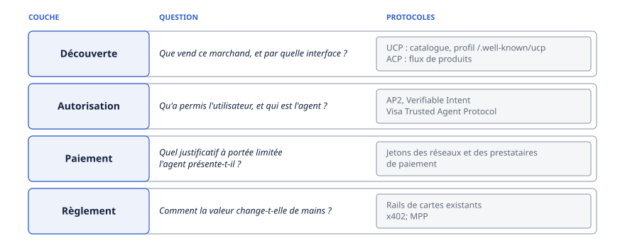
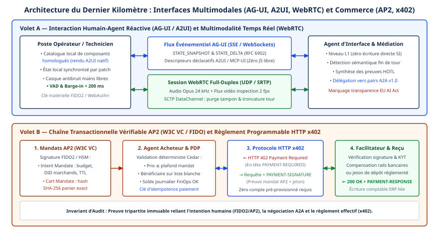

# Chapitre 10 — Commerce agentique

*Question directrice : comment un agent prouve-t-il qu'il a le droit d'acheter ?*

> **État de référence :** AP2 v0.2, UCP (versions datées; les exemples de la spécification portent `2026-08-25`), Agentic Commerce Protocol `2026-04-17` (bêta), Verifiable Intent (brouillon v0.1), x402 (dépôt de la x402 Foundation) et Machine Payments Protocol. Les numéros entre crochets renvoient aux sources : [1] à [12] sont des pages primaires lues pour ce chapitre; [13] à [16] sont des prépublications dont seul le résumé a été lu; [17] à [19] sont secondaires ou non lues; [20], primaire, a été lue le 14 novembre 2026.

Un paiement par carte repose sur une hypothèse rarement énoncée : la personne qui clique sur « payer » détient le moyen de paiement, ou agit sous les yeux de son titulaire. Un agent qui achète rompt cette hypothèse. Le marchand reçoit une commande d'un logiciel; l'émetteur voit passer une transaction que son client n'a pas saisie; le client découvre le résultat après coup.

L'identité de l'agent ne répond pas à ces inquiétudes. Savoir quel agent émet une requête (chapitres 9 et 29) ne dit rien de ce que son utilisateur l'a autorisé à dépenser. La réponse qui se dégage des spécifications de 2026 est un objet signé, le mandat, qui lie une personne, un panier et un paiement, et que chaque partie vérifie sans se fier au modèle de langage.

Ce chapitre soutient deux thèses. Les protocoles convergent sur la forme de la preuve, mais non sur les rails qui la transportent, et aucun ne couvre un achat de bout en bout. Et la preuve reste étroite : elle montre ce qui a été autorisé, sans dire qui paie quand l'agent se trompe, question que les spécifications lues écartent expressément.

---

## 10.1 Une pile en couches

Un achat par agent se décompose en quatre questions, auxquelles répondent des protocoles distincts.



| Couche | Question | Protocoles |
|---|---|---|
| Découverte | Que vend ce marchand, et par quelle interface ? | UCP (catalogue, profil `/.well-known/ucp`); ACP (flux de produits) |
| Autorisation | Qu'a permis l'utilisateur, et qui est l'agent ? | AP2, Verifiable Intent; Visa Trusted Agent Protocol |
| Paiement | Quel justificatif à portée limitée l'agent présente-t-il ? | Jetons des réseaux et des prestataires de paiement |
| Règlement | Comment la valeur change-t-elle de mains ? | Rails de cartes existants; x402; MPP |

Le découpage est commode, pas normatif. Un billet de l'AAIF, daté du 20 août 2026, retient plutôt cinq responsabilités : brancher un agent sur le parcours d'achat d'un marchand, identifier un agent sur un site existant, prouver ce que l'utilisateur a autorisé, fournir des justificatifs de paiement limités, payer des services numériques [12]. Les deux lectures mènent au même constat : aucun protocole ne couvre un achat complet sur l'ensemble du web.

D'une couche à l'autre, les protocoles se composent : UCP délègue la preuve d'autorisation à AP2, et les exemples d'AP2 couvrent aussi bien les cartes que x402 [1][4]. La concurrence se joue à l'intérieur de chaque couche (section 10.6).

Ils s'appuient sur les protocoles déjà décrits : UCP et ACP se transportent sur MCP (chapitre 5), UCP aussi sur A2A (chapitre 6), et le Trusted Agent Protocol de Visa repose sur les signatures de requêtes HTTP du chapitre 9.

---

## 10.2 Prouver l'intention : AP2 et Verifiable Intent

### Le mandat, unité de preuve

AP2 (Agent Payments Protocol), publié par Google, ne décrit ni catalogue ni panier. La spécification se définit comme une fonction de sécurité logée dans un protocole de commerce, et se dit conçue pour être compatible avec UCP [1]. Son objet est le mandat : un justificatif signé qui atteste ce qu'un utilisateur a approuvé.

Le 28 avril 2026, Google a apporté AP2 à la FIDO Alliance. Celle-ci rédige des spécifications pour le commerce initié par des agents au sein de son groupe de travail technique sur les paiements, présidé par des membres de Mastercard et de Visa; le communiqué ne donne aucune échéance [20].

La version lue, v0.2, non datée, définit deux mandats [1].

Le **Checkout Mandate** porte sur le contenu de l'achat. Le marchand émet d'abord un objet de caisse qu'il signe; le mandat y est lié par hachage. L'agent le présente au marchand, qui le vérifie et renvoie un reçu.

Le **Payment Mandate** porte sur l'autorisation de payer. Il est lié au même objet de caisse par hachage, et vérifié par le fournisseur de justificatifs, le réseau et le processeur de paiement du marchand. Un reçu de paiement suit.

Chaque mandat existe en deux états. **Ouvert**, il exprime des contraintes : c'est ce que signe un utilisateur qui délègue un achat à venir. **Fermé**, il décrit une transaction précise. Les vérificateurs ne reçoivent que des mandats fermés.

Les mandats sont des SD-JWT, un format de jeton à divulgation sélective. Un mandat ouvert doit contenir la clé publique de l'agent, dans une revendication `cnf` : c'est ce qui permet ensuite à l'agent, et à lui seul, de signer les mandats fermés qui en découlent. La spécification recommande l'expiration la plus courte que la tâche permette.

### Cinq rôles, dont un qui ne peut pas être un agent

| Rôle | Fonction | Peut être un agent ? |
|---|---|---|
| Shopping Agent | Agit pour l'utilisateur et présente les mandats | Oui, c'est le cas attendu |
| Credential Provider | Vérifie le mandat de paiement et remet un justificatif | Oui ou non |
| Merchant | Signe l'objet de caisse et vérifie le mandat de caisse | Oui ou non |
| Merchant Payment Processor | Vérifie le mandat de paiement | Oui ou non |
| Trusted Surface | Présente à l'utilisateur ce qu'il approuve | Non |

Un même acteur peut tenir plusieurs rôles [1]. Deux exigences donnent au dispositif sa valeur. La surface de confiance ne doit pas être agentique : ce que l'utilisateur voit au moment d'approuver n'est pas produit par un modèle. Et la validation des mandats doit s'exécuter dans du code déterministe, que le rôle soit tenu par un agent ou non. La vérification ne dépend donc jamais du jugement d'un modèle; le choix du contenu des mandats, laissé hors du champ, en dépend.

### Deux parcours

Dans le parcours **avec présence humaine**, l'utilisateur approuve sur la surface de confiance le panier fermé et le paiement. Le fournisseur de justificatifs vérifie le mandat de paiement et remet un justificatif; le marchand conclut la transaction.

Dans le parcours **sans présence humaine**, l'utilisateur approuve des contraintes, sous forme de mandats ouverts. L'agent signe ensuite, avec sa propre clé, les mandats fermés. Un garde-fou encadre les essais : l'agent ne doit pas présenter un nouveau mandat ouvert sans avoir obtenu un reçu de rejet pour le précédent [1].

### Ce qu'AP2 laisse dehors

La spécification énumère ses exclusions [1] : le détail du protocole de commerce; la façon dont l'agent arrête le contenu des mandats; la résolution des litiges, ainsi que la conservation et la récupération des preuves; la délégation de mandat d'un agent à un autre; un langage de requête normalisé pour les mandats.

Elle affirme que mandats et reçus, pris ensemble, donnent de la transaction une image non répudiable, utilisable comme preuve une fois les vérifications réussies. Elle ne répartit pas la responsabilité entre les rôles. La preuve existe; la règle qui dit quoi en faire n'y est pas (chapitre 36).

### Verifiable Intent

Verifiable Intent se présente comme une spécification ouverte d'autorisation cryptographique des agents dans le commerce, au stade de brouillon v0.1 et sous licence Apache 2.0 [7]. Le billet de l'AAIF l'attribue à Mastercard, avec Google, et la décrit comme un complément d'AP2 [12]; la page du projet ne nomme pas ses auteurs. Le communiqué de la FIDO Alliance le confirme : Mastercard y a apporté Verifiable Intent, qu'il dit codéveloppé avec Google et conçu pour fonctionner avec AP2 [20].

Sa structure tient en trois couches, chacune contraignant la suivante.

| Couche | Signataire | Contenu |
|---|---|---|
| 1 — Identité | L'émetteur | Un justificatif d'identité |
| 2 — Intention | L'utilisateur | Des contraintes |
| 3 — Action | L'agent | La preuve qu'il agit dans ce périmètre |

Le tout forme une chaîne de délégation en SD-JWT, où chaque maillon est lié au suivant par confirmation de clé. La page annonce huit types de contraintes vérifiables par machine et en nomme quatre : bornes de montant, listes de marchands autorisés, plafonds de budget, conditions de récurrence. Elle fournit des correspondances avec AP2, ACP et UCP.

Le format et la logique sont ceux d'AP2. L'apport propre est le premier maillon, qui rattache la chaîne à un émetteur : selon le billet de l'AAIF, marchands et émetteurs peuvent ainsi vérifier l'approbation chacun de leur côté [12].

---

## 10.3 Passage en caisse : ACP et UCP

### Agentic Commerce Protocol

L'Agentic Commerce Protocol (ACP) a été élaboré par Stripe et OpenAI, sous licence Apache 2.0 [5]. Il permet à un marchand d'exposer un passage en caisse destiné aux agents, par REST ou par MCP. Le marchand demeure le marchand attitré (*merchant of record*) : il décide des produits vendus, de leur présentation et de l'exécution des commandes.

Le dépôt qualifie la spécification de **bêta** [6]. Cinq versions datées se sont succédé depuis septembre 2025, dont deux en janvier 2026 (négociation de capacités, extensions, gestionnaires de paiement); la plus récente, `2026-04-17`, couvre le panier, le flux de produits, les commandes, l'authentification et MCP. Le paiement délégué s'appuie sur un jeton à portée limitée, le Shared Payment Token, dont Stripe est le premier prestataire compatible [5].

Trois réserves s'imposent. La gouvernance est conjointe entre OpenAI et Stripe; le passage à une fondation neutre est annoncé sans échéance [6]. Le site reconnaît que la découverte des marchands compatibles est encore en développement, et que chaque plateforme d'IA gère son propre processus de participation [5]. Enfin, le premier débouché du protocole s'est rétréci : selon le billet de l'AAIF, OpenAI a recentré son usage sur la découverte de produits en mars 2026 [12]; un billet de fournisseur, qui cite la presse, parle d'un abandon de l'achat intégré à ChatGPT faute d'adoption [17].

### Universal Commerce Protocol

UCP se présente comme un standard ouvert qui va de la découverte au suivi après achat [2]. Sa page d'accueil le dit élaboré par Google, Shopify, de grands détaillants, Microsoft, Meta, Salesforce et Stripe, entre autres, et appuyé notamment par Mastercard, Visa et PayPal. La licence est Apache 2.0.

Le protocole s'organise en capacités : catalogue, panier, passage en caisse, liaison d'identité par OAuth 2.0, commande. Des capacités pour l'hébergement et la restauration sont à l'état de brouillon [2].

Son mécanisme central est la négociation [3]. Le marchand publie un profil à l'adresse `/.well-known/ucp`. La plateforme de l'agent publie le sien et en transmet l'adresse à chaque requête, dans un en-tête `UCP-Agent` ou dans les métadonnées MCP. Les capacités sont appariées par nom, à la version commune la plus récente. Quatre transports sont prévus : `rest`, `mcp`, `a2a` et `embedded`, ce dernier affichant la caisse du marchand dans l'interface de la plateforme.

Le paiement passe par des gestionnaires (*payment handlers*) que le marchand déclare et classe par préférence [3]. La plateforme obtient un jeton du fournisseur de justificatifs et le remet au marchand; elle ne devrait pas toucher aux données de carte brutes, ce qui lui évite le périmètre PCI DSS. Pour un agent autonome, l'extension AP2 remplace le jeton par des mandats : le marchand signe l'état du panier, la plateforme produit, après consentement de l'utilisateur, un mandat de caisse et un mandat de paiement, et le processeur vérifie le second [3][4]. Les requêtes peuvent aussi porter des signatures RFC 9421 (chapitre 9).

La spécification énonce elle-même deux limites [3]. Le lien entre un nom et un domaine prouve la provenance, pas la confiance : négocier ou non avec une contrepartie reste la décision de chaque partie. Et UCP ne prescrit aucun calendrier de dépréciation; le retrait d'une version est une décision du marchand, loin de la fenêtre minimale de douze mois de MCP (chapitre 5).

### Comparaison

| | ACP | UCP |
|---|---|---|
| Origine | Stripe et OpenAI [5] | Google, Shopify et un large groupe de détaillants et de plateformes [2] |
| Statut | Bêta, versions datées [6] | Versions datées; verticales en brouillon [2][3] |
| Découverte du marchand | En développement [5] | Profil `/.well-known/ucp` [3] |
| Preuve d'autorisation | Jeton de paiement à portée limitée | Mandats AP2, sur activation [4] |
| Gouvernance | Deux mainteneurs fondateurs [6] | Un « organe de gouvernance » cité, non nommé [3] |

Les deux laissent au marchand la relation client et l'exécution. ACP part de la caisse; UCP part de la découverte et descend jusqu'à la commande.

---

## 10.4 Réseaux de cartes

### Visa Trusted Agent Protocol

La page de Visa décrit le Trusted Agent Protocol comme un standard cryptographique qui permet aux marchands de distinguer un agent légitime d'un robot ou d'un collecteur [8]. Le mécanisme est celui de la RFC 9421 : l'agent joint une signature à sa requête; le marchand reconstitue la base de signature et la vérifie avec la clé publique de l'agent.

Le protocole prévoit en outre la validation de l'intention de l'agent, ainsi que des signatures pour la reconnaissance du consommateur et pour le paiement. Le billet de l'AAIF, qui l'attribue à Cloudflare et à Visa, précise qu'il s'appuie sur Web Bot Auth et indique si l'agent signé navigue ou tente de payer [12].

Un marchand qui bloque les robots à sa périphérie bloque aussi les agents acheteurs; une signature vérifiable lui permet de laisser passer ceux qui viennent payer. Le protocole répond donc à une question antérieure à celle d'AP2 : il ne prouve pas ce que l'utilisateur a autorisé, mais que l'appelant est un agent reconnu. La page parle d'agents approuvés par Visa; l'approbation relève du réseau, pas d'un registre ouvert.

### Mastercard Agent Pay

Les pages de Mastercard sont restées inaccessibles [18] : le produit Agent Pay n'est pas décrit ici. Trois faits sont établis. Mastercard est à l'origine de Verifiable Intent, qu'il a apporté à la FIDO Alliance le 28 avril 2026 (section 10.2) [12][20]. Des membres de Mastercard et de Visa président le groupe de travail de cette alliance sur les paiements [20]. Mastercard figure enfin parmi les appuis d'UCP [2]. Le billet de l'AAIF le range, avec Visa, American Express et Stripe, parmi les acteurs dotés chacun d'un schéma propriétaire de justificatifs limités, faute de standard ouvert commun aux réseaux [12]. L'intégration de Verifiable Intent aux API d'intention d'Agent Pay n'est connue que par un résumé de moteur de recherche [18] : elle reste à établir.

---

## 10.5 Règlement natif : x402

Les protocoles précédents ajoutent une preuve à des rails existants. x402 fait l'inverse : il place le paiement dans l'échange HTTP lui-même.

### Mécanisme

x402 se définit comme un standard de paiement ouvert, sous licence Apache 2.0, qui permet à un service de facturer l'accès à une API ou à un contenu directement sur HTTP, au moyen du code d'état 402 Payment Required [9]. L'échange s'appuie sur trois en-têtes [10] :

1. le client demande une ressource; le serveur répond 402 et joint ses exigences de paiement dans `PAYMENT-REQUIRED`;
2. le client prépare une charge de paiement et réémet sa requête avec `PAYMENT-SIGNATURE`;
3. le serveur vérifie et règle le paiement, puis sert la ressource avec `PAYMENT-RESPONSE`.

Le serveur peut vérifier et régler lui-même, ou s'en remettre à un **facilitateur**, qui expose `/verify` et `/settle` [9][10]. Trois schémas sont documentés : `exact` (un montant précis), `upto` (un plafond par requête, le vendeur réglant l'usage réel) et `batch-settlement` (séquestre et bons hors chaîne, encaissés par lots, sur chaînes EVM seulement) [10].

Le client n'a ni compte, ni session, ni identifiants à gérer [9]. C'est l'attrait pour un agent : payer une ressource à l'unité, sans relation commerciale préalable.

### Gouvernance et portée

Le dépôt d'origine, chez Coinbase, n'est plus qu'une copie de développement : le projet a été transféré sous une x402 Foundation (`x402-foundation/x402`) [10]. Le protocole vise tous les réseaux, cryptographiques comme fiduciaires; les SDK listés visent des chaînes de blocs, et le billet de l'AAIF décrit un règlement en cryptomonnaies stables [10][12].

Parmi ses principes, un seul touche à la sécurité : ni le facilitateur ni le serveur ne doivent pouvoir déplacer des fonds au-delà de l'intention du client [10]. Les pages lues ne disent rien du remboursement, du litige ni de l'identité du payeur.

### MPP, le voisin

Le Machine Payments Protocol (MPP), corédigé par Tempo et Stripe, emploie le même code 402 avec une autre grammaire : le serveur émet un défi (Challenge) qui liste les options de paiement, le client répond par un justificatif (Credential) qui prouve le paiement, le serveur renvoie un reçu (Receipt) [11]. Il se veut neutre quant au moyen de paiement (cryptomonnaies stables, cartes, virements). Sa page renvoie à un brouillon de l'IETF sans en préciser l'état. Litiges et identité y sont présentés comme des ajouts possibles, non comme des acquis.

### Ce que cela vaut pour une entreprise

Le règlement natif convient à un cas précis : des appels nombreux et de faible valeur vers des services que l'agent découvre en cours de tâche. Il déplace toutefois la preuve. Les pages lues ne décrivent aucune autorisation distincte du paiement : le droit d'acheter s'y confond avec la capacité de produire une charge de paiement valide. La limite de dépense n'est pas dans le protocole; elle doit être posée en amont, sur le portefeuille ou à la passerelle (chapitre 40). Un mandat AP2 peut porter l'autorisation et x402 le règlement, puisque AP2 se déclare indépendant de l'instrument [1].

---

## 10.6 Rails non interopérables : état de la fragmentation

| Besoin | Propositions concurrentes | Pont entre elles |
|---|---|---|
| Passage en caisse | ACP, UCP | Aucun dans les pages lues; MCP comme transport commun |
| Preuve d'intention | AP2, Verifiable Intent | Correspondances de Verifiable Intent avec AP2, ACP et UCP [7]; tous deux apportés à la FIDO Alliance en avril 2026 [20] |
| Reconnaissance de l'agent | Trusted Agent Protocol; dispositifs des autres réseaux | Web Bot Auth comme socle [12] |
| Justificatif limité | Schémas de Stripe, Visa, Mastercard, American Express | Aucun; schémas propriétaires [12] |
| Paiement sur HTTP 402 | x402, MPP | Aucun dans les pages lues |

**La fragmentation est horizontale.** Les protocoles s'emboîtent d'une couche à l'autre et se doublent au sein d'une couche. Un marchand qui veut être joignable par tout agent doit mettre en œuvre deux caisses, reconnaître plusieurs schémas de signature et accepter plusieurs jetons.

**Les mêmes acteurs sont des deux côtés.** Stripe corédige ACP et MPP, et figure parmi les concepteurs d'UCP [2][5][11]. La fragmentation traduit des paris parallèles plutôt que des camps.

L'AAIF a constitué un groupe de travail sur le commerce agentique, présidé par un représentant de Shopify et coprésidé par un représentant d'OpenAI, soit un acteur de chacun des deux protocoles de caisse [12]. Le billet pose trois principes : aucune couche ne devrait exiger la pile entière d'un fournisseur; un agent devrait pouvoir utiliser plusieurs réseaux de paiement; l'autorisation devrait rester lisible quand la tâche change d'agent, cas qu'AP2 exclut. Aucun livrable n'y est cité; la gouvernance de l'AAIF est décrite au chapitre 11. La FIDO Alliance mène un travail voisin sur les paiements (section 10.2) [20] : deux enceintes traitent donc du commerce agentique, sans articulation décrite dans les pages lues.

Pour l'entreprise, la conséquence est une architecture à adaptateurs : un modèle interne du panier, du mandat et du paiement, et un adaptateur par protocole externe, pour qu'un changement de version ou l'abandon d'un rail ne touche pas le cœur.

---

## 10.7 Sécurité

Les quatre prépublications retenues n'ont été lues qu'en résumé; leurs chiffres sont ceux des auteurs.

### Des garanties implicites

Une analyse formelle modélise x402, MPP, ACP et AP2 dans le vérificateur Tamarin [13]. Sur 86 cas de vérification, elle reproduit 46 cas connus ou d'étalonnage et relève 40 constats de cohérence formelle non documentés jusque-là. Les contre-exemples se répartissent en 17 cas d'intégrité, 16 de paiement et 7 de service, et touchent surtout aux liaisons entre rôles, à l'ambiguïté d'autorisation, aux effets dupliqués et à l'état de règlement et de livraison. Les auteurs en tirent 18 principes de sécurité communs.

Leur diagnostic : intention, délégation, usage du justificatif, règlement et exécution sont répartis entre acteurs et étapes, si bien qu'aucun message ni participant ne peut seul faire respecter la sécurité. Les garanties restent implicites dans des spécifications et des mises en œuvre de référence mouvantes; elles devraient y être écrites.

### Des failles indépendantes du modèle

Une deuxième prépublication, signée d'un seul auteur, recense 33 vulnérabilités structurelles sur trois plateformes de commerce agentique, que son résumé ne nomme pas [15]. Chacune réussit de façon déterministe quel que soit le modèle déployé, avec un taux de succès de 100 % là où la mesure a été faite en conditions réelles; trois d'entre elles s'enchaînent en un détournement de paiement de bout en bout. La défense proposée ramène le taux de succès à zéro pour quatre des cinq classes structurelles.

L'article sépare les attaques structurelles, logées dans le protocole, des attaques sémantiques comme l'injection de prompt (chapitre 31). Améliorer le modèle ne corrige pas les premières.

### L'écart entre la spécification et l'exécution

Une troisième étude porte sur le cycle de vie des mandats d'AP2 [16]. Signature, liaison explicite et expiration donnent des garanties au niveau de la spécification. À l'exécution, les nouveaux essais, la concurrence et l'orchestration rompent des hypothèses tacites : un mandat valide peut être rejoué, ou appliqué à un autre contexte. La réponse proposée est une couche de vérification à l'exécution qui impose la liaison au contexte et l'usage unique du mandat, au moyen de nonces à durée limitée. Les auteurs rapportent une latence d'environ 3,8 ms jusqu'à 10 000 transactions par seconde, résultat obtenu **par simulation**.

Un agent qui réémet une requête après une coupure fait ce que ferait un attaquant qui rejoue un mandat : distinguer les deux exige une clé d'idempotence et un état partagé entre vérificateurs (chapitre 18). UCP demande d'ailleurs au marchand d'imposer l'idempotence contre les doubles débits [3].

### Une lecture transversale

Une systématisation des connaissances couvre sept protocoles, dont AP2, x402, MPP et l'Agent Commerce Protocol de Virtuals (homonyme d'ACP, distinct de celui de Stripe et d'OpenAI), et ordonne les menaces selon cinq dimensions, de l'intégrité de l'agent à la conformité réglementaire [14]. Elle en dérive douze vecteurs d'attaque qui traversent les couches : une défaillance née dans le raisonnement ou l'outillage se propage jusqu'à la garde des fonds et au règlement.

D'autres prépublications, repérées mais non lues, visent AP2 et x402 pris isolément [19].

### Fraude et litiges

Les spécifications produisent des éléments de preuve; elles ne disent ni qui les conserve, ni qui supporte la perte. AP2 exclut expressément la résolution des litiges [1]; MPP la range parmi les ajouts possibles [11]; les pages de x402 n'en parlent pas. Le droit applicable relève du chapitre 36; la grille de décision retient une mesure minimale : verser mandats et reçus à la piste d'audit.

---

## 10.8 Approvisionnement interentreprises entre agents

C'est la section la moins étayée du chapitre : aucune spécification ni aucun article évalué par les pairs sur l'approvisionnement entre agents n'a été trouvé. Elle s'appuie sur un billet de fournisseur [17], sur les exclusions des spécifications lues et sur le chapitre 45, qui traite contrats d'usage, négociation et règlement entre organisations.

### Un modèle pensé pour le consommateur

Les protocoles décrits modélisent un achat de détail; le billet résume en trois écarts ce qui en sépare l'approvisionnement [17].

| Hypothèse des protocoles de détail | Réalité de l'approvisionnement |
|---|---|
| Un prix affiché | Des prix contractuels, par compte, palier de volume et droits |
| Un panier prêt à payer | Un dossier, de la soumission à la commande, prêt à approuver |
| Un acheteur, un justificatif | Un groupe d'achat, des seuils budgétaires, une chaîne d'approbation |

Les spécifications confirment cet écart par leurs silences. AP2 place hors de son champ la délégation de mandat d'un agent à un autre [1], alors qu'une chaîne d'approbation est une délégation à plusieurs maillons. Les contraintes que nomme Verifiable Intent (montant, marchands, budget, récurrence) expriment la consigne d'une personne, non la politique d'une organisation [7].

### Ce qui peut servir dès maintenant

A2A fournit la délégation de tâche entre agents qui ne se contrôlent pas (chapitre 6); une demande de prix, une proposition et une contre-proposition peuvent s'y échanger. Aucun protocole lu ne fixe la sémantique commerciale : forme d'une soumission, d'un bon de commande, de conditions de paiement.

Quatre orientations se dégagent, à titre d'hypothèses de travail.

**Garder le système d'enregistrement comme autorité.** Prix contractuels, seuils et approbations vivent dans le progiciel de gestion. L'agent les consulte par des outils (chapitre 5); il ne les porte pas dans un mandat.

**Traiter l'approbation comme un point de contrôle déterministe.** La chaîne d'approbation relève de l'orchestration et de l'humain dans la boucle (chapitres 17 et 22), non du protocole de paiement.

**Rapprocher avant de payer.** Un mandat prouve une autorisation, pas une livraison; le chapitre 45 propose de ne l'émettre qu'après concordance du bon de commande, de la réception et de la facture (section 45.7).

**Rendre les données commerciales lisibles par machine.** Le billet insiste sur ce préalable : attributs complets, unités cohérentes, conditions par compte exposées par API plutôt que dans des PDF ou des portails [17]. C'est le sujet du chapitre 15.

---

## Grille de décision

| Décision | Option par défaut | Quand s'en écarter |
|---|---|---|
| Autoriser un agent à acheter | Présence humaine : approbation du panier fermé sur une surface non agentique [N] | Achats répétitifs de faible valeur : mandat ouvert, contraintes étroites, expiration courte |
| Preuve d'autorisation | Mandats signés, vérifiés en code déterministe [N] | — |
| Protocole de caisse, côté marchand | Modèle interne et adaptateurs, selon les plateformes d'agents visées [S] | Canal unique imposé par un partenaire |
| Reconnaissance des agents à la périphérie | Vérification des signatures de requêtes HTTP (chapitre 9) [É] | Site sans transaction |
| Plafond de dépense | Imposé hors de l'agent : justificatif, portefeuille ou passerelle [S] | — |
| Règlement natif (x402, MPP) | Micropaiements de services, portefeuille dédié et plafonné [S] | Contrepartie connue et volume élevé : contrat et facturation classiques |
| Mandats à l'exécution | Usage unique, liaison au contexte, versement à la piste d'audit [S] | — |
| Achat interentreprises | Approbation dans l'orchestration, prix dans le système d'enregistrement, mandat après rapprochement à trois voies (chapitre 45) [S] | Achats hors contrat sous un seuil : traitement de type détail |
| Dépendance à un protocole | Aucun engagement exclusif; versions épinglées [S] | Protocole stabilisé et passé sous gouvernance neutre |

---

## Points à retenir

- Un agent prouve son droit d'acheter par un mandat signé qui lie un utilisateur, un panier et un paiement, non par son identité.
- AP2 et Verifiable Intent convergent sur la forme : des SD-JWT, des contraintes signées par l'utilisateur, une action signée par l'agent, une vérification en code déterministe. Tous deux ont été apportés à la FIDO Alliance en avril 2026.
- Aucun protocole ne couvre un achat de bout en bout. Les couches s'emboîtent; à l'intérieur de chacune, deux propositions ou plus se doublent.
- ACP et UCP laissent au marchand la relation client et l'exécution. Ils diffèrent par le périmètre, la découverte et la gouvernance.
- Les réseaux de cartes ajoutent la reconnaissance de l'agent et des justificatifs limités, par des schémas propriétaires sans standard commun.
- x402 et MPP placent le paiement dans l'échange HTTP. Le plafond de dépense doit venir d'ailleurs.
- Les analyses de sécurité, en prépublication, concluent que les garanties sont implicites et que les failles tiennent au protocole, non au modèle.
- Litiges, responsabilité et approvisionnement interentreprises restent hors du champ des spécifications.

---

## Sources

Pages primaires lues le 11 novembre 2026; [1], [3], [6], [7], [10] et [12] relues le 12 novembre :

1. [AP2 — spécification v0.2](https://ap2-protocol.org/ap2/specification/)
2. [UCP — page d'accueil](https://ucp.dev/)
3. [UCP — vue d'ensemble de la spécification](https://ucp.dev/latest/specification/overview/) — lue à l'audit, hormis la toute fin.
4. [UCP et AP2](https://ucp.dev/documentation/ucp-and-ap2/)
5. [Agentic Commerce Protocol — site](https://www.agenticcommerce.dev/)
6. [Agentic Commerce Protocol — dépôt](https://github.com/agentic-commerce-protocol/agentic-commerce-protocol)
7. [Verifiable Intent](https://verifiableintent.dev/)
8. [Visa — Trusted Agent Protocol, aperçu](https://developer.visa.com/capabilities/trusted-agent-protocol/overview)
9. [x402 — introduction](https://docs.x402.org/introduction)
10. [x402 — README du dépôt d'origine](https://github.com/coinbase/x402), copie de développement de `x402-foundation/x402`.
11. [Machine Payments Protocol — aperçu](https://mpp.dev/overview)
12. [AAIF — « How does agentic commerce work », 20 août 2026](https://aaif.io/blog/how-does-agentic-commerce-work) — primaire pour le groupe de travail de l'AAIF, secondaire pour les protocoles décrits.

Prépublications, résumé lu seulement :

13. [A Formal Analysis of Agent Payment Protocols (arXiv 2609.00060)](https://arxiv.org/abs/2609.00060)
14. [SoK: Security of Autonomous LLM Agents in Agentic Commerce (arXiv 2604.15367)](https://arxiv.org/abs/2604.15367)
15. [Protocol-Level Attacks on Agentic Commerce Platforms (arXiv 2607.21824)](https://arxiv.org/abs/2607.21824)
16. [Zero-Trust Runtime Verification for Agentic Payment Protocols (arXiv 2602.06345)](https://arxiv.org/abs/2602.06345)

Sources secondaires :

17. [Inriver — « Why B2B agentic commerce can't run on retail protocols », septembre 2026](https://www.inriver.com/resources/b2b-agentic-commerce-retail-protocols/) — billet de fournisseur, lu.
18. [Mastercard Agent Pay](https://www.mastercard.com/us/en/business/artificial-intelligence/mastercard-agent-pay.html) et [Mastercard — Verifiable Intent](https://www.mastercard.com/us/en/news-and-trends/stories/2026/verifiable-intent.html) — pages non lues (accès refusé), connues par un résumé de moteur de recherche.
19. Prépublications repérées par recherche, non lues : [arXiv 2608.23858](https://arxiv.org/abs/2608.23858) (AP2), [arXiv 2605.11781](https://arxiv.org/abs/2605.11781) (x402), [arXiv 2609.11757](https://arxiv.org/abs/2609.11757) (AP2).

Page primaire lue le 14 novembre 2026 :

20. [FIDO Alliance — communiqué du 28 avril 2026 sur les normes d'interactions d'agents](https://fidoalliance.org/fido-alliance-to-develop-standards-for-trusted-ai-agent-interactions/)

## Limites de ce chapitre

- Les sources [13], [14], [15] et [16], d'abord connues par leur seul résumé, ont été relues au-delà du résumé le 14 novembre 2026, par un outil qui en rend des extraits; les écarts relevés sont corrigés dans le texte.
- Les quatre articles de sécurité, lus en résumé, ne sont pas évalués par les pairs d'après leur page arXiv.
- Pages de Mastercard inaccessibles : le nom d'Agent Pay vient du plan initial, son lien avec Verifiable Intent d'un résumé de recherche.
- L'attribution d'AP2 à Google repose sur l'avis de droit d'auteur de la page, sur le billet de l'AAIF et sur le communiqué de la FIDO Alliance [20]. Ce communiqué ne dit pas ce que devient la gouvernance des deux spécifications et ne donne aucune échéance. Il a été lu par l'outil de lecture, qui en a rendu les phrases citées; le texte brut de la page n'a pas pu être recoupé.
- La vue d'ensemble d'UCP, relue à l'audit hormis sa toute fin, lève la réserve sur l'architecture de paiement; l'organe de gouvernance qu'elle cite n'est pas nommé. Pour Visa, seule la page d'aperçu a été lue.
- Pour x402, ni la version du protocole, ni la liste des réseaux, ni les statuts de la fondation n'ont été établis; le dépôt de la fondation n'a pas été lu. Pour MPP, le brouillon de l'IETF n'a pas été lu.
- Le recentrage d'OpenAI en mars 2026 est rapporté par deux billets, non vérifié auprès d'OpenAI.
- La section 10.8 repose sur un billet de fournisseur et sur le chapitre 45. Ses orientations sont un raisonnement, non un résultat de source.
- Aucune donnée d'adoption ni de fraude n'est citée. Deux articles du plan initial (paiements entre agents sur chaîne de blocs, TessPay) n'ont pas été lus.

## Mise en œuvre — Interfaces humain-agent, multimodalité temps réel et protocoles transactionnels {.volet}

:::: {.encadre .executive}
::: {.encadre-titre}
**Synthèse exécutive**
:::

- **Enjeu stratégique** : une fabrique agentique bien orchestrée en arrière-plan (MCP + A2A v1.0) échoue en bout de chaîne si elle restitue ses arbitrages dans une boîte de clavardage, oblige un technicien ganté à taper sur un écran en atelier bruyant, ou confie une carte bancaire partagée à un modèle probabiliste pour payer un fournisseur externe. L’interface humaine et le règlement financier concentrent le risque de complaisance cognitive (OWASP ASI09) et de fraude transactionnelle.
- **Décisions architecturales structurantes** :
  1.  *Irréversible côté sécurité client* : interdire aux agents d’émettre du HTML ou du JavaScript exécutable vers le navigateur; imposer AG-UI avec des descripteurs déclaratifs A2UI, rendus par un catalogue local de composants natifs homologués.
  2.  *Structurante pour le terrain industriel* : déployer WebRTC en duplex intégral (UDP/SRTP) plutôt que des flux TCP pour toute assistance vocale et visuelle en temps réel, avec interruption sous 200 ms et troncature exacte du contexte serveur.
  3.  *Obligatoire pour l’autonomie financière* : proscrire les moyens de paiement statiques partagés au profit de mandats vérifiables AP2 (Checkout Mandate et Payment Mandate, ouverts ou fermés, au format SD-JWT selon la section 10.2, signés via FIDO2 / WebAuthn) et du règlement programmable HTTP 402 (x402).
- **Indicateurs de gouvernance associés** : délai médian d’arbitrage humain éclairé en mode humain sur la boucle (HOTL) (\< 30 s), latence voix-à-voix P95 (\< 450 ms), interruption (\< 200 ms), et 100 % des paiements agentiques couverts par une preuve tripartite (AP2 + Cedar + reçu x402/ERP).
::::

## 10.9 Interfaces réactives pilotées par événements : AG-UI, différentiels d’état, A2UI et MCP-UI

Le flux continu de texte Markdown s’est imposé par défaut comme interface des premiers copilotes. En production d’entreprise en 2027 (souscription d’assurance, tour de contrôle logistique, supervision HOTL), il épuise l’opérateur, qui doit parcourir quarante lignes générées pour repérer une anomalie tarifaire, encourage l’approbation réflexe (OWASP ASI09) et empêche la co-édition structurée d’un dossier métier.

L’architecture sépare le transport bidirectionnel d’événements et d’état (AG-UI) de la spécification déclarative des vues (A2UI et MCP-UI); MCP-UI désigne ici le projet communautaire dont l’extension officielle MCP Apps (chapitre 5) est la forme normalisée.

### AG-UI (*Agent-User Interaction Protocol*) : synchronisation d’état par JSON Patch

AG-UI est né autour de CopilotKit en 2025, et les moteurs d’orchestration l’ont largement adopté (LangGraph, Microsoft Agent Framework, CrewAI, Mastra). Il normalise la liaison entre l’environnement d’exécution agentique et le client frontal, sur SSE ou WebSockets, autour de quatre familles principales d’événements :

1.  **Cycle d’exécution** (`RUN_STARTED`, `STEP_STARTED`, `STEP_FINISHED`, `RUN_FINISHED`, `RUN_ERROR`) : il expose l’avancement exact de la saga sans divulguer de chaîne de pensée interne sensible.
2.  **Flux de messages** (`TEXT_MESSAGE_START`, `TEXT_MESSAGE_CONTENT`, `TEXT_MESSAGE_END`), corrélés par `messageId`.
3.  **Appels d’outils visibles et frontaux** (`TOOL_CALL_START`, `TOOL_CALL_ARGS`, `TOOL_CALL_END`) : ils permettent aussi d’invoquer une action locale du poste client, comme une invite matérielle WebAuthn.
4.  **État partagé par différentiels (`STATE_SNAPSHOT` et `STATE_DELTA`)** : après un instantané initial, l’agent n’émet plus que des opérations JSON Patch (RFC 6902) atomiques (`replace`, `add`, `remove`). Symétriquement, toute modification de champ par l’opérateur remonte à l’agent sous forme de différentiel typé : l’humain et la machine travaillent sur le même modèle d’état.

### A2UI et MCP-UI : interfaces génératives sans exécution de code arbitraire

Deux standards permettent à l’agent de composer l’écran adapté au contexte sans faille XSS ni exfiltration de session :

- **MCP-UI** : quand un serveur MCP tiers fournit une visualisation spécialisée absente du système de design interne, MCP-UI l’isole dans une iframe sans origine partagée : `sandbox="allow-scripts"` sans `allow-same-origin`, qui interdit toute évasion du confinement, et directive CSP `connect-src 'none'`. Seul un canal de messages filtrés la relie au client.
- **A2UI (*Agent-to-User Interface*)** : porté par Google fin 2025 pour les interfaces critiques natives, il applique une règle : des données, jamais du code. L’agent transmet une liste plate d’adjacence JSON qui référence uniquement des composants abstraits, liés par JSON Pointer à l’état AG-UI. Le client instancie ses propres composants homologués (React, Angular, Flutter), ce qui garantit la charte graphique et l’accessibilité WCAG, et écarte l’injection de script.

Deux raisons d’ingénierie justifient ce choix en production :

- **Graphe plat d’adjacence et diffusion en continu** : un arbre JSON profondément imbriqué n’est valide qu’une fois reçues toutes ses accolades fermantes. La liste plate d’objets composants d’A2UI permet au poste client de rendre le squelette de la carte dès les cinquante premières millisecondes, puis d’alimenter chaque sous-composant à mesure que les jetons arrivent.
- **Conflits d’édition concurrents (opération `test` de la RFC 6902)** : quand l’humain et l’agent modifient en même temps le même dossier, un `STATE_DELTA` retardé par le réseau risque d’écraser la saisie manuelle de l’opérateur. Chaque lot JSON Patch s’ouvre donc par une opération atomique `{"op": "test", "path": "/_revision", "value": 14}` : le magasin d’état rejette toute mutation obsolète et force une réconciliation explicite.

| Paradigme d’interface | Sécurité client (XSS / ASI01) | Accessibilité et cohérence de l’interface | Co-édition d’état | Usage cible en entreprise (2027) |
|:-----------------|:------------------|:--------------------|:--------------------|:-----------------------|
| Clavardage Markdown brut | Moyenne (liens et images forgés) | Faible sur les dossiers métiers denses | Nulle | Recherche documentaire simple (L0/L1) |
| Génération HTML/JS libre | Critique (inacceptable) | Aléatoire | Fragile | Proscrit en production |
| MCP-UI (iframe isolée) | Élevée sous `sandbox` strict | Propre à l’éditeur tiers | Par pont d’événements | Composants externes spécialisés (CAO, cartes) |
| AG-UI + catalogue A2UI | Maximale (aucun code reçu) | Native (système de design interne) | Bidirectionnelle (RFC 6902) | Postes opérateurs, consoles HOTL, mobile |

#### Extrait 10.1 — Flux AG-UI (STATE_DELTA) et descripteur déclaratif A2UI pour une escalade HOTL

Le premier événement met à jour l’état d’un dossier sous contrôle de révision; le second décrit le panneau de décision que le client instancie.

``` json
[{
  "_comment": "1. Événement AG-UI : mise à jour différentielle (JSON Patch RFC 6902)",
  "type": "STATE_DELTA",
  "threadId": "thr-hotl-bca-88412",
  "runId": "run-99201",
  "delta": [
    { "op": "test", "path": "/_revision", "value": 14 },
    { "op": "replace", "path": "/_revision", "value": 15 },
    { "op": "replace", "path": "/claim/status", "value": "AWAITING_UNDERWRITER_HOTL" },
    { "op": "replace", "path": "/claim/estimatedCostCad", "value": 6420.00 },
    { "op": "add", "path": "/escalationReasons/0", "value": "Dépassement du plafond L3 (5 000 $ CAD)" }
  ]
},
{
  "_comment": "2. Événement A2UI : liste plate d'adjacence instanciée par React",
  "type": "CUSTOM",
  "name": "a2ui.surfaceUpdate",
  "value": {
    "surfaceId": "hotl-decision-panel",
    "catalogId": "https://ui.boreal.ca/catalogs/bca-underwriting-v2.json",
    "rootComponentId": "card-root",
    "components": [
      {
        "id": "card-root",
        "component": "BorealEscalationCard",
        "props": { "severity": "warning", "title": "Escalade HOTL — Compresseur BOR-CMP-90441" },
        "children": ["diff-evidence", "cap-adjuster", "fido-action-bar"]
      },
      {
        "id": "diff-evidence",
        "component": "ContradictionDiffTable",
        "dataBinding": { "rowsPath": "/evidenceComparison", "ceilingPath": "/policy/l3CeilingCad" }
      },
      {
        "id": "cap-adjuster",
        "component": "CurrencyBoundInput",
        "props": { "label": "Plafond approuvé (CAD)", "min": 0, "max": 15000 },
        "twoWayBinding": "/claim/approvedCapCad"
      },
      {
        "id": "fido-action-bar",
        "component": "WebAuthnMandateBar",
        "props": { "approveActionId": "SIGN_AP2_CART", "requireHardwarePasskey": true }
      }
    ]
  }
}]
```

---

## 10.10 Agents vocaux et visuels temps réel : WebRTC en duplex intégral et gestion de l’interruption

L’exposé ne traite pas les agents vocaux : aucune source n’a été lue pour cette section.

En usine d’usinage, en entrepôt frigorifique ou lors d’une intervention sur turbine, le technicien porte des gants isolants, tient un outil de mesure et travaille sous 85 dB(A) de bruit mécanique. L’écran tactile devient impraticable : l’audio mains libres et le flux caméra en temps réel deviennent le canal principal de la fabrique agentique.

### WebRTC plutôt que WebSockets sur TCP

Transporter de la voix interactive sur WebSockets (TCP) échoue dès qu’un opérateur se déplace entre deux bornes Wi-Fi 6E ou 5G privée : une perte radio de 2 % bloque la file d’attente TCP (blocage en tête de file), l’audio se fige pendant près d’une seconde, puis une rafale incompréhensible arrive d’un coup.

Une architecture terrain de production repose donc sur WebRTC en duplex intégral, terminé sur une passerelle média de périphérie (SFU) :

- **Audio Opus sur UDP / SRTP** (trames de 20 ms, correction d’erreur FEC intégrée au flux) : il absorbe la gigue radio sans interruption.
- **Piste vidéo sobre** (1 à 2 trames/s à la demande) : elle suffit pour lire une plaque signalétique ou inspecter un bornier sans saturer les GPU.
- **DataChannel SCTP couplé** : il synchronise en même temps l’affichage AG-UI/A2UI sur une tablette posée à proximité.

### Budget de latence et interruption

La fluidité conversationnelle exige un délai inférieur à 450 millisecondes entre la fin sémantique du tour humain et le premier échantillon sonore de réponse :

$$L_{\text{voix}} = L_{\text{net}} + L_{\text{VAD/EOU}} + L_{\text{inf}} + L_{\text{audio}} \le 450\text{ ms}$$

Dans cette décomposition, $L_{\text{net}}$ couvre le transport aller-retour UDP/SRTP, $L_{\text{VAD/EOU}}$ la détection de fin de tour, $L_{\text{inf}}$ le temps au premier jeton du modèle et $L_{\text{audio}}$ la synthèse vocale. Les modèles parole à parole (S2S) natifs abaissent ce délai vers 280 ms, mais les chaînes cascadées en diffusion continue (VAD neuronale + STT + SLM + TTS basse latence, environ 390 ms) restent privilégiées en environnement industriel réglementé : leur étape texte intermédiaire permet un filtrage déterministe du vocabulaire de sûreté et produit une transcription d’audit exacte.

L’invariant critique est l’interruption. Lorsque le technicien coupe la parole à l’agent (« *Stop, la vanne est grippée !* »), le détecteur vocal, qui filtre les bruits d’impact mécanique, doit purger le tampon audio du client en moins de 200 ms, interrompre la synthèse serveur par le `DataChannel` et tronquer l’historique conversationnel de l’agent au mot exact réellement entendu, afin d’éviter tout décalage dangereux sur les consignes non prononcées.

Le déploiement industriel exige en plus de soigner la détection sémantique de fin de tour (EOU) et la traversée réseau :

- **Coupures prématurées sur hésitation technique** : un détecteur acoustique naïf qui déclenche la réponse après 350 ms de silence coupe la parole à un technicien qui lit un manomètre (« *La pression d’huile affiche… quarante-deux virgule… huit bars* »). Un micro-modèle syntaxique EOU léger (moins de 150 millions de paramètres, latence de 12 ms sur CPU) évalue si l’énoncé en cours est grammaticalement achevé avant d’autoriser l’agent à prendre la parole, ce qui réduit de 70 % les collisions vocales.
- **Relais TURN d’entreprise sur port 443** : sur les réseaux d’usine segmentés, où l’UDP direct est parfois filtré entre zones, des serveurs TURN internes dédiés, avec repli DTLS/SRTP, garantissent un établissement d’appel ICE en moins de 300 ms sans acheminer le flux média par un nuage public tiers.

:::: {.encadre .sectoriel}
::: {.encadre-titre}
**Terrain industriel et conformité — transparence multimodale (EU AI Act, art. 50) et biométrie vocale (Loi 25)**
:::

Les interfaces vocales et visuelles activent deux exigences légales en 2027 :

1.  **EU AI Act (articles 50 et 5)** : l’article 50, actif depuis août 2026, impose d’informer clairement l’utilisateur dès l’ouverture d’un canal vocal synthétique. L’article 5(1)(f) interdit les systèmes qui infèrent les émotions des employés sur le lieu de travail, hors sûreté médicale ou fatigue critique : tout module d’analyse émotionnelle de la voix est exclu.
2.  **Biométrie sous la Loi 25 et la LCCJTI au Québec** : identifier un employé par empreinte vocale sur WebRTC constitue une base biométrique, qui exige un consentement exprès, une ÉFVP et une déclaration à la CAI 60 jours avant le déploiement. L’authentification se fait plutôt par badge matériel FIDO2/NFC.
::::

---

## 10.11 Commerce agentique : mandats vérifiables AP2 (FIDO, SD-JWT) et règlement HTTP x402

De nombreux flux de travail agentiques débouchent sur un engagement financier : achat unitaire d’une donnée douanière ou météo haute précision, réservation de fret ponctuel ou commande d’une pièce critique.



Une carte d’entreprise partagée confiée à un agent viole la non-répudiation : en cas d’hallucination ou d’injection indirecte, aucune preuve cryptographique ne relie le décaissement à une intention approuvée. AP2 (section 10.2) et x402 (section 10.5) ferment cette brèche.

### AP2 (*Agent Payments Protocol*) : mandats ouverts et fermés

AP2, publié par Google, définit dans sa v0.2 un Checkout Mandate (le contenu de l’achat) et un Payment Mandate (l’autorisation de payer), chacun ouvert ou fermé, au format SD-JWT (section 10.2). L’exposé retient pour leur approbation une surface de confiance non agentique et une validation en code déterministe; l’exigence d’une signature matérielle (passkey FIDO2 ou HSM) va au-delà. La mise en œuvre repose sur les deux parcours de la v0.2 :

1.  **Parcours avec présence humaine (mandats fermés, validation HOTL)** : l’approbateur signe via WebAuthn le hachage SHA-256 exact du panier (articles, quantités, montant, devise et DID marchand), ce qui rend impossible toute altération ultérieure par l’agent.
2.  **Parcours sans présence humaine (mandats ouverts, autonomie L3/L4)** : délégation préalable à contraintes déterministes (plafond unitaire et journalier, catégories UNSPSC, liste blanche de DID marchands et expiration TTL), qui permet aux agents d’acheter sans attente humaine dans un cadre borné.

Cette architecture ne règle pas la question de l’attribution de responsabilité en cas de litige. Mandats et reçus donnent de la transaction une image non répudiable, utilisable comme preuve une fois les vérifications réussies; mais AP2 exclut expressément la résolution des litiges et ne répartit pas la responsabilité entre les rôles (sections 10.2 et 10.7). La preuve existe; la règle qui dit quoi en faire n’y est pas. La mesure minimale retenue par l’exposé est de verser mandats et reçus à la piste d’audit (section 10.7).

### Règlement programmable x402 (HTTP 402 Payment Required)

Le mécanisme de l’échange HTTP 402 est décrit à la section 10.5. x402 est un protocole distinct d’AP2 (sections 10.1 et 10.5) : un mandat AP2 peut porter l’autorisation et x402 le règlement, puisqu’AP2 se déclare indépendant de l’instrument. Le dépôt d’origine de x402, chez Coinbase, a été transféré sous une x402 Foundation (section 10.5). x402 permet à l’agent de payer à la requête une API externe ou un serveur MCP marchand distant sur Streamable HTTP. Entre le défi 402 et la relance, la passerelle lit `PAYMENT-REQUIRED` (tarif exact, actif, bénéficiaire) et vérifie par Cedar, sur agentgateway, que l’offre respecte le mandat ouvert AP2 actif. Elle relance ensuite avec `PAYMENT-SIGNATURE`; un facilitateur agréé compense le paiement et la réponse 200 OK porte `PAYMENT-RESPONSE` (Extrait 10.3).

Le cas limite est celui d’un règlement compensé alors que le serveur marchand échoue (HTTP 502/504) avant de livrer la charge utile. L’exposé ne décrit pas de garantie contre ce cas dans x402, dont les pages lues ne disent rien du remboursement, du litige ni de l’identité du payeur (section 10.5) : c’est ici la mise en œuvre de la passerelle qui la porte. `PAYMENT-SIGNATURE` lie alors cryptographiquement l’`Idempotency-Key` et le hachage SHA-256 de la requête : toute relance présente la preuve du débit déjà honoré et récupère la réponse mise en cache, sans double facturation. Les achats de montant élevé privilégient une pré-autorisation à capture conditionnelle.

| Rail transactionnel | Friction d’ouverture | Contrôle granulaire par panier | Délai et frais | Cas d’usage cible (2027) |
|:-------------------|:------------------|:---------------------|:-----------------|:-----------------------|
| Carte virtuelle partagée | Faible | Nul (plafond global aveugle) | Temps réel; 1,5–2,9 % | Déconseillé pour agents autonomes |
| Bon de commande EDI / ERP | Très lourde (semaines) | Élevé (rapprochement 3-voies) | Jours (ACH / virement) | Contrats cadres récurrents (\> 10 000 \$ CAD) |
| AP2 sur rails bancaires / cartes | Modérée | Maximal (mandats AP2 ouverts ou fermés, FIDO2) | Secondes; litiges hors du champ d’AP2 (section 10.2) | Achats ponctuels interentreprises d’équipements et de fret |
| AP2 + HTTP x402 | Nulle (aucun compte préalable) | Maximal (mandat AP2 + coupe-circuit) | \< 250 ms; \< 0,001 \$ | Micropaiements d’API et données à l’acte |

#### Extrait 10.2 — Intent Mandate et Cart Mandate AP2, vocabulaire initial de 2025 (W3C VC 2.0 + assertion FIDO2)

L’Intent Mandate de mars 2027 borne les achats de l’orchestrateur BEL : montants, catégories UNSPSC et marchands autorisés. L’extrait suit le vocabulaire initial d’AP2 (2025) : un mandat nommé Intent Mandate, au format W3C VC 2.0; pour AP2 v0.2, l’exposé indique à la place un Checkout Mandate et un Payment Mandate, chacun ouvert ou fermé, au format SD-JWT (section 10.2).

``` json
{
  "@context": ["https://www.w3.org/ns/credentials/v2", "https://schemas.agentpayments.org/ap2/v1"],
  "id": "urn:uuid:ap2-intent-boreal-bel-2027-0391",
  "type": ["VerifiableCredential", "AP2IntentMandate"],
  "issuer": "did:wba:boreal.ca:treasury:procurement-authority",
  "validFrom": "2027-03-01T00:00:00Z",
  "validUntil": "2027-03-31T23:59:59Z",
  "credentialSubject": {
    "delegatedAgent": "spiffe://boreal.ca/ns/bel/sa/spot-procurement-orchestrator",
    "mandateClass": "HUMAN_NOT_PRESENT_BOUNDED",
    "constraints": {
      "currency": "CAD",
      "maxSingleTransactionAmount": "2500.00",
      "maxDailyCumulativeAmount": "7500.00",
      "allowedUnspscCategories": ["78101800", "81141601"],
      "allowedMerchantDids": [
        "did:wba:b2b-agents.acier-laurentides.ca:sales:rfq-responder",
        "did:wba:api.customs-tariffs-na.ca:x402:gateway"
      ]
    },
    "cartMandateBindingTemplate": {
      "requiredDigestAlgorithm": "SHA-256",
      "exampleLockedCartDigest":
      "sha256:4e91b8c02d77a6f315c48b206d93e7a158c04f2b76d19a3890e82d3f11a04c92"
    }
  },
  "proof": {
    "type": "DataIntegrityProof",
    "cryptosuite": "ecdsa-rdfc-2019",
    "verificationMethod": "did:wba:boreal.ca:treasury:proc#fido2-hsm-key-04",
    "proofPurpose": "assertionMethod",
    "fido2AuthenticatorData": "SZYN5YgOjGh0NBcPZHZgW4_krrmihjLHmVzzuoMdl2MFAAAAAQ...",
    "proofValue": "z3FXQjecWufY46kLp2mN8qR9vT1xW"
  }
}
```

#### Extrait 10.3 — Séquence HTTP 402 (x402) couplée à la vérification du mandat AP2

Une vérification tarifaire douanière à 0,04 USD : défi 402, relance par la passerelle après contrôle du mandat, puis reçu. L’extrait montre un montage de mise en œuvre, où la passerelle contrôle le mandat AP2 avant la relance et où le reçu est qualifié d’immuable; l’exposé retient qu’AP2 et x402 sont des protocoles distincts, que les pages x402 lues ne décrivent aucune autorisation distincte du paiement et que le serveur sert la ressource avec `PAYMENT-RESPONSE` après règlement (sections 10.1 et 10.5).

``` http
### 1. Requête initiale de l'agent vers un service externe de décisions tarifaires douanières
POST /v2/hs-classification/ruling-lookup HTTP/1.1
Host: api.customs-tariffs-na.ca
Content-Type: application/json

{"componentSpec": "Rotor haute pression Inconel 718", "originCountry": "US", "destCountry": "CA"}

### 2. Défi tarifaire retourné par le serveur marchand (0,04 USD à l'acte)
HTTP/1.1 402 Payment Required
Content-Type: application/problem+json
PAYMENT-REQUIRED: eyJ4NDAyVmVyc2lvbiI6Miwic2NoZW1lIjoiZXhhY3QiLCJhbW91bnQi...

{"title": "Paiement x402 requis", "amount": "0.04 USD", "expiresAt": "2027-03-14T14:25:00Z"}

### 3. Relance par agentgateway après contrôle Cedar de l'Intent Mandate AP2 et signature HSM
POST /v2/hs-classification/ruling-lookup HTTP/1.1
Host: api.customs-tariffs-na.ca
Content-Type: application/json
Idempotency-Key: x402-saga-088412-step-ruling
PAYMENT-SIGNATURE: eyJ4NDAyVmVyc2lvbiI6MiwiYXAyTWFuZGF0ZVJlZiI6InVybjp1dWlk...

{"componentSpec": "Rotor haute pression Inconel 718", "originCountry": "US", "destCountry": "CA"}

### 4. Règlement atomique via facilitateur agréé, réponse métier et reçu comptable immuable
HTTP/1.1 200 OK
Content-Type: application/json
PAYMENT-RESPONSE: eyJzZXR0bGVkIjp0cnVlLCJ0eEhhc2giOiIweDRmOGIyYzE5Li4uIn0=

{"hsCode": "8414.90.41.00", "mfnDutyRate": 0.0, "usmcaEligible": true, "rulingRef": "CBSA-2026-8812"}
```

:::: {.encadre .sectoriel}
::: {.encadre-titre}
**Commerce interentreprises et technologies financières — encadrement cryptographique des micropaiements d’API et des achats ponctuels**
:::

L’homologation d’AP2 et de x402 par une direction financière exige trois verrous en passerelle sortante :

1.  **Ségrégation des clés et criblage LCB-FT (KYT)** : aucun conteneur d’agent ne détient de clé de signature financière. Cette règle va au-delà de ce que retient l’exposé : en parcours sans présence humaine, l’agent signe lui-même les mandats fermés avec sa propre clé, publiée dans la revendication `cnf` du mandat ouvert (section 10.2). Seul le module trésorerie d’agentgateway signe `PAYMENT-SIGNATURE`, après filtrage en temps réel des listes de sanctions (OFAC, CANAFE/SCRS, UE) et validation par un facilitateur institutionnel agréé.
2.  **Coupe-circuit de vélocité horaire** : indépendamment des mandats individuels, un coupe-circuit déterministe bloque toute signature si le flux agrégé de la flotte dépasse un plafond horaire anormal (par exemple 500 \$ CAD/h sur les API externes), ce qui interrompt toute boucle de drainage.
3.  **Imputation ERP automatisée** : chaque `PAYMENT-RESPONSE` est corrélé au `sagaId` OpenTelemetry et versé quotidiennement au grand livre SAP S/4HANA avec sa preuve AP2, opposable aux auditeurs externes.
::::

---

## 10.12 Application au fil rouge : poste opérateur multimodal et achats ponctuels chez Groupe Boréal

:::: {.encadre .filrouge}
::: {.encadre-titre}
**Fil rouge — Groupe Boréal : poste opérateur AG-UI/A2UI, guidage vocal WebRTC en usine et achats ponctuels AP2/x402**
:::

**Frictions résiduelles (début 2027)** : en usine BEL, les techniciens devaient ôter leurs gants toutes les six minutes pour chercher un couple de serrage sur tablette sous 84 dB(A), tandis que les souscripteurs BCA perdaient 14 minutes par escalade HOTL à relire des synthèses textuelles. Côté achats, émettre un bon de commande SAP pour une requête douanière à 0,04 \$ USD ou pour un coursier urgent coûtait plus cher en frais administratifs que le service lui-même.

**Architecture déployée (T2 2027)** :

1.  **Postes AG-UI et A2UI chez BCA et BSN** : déploiement d’un catalogue de 16 composants React certifiés (Extrait 10.1). Sur escalade \> 5 000 \$ CAD, le souscripteur examine le tableau différentiel des clauses AS/400, ajuste le plafond en RFC 6902 et signe le Checkout Mandate AP2 avec sa clé matérielle YubiKey FIDO2.
2.  **Guidage mains libres WebRTC dans les 4 usines BEL** : casques ostéophoniques antibruit (Opus + caméra de lunettes à 1,5 trame/s) connectés à la chaîne cascadée SLM locale, avec badgeage FIDO2/NFC sans biométrie vocale (Loi 25) et annonce conforme à l’article 50 de l’EU AI Act.
3.  **Règlements AP2 et x402** : un mandat ouvert AP2 mensuel borné (Extrait 10.2) autorise l’orchestrateur BEL à régler à l’acte les vérifications tarifaires via x402 (Extrait 10.3) et les affrètements express sous 2 500 \$ CAD.

**Résultats mesurés en production** :

- **Temps médian de décision HOTL chez BCA** : abaissé de 14 minutes à 22 secondes, avec +19 % de détection des exclusions subtiles.
- **Assistance vocale en atelier (84 dB)** : latence P95 de 390 ms, interruption à 165 ms et -27 % sur le temps de remise en route des broches d’usinage.
- **Transactions autonomes** : 1 420 micropaiements x402 et 64 affrètements AP2 au T2 2027, avec zéro anomalie de réconciliation SAP.
::::

---

## 10.13 Décision d’architecture normative et points de contrôle

:::: {.encadre .adr}
::: {.encadre-titre}
**ADR-007 — Découplage déclaratif des interfaces génératives via AG-UI et A2UI**
:::

- **Statut** : acceptée \| périmètre : interfaces humaines, terminaux de terrain et paiements agentiques \| révision : semestrielle
- **Contexte** : l’exposition directe des agents aux utilisateurs et aux réseaux de paiement introduit des risques élevés d’injection côté client (XSS), de complaisance d’approbation (OWASP ASI09), de coupures audio sur Wi-Fi industriel et d’engagements financiers non répudiables mal bornés.
- **Options évaluées** :
  1.  *Clavardage Markdown + cartes d’entreprise partagées* : rejetée, pour la lenteur cognitive en HOTL et l’absence de preuve cryptographique par panier.
  2.  *Génération libre de HTML/JavaScript par LLM* : rejetée, pour le risque critique d’exécution de code arbitraire dans le navigateur.
  3.  *Pile normalisée AG-UI + A2UI, WebRTC terrain et mandats AP2 / x402* : retenue, pour la séparation du code et des données, la synchronisation RFC 6902, la résilience UDP, l’autorisation matérielle FIDO2 et les mandats SD-JWT.
- **Décision** :
  1.  Toute interface applicative agentique utilise AG-UI (`STATE_DELTA` RFC 6902) et A2UI sur catalogue local homologué (ou iframe isolée MCP-UI pour les outils tiers).
  2.  Tout canal vocal ou visuel en temps réel emprunte WebRTC (SRTP + `DataChannel`), avec troncature du contexte à l’interruption (\< 200 ms), sans biométrie vocale ni inférence émotionnelle.
  3.  Tout décaissement initié par un agent requiert un mandat AP2 ouvert ou fermé (SD-JWT) signé matériellement (FIDO2/HSM), validé par Cedar et réglé en passerelle par des rails agréés ou par HTTP x402.
- **Conséquences** :
  - *Positives* : protection contre les XSS génératifs, revues HOTL rapides et éclairées, utilisabilité mains libres en atelier et auditabilité financière complète.
  - *Négatives / coûts assumés* : gouvernance du catalogue A2UI, infrastructure de relais WebRTC et raccordement à un facilitateur AP2/x402.
- **Condition de révision** : unification éventuelle d’A2UI et de MCP-UI sous l’AAIF, ou ouverture des API agentiques sur le rail canadien RTR.
::::

### Liste de contrôle de mise en production

Avant d’ouvrir une interface agentique ou d’autoriser une transaction autonome, huit exigences se vérifient :

1.  **Catalogue d’interface fermé** : le client rejette-t-il tout HTML/JavaScript libre généré pour n’afficher que des composants du catalogue local A2UI (ou une iframe MCP-UI sans `allow-same-origin`) ?
2.  **Validation serveur des différentiels AG-UI** : les opérations RFC 6902 entrantes sont-elles revalidées contre les règles métiers du serveur avant toute mutation de l’état partagé ?
3.  **Affichage différentiel HOTL** : les vues d’escalade mettent-elles en relief les preuves contradictoires plutôt qu’un texte uniforme propice à l’approbation réflexe (OWASP ASI09) ?
4.  **Troncature exacte à l’interruption WebRTC** : une interruption vocale coupe-t-elle l’audio en moins de 200 ms tout en alignant la mémoire serveur sur le dernier mot réellement entendu ?
5.  **Conformité Loi 25 et EU AI Act** : l’annonce d’interaction avec une IA est-elle explicite, sans collecte d’empreinte vocale biométrique ni détection d’émotions des employés ?
6.  **Signature matérielle AP2** : chaque mandat AP2, ouvert ou fermé, est-il signé hors du conteneur agentique par une clé FIDO2/WebAuthn ou un HSM ? Cette exigence est plus stricte que l’exposé, selon lequel l’agent signe lui-même les mandats fermés avec sa propre clé (section 10.2).
7.  **Coupe-circuit et criblage sur x402** : la passerelle vérifie-t-elle la liste blanche des bénéficiaires, la clé d’idempotence et le plafond horaire global avant d’émettre `PAYMENT-SIGNATURE` ?
8.  **Traçabilité comptable ERP** : chaque reçu `PAYMENT-RESPONSE` est-il lié au `sagaId` OpenTelemetry et archivé automatiquement avec le mandat AP2 dans l’ERP financier ?
