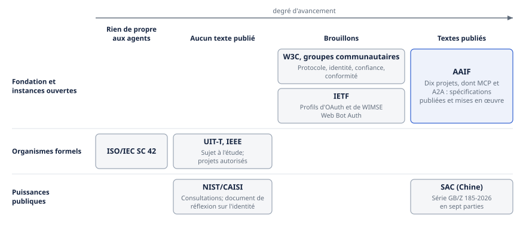
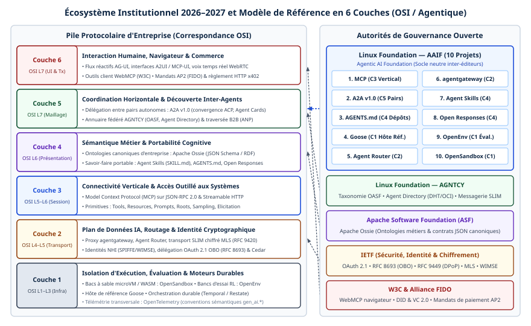

# Chapitre 11 — Géopolitique et gouvernance des standards

*Question directrice : qui écrit les règles, et que faire en attendant qu'elles se stabilisent ?*

> **État de référence :** pages de l'AAIF, du W3C, de l'IETF, du NIST, de l'UIT-T et de l'IEEE consultées le 11 novembre 2026; brouillons IETF dans leurs révisions du 29 octobre au 2 novembre 2026; page de l'initiative du NIST mise à jour le 9 novembre 2026. Les numéros entre crochets renvoient aux sources en fin de chapitre. Les sources [1] à [27] et [34] sont des pages primaires lues pour ce chapitre; les sources [28] à [33] sont secondaires, et la section sur la Chine repose entièrement sur elles.

Les chapitres 5 à 10 décrivent des protocoles. Celui-ci décrit ceux qui les écrivent. Une entreprise qui bâtit sur MCP, sur A2A ou sur un profil OAuth parie sur la stabilité d'un texte, donc sur l'organisation qui le tient. Or ces organisations n'ont ni le même statut, ni le même rythme, ni les mêmes maîtres.

La thèse du chapitre tient en trois propositions. Les protocoles d'agents se décident aujourd'hui dans des consortiums et des projets à code ouvert, pas dans les organismes de normalisation formels. La convergence est réelle à la couche des protocoles, où une seule fondation héberge les deux textes dominants, et absente à la couche de l'identité, où trois logiques s'opposent. Enfin, ce qui compte le plus pour une entreprise, soit l'approbation, l'escalade, l'audit et l'imputabilité, n'est exprimé par aucun protocole et ne le sera pas à court terme. La posture qui en découle : bâtir sur ce qui est stable, isoler ce qui ne l'est pas, et porter soi-même la gouvernance.

---

## 11.1 Cartographie des instances

Sept familles d'instances produisent ou annoncent des règles pour les agents.



| Instance | Nature | Production pour les agents | Texte le plus avancé |
|---|---|---|---|
| AAIF (Linux Foundation) | Fondation de projets à code ouvert, financée par cotisations | Héberge dix projets, dont MCP et A2A [1] | Spécifications publiées et mises en œuvre |
| W3C, groupes communautaires | Groupes ouverts, hébergés sans aval du W3C | Protocole d'agent, identité, confiance, conformité [9][10][11][12] | Brouillons de groupe; plusieurs groupes n'ont encore rien publié |
| IETF | Organisme ouvert de normalisation d'Internet | Profils d'OAuth et de WIMSE, signature des requêtes de robots [13][16][19] | Internet-Drafts de groupes de travail; aucun RFC propre aux agents |
| NIST/CAISI | Agence fédérale américaine | Consultations, document de réflexion sur l'identité [20][22] | Aucun livrable normatif publié |
| ISO/IEC JTC 1/SC 42 | Normalisation internationale par délégations nationales | Rien de propre aux agents repéré [32] | — |
| UIT-T, IEEE | Organismes formels | Sujet à l'étude; projets autorisés [23][24][25] | Aucun texte publié |
| SAC (Chine) | Autorité nationale de normalisation | Série GB/Z 185-2026 en sept parties [28][29] | Documents techniques d'orientation publiés |

**Les textes mis en œuvre viennent des consortiums.** MCP et A2A ont été écrits par des entreprises, puis confiés à une fondation. Les organismes formels en sont à autoriser des projets ou à ouvrir des sujets d'étude.

**Le travail se répartit par couche.** Les protocoles d'échange logent à l'AAIF. L'identité et l'autorisation se traitent à l'IETF, par extension de standards existants. Les groupes du W3C occupent les marges : identité décentralisée, score de confiance, conformité.

**Deux puissances publiques ont agi, de façon opposée.** Les États-Unis convoquent l'industrie et promettent des lignes directrices volontaires. La Chine a publié une série nationale complète. L'Union européenne intervient par la réglementation plutôt que par les protocoles (chapitre 35).

---

## 11.2 AAIF : dix projets, niveaux de maturité, membres

### Ce qu'est la fondation

L'Agentic AI Foundation a été annoncée par la Linux Foundation le 9 décembre 2025, avec trois projets fondateurs : MCP, donné par Anthropic, goose, donné par Block, et AGENTS.md, donné par OpenAI [3]. Elle en héberge dix au 11 novembre 2026 : Agent Router, Agent Skills, A2A, AGENTS.md, agentgateway, goose, MCP, Open Responses, OpenEnv et OpenSandbox [1]. A2A y a été accepté à l'été 2026; son billet d'annonce date du 27 août (chapitre 6) [7]. Agent Skills y est entré le 22 octobre 2026 (chapitre 13); le chapitre 44 décrit les deux passerelles.

La liste mêle des objets de nature différente : protocoles, formats de contexte, agent, passerelles, bac à sable. L'AAIF n'est donc pas un organisme de normalisation au sens strict : c'est un foyer neutre pour des projets, dont certains sont des spécifications.

### Deux étages de gouvernance

**L'étage de la fondation est réglé par la cotisation.** Quatre niveaux d'adhésion existent [2]. Le niveau platine, plafonné à huit membres et affiché comme non disponible, est occupé par Amazon Web Services, Anthropic, Block, Bloomberg, Cloudflare, Google, Microsoft et OpenAI; chacun a un siège garanti au conseil d'administration. Les membres or élisent un siège partagé et peuvent présider un groupe de travail, les membres argent peuvent en proposer un, et un niveau associé, gratuit et sans droit de vote, est réservé aux organismes sans but lucratif, universitaires et publics. Un décompte approximatif des logos donne une cinquantaine de membres or et environ deux cents membres argent.

Le comité technique compte un représentant de chacun des huit membres platine. Il fixe les exigences d'admission des projets, examine les candidatures et se réunit toutes les deux semaines [4]. Le même billet annonce sept groupes de travail, dont l'identité et la confiance, le commerce agentique, la sécurité, l'observabilité et l'alignement réglementaire, présidés tantôt « chacun par un membre platine », tantôt par des membres platine et or [4]. Le second énoncé est le bon au moins pour le commerce agentique, présidé par un représentant de Shopify, membre or [2], et coprésidé par OpenAI (chapitre 10). Ouverts en février 2026 à tous les niveaux d'adhésion [4], les groupes le seraient désormais aux non-membres, selon la presse [33].

**L'étage du projet est réglé par le mérite individuel, du moins pour MCP.** Le projet est constitué en entité distincte au sein de LF Projects. Ses sièges appartiennent à des personnes et non à des entreprises, et deux mainteneurs en chef ont le dernier mot [8]. Tout changement de gouvernance doit toutefois être approuvé par LF Projects (chapitre 5).

Les huit entreprises qui paient le plus contrôlent donc l'admission des projets et la stratégie de la fondation, sans détenir d'autorité formelle sur le contenu d'une spécification. L'admission d'un projet ne confère d'ailleurs ni niveau d'adhésion ni siège au conseil [6]. Le modèle varie d'un projet à l'autre : Agent Skills est orienté par des mainteneurs siégeant à titre individuel (chapitre 13), tandis que le comité de pilotage technique d'A2A réunissait en 2025 des représentants de huit entreprises (chapitre 6). La gouvernance se vérifie donc projet par projet.

### Trois niveaux de maturité

Jusqu'à l'été 2026, la fondation ne connaissait que deux niveaux, Growth et Impact. Un billet du 1er septembre 2026 en ajoute un troisième, Sandbox, parce que l'ancien seuil d'entrée supposait un usage en production à grande échelle [5].

| Niveau | Critères d'entrée | Suivi |
|---|---|---|
| Sandbox | Mise en œuvre fonctionnelle; intérêt externe naissant ou thèse crédible; un mainteneur actif désigné | Point d'étape à six mois; douze mois pour demander le niveau Growth, sans quoi une discussion d'archivage s'ouvre |
| Growth | Usage en production par deux organisations non affiliées; contributions de deux organisations ou plus sur six mois; plan de croissance accepté par un parrain du comité technique | — |
| Impact | Incidence à grande échelle et déploiements substantiels en production | — |

A2A a été admis au niveau Growth [7]. La page des projets n'affiche le niveau d'aucun d'entre eux [1] : celui des neuf autres n'a pas pu être établi.

Pour un acheteur, l'étiquette « projet de l'AAIF » ne dit donc rien de la maturité. Un projet Sandbox peut être archivé au bout d'un an. Il faut demander le niveau, et le vérifier.

---

## 11.3 W3C : groupes communautaires sur les protocoles, la confiance et la conformité

Le W3C n'a pas ouvert de groupe de travail normatif sur les protocoles d'agents. Il héberge des groupes communautaires, que toute personne peut proposer. Les pages de ces groupes précisent qu'ils sont animés par leur communauté et que l'hébergement n'emporte aucun aval du W3C [10][12]. Leurs rapports ne sont pas des Recommandations.

| Groupe | Lancement | Participants | Publié à ce jour |
|---|---|---|---|
| AI Agent Protocol [9] | 8 mai 2025 | 283 | Livre blanc d'Agent Network Protocol (mai 2025); cas d'usage et spécification de protocole (août 2025) |
| Agent Identity Registry Protocol [11] | Avril 2026 | Non indiqué | Rien; périmètre annoncé seulement |
| Agent Trust Protocol [10] | 4 juin 2026 | 22 | Rien |
| Agent Conformance and Benchmarking [12] | 30 août 2026 | 29 | Rien |

Le groupe **AI Agent Protocol** est le plus ancien et le plus peuplé. Sa mission est d'élaborer des protocoles ouverts qui permettent aux agents de se découvrir, de s'identifier et de collaborer [9]. Son premier brouillon publié est le livre blanc d'ANP, protocole décrit au chapitre 7.

Deux groupes nés en 2026 visent les lacunes de ce premier travail. **Agent Trust Protocol** annonce une méthode d'identifiant décentralisé et un modèle de score de confiance fondé sur les Verifiable Credentials [10]. **Agent Identity Registry Protocol** annonce un format de justificatif d'agent et un protocole de négociation de confiance entre organisations, avec des profils d'intégration pour MCP, A2A, OAuth et SPIFFE [11].

Le quatrième, **Agent Conformance and Benchmarking**, veut produire des méthodes ouvertes et reproductibles pour mesurer la conformité des systèmes d'agents [12]. Le chapitre 32 revient sur son intérêt pour l'assurance.

Ces groupes signalent où se trouvent les manques : identité vérifiable entre organisations, confiance, conformité. Ils ne signalent pas une solution : trois des quatre n'ont rien publié, leurs effectifs sont modestes et leurs périmètres se chevauchent. Une entreprise n'a rien à mettre en œuvre de ce côté; elle a une veille à tenir.

---

## 11.4 IETF : OAuth, WIMSE, Web Bot Auth

L'IETF aborde les agents par l'identité et l'autorisation. Sa méthode se lit dans le résumé du principal brouillon consacré au sujet : ne définir aucun nouveau protocole, montrer comment appliquer ou étendre les standards existants, et repérer les manques [16].

### OAuth

Le groupe OAuth porte l'Identity Assertion JWT Authorization Grant, ou ID-JAG, appelé informellement Cross-App Access (XAA). Le brouillon en est à la révision 06, datée du 31 octobre 2026; c'est un document du groupe de travail, destiné à la voie de normalisation, qui n'est pas encore un RFC [13]. Il décrit comment une application obtient un jeton d'accès pour une API tierce en présentant une assertion d'identité à un fournisseur d'identité que le serveur d'autorisation de cette API reconnaît déjà. Il s'appuie sur l'échange de jetons (RFC 8693) et sur le profil JWT des autorisations (RFC 7523).

Ce brouillon importe au-delà de l'IETF : l'extension Enterprise-Managed Authorization de MCP, pourtant classée stable, repose sur lui (chapitre 5). Un standard d'un consortium dépend ici d'un texte encore mouvant d'un autre organisme.

### WIMSE

Le groupe Workload Identity in Multi-System Environments traite de l'identité des charges de travail. Sa charte ne mentionne pas les agents : elle parle de microservices qui doivent s'authentifier entre eux à travers des frontières de confiance, et constate que OAuth, JWT et SPIFFE se combinent de multiples façons sans que leur interopération soit claire [14].

Les agents y sont entrés par un document. Un brouillon individuel a été remplacé par un document adopté par le groupe, « AI Identity Management System », dont la révision 01 date du 2 novembre 2026 [16][17]. Ses auteurs viennent notamment d'AWS, de Ping Identity, d'OpenAI et d'Okta. Sa thèse tient dans un titre de section : les agents sont des charges de travail. Le document compose SPIFFE, WIMSE et la famille OAuth 2.0 (chapitre 29).

Le document est de portée informative, et le groupe n'a publié aucun RFC [15].

### Web Bot Auth

Ce groupe vise l'authentification cryptographique des robots auprès des sites web, y compris les agents qui agissent au nom d'un utilisateur; sa charte exclut l'authentification de l'utilisateur final et les interfaces d'agent à agent [18]. Son unique document de groupe en est à la révision 01 du 29 octobre 2026 [19], et le calendrier de la charte a glissé. Le chapitre 9 décrit le mécanisme.

### Ce que l'IETF apporte, et ce qu'elle n'apporte pas

L'IETF apporte la continuité : un agent s'y authentifie avec les mêmes briques qu'un microservice, ce qui protège les investissements en gestion d'identité. Elle n'apporte ni vitesse ni couverture complète : aucun RFC propre aux agents n'existe au 11 novembre 2026.

---

## 11.5 NIST/CAISI et NCCoE

Le 17 février 2026, le Center for AI Standards and Innovation (CAISI) du NIST a lancé l'AI Agent Standards Initiative, en coordination avec l'Information Technology Laboratory du NIST et la National Science Foundation [21]. L'initiative repose sur trois piliers [20][21] :

1. faciliter des standards menés par l'industrie et le leadership américain dans les organismes internationaux de normalisation;
2. soutenir des protocoles ouverts portés par la communauté;
3. investir dans la recherche sur la sécurité et l'identité des agents.

Le NIST n'écrit pas de protocole : il organise des rencontres techniques, mène des analyses d'écarts et produit des lignes directrices volontaires [20].

Trois activités ont été lancées, toutes de consultation : une demande d'information sur la sécurité des agents, un document de réflexion du NCCoE (National Cybersecurity Center of Excellence) sur l'identité et l'autorisation, et des séances d'écoute sectorielles sur les obstacles à l'adoption [20].

Le projet de document du NCCoE, publié le 5 février 2026 et soumis à commentaires jusqu'au 2 avril, expose les considérations d'un projet de démonstration **éventuel** sur l'application des standards d'identité aux agents [22]. Rien, dans les pages lues, ne confirme que ce projet a été lancé.

**Ce qui n'existe pas.** Plusieurs sources secondaires annoncent un « profil d'interopérabilité des agents » du NIST pour le quatrième trimestre de 2026. La page officielle de l'initiative, mise à jour le 9 novembre 2026, n'en fait aucune mention [20]. Elle ne liste aucun livrable normatif publié. Tant qu'un tel profil ne figure pas sur une page du NIST, il ne faut pas en faire une hypothèse de planification.

L'initiative vaut donc pour ce qu'elle signale : le gouvernement américain appuie les protocoles ouverts portés par l'industrie plutôt qu'un standard d'État, et traite l'identité comme le chantier prioritaire. Cela n'ajoute rien, pour l'instant, à ce qu'une entreprise peut mettre en œuvre.

---

## 11.6 ISO/IEC SC 42 : une absence à interpréter

### Rien de propre aux agents

Une synthèse d'octobre 2026 sur l'état de la famille ISO/IEC 42000 ne recense aucune norme ni aucun projet du sous-comité SC 42 consacré aux agents, aux systèmes multi-agents ou à leur interopérabilité [32]. Les textes en cours les plus proches sont horizontaux : un projet final sur la journalisation des systèmes d'IA (ISO/IEC FDIS 24970) et un autre sur la supervision humaine (ISO/IEC 42105), en cours de publication depuis le 22 octobre 2026 selon un catalogue national. Ils concernent les agents sans les nommer (chapitre 35). Ce constat repose sur une source secondaire; le catalogue de l'ISO n'a pas été consulté.

### Trois lectures

**Le rythme.** Un protocole d'agents change plusieurs fois par an : MCP a connu une révision majeure en juillet 2026 (chapitre 5). Un cycle de normalisation internationale par délégations nationales ne suit pas ce rythme.

**L'objet.** Le SC 42 normalise des concepts, des systèmes de gestion et des méthodes d'évaluation. Les protocoles d'échange se négocient ailleurs, comme ce fut le cas pour ceux du web.

**La séquence.** Une norme internationale consacre souvent un consensus déjà formé. Selon l'autorité chinoise de normalisation elle-même, ce consensus n'existe pas encore sur l'identité des agents [29].

### Les autres organismes formels bougent

L'absence est propre à l'ISO/IEC. Deux organismes formels ont ouvert des travaux, encore loin d'un texte.

À l'**UIT-T**, la commission d'études 17 porte un sujet sur un modèle de données de référence pour l'identité des agents (X.aiidm) : intention, capacités, niveaux d'autonomie, délégation en chaîne. La fiche l'indique à l'étude, avec la mention « en pause », et vise une approbation en septembre 2027 [23].

À l'**IEEE**, deux projets ont été autorisés en 2026. Le projet P3931 porte sur l'interopérabilité de la description, de la découverte et des registres d'agents, à l'exclusion des cadres d'identité et des politiques de gouvernance [24]. Le projet P3945.1 définit un profil d'interopérabilité entre agents industriels [25]. Le premier recoupe le chapitre 8, le second le chapitre 28.

Une autorisation de projet n'est pas un brouillon : ces travaux donneront au mieux des textes en 2027. Ils montrent cependant que le terrain de la découverte et de l'identité attire de nouveaux prétendants.

---

## 11.7 Chine : la série GB/Z 185-2026

> Cette section repose sur des sources secondaires [28] à [31]. Le texte officiel de la série n'a pas été lu.

### Ce qui a été publié

L'administration chinoise de la normalisation (SAC) et l'autorité de régulation du marché (SAMR) ont publié la série GB/Z 185-2026, « Intelligence artificielle — Interconnexion d'agents », en sept parties [28][29] :

1. architecture générale;
2. code d'identité;
3. gestion de l'identité;
4. description de l'agent;
5. découverte;
6. interaction;
7. invocation d'outils.

Les sources divergent sur la date : une fiche réglementaire donne le 22 mai 2026 [28], une note d'un observatoire européen situe au 26 juin la conférence de presse qui a présenté la série [29]. Les deux sont compatibles si la première est celle de l'avis officiel. Un article de la presse d'État parle pour sa part de huit documents [30]; l'écart reste inexpliqué.

La rédaction a été pilotée par le China Electronics Standardization Institute, avec plusieurs dizaines d'organisations, dont Huawei, Alibaba Cloud et Ant Group [28][30]. L'ensemble est présenté sous le nom d'Agent Interconnection Protocols (AIP).

### Ce que signifie « GB/Z »

Un texte GB/Z est un document technique d'orientation, non une norme obligatoire [28]. Selon l'observatoire européen, la SAC assume cette méthode : publier vite pour former un consensus, puis durcir. Elle prévoit de convertir la partie sur le code d'identité en norme obligatoire après une phase pilote [29].

### Une couverture fonctionnelle de bout en bout

La série couvre à elle seule ce que l'écosystème ouvert répartit entre MCP, A2A, les registres et l'IETF. D'après une analyse technique publiée en juin 2026, son introduction nomme MCP, A2A et ANP et constate qu'aucun ne fait consensus; la description d'agent y est proche de l'Agent Card d'A2A [31].

### La divergence porte sur l'identité

Toujours selon cette analyse, le code d'identité s'inscrit dans l'arbre des identifiants d'objet (OID), sous une racine nationale, et les certificats relèvent d'autorités de certification reconnues par l'État. Une annexe traite des agents étrangers : enregistrement sous le nœud national, ou système distinct assorti d'un accord de reconnaissance mutuelle [31].

Le contraste avec les sections 11.3 et 11.4 est net. L'IETF traite l'agent comme une charge de travail dans le domaine de confiance de son organisation. Les groupes du W3C misent sur des identifiants décentralisés, sans racine. La série chinoise pose une racine nationale. Ce sont trois modèles de confiance, et non trois syntaxes.

L'observatoire européen en tire une mise en garde, qui est une analyse et non un fait annoncé : si le code d'identité devient obligatoire, il pourrait conditionner l'accès au marché [29].

---

## 11.8 Convergence ou fragmentation : scénarios

### Ce qui converge, ce qui diverge

La convergence s'observe à la couche des protocoles. ACP a été absorbé par A2A (chapitre 6), et MCP et A2A logent dans la même fondation, qui les présente comme complémentaires [7]. Un relevé de mai 2025 proposait encore d'adopter quatre protocoles en séquence, MCP, ACP, A2A puis ANP [27]; dix-huit mois plus tard, le deuxième n'existe plus comme protocole distinct et le quatrième reste un brouillon de groupe communautaire [9].

La divergence s'observe à la couche de l'identité, où coexistent le profil OAuth et WIMSE, les identifiants décentralisés et la racine nationale. Entre organisations, le chapitre 45 examine une autre racine encore, le vLEI de la GLEIF, qui rattache une signature à une personne morale enregistrée. La divergence touche aussi la couche de la découverte, où un projet de l'IEEE s'ajoute aux registres existants (chapitre 8).

### Trois scénarios

Ces scénarios sont une construction d'auteur, sans appui sur une prévision publiée.

| Scénario | Description | Signaux à surveiller |
|---|---|---|
| A — Convergence de fait | MCP et A2A demeurent la base commune; l'IETF publie ses profils d'identité; les organismes formels entérinent après coup | Premier RFC de WIMSE; ID-JAG en dernier appel; extensions d'identité stables chez MCP |
| B — Bifurcation régionale | Les protocoles restent proches, mais l'identité se scinde entre une racine nationale chinoise et le reste du monde | Conversion du code d'identité chinois en norme obligatoire; proposition à l'ISO/IEC ou à l'UIT-T |
| C — Prolifération | Les groupes et projets se multiplient sans mises en œuvre; l'interopérabilité réelle passe par les plateformes des éditeurs | Groupes communautaires sans publication après un an; projets Sandbox archivés; écarts entre interopérabilité déclarée et constatée |

Les scénarios A et B ne s'excluent pas. Le scénario C n'est pas une hypothèse d'école : il décrit déjà la partie du paysage où les entreprises s'en remettent au plan de contrôle d'un éditeur (chapitre 26). Le chapitre 43 construit, pour 2027-2030, ses propres scénarios d'architecture; son scénario « Blocs » prolonge le scénario B.

---

## 11.9 Ce que les protocoles n'expriment pas

Reste, quel que soit le scénario, ce que les protocoles savent dire. Une prépublication de juin 2026 pose la question [26]. Ses auteurs appliquent une taxonomie de six dimensions de gouvernance à cinq protocoles et classent chaque couple comme pris en charge, partiel ou absent.

| Dimension | MCP | A2A | ACP | ANP | ERC-8004 |
|---|---|---|---|---|---|
| Appartenance (admission, retrait, rôles) | Absent | Partiel | Partiel | Absent | Partiel |
| Délibération structurée | Absent | Absent | Partiel | Absent | Absent |
| Vote | Absent | Absent | Absent | Absent | Absent |
| Préservation de la dissidence | Absent | Absent | Absent | Absent | Absent |
| Escalade vers l'humain | Absent | Absent | Absent | Absent | Absent |
| Audit et rejeu | Partiel | Absent | Absent | Absent | Partiel |

Aucune case n'est « pris en charge ». Les auteurs distinguent deux natures de lacune. Certaines sont comblables par extension : le mécanisme d'extension d'A2A pourrait accueillir ces primitives, mais aucune extension de gouvernance n'a été proposée. D'autres sont structurelles : le modèle client-serveur de MCP se prête mal à un état de communauté persistant. Leur conclusion est que la gouvernance est une couche manquante au-dessus des protocoles.

### Les réserves

Ce résultat doit être lu avec trois réserves. Il s'agit d'une prépublication de deux auteurs, sans évaluation par les pairs ni double codage des classements. La version de MCP analysée précède la révision de juillet 2026 (chapitre 5). Et l'analyse porte sur ce que les protocoles encodent, pas sur ce qu'on peut bâtir par-dessus.

La dernière réserve est décisive. Le classement « absent » de l'escalade humaine dans MCP ne signifie pas qu'un hôte ne peut pas demander une approbation. Il signifie que le protocole recommande la confirmation humaine par des « devrait », sans l'imposer ni en fixer la preuve, ce que le chapitre 5 établit à partir de la spécification elle-même.

### Une lacune que les normalisateurs reconnaissent

Le brouillon de WIMSE arrive par un autre chemin à un constat voisin. Il laisse hors de son périmètre le langage des politiques, qu'il ne recommande pas de normaliser, et les critères de conformité. Sur l'approbation humaine en cours d'exécution, il note que du travail de spécification reste à faire [16].

Les protocoles normalisent l'échange, et les profils d'identité normalisent la preuve de qui parle. Qui a le droit de décider, qui doit être consulté, quand un humain tranche et comment la décision se reconstitue : ces règles restent propres à chaque organisation. Elles se logent dans le plan de contrôle (chapitre 23), s'appliquent à la passerelle (chapitre 24) et se décident dans les instances internes (chapitre 39). Attendre qu'un standard les fournisse serait une erreur de planification.

---

## 11.10 Posture d'entreprise : suivre, contribuer, attendre

### Lire le statut d'un texte

Chaque instance a son échelle de maturité, et aucune ne se traduit directement dans une autre.

| Instance | Échelle | Seuil raisonnable pour la production |
|---|---|---|
| IETF | Brouillon individuel, document de groupe de travail, dernier appel, RFC | RFC; document de groupe en dernier appel si l'on accepte un risque de retouche |
| MCP | Extension expérimentale, bêta, stable; SDK de niveau 1 à 3 | Extension stable, SDK de niveau 1 (chapitre 5) |
| AAIF | Sandbox, Growth, Impact | Growth ou Impact |
| W3C | Rapport de groupe communautaire, puis voie de Recommandation | Rien n'est prêt du côté des groupes communautaires |
| Chine | GB/Z (orientation), GB (obligatoire) | Selon l'exposition au marché chinois |
| IEEE, UIT-T | Projet autorisé ou sujet à l'étude, puis texte approuvé | Rien avant un texte approuvé |

Un texte « stable » peut dépendre d'un texte qui ne l'est pas, comme l'extension d'autorisation de MCP dépend du brouillon ID-JAG. La maturité se vérifie donc sur toute la chaîne de dépendances.

### Trois postures, par couche

**Suivre** est la posture par défaut. Elle exige un responsable de veille désigné et une liste courte de signaux : révisions de MCP et d'A2A, état des brouillons OAuth et WIMSE, page de l'initiative du NIST, suites données à la série chinoise.

**Contribuer** se justifie quand trois conditions sont réunies : une lacune bloque un cas d'usage, l'entreprise possède une expérience de mise en œuvre à verser au débat, et elle peut y consacrer une personne dans la durée. Chez MCP, les réunions des groupes de travail sont ouvertes à toute la communauté et nul n'a besoin d'être membre d'un groupe pour prendre part à ses travaux; la page ne pose aucune condition d'adhésion à la fondation [34]. Les consultations du NIST sont ouvertes à tous. Peser sur la stratégie de la fondation suppose en revanche une cotisation, et le niveau platine est fermé [2].

**Attendre** convient aux couches sans consensus : identité décentralisée, score de confiance, réputation. Attendre ne veut pas dire ne rien faire. Il s'agit d'isoler la dépendance derrière un adaptateur, à la passerelle ou dans la couche d'identité, pour que le choix reste réversible.

| Couche | Posture | Motif |
|---|---|---|
| Protocoles agent-outil et agent-agent | Adopter et suivre | Textes mis en œuvre, hébergés par une fondation, politique de dépréciation connue |
| Autorisation déléguée par l'entreprise | Adopter avec prudence; contribuer si l'enjeu est élevé | Extension stable adossée à un brouillon IETF |
| Identité de charge de travail pour agents | Suivre de près | Document de groupe informatif; aucun RFC de WIMSE |
| Identité décentralisée, confiance, réputation | Attendre | Groupes sans publication, modèles concurrents |
| Découverte et registres | Adopter un registre interne; suivre le reste | Registre officiel en préversion (chapitre 8); projet IEEE naissant |
| Gouvernance des décisions | Bâtir en interne | Hors de portée des protocoles (section 11.9) |

### Deux cas particuliers

Une entreprise présente en Chine doit prévoir qu'un agent puisse porter deux identités, l'une pour son écosystème habituel, l'autre conforme au code national si celui-ci devient obligatoire. L'architecture d'identité devrait donc traiter l'identifiant comme un attribut remplaçable, non comme une clé gravée dans les agents.

Une entreprise qui dépend d'un éditeur de plateforme devrait inscrire dans ses contrats les standards visés, leur version et le délai de mise à niveau, plutôt qu'une mention générale d'ouverture (chapitre 27).

---

## Grille de décision

| Décision | Option par défaut | Quand s'en écarter |
|---|---|---|
| Sur quels standards bâtir | Textes mis en œuvre et hébergés par une fondation : MCP, A2A, RFC de la famille OAuth | Secteur doté d'un protocole propre (chapitres 7, 10, 28) |
| Seuil de maturité en production | RFC; extension stable; projet AAIF de niveau Growth ou Impact | Bénéfice élevé et coût d'adaptation budgété : document de groupe IETF, extension bêta |
| Dépendance à un brouillon | Isolée derrière un adaptateur, révision visée consignée | Aucun cas pour une dépendance diffuse dans les agents |
| Projet de niveau Sandbox | Essai seulement | Engagement d'un mainteneur et plan de sortie documenté |
| Modèle d'identité des agents | Identité de charge de travail et OAuth, dans la continuité de l'existant | Exigence réglementaire locale; échanges ouverts entre organisations sans fédération possible |
| Identifiants décentralisés et scores de confiance | Attendre | Consortium sectoriel qui impose un modèle |
| Marché chinois | Veille sur la série GB/Z 185 et identité d'agent remplaçable | Conversion en norme obligatoire : conformité planifiée |
| Annonces non confirmées (profil du NIST, par exemple) | Exclues de la planification | Publication sur la page officielle de l'organisme |
| Participation aux standards | Veille avec responsable désigné | Lacune bloquante et expérience de mise en œuvre à faire valoir : contribution ciblée |
| Gouvernance des décisions d'agents | Conçue en interne, au-dessus des protocoles | — |
| Clauses contractuelles | Standards, versions et délais de mise à niveau nommés | — |

---

## Points à retenir

- Les protocoles d'agents se décident dans des consortiums et des projets à code ouvert. Les organismes formels en sont au stade du projet autorisé ou du sujet à l'étude.
- L'AAIF héberge dix projets de nature et de maturité inégales. Son conseil et son comité technique sont réglés par la cotisation; la gouvernance technique varie selon le projet et, chez MCP, repose sur des personnes.
- L'étiquette « projet de l'AAIF » ne garantit rien : trois niveaux existent depuis septembre 2026, et un projet Sandbox peut être archivé après un an.
- L'IETF étend OAuth et WIMSE aux agents sans créer de protocole. Aucun RFC propre aux agents n'existe, et l'extension d'autorisation d'entreprise de MCP repose sur un brouillon.
- L'initiative du NIST est une démarche de consultation. Le profil d'interopérabilité que lui prêtent des sources secondaires ne figure pas sur sa page officielle.
- Aucune norme ISO/IEC propre aux agents n'a été repérée. L'UIT-T et l'IEEE ont ouvert des travaux sur l'identité, la découverte et les agents industriels, sans texte publié.
- La Chine a publié une série nationale en sept parties, non obligatoire, qui couvre toute la pile. Sa différence de fond porte sur l'identité, ancrée dans une racine nationale.
- La convergence est réelle pour les protocoles et absente pour l'identité, où s'opposent trois modèles de confiance.
- Aucun protocole n'exprime l'approbation, l'escalade, la délibération ou l'audit d'une décision. Cette couche revient à l'entreprise.

---

## Sources

Pages primaires lues le 11 novembre 2026 :

1. [AAIF — projets](https://aaif.io/projects)
2. [AAIF — membres](https://aaif.io/members)
3. [AAIF — annonce de formation, 9 décembre 2025](https://aaif.io/news/linux-foundation-announces-formation-of-aaif)
4. [AAIF — bilan du premier trimestre, 24 février 2026](https://aaif.io/blog/aaifs-first-quarter-success-story-new-members-technical-wins-and-open-governance)
5. [AAIF — « Catch Them Early », phase Sandbox, 1er septembre 2026](https://aaif.io/blog/aaif-sandbox-phase)
6. [AAIF — dépôt des propositions de projets](https://github.com/aaif/project-proposals)
7. [A2A — entrée à l'AAIF, 27 août 2026](https://a2a-protocol.org/latest/blog/2026/08/27/a-new-chapter-for-a2a-joining-the-agentic-ai-foundation/)
8. [MCP — gouvernance](https://modelcontextprotocol.io/community/governance.md)
9. [W3C — AI Agent Protocol Community Group](https://www.w3.org/community/agentprotocol/)
10. [W3C — Agent Trust Protocol Community Group](https://www.w3.org/community/atp/)
11. [W3C — Agent Identity Registry Protocol Community Group](https://www.w3.org/groups/cg/agent-identity/)
12. [W3C — Agent Conformance and Benchmarking Community Group](https://www.w3.org/community/agent-conformance/)
13. [IETF — draft-ietf-oauth-identity-assertion-authz-grant-06](https://datatracker.ietf.org/doc/draft-ietf-oauth-identity-assertion-authz-grant/)
14. [IETF — charte du groupe WIMSE](https://datatracker.ietf.org/wg/wimse/about/)
15. [IETF — documents du groupe WIMSE](https://datatracker.ietf.org/wg/wimse/documents/)
16. [IETF — draft-ietf-wimse-aims-01, « AI Identity Management System »](https://datatracker.ietf.org/doc/draft-ietf-wimse-aims/)
17. [IETF — draft-klrc-aiagent-auth-03 (remplacé)](https://datatracker.ietf.org/doc/draft-klrc-aiagent-auth/)
18. [IETF — charte du groupe Web Bot Auth](https://datatracker.ietf.org/wg/webbotauth/about/)
19. [IETF — draft-ietf-webbotauth-httpsig-protocol-01](https://datatracker.ietf.org/doc/draft-ietf-webbotauth-httpsig-protocol/)
20. [NIST — AI Agent Standards Initiative](https://www.nist.gov/caisi/ai-agent-standards-initiative)
21. [NIST — annonce de l'initiative, 17 février 2026](https://www.nist.gov/news-events/news/2026/02/announcing-ai-agent-standards-initiative-interoperable-and-secure)
22. [NIST — document de réflexion du NCCoE, 5 février 2026](https://www.nist.gov/news-events/news/2026/02/new-concept-paper-identity-and-authority-software-agents)
23. [UIT-T — sujet d'étude X.aiidm](https://www.itu.int/ITU-T/workprog/wp_item.aspx?isn=24045)
24. [IEEE — projet P3931](https://standards.ieee.org/ieee/3931/12499/)
25. [IEEE — projet P3945.1](https://standards.ieee.org/ieee/3945.1/12437)
26. [Governance Gaps in Agent Interoperability Protocols (arXiv 2606.31498), prépublication](https://arxiv.org/abs/2606.31498)
27. [A survey of agent interoperability protocols (arXiv 2505.02279), résumé](https://arxiv.org/abs/2505.02279)

Sources secondaires, lues le même jour :

28. [regulations.ai — fiche de la série GB/Z 185-2026](https://regulations.ai/regulations/RAI-CN-NA-GB18520-2026)
29. [SESEC — « China will Accelerate Agentic AI Standardization », 16 juillet 2026](https://sesec.eu/2026/07/16/china-will-accelerate-agentic-ai-standardization/)
30. [Science and Technology Daily — publication de la série, 9 juin 2026](https://www.stdaily.com/web/gdxw/2026-06/09/content_529630.html)
31. [Ken Huang — analyse de la série GB/Z 185, 28 juin 2026](https://kenhuangus.substack.com/p/china-shipped-a-national-standard)
32. [GAICC — état de la famille ISO/IEC 42000, octobre 2026](https://gaicc.org/blog/iso-42000-standards-family/)
33. [diginomica — changements de règles à l'AAIF, 14 octobre 2026](https://diginomica.com/what-agentic-ai-foundations-rule-changes-mean-building-mcp-a2a)

Page primaire lue lors de l'audit, le 12 novembre 2026 :

34. [MCP — Working Groups and Interest Groups](https://modelcontextprotocol.io/community/working-interest-groups.md)

## Limites de ce chapitre

- **Chine.** Le texte officiel de la série GB/Z 185-2026 n'a pas été lu : dates, statut, contenu et intentions viennent de sources secondaires, dont une analyse écrite par l'auteur d'une proposition concurrente. L'écart entre sept et huit documents n'est pas résolu.
- **ISO/IEC.** L'absence de projet propre aux agents repose sur une synthèse secondaire.
- **AAIF.** Les pages [1], [2] et [4], relues le 12 novembre 2026, confirment les projets, les membres platine et le comité technique. Les effectifs or et argent restent un décompte approximatif de logos, qui varie d'une lecture à l'autre. Le niveau de neuf projets sur dix reste inconnu; la gouvernance de sept projets n'a pas été lue. Le billet [4] se contredit sur la présidence des groupes de travail; leur ouverture aux non-membres vient de la presse.
- **NIST et IETF.** Le document du NCCoE est connu par sa page d'annonce. Les brouillons de l'IETF sont décrits d'après leur fiche, relue le 12 novembre 2026 pour [13] et [16], non d'après une lecture intégrale.
- **Prépublication [26].** Le classement n'a pas été refait à partir des spécifications.
- **Hors champ.** L'Union européenne (CEN-CENELEC, ETSI), le Japon et la Corée ne sont pas couverts ici; la section 35.7 donne un relevé des cadres japonais et coréen.
- **Scénarios et grilles.** Les scénarios de la section 11.8, les seuils de maturité et les grilles de posture sont des propositions de ce chapitre.

## Mise en œuvre — Gouvernance des standards et anatomie de la pile interopérable {.volet}

:::: {.encadre .executive}
::: {.encadre-titre}
**Synthèse exécutive**
:::

- **Enjeu stratégique** : entre 2024 et 2025, la prolifération de cadriciels d’agents captifs et de connecteurs sur mesure a imposé aux entreprises un coût d’intégration quadratique ($N \times M$) et recréé un verrouillage fournisseur. En 2027, une pile protocolaire gouvernée par des fondations neutres conditionne toute mise à l’échelle rentable et auditable entre divisions.
- **Décisions architecturales structurantes** :
  1.  *Irréversible à moyen terme* : standardiser les contrats « sur le fil » autour du socle de l’AAIF (MCP en vertical, A2A v1.0 en horizontal, agentgateway en coupure réseau) et d’ontologies métiers canoniques (Apache Ossie).
  2.  *Structurante dès le cadrage* : appliquer sans dérogation la loi de non-substituabilité entre un outil déterministe (MCP) et un pair autonome (A2A), pour préserver les délais réseau, la chaîne d’identité et le périmètre réglementaire (BSIF E-23, EU AI Act).
  3.  *Réversible par conception* : le choix du moteur de modèle (abstrait derrière Open Responses et Agent Router), du bac à sable (OpenSandbox) ou du studio interne d’un éditeur SaaS.
- **Indicateurs de gouvernance associés** : taux de conformité protocolaire en production (cible $\ge 95\,\%$), délai médian de raccordement d’un domaine métier, temps de bascule entre modèles ($< 4\text{ h}$) et nombre de connecteurs hors norme maintenus en dette technique.
::::

## 11.11 Cartographie institutionnelle 2026–2027

Un code source ouvert ne suffit pas : il faut une gouvernance ouverte. Bâtir sur une bibliothèque sous licence MIT contrôlée à 95 % par un éditeur unique expose à des ruptures d’API trimestrielles, à des optimisations qui favorisent le nuage de son créateur et à une inflation combinatoire des ponts d’intégration. Pour $N$ environnements hôtes et $M$ systèmes cibles, soumis à un facteur annuel de dérive $\delta$, le passage aux protocoles canoniques change l’équation économique :

$$C_{\text{propriétaire}} = (1 + \delta) \cdot (N \times M) \quad \longrightarrow \quad C_{\text{ouvert}} = N + M$$

Dans un groupe qui exploite $N = 12$ environnements d’agents et $M = 45$ systèmes métiers, avec un taux annuel de rupture d’API propriétaires $\delta = 0,35$, passer de $540$ intégrations point-à-point (soit $1,35 \times 540 \approx 729$ maintenances correctives annuelles) à $57$ adaptateurs normalisés réduit d’un ordre de grandeur la surface d’attaque et la dette d’entretien.



### Projets de l’AAIF et autorités complémentaires

Le tableau dresse l’inventaire technique des dix projets hébergés par l’AAIF au 11 novembre 2026 (section 11.2) et les rattache aux couches du modèle de référence défini plus bas. La colonne de statut s’en tient à ce que l’exposé établit : A2A a été admis au niveau Growth, et le niveau des neuf autres projets n’a pas pu être établi (section 11.2). Le fil rouge (section 11.14) et l’ADR-004 (section 11.15) placent la plupart de ces projets au socle obligatoire, ce qui va au-delà de ce que retient l’exposé : un seuil de production à Growth ou Impact et la vérification du niveau de chaque projet (sections 11.2 et 11.10).

| Projet AAIF | Origine initiale | Couche | Rôle normatif en architecture d’entreprise | Statut 2026–2027 |
|:-----------------|:-------------|:--------------|:------------------------------------|:------------------|
| **1. MCP** (*Model Context Protocol*) | Anthropic | C3 (Vertical) | Protocole JSON-RPC 2.0 sur Streamable HTTP qui normalise outils, ressources, prompts, échantillonnage et élicitation. | Texte mis en œuvre; niveau non établi |
| **2. A2A** (*Agent2Agent v1.0*) | Google + IBM (ACP) | C5 (Horizontal) | Délégation asynchrone d’objectifs entre agents pairs opaques, par Agent Cards, tâches durables et artefacts typés. | Niveau Growth |
| **3. `AGENTS.md`** | OpenAI / Communauté | C4 (Contexte) | Convention Markdown qui fixe à la racine d’un dépôt les invariants d’architecture, les tests et les frontières de sécurité. | Niveau non établi |
| **4. goose** | Block | C1 (Hôte) | Hôte et cadriciel agentique modulaire de référence, conçu nativement autour de MCP. | Niveau non établi |
| **5. Agent Router** | Communauté AAIF | C2 (Routage) | Routage dynamique des requêtes entre SLM économiques, LLM de raisonnement et agents spécialisés, selon le coût et la latence. | Niveau non établi |
| **6. agentgateway** | Solo.io | C2 (Plan données) | Proxy natif pour l’IA (Rust) qui assure l’authentification OAuth 2.1 OBO, les politiques Cedar/OPA et les traces MCP/A2A/LLM. | Niveau non établi |
| **7. Agent Skills** | Anthropic | C4 (Savoirs) | Empaquetage procédural portable (`SKILL.md`, `scripts/`, `references/`), chargé par divulgation progressive. | Niveau non établi |
| **8. Open Responses** | OpenAI / Communauté | C4 (Inférence) | Spécification multifournisseurs qui unifie appels de modèles, blocs de raisonnement, flux d’événements et outils distants. | Niveau non établi |
| **9. OpenEnv** | Hugging Face | C1 (Évaluation) | Environnement conteneurisé standardisé pour l’évaluation reproductible, la simulation et le RL d’agents. | Niveau non établi |
| **10. OpenSandbox** | Alibaba | C1 (Isolation) | Environnement d’exécution confiné (microVM, gVisor, WASM) pour le code généré ou les scripts d’outils. | Niveau non établi; obligatoire pour code dynamique |

Cinq autorités complémentaires couvrent le reste du modèle (l’IETF et le W3C sont présentés aux sections 11.4 et 11.3) :

- Linux Foundation AGNTCY fournit la taxonomie formelle de compétences OASF (*Open Agentic Schema Framework*), l’annuaire fédéré Agent Directory (registres OCI et DHT) et le transport temps réel SLIM (*Secure Low-Latency Interactive Messaging*). Retenir OASF et Agent Directory au socle obligatoire (section 11.14, ADR-004) va au-delà de ce que retient l’exposé : adopter un registre interne et suivre le reste, le registre officiel étant en préversion et un projet de l’IEEE naissant (section 11.10).
- Apache Software Foundation (Apache Ossie) gouverne les ontologies métiers et les schémas JSON canoniques, pour que deux agents qui échangent le champ `net_exposure` partagent la même définition comptable.
- L’IETF étend les standards existants à l’identité et à l’autorisation des agents, sans qu’aucun RFC propre aux agents n’existe (section 11.4) : OAuth 2.1, échange RFC 8693 (*On-Behalf-Of*), preuve RFC 9449 (*DPoP*) et chiffrement de groupe RFC 9420 (MLS sous SLIM). L’identité multi-environnements WIMSE n’en est qu’à un document informatif et le groupe n’a publié aucun RFC : l’exposé recommande de la suivre de près (sections 11.4 et 11.10).
- Le W3C encadre DID / Verifiable Credentials 2.0. WebMCP (*Web Machine Learning Community Group*), qui expose les fonctions JavaScript d’une application web active aux agents du navigateur, relève d’un groupe communautaire : un tel groupe est hébergé sans aval du W3C et ses rapports ne sont pas des Recommandations (section 11.3).
- L’alliance FIDO ancre AP2 (*Agent Payments Protocol*) dans des mandats vérifiables signés par clé biométrique (*passkey*), complété par x402 (HTTP 402) pour les micro-règlements programmatiques.

Chaque couche délègue la sécurité ou le transport au standard spécialisé éprouvé, plutôt que de réinventer une pile monolithique.

:::: {.encadre .important}
::: {.encadre-titre}
**Important**
:::

**Niveaux de maturité** : distinguer, dans une architecture, les briques que l’exposé donne pour mises en œuvre et hébergées par une fondation (MCP Streamable HTTP, A2A v1.0) ou adossées à des RFC de la famille OAuth (OAuth 2.1 OBO), celles dont le niveau n’a pas pu être établi (`AGENTS.md`, Agent Skills, agentgateway) et les standards déployés par paliers encadrés en 2027 (fédérations AGNTCY inter-entreprises et règlements AP2/x402 soumis aux homologations bancaires). WebMCP relève d’un groupe communautaire du W3C : l’exposé ne voit rien de prêt pour la production de ce côté (section 11.10). Le seuil de maturité par instance figure à la section 11.10.
::::

------------------------------------------------------------------------

## 11.12 Modèle de référence en 6 couches et loi de non-substituabilité de l’outil et du pair

Ce modèle de référence en six couches (C1 à C6) décompose, selon une lecture ascendante d’inspiration OSI, les strates d’infrastructure et de transport sous-jacentes à la vue fonctionnelle de l’Ouverture. Il garantit l’indépendance de substitution : remplacer un moteur de couche 1 ou un routeur de couche 2 laisse intacts les contrats fonctionnels des couches 3 à 6. Contrairement à OSI, la pile agentique doit transporter aussi le sens métier, l’intention déléguée, l’identité atténuée et le budget économique, à travers des composants non déterministes :

1.  **Couche 1 — Isolation, évaluation et hôtes (OpenSandbox, OpenEnv, goose, moteurs durables)** : fournit le socle physique et temporel, soit l’exécution durable à journalisation déterministe (Temporal, Restate), le confinement microVM/WASM pour tout code non fiable, les bancs d’homologation reproductibles et la télémétrie OpenTelemetry.
2.  **Couche 2 — Plan de données IA, routage et identité (agentgateway, Agent Router, SLIM/MLS, OAuth 2.1 OBO)** : assure l’acheminement chiffré post-quantique, la vérification des identités non humaines (NHI via SPIFFE/WIMSE), l’atténuation des portées à chaque saut, l’arbitrage coût/latence entre modèles et l’évaluation des politiques Cedar ou OPA.
3.  **Couche 3 — Connectivité verticale (MCP sur Streamable HTTP)** : normalise l’invocation déterministe et typée des fonctions métiers, la lecture de ressources adressables par URI et les demandes contrôlées d’échantillonnage ou d’élicitation.
4.  **Couche 4 — Sémantique et portabilité cognitive (Apache Ossie, Agent Skills, `AGENTS.md`, Open Responses)** : découple le sens des entités d’affaires, le savoir-faire procédural de l’organisation et le contrat d’appel d’inférence des poids propriétaires d’un modèle particulier.
5.  **Couche 5 — Coordination horizontale (A2A v1.0, AGNTCY OASF et Agent Directory, ANP)** : assure la découverte dynamique des capacités publiées, la négociation de modalités et le cycle de vie asynchrone de tâches déléguées entre pairs autonomes opaques, y compris au-delà des frontières de l’entreprise.
6.  **Couche 6 — Interaction humaine et commerce (AG-UI, A2UI, WebRTC, WebMCP, AP2, x402)** : couvre la synchronisation d’état bidirectionnelle avec les opérateurs humains, le rendu d’interfaces génératives déclaratives sans injection de code, les flux vocaux temps réel et la signature cryptographique de mandats financiers.

### La loi de non-substituabilité : un outil MCP n’est pas un pair A2A

MCP et A2A v1.0 reposent tous deux sur JSON-RPC 2.0 sur HTTP, et certaines équipes tentent de les réduire à un seul protocole. Deux antipatrons en résultent :

- **Antipatron 1 — le « pair déguisé en outil » sur MCP** : dissimuler un agent autonome multi-tours derrière un appel `tools/call` MCP provoque des expirations HTTP 504 en cascade, masque la consommation récursive de jetons et empêche la gestion des états asynchrones (`WORKING`, `INPUT_REQUIRED`) quand une approbation humaine différée est requise.
- **Antipatron 2 — le « microservice déguisé en agent » sur A2A** : envelopper un calcul fiscal ou une requête SQL déterministe dans un serveur A2A doté d’un LLM ajoute 1 à 3 secondes de latence, introduit un risque d’hallucination inutile et soumet un composant ordinaire aux obligations réglementaires du risque de modèle (BSIF E-23).

| Critère d’architecture | Connectivité verticale — MCP (Couche 3) | Coordination horizontale — A2A v1.0 (Couche 5) |
|:----------------------|:-------------------------------------|:----------------------------------------|
| **Nature de la cible** | Capacité déterministe typée (*boîte de verre* : API, base, calcul) | Pair autonome opaque (*boîte noire* dotée de raisonnement et de mémoire propres) |
| **Contrat publié** | Schémas stricts (`inputSchema` / `outputSchema`) par primitive | Agent Card (`/.well-known/agent-card.json`) orientée compétences (`skills`) |
| **Régime temporel** | Millisecondes à quelques secondes (appel atomique borné) | Secondes à plusieurs jours, par machine à états (`SUBMITTED`, `WORKING`, `COMPLETED`) |
| **Couplage cognitif** | L’appelant prescrit *quelle* fonction exécuter, avec ses arguments exacts | L’appelant formule *quel* objectif atteindre; le pair planifie le *comment* |
| **Frontière d’identité** | Accès délégué à une ressource technique du domaine | Traversée de frontière organisationnelle, avec échange OAuth 2.1 OBO (RFC 8693) |
| **Profil FinOps et risque** | Coût marginal fixe; hors inventaire des modèles autonomes | Coût d’inférence variable plafonné (`ActionEnvelope`); gouvernance BSIF E-23 |

:::: {.encadre .sectoriel}
::: {.encadre-titre}
**Éditeurs SaaS B2B — Stratégie d’ouverture protocolaire face aux écosystèmes hyperscalers**
:::

Pour un éditeur SaaS B2B, refuser les standards ouverts par crainte d’être réduit à une base passive conduit, en 2027, à l’éviction lors des renouvellements de grands comptes. Les éditeurs performants structurent leur ouverture sur deux niveaux :

1.  **Ouvrir l’accès transactionnel par un serveur MCP distant** : exposer ses opérations unitaires validées sur Streamable HTTP et OAuth 2.1 remplace les accès fragiles par l’interface et préserve l’intégrité des règles métiers.
2.  **Monétiser le savoir-faire différenciant par A2A v1.0** : conserver ses modèles sectoriels et ses heuristiques propriétaires derrière une façade d’agent spécialiste A2A, facturée au résultat. Les orchestrateurs clients lui délèguent des missions à forte valeur sans pouvoir extraire sa propriété intellectuelle interne.
::::

------------------------------------------------------------------------

## 11.13 Cycle de vie des spécifications ouvertes et stratégies anti-verrouillage

MCP négocie ses révisions calendaires par l’en-tête MCP-Protocol-Version, tandis qu’A2A suit un versionnement sémantique (v1.0). Contre les extensions propriétaires qui rendent un composant captif, l’architecture combine une validation déclarative en passerelle et l’abstraction du plan d’inférence, conformément à l’isolement des dépendances instables derrière un adaptateur (section 11.10).

#### Extrait 11.1 — Matrice déclarative de conformité protocolaire (boreal-protocol-policy.yaml)

La politique fixe les versions de MCP et d’A2A admises, les transports, les contraintes de conception des outils, les règles d’identité et l’espace de noms des extensions d’éditeur; en production, tout composant non conforme est bloqué.

``` yaml
apiVersion: architecture.boreal.ca/v2027
kind: ProtocolGovernancePolicy
metadata:
  name: boreal-aaif-baseline-2027
  owner: coe-architecture-agentique@boreal.ca
spec:
  enforcementMode: block_non_compliant_in_prod
  verticalConnectivity:
    protocol: mcp
    allowedProtocolVersions: ["2025-06-18", "2026-07-28"]
    deprecatedGracePeriodDays: 90
    transports:
      remoteProductionAllowed: ["streamable-http"]
      forbidden: ["legacy-http-sse", "stdio"] # stdio réservé à OpenSandbox local
    toolDesignConstraints:
      maxToolsPerServer: 15
      requireOutputSchema: true
      requireIdempotencyKeyOnMutatingTools: true
  horizontalCoordination:
    protocol: a2a
    minVersion: "1.0.0"
    requireSignedAgentCard: true
    canonicalPayloadRegistry: "https://schemas.boreal.ca/ossie/v2/"
  securityAndIdentity:
    forbidStaticApiKeys: true
    requiredDelegationFlow: "urn:ietf:params:oauth:grant-type:token-exchange"
    requireDpopSenderConstraint: true
  vendorExtensionsPolicy:
    permittedNamespace: "_meta.vendor"
    requireGracefulDegradationWhenStripped: true
```

En homologation dans OpenEnv, le pipeline CI/CD purge systématiquement `_meta.vendor` : tout composant qui échoue sans ses métadonnées propriétaires se voit refuser le déploiement. La même gouvernance protège la chaîne d’approvisionnement logicielle contre les mutations furtives des schémas distants : chaque manifeste d’outils MCP et chaque Agent Card A2A approuvés voient leur empreinte SHA-256 scellée dans le registre interne de la passerelle. Si un éditeur SaaS modifie silencieusement la description d’un outil ou élargit ses paramètres lors d’une mise à jour nocturne, agentgateway détecte la divergence d’empreinte et met la route en quarantaine avant qu’un agent interne n’interprète ce schéma non audité.

Coder directement contre le SDK exclusif d’un laboratoire d’IA, ou lui confier l’hébergement de l’état de session, interdit tout basculement d’urgence en cas de panne infonuagique ou de révision tarifaire. Les appels passent par Open Responses derrière Agent Router, avec `storeStateRemotely: false` : l’historique décisionnel reste sous le contrôle du moteur durable interne. Les modèles à raisonnement ajoutent une contrainte : leurs traces latentes chiffrées (*Encrypted Reasoning Items*) sont liées cryptographiquement au fournisseur émetteur et ne peuvent pas être rejouées vers un modèle concurrent en cours de conversation. Le moteur durable ne conserve donc d’un tour à l’autre que les faits structurés et les résultats d’outils canoniques.

#### Extrait 11.2 — Port d’abstraction anti-verrouillage TypeScript sur Open Responses

Le client ci-dessous interdit au niveau du type le stockage d’état chez le fournisseur et transmet à Agent Router une preuve DPoP, le profil de routage, la zone de résidence des données et le plafond de coût.

``` typescript
export interface InferenceRoutingPolicy {
  readonly capabilityProfile: "fast-triage-slm" | "domain-specialist" | "deep-reasoning";
  readonly dataResidencyZone: "CA-QC-LAW25" | "EU-GDPR" | "US-EAST";
  readonly maxCostCadPerCall: number;
}

export interface OpenResponseRequest {
  readonly specVersion: "open-responses/1.0";
  readonly instructions: string;
  readonly input: ReadonlyArray<{
    readonly type: "message" | "item_reference";
    readonly role?: "user" | "system" | "developer";
    readonly content?: string;
  }>;
  readonly mcpServers?: ReadonlyArray<{
    readonly serverLabel: string;
    readonly serverUrl: string;
    readonly allowedTools: ReadonlyArray<string>;
  }>;
  readonly textFormatSchema?: Record<string, unknown>;
  readonly storeStateRemotely: false; // Rétention d'état externe strictement interdite
}

export interface OpenResponseResult<T> {
  readonly responseId: string;
  readonly servedByModelId: string;
  readonly parsedOutput: T;
  readonly billedCostCad: number;
}

export class BorealVendorNeutralModelClient {
  constructor(
    private readonly routerUrl: string,
    private readonly obtainDpopArtifacts: (
      htm: string,
      htu: string
    ) => Promise<{ accessToken: string; dpopProof: string }>
  ) {}

  async invokeStructured<T>(
    request: OpenResponseRequest,
    routing: InferenceRoutingPolicy,
    signal?: AbortSignal
  ): Promise<OpenResponseResult<T>> {
    const endpoint = `${this.routerUrl}/v1/responses`;
    const { accessToken, dpopProof } = await this.obtainDpopArtifacts("POST", endpoint);
    const res = await fetch(endpoint, {
      method: "POST",
      signal,
      headers: {
        "Content-Type": "application/json",
        "Authorization": `DPoP ${accessToken}`,
        "DPoP": dpopProof,
        "X-Agent-Router-Profile": routing.capabilityProfile,
        "X-Agent-Residency-Zone": routing.dataResidencyZone,
        "X-Agent-Max-Cost-CAD": routing.maxCostCadPerCall.toFixed(4)
      },
      body: JSON.stringify(request)
    });
    if (!res.ok) throw new Error(`Échec Agent Router (${res.status})`);
    return (await res.json()) as OpenResponseResult<T>;
  }
}
```

:::: {.encadre .sectoriel}
::: {.encadre-titre}
**Secteur public et infrastructures critiques — Clauses de réversibilité dans les marchés publics (Loi 25, EU AI Act)**
:::

Pour les organismes publics québécois, canadiens et européens soumis à la Loi 25, au RGPD et à l’article 25 de l’EU AI Act (échéance haut risque de décembre 2027), la réversibilité protocolaire est une exigence de souveraineté opérationnelle. Les cahiers d’appel d’offres 2027 imposent quatre clauses techniques :

1.  **Ouverture native sans surtaxe** : exposition obligatoire des capacités par MCP (AAIF) et A2A v1.0, sans frais discriminatoires par appel externe.
2.  **Propriété et exportabilité cognitive** : restitution intégrale des procédures métiers au format ouvert Agent Skills (`SKILL.md`) et en schémas JSON standardisés.
3.  **Absence d’état captif** : interdiction de subordonner l’exécution à un historique décisionnel enfermé dans un nuage propriétaire non réplicable.
4.  **Preuve contractuelle de substitution** : démonstration annuelle, sur banc OpenEnv, d’un changement de modèle sous-jacent en moins de 48 heures, sans régression critique.
::::

------------------------------------------------------------------------

## 11.14 Application au fil rouge : charte d’interopérabilité du Groupe Boréal

:::: {.encadre .filrouge}
::: {.encadre-titre}
**Fil rouge — Groupe Boréal : Rationalisation des 47 initiatives vers le socle normatif AAIF**
:::

**État initial (T4 2026)** : l’audit des 47 initiatives dispersées entre BEL, BCA et BSN relève 11 cadriciels d’agents incompatibles, des connecteurs SAP et Snowflake réécrits trois fois et deux pilotes captifs de l’API d’état hébergée d’un fournisseur américain, ce qui bloque le repli de BCA vers une région canadienne conforme à la Loi 25.

**Urbanisation en trois anneaux (8 semaines)** : plutôt que d’imposer un langage unique aux équipes TypeScript (BSN), Python (BCA) et Java/ABAP (BEL), l’architecture impose l’uniformité des protocoles sur le fil :

- **Anneau 1 (socle obligatoire)** : MCP (Streamable HTTP) en vertical; A2A v1.0 et AGNTCY OASF en horizontal; Apache Ossie (`schemas.boreal.ca/ossie/v2`) pour les 18 objets métiers canoniques; Open Responses par Agent Router et agentgateway; OpenSandbox pour tout script.
- **Anneau 2 (toléré sous passerelle $\le 6$ mois)** : les agents natifs Salesforce Agentforce et Copilot Studio restent dans leur périmètre local, à condition de ne communiquer que par des façades A2A v1.0 et MCP filtrées par agentgateway.
- **Anneau 3 (interdit immédiatement)** : clés d’API statiques, MCP stdio distant, génération OpenAPI brute (\> 15 outils) et `storeStateRemotely: true`.

**Résultats mesurés à T2 2027** :

- **Rationalisation** : extinction de 8 des 11 cadriciels redondants au profit d’un catalogue partagé de serveurs MCP et d’Agent Cards.
- **Raccordement** : un nouvel agent raccordé à deux *Systems of Record* passe de 9 semaines à 6 jours ouvrables.
- **Réversibilité prouvée (BSIF E-23)** : bascule réelle de l’agent garantie BCA vers un modèle souverain hébergé à Montréal en 2 h 15, avec un écart de précision de 0,7 % sous OpenEnv et aucune modification du code métier.
::::

------------------------------------------------------------------------

## 11.15 Décision d’architecture normative et points de contrôle

:::: {.encadre .adr}
::: {.encadre-titre}
**ADR-004 — Alignement normatif sur la pile Linux Foundation AAIF et gouvernance anti-verrouillage**
:::

- **Statut** : acceptée \| Périmètre : entreprise (développements internes et acquisitions SaaS) \| Révision : semestrielle
- **Contexte** : la dispersion des SDK propriétaires et des états d’inférence hébergés multiplie les coûts d’intégration ($N \times M$) et crée un verrouillage incompatible avec les exigences de BSIF E-23, de la Loi 25 et de l’EU AI Act.
- **Options évaluées** :
  1.  *Autonomie totale par produit* : rejetée — silos entre divisions, duplication des connecteurs et failles d’identité.
  2.  *Cadriciel logiciel unique imposé* : rejetée — incompatible avec les agents natifs des progiciels SaaS (SAP, Salesforce, ServiceNow) et avec la diversité des piles internes.
  3.  *Standardisation des protocoles sur le fil (socle AAIF + AGNTCY + IETF + Ossie)* : liberté de mise en œuvre interne, sous réserve du respect des contrats protocolaires ouverts, vérifiés en passerelle. Retenue.
- **Décision** : adopter le modèle en 6 couches fondé sur MCP (Streamable HTTP), A2A v1.0, AGNTCY OASF, Apache Ossie, Open Responses (`storeStateRemotely: false`), agentgateway (OAuth 2.1 OBO + DPoP) et OpenSandbox/OpenEnv. Confiner toute extension d’éditeur sous `_meta.vendor`, avec une dégradation gracieuse vérifiée en CI/CD.
- **Conséquences** :
  - *Positives* : complexité réduite à $N + M$, substitution de modèle en moins de 4 heures, clauses d’achat opposables aux éditeurs.
  - *Négatives, coûts assumés* : gouvernance continue du registre ontologique Apache Ossie et exploitation des pipelines de conformité OpenEnv.
- **Condition de révision** : semestrielle, selon les publications techniques de l’AAIF, de l’IETF (WIMSE) et du W3C (WebMCP).
::::

### Liste de contrôle de mise en production

Avant toute mise en production sur ce socle protocolaire, il faut vérifier huit critères :

1.  **Loi de non-substituabilité** : aucun agent multi-tours lent n’est-il dissimulé derrière un outil MCP, et aucun service déterministe simple n’est-il exposé inutilement en pair A2A ?
2.  **Validation de version en coupure** : la passerelle contrôle-t-elle MCP-Protocol-Version et les Agent Cards A2A v1.0 signées, et rejette-t-elle les transports obsolètes ?
3.  **Zéro état captif** : tous les appels cognitifs transitent-ils par Open Responses, avec refus du stockage d’état distant chez le fournisseur de LLM ?
4.  **Purge des extensions propriétaires** : les bancs OpenEnv valident-ils le fonctionnement nominal des flux après suppression automatique de `_meta.vendor` ?
5.  **Schémas métiers canoniques** : les charges entre divisions pointent-elles vers le registre versionné Apache Ossie ?
6.  **Confinement systématique** : toute exécution de script dynamique passe-t-elle par OpenSandbox, sans accès réseau libre ?
7.  **Clauses contractuelles SaaS** : les contrats d’édition exigent-ils MCP (Streamable HTTP + OAuth 2.1) et A2A v1.0 sans surcoût d’accès ?
8.  **Exercice de réversibilité** : un test chronométré de changement de modèle a-t-il été réussi ce trimestre sur un flux critique ?
