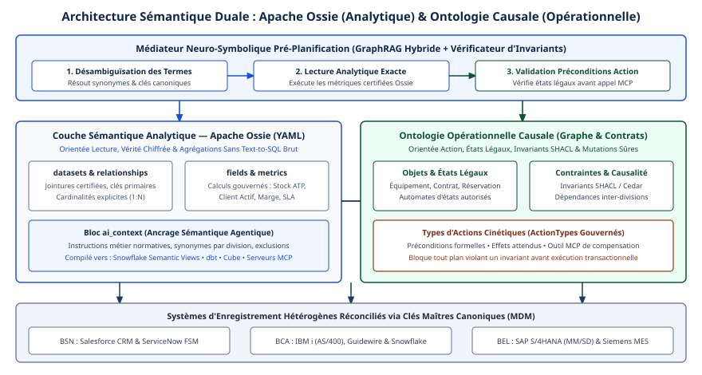

# Chapitre 12 — Couche sémantique et ontologies

*Question directrice : comment garantir que deux agents donnent le même sens au même terme ?*

> **État de référence :** dépôt `apache/ossie` (branche principale; spécification cœur et spécification d'ontologie en version `0.3.0.dev0`), page du projet à l'Apache Incubator, documentation du serveur MCP de dbt. Les numéros entre crochets renvoient aux sources en fin de chapitre : [1] à [11] sont des pages primaires lues pour ce chapitre, [12] et [13] des billets de fournisseurs lus et traités comme sources secondaires, [14] une source reprise du plan initial.

Deux agents peuvent échanger un message parfaitement formé et ne pas parler de la même chose. L'agent des ventes demande le « revenu du trimestre » à l'agent des finances; l'un pense aux commandes signées, l'autre aux montants reconnus en comptabilité. Aucun protocole ne signale l'écart : le schéma est respecté, le chiffre est plausible, et il est faux pour celui qui le reçoit.

MCP et A2A confient le sens à des descriptions en langage naturel, interprétées par un modèle (chapitres 5 et 6). Ce choix a supprimé le coût d'accord préalable qui avait freiné les générations précédentes (chapitre 2). Il laisse à l'entreprise la charge de fixer son vocabulaire ailleurs.

La thèse de ce chapitre tient en une phrase : aucun mécanisme ne garantit à lui seul l'accord de sens; on s'en approche par trois étages. Une couche sémantique fixe les mesures. Une ontologie fixe les concepts et leurs relations. Un contrôle d'intention vérifie que les agents poursuivent le même but. Le premier étage est mûr, le deuxième est coûteux, le troisième relève encore de la recherche. Quant au standard censé rendre les deux premiers portables, Open Semantic Interchange, il est moins avancé que l'étiquette « v1.0 » sous laquelle il circule ne le laisse croire.

---

## 12.1 Pourquoi l'accord syntaxique ne suffit pas

### Ce que le schéma ne dit pas

Un schéma JSON déclare qu'un champ `revenue` est un nombre décimal. Il ne dit ni la devise, ni la période, ni si les remboursements sont déduits, ni quelle table fait autorité. Dans MCP, ces précisions tiennent dans la description de l'outil, c'est-à-dire dans une phrase (chapitre 3). Deux serveurs écrits par deux équipes porteront deux phrases, et le modèle fera de son mieux avec chacune.

L'erreur qui en résulte a une propriété gênante : elle est silencieuse. Une erreur de syntaxe produit un rejet. Une erreur de sens produit une réponse bien formée, que l'agent suivant reprend comme un fait. Dans une chaîne d'agents, l'écart se propage sans qu'aucun contrôle de protocole ne le voie.


### Trois objets à accorder

Le mot « sens » recouvre trois objets différents, qui n'appellent pas le même instrument.

| Objet | Question type | Instrument | Maturité |
|---|---|---|---|
| La mesure | Comment calcule-t-on le revenu net ? | Couche sémantique | Produits établis |
| Le concept | Qu'est-ce qu'un client actif, et que peut-on en déduire ? | Ontologie, graphe de connaissances | Technique ancienne, coûteuse à tenir |
| L'intention | Que cherche-t-on à accomplir avec ce chiffre ? | Contexte partagé, détection de conflits | Recherche |

### Ce que montrent les bancs d'essai

Laisser un modèle écrire du SQL sur un schéma brut revient à lui faire deviner la couche sémantique. Un banc d'essai de 2023 a mesuré le prix de cette devinette. Sur un schéma d'assurance et 43 questions d'entreprise allant du rapport à la métrique, GPT-4 interrogeant directement la base SQL, sans exemples, obtenait 16 % de bonnes réponses; les mêmes questions posées sur une représentation en graphe de connaissances, bâtie d'une ontologie et de correspondances, en obtenaient 54 % (mesure des auteurs de data.world, dont la plateforme interrogeait le graphe; GPT-4 seul testé) [11].

Deux précautions s'imposent. Ces chiffres viennent du résumé de l'article, datent de novembre 2023 et portent sur un modèle dépassé. Et 54 % n'est pas un résultat de production. La leçon durable est le sens de l'écart : un modèle répond mieux quand le vocabulaire d'affaires lui est donné que lorsqu'il doit le reconstruire à partir de noms de colonnes. Le chapitre 15 arrive au même constat avec Spider 2.0, banc d'essai de la fin de 2024 sur des schémas d'entreprise réels.

---

## 12.2 La couche sémantique : métriques et dimensions gouvernées

### Définition

Une couche sémantique associe la logique d'affaires aux données, pour que les métriques soient calculées de la même manière quel que soit l'outil qui les demande. La formule vient d'un éditeur de catalogues, qui résume la répartition des rôles ainsi : la couche sémantique fixe comment une mesure se calcule, l'ontologie fixe ce qu'un concept veut dire [13].

Le vocabulaire est stable d'un produit à l'autre, et la spécification cœur d'Apache Ossie en donne une forme neutre [3].

| Construction | Rôle |
|---|---|
| Jeu de données (`datasets`) | Entité logique, table de faits ou de dimension, rattachée à une source physique; porte ses clés |
| Champ (`fields`) | Attribut de ligne servant à grouper, filtrer ou calculer; peut être marqué comme dimension temporelle |
| Relation (`relationships`) | Jointure déclarée entre deux jeux de données, y compris par clés composées |
| Métrique (`metrics`) | Agrégation nommée, propre à un jeu de données ou transversale au modèle |
| Contexte pour l'IA (`ai_context`) | Consignes, synonymes et exemples destinés aux outils d'IA |

Un fragment illustratif, construit d'après la forme que décrit la spécification :

```yaml
name: sales_analytics
datasets:
  - name: orders
    source: sales.public.orders
    fields:
      - name: amount
        expression: { sql: amount }
        ai_context:
          synonyms: [montant, chiffre d'affaires]
metrics:
  - name: total_revenue
    expression: { sql: SUM(orders.amount) }
```

### Ce que l'agent y gagne

L'agent ne rédige plus la requête. Il nomme une métrique et des dimensions; la couche compile le SQL. Trois effets en découlent.

**Le calcul devient déterministe.** Deux agents qui demandent `total_revenue` par région obtiennent le même chiffre, parce que la jointure et l'agrégation ne dépendent plus de l'interprétation d'un modèle.

**La surface d'erreur rétrécit.** Le modèle choisit parmi des noms gouvernés au lieu de naviguer dans les colonnes d'un schéma brut.

**La définition devient auditable.** Elle est écrite une fois, versionnée, et l'on peut montrer quelle version a produit un chiffre.

### Ce qu'elle ne fait pas

La couche sémantique exécute des calculs prédéfinis; elle ne raisonne pas [13]. Elle sait calculer le revenu par client. Elle ne sait pas qu'un sous-traitant de second rang est une sorte de fournisseur, ni qu'un client sous sanction ne doit pas recevoir d'offre. Son plafond est la profondeur conceptuelle.

Elle ne règle pas non plus le désaccord entre deux couches. Une entreprise qui a défini « revenu » dans son outil d'intelligence d'affaires, dans son entrepôt et dans sa plateforme de vente a trois couches sémantiques, donc trois vérités. C'est le problème que vise le format d'échange décrit en 12.4.

---

## 12.3 Ontologies et graphes de connaissances

### Définition

Une ontologie décrit formellement les concepts d'un domaine, leurs relations et les contraintes qui les lient, sous une forme lisible par une machine. La définition classique, due à Tom Gruber, en fait la spécification explicite d'une conceptualisation [13]. Les standards associés sont ceux du web sémantique : RDF pour les énoncés, OWL pour la logique, SPARQL pour l'interrogation. Un graphe de connaissances est ce qu'on obtient quand on peuple une ontologie avec les entités réelles de l'entreprise.

Là où la couche sémantique répond à « combien », l'ontologie répond à « qu'est-ce que » et « qu'en découle-t-il ». Elle permet trois choses qu'un modèle dimensionnel n'exprime pas : la hiérarchie de concepts (un employé est une personne), l'identité (ce qui fait que deux enregistrements désignent le même client) et la règle (un client dont les achats dépassent un seuil appartient à une catégorie).

| Critère | Couche sémantique | Ontologie |
|---|---|---|
| Objet | Métriques et dimensions | Concepts, relations, règles |
| Origine | Intelligence d'affaires | Représentation des connaissances |
| Résultat | SQL gouverné, indicateurs constants | Graphe, déductions, modèle conceptuel |
| Raisonnement | Aucun | Inférence à partir de règles formelles |
| Standards | Définitions YAML et SQL; format d'échange en cours | RDF, OWL, SPARQL |
| Apport pour un agent | Accès déterministe aux chiffres | Compréhension du domaine |

Ce tableau condense la comparaison d'un éditeur [13]; il vaut comme cadrage, non comme résultat de recherche.

### L'argument en faveur des agents

RelationalAI, membre du groupe à l'origine d'Open Semantic Interchange, formule l'argument sans détour : les modèles dimensionnels servent l'analyse et le rapport, alors qu'un agent doit raisonner [12]. Son exemple est une question de chaîne d'approvisionnement : quelle est l'exposition de l'entreprise si un fournisseur de second rang s'arrête ? Répondre suppose de savoir ce qu'est un fournisseur de second rang, par quelles relations il se rattache aux produits, et quelles règles définissent l'exposition. Sans ontologie, l'agent redécouvre cette logique à chaque question, avec le coût en jetons et le risque d'incohérence que cela comporte.

L'argument est plausible, mais il vient d'un fournisseur de moteur de raisonnement, sans mesure à l'appui. La seule donnée chiffrée lue ici est celle du banc d'essai cité en 12.1 [11].

### Le coût, leçon déjà apprise

Les ontologies ne sont pas une nouveauté, et leur histoire avec les agents est instructive. Les systèmes multi-agents de l'ère FIPA, vers 1995-2005, exigeaient une ontologie partagée avant tout échange, et cette exigence a pesé sur leur adoption (chapitre 2). Rien n'indique que le coût de construction et d'entretien ait disparu. Ce qui a changé, c'est que l'ontologie n'est plus un préalable à la communication : les agents se comprennent approximativement sans elle. Elle devient un investissement ciblé, justifié là où l'approximation coûte cher.

Deux situations le justifient. La première est un domaine borné, à fort enjeu, où une erreur de catégorie a une conséquence réglementaire ou financière. La seconde est un secteur qui dispose déjà d'une ontologie de référence : la finance et la santé en ont [13], et l'industrie s'appuie sur ses propres modèles d'information, OPC UA et AAS (chapitre 28). Dans les deux cas, on réutilise avant de construire.

Entre entreprises, un espace de données partage un vocabulaire de politiques d'usage (ODRL), pas la sémantique commerciale (chapitre 45); l'accord sémantique y reste un obstacle (chapitre 37).

---

## 12.4 Open Semantic Interchange, devenu Apache Ossie

### Chronologie

Open Semantic Interchange (OSI) a été lancé en septembre 2025 par un groupe d'éditeurs et d'utilisateurs comprenant Snowflake, Salesforce, dbt Labs, BlackRock et RelationalAI, selon une source secondaire [13]. Les jalons suivants sont lus à la source.

| Date | Événement | Source |
|---|---|---|
| 11 décembre 2025 | Version `0.1.1` de la spécification cœur, qualifiée de version initiale | [3] |
| 27 janvier 2026 | Snowflake annonce que la première version est disponible, sous licence Apache 2.0; huit nouveaux membres, dont Databricks | [7] |
| 28 avril 2026 | Cinq groupes de travail ouverts; quatorze nouveaux participants, dont Oracle et Cloudera | [6] |
| 29 mai 2026 | Première version de développement de la spécification d'ontologie, `0.2.0.dev0` | [5] |
| 22 juin 2026 | Entrée à l'Apache Incubator sous le nom Apache Ossie | [2] |

Le dépôt vit désormais sous `apache/ossie` et se présente comme l'ancien OSI [1]. Le billet de janvier promettait une gouvernance neutre confiée à une fondation [7]; c'est chose faite, avec une réserve. Un projet en incubation n'a pas encore reçu l'aval complet de l'Apache Software Foundation, et la page du projet ne contient encore aucun rapport d'étape [2].

### « v1.0 » n'est pas un numéro de version

Le plan initial de ce compendium, comme le billet d'Atlan, parle d'OSI « v1.0 » [13]; celui de Snowflake annonce une « première version » sans numéro [7]. L'historique des versions de la spécification ne contient aucune version 1.0 [3]. Il en liste deux : `0.1.1`, la version initiale, et `0.3.0.dev0`, en cours de développement, qui remplace une `0.2.0.dev0` jamais publiée. La section des publications du dépôt est vide [1]. La version en développement porte un avertissement sans équivoque : « Schema is mutable; do not depend on this version in production » [3].

Elle introduit d'ailleurs des ruptures : le champ d'extension change de nom, le tableau qui regroupait plusieurs modèles dans un document disparaît, et les références de métriques changent de cible. Un fichier conforme à la version de décembre 2025 n'est pas conforme à la branche principale de novembre 2026.

Il faut donc lire « v1.0 » comme une étiquette de communication désignant la première publication, et citer le numéro réel dans toute exigence contractuelle ou technique.

### Ce que couvre la spécification cœur

Un document Ossie, en YAML ou en JSON, décrit un seul modèle sémantique, avec les constructions présentées en 12.2 [3]. Quatre choix de conception méritent l'attention.

**Un SQL portable, et des dialectes opaques.** Une expression s'écrit d'abord dans un dialecte défini par la spécification, `OSSIE_SQL_2026`. Des variantes propres à un moteur peuvent l'accompagner, mais Ossie les traite comme opaques : une mise en œuvre peut les ignorer.

**Des extensions déclarées non portables.** Le champ `nonportable_extensions` accueille des données propres à un fournisseur. La sémantique cœur ne doit pas en dépendre, et un consommateur doit conserver celles qu'il ne comprend pas. Le nom dit l'essentiel : tout ce qui s'y loge reste captif.

**Un contexte pour l'IA.** Le champ `ai_context` reçoit des consignes, des synonymes et des exemples de questions. L'historique des versions le décrit comme un contexte pour agents. C'est le seul point où la spécification évoque les agents.

**Pas d'interface d'interrogation.** La spécification décrit des définitions, pas la manière de les interroger. Dans la version courante, une métrique ne peut pas en référencer une autre, et un champ ne peut pas en référencer un autre. Le contrôle d'accès n'y figure pas.

Le dépôt fournit, autour du texte, un SDK Python, des outils de validation, un évaluateur de portabilité et des convertisseurs de référence vers dbt, GoodData, Polaris et Salesforce [1].

### La spécification d'ontologie

L'« extension ontologique » annoncée par RelationalAI le 29 mai 2026 [12] est, dans le dépôt, un document distinct, au même numéro de version de développement [5]. Ses constructions sont peu nombreuses.

| Construction | Ce qu'elle exprime |
|---|---|
| `concept`, de type `EntityType` ou `ValueType` | Une entité d'affaires ou un type de valeur |
| `extends` | La spécialisation : un concept en étend un autre |
| `identify_by` | Les relations qui identifient une entité |
| `relationships`, avec rôles et `multiplicity` | Les liens entre concepts et leur cardinalité |
| `derived_by` | Une règle de dérivation, que la spécification compare à une vue |
| `requires` | Une contrainte sur la population d'un concept ou d'une relation |
| `iri` et `prefixes` | Le rattachement à un vocabulaire externe |

L'exemple de la spécification donne le ton :

```yaml
name: EnterpriseOntology
ontology:
  - concept: SocialSecurityNr
    type: ValueType
    extends: [Integer]
  - concept: Employee
    type: EntityType
    extends: [Person]
```

Le lien avec les données passe par des documents de correspondance séparés. Chacun relie une ontologie à un modèle sémantique et indique, par des expressions SQL sur les champs, comment peupler concepts et relations. L'ancienne forme, où les correspondances étaient incluses dans l'ontologie, est dépréciée. La spécification précise que l'analyseur et les convertisseurs ne prennent pas encore en charge les documents de correspondance autonomes [5].

Trois constats cadrent les attentes. Le document ne décrit aucun moteur d'inférence : règles et contraintes sont des définitions qu'un outil peut évaluer, pas un raisonnement garanti. Il ne remplace pas les standards du web sémantique, mais permet d'y renvoyer par des IRI; ses exemples pointent vers des vocabulaires publics existants. Enfin, il est plus jeune et moins outillé que la spécification cœur.

### La feuille de route

La feuille de route du dépôt ne donne ni date ni version cible, et ne mentionne aucune version 1.0 [4]. Elle distingue les travaux en cours (sémantique des métriques, intégration aux catalogues, ontologie) des travaux futurs. Parmi ces derniers figurent trois éléments qui manquent aujourd'hui à un usage agentique : un langage d'interrogation sémantique avec un moteur de référence et une suite de tests de conformité, une couche sémantique « native IA » comprenant des requêtes vérifiées et le contrôle de ce qui est exposé à l'IA, et des identifiants stables assortis de normes de validation.

Ossie est donc, à ce jour, un format d'échange de définitions entre outils, muet sur la manière dont un agent les découvre ou les interroge à l'exécution. Sa valeur : écrire une définition une fois et la porter d'un outil à l'autre.

---

## 12.5 Exposer la sémantique aux agents

Une définition gouvernée ne sert à rien si l'agent ne la consulte pas. Faute d'interface standard, l'exposition passe par les produits, le plus souvent par MCP.

### Trois modes d'exposition

| Mode | Ce que fait l'agent | Risque principal |
|---|---|---|
| Outils sémantiques | Liste les métriques, choisit des dimensions, lance la requête | Catalogue trop vaste, noms ambigus |
| Contexte injecté | Lit définitions, synonymes et exemples, puis agit | Coût en jetons, contexte périmé |
| SQL libre | Rédige et exécute sa propre requête | Jointure ou agrégation fausse, sans signal |

Le serveur MCP de dbt illustre le premier mode [8][9]. Ses outils de couche sémantique forment une séquence : `list_metrics` énumère les métriques définies, `get_dimensions` et `get_entities` donnent ce par quoi on peut les découper, `get_dimension_values` les valeurs possibles, `query_metrics` exécute la requête avec filtres et regroupements. Un outil mérite d'être signalé : `get_metrics_compiled_sql` renvoie le SQL compilé sans l'exécuter. Il permet de consigner, pour chaque chiffre, la requête exacte qui l'a produit.

Le même serveur offre le troisième mode, par `text_to_sql` et `execute_sql`. La documentation traite le premier de ces outils à part : c'est le seul que la désactivation des fonctions d'IA par un administrateur fait disparaître [9]. Les serveurs gérés des grandes plateformes de données suivent une répartition comparable entre analyse sur vues sémantiques et exécution de SQL (chapitre 15).

Le deuxième mode repose sur les champs `ai_context` décrits en 12.4, ou sur leurs équivalents propres à chaque produit. Il relève de l'ingénierie du contexte : que charger, quand, et à quel coût (chapitre 13).

### Règles de conception

Cinq règles se dégagent. Ce sont des propositions de ce chapitre : les trois premières s'appuient sur la documentation lue, les deux dernières sur les chapitres voisins.

1. **Découvrir avant d'interroger.** L'agent consulte la liste des métriques et leurs dimensions avant toute requête. Une métrique absente du catalogue donne lieu à une demande de clarification, non à une improvisation en SQL.
2. **Garder la requête compilée.** Le SQL produit par la couche sémantique entre dans la piste d'audit avec la version du modèle.
3. **Stabiliser les noms.** La documentation de dbt indique que l'éditeur évite de renommer ou de retirer des outils, parce que des clients s'en servent dans leurs listes d'autorisation, et recommande d'épingler une version du serveur autohébergé pour obtenir un jeu d'outils figé [9]. La même discipline vaut pour les noms de métriques : les renommer rompt silencieusement les agents qui les ont appris.
4. **Borner le SQL libre.** Lecture seule, périmètre restreint, permissions de l'utilisateur appelant (chapitre 15).
5. **Traiter les descriptions comme une surface d'attaque.** Synonymes, consignes et exemples sont du texte injecté dans le contexte du modèle (chapitre 31). Leur modification passe par la même revue que le code.

### Une limite à garder en vue

Rien de tout cela n'est standardisé au niveau sémantique. MCP transporte l'appel; il ne dit pas qu'une métrique s'appelle une métrique. Deux serveurs de deux éditeurs exposent deux jeux d'outils différents pour le même besoin. Un format d'échange commun réduirait l'écart en amont, puisque les deux serveurs liraient les mêmes définitions. L'interface d'interrogation commune, elle, n'est qu'un projet de la feuille de route d'Ossie [4].

---

## 12.6 Divergence d'intention : le pont vers l'orchestration

### Le même mot, le même calcul, deux buts

Supposons le vocabulaire fixé : les deux agents partagent la définition du revenu et celle du client actif. Ils peuvent encore diverger sur ce qu'ils cherchent à faire. L'un optimise le délai de traitement d'une réclamation, l'autre la conformité du dossier; chacun agit correctement selon sa lecture de l'objectif commun, et le résultat d'ensemble est incohérent.

Dans sa version 2, la taxonomie MAST range 36,94 % des échecs multi-agents observés dans le désalignement entre agents [14]; la version 3 ramène cette part à environ 32 % (chapitre 21). Une prépublication de mars 2026 donne un nom au phénomène, la divergence d'intention sémantique, et y voit une cause première de ces échecs [10].

### Le cadre de consensus sémantique

Cette prépublication propose un intergiciel à six composants, qui couvrent le contexte partagé, la représentation de l'intention, la détection des conflits, leur résolution, le suivi de la dérive et la gouvernance [10]. D'après le résumé, l'idée est de représenter explicitement l'intention de chaque agent et de la confronter au contexte du processus d'affaires.

Le résumé rapporte une évaluation de 600 exécutions sur trois cadriciels et quatre scénarios d'entreprise. Le cadre y atteint 100 % de complétion des workflows, contre 25,1 % pour la meilleure solution de comparaison. Il détecte 65,2 % des conflits sémantiques, avec une précision de 27,9 %. L'auteur le présente comme indépendant du protocole et compatible avec MCP et A2A.

Ces résultats appellent une lecture prudente. La prépublication a un seul auteur et n'a pas été évaluée par les pairs. Selon le chapitre 21, qui en a lu le texte, les 600 exécutions sont simulées, sans vrais appels de modèle, et l'agent juge de comparaison atteint 93,2 % de précision. Une précision de 27,9 % signifie que près de trois alertes sur quatre sont fausses; à ce taux, un point de contrôle humain branché sur le détecteur serait vite ignoré (chapitre 22).

### Ce qu'on peut en retenir

Au niveau des buts, aucun instrument n'est mûr. Trois pratiques simples tiennent lieu de consensus. L'intention s'écrit dans le message de délégation, avec les critères de réussite et les arbitrages attendus (chapitre 13). L'agent qui reçoit une tâche ambiguë demande une clarification au lieu de trancher seul. Et un contrôle indépendant vérifie le résultat par rapport à l'objectif, pas seulement par rapport au format. Le chapitre 21 développe ces remèdes.

La couche sémantique y contribue indirectement. Un modèle de processus et un vocabulaire partagés donnent aux déclarations d'intention un référentiel commun; sans eux, deux intentions exprimées dans deux vocabulaires ne sont même pas comparables.

---

## 12.7 Gouverner le vocabulaire d'entreprise

Aucun instrument ne fonctionne sans réponse à une question de fond : qui décide de ce que veut dire un terme ?

### Le vocabulaire comme code

Un modèle sémantique est un fichier texte. Il se versionne, se révise et se valide comme du code, et l'outillage existe : schémas, validateurs, SDK [1]. Cette pratique donne trois garanties qu'un glossaire dans un document partagé ne donne pas : un historique des changements, une revue avant publication et la possibilité de tests automatiques.

Les tests comptent le plus dans un contexte agentique. Un jeu de questions de référence, avec la métrique et les dimensions attendues pour chacune, se rejoue à chaque changement du modèle sémantique et à chaque changement de modèle de langage, y compris pour chaque modèle qu'un routeur peut choisir (chapitre 44) ou un petit modèle distillé (chapitre 47). C'est la seule façon de détecter qu'un synonyme ajouté pour un agent en égare un autre.

### Rôles

| Rôle | Responsabilité |
|---|---|
| Propriétaire d'un terme | Tranche la définition; répond de sa justesse |
| Intendant du modèle sémantique | Tient le fichier, applique la revue, publie les versions |
| Équipe d'agents | Signale les ambiguïtés rencontrées en exploitation; propose synonymes et exemples |
| Architecture d'entreprise | Arbitre entre domaines quand un terme a deux propriétaires |

Le dernier cas est le plus fréquent et le plus politique. Quand les ventes et les finances définissent le revenu différemment, la solution n'est pas d'en choisir une. Elle consiste à nommer deux métriques distinctes, à documenter leur écart, et à retirer le terme nu du catalogue exposé aux agents.

### Un ordre de travail

Commencer par les métriques contestées, celles dont deux tableaux de bord donnent deux valeurs. Elles sont peu nombreuses, leur coût d'ambiguïté est connu, et la couche sémantique suffit.

Ajouter ensuite une ontologie pour un domaine borné où les agents doivent classer ou déduire, en partant d'un vocabulaire sectoriel quand il en existe un.

Formaliser enfin les règles. Les politiques d'entreprise vivent dans des documents et des usages; tant qu'elles n'ont pas été converties en définitions lisibles par machine, aucun format n'y change rien (chapitres 13 et 39).

### Portabilité et dépendance

Le format d'échange est une assurance contre le verrouillage, à condition de le lire correctement. Trois vérifications s'imposent avant de s'y fier : la version exacte que le produit lit et écrit; la part des définitions logée dans les extensions non portables; le sort des expressions écrites dans un dialecte propre au moteur. Une clause d'exportation dans un format ouvert, avec numéro de version, a sa place dans les contrats (chapitre 27).

Ce que le format ne porte pas reste à gouverner ailleurs. Le contrôle d'accès aux métriques n'est pas dans la spécification [3]; il relève des données et de l'autorisation (chapitres 15 et 30).

---

## Grille de décision

| Décision | Option par défaut | Quand s'en écarter |
|---|---|---|
| Accès des agents aux chiffres | Outils de couche sémantique : métriques et dimensions nommées | Exploration ponctuelle par un analyste : SQL libre en lecture seule |
| Définition des métriques | Une couche sémantique unique par domaine, versionnée comme du code | Deux définitions légitimes : deux métriques nommées, jamais un terme nu |
| Ontologie | Aucune au départ | Domaine borné à fort enjeu, ou ontologie sectorielle déjà disponible |
| Format d'échange | Suivre Apache Ossie; exiger l'import et l'export avec numéro de version | Parc à un seul outil : le format natif suffit |
| Version d'Ossie | Ne rien bâtir en production sur `0.3.0.dev0` | Prototype dont la réécriture est prévue |
| Spécification d'ontologie d'Ossie | Veille | Projet pilote avec un fournisseur membre du groupe de travail |
| Extensions de fournisseur | Minimales et inventoriées | Fonction sans équivalent portable, avec plan de sortie |
| Synonymes et consignes pour l'IA | Soumis à la même revue que le code | — |
| Contrôle d'intention | Intention écrite dans la délégation, clarification, vérification indépendante | Intergiciel de consensus : expérimentation seulement |
| Traçabilité d'un chiffre | Requête compilée et version du modèle consignées | — |

---

## Points à retenir

- Les protocoles transportent des mots; ils n'en fixent pas le sens. Une erreur sémantique ne produit pas de rejet, mais un résultat plausible et faux.
- Trois objets sont à accorder : la mesure, le concept et l'intention. Chacun a son instrument et son degré de maturité.
- La couche sémantique rend le calcul déterministe : l'agent nomme une métrique, la couche compile la requête. C'est l'étage le plus rentable et le plus mûr.
- L'ontologie ajoute hiérarchies, identité et règles. Son coût reste élevé; elle se justifie dans un domaine borné à fort enjeu.
- Open Semantic Interchange est devenu Apache Ossie, entré en incubation le 22 juin 2026. Il n'existe pas de version 1.0 : la seule version parue est la `0.1.1` de décembre 2025, et la branche en développement se déclare impropre à la production.
- La spécification d'ontologie d'Ossie est un document distinct, plus jeune, sans moteur d'inférence défini, et dont l'outillage de correspondance n'est pas terminé.
- Ossie est un format d'échange de définitions, pas une interface d'exécution. L'exposition aux agents passe aujourd'hui par des serveurs MCP propres à chaque éditeur.
- La divergence d'intention subsiste quand le vocabulaire est partagé. Le seul remède instrumenté lu pour ce chapitre est une prépublication, évaluée en simulation, dont le détecteur a une précision de 27,9 %.
- Le vocabulaire se gouverne comme du code : un propriétaire par terme, des versions, une revue, des jeux d'essai rejoués à chaque changement.

---

## Sources

Pages primaires lues le 11 novembre 2026 :

1. [Apache Ossie — dépôt et README](https://github.com/apache/ossie)
2. [Apache Incubator — page du projet Ossie](https://incubator.apache.org/projects/ossie.html)
3. [Apache Ossie — spécification cœur, version 0.3.0.dev0](https://raw.githubusercontent.com/apache/ossie/main/core-spec/spec.md)
4. [Apache Ossie — feuille de route](https://raw.githubusercontent.com/apache/ossie/main/ROADMAP.md)
5. [Apache Ossie — spécification d'ontologie, version 0.3.0.dev0](https://raw.githubusercontent.com/apache/ossie/main/ontology/ontology.md)
6. [Apache Ossie — point communautaire du 28 avril 2026](https://ossie.apache.org/updates/osi-april-2026-community-update/)
7. [Snowflake — billet du 27 janvier 2026 sur la première version d'OSI](https://www.snowflake.com/en/blog/open-semantic-interchanges-specs-finalized/)
8. [dbt — à propos du serveur MCP](https://docs.getdbt.com/docs/dbt-ai/about-mcp)
9. [dbt — outils du serveur MCP](https://docs.getdbt.com/docs/dbt-ai/mcp-available-tools)
10. [Semantic Consensus: Process-Aware Conflict Detection and Resolution for Enterprise Multi-Agent LLM Systems (arXiv 2604.16339)](https://arxiv.org/abs/2604.16339) — résumé seulement; le texte est lu au chapitre 21.
11. [A Benchmark to Understand the Role of Knowledge Graphs on LLM's Accuracy for Question Answering on Enterprise SQL Databases (arXiv 2311.07509)](https://arxiv.org/abs/2311.07509) — résumé seulement.

Billets de fournisseurs lus, traités comme sources secondaires :

12. [RelationalAI — sémantique ontologique dans OSI, 29 mai 2026](https://www.relational.ai/post/bringing-ontological-semantics-to-open-semantic-interchange-osi)
13. [Atlan — ontologie et couche sémantique, mise à jour du 9 octobre 2026](https://atlan.com/know/ontology-vs-semantic-layer/)

Source reprise du plan initial, non relue pour ce chapitre :

14. [Why Do Multi-Agent LLM Systems Fail? — MAST (arXiv 2503.13657)](https://arxiv.org/html/2503.13657v2)

## Limites de ce chapitre

- Les sources [10] et [11], d'abord connues par leur seul résumé, ont été relues au-delà du résumé le 14 novembre 2026, par un outil qui en rend des extraits; les écarts relevés sont corrigés dans le texte.
- L'intitulé de la section 12.4 a été modifié. Le plan initial annonce « Open Semantic Interchange v1.0 et son extension ontologique »; le dépôt ne contient aucune version 1.0, et le projet a changé de nom. Aucun autre chapitre ne reprend l'étiquette « v1.0 ».
- Les pages ont été lues par un outil d'extraction qui condense le texte, y compris à l'audit du 12 novembre 2026. Celui-ci a relu [2] à [7], [10] et [11], qui confirment dates, versions, avertissement de production, constructions de l'ontologie, feuille de route et chiffres des résumés. Noms de champs et fragments YAML restent à vérifier dans le dépôt; le fragment de la section 12.2 est une illustration, non un extrait.
- Le README [1], source de la liste des convertisseurs, et la documentation de dbt [8][9] n'ont pas été relus à l'audit. Le point communautaire d'avril renvoie à un dépôt distinct, `apache/ossie-converters`.
- La date de lancement d'OSI et la liste de ses fondateurs viennent d'Atlan [13]. Le point communautaire daté du 28 avril cite l'ancien dépôt, mais ses liens mènent au nouveau et il se dit en incubation, signe d'une mise à jour postérieure; la date du transfert n'a pas été établie.
- Les définitions de RDF, d'OWL, de SPARQL et du graphe de connaissances, ainsi que le rappel des ontologies dans les systèmes multi-agents classiques, viennent de la connaissance générale et du chapitre 2, non d'une page du W3C lue pour ce chapitre. SHACL n'a pas été examiné.
- Aucun produit d'ontologie d'entreprise n'a été étudié à la source. Les ontologies proposées par les plateformes de données et les vues sémantiques de Snowflake ne sont connues que par Atlan ou par le chapitre 15.
- Les deux articles [10] et [11] ne sont connus ici que par leur résumé; le caractère simulé de l'évaluation de [10] est repris du chapitre 21. La part de 36,94 % (MAST, version 2 [14], non relue) concorde avec les chapitres 3, 4 et 21; celle d'environ 32 % est une somme calculée au chapitre 21. Le banc d'essai [11] date de 2023; aucune mesure récente et indépendante du gain apporté par une couche sémantique ou une ontologie n'a été lue.
- Les chiffres d'Atlan (délais de mise en œuvre, gains de précision, prévisions d'analystes) ont été écartés, faute de source primaire lue.
- Les règles de conception de la section 12.5, les rôles et l'ordre de travail de la section 12.7 sont des propositions de ce chapitre, non des résultats tirés d'une source.

## Mise en œuvre — Couches sémantiques normalisées et ontologies d'entreprise {.volet}

:::: {.encadre .executive}
::: {.encadre-titre}
**Synthèse exécutive**
:::

- **Enjeu stratégique** : Un protocole normalisé (MCP, A2A v1.0) garantit que deux agents échangent des messages valides, non qu’ils désignent la même réalité métier. Un agent qui interroge directement des tables physiques, ou qui traverse trois divisions définissant chacune autrement un « client actif », une « garantie valide » ou un « stock disponible », automatise à haute cadence des contresens comptables, commerciaux et réglementaires.
- **Décisions architecturales structurantes** :
  1.  *Irréversible à moyen terme* : interdire à tout agent de production d’émettre du SQL libre contre des schémas physiques; imposer le passage exclusif par une couche sémantique déclarative neutre, décrite dans le format d’échange Apache Ossie (section 12.4), projet en incubation dont la seule version parue est la `0.1.1`, et versionnée sous Git.
  2.  *Structurante dès le jour 1* : coupler cette couche de lecture à une ontologie opérationnelle causale, qui formalise les identifiants maîtres inter-systèmes (MDM), les automates d’états légaux et les contrats de préconditions et d’effets des actions mutatives.
  3.  *Réversible par conception* : les moteurs d’exécution vers lesquels l’architecture vise à compiler le manifeste (Snowflake Semantic Views, dbt Semantic Layer, Cube, moteurs d’intelligence d’affaires, serveurs MCP) et le substrat de stockage du graphe ontologique.
- **Indicateurs de gouvernance associés** : taux de couverture des concepts partagés par des manifestes Apache Ossie, taux de rejet transactionnel aval pour violation d’invariant métier (cible \< 0,5 %), écart nul entre les chiffres que l’intelligence d’affaires présente aux comités exécutifs et ceux que consomment les agents, délai de propagation d’une règle d’affaires modifiée.
::::

## 12.8 Les limites du SQL libre sur un patrimoine d’entreprise

Un banc d’essai de 2023 (section 12.1) a mesuré, sur un schéma d’assurance, 16 % de bonnes réponses en SQL direct, contre 54 % sur une représentation en graphe de connaissances. Ces chiffres viennent du résumé de l’article et portent sur un modèle dépassé; 54 % n’est pas un résultat de production. Dans un grand compte qui porte quarante ans d’héritage applicatif, le schéma physique compte 14 000 tables. Elles se répartissent entre des modules SAP S/4HANA (VBAK, MARD, ACDOCA), des fichiers physiques hérités d’IBM i (AS/400) aux mnémoniques de six caractères (CSTSTS, WRTYCD, BAL90D) et des centaines d’objets personnalisés ajoutés dans Salesforce au fil des fusions-acquisitions (`Account_Tier_Legacy_2021__c`).

Un agent qui improvise ses jointures et ses formules d’agrégation sur un tel patrimoine échoue pour quatre causes structurelles.

1.  **Les exclusions métier implicites.** Une table transactionnelle mêle ventes réelles, écritures techniques de contre-passation, commandes internes d’essai et lignes annulées logiquement (`STAT_CD NOT IN ('90', '99')`). Aucune clé étrangère ne documente ces filtres. L’agent qui les omet fausse les agrégats de 8 à 25 %.
2.  **Les pièges d’agrégation à la jointure.** Joindre dans une même requête `SELECT SUM(contract_value)` une table de contrats (1), une table d’équipements (N) et une table d’avenants (M) multiplie silencieusement la valeur du contrat par le produit du nombre d’équipements et du nombre d’avenants. Le moteur s’exécute sans erreur et l’agent défend ce résultat faux.
3.  **La polysémie organisationnelle.** Deux divisions emploient le même terme pour des concepts distincts. Pour l’équipe SaaS, un « client actif » s’est connecté dans les trente derniers jours; pour la finance, c’est un cocontractant sans facture échue depuis plus de soixante jours; pour le support, c’est un parc sous contrat d’assistance ouvert. Sans désambiguïsation formelle, un orchestrateur mélange ces acceptions à chaque délégation A2A.
4.  **L’asymétrie entre observer et muter.** Un agrégat analytique ne suffit jamais à légitimer une action. Lire trois turbines en stock comptable n’indique pas si l’agent a le droit contractuel d’allouer la dernière pièce du stock tampon réservé à un client sous pénalité SLA.

La probabilité d’exactitude d’une décision qui croise $k$ concepts métier s’écrit :

$$P(\text{Exact}) = P(\text{Syntaxe}) \cdot \prod_{j=1}^{k} P(\text{Sens}_j \mid \mathcal{O})$$

Les protocoles de la partie II (MCP, schémas JSON stricts, A2A v1.0) portent $P(\text{Syntaxe})$ au-delà de $0{,}999$. Sans référentiel sémantique partagé $\mathcal{O}$, si chaque concept a une probabilité d’interprétation exacte de $0{,}80$, croiser quatre concepts (client, garantie, stock, priorité SLA) abaisse la fiabilité globale à $0{,}80^4 \approx 0{,}41$, soit près de trois décisions erronées sur cinq.

| Approche d’accès au sens métier | Exactitude analytique chiffrée | Maîtrise des actions mutatives | Portabilité (intelligence d’affaires et agents) | Risque majeur en exploitation |
|:----------------------|:-----------------|:------------------|:----------------|:-------------------------|
| SQL libre sur tables brutes | Faible (16 % de bonnes réponses sur un banc d’essai de 2023, modèle dépassé; section 12.1) | Nulle (aucun automate d’état) | Nulle (couplé au SGBD) | Pièges d’agrégation, oubli des annulations, chiffres inventés |
| Consignes locales par agent (documentation ad hoc) | Moyenne mais divergente | Fragile (prose non vérifiée) | Nulle (enfermé par agent) | Écarts chroniques entre les calculs des agents et les rapports |
| *GraphRAG* documentaire pur (extraction par modèle de langage) | Faible sur agrégats numériques | Incomplète (graphe non typé) | Modérée | Triplets bruyants extraits sans contrôle d’invariants |
| Couplage Apache Ossie et ontologie causale | Déterministe (\> 99 % compilé) | Forte (préconditions formelles) | Maximale (format d’échange en incubation à l’ASF; section 12.4) | Effort initial de gouvernance inter-divisions |

------------------------------------------------------------------------

## 12.9 Apache Ossie comme source unique de la couche analytique

Jusqu’en 2025, les métriques d’une entreprise vivaient en plusieurs exemplaires dans les formats captifs des outils de visualisation (Tableau, Power BI, Looker, Omni), de transformation (dbt), de cubes (Cube) et d’entrepôts (Snowflake, Databricks). Toute évolution d’une règle de marge ou de disponibilité imposait quatre réécritures manuelles, et aucun serveur MCP n’en bénéficiait directement. Le projet et son historique sont décrits à la section 12.4.

### Un manifeste compilé, non un serveur

Apache Ossie n’ajoute aucun composant propriétaire sur le chemin critique des requêtes. Le manifeste YAML est versionné dans un dépôt Git unique, que gouvernent les propriétaires de produits de données. Le dépôt d’Ossie fournit des convertisseurs de référence vers dbt, GoodData, Polaris et Salesforce; la spécification ne décrit aucune interface d’interrogation, et l’exposition aux agents passe par des serveurs MCP propres à chaque éditeur (sections 12.4 et 12.5). L’architecture visée est plus large : un pipeline CI/CD compile le manifeste simultanément vers trois familles de cibles :

- les vues sémantiques natives des entrepôts (Snowflake Semantic Views, Databricks Unity Catalog Metric Views);
- les moteurs analytiques et d’intelligence d’affaires (dbt, Cube, tableaux de bord exécutifs);
- les serveurs MCP analytiques de la fabrique agentique, qui exposent chaque indicateur certifié comme un outil paramétré, sans SQL libre.

Le directeur financier qui consulte son rapport mensuel et l’agent L3 qui statue à 3 h du matin sur une prise en charge urgente exécutent le même arbre relationnel, compilé depuis le même fichier.

### Usage des cinq constructions

Les constructions sont celles de la section 12.2. L’architecture leur assigne les rôles suivants.

1.  **`datasets`.** Chaque entité logique, fait ou dimension nettoyée, est reliée à sa table ou vue source et déclare ses clés primaires (`primary_key`).
2.  **`fields`.** Ils déclarent les dimensions et attributs exposés, avec types stricts, expressions SQL normalisées et marqueurs temporels (`dimension.is_time`). Les colonnes techniques internes restent masquées.
3.  **`metrics`.** Elles figent les formules quantitatives officielles (SUM, COUNT DISTINCT, ratios conditionnels). L’agent invoque `net_allocatable_atp_qty`; il n’invente jamais sa propre soustraction des stocks bloqués.
4.  **`relationships`.** Elles définissent le graphe orienté des jointures légales (`from_columns`, `to_columns`) et leur cardinalité, ce qui interdit le piège d’agrégation dans les requêtes multi-tables.
5.  **`ai_context`.** Présent à la racine comme sur chaque champ, métrique ou relation, il porte les instructions d’interprétation, les synonymes de chaque division et les exclusions explicites qui préviennent les confusions.

### Cycle de vie du manifeste et compatibilité ascendante

Un manifeste partagé par vingt-cinq agents autonomes se gouverne avec la rigueur contractuelle d’une interface publique d’API. Modifier en silence le sens d’un booléen critique, par exemple abaisser de soixante à trente jours le seuil d’arriéré toléré de `is_active_commercial_customer` sans incrémenter la version majeure du modèle, change du jour au lendemain le comportement décisionnel de tous les agents consommateurs. C’est un changement matériel au sens de la ligne directrice BSIF E-23.

Un pipeline de validation continue applique donc trois garde-fous automatisés à chaque demande de fusion Git.

- **Intégrité référentielle et acyclicité.** Le validateur inspecte les expressions SQL, confirme que les colonnes existent dans le catalogue de l’entrepôt cible et rejette tout cycle ambigu de jointures dans le bloc `relationships`.
- **Détection des ruptures de contrat.** Renommer une métrique, modifier le type de retour d’un champ ou changer la logique d’un prédicat sans mise à jour de version sémantique (SemVer) bloque le déploiement tant que les propriétaires des Agent Cards abonnées n’ont pas contresigné l’impact.
- **Tests d’assertion de référence.** Des requêtes témoins s’exécutent sur un jeu de données figé. Chaque cible de compilation (Snowflake, dbt et Cube, serveur MCP) doit restituer les mêmes valeurs décimales à $10^{-6}$ près.

L’Extrait 12.1 ci-dessous porte `version: "1.0.0"`, alors qu’aucune version 1.0 d’Apache Ossie n’existe : la seule version parue est la `0.1.1`, et la branche `0.3.0.dev0` se déclare impropre à la production (section 12.4). Il arrête aussi une définition unique du « client actif »; or, quand deux domaines définissent un terme différemment, la section 12.7 recommande de nommer deux métriques distinctes, de documenter l’écart et de retirer le terme nu du catalogue exposé aux agents.

#### Extrait 12.1 — Manifeste sémantique complet Apache Ossie (boreal_core_operations.ossie.yaml)

Ce manifeste unifie chez Groupe Boréal la définition d’un client commercial actif, d’une garantie valide et du stock net allouable à la promesse (ATP) :

``` yaml
version: "1.0.0"
name: boreal_core_operations_semantic_model
description: "Modèle sémantique canonique inter-divisions du Groupe Boréal (BSN, BCA, BEL)."

ai_context:
  instructions: >
    Source unique de vérité analytique pour qualifier un client, vérifier l'admissibilité d'une garantie
    équipement et calculer la disponibilité nette de pièces (ATP). Ne jamais assimiler un compte d'essai
    télématique gratuit BSN à un client actif. Ne jamais promettre une pièce sur la base du stock physique
    brut SAP (labst_raw) : interroger exclusivement la métrique net_allocatable_atp_qty.
  synonyms: ["référentiel parc installé Boréal", "vérité client garantie stock"]

datasets:
  - name: enterprise_customer
    description: "Entité cliente maître réconciliée (MDM) entre Salesforce BSN, IBM i BCA et SAP BEL."
    source: boreal_gold.mdm.dim_enterprise_customer
    primary_key: [boreal_party_id]
    fields:
      - name: boreal_party_id
        datatype: String
        expression: { sql: boreal_party_id }
      - name: legal_entity_name
        datatype: String
        expression: { sql: legal_entity_name }
      - name: overdue_balance_over_60d_cad
        datatype: Decimal
        expression: { sql: ar_overdue_60d_amount_cad }
      - name: is_active_commercial_customer
        datatype: Boolean
        expression:
          sql: >
            (commercial_lifecycle_stage = 'SIGNED_CONTRACT_ACTIVE'
             AND is_free_telemetry_trial = FALSE
             AND COALESCE(ar_overdue_60d_amount_cad, 0) = 0
             AND legal_hold_flag = FALSE)
        ai_context:
          instructions: >
            Définition normative Groupe Boréal d'un « client actif ». Exclut les essais SaaS gratuits 90 jours,
            les dossiers en gel contentieux et tout arriéré comptable dépassant 60 jours.
          synonyms: ["client actif", "compte commercial en règle"]

  - name: equipment_warranty_contract
    description: "Contrats de garantie bris de machine synchronisés depuis BCA (IBM i / Guidewire)."
    source: boreal_gold.bca.fct_warranty_coverages
    primary_key: [warranty_contract_id, equipment_serial_number]
    fields:
      - name: warranty_contract_id
        datatype: String
        expression: { sql: warranty_contract_id }
      - name: boreal_party_id
        datatype: String
        expression: { sql: holder_boreal_party_id }
      - name: equipment_serial_number
        datatype: String
        expression: { sql: equipment_serial_number }
      - name: is_warranty_coverage_valid
        datatype: Boolean
        expression:
          sql: >
            (policy_status = 'IN_FORCE'
             AND CURRENT_DATE() BETWEEN effective_start_date AND effective_end_date
             AND telemetry_verified_hours <= contractual_hour_ceiling
             AND lease_delinquency_30d_flag = FALSE)
        ai_context:
          instructions: >
            Vrai uniquement si la police est en vigueur, le plafond d'heures moteur mesuré par télémétrie BSN
            est respecté et le contrat de crédit-bail BCA ne présente aucun impayé > 30 jours.
          synonyms: ["garantie valide", "couverture bris active"]
    metrics:
      - name: active_covered_units_count
        description: "Nombre d'équipements couverts par une garantie valide."
        datatype: Integer
        expression:
          sql: COUNT(DISTINCT CASE WHEN is_warranty_coverage_valid THEN equipment_serial_number END)

  - name: spare_part_plant_inventory
    description: "Position temps réel (CDC Kafka < 30s) des stocks de pièces dans SAP S/4HANA (BEL)."
    source: boreal_gold.bel.fct_sap_spare_inventory_rt
    primary_key: [material_code, plant_depot_code]
    fields:
      - name: material_code
        datatype: String
        expression: { sql: matnr_canonical }
      - name: plant_depot_code
        datatype: String
        expression: { sql: werks_depot_code }
      - name: safety_floor_qty
        datatype: Integer
        expression: { sql: contractual_safety_buffer_qty }
    metrics:
      - name: net_allocatable_atp_qty
        description: "Stock net disponible à la promesse (ATP) hors réservations fermes et tampon SLA."
        datatype: Integer
        expression:
          sql: >
            SUM(GREATEST(0,
              sap_labst_qty - committed_open_reservations_qty - contractual_safety_buffer_qty
            ))
        ai_context:
          instructions: >
            Seule métrique autorisée pour allouer automatiquement une pièce. Retranche du stock libre SAP
            (sap_labst_qty, déjà hors quarantaine qualité) les réservations ouvertes et le tampon contractuel.
          synonyms: ["stock disponible", "disponibilité nette ATP", "pièces allouables"]

relationships:
  - name: warranty_to_enterprise_customer
    description: "Relie chaque contrat de garantie d'équipement à l'entité juridique cliente maître."
    from: equipment_warranty_contract
    to: enterprise_customer
    cardinality: many_to_one
    from_columns: [boreal_party_id]
    to_columns: [boreal_party_id]
    ai_context:
      synonyms: ["titulaire de la garantie", "locataire assuré"]
```

------------------------------------------------------------------------

## 12.10 De la lecture analytique à l’action sûre : l’ontologie opérationnelle causale

Un manifeste Apache Ossie fixe la vérité descriptive : humains et logiciels s’accordent sur ce qui est. Or l’entreprise agentique ne se borne pas à lire des agrégats; ses agents modifient l’état des systèmes transactionnels. Une couche analytique ne modélise ni la légalité des transitions d’état, ni la causalité opérationnelle. Lire `net_allocatable_atp_qty = 2` à Montréal-Est ne dit pas à l’orchestrateur :

1.  si l’ordre de travail courant se trouve à l’état `DIAGNOSIS_QUALIFIED`, qui autorise le passage vers `WARRANTY_AND_PARTS_COMMITTED`;
2.  quelles préconditions inter-divisions doivent être réunies simultanément (client commercial actif au sens d’Ossie, compatibilité de nomenclature BOM certifiée, plafond financier d’autonomie L3 respecté);
3.  dans quel cas exceptionnel une règle métier autorise à puiser dans le tampon `safety_floor_qty`;
4.  quel outil MCP inverse appeler en compensation si l’affectation terrain échoue ensuite.

L’ontologie opérationnelle causale répond à ces questions. Elle est le second pilier de l’architecture duale que représente la figure suivante : Apache Ossie gouverne les noms et les métriques, l’ontologie causale gouverne les états, les invariants et les actions. Ce second pilier, que la décision (c) de l’ADR-009 exige pour tout outil MCP mutatif L2+, va au-delà de ce que retient la section 12.3, qui ne prescrit aucune ontologie au départ et la réserve aux domaines bornés à fort enjeu ou aux secteurs dotés d’une ontologie de référence. Il s’appuie sur le registre de l’Extrait 12.2, non sur la spécification d’ontologie d’Ossie, jeune et sans moteur d’inférence défini (section 12.4).



| Concept canonique | Ambiguïtés historiques des silos | Vérité analytique (Apache Ossie) | Règle causale et d’action (ontologie opérationnelle) |
|:---------------------|:-------------------------|:-------------------------|:----------------------------|
| Client (`EnterpriseCustomer`) | Essai gratuit SaaS (BSN), locataire à bail (BCA), acheteur de pièces (BEL) | Booléen certifié `is_active_commercial_customer` sur clé `boreal_party_id` | Invariant : toute mutation L3 sans pré-paiement exige `is_active_commercial_customer == true` |
| Garantie (`WarrantyCoverage`) | Police active aux dates calendaires, mais plafond d’heures moteur dépassé | Booléen `is_warranty_coverage_valid` croisant dates, loyers et heures IoT | Action `PreauthorizeClaim` : autorisée depuis `IN_FORCE`; escalade HOTL si coût \> 5 000 \$ CAD |
| Stock (`SpareInventory`) | Colonne brute LABST mêlant stock libre et tampon d’urgence `SLA 99,5 %` | Métrique `net_allocatable_atp_qty` isolant le tampon contractuel | Action `AllocateWarrantyReplacementPart` : accès à `safety_floor_qty` réservé au rang `PLATINUM_995` |

#### Extrait 12.2 — Contrat d’action cinétique et vérificateur déterministe de préconditions (TypeScript)

Ces garde-fous s’exécutent dans un registre ontologique typé avant tout appel MCP, non dans une consigne en prose que le modèle peut oublier :

``` typescript
export type WorkOrderState =
  | "TRIAGE_PENDING" | "DIAGNOSIS_QUALIFIED" | "WARRANTY_AND_PARTS_COMMITTED" | "DISPATCHED" | "CLOSED";

export interface DomainSnapshot {
  readonly partyId: string;
  readonly isActiveCommercialCustomer: boolean; // Issu d'Apache Ossie
  readonly slaTier: "STANDARD" | "GOLD_990" | "PLATINUM_995";
  readonly isWarrantyValid: boolean;            // Issu d'Apache Ossie
  readonly estimatedRepairCostCad: number;
  readonly currentWorkOrderState: WorkOrderState;
  readonly netAllocatableAtpQty: number;        // Issu d'Apache Ossie
  readonly safetyFloorQty: number;
}

export type PreconditionVerdict =
  | { readonly status: "EXECUTABLE"; readonly nextState: WorkOrderState }
  | { readonly status: "REQUIRES_HOTL"; readonly reasonCode: string; readonly queue: string }
  | { readonly status: "ILLEGAL_ACTION"; readonly violatedInvariant: string };

export const AllocateWarrantyReplacementPart = {
  actionId: "boreal.ontology.action.AllocateWarrantyReplacementPart",
  mcpTool: "sap_reserve_critical_spare_part",
  compensationMcpTool: "sap_release_spare_part_reservation",
  allowedFrom: ["DIAGNOSIS_QUALIFIED"] as ReadonlyArray<WorkOrderState>,
  targetState: "WARRANTY_AND_PARTS_COMMITTED" as WorkOrderState,

  verify(snap: DomainSnapshot, reqQty: number, allowSafetyTap: boolean): PreconditionVerdict {
    if (!Number.isInteger(reqQty) || reqQty <= 0) {
      return { status: "ILLEGAL_ACTION", violatedInvariant: `Quantité demandée invalide (${reqQty}).` };
    }
    if (!AllocateWarrantyReplacementPart.allowedFrom.includes(snap.currentWorkOrderState)) {
      return { status: "ILLEGAL_ACTION", violatedInvariant: `État illégal : ${snap.currentWorkOrderState}.` };
    }
    if (!snap.isActiveCommercialCustomer) {
      return { status: "ILLEGAL_ACTION", violatedInvariant: `Tiers ${snap.partyId} inactif au sens Ossie.` };
    }
    if (snap.netAllocatableAtpQty < reqQty) {
      const canTapBuffer = allowSafetyTap && snap.slaTier === "PLATINUM_995" &&
        (snap.netAllocatableAtpQty + snap.safetyFloorQty >= reqQty);
      if (!canTapBuffer) {
        return { status: "ILLEGAL_ACTION", violatedInvariant: `Stock ATP insuffisant (${snap.netAllocatableAtpQty}).` };
      }
    }
    if (!snap.isWarrantyValid) {
      return { status: "REQUIRES_HOTL", reasonCode: "OUT_OF_WARRANTY_QUOTE_NEEDED", queue: "bsn-commercial-hotl" };
    }
    if (snap.estimatedRepairCostCad > 5000) {
      return { status: "REQUIRES_HOTL", reasonCode: "EXCEEDS_L3_CEILING_5000_CAD", queue: "bca-underwriting-hotl" };
    }
    return { status: "EXECUTABLE", nextState: AllocateWarrantyReplacementPart.targetState };
  }
};
```

Le modèle garde sa souplesse linguistique pour qualifier un symptôme complexe, mais il ne peut enfreindre ni une transition d’état, ni un seuil actuariel, ni le tampon protégé, puisque le vérificateur s’exécute avant l’appel. Sous forte concurrence, ce pré-contrôle, fondé sur une vue analytique rafraîchie par CDC en moins de trente secondes, reste doublé d’une garde atomique Compare-And-Set dans le serveur MCP transactionnel. Elle arbitre sans sur-allocation deux sagas parallèles qui visent la dernière pièce disponible (`ATP = 1`).

------------------------------------------------------------------------

## 12.11 Résolution neuro-symbolique avant la planification

Une alerte textuelle imprécise (« Usine Boisbriand – Compresseur ligne 3 en surchauffe ») doit être reliée aux clés canoniques `boreal_party_id` et `matnr_canonical`. Un pipeline de résolution neuro-symbolique, ancré dans l’ontologie, s’en charge avant la planification.

Le *GraphRAG* documentaire de 2024 demandait à un modèle d’extraire des triplets approximatifs de documents PDF. Celui de 2027 projette les référentiels maîtres (MDM), les nomenclatures d’ingénierie (BOM) et les relations d’Apache Ossie dans un graphe typé et gouverné. Avant toute génération de plan par le modèle orchestrateur, le médiateur exécute quatre étapes déterministes en moins de 80 ms.

1.  **Résolution d’entités.** Un appariement lexical et vectoriel sur les alias de sites résout la mention brute vers l’URI unique `urn:boreal:asset:BOR-CMP-90441`. Si plusieurs actifs candidats subsistent, le médiateur suspend toute action mutative et exige une désambiguïsation explicite.
2.  **Expansion bornée à deux sauts.** Le médiateur traverse les relations certifiées (Actif → Pièces compatibles BOM → Dépôts régionaux rattachés; Actif → Contrat de garantie BCA).
3.  **Hydratation chiffrée.** Les métriques et attributs certifiés d’Apache Ossie sont exécutés, avec paramètres, sur les entités résolues.
4.  **Élagage de l’espace d’actions.** Les préconditions ontologiques sont évaluées pour ne transmettre au modèle planificateur qu’un dossier d’état certifié, accompagné des seules actions légalement exécutables ou admissibles à l’escalade HOTL.

Le résolveur de l’Extrait 12.3 interroge Ossie par un client `OssieClient.query`; la spécification ne décrit pourtant aucune interface d’interrogation, qui figure parmi les travaux futurs de la feuille de route, et l’exposition aux agents passe par des serveurs MCP propres à chaque éditeur (sections 12.4 et 12.5).

#### Extrait 12.3 — Résolveur neuro-symbolique pré-planification (NeuroSymbolicPlanningResolver en Python)

Le résolveur suivant prépare le dossier de planification :

``` python
from dataclasses import dataclass
from typing import Any, Protocol, Sequence

@dataclass(frozen=True)
class AssetNode:
    party_id: str; legal_name: str; sla_tier: str; serial: str
    valid_bom_parts: tuple[str, ...]; depots: tuple[str, ...]; wo_state: str

class OntologyGraph(Protocol):
    def resolve_asset(self, mention: str, device_hint: str | None) -> Sequence[AssetNode]: ...

class OssieClient(Protocol):
    def query(self, model: str, dims: Sequence[str], metrics: Sequence[str], filters: dict[str, Any]) -> list[dict]: ...

class NeuroSymbolicPlanningResolver:
    MODEL = "boreal_core_operations_semantic_model"

    def __init__(self, graph: OntologyGraph, ossie: OssieClient) -> None:
        self._graph, self._ossie = graph, ossie

    def prepare_planning_brief(
        self, site_mention: str, device_hint: str | None, part_code: str, est_cost_cad: float
    ) -> dict[str, Any]:
        matches = self._graph.resolve_asset(site_mention, device_hint)
        if len(matches) != 1:
            return {
                "status": "DISAMBIGUATION_REQUIRED",
                "candidates": [m.serial for m in matches],
                "admissible_actions": [],
            }

        asset = matches[0]
        if asset.wo_state != "DIAGNOSIS_QUALIFIED" or part_code not in asset.valid_bom_parts:
            reason = f"État {asset.wo_state} illégal." if asset.wo_state != "DIAGNOSIS_QUALIFIED" else f"Pièce {part_code} hors BOM."
            return {
                "status": "READY",
                "admissible_actions": [],
                "blocked": [{"action": "AllocateWarrantyReplacementPart", "reason": reason}],
            }

        cust = self._ossie.query(
            model=self.MODEL,
            dims=["enterprise_customer.is_active_commercial_customer",
                  "equipment_warranty_contract.is_warranty_coverage_valid"],
            metrics=[
                "equipment_warranty_contract.active_covered_units_count"
            ],
            filters={"enterprise_customer.boreal_party_id": asset.party_id,
                     "equipment_warranty_contract.equipment_serial_number": asset.serial},
        )
        inv = self._ossie.query(
            model=self.MODEL,
            dims=["spare_part_plant_inventory.plant_depot_code"],
            metrics=["spare_part_plant_inventory.net_allocatable_atp_qty"],
            filters={"spare_part_plant_inventory.material_code": part_code,
                     "spare_part_plant_inventory.plant_depot_code": list(asset.depots)},
        )

        c_fact = cust[0] if cust else {}
        active = bool(c_fact.get("is_active_commercial_customer", False))
        warranty = bool(c_fact.get("is_warranty_coverage_valid", False))
        atp = {r["plant_depot_code"]: int(r["net_allocatable_atp_qty"]) for r in inv}
        viable = [d for d, q in atp.items() if q >= 1]

        admissible, blocked = [], []
        if active and warranty and viable and est_cost_cad <= 5000.0:
            admissible.append({"action": "AllocateWarrantyReplacementPart", "mode": "L3_AUTO", "depot": viable[0]})
        elif active and viable:
            admissible.append({"action": "AllocateWarrantyReplacementPart", "mode": "HOTL_ESCALATION"})
        else:
            blocked.append({"action": "AllocateWarrantyReplacementPart", "reason": "Client inactif ou rupture ATP."})

        return {
            "status": "READY",
            "canonical_asset": {"party_id": asset.party_id, "serial": asset.serial, "wo_state": asset.wo_state},
            "ossie_facts": {"active_customer": active, "valid_warranty": warranty, "atp_by_depot": atp},
            "admissible_actions": admissible,
            "blocked": blocked,
        }
```

Le médiateur divise aussi par trois la consommation de jetons de raisonnement du modèle planificateur, qui n’a plus à tâtonner par des appels d’outils infructueux.

:::: {.encadre .sectoriel}
::: {.encadre-titre}
**Commerce omnicanal et distribution — Promesse de disponibilité (ATP), tarification unifiée et retours**
:::

Dans le commerce omnicanal et la distribution B2B, les agents d’achat externes et les agents internes d’après-vente exposent toute divergence sémantique entre canaux.

1.  **Stock comptable en magasin et promesse de disponibilité.** Un ERP affiche 4 articles en succursale, mais 2 sont dans des paniers physiques en rayon, 1 est un modèle d’exposition abîmé et 1 attend son ramassage *Click & Collect*. Sans une métrique Apache Ossie qui intègre une décote de surface de vente et les verrous de l’orchestrateur de commandes (OMS), l’agent promet un retrait express qui échoue en rupture client.
2.  **Non-cumul promotionnel.** L’ontologie causale doit encoder l’incompatibilité entre remises cadres B2B, démarques saisonnières et gestes de rétention avant toute émission d’offre ferme.
3.  **Remboursements sans retour physique.** Lorsque le transport retour excède la valeur résiduelle d’un article défectueux, l’ontologie autorise un crédit immédiat sans étiquette de retour, mais verrouille cette transition dès que le score de récurrence d’incidents du compte ou du transporteur dépasse le seuil antifraude.
::::

:::: {.encadre .sectoriel}
::: {.encadre-titre}
**Santé et sciences de la vie — Terminologies normatives (HL7 FHIR, SNOMED CT) et interdiction de l'approximation vectorielle**
:::

Dans les réseaux hospitaliers, l’assurance santé et la pharmacovigilance, l’alignement sémantique s’appuie sur des ontologies cliniques internationales : ressources HL7 FHIR R5, nomenclature SNOMED CT, analyses LOINC et référentiels médicamenteux RxNorm et Santé Canada. Une règle de sûreté médicale s’impose : aucun agent de coordination des soins ou de pré-autorisation ne doit résoudre un terme clinique par simple proximité cosinus entre vecteurs. Dans un espace vectoriel dense, « hyperkaliémie sévère » et « hypokaliémie sévère » affichent une similarité supérieure à $0{,}94$ tout en appelant des gestes opposés. Toute résolution passe par un serveur terminologique déterministe, qui valide les hiérarchies IS-A de SNOMED CT et les profils FHIR.
::::

------------------------------------------------------------------------

## 12.12 Application au fil rouge : l’alignement sémantique inter-divisions chez Groupe Boréal

:::: {.encadre .filrouge}
::: {.encadre-titre}
**Fil rouge — Groupe Boréal : réconcilier « client actif », « garantie valide » et « stock disponible » entre BSN, BCA et BEL**
:::

**L’alerte d’audit interne (février 2027).** En élargissant les flux inter-divisions à 1 100 dossiers sur trois semaines, l’audit interne de Groupe Boréal a constaté que 19,4 % des sagas subissaient soit un rejet transactionnel tardif dans SAP ou l’AS/400, soit une perte financière sèche. Trois ambiguïtés sémantiques en étaient la cause directe.

1.  **Le faux « client actif » (37 400 \$ CAD de pièces expédiées à perte).** Pour stimuler son adoption SaaS, Boréal Services Numériques (BSN) accordait 90 jours d’essai gratuit à des prospects industriels dont le compte Salesforce portait `Account.Status__c = 'Active'`. L’orchestrateur assimilait ce champ local à un contrat commercial en vigueur et engageait des réservations prioritaires pour des prospects non facturables.
2.  **La fausse « garantie valide » (litiges inter-filiales).** Sur l’IBM i (AS/400) de Boréal Capital & Assurances (BCA), une police restait au statut `IN_FORCE` jusqu’à son échéance annuelle, même lorsque le locataire avait dépassé de 1 200 heures son quota contractuel d’utilisation mesuré par la télémétrie BSN, ou accusait 45 jours d’impayé de crédit-bail. L’agent BCA, qui lisait la seule colonne POLSTS, accordait indûment la gratuité.
3.  **Le faux « stock disponible » (pénalités SLA chez Boréal Équipements & Logistique, BEL).** Un premier serveur MCP lisait directement la colonne physique `MARD.LABST` dans SAP S/4HANA. Par deux fois, un agent a alloué à un dépannage ordinaire la dernière turbine gardée en tampon contractuel de sécurité pour une aluminerie québécoise sous SLA 99,5 %.

**Remédiation du Bureau de Gouvernance Sémantique (mars–avril 2027).**

- **Dépôt fédéré `boreal-semantic-contracts` sous Apache Ossie** : un comité tripartite (propriétaire produit BSN, actuaire BCA, logistique BEL) a normalisé en trois semaines les 42 métriques et dimensions transversales du groupe (dont l’Extrait 12.1), compilées par CI/CD vers Snowflake et les serveurs MCP analytiques.
- **Médiation neuro-symbolique obligatoire (Extraits 12.2 et 12.3)** : résolution préalable vers `boreal_party_id` et blocage déterministe de toute ponction sur un tampon de sécurité hors SLA `PLATINUM_995`.

**Résultats vérifiés au trimestre suivant (T2 2027).**

- **Rejets transactionnels ou annulations aval** : abaissés de 19,4 % à 0,28 %.
- **Expéditions ou prises en charge hors contrat** : ramenées à 0 \$ CAD sur 18 500 dossiers consécutifs.
- **Concordance entre intelligence d’affaires et agents** : 100 % d’identité mathématique entre les tableaux de bord exécutifs du siège de Montréal et les métriques que lisent en temps réel les 24 agents spécialistes.
::::

------------------------------------------------------------------------

## 12.13 Décision d’architecture et points de contrôle

L’ADR-009 ci-dessous adopte Apache Ossie pour la production. Selon la section 12.4, aucune version 1.0 n’existe et la branche `0.3.0.dev0` se déclare impropre à la production; la grille de décision du chapitre recommande de ne rien bâtir en production sur cette version : l’ADR porte donc sur la seule version parue, la `0.1.1`. La grille recommande aussi de suivre Apache Ossie comme format d’échange et d’exiger l’import et l’export avec numéro de version.

:::: {.encadre .adr}
::: {.encadre-titre}
**ADR-009 — Adoption d'Apache Ossie pour la sémantique analytique et d'une ontologie causale versionnée pour les actions**
:::

- **Statut** : Acceptée \| Périmètre : données d’entreprise et fabrique agentique \| Révision : annuelle
- **Contexte** : L’interrogation directe des schémas physiques (SQL libre) et l’absence de définitions partagées entre divisions provoquent des erreurs d’agrégation, des interprétations contradictoires des concepts pivots (client, couverture, stock) et des mutations qui violent des invariants métier.
- **Options évaluées** :
  1.  *Exemples SQL dans les consignes des agents* : documenter les tables dans chaque consigne. Rejetée : duplication ingérable, dérive face aux évolutions de schéma et risque élevé de chiffres inventés.
  2.  *Couche sémantique captive d’un outil d’intelligence d’affaires unique* : forcer tous les agents à passer par l’API propriétaire d’un éditeur. Rejetée : verrouillage critique, coût prohibitif à haute cadence machine et absence de modélisation des mutations.
  3.  *Architecture duale ouverte : manifestes YAML Apache Ossie et ontologie opérationnelle causale* : standardiser les métriques, les relations et les instructions `ai_context` sous Apache Ossie, compilé vers l’entrepôt et les serveurs MCP, et lier chaque outil mutatif à un contrat formel d’état et de préconditions, évalué avant la planification. Retenue.
- **Décision** : (a) le SQL libre sur tables physiques est interdit en production pour tout agent L1–L4; (b) tout concept partagé entre deux applications ou divisions doit figurer au référentiel Git Apache Ossie; (c) tout outil MCP mutatif L2+ doit être adossé à une action ontologique qui déclare ses états sources légaux, ses préconditions vérifiables sur Ossie et sa compensation.
- **Conséquences** :
  - *Positives* : identité mathématique entre les rapports d’intelligence d’affaires et les agents, indépendance vis-à-vis des moteurs analytiques, quasi-disparition des rejets aval et auditabilité formelle (BSIF E-23).
  - *Négatives et coûts assumés* : gouvernance inter-divisions (intendance sémantique), maintien des clés maîtres MDM et modélisation explicite des automates d’états.
- **Condition de révision** : l’adoption porte sur la version parue `0.1.1`, épinglée dans chaque manifeste, non sur la branche `0.3.0.dev0`; révision à chaque version publiée d’Apache Ossie (ASF), et alignement annuel sur la Linux Foundation AAIF.
::::

### Liste de contrôle de mise en production

Le premier point et la décision (a) de l’ADR-009 vont au-delà de ce que retient la section 12.5 : elle borne le SQL libre (lecture seule, périmètre restreint, permissions de l’appelant) et l’admet en lecture seule pour l’exploration ponctuelle d’un analyste.

1.  **Interdiction du SQL libre.** Aucun agent de production ne détient-il un accès qui lui permette d’exécuter du SQL généré librement sur les tables physiques des ERP, des CRM ou des lacs bruts ?
2.  **Manifestes sous CI/CD.** Les concepts transversaux sont-ils définis en YAML Apache Ossie, validés par revue croisée métier et compilés automatiquement vers l’intelligence d’affaires et les serveurs MCP ?
3.  **Contenu des blocs `ai_context`.** Chaque entité, chaque métrique critique et chaque relation documente-t-elle ses règles de désambiguïsation, ses synonymes par division et ses exclusions ?
4.  **Pièges d’agrégation.** Toutes les agrégations multi-tables reposent-elles exclusivement sur les `relationships` certifiées du manifeste ?
5.  **Résolution MDM stricte.** Le médiateur de pré-planification résout-il les mentions locales en URI maîtres uniques, et exige-t-il une clarification dès qu’une ambiguïté subsiste ?
6.  **Préconditions déterministes.** Chaque outil MCP mutatif possède-t-il un automate d’états légaux et un vérificateur exécuté avant l’appel transactionnel ?
7.  **Routage typé vers HOTL.** Les dépassements de plafond ou les cas hors garantie produisent-ils un verdict structuré `REQUIRES_HOTL` vers la file compétente, plutôt qu’une improvisation du modèle ?
8.  **Tests de concordance.** Une suite automatisée vérifie-t-elle, à chaque déploiement, que les valeurs retournées aux agents égalent au centime près celles des rapports officiels ?
