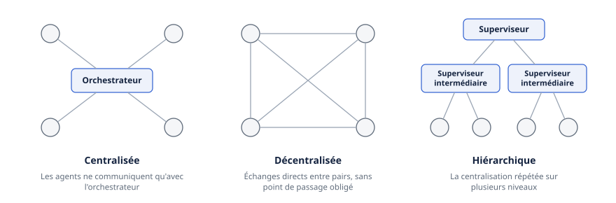
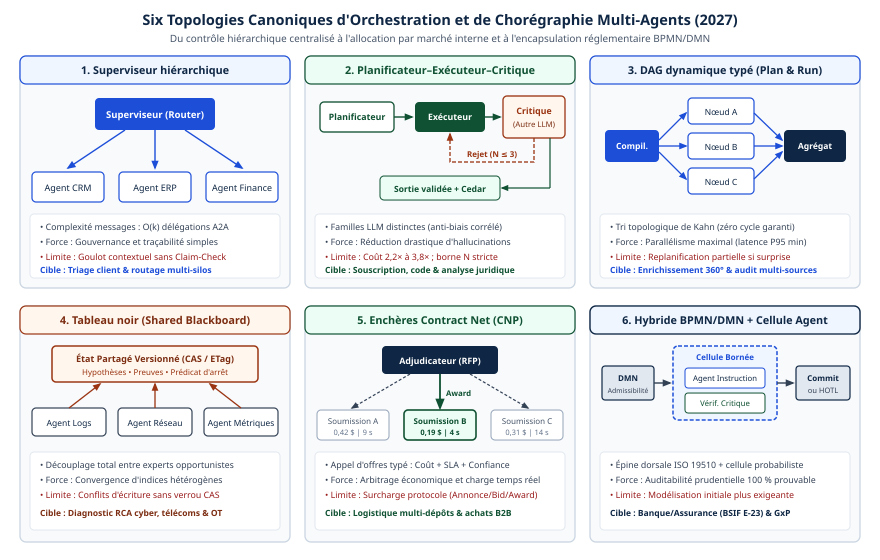

# Chapitre 16 — Topologies et patrons

*Question directrice : comment répartir le travail entre plusieurs agents ?*

> **État de référence :** deux études comparatives en prépublication (documents financiers, mars 2026; mise à l'échelle des systèmes d'agents, avril 2026) et la documentation d'orchestration de Microsoft, d'Anthropic, d'OpenAI et de LangChain, consultée à cette date. Les numéros entre crochets renvoient aux sources en fin de chapitre; [1] à [11] sont des pages primaires lues pour ce chapitre, dont trois par leur seul résumé; [12], marquée secondaire, n'a pas pu être lue.

Dès qu'une tâche dépasse ce qu'un agent accomplit seul, la tentation est d'en ajouter d'autres : un planificateur, des spécialistes, un vérificateur. L'analogie avec une équipe humaine rend le geste naturel. Elle masque trois coûts. Chaque agent consomme des jetons pour ses consignes, son contexte et son raisonnement. Chaque passage de relais ajoute de la latence. Chaque frontière entre agents est un endroit où une information se perd et où une erreur se propage.

Une topologie répond à deux questions : qui décide de la prochaine étape, et qui voit quoi. Les patrons de ce chapitre en sont les réponses types.

Les mesures disponibles en 2026 ne désignent aucune topologie supérieure aux autres. Elles montrent que la bonne topologie se déduit de la structure de la tâche, que l'agent unique est le point de départ, et que la coordination s'achète en jetons, en secondes et en modes de panne.

---

## 16.1 Taxonomie : trois topologies et un axe adaptatif

### Trois topologies

Le relevé de Zhu et coll. classe les systèmes selon trois topologies de coordination (centralisée, décentralisée, hiérarchique) et un axe orthogonal d'adaptativité [12]. Son texte n'a pas pu être lu : la taxonomie est reprise du plan initial et d'un résumé de moteur de recherche, et les définitions qui suivent sont celles de l'usage courant, recoupées avec une étude expérimentale [2].



- **Centralisée.** Un orchestrateur reçoit la demande, distribue le travail et assemble les résultats. Les autres agents ne communiquent qu'avec lui.
- **Décentralisée.** Les agents échangent directement entre pairs, sans point de passage obligé. La forme extrême est le tous-vers-tous, avec des cycles de débat et un consensus.
- **Hiérarchique.** La centralisation se répète sur plusieurs niveaux : un superviseur délègue à des superviseurs intermédiaires, qui dirigent chacun leur équipe.

L'étude de Kim et coll. ajoute deux variantes [2]. Dans l'architecture **indépendante**, des agents isolés travaillent en parallèle et un agrégateur concatène leurs sorties, sans vote ni validation croisée. Dans l'architecture **hybride**, un orchestrateur coexiste avec une communication latérale limitée entre pairs.

### L'axe adaptatif

Chaque topologie peut être statique ou dynamique. Dans une structure statique, le code fixe qui parle à qui et dans quel ordre. Dans une structure dynamique, un modèle le décide à l'exécution.

Les fournisseurs tracent tous cette ligne, sous des noms différents. Anthropic oppose les workflows, où modèles et outils suivent des chemins de code prédéfinis, aux agents, où le modèle dirige lui-même son processus [4]. OpenAI distingue l'orchestration par le code de l'orchestration par le LLM, et note que la première est plus prévisible en vitesse, en coût et en performance [7]. Microsoft caractérise chacun de ses patrons par son mode de routage, déterministe ou dynamique [5].

Cet axe pèse lourd sur l'auditabilité. Une structure statique se lit dans le code; une structure dynamique ne se lit que dans les traces d'exécution (chapitre 33). Le chapitre 17 traite du placement du non-déterminisme dans un processus d'affaires; celui-ci s'en tient à la forme de la coordination.

### Un vocabulaire éclaté

Les mêmes patrons portent des noms différents selon l'éditeur; le tableau donne les correspondances relevées.

| Patron | Topologie | Qui choisit l'étape suivante | Autres noms |
|---|---|---|---|
| Pipeline | Centralisée, statique | Le code | sequential, prompt chaining, linear delegation [4][5] |
| Fan-out | Centralisée | Le code ou un initiateur | concurrent, parallelization, scatter-gather, map-reduce [4][5] |
| Routeur | Centralisée | Un classifieur | routing, router [4][6] |
| Superviseur | Centralisée, dynamique | Un agent orchestrateur | orchestrator-workers, subagents, agents as tools [4][6][7] |
| Hiérarchie | Hiérarchique | Un superviseur par niveau | supervisor-worker [1] |
| Planificateur à registre | Centralisée, dynamique | Un gestionnaire qui révise son plan | magentic, dynamic orchestration [5] |
| Débat | Décentralisée | Les pairs, par tours | group chat, roundtable, council, multiagent debate [5][8] |
| Réflexion | Boucle à deux rôles | Le vérificateur | evaluator-optimizer, maker-checker, critic loop [4][5] |
| Transfert, essaim | Décentralisée, dynamique | L'agent actif | handoff, triage, transfer [5][7] |

### La question du contexte

La documentation de LangChain place l'ingénierie du contexte au centre de la conception multi-agents : il s'agit de décider quelle information chaque agent voit. Elle ajoute que, avec un contexte infini et une latence nulle, on mettrait tout dans un seul prompt [6]. Répartir le travail entre agents est d'abord une technique de cloisonnement du contexte (chapitre 13), ensuite seulement une division du travail.

---

## 16.2 Superviseur et hiérarchie

### Le superviseur

Le superviseur place un agent au centre. Il analyse la demande, la découpe, confie chaque morceau à un spécialiste et assemble la réponse. Les spécialistes ne se parlent pas.

Anthropic le nomme orchestrator-workers et précise ce qui le sépare d'un fan-out : les sous-tâches ne sont pas prédéfinies, l'orchestrateur les détermine d'après l'entrée [4]. Les cadriciels le réalisent en exposant chaque spécialiste comme un outil de l'agent principal : subagents chez LangChain [6], agents as tools dans l'OpenAI Agents SDK, où l'agent principal garde la conversation et produit seul la réponse finale [7].

Trois propriétés le rendent attrayant.

**L'isolation du contexte.** Chaque spécialiste travaille dans sa propre fenêtre, avec ses propres outils, et ne renvoie qu'un résultat condensé. Le superviseur ne porte pas le détail des explorations.

**Un point de contrôle unique.** Les garde-fous communs et la réponse finale se logent à un seul endroit, ce que la documentation d'OpenAI donne comme critère de choix du patron [7].

**Une vérification centrale.** Dans l'étude de Kim et coll., les architectures sans vérification centralisée propagent davantage les erreurs. Mesurée sur les traces, l'amplification des erreurs par rapport à l'agent unique atteint 17,2 fois pour des agents indépendants, contre 4,4 fois avec un orchestrateur [2]. Le facteur mesuré au niveau de la tâche est bien plus faible (1,1 à 1,3), et l'effet n'est pas statistiquement significatif dans le modèle final : les auteurs attribuent les écarts davantage au surcoût de coordination qu'à la propagation des erreurs.

### Ce que la délégation exige

Le système de recherche multi-agents décrit par Anthropic en juin 2025 suit ce patron : un agent principal élabore une stratégie et lance en parallèle des sous-agents de recherche, puis rédige la synthèse [3]. Le retour d'expérience publié contient trois leçons transposables.

1. **Une consigne de délégation complète.** Chaque sous-agent doit recevoir un objectif, un format de sortie, des indications sur les outils et les sources, et des limites claires. Sans cela, les sous-agents dupliquent le travail ou laissent des trous.
2. **Un effort proportionné.** Une requête simple mobilise un agent et quelques appels d'outils; une recherche complexe peut mobiliser plus de dix sous-agents.
3. **Le choix du synchronisme.** L'agent principal attend la fin d'un lot de sous-agents avant de poursuivre. C'est simple à coordonner, mais cela crée un goulot. L'exécution asynchrone promet plus de parallélisme, au prix de difficultés de cohérence d'état.

Le même texte rappelle que les erreurs se composent : une défaillance mineure peut faire dérailler une exécution entière. La réponse retenue combine points de contrôle, relances automatiques et reprise au point d'arrêt, soit l'exécution durable du chapitre 18.

### La hiérarchie

Quand un superviseur dirige trop de spécialistes, son contexte enfle et son choix se dégrade. La hiérarchie répond en ajoutant des niveaux. Le banc d'essai sur les documents financiers en donne une forme concrète : un superviseur répartit les champs à extraire, réassigne ceux dont la confiance tombe sous un seuil de 0,85 et borne la réextraction à deux itérations [1]. Le superviseur y porte une boucle de contrôle de qualité bornée.

### Le planificateur à registre

Microsoft décrit une variante plus dynamique, l'orchestration « magentic » [5]. Un agent gestionnaire construit un registre de tâches, le révise à mesure que les spécialistes rapportent leurs résultats, et vérifie si la demande est satisfaite ou si le travail piétine. Le registre peut être présenté à un humain avant l'exécution (chapitre 22). Le patron vise les problèmes ouverts, sans chemin de solution connu. Il est déconseillé quand la tâche est simple, quand le temps presse ou quand le chemin est déterministe; son coût est le plus variable de tous.

### Ce que coûte le centre

Le passage obligé par le superviseur a un prix. Dans la comparaison que publie LangChain, une requête simple demande quatre appels de modèle avec des sous-agents, contre trois avec les autres patrons, parce que le résultat repasse par l'agent principal [6]. Dans l'étude de Kim et coll., l'architecture centralisée consomme en moyenne 27,7 tours par essai, contre 7,2 pour l'agent unique [2].

Le superviseur est aussi un point de défaillance unique, et son contexte grossit à chaque retour de spécialiste. Microsoft recommande de compacter le contexte entre agents, par résumé ou élagage [5].

---

## 16.3 Pipeline et fan-out

### Le pipeline

Le pipeline enchaîne les agents dans un ordre fixe. Chacun traite la sortie du précédent. Le choix de l'agent suivant est défini par le workflow et n'est pas laissé aux agents [5]. C'est le patron le plus statique, et le plus facile à auditer.

Il convient aux processus dont les étapes ont des dépendances linéaires claires et au raffinement progressif du type brouillon, révision, finition [5]. Anthropic y voit un échange de latence contre précision, chaque appel traitant une tâche plus simple, et souligne qu'on peut insérer des contrôles programmés entre les étapes [4].

Sa faiblesse est connue : une erreur en amont se propage vers l'aval. Microsoft déconseille le patron quand rien n'empêche les étapes suivantes de traiter une sortie dégradée, quand le travail exige des retours en arrière, ou quand les étapes tiendraient dans un seul agent [5].

### Le fan-out

Le fan-out lance plusieurs agents en même temps, puis réunit leurs résultats. Anthropic en distingue deux usages [4]. Le **découpage** répartit des sous-tâches indépendantes pour gagner du temps. Le **vote** exécute plusieurs fois la même tâche pour obtenir des sorties diverses et une confiance plus élevée.

Tout se joue à la fusion. Microsoft énumère les stratégies : vote ou règle de majorité pour une classification, fusion pondérée pour des recommandations notées, synthèse par un modèle pour concilier des résultats en un texte cohérent [5]. Dans le banc d'essai financier, un routeur répartit les sections du document entre trois extracteurs spécialisés, et un agent de réconciliation tranche les conflits par un vote pondéré par la confiance [1].

Une fusion sans validation est l'architecture « indépendante » de Kim et coll., celle dont l'amplification d'erreurs est la plus forte [2]. Un fan-out a donc besoin d'une étape de fusion qui vérifie, non d'une simple concaténation.

Le patron est à éviter quand les agents doivent bâtir sur le travail des autres, quand aucune stratégie de résolution des conflits n'existe, ou quand les quotas de modèle rendent le parallélisme illusoire [5]. Microsoft range aussi parmi les antipatrons le partage d'un état modifiable entre agents concurrents, source de données incohérentes (chapitre 14).

### Le routeur

Le routeur est le cas limite : une étape de classification envoie l'entrée vers un spécialiste, ou vers quelques-uns dont on synthétise les réponses [4][6]. Anthropic en donne un usage économique : diriger les requêtes simples vers un petit modèle et les difficiles vers un modèle plus capable [4]. Le chapitre 44 traite ce routage de modèles : aucun routeur n'y domine dans la seule comparaison indépendante lue. Quand le bon agent se reconnaît dès l'entrée, Microsoft préfère ce routage à un transfert dynamique [5].

Ces trois formes se combinent : Microsoft conseille de ne pas forcer un workflow entier dans un seul patron [5]. Quand le déclencheur est un événement plutôt qu'un appel, elles se transposent sur un flux (chapitre 19).

---

## 16.4 Débat, réflexion, autocorrection

Ces patrons partagent une idée : confronter une sortie à un autre regard avant de la livrer. Ils diffèrent par le nombre de regards et par ce qui arrête la boucle.

### Le débat

Dans le débat multi-agents, plusieurs instances de modèle proposent chacune une réponse et un raisonnement, puis les confrontent pendant plusieurs tours jusqu'à une réponse commune. L'article fondateur de Du et coll. rapporte, selon son résumé, une amélioration du raisonnement mathématique et stratégique et de la validité factuelle, avec une réduction des hallucinations, sur des modèles en boîte noire [8].

L'évaluation de Smit et coll. tempère ce résultat. Selon son résumé, les systèmes de débat, dans leur forme d'alors, ne surpassent pas de façon fiable d'autres stratégies plus simples, dont l'autocohérence et les ensembles de chaînes de raisonnement; ils sont plus sensibles aux hyperparamètres et difficiles à optimiser, même si un réglage du niveau d'accord entre agents peut les améliorer nettement [9]. Ces deux articles datent de 2023 et de 2024; leurs conclusions n'ont pas été revérifiées sur les modèles de 2026.

Les mesures de Kim et coll. situent le coût : l'architecture décentralisée, à débat et consensus, consomme 26,1 tours par essai en moyenne, et son amplification d'erreurs mesurée sur les traces est de 7,8 fois, entre l'orchestrateur et les agents indépendants [2].

Microsoft range le débat dans l'orchestration en conversation de groupe, où un gestionnaire décide qui parle [5]. Les agents y sont en général en lecture seule : ils discutent, ils ne modifient pas de systèmes. Le fil unique donne transparence et auditabilité, et un humain peut y participer. La maîtrise se perd vite avec le nombre : la page suggère de s'en tenir à trois agents ou moins.

### La réflexion

La boucle de réflexion est un débat réduit à deux rôles. Un agent produit, un autre évalue selon des critères définis et renvoie un retour précis; le premier révise. Anthropic la nomme evaluator-optimizer et la réserve aux cas où les critères d'évaluation sont clairs et où le raffinement itératif apporte une valeur mesurable [4].

Microsoft formule trois exigences [5] : des critères d'acceptation assez nets pour que le vérificateur décide de façon cohérente; un plafond d'itérations; un repli quand le plafond est atteint, par exemple l'escalade vers un réviseur humain ou la livraison du meilleur résultat avec un avertissement.

### L'autocorrection mesurée

Le banc d'essai financier chiffre le compromis. Son architecture réflexive enchaîne extraction, vérification (format, cohérence entre champs, ancrage dans la source), critique et correction, avec trois itérations au plus. Elle obtient la meilleure précision des quatre architectures comparées, et aussi le coût et la latence les plus élevés [1]. Les chiffres figurent à la section 16.6.

La vérification gagne donc à être un rôle distinct de la production, avec ses propres critères. Elle ne suffit pas à elle seule : la taxonomie MAST fait de la vérification de la tâche l'une de ses trois catégories d'échec [10] (chapitre 21). Le chapitre 18 traite de la validation indépendante avant une action irréversible.

---

## 16.5 Essaim et pair-à-pair

### Le transfert

Dans le transfert (handoff), l'agent actif juge s'il peut traiter la demande ou s'il doit la céder à un agent mieux placé. Le contrôle passe en entier d'un agent à l'autre; un seul agent travaille à la fois [5]. Dans l'OpenAI Agents SDK, un agent d'aiguillage transfère la conversation à un spécialiste, qui répond directement à l'utilisateur [7]. La différence avec le superviseur tient à qui garde la conversation.

Le patron convient quand le spécialiste requis n'apparaît qu'en cours de traitement. L'exemple type est le soutien à la clientèle : un agent de triage traite les cas courants, cède les autres à un agent technique ou de facturation, et peut passer la main à un employé [5].

Microsoft signale deux risques : la boucle de transferts sans fin et un parcours imprévisible [5]. Selon la comparaison de LangChain, sur une requête répétée, les transferts économisent des appels, puisque le spécialiste reste actif : cinq appels sur deux tours, contre huit avec des sous-agents. Sur une question qui touche plusieurs domaines, ils coûtent davantage : sept appels ou plus, contre cinq [6]. Ces chiffres viennent de scénarios illustratifs d'un éditeur, non d'une mesure indépendante.

### L'essaim

Un essaim est un ensemble d'agents qui se passent le travail par transferts, sans superviseur. Aucun agent n'a de vue d'ensemble; la coordination émerge des décisions locales. Il n'y a pas d'orchestrateur à écrire, mais la difficulté se reporte sur l'observabilité : reconstituer qui a décidé quoi exige une trace complète de chaque transfert (chapitre 33).

Multiplier les canaux ne s'amortit pas de soi. L'architecture hybride de Kim et coll., qui ajoute des échanges latéraux à un orchestrateur, est la plus coûteuse de l'étude : 44,3 tours par essai en moyenne, six fois plus que l'agent unique [2].

### Le pair-à-pair imposé

Une situation échappe au choix. Quand les agents appartiennent à des plateformes ou à des organisations différentes, aucun superviseur commun n'est possible : nul ne détient l'autorité sur tous, ni l'accès à tous les contextes. La topologie décentralisée est alors une donnée. C'est le terrain d'A2A, qui standardise la délégation entre agents opaques l'un pour l'autre (chapitre 6), de la découverte par registres (chapitre 8) et des réseaux B2B fédérés (chapitre 45).

Il en découle une règle de composition, qui relève du raisonnement plus que de la mesure : pair-à-pair entre domaines, par protocole; topologie centralisée à l'intérieur d'un domaine, où une seule équipe maîtrise les agents, leurs contextes et leurs permissions. La frontière de domaine coïncide souvent avec une frontière de sécurité, critère que Microsoft retient pour justifier plusieurs agents [5]. Les chaînes de délégation qui traversent ces frontières sont traitées aux chapitres 29 et 30.

---

## 16.6 Compromis coût, précision, latence

### Un banc d'essai chiffré

L'étude de Kulkarni et Kulkarni compare quatre architectures sur 10 000 dépôts réglementaires américains (formulaires 10-K, 10-Q et 8-K), avec 25 types de champs à extraire et cinq modèles [1]. Le tableau donne les résultats du modèle le plus performant de l'étude, Claude 3.5 Sonnet.

| Architecture | F1 | Exactitude par document | Latence médiane | Coût par document | Jetons par document |
|---|---|---|---|---|---|
| Pipeline séquentiel | 0,903 | 0,648 | 38,7 s | 0,187 $ | 146 160 |
| Fan-out avec fusion | 0,914 | 0,672 | 21,3 s | 0,221 $ | 172 930 |
| Hiérarchique | 0,929 | 0,718 | 46,2 s | 0,261 $ | 203 120 |
| Réflexive | 0,943 | 0,758 | 74,1 s | 0,430 $ | 321 610 |

**Aucune architecture ne domine.** Le pipeline est le moins cher, le fan-out le plus rapide, la boucle réflexive la plus précise. Chaque point de F1 gagné se paie.

**La hiérarchie offre le meilleur compromis.** D'après les tableaux, elle atteint 98,5 % du F1 de l'architecture réflexive pour 60,7 % de son coût. L'introduction de l'article annonce 97,7 % et 60,9 %, et son résumé un F1 de 0,921, qui est celui de GPT-4o; ces écarts ne sont pas expliqués.

**La queue de latence compte.** Au 99e centile, l'architecture réflexive prend 247,3 secondes, contre 68,3 pour le fan-out.

**L'exactitude par document reste modeste.** Même la meilleure architecture ne rend tous les champs corrects que pour trois documents sur quatre environ. La topologie ne dispense pas d'une révision humaine en aval (chapitre 22).

### L'optimisation pèse autant que la topologie

Les ablations de la même étude portent sur l'architecture hiérarchique [1]. Un routage à deux niveaux de modèles ramène le coût de 0,261 $ à 0,127 $ par document, pour un F1 de 0,912. La configuration qui combine cache sémantique, routage de modèles et relance adaptative atteint un F1 de 0,924 pour 0,148 $ et 30,2 secondes : moins chère et plus rapide que le pipeline naïf, et plus précise que lui.

Microsoft donne la même consigne : attribuer à chaque agent un modèle à la mesure de sa tâche et mesurer la consommation de jetons par agent et par exécution [5]. Les chapitres 40 et 44 développent cette discipline.

### Le classement change sous la charge

L'étude fait varier le volume sur une grappe fixe de huit nœuds [1].

| Documents par jour | Pipeline | Fan-out | Hiérarchique | Réflexive |
|---|---|---|---|---|
| 1 000 | 0,903 | 0,914 | 0,929 | 0,943 |
| 50 000 | 0,894 | 0,906 | 0,907 | 0,898 |
| 100 000 | 0,886 | 0,898 | 0,891 | 0,871 |

L'architecture réflexive, la meilleure à faible volume, devient la moins bonne à 100 000 documents par jour : les délais d'attente tronquent ses boucles de correction. Le fan-out et le pipeline se dégradent le moins. Les seuils dépendent de l'infrastructure, les auteurs le soulignent. Le constat demeure : un patron validé en pilote doit être réévalué au volume de production.

### Les jetons comme variable cachée

Anthropic rapporte que ses agents consomment environ quatre fois plus de jetons qu'une conversation, et ses systèmes multi-agents environ quinze fois plus. Sur une évaluation interne de recherche, son système multi-agents dépasse de 90,2 % l'agent unique; sur le banc d'essai BrowseComp, la quantité de jetons utilisée explique à elle seule 80 % de la variance de performance [3].

Ces chiffres viennent d'un billet de fournisseur. Ils suggèrent qu'une part du gain des architectures multi-agents tient à ce qu'elles dépensent plus de jetons, en parallèle et dans des fenêtres séparées. Selon le même texte, elles ne se justifient que pour des tâches dont la valeur couvre ce coût.

Une réserve vaut pour toute la section : le banc d'essai financier est une prépublication qui porte sur un seul domaine, des modèles de 2024 et des tarifs de janvier 2025 [1]. Les rapports entre architectures se transposent mieux que les valeurs absolues.

---

## 16.7 Quand un seul agent suffit

### La consigne des éditeurs

Les fournisseurs, qui ont intérêt à vendre de l'orchestration, recommandent pourtant la retenue. Anthropic conseille de chercher la solution la plus simple et de n'ajouter de complexité que si elle améliore les résultats [4]. Microsoft pose trois niveaux (appel direct au modèle, agent unique avec outils, orchestration multi-agents), demande de retenir le plus bas qui répond au besoin, et tient l'agent unique outillé pour le bon choix par défaut dans bien des cas d'entreprise [5]. LangChain écrit qu'un agent unique bien outillé suffit souvent [6].

### Ce que disent les mesures

L'étude de Kim et coll. donne à cette prudence une base expérimentale : 260 configurations, six bancs d'essai, cinq architectures et trois familles de modèles, avec outils, prompts et budget de calcul alignés pour isoler l'effet de l'architecture [2]. Sur l'ensemble, l'écart moyen des systèmes multi-agents par rapport à l'agent unique est de −0,3 %, avec un intervalle de confiance à 95 % qui va de −58,7 % à +77,2 %. La moyenne ne dit rien; tout dépend de la tâche.

| Banc d'essai | Écart le plus favorable | Écart le plus défavorable relevé |
|---|---|---|
| Finance-Agent (raisonnement décomposable) | Centralisée, +80,8 % | Aucun écart négatif |
| BrowseComp-Plus | Décentralisée, +9,2 % | Indépendante, environ −35 % |
| WorkBench | Décentralisée, +5,6 % | Environ −11 % |
| SWE-bench Verified | Hybride, −2,1 % | Indépendante, −14,9 % |
| Terminal-Bench | Indépendante, +1,7 % | Centralisée, −19,2 % |
| PlanCraft (planification séquentielle) | Hybride, −39,1 % | Indépendante, −70,0 % |

Trois régularités ressortent de l'article.

**La structure de la tâche décide.** Une tâche décomposable en sous-problèmes indépendants profite fortement de la coordination. Une tâche de planification séquentielle, où chaque étape dépend de l'état laissé par la précédente, se dégrade dans toutes les architectures multi-agents.

**Un plafond de capacité.** Quand l'agent unique réussit déjà au-delà d'environ 45 % sur une tâche, la coordination donne des rendements décroissants ou négatifs.

**Un compromis entre outils et coordination.** Les tâches riches en outils pénalisent davantage les architectures coûteuses en coordination; avec quatre outils ou moins, l'effet est négligeable.

Les auteurs présentent ces résultats comme des tendances; SWE-bench Verified et Terminal-Bench reposent sur vingt instances seulement.

Le retour d'expérience d'Anthropic concorde : les systèmes multi-agents conviennent mal aux domaines où tous les agents doivent partager le même contexte ou dont les sous-tâches sont très interdépendantes, et le texte range la plupart des tâches de programmation dans ce cas [3].

### Les raisons légitimes d'en ajouter

Les pages lues convergent sur une courte liste [3][5][6] :

- la tâche est large et se parallélise;
- elle dépasse la fenêtre de contexte d'un agent;
- l'agent a trop d'outils et choisit mal;
- des frontières de sécurité distinctes s'imposent entre agents;
- des équipes indépendantes développent et entretiennent chacune leur agent.

Les deux dernières tiennent à la sécurité et à l'organisation.

Avant d'ajouter un agent, une solution intermédiaire mérite examen : l'agent unique qui charge à la demande des consignes et des connaissances spécialisées, que LangChain classe parmi ses patrons sous le nom de skills [6] (chapitre 13).

---

## 16.8 Grille de choix

La fiche des annexes du relevé de Zhu et coll. signale un arbre de décision pour le choix d'un patron [11]; il n'a pas été lu. La séquence qui suit est une synthèse des sources de ce chapitre.

1. **Un agent unique outillé suffit-il ?** Le mesurer d'abord. S'il réussit déjà bien, la coordination a peu de chances d'ajouter quelque chose [2].
2. **Les étapes sont-elles connues d'avance ?** Si oui, une structure statique est plus prévisible et plus auditable [5][7].
3. **Les sous-tâches sont-elles indépendantes ?** Si oui, fan-out ou superviseur. Sinon, pipeline ou agent unique [2][5].
4. **Existe-t-il un critère d'acceptation vérifiable, et l'erreur coûte-t-elle cher ?** Boucle de réflexion bornée [4][5].
5. **Les agents relèvent-ils d'autorités différentes ?** Pair-à-pair par protocole (chapitre 6).
6. **Le patron tient-il au volume de production ?** Le vérifier sous charge [1].

| Caractéristique de la tâche | Patron indiqué | Signal d'alerte |
|---|---|---|
| Étapes fixes, dépendances linéaires | Pipeline | Erreur amont non détectée |
| Sous-tâches indépendantes et connues | Fan-out avec fusion vérifiée | État partagé, quotas |
| Catégories d'entrée distinctes | Routeur | Classification incertaine |
| Sous-tâches indépendantes, imprévisibles | Superviseur | Contexte du superviseur qui enfle |
| Problème ouvert, plan à construire | Planificateur à registre | Piétinement, coût imprévisible |
| Expertise qui émerge en cours de route | Transfert | Boucles de transferts |
| Qualité critique, critères nets | Réflexion bornée | Latence, dégradation sous charge |
| Étapes fortement couplées, contexte commun | Agent unique | Fenêtre de contexte saturée |

Le choix du cadriciel vient ensuite; la plupart mettent en œuvre plusieurs de ces patrons (chapitre 20).

---

## Grille de décision

| Décision | Option par défaut | Quand s'en écarter |
|---|---|---|
| Nombre d'agents | Un agent outillé | Tâche parallélisable, contexte saturé, trop d'outils, frontière de sécurité ou d'équipe |
| Structure | Statique, fixée par le code | Sous-tâches imprévisibles : superviseur dynamique |
| Topologie dans un domaine | Centralisée | Expertise qui émerge en conversation : transfert |
| Topologie entre domaines | Pair-à-pair par protocole | Plateforme unique sous une seule autorité |
| Fusion d'un fan-out | Étape de validation ou de vote | Résultats indépendants, sans agrégation requise |
| Vérification | Rôle distinct de la production, critères écrits | Tâche à faible enjeu |
| Boucles | Plafond d'itérations et repli défini | — |
| Débat | Trois agents au plus, en lecture seule | Animation par un humain |
| Modèle par agent | Proportionné à la tâche de l'agent | Faible volume : un seul modèle |
| Validation du patron | Mesure contre l'agent unique, puis sous charge | — |

---

## Points à retenir

- Une topologie répond à deux questions : qui décide de l'étape suivante, et qui voit quoi. Répartir le travail, c'est d'abord cloisonner le contexte.
- Trois topologies (centralisée, décentralisée, hiérarchique) et un axe adaptatif suffisent à situer les patrons, malgré un vocabulaire qui varie d'un éditeur à l'autre.
- Aucune topologie ne domine. Sur six bancs d'essai, l'écart moyen entre multi-agents et agent unique est à peu près nul, et va de +80,8 % à −70,0 % : la coordination aide les tâches décomposables et nuit aux tâches séquentielles couplées.
- L'agent unique outillé est le point de départ; les éditeurs eux-mêmes le recommandent.
- Le superviseur vaut par son contrôle central, mais ajoute des appels et un goulot. Une délégation sans objectif, format ni limites produit doublons et lacunes.
- La boucle réflexive donne la meilleure précision au coût et à la latence les plus élevés, et se dégrade le plus vite sous charge; la hiérarchie offre le meilleur compromis mesuré en traitement de documents financiers.
- Routage de modèles, cache et relances adaptatives déplacent le coût autant que le choix de topologie.
- Entre organisations, le pair-à-pair s'impose : la topologie suit les frontières d'autorité.

---

## Sources

Pages primaires lues le 11 novembre 2026 ([1] à [3] et [5] à [7] relues le 12 novembre 2026) :

1. [Kulkarni et Kulkarni — Benchmarking Multi-Agent LLM Architectures for Financial Document Processing (arXiv 2603.22651v1)](https://arxiv.org/html/2603.22651v1) — prépublication.
2. [Kim et coll. — Towards a Science of Scaling Agent Systems (arXiv 2512.08296v3)](https://arxiv.org/html/2512.08296v3) — prépublication; résumé et première moitié du texte.
3. [Anthropic — How we built our multi-agent research system, 13 juin 2025](https://www.anthropic.com/engineering/built-multi-agent-research-system) — billet de fournisseur.
4. [Anthropic — Building effective agents, 19 décembre 2024](https://www.anthropic.com/engineering/building-effective-agents) — billet de fournisseur.
5. [Microsoft, Azure Architecture Center — AI agent orchestration patterns, page datée du 12 février 2026](https://learn.microsoft.com/en-us/azure/architecture/ai-ml/guide/ai-agent-design-patterns)
6. [LangChain — Multi-agent](https://docs.langchain.com/oss/python/langchain/multi-agent)
7. [OpenAI Agents SDK — Agent orchestration](https://openai.github.io/openai-agents-python/multi_agent/)
8. [Du et coll. — Improving Factuality and Reasoning in Language Models through Multiagent Debate (arXiv 2305.14325)](https://arxiv.org/abs/2305.14325) — résumé seulement.
9. [Smit et coll. — Should we be going MAD? (arXiv 2311.17371)](https://arxiv.org/abs/2311.17371) — résumé seulement.
10. [Cemri et coll. — Why Do Multi-Agent LLM Systems Fail? (arXiv 2503.13657v3)](https://arxiv.org/abs/2503.13657) — résumé seulement.
11. [Zenodo — annexes du relevé de Zhu et coll.](https://zenodo.org/records/19774440) — fiche du dépôt; l'archive n'a pas été ouverte.

Source secondaire :

12. [Zhu et coll. — LLM-Based Multi-Agent Orchestration: A Survey of Frameworks, Communication Protocols, and Emerging Patterns](https://www.preprints.org/manuscript/202604.2147) — prépublication non lue (accès refusé); taxonomie reprise du plan initial et de résumés de recherche.

## Limites de ce chapitre

- Le relevé [12], appui principal prévu par le plan initial, n'a pas été lu : le 12 novembre 2026, sa page refuse toujours l'accès, et une recherche ne trouve aucune parution dans *Future Internet*. La liste d'auteurs diffère entre la prépublication et la fiche Zenodo. Les définitions des topologies viennent de l'usage courant et de [2], non du relevé.
- Les pages ont été lues, puis relues pour six d'entre elles, au moyen d'un outil qui en condense le contenu. Les chiffres cités concordent d'une lecture à l'autre, mais n'ont pas été recoupés avec les tableaux d'origine.
- [1] se contredit par endroits, notamment sur les gains d'optimisation qu'il annonce; ce sont les valeurs de ses tableaux qui sont citées.
- [2] n'a été lu que sur sa première moitié; le tableau de la section 16.7 ne garantit pas qu'aucune architecture ne fasse pire que l'écart relevé.
- [1] et [2] sont des prépublications; [3] à [7] sont des documents d'éditeurs qui décrivent leurs propres produits.
- La description de l'essaim et la règle « pair-à-pair entre domaines, centralisé à l'intérieur » relèvent de la connaissance générale et du raisonnement.
- Le routeur et le planificateur à registre s'ajoutent au plan initial; l'essaim est traité avec le transfert.
- Aucune donnée d'adoption des patrons en entreprise n'est citée, faute de source vérifiée.

## Mise en œuvre — Topologies d'orchestration et de chorégraphie multi-agents {.volet}

:::: {.encadre .executive}
::: {.encadre-titre}
**Synthèse exécutive**
:::

- **Enjeu** : multiplier les agents spécialisés sans gouverner leurs interactions fait croître la facture de jetons de façon quadratique, dilue la responsabilité réglementaire et multiplie les défaillances silencieuses en cascade (OWASP ASI08).
- **Décisions d’architecture** :
  1. *Irréversible à l’échelle de l’entreprise* : adopter un modèle cellulaire fédéré, avec une chorégraphie événementielle entre domaines d’affaires autonomes (Kafka, Solace) et une orchestration déterministe à l’intérieur de chaque domaine.
  2. *Normative dès la conception* : interdire en production tout graphe cyclique libre (« débat ouvert entre pairs ») et limiter les équipes aux six topologies canoniques homologuées, chacune avec des bornes dures de sauts, de budget et de temps.
  3. *Réversible par configuration* : l’affectation d’un modèle ou d’un agent spécialiste à un rôle topologique (exécuteur, critique, soumissionnaire), grâce au découplage par A2A v1.0 et Apache Ossie.
- **Indicateurs de gouvernance** : facteur d’amplification de jetons par transaction métier, nombre moyen et 99e centile de sauts entre agents par saga, taux de convergence au premier passage des boucles critiques, latence du chemin critique de bout en bout.
::::

## 16.9 Orchestration centralisée et chorégraphie décentralisée

La section 16.1 distingue les topologies centralisée et décentralisée. Avec dix ou cent agents spécialisés répartis sur plusieurs lignes d’affaires, le choix prend la forme du dilemme classique des systèmes distribués, que la nature probabiliste des modèles amplifie : confier la conduite du flux à un coordinateur central (orchestration), ou laisser chaque acteur réagir de façon autonome aux faits publiés sur un courtier d’événements (chorégraphie).

Entre 2024 et 2025, plusieurs cadriciels multi-agents expérimentaux ont retenu la « salle de réunion virtuelle » : les agents conversent dans un fil partagé jusqu’à dégager un consensus. C’est la forme libre du débat décrit à la section 16.4. L’interdiction que pose ce volet va au-delà de ce que retient l’exposé : le débat y est admis à trois agents au plus, en lecture seule, sous un gestionnaire qui décide qui parle (section 16.4 et grille de décision), et la section 16.5 traite le transfert et l’essaim comme des patrons valides. Sur une démonstration à trois tours, la formule séduit. Les mesures de Kim et coll. situent le coût de l’architecture décentralisée, à débat et consensus, à 26,1 tours par essai en moyenne, contre 27,7 pour l’architecture centralisée, avec une amplification d’erreurs de 7,8 fois, entre l’orchestrateur et les agents indépendants (sections 16.2 et 16.4). Le calcul qui suit décrit un modèle du maillage, non une mesure.

### Croissance quadratique des échanges et des jetons

Soit un ensemble de $n$ agents qui coopèrent sur un dossier complexe. Dans un maillage conversationnel non contraint, où chaque agent peut interpeller n’importe quel pair et reçoit l’historique complet des échanges, le nombre de canaux potentiels croît selon :

$$C(n) = \frac{n(n - 1)}{2} \in O(n^2)$$

La consommation de jetons d’entrée croît aussi de façon quadratique. Si chaque tour $t \in \{1, \dots, T\}$ ajoute en moyenne $L$ jetons au tampon conversationnel partagé, le volume cumulé de jetons facturés et traités par l’attention au bout de $T$ tours atteint :

$$V_{\text{jetons}}(T) = \sum_{t=1}^{T} (L_0 + t \cdot L) = T \cdot L_0 + \frac{T(T + 1)}{2} L$$

où $L_0$ désigne l’empreinte initiale des consignes système et des schémas d’outils. Au-delà de huit à dix échanges croisés, trois dégradations s’ajoutent :

1. **Érosion du rapport signal/bruit.** Une hypothèse erronée émise au tour 2 reste dans la fenêtre de contexte au tour 9 et continue d’influencer l’attention des agents aval, même réfutée.
2. **Contagion des rationalisations (OWASP ASI08).** Quand un agent amont énonce avec assurance une déduction inexacte, les agents pairs tendent statistiquement à s’aligner sur cette prémisse plutôt qu’à la contredire, par sycophantie entre modèles.
3. **Perte d’efficacité du cache KV.** Quand chaque agent a un préfixe système différent et réingère dans le désordre les interventions des autres, les moteurs d’inférence ne réutilisent plus les préfixes mis en cache. Le coût et le délai avant le premier jeton augmentent ensemble.

### Dualité : gouverner localement, fédérer globalement

Le principe de dualité échelle-couplage du *Domain-Driven Design* (DDD) écarte à la fois le maillage libre et l’orchestrateur monolithique omniscient qui régenterait toute l’entreprise (voir aussi la section 16.5). La règle qui suit s’écarte de ce que retient l’exposé : la section 16.5 et la grille de décision posent, entre domaines, le pair-à-pair par protocole (A2A, chapitre 6) et, à l’intérieur d’un domaine, une topologie centralisée; la grille ne propose de s’en écarter que pour une plateforme unique sous une seule autorité.

- **Dans un contexte borné, l’orchestration déterministe.** Un processus relève d’un domaine métier unique, sous une responsabilité claire : l’instruction d’une réclamation d’assurance chez BCA, le diagnostic complet d’une alerte machine chez BSN. Un coordinateur explicite pilote les étapes, détient l’état d’avancement, applique les délais de garde et agrège les preuves. Un seul identifiant d’exécution indique où en est le dossier.
- **Entre domaines, la chorégraphie événementielle.** Quand la clôture d’un diagnostic technique chez BSN doit déclencher une mise à jour du risque client dans le CRM, un réajustement des prévisions de pièces dans l’ERP industriel et une écriture analytique de provision financière, aucun orchestrateur central ne doit coupler ces trois divisions. Le domaine source publie un événement métier immuable et typé (`EquipmentFailureDiagnosed.v2`, conforme à Apache Ossie) sur le courtier d’entreprise (Kafka ou Solace). Chaque domaine abonné déclenche de façon autonome son propre micro-orchestrateur interne.

| Critère d’urbanisation | Orchestration monolithique globale | Chorégraphie pure intégrale | Architecture cellulaire fédérée (Standard 2027) |
|:-------------------|:---------------------------|:--------------------------|:---------------------------|
| Autorité de flux | Un seul moteur central pilote toutes les divisions | Aucun point central; réactions par chaînes d’événements | Chorégraphie inter-domaines + orchestration intra-domaine |
| Couplage organisationnel | Très fort : chaque changement local touche le flux maître | Très faible : ajout d’abonnés sans modifier l’émetteur | Optimal : contrats d’événements stables aux frontières |
| Visibilité d’un processus | Native dans la console du moteur central | Difficile : le flux émerge implicitement des journaux | Reconstruite par corrélation OpenTelemetry (`traceparent`) |
| Gestion des échecs globaux | Blocs `try/catch` et compensation pilotée | Événements compensatoires en cascade complexes à tester | Sagas locales orchestrées + événements d’annulation typés |
| Rayon d’impact d’une panne | Critique (point de défaillance unique logique) | Confiné par file d’attente et mémoire tampon du courtier | Isolé par cellule métier avec découplage temporel |
| Conformité réglementaire | Lourde (tout le graphe hérite de la cote maximale) | Audit laborieux des chaînes causales émergentes | Périmètre BSIF E-23 / EU AI Act cloisonné |

---

## 16.10 Anatomie comparative des six topologies canoniques en 2027

Une fois les frontières de domaines tracées, il reste à structurer la collaboration des agents à l’intérieur d’une cellule orchestrée ou d’un sous-réseau coopératif. Ce volet retient six topologies canoniques, illustrées à la figure ci-dessous; l’exposé, qui ne cite aucune donnée d’adoption des patrons en entreprise, classe neuf patrons selon trois topologies et un axe adaptatif (section 16.1). Toute architecture candidate justifie laquelle elle instancie, ou comment elle les compose hiérarchiquement.



### 1. Superviseur hiérarchique et routeur

Le superviseur, la hiérarchie et le routeur sont décrits aux sections 16.2 et 16.3. En production, le nœud coordinateur choisit les spécialistes d’après leurs Agent Cards A2A v1.0 et leur transmet un sous-mandat ciblé. La configuration est en étoile, ou en arbre à deux niveaux quand des superviseurs de domaine dirigent des travailleurs spécialisés.

- **Force.** La complexité des échanges reste linéaire, en $O(k)$ pour $k$ spécialistes sollicités. Les agents feuilles s’ignorent : la compromission ou la dérive de l’un ne contamine pas latéralement le contexte des autres.
- **Piège en production : le superviseur entonnoir.** Si un spécialiste d’extraction retourne au superviseur un document JSON de 40 000 jetons pour qu’il le retransmette à un second spécialiste, le superviseur paie deux fois la sérialisation et la génération par le modèle, et risque de tronquer ou d’altérer des identifiants critiques.
- **Remède obligatoire : le passage par référence.** Le spécialiste n° 1 dépose l’artefact volumineux dans un magasin d’objets chiffré, à bail court, et ne retourne au superviseur qu’un résumé de 150 jetons avec un pointeur URI signé (`a2a://artifacts/sha256-...`). Le superviseur le transmet tel quel au spécialiste n° 2.

### 2. Planificateur, exécuteur et critique bornés

Cette topologie prolonge la boucle de réflexion de la section 16.4 par un troisième rôle. Le planificateur structure la démarche, l’exécuteur produit l’artefact ou prépare la transaction avec ses outils MCP, le critique évalue le résultat face aux pièces justificatives, aux invariants métier et aux politiques de conformité avant d’autoriser la sortie ou d’exiger une révision ciblée.

- **Indépendance épistémique.** Faire jouer l’exécuteur et le critique par le même modèle, avec deux consignes système différentes, ne corrige qu’une fraction marginale des erreurs : le modèle partage les mêmes angles morts et valide ses propres hallucinations avec une confiance élevée. En production, le critique combine des vérificateurs déterministes (schémas JSON, moteurs Cedar/OPA, solveurs arithmétiques) et un modèle évaluateur issu d’une famille d’entraînement distincte de celle de l’exécuteur.
- **Condition d’arrêt.** La boucle est bornée par une constante dure $N_{\max} \in \{2, 3\}$ et par un détecteur de convergence. Si l’écart sémantique entre deux révisions successives stagne, ou si le plafond $N_{\max}$ est atteint sans approbation du critique, l’exécution n’échoue pas en silence : elle bascule de façon déterministe en escalade HOTL, avec le journal exact des objections du critique.

### 3. Graphe orienté acyclique dynamique typé

Dans une boucle *ReAct*, l’agent improvise chaque pas après avoir observé le précédent, ce qui enchaîne séquentiellement dix appels coûteux au modèle. Le patron planifier puis exécuter sépare deux temps :

1. **Compilation.** Un modèle de raisonnement analyse la requête une seule fois et émet un graphe orienté acyclique (DAG) déclaratif. Chaque nœud référence une compétence OASF/A2A ou un outil MCP répertorié, avec une liaison explicite des entrées et des sorties typées.
2. **Validation et ordonnancement déterministes.** Avant toute exécution, le moteur de plateforme vérifie hors modèle que le graphe est strictement acyclique (tri topologique de Kahn), que les schémas Apache Ossie connectés sont compatibles, que l’identité appelante détient les portées requises et que le coût estimé cumulé des nœuds respecte le budget de l’`ActionEnvelope`. Il exécute ensuite en parallèle maximal (fan-out) toutes les branches indépendantes.

Sur les processus de collecte multi-sources, d’audit de conformité ou d’enrichissement client 360°, cette topologie divise couramment la latence de bout en bout par un facteur 3 à 5 et réduit de 60 % la facture de jetons, parce qu’elle supprime les appels de routage intermédiaires. Si un nœud échoue sur une surprise métier, le moteur replanifie localement le sous-graphe, limité aux nœuds aval touchés.

### 4. Tableau noir partagé

Issue des premiers systèmes experts acoustiques (Hearsay-II) et reprise en 2026–2027 sur des magasins d’état transactionnels rapides, cette architecture inverse le couplage : aucun orchestrateur ne connaît à l’avance l’ordre d’intervention des spécialistes. Le dossier est un espace mémoire structuré et versionné, qui contient les observations brutes, les hypothèses actives avec leurs intervalles de confiance, les pistes réfutées et un prédicat formel de résolution.

Des spécialistes indépendants observent les mutations du tableau noir. Quand un fait de leur compétence apparaît (anomalie BGP, signature spectrale haute fréquence), le spécialiste lit l’état courant, conduit ses investigations MCP et publie un enrichissement atomique, protégé par concurrence optimiste (ETag) sur sa propre sous-clé, pour éviter la famine d’écriture entre experts rapides et lents. Un contrôleur léger vérifie après chaque mutation si le prédicat d’arrêt est satisfait : confiance $\ge 0,92$ sur une cause racine corroborée, ou épuisement du budget temporel. La topologie convient au diagnostic d’incidents cyber-physiques, aux centres SOC et aux opérations réseau complexes. Microsoft range pourtant parmi les antipatrons le partage d’un état modifiable entre agents concurrents, source de données incohérentes (section 16.3, chapitre 14) : l’exposé ne traite pas le tableau noir, et la concurrence optimiste décrite ci-dessus est la parade propre à ce volet.

### 5. Réseau contractuel à enchères internes (Contract Net Protocol, CNP)

Quand plusieurs agents, fournisseurs internes ou passerelles externes peuvent accomplir la même tâche, avec des profils de coût, de charge instantanée, de localisation ou de qualité qui varient en temps réel, un routage statique devient sous-optimal. Le protocole Contract Net, formalisé à l’origine par Reid Smith puis standardisé par la FIPA, a été transposé sur A2A v1.0 et AGNTCY SLIM. Il institue un micro-marché interne en quatre phases :

1. **Annonce (`TaskAnnouncement`).** L’adjudicateur diffuse aux candidats qualifiés le cahier des charges typé : objectif, contraintes de résidence des données, échéance maximale, plafond budgétaire.
2. **Soumission.** Chaque candidat interroge sa file d’attente, ses stocks locaux ou le coût courant de son modèle, puis soumet une offre chiffrée et engageante, assortie d’un bail de capacité court, ou refuse explicitement s’il est saturé.
3. **Adjudication déterministe.** Un algorithme déterministe, jamais un prompt sensible à l’auto-promotion, écarte les baux expirants, classe les offres valides selon une fonction d’utilité pondérée et attribue le mandat exclusif au lauréat par un jeton `TaskAward` borné dans le temps.
4. **Exécution et reddition.** L’écart entre la promesse de la soumission (latence, exactitude) et la performance réelle met à jour le score de réputation de l’agent dans le registre de plateforme. Cela neutralise la malédiction du vainqueur, où un agent sous-estime ses délais pour remporter l’enchère.

### 6. Hybride BPMN 2.0 / DMN et sous-graphes agentiques bornés

Dans les secteurs très réglementés (banque sous BSIF E-23, assurance, santé, aéronautique, secteur public), le flux directeur d’un dossier ne peut pas dépendre de l’interprétation d’un modèle de langage : la séquence légale des notifications, les délais de rétractation, les contrôles anti-blanchiment (KYC/AML) et les seuils de délégation de signature doivent être prouvables.

L’architecture hybride garde comme flux directeur un moteur de processus normatif : ISO/IEC 19510 BPMN 2.0 couplé aux tables de règles OMG DMN, exécuté sur Camunda 8 / Zeebe, UiPath Maestro ou IBM BAMOE. Seules les étapes qui exigent une synthèse documentaire non structurée, un rapprochement sémantique flou ou une négociation assistée sont déléguées à une Service Task qui encapsule un sous-graphe agentique borné, typiquement une cellule planificateur–exécuteur–critique. Quand la cellule retourne sa recommandation structurée, une porte déterministe DMN reprend la main et valide les seuils d’affaires avant toute écriture dans le système d’enregistrement.

### Matrice de sélection topologique

| Topologie multi-agents | Latence bout-en-bout | Multiplicateur coût jetons | Déterminisme du parcours | Tolérance aux pannes partielles | Auditabilité prudentielle | Risque dominant (OWASP ASI) | Cas d’usage de référence |
|:--------------|:-----------|:-----------|:-----------|:-----------|:-----------|:-----------|:---------------|
| 1. Superviseur hiérarchique | Moyenne (séquentielle ou semi-parallèle) | Faible à modéré ($1,3\times$ à $2,0\times$) | Moyen-élevé (étoile contrôlée) | Bonne (réessai ou repli par feuille) | Élevée si le passage par référence est actif | ASI01 / Surcharge du nœud racine | Triage omnicanal, assistance employé multi-applications |
| 2. Planificateur–exécuteur–critique | Moyenne à haute ($1$ à $3$ cycles) | Modéré à élevé ($2,2\times$ à $3,8\times$) | Moyen (boucle bornée par $N_{\max}$) | Élevée (autocorrection sémantique) | Très élevée (journal des objections) | Collusion de biais si même famille de modèles | Souscription complexe, génération de code/SQL, analyse légale |
| 3. DAG dynamique typé | Très faible (parallélisme maximal) | Très faible ($1,1\times$ à $1,5\times$) | Élevé une fois le DAG compilé | Moyenne (recompilation locale sur échec) | Très élevée (graphe figé avant action) | Mauvaise décomposition initiale | Vue 360° client, audit multi-systèmes, due diligence |
| 4. Tableau noir partagé | Variable (convergence opportuniste) | Modéré à élevé selon le nombre d’experts | Faible sur l’ordre, strict sur l’arrêt | Excellente (experts découplés) | Bonne via le journal des révisions ETag | ASI06 Empoisonnement d’état partagé | Diagnostic de cause racine (RCA) télécoms, cyber SOC, maintenance OT |
| 5. Contract Net (enchères) | Moyenne (+1 aller-retour d’enchère) | Modéré (annonces légères JSON) | Élevé (adjudication algébrique) | Excellente (routage hors nœuds saturés) | Élevée (traces d’offres et scores) | Sur-promesse d’un agent mal calibré | Allocation logistique multi-dépôts, approvisionnement B2B, routage GPU |
| 6. Hybride BPMN/DMN + cellule | Calibrée par SLA métier | Minimal (IA confinée aux nœuds flous) | Maximal (ISO 19510 + DMN) | Très élevée (compensations natives BPMN) | Maximale (BSIF E-23, FDA, ISO) | Friction d’évolution si mal découpé | Octroi de crédit, indemnisation d’assurance, dossiers réglementés |

---

## 16.11 Implémentation de référence de trois patrons

Trois extraits codent les mécanismes où une erreur d’implémentation coûte le plus cher en production : le bornage de la boucle exécuteur–critique, l’adjudication d’une enchère Contract Net et l’insertion d’une cellule cognitive dans un flux BPMN 2.0 / DMN.

#### Extrait 16.1 — Cellule Planificateur–Exécuteur–Critique bornée à hétérogénéité de modèles obligatoire

Cet orchestrateur TypeScript impose quatre garde-fous. Au démarrage, il vérifie que l’exécuteur et le critique relèvent de deux familles de fournisseurs distinctes. Il impute chaque coût au budget de l’`ActionEnvelope`, détecte la stagnation des critiques d’un tour à l’autre par une empreinte normalisée, et bascule en escalade HOTL plutôt que de livrer une sortie non homologuée.

``` typescript
import { createHash } from "node:crypto";

export interface ModelEndpointDescriptor {
  readonly providerFamily: "anthropic" | "openai" | "google" | "mistral" | "meta-local";
  readonly modelId: string;
  readonly gatewayRoute: string;
}

export interface CriticVerdict {
  readonly approved: boolean;
  readonly severityScore: number; // 0.0 (conforme) à 1.0 (blocage critique)
  readonly violatedInvariants: ReadonlyArray<string>;
  readonly actionableFeedback: string;
  readonly tokenCostCad: number;
}

export interface ExecutionAttempt<TOutput> {
  readonly draft: TOutput;
  readonly evidenceUris: ReadonlyArray<string>;
  readonly tokenCostCad: number;
}

export type BoundedCellOutcome<TOutput> =
  | { readonly status: "APPROVED"; readonly output: TOutput; readonly iterations: number; readonly totalCostCad: number }
  | { readonly status: "ESCALATE_HOTL"; readonly lastDraft: TOutput; readonly reason: string; readonly auditTrail: ReadonlyArray<CriticVerdict> };

export class BoundedPECOrchestrator<TInput, TOutput> {
  private readonly maxIterations: number;

  constructor(
    private readonly executorModel: ModelEndpointDescriptor,
    private readonly criticModel: ModelEndpointDescriptor,
    private readonly executeStep: (input: TInput, feedback: string | null) => Promise<ExecutionAttempt<TOutput>>,
    private readonly evaluateStep: (input: TInput, attempt: ExecutionAttempt<TOutput>) => Promise<CriticVerdict>,
    private readonly deterministicPolicyCheck: (draft: TOutput) => ReadonlyArray<string>,
    options: { maxIterations?: number } = {}
  ) {
    if (executorModel.providerFamily === criticModel.providerFamily) {
      throw new Error(
        `Violation ADR-011 : L'Exécuteur (${executorModel.modelId}) et le Critique ` +
        `(${criticModel.modelId}) doivent appartenir à des familles de modèles distinctes.`
      );
    }
    this.maxIterations = Math.min(Math.max(options.maxIterations ?? 3, 1), 3);
  }

  public async runBoundedCell(
    input: TInput,
    maxBudgetCad: number
  ): Promise<BoundedCellOutcome<TOutput>> {
    let spentCad = 0;
    let priorFeedback: string | null = null;
    const seenViolationHashes = new Set<string>();
    const auditTrail: CriticVerdict[] = [];
    let latestAttempt: ExecutionAttempt<TOutput> | null = null;

    for (let iteration = 1; iteration <= this.maxIterations; iteration++) {
      latestAttempt = await this.executeStep(input, priorFeedback);
      spentCad += latestAttempt.tokenCostCad;

      if (spentCad > maxBudgetCad) {
        return {
          status: "ESCALATE_HOTL",
          lastDraft: latestAttempt.draft,
          reason: `Plafond budgétaire cellule dépassé (${spentCad.toFixed(3)} / ${maxBudgetCad.toFixed(3)} CAD)`,
          auditTrail,
        };
      }

      // 1. Garde déterministe rapide (gratuit et infaillible) avant d'appeler le Critique LLM
      const hardViolations = this.deterministicPolicyCheck(latestAttempt.draft);
      if (hardViolations.length > 0) {
        const hardSig = createHash("sha256").update(["HARD", ...[...hardViolations].sort()].join("::")).digest("hex");
        if (seenViolationHashes.has(hardSig)) {
          return {
            status: "ESCALATE_HOTL",
            lastDraft: latestAttempt.draft,
            reason: `Stagnation déterministe à l'itération ${iteration} (${hardViolations[0]})`,
            auditTrail,
          };
        }
        seenViolationHashes.add(hardSig);
        priorFeedback = `Violations déterministes bloquantes : ${hardViolations.join(" | ")}`;
        continue;
      }

      // 2. Évaluation sémantique indépendante par le Critique hétérogène
      const verdict = await this.evaluateStep(input, latestAttempt);
      spentCad += verdict.tokenCostCad;
      auditTrail.push(verdict);

      if (verdict.approved && verdict.violatedInvariants.length === 0) {
        return {
          status: "APPROVED",
          output: latestAttempt.draft,
          iterations: iteration,
          totalCostCad: spentCad,
        };
      }
      if (spentCad > maxBudgetCad) {
        return {
          status: "ESCALATE_HOTL",
          lastDraft: latestAttempt.draft,
          reason: `Plafond budgétaire cellule dépassé après revue (${spentCad.toFixed(3)} / ${maxBudgetCad.toFixed(3)} CAD)`,
          auditTrail,
        };
      }

      // 3. Détection de stagnation : si l'Exécuteur reproduit exactement les mêmes fautes, inutile de boucler
      const violationSignature = createHash("sha256")
        .update([...verdict.violatedInvariants].sort().join("::"))
        .digest("hex");

      if (seenViolationHashes.has(violationSignature)) {
        return {
          status: "ESCALATE_HOTL",
          lastDraft: latestAttempt.draft,
          reason: `Stagnation cognitive détectée à l'itération ${iteration} sur les mêmes invariants`,
          auditTrail,
        };
      }

      seenViolationHashes.add(violationSignature);
      priorFeedback = verdict.actionableFeedback;
    }

    return {
      status: "ESCALATE_HOTL",
      lastDraft: latestAttempt!.draft,
      reason: `Convergence non atteinte après le plafond dur de ${this.maxIterations} itérations`,
      auditTrail,
    };
  }
}
```

#### Extrait 16.2 — Adjudicateur typé d’enchères internes *Contract Net Protocol* (CNP) sur A2A v1.0

Un coordinateur logistique sollicite en même temps plusieurs agents de centres de distribution ou de transporteurs homologués. Le gagnant est choisi par un score multicritère normalisé, pondéré par la fiabilité historique que la plateforme a vérifiée, ce qui neutralise toute tentative d’un agent tiers de gonfler sa confiance déclarée.

``` typescript
export interface TaskAnnouncement {
  readonly cfpId: string;
  readonly capabilityOasfUri: string;
  readonly requiredJurisdiction: "CA-QC" | "CA-ON" | "US-EAST" | "EU-DE";
  readonly maxAcceptableLatencyMs: number;
  readonly reservePriceCad: number;
  readonly bidSubmissionWindowMs: number;
  readonly payloadSchemaRef: string;
}

export interface AgentBid {
  readonly cfpId: string;
  readonly bidderAgentId: string;
  readonly bidderSpiffeId: string;
  readonly jurisdiction: "CA-QC" | "CA-ON" | "US-EAST" | "EU-DE";
  readonly quotedCostCad: number;
  readonly guaranteedP95LatencyMs: number;
  readonly selfReportedConfidence: number; // 0..1 (pondéré avec prudence!)
  readonly capacityHoldUntilIso: string;
}

export interface PlatformReputationRecord {
  readonly verifiedPassKScore: number;     // Mesuré par télémétrie réelle (0..1)
  readonly slaComplianceRate30d: number;   // Taux de respect des délais promis (0..1)
}

export interface TaskAward {
  readonly awardId: string;
  readonly cfpId: string;
  readonly winningBidderAgentId: string;
  readonly agreedMaxCostCad: number;
  readonly leaseExpiresAtIso: string;
  readonly utilityScore: number;
  readonly runnerUpAgentId: string | null;
}

export function adjudicateContractNetBids(
  announcement: TaskAnnouncement,
  bids: ReadonlyArray<AgentBid>,
  reputationLedger: ReadonlyMap<string, PlatformReputationRecord>,
  nowEpochMs: number
): TaskAward | null {
  // 1. Filtrage éliminatoire strict (contraintes réglementaires, bail actif, plafond FinOps et SLA)
  const eligibleBids = bids.filter((bid) => {
    const rep = reputationLedger.get(bid.bidderAgentId);
    if (!rep || rep.verifiedPassKScore < 0.80) return false;
    if (bid.jurisdiction !== announcement.requiredJurisdiction) return false;
    if (bid.quotedCostCad <= 0 || bid.quotedCostCad > announcement.reservePriceCad) return false;
    if (bid.guaranteedP95LatencyMs > announcement.maxAcceptableLatencyMs) return false;
    const holdExpiryMs = Date.parse(bid.capacityHoldUntilIso);
    if (Number.isNaN(holdExpiryMs) || holdExpiryMs < nowEpochMs + announcement.maxAcceptableLatencyMs) return false;
    return true;
  });

  if (eligibleBids.length === 0) {
    return null;
  }

  // 2. Évaluation déterministe : 45 % Fiabilité prouvée, 35 % Économie, 20 % Vélocité
  const scored = eligibleBids.map((bid) => {
    const rep = reputationLedger.get(bid.bidderAgentId)!;
    const costEfficiency = 1 - bid.quotedCostCad / announcement.reservePriceCad;
    const speedEfficiency = 1 - bid.guaranteedP95LatencyMs / announcement.maxAcceptableLatencyMs;
    const calibratedReliability =
      0.85 * (rep.verifiedPassKScore * rep.slaComplianceRate30d) +
      0.15 * Math.min(Math.max(bid.selfReportedConfidence, 0), 1);

    const utilityScore =
      0.45 * calibratedReliability +
      0.35 * costEfficiency +
      0.20 * speedEfficiency;

    return { bid, utilityScore };
  });

  scored.sort(
    (a, b) =>
      b.utilityScore - a.utilityScore ||
      a.bid.quotedCostCad - b.bid.quotedCostCad ||
      a.bid.bidderAgentId.localeCompare(b.bid.bidderAgentId)
  );

  const winner = scored[0];
  const runnerUp = scored.length > 1 ? scored[1].bid.bidderAgentId : null;

  return {
    awardId: `award-${announcement.cfpId}-${nowEpochMs}`,
    cfpId: announcement.cfpId,
    winningBidderAgentId: winner.bid.bidderAgentId,
    agreedMaxCostCad: winner.bid.quotedCostCad,
    leaseExpiresAtIso: winner.bid.capacityHoldUntilIso,
    utilityScore: Number(winner.utilityScore.toFixed(4)),
    runnerUpAgentId: runnerUp,
  };
}
```

#### Extrait 16.3 — Encapsulation d’une cellule cognitive dans un processus réglementé BPMN 2.0 / DMN

Ce fragment BPMN 2.0 exécutable (Camunda 8 / Zeebe) insère une délégation A2A bornée entre trois barrières déterministes : une table DMN amont qui vérifie la recevabilité contractuelle, un minuteur d’expiration en frontière (`boundaryEvent`) qui empêche la lenteur d’inférence de bloquer le dossier, et une passerelle exclusive (`exclusiveGateway`) aval qui oriente vers l’enregistrement automatique ou vers un souscripteur humain.

``` xml
<bpmn:process id="bca-claim-adjudication-v3"
              name="Instruction Sinistre Sous Contrôle BSIF E-23"
              isExecutable="true"
              xmlns:bpmn="http://www.omg.org/spec/BPMN/20100524/MODEL"
              xmlns:zeebe="http://camunda.org/schema/zeebe/1.0"
              xmlns:xsi="http://www.w3.org/2001/XMLSchema-instance">

  <!-- 1. Filtre déterministe amont : Table DMN d'admissibilité contractuelle de base -->
  <bpmn:businessRuleTask id="Task_PreCheckDMN" name="Vérifier Franchise et Statut Police (DMN)">
    <bpmn:extensionElements>
      <zeebe:calledDecision decisionId="dmn-policy-eligibility-v4" resultVariable="preCheck" />
    </bpmn:extensionElements>
  </bpmn:businessRuleTask>

  <!-- 2. Cellule cognitive bornée invoquée via connecteur A2A gouverné -->
  <bpmn:serviceTask id="Task_AgenticTechnicalReview" name="Cellule A2A : Analyse Rapport Expertise &amp; Clauses">
    <bpmn:extensionElements>
      <zeebe:taskDefinition type="io.boreal.a2a.bounded-pec-worker:v2" retries="2" />
      <zeebe:taskHeaders>
        <zeebe:header key="targetAgentCard"
          value="https://gateway.boreal.ca/a2a/bca/claims-pec" />
        <zeebe:header key="maxIterations" value="3" />
        <zeebe:header key="maxBudgetCad" value="1.85" />
        <zeebe:header key="requiredOboScope" value="bca.claims.analyze_technical_report" />
      </zeebe:taskHeaders>
    </bpmn:extensionElements>
  </bpmn:serviceTask>

  <!-- Barrière temporelle déterministe : interruption propre si la cellule dépasse 90 secondes -->
  <bpmn:boundaryEvent id="Timer_AgentSlaBreach" attachedToRef="Task_AgenticTechnicalReview" cancelActivity="true">
    <bpmn:timerEventDefinition>
      <bpmn:timeDuration xsi:type="bpmn:tFormalExpression">PT90S</bpmn:timeDuration>
    </bpmn:timerEventDefinition>
  </bpmn:boundaryEvent>

  <!-- 3. Table DMN aval de gouvernance HOTL (aucun commit direct sur la seule foi du LLM) -->
  <bpmn:businessRuleTask id="Task_PostGateDMN" name="Statuer Autorisation Décaissement vs Escalade HOTL (DMN)">
    <bpmn:extensionElements>
      <zeebe:calledDecision decisionId="dmn-e23-disbursement-gate" resultVariable="gateDecision" />
    </bpmn:extensionElements>
  </bpmn:businessRuleTask>

  <bpmn:exclusiveGateway id="Gw_RouteAuthorization" name="Décision Porte DMN" default="Flow_ToHumanUnderwriter" />

  <bpmn:sequenceFlow id="Flow_1" sourceRef="Task_PreCheckDMN" targetRef="Task_AgenticTechnicalReview" />
  <bpmn:sequenceFlow id="Flow_2" sourceRef="Task_AgenticTechnicalReview" targetRef="Task_PostGateDMN" />
  <bpmn:sequenceFlow id="Flow_TimeoutFallback" sourceRef="Timer_AgentSlaBreach" targetRef="Task_HumanUnderwriterReview" />
  <bpmn:sequenceFlow id="Flow_AutoCommit" sourceRef="Gw_RouteAuthorization" targetRef="Task_CommitGuidewire">
    <bpmn:conditionExpression xsi:type="bpmn:tFormalExpression">
      = gateDecision.allowStraightThrough = true and agentResult.status = "APPROVED" and claimAmountCad &lt;= 10000
    </bpmn:conditionExpression>
  </bpmn:sequenceFlow>
  <bpmn:sequenceFlow id="Flow_ToHumanUnderwriter" sourceRef="Gw_RouteAuthorization" targetRef="Task_HumanUnderwriterReview" />

</bpmn:process>
```

---

## 16.12 Gouvernance anti-dérive : coupe-circuits topologiques et antipatrons

Même quand une équipe choisit d’abord une topologie saine, la maintenance continue des consignes système, l’ajout d’agents spécialistes dans l’annuaire OASF et l’évolution silencieuse des poids des modèles introduisent des pathologies structurelles en production. L’ingénierie AgentOps de 2027 traite la topologie d’exécution comme une surface d’attaque et de dérive financière, surveillée en temps réel dans la passerelle agentgateway et le collecteur OpenTelemetry.

### Quatre mécanismes de confinement

Pour qu’un graphe multi-agents se termine en temps fini et à coût borné, quatre garde-fous d’infrastructure s’appliquent indépendamment du raisonnement des agents :

1. **Compteur de sauts décrémenté de façon atomique.** Comme le champ TTL d’un paquet IPv4, l’entier `maxRemainingHops` transporté dans l’en-tête signé de l’`ActionEnvelope` perd une unité à chaque délégation horizontale A2A v1.0. Quand un orchestrateur délègue en parallèle à trois spécialistes (fan-out), il divise ou plafonne de même le sous-budget de chaque branche $B_i$ :

$$B_i \le \alpha_i \cdot B_{\text{rest}}, \quad \sum_{i=1}^{k} \alpha_i \le 1 - \varepsilon$$

où $\varepsilon$ réserve le budget de l’étape finale d’agrégation. Tout appel entrant dont le compteur vaut zéro est rejeté par la passerelle en HTTP 429 Too Many Requests, avant même d’invoquer un GPU.

2. **Détection de cycles par graphe d’appels en session.** Un compteur de sauts protège contre l’infini, mais pas contre deux agents A et B qui gaspillent six sauts à se renvoyer la balle (`A -> B -> A -> B`). La passerelle garde dans le contexte de trace OpenTelemetry la liste ordonnée des combinaisons `(targetAgentId, skillId, canonicalInputHash)` déjà traversées par la saga. Toute réinvocation identique, sans mutation intermédiaire de l’état externe, déclenche un court-circuit immédiat.

3. **Isolement strict des fenêtres de contexte.** Les cadriciels de première génération transmettaient à chaque sous-agent tout le fil amont. Une délégation A2A de production n’envoie au spécialiste aval que l’objet JSON validé par son `inputSchema`. Cette hygiène réduit de 70 % la consommation de jetons, améliore le taux de succès du cache KV du spécialiste et bloque la propagation latérale des injections de prompt cachées dans les étapes antérieures (OWASP ASI01).

4. **Dégradation par routage de secours pré-câblé.** Quand un nœud non critique d’un DAG dynamique ou un soumissionnaire Contract Net expire, le moteur ne fait pas échouer toute la saga si une réponse partielle qualifiée suffit au métier, et ne laisse pas un modèle improviser une stratégie de sauvetage. Chaque arc du graphe déclare sa politique d’échec : `FAIL_FAST`, `SUBSTITUTE_RUNNER_UP` (bascule vers le second de l’enchère) ou `DEGRADE_WITH_FLAG` (poursuite avec un marquage explicite d’incertitude, qui abaisse le plafond d’autonomie de L3 à L2).

### Antipatrons observés en production

| Antipatron topologique | Description du dysfonctionnement | Signature télémétrique (OpenTelemetry) | Correctif architectural normatif |
|:----------------|:----------------------------|:---------------------------|:---------------------------|
| Le comité bavard | Quatre à six agents débattent en boucle ouverte sur un tampon commun, sans arbitre déterministe | Ratio jetons générés / jetons utiles $> 12:1$; variance extrême de durée (P99 $> 8\times$ P50) | Remplacer par un DAG typé (collecte) suivi d’une cellule exécuteur–critique bornée à $N_{\max} = 2$ |
| Le superviseur entonnoir | Le superviseur central recopie par génération du modèle de gros tableaux ou documents d’un agent feuille à un autre | Spans du superviseur représentant $> 65\,\%$ du coût total et dégradations d’exactitude sur les codes SKU/ID | Imposer le passage par référence : transfert d’URI d’artefacts immuables hors de la voie cognitive |
| Le ping-pong de politesse | Deux agents autonomes se remercient ou se redemandent mutuellement confirmation de clôture d’une tâche | Alternance périodique `agent.A <-> agent.B` avec charge utile quasi vide avant épuisement du TTL | Protocole d’état fini A2A strict (COMPLETED terminal non réentrant) + détection de cycle sur `traceId` |
| La critique incestueuse | L’agent critique utilise le même modèle et le même contexte RAG bruité que l’agent exécuteur | Taux d’approbation au tour 1 $> 99\,\%$, mais taux de défauts découverts après coup inchangé | Imposer deux familles de modèles distinctes (ADR-011) + exécuter en amont les gardes déterministes Cedar |
| L’orchestrateur dieu | Un seul graphe central encode les règles internes de cinq départements et de trente serveurs MCP | Déploiements bloqués par la coordination inter-équipes; rayon d’impact total à chaque changement de schéma | Scinder selon les contextes bornés : chorégraphie événementielle inter-divisions + micro-workflows locaux |

---

## 16.13 Application au fil rouge et éclairages sectoriels

L’erreur la plus fréquente d’un centre d’excellence nouvellement créé est de décréter une topologie unique pour toute l’entreprise, par exemple un superviseur hiérarchique partout, par souci d’uniformité. Au Groupe Boréal Inc., les contraintes opérationnelles, physiques et réglementaires des trois divisions diffèrent trop pour cela. L’équipe d’architecture a institué une sélection topologique différenciée, articulée autour d’un bus chorégraphique commun.

:::: {.encadre .filrouge}
::: {.encadre-titre}
**Fil rouge — Groupe Boréal : sélection topologique différenciée sur les trois divisions (BSN, BEL, BCA)**
:::

**Problème initial (début T1 2027).** Au cadrage de la Fabrique Agentique Boréal, trois équipes pilotes proposaient des architectures incompatibles. Chez BSN, une équipe avait prototypé un « essaim conversationnel » de cinq agents pour diagnostiquer les pannes complexes de compresseurs : chaque incident consommait en moyenne 84 000 jetons et durait 4 minutes, avec 11 % de contradictions non résolues. Chez BEL, un routeur statique affectait toujours les commandes urgentes de pièces au dépôt le plus proche, sans tenir compte des engorgements de préparation ni des grèves de transporteurs locaux. Chez BCA, la direction de la conformité refusait qu’un orchestrateur LLM libre pilote l’instruction d’un dossier soumis à la ligne directrice BSIF E-23.

**Architecture retenue par division, reliée par chorégraphie entre les divisions.**

1. **Boréal Services Numériques (BSN) : tableau noir pour le diagnostic multi-signaux, DAG typé pour l’enrichissement client.**
    - Quand une machine industrielle remonte une alerte composite ambiguë (vibrations, surchauffe de l’huile, chutes de pression intermittentes), un tableau noir transactionnel, hébergé sur Redis Enterprise / PostgreSQL avec verrouillage ETag, agrège en parallèle les observations de trois travailleurs spécialisés : un SLM vibratoire, un SLM thermodynamique et l’historique des interventions ServiceNow. Dès que le prédicat de corroboration franchit $0,92$ de confiance, en 3,4 secondes en moyenne, le diagnostic figé est publié sur Kafka (`EquipmentFailureDiagnosed.v2`).
    - Pour préparer le dossier de soutien client dans Salesforce Agentforce, BSN utilise un DAG dynamique typé qui compile en parallèle la lecture télémétrique, l’état contractuel et les billets ouverts. La latence d’affichage chez le conseiller passe de 19 secondes à 2,1 secondes.
2. **Boréal Équipements & Logistique (BEL) : enchères internes Contract Net (CNP), sous la garde du jumeau numérique.**
    - En réaction par chorégraphie à l’événement `EquipmentFailureDiagnosed.v2`, le coordinateur logistique de BEL lance un appel d’offres CNP d’une fenêtre de 800 millisecondes auprès des agents des neuf centres logistiques nord-américains et de trois transporteurs express raccordés.
    - Chaque agent de dépôt calcule sa soumission à partir du stock libre dans SAP S/4HANA, de la charge instantanée des quais d’expédition et de l’empreinte carbone et du coût du transport. L’adjudicateur (Extrait 16.2) attribue la réservation au dépôt optimal, souvent Québec ou Mississauga plutôt que Montréal-Est saturé. Les coûts de fret d’urgence baissent de 23 % et le respect du SLA passe à 98,7 %.
3. **Boréal Capital & Assurances (BCA) : flux directeur hybride BPMN 2.0 / DMN qui encapsule une cellule planificateur–exécuteur–critique.**
    - Pour toute instruction de garantie ou de sinistre bris de machine, BCA impose un flux directeur déterministe sur Camunda 8 / Zeebe (Extrait 16.3). Les vérifications de police en vigueur sur l’IBM i (AS/400) et le calcul des plafonds de franchise sont exécutés à 100 % par des tables DMN, sans aucun appel à un modèle.
    - Seule l’analyse croisée du rapport technique de panne et des clauses particulières d’exclusion est confiée à une cellule planificateur–exécuteur–critique limitée à $N_{\max} = 3$ tours : exécuteur sur Claude, critique indépendant sur Gemini, hébergés en région canadienne conformément à la Loi 25. Cette isolation a permis aux auditeurs internes de valider la conformité BSIF E-23 trois mois avant l’échéance du 1er mai 2027.

**Bilan à 90 jours.** Les boucles infinies entre agents ont disparu : 0 incident, contre 3 par mois en phase prototype. Le facteur d’amplification de jetons baisse de 68 % chez BSN, de 84 000 à 26 500 jetons sur les cas complexes. La traçabilité OpenTelemetry est unifiée, de l’alerte du capteur à la comptabilisation financière.
::::

:::: {.encadre .sectoriel}
::: {.encadre-titre}
**Télécommunications — Auto-cicatrisation des réseaux 5G Standalone (niveau 4 du TM Forum) par tableau noir et hiérarchie régionale**
:::

Les opérateurs engagés en 2027 vers le niveau 4 des réseaux autonomes du TM Forum font face à un défi d’échelle : une tempête ou une coupure de fibre optique génère en quelques secondes 50 000 alarmes corrélées à travers le réseau d’accès radio (Open RAN), le transport optique et le cœur 5G Standalone multi-fournisseurs.

Une orchestration centralisée unique s’effondrerait sous la latence et le volume de télémétrie. Les architectures déployées en production chez les grands opérateurs combinent donc deux topologies :

1. **Grappe régionale MEC : tableau noir à haute vitesse.** Des agents spécialisés par couche réseau (radio RF, routage IP/MPLS, tranches réseau B2B) alimentent un tableau noir d’incident local et isolent en moins de 5 secondes le défaut physique racine parmi des milliers d’alarmes symptômes.
2. **NOC national : superviseur hiérarchique borné à deux niveaux.** Quand la remédiation locale exige de réallouer du spectre ou de réacheminer du trafic inter-régional qui touche des SLA entreprises critiques, le superviseur régional soumet un plan d’action chiffré au contrôleur déterministe national (vérificateur de politiques SON, jumeau de topologie réseau) avant application sur les contrôleurs SMO. Tout contournement direct entre deux agents de cellules radio voisines, sans passage par les gardes de stabilité, est bloqué pour éviter les oscillations de charge (flapping).
::::

:::: {.encadre .sectoriel}
::: {.encadre-titre}
**Industrie pharmaceutique et sciences de la vie (GxP) — Homologation GAMP 5 par encapsulation BPMN/DMN de cellules critiques**
:::

Dans la fabrication biopharmaceutique soumise aux bonnes pratiques GxP, au guide ISPE GAMP 5 (2e édition) et à la réglementation FDA 21 CFR Part 11 (signatures électroniques et intégrité des données ALCOA+), la libération d’un lot de vaccins ou de principes actifs exige l’examen des dossiers de lot et l’investigation de tout écart de procédé.

Un graphe libre d’agents autonomes qui statuerait sur un écart de stérilisation rendrait le système informatique non validable lors d’une inspection réglementaire. La topologie hybride BPMN/DMN et cellule critique s’impose en 2027 comme patron de référence : elle accélère de 60 % la préparation des dossiers qualité sans compromettre la conformité.

- Le workflow BPMN 2.0 validé impose la séquence immuable des contrôles, l’horodatage infalsifiable et la signature électronique nominative de la personne qualifiée (QP), en régime strict L2 sur la décision finale de libération.
- Dans une étape circonscrite d’investigation documentaire, une cellule exécuteur–critique compare l’écart observé à dix ans d’historiques CAPA, vérifie chaque citation contre le PDF original indexé par empreinte SHA-256 et produit un projet de rapport structuré. Le critique indépendant certifie l’absence d’affirmation non sourcée avant sa présentation à la QP.
::::

---

## 16.14 Décision d’architecture normative et liste de contrôle

:::: {.encadre .adr}
::: {.encadre-titre}
**ADR-011 — Standardisation des topologies multi-agents et interdiction des graphes cycliques non bornés**
:::

- **Statut** : Acceptée \| Périmètre : Ensemble des systèmes multi-agents (L1 à L4) \| Révision : Semestrielle
- **Contexte** : les équipes produits assemblent des flottes d’agents spécialisés par A2A v1.0 et divers cadriciels applicatifs. Sans contrainte structurelle sur la topologie des graphes d’interaction, l’organisation s’expose à des croissances quadratiques de consommation de jetons, à des boucles entre pairs, à la dégradation du cache KV et à l’impossibilité de démontrer le déterminisme des contrôles devant les régulateurs (BSIF E-23, Loi 25, EU AI Act).
- **Options évaluées** :
  1. *Liberté totale laissée aux cadriciels d’équipes (maillage conversationnel ouvert)* : rejetée. Les coûts deviennent imprévisibles, les défaillances en cascade ne sont pas contenues (OWASP ASI08) et la piste d’audit est illisible.
  2. *Topologie unique (superviseur hiérarchique partout)* : rejetée. Elle crée des goulots artificiels sur les diagnostics parallèles, interdit l’optimisation économique par enchères logistiques et ne suffit pas aux exigences formelles BPMN des processus financiers réglementés.
  3. *Catalogue fermé de six topologies homologuées, sous architecture cellulaire fédérée* : chorégraphie événementielle typée entre domaines métiers, choix explicite et documenté parmi les six topologies canoniques à l’intérieur de chaque domaine, garde-fous déterministes obligatoires. Retenue.
- **Décision** :
  1. Toute intégration entre domaines privilégie la chorégraphie, avec des événements métier immuables conformes aux schémas Apache Ossie. L’orchestration directe est réservée aux frontières d’un même contexte borné ou d’une saga définie par contrat.
  2. Les graphes cycliques libres sont interdits en production. Seules sont autorisées les boucles de rétroaction planificateur–exécuteur–critique, sous réserve d’un plafond dur $N_{\max} \le 3$, d’un détecteur de stagnation et de l’emploi obligatoire de deux familles de modèles distinctes pour l’exécuteur et le critique.
  3. Tout transfert de données volumineuses ($> 2\,000$ jetons) entre agents par l’intermédiaire d’un superviseur doit emprunter le passage par référence plutôt que la régénération textuelle.
  4. Les processus soumis à une cotation de matérialité élevée (BSIF E-23, GxP, octroi financier) doivent adopter la topologie hybride n° 6 (flux directeur BPMN 2.0 / DMN).
- **Conséquences** :
  - *Positives* : coût maximal par transaction prévisible, parallélisme maîtrisé, conformité prudentielle native, élimination par construction des rafales d’appels entre agents.
  - *Négatives et coûts assumés* : un magasin d’artefacts éphémères à maintenir pour le passage par référence, un double approvisionnement en fournisseurs de modèles pour l’hétérogénéité exécuteur/critique, et une revue d’architecture préalable à l’enregistrement de tout nouveau graphe orchestrateur.
- **Condition de révision** : réévaluation semestrielle des seuils de latence et des poids d’utilité du Contract Net à la lumière des métriques OpenTelemetry de production.
::::

### Liste de contrôle de mise en production

Avant d’homologuer un système multi-agents, et avant d’aborder au chapitre 18 le moteur d’exécution durable qui en conservera l’état, chaque architecture passe les huit vérifications suivantes :

1. **Frontières DDD respectées.** Le graphe évite-t-il de coupler les bases internes de plusieurs divisions dans un orchestrateur dieu, au profit d’événements métier typés aux frontières organisationnelles ?
2. **Rattachement explicite au catalogue topologique.** Le dossier d’architecture justifie-t-il laquelle des six topologies canoniques il emploie, au regard des contraintes de latence, de budget et d’auditabilité ?
3. **Acyclicité prouvée ou bornage strict.** Si le graphe est un DAG dynamique, un tri topologique déterministe rejette-t-il tout cycle avant l’exécution ? S’il comporte une boucle critique, la constante $N_{\max} \le 3$ et l’arrêt sur stagnation sont-ils codés en dur hors du prompt ?
4. **Indépendance épistémique du critique.** Dans toute cellule exécuteur–critique de niveau L2 à L4, le modèle critique vient-il d’une famille distincte de celle du modèle producteur, et des contrôles déterministes gratuits le précèdent-ils ?
5. **Hygiène du contexte et passage par référence.** Chaque sous-agent reçoit-il seulement son schéma d’entrée minimal, et les charges utiles volumineuses transitent-elles par un pointeur URI signé, sans traverser la fenêtre de génération du superviseur ?
6. **Coupe-circuits en passerelle.** La passerelle décrémente-t-elle `maxRemainingHops` à chaque saut A2A et bloque-t-elle les combinaisons `(agent, skill, inputHash)` répétées dans une même trace OpenTelemetry ?
7. **Adjudication déterministe des enchères.** Si le protocole Contract Net est utilisé, le classement des offres repose-t-il sur une fonction algébrique pondérée par la réputation que mesure la plateforme, plutôt que sur l’auto-évaluation déclarative des agents ?
8. **Politique de dégradation par branche.** Chaque délégation, parallèle ou séquentielle, définit-elle son comportement déterministe à l’expiration (`FAIL_FAST`, `SUBSTITUTE_RUNNER_UP`, `DEGRADE_WITH_FLAG` ou escalade HOTL) ?
