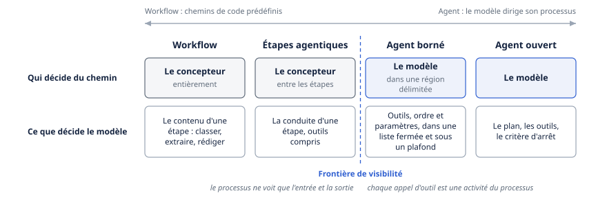
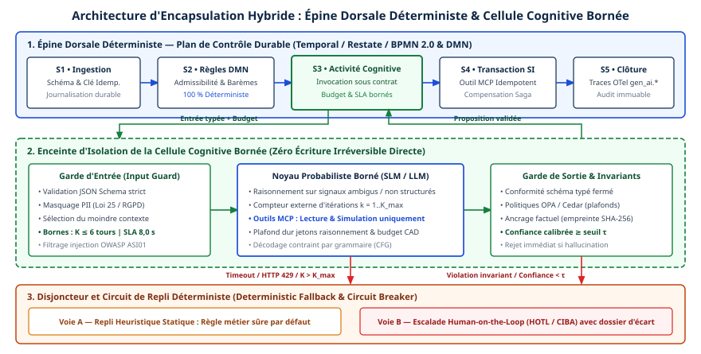

# Chapitre 17 — Déterministe ou agentique

*Question directrice : où placer le non-déterminisme dans un processus d'affaires ?*

> **État de référence :** documentation Camunda 8.11 (branche « next », non publiée; la dernière version publiée est la 8.10), documentation UiPath Maestro pour Automation Cloud, prépublication Routine (v2, 22 juillet 2025). Les numéros entre crochets renvoient aux sources en fin de chapitre; [1] à [12] sont des pages primaires lues pour ce chapitre, [13] et [14] sont secondaires.

Un processus d'affaires est une promesse de répétabilité : la même demande, traitée deux fois, suit le même chemin et laisse la même trace. Un modèle de langage offre l'inverse. Il interprète une entrée imprévue, choisit une suite d'actions que personne n'a écrite, et ne garantit pas de refaire le même choix. Les deux propriétés sont utiles, mais pas au même endroit.

Le débat « workflow ou agent » est donc mal posé. Le chapitre 1 a fixé le critère qui sépare les deux : qui décide du chemin, le concepteur ou le modèle. La question de ce chapitre vient ensuite : dans un processus donné, quelles décisions confier au modèle, et sous quelle enveloppe.

La thèse tient en une phrase. Le non-déterminisme se place dans une région bornée du processus, là où la variabilité des cas le justifie; l'enveloppe — séquence imposée, contrôles, approbations, effets irréversibles, trace — reste déterministe. Le moteur de processus, la gestion de cas et la planification structurée sont trois façons de bâtir cette enveloppe. Le processus exposé comme outil en est une quatrième, vue depuis l'agent.

---

## 17.1 Un spectre : workflow, étapes agentiques, agent borné, agent ouvert

### Deux pôles

La distinction de référence vient d'un texte d'ingénierie d'Anthropic publié en décembre 2024 [1]. Un *workflow* orchestre des modèles et des outils selon des chemins de code prédéfinis. Un *agent* laisse le modèle diriger lui-même son processus et son usage des outils. Le texte y joint un conseil de sobriété : chercher la solution la plus simple, quitte à ne pas construire d'agent, et n'ajouter de la complexité que si elle améliore les résultats de façon démontrable. Il nomme aussi le prix de l'autonomie : latence, coût, et erreurs qui s'accumulent d'une étape à l'autre.

### Quatre positions

Entre ces deux pôles, la pratique d'entreprise occupe au moins quatre positions.



| Position | Qui décide du chemin | Ce que décide le modèle | Forme typique |
|---|---|---|---|
| Workflow | Le concepteur, entièrement | Le contenu d'une étape : classer, extraire, rédiger | Tâche qui appelle un modèle; chaînage, routage [1] |
| Étapes agentiques | Le concepteur, entre les étapes | La conduite d'une étape, outils compris | Agent appelé comme tâche d'un processus [8] |
| Agent borné | Le modèle, dans une région délimitée | Les outils, leur ordre et leurs paramètres, dans une liste fermée et sous un plafond | Sous-processus ad hoc [3][4]; plan structuré [11] |
| Agent ouvert | Le modèle | Le plan, les outils, le critère d'arrêt | Agent autonome muni d'un catalogue d'outils |

La position est une propriété d'une **région** du processus, non du système entier. Un même traitement de réclamation peut commencer par une extraction (workflow), confier l'enquête à un agent borné, puis revenir à une séquence fixe pour le paiement.

La frontière entre la deuxième et la troisième position est une frontière de **visibilité**. Dans une étape agentique, l'agent est une boîte dont le processus ne connaît que l'entrée et la sortie. Dans un agent borné, chaque appel d'outil est une activité du processus lui-même. Camunda trace exactement cette ligne quand il distingue ses propres agents, dont la boucle tourne dans le moteur, des agents externes, dont il ne voit que ce que leur environnement d'exécution renvoie [3].

### Ce que montre la pratique

L'étude Measuring Agents in Production, fondée sur vingt études de cas et un sondage de 306 réponses, dont 86 sur des systèmes déployés, rapporte que 68 % de ces systèmes exécutent moins de dix étapes avant une intervention humaine (au plus dix selon son résumé), et que la fiabilité, premier défi cité, se traite surtout par la conception du système [12]. Les chapitres 4 et 22 exploitent ces résultats; selon le chapitre 42, seize des vingt cas reposent sur des workflows prédéfinis : les déploiements réels occupent surtout les trois premières positions.

---

## 17.2 BPMN comme enveloppe : le sous-processus ad hoc

### Un élément ancien pour un besoin nouveau

BPMN possède un élément conçu pour le travail dont l'ordre n'est pas connu d'avance : le sous-processus ad hoc, marqué d'un tilde. Dans la mise en œuvre de Camunda, il regroupe des activités qui peuvent s'exécuter dans n'importe quel ordre, plusieurs fois ou pas du tout; il ne contient ni événement de début ni événement de fin, et des flux de séquence peuvent y imposer une structure partielle quand certaines activités dépendent l'une de l'autre [4].

C'est la forme qu'il faut à un agent borné : une frontière nette, une liste fermée d'actions, un ordre libre à l'intérieur.

### La boucle confinée

Camunda définit l'agent par sa boucle : le modèle décide de la prochaine action, des outils à appeler et du moment d'arrêter. Un appel de modèle sans boucle ni choix d'outil n'est pas un agent [3]. Cette boucle est logée dans un sous-processus ad hoc, selon une convention simple [2][4] :

- chaque élément BPMN du sous-processus est exposé au modèle comme un outil;
- l'identifiant de l'élément sert de nom d'outil, et son champ de documentation, de description;
- les paramètres attendus du modèle sont déclarés par la fonction `fromAi`.

Le partage des responsabilités est explicite [3]. Le modèle choisit l'outil, l'ordre et les paramètres. Le moteur exécute l'activité choisie, conserve les variables, gère les nouvelles tentatives et les incidents, route les tâches humaines et les événements.

Le mécanisme sous-jacent porte la garantie. Le sous-processus ad hoc peut être piloté par un *job worker* : le moteur crée un travail à l'activation, puis un nouveau à chaque fin de flux interne, et attend qu'on lui dise quels éléments activer ou si le sous-processus est terminé [4]. Le connecteur d'agent tient ce rôle. Le modèle n'exécute donc jamais rien : il propose, le moteur active. Pour l'activation par expression, la documentation précise qu'un identifiant étranger au sous-processus crée un incident, non une action [4].

**Un outil peut contenir toute la logique BPMN.** Un outil peut être une tâche de service, un sous-processus entier ou l'appel d'un autre processus [2]. La partie déterministe ne s'arrête donc pas à la frontière de l'agent : elle se retrouve à l'intérieur de chacun de ses outils.

**La boucle a un plafond.** Le connecteur limite le nombre d'appels au modèle, à dix par défaut, et borne la fenêtre de contexte à vingt messages par défaut [5]. La documentation précise que ce plafond ne remplace pas la surveillance des coûts chez le fournisseur du modèle (chapitre 40).

**Le processus peut interrompre le raisonnement.** Des sous-processus d'événements non interruptifs permettent de réagir à un message externe ou à une minuterie pendant que l'agent travaille [2]. Deux comportements sont offerts : attendre la fin des appels d'outils en cours, ou les annuler et en informer le modèle [5].

**La qualité des descriptions devient une question de fiabilité.** Le modèle choisit sur la foi du nom et de la documentation de chaque élément; une description vague multiplie les mauvais choix et les appels répétés [2]. Modéliser le processus, c'est aussi rédiger du contexte (chapitre 13).

### L'agent comme tâche

UiPath Maestro adopte, dans son canevas BPMN, l'autre construction. L'agent y est représenté par une tâche de service. Le processus lui envoie des paramètres d'entrée, attend, puis reçoit une sortie en JSON dont chaque paramètre doit être affecté à une variable de processus. La suite — branchements (*gateways*), affectations, actions — s'appuie sur ces variables [8]. L'agent peut être hébergé chez UiPath ou être un agent externe joint par un connecteur; la page cite notamment CrewAI, Databricks et Google Vertex.

La page ne parle pas de déterminisme; selon la lecture proposée ici, la boucle de l'agent reste hors du modèle de processus, et l'enveloppe repose sur deux choses, un contrat de sortie strict et un routage fixé à la conception.

| | Boucle confinée | Agent comme tâche |
|---|---|---|
| Où tourne la boucle | Dans le moteur de processus | Dans l'agent appelé |
| Ce que voit le processus | Chaque appel d'outil, comme activité | L'entrée, la sortie, et la trace que l'agent fournit |
| Ce qui borne l'agent | Liste fermée d'outils, plafond d'appels, événements | Contrat de sortie, routage en aval |

Les deux constructions ne s'excluent pas : Camunda prend aussi en charge des agents externes [3].

### Règles de conception

La page de conception de Camunda énonce des principes qui valent au-delà du produit [2] :

- partir du problème du processus, et n'introduire un agent que s'il aide à le résoudre;
- encadrer l'agent d'une vérification (*guardrail sandwich*) : un agent exécute, un second contrôle le raisonnement et la conformité, et un échec renvoie à un humain;
- donner à l'agent des sorties déterministes, et non seulement des niveaux de confiance;
- prévoir un chemin d'escalade vers un humain (chapitre 22);
- versionner les prompts, pour pouvoir revenir en arrière.

Un agent qui ne rend qu'un niveau de confiance reporte le problème sur le branchement suivant, qui devra choisir un seuil. Un agent tenu de rendre l'une de quelques issues nommées donne au processus une variable sur laquelle router.

---

## 17.3 Gestion de cas et processus à exceptions

### Quand le diagramme ne suffit plus

Un sinistre, un litige de facturation ou une remédiation de conformité avancent par retours en arrière, attendent des pièces, changent de mains. Les représenter en BPMN strict oblige à prévoir chaque exception par un branchement, jusqu'à rendre le diagramme illisible.

UiPath Maestro consacre à cette classe de problèmes un canevas de gestion de cas, Case, distinct de son canevas BPMN, avec un test simple pour choisir : si l'étape suivante dépend de ce qui vient de se passer, le cas convient; si le processus suit toujours le même chemin, BPMN suffit [10]. Les indices retenus sont une durée qui se compte en heures ou en semaines, des exceptions attendues et non rares, plusieurs équipes, des retours fréquents à une étape antérieure, des délais de service à suivre par phase.

### Les règles d'abord, l'agent ensuite

Un cas se compose de phases (*stages*), primaires pour le parcours principal et secondaires pour les exceptions, de règles d'entrée, de complétion, de sortie et de réentrée, et de tâches de types variés : action humaine, robot, appel d'API, agent, processus BPMN, cas enfant [10].

Le chemin se décide à l'exécution, par trois mécanismes ordonnés [10] :

1. les règles du plan de cas, déterministes, traitent les scénarios prévus;
2. un agent gestionnaire de cas (*Case Manager*), fondé sur un modèle de langage, raisonne sur l'état du cas, le plan et les politiques, et prend le relais pour les écarts;
3. si ni les règles ni l'agent ne peuvent trancher — données ambiguës, politiques contradictoires, décision hors de son autorité —, le cas est escaladé à un humain.

Cet ordre est une règle de placement en soi : le modèle n'intervient que là où les règles s'arrêtent.

### Une symétrie utile

La gestion de cas place le non-déterminisme à l'inverse des étapes agentiques.

| Patron | Routage entre les étapes | Contenu des étapes |
|---|---|---|
| Étapes agentiques | Fixé à la conception | Confié à un agent |
| Gestion de cas | Décidé à l'exécution, règles puis agent | Souvent déterministe : processus, robot, action humaine |

Les deux se composent. Un cas peut lancer un processus BPMN pour une phase linéaire, et un processus BPMN peut ouvrir un cas [10]. Camunda décrit la même combinaison avec d'autres mots : orchestration déterministe pour les chemins clairs, les décisions répétables et les séquences qu'impose la réglementation; orchestration dynamique pour le tri, la classification et l'enquête. Son exemple est la connaissance du client, où un agent guide la personne et ajuste le niveau de risque sans que la conformité cesse d'être prévisible [2].

Réserve de maturité : dans la documentation lue, l'entité de cas, c'est-à-dire l'objet de données persistant qui sert de source unique de vérité, est marquée comme à venir [10].

---

## 17.4 Planification structurée

### Le plan comme artefact

Entre le chemin codé dans un moteur et le chemin improvisé par le modèle, il existe une voie moyenne : écrire le chemin en langage naturel structuré, et demander au modèle de le suivre. Le cadre Routine, décrit dans une prépublication de 2025, en donne la forme la plus aboutie parmi les sources lues [11].

Une Routine est un plan en étapes numérotées. Chaque étape porte un nom, une description avec ses conditions d'exécution, au besoin une description des entrées et des sorties, et un seul outil. Les branches sont numérotées elles aussi, de sorte que le modèle sait où il se trouve. Le plan naît d'un brouillon rédigé par un expert du domaine; un modèle de planification le décompose et rattache chaque étape à un outil disponible, puis un expert relit le résultat.

Trois choix d'architecture accompagnent ce format [11].

- **Deux modèles.** Un grand modèle planifie, en amont. Un petit modèle exécute : il suit la Routine et ne produit que des appels d'outils. La réponse finale est rédigée par un outil de synthèse à la dernière étape.
- **Une mémoire procédurale.** Les Routines sont rangées dans une base, et celle qui convient est retrouvée par similarité avec la demande. Le contexte ne porte qu'une procédure à la fois.
- **Une mémoire de variables.** Un résultat d'outil trop long est rangé sous une clé, que le modèle transmet à sa place.

### Ce que disent les chiffres, et leur portée

Sur un scénario réel de ressources humaines, avec sept Routines et vingt-cinq outils exposés par MCP, les auteurs rapportent que la précision des appels d'outils passe de 41,1 % à 96,3 % pour GPT-4o, et de 32,6 % à 83,3 % pour un modèle plus petit, Qwen3-14B. Affiné sur des exemples distillés du scénario, ce dernier atteint 95,5 % [11]; la distillation vers de petits modèles relève du chapitre 47.

Trois réserves s'imposent. Ces résultats viennent d'une prépublication et d'une seule expérience, mesurée par ses auteurs. Le gain dépend de brouillons d'experts, ce qui limite la généralisation quand les outils ou les procédures changent; les auteurs le reconnaissent. Et la mesure porte sur la justesse des appels d'outils, non sur le résultat d'affaires.

### Guider n'est pas contraindre

Une Routine guide le modèle; elle ne le contraint pas. Rien, dans le cadre décrit, n'empêche le modèle de sauter une étape : il ne le fait pas, la plupart du temps. Un moteur de processus, lui, ne peut pas sauter une étape. Le reliquat d'erreur d'une planification structurée, même faible, doit donc être rattrapé par autre chose : une validation en aval, une approbation, ou un outil qui refuse d'agir si l'étape préalable manque.

La planification structurée convient quand les procédures sont nombreuses et changeantes, que leur auteur est un expert du métier plutôt qu'un modélisateur, et qu'une erreur d'ordre se détecte et se corrige. Elle convient mal à une séquence que la réglementation impose. Le conditionnement de connaissances procédurales, dont les Agent Skills, relève du chapitre 13.

---

## 17.5 Le processus exposé comme outil

### Renverser la perspective

Les sections précédentes logeaient l'agent dans le processus. L'inverse consiste à loger le processus derrière un outil, et laisser un agent, borné ou ouvert, décider de le lancer.

Un billet de Camunda du 18 août 2026 distingue trois directions pour MCP [6].

| Direction | Mécanisme | Usage |
|---|---|---|
| Le processus appelle un serveur MCP | Connecteurs MCP Client dans un sous-processus ad hoc | Donner à l'agent des outils externes, dont le choix reste visible dans le processus |
| Un client appelle le moteur | Point d'accès MCP du cluster d'orchestration | Consulter les instances, résoudre des incidents, démarrer un processus en langage naturel |
| Un processus devient un outil | Gabarit *MCP start event* et Processes MCP Server | Laisser un agent externe déclencher un processus |

Dans la troisième direction, le nom de l'outil, sa description et ses entrées sont définis dans le modèle BPMN, et l'outil est découvert au déploiement. L'appel démarre le processus et renvoie aussitôt une clé d'instance : l'agent déclenche et suit, il n'attend pas le résultat [6].

### Deux façons d'appeler, deux traces

Pour un agent Camunda qui appelle un autre processus, la documentation compare deux voies [2].

| | Activité d'appel (*call activity*) | Client MCP |
|---|---|---|
| Portée | Même cluster | Autre cluster |
| Résultat | L'appel attend la fin et renvoie la sortie à l'agent | L'outil renvoie la clé d'instance, sans la sortie |
| Hiérarchie | Instance enfant, visible dans l'arbre | Aucun lien structurel avec l'appelant |
| Audit | Trace complète de la hiérarchie | Déclenchement externe, sans lien avec l'agent |

Le choix a un coût d'audit : franchir une frontière de cluster par MCP rompt le lien entre l'agent et ce qu'il a déclenché, sauf à le reconstituer par corrélation. Un processus lancé sans attente est aussi un travail de longue durée, à suivre et à reprendre (chapitres 5 et 18).

### Pourquoi le patron compte

Exposé comme outil, un processus n'est plus un appel d'API, mais une transaction d'affaires entière, avec ses contrôles internes. L'agent décide s'il faut la lancer et quand; il ne peut pas en sauter la troisième étape. Un agent ouvert accède ainsi aux systèmes d'enregistrement sans en recevoir la séquence; le chapitre 25 en fait un principe d'intégration au patrimoine.

La deuxième direction appelle la prudence inverse. Un point d'accès qui démarre des instances et résout des incidents, avec la même authentification que l'API REST [6], est un accès opérationnel, à soumettre à l'autorisation par opération (chapitre 30).

### A2A : un état à dater

⚠ La prise en charge d'A2A par Camunda est partielle à la date de rédaction. La documentation présente trois connecteurs clients — envoi de messages et lecture de l'Agent Card, interrogation des tâches asynchrones, réception par webhook — rangés parmi les fonctionnalités alpha. Elle avertit qu'ils ne prennent pas encore en charge l'authentification auprès d'un serveur A2A distant [7]. Les notes de version de la 8.9 (avril 2026) les introduisent, pour la collaboration multi-agents avec le connecteur d'agent [14]. Selon un résumé non vérifié, ils peuvent servir soit de tâche de service déterministe, soit d'outil offert à l'agent [13]. Aucune page lue ne décrit l'exposition d'un processus Camunda comme agent A2A. Conclusion prudente : un usage expérimental tant que l'authentification manque.

Côté UiPath, les pages Maestro lues ne mentionnent ni MCP ni A2A [8][9]; le chapitre 26 relève toutefois, dans la documentation d'Orchestrator, une prise en charge d'A2A en préversion.

---

## 17.6 Critères de placement

### Sept critères

| Critère | Penche vers le déterministe | Penche vers l'agentique |
|---|---|---|
| Variabilité du chemin | Le même chemin à chaque fois [10] | L'étape suivante dépend de ce qui vient de se passer [10] |
| Nature des entrées | Structurées, validées par schéma | Non structurées : tri, classification, enquête [2] |
| Séquence imposée | Par la réglementation ou le contrôle interne [2] | Aucune contrainte d'ordre |
| Coût et réversibilité de l'erreur | Effet irréversible ou coûteux | Erreur détectable et corrigible |
| Volume, latence, coût unitaire | Fort volume, délai serré [1] | Faible volume, valeur élevée par cas |
| Vérifiabilité du résultat | Difficile à vérifier après coup | Vérifiable par une règle ou un second regard |
| Rythme de changement | Procédure stable | Procédures nombreuses et changeantes [11] |

Un critère seul ne tranche pas. Une enquête de fraude a des entrées non structurées et un chemin variable, mais son issue, le gel d'un compte, est un effet lourd. La réponse est de découper : enquête agentique, décision par règle ou par un humain, exécution déterministe.

### Trois types de décisions

Le découpage se fait mieux en distinguant ce que le modèle décide. Cette typologie est une proposition du chapitre.

- **Interpréter** : classer une demande, extraire des champs, résumer un dossier. Le non-déterminisme porte sur une valeur, que le processus peut valider avant de s'en servir. C'est le placement le moins risqué, à condition de valider : un routeur fondé sur un modèle change souvent de choix devant une simple reformulation (chapitre 44).
- **Choisir** : sélectionner l'outil suivant, l'ordre, les paramètres. Le non-déterminisme porte sur le chemin. Il demande une liste fermée, un plafond et une trace de chaque choix.
- **Engager** : produire un effet dans un système d'enregistrement ou vis-à-vis d'un tiers. Le modèle peut le proposer; l'exécution passe par une étape déterministe et, selon la classe d'action, par une approbation.

Certaines décisions ne se délèguent pas au modèle, quel que soit le patron : la vérification d'une autorisation, le calcul d'un montant, l'application d'un seuil réglementaire, le franchissement d'un point de non-retour (chapitre 18). Elles s'expriment par des règles ou du code, que le modèle appelle ou que le processus applique après lui.

### Un ordre de progression

Les sources convergent sur le point de départ : la solution la plus simple qui fonctionne, et l'agent seulement s'il résout un problème du processus [1][2]. La progression va du workflow vers l'agent borné, région par région, sur preuve (chapitre 22). La répartition du travail entre plusieurs agents relève du chapitre 16.

---

## 17.7 Auditabilité

### Deux questions

Un auditeur pose deux questions : que s'est-il passé, et pourquoi. L'enveloppe déterministe répond à la première. La seconde, pour la part confiée au modèle, n'a qu'une réponse partielle.

### Ce que l'enveloppe enregistre

Dans la construction à boucle confinée, la trace est celle du moteur de processus. Chaque appel d'outil est une activité exécutée, avec ses variables; chaque agent spécialisé appelé comme processus apparaît comme une instance enfant; la découverte des outils d'un serveur MCP figure elle-même dans la piste d'audit [2][3][6]. Cette trace a des angles morts.

- **Le lieu de stockage de la conversation.** L'historique affiché dans l'outil d'exploitation vient d'une API propre aux instances d'agent, distincte du stockage du contexte. Seul le stockage dans les variables de processus permet d'inspecter le JSON brut; avec le stockage documentaire, assorti d'une durée de vie, la variable ne contient qu'une référence [5]. Une durée de vie plus courte que l'obligation de conservation efface la justification avant l'échéance.
- **Les frontières.** Un processus déclenché par MCP sur un autre cluster n'est pas rattaché à l'agent appelant [2]. Un agent externe ne livre que ce que son environnement renvoie [3].

Dans la construction à agent comme tâche, le processus conserve l'historique de chaque instance, avec les entrées et les sorties de l'agent; UiPath mentionne des données de trace — outils utilisés, décisions — pour le débogage et la transparence [8][9]. Leur profondeur dépend de l'agent appelé, surtout s'il est externe.

### Rejouer et expliquer

Un processus déterministe se rejoue : mêmes entrées, même chemin. Une étape agentique ne se rejoue pas, elle se consigne. La piste d'audit doit donc conserver ce qui permet de reconstituer la décision sans la reproduire : la version du prompt [2], l'identité du modèle, la liste d'outils offerte, les entrées, chaque appel et son résultat, la sortie. La justification que rédige le modèle est un élément du dossier, non une preuve de son raisonnement.

Plus la région agentique est petite, plus la part inexpliquée du dossier l'est aussi. Et les sorties déterministes de la section 17.2 servent autant l'audit que le routage : une issue nommée se compte et se contrôle. Les conventions de trace sont traitées au chapitre 33, l'imputabilité au chapitre 36.

---

## Grille de décision

| Décision | Option par défaut | Quand s'en écarter |
|---|---|---|
| Point de départ | Workflow; agent seulement si un problème du processus l'exige [É] | Travail d'enquête ou de tri sans chemin stable |
| Forme de la région agentique | Agent borné : liste fermée d'outils, plafond d'appels [É] | Agent externe déjà en place : l'appeler comme tâche, avec contrat de sortie |
| Processus à exceptions | Gestion de cas, règles d'abord, agent en repli, humain en dernier recours [É] | Exceptions rares : BPMN avec quelques branchements |
| Sortie d'un agent | Issues nommées, routables [É] | Niveau de confiance seulement comme information d'appoint |
| Procédures nombreuses et changeantes | Plan structuré rédigé par le métier, validé en aval [M] | Séquence réglementaire : moteur de processus |
| Accès d'un agent ouvert aux systèmes d'enregistrement | Processus exposé comme outil [É] | Lecture seule : outil direct |
| Appel d'un processus par un agent | Activité d'appel dans le même cluster [É] | Autre cluster : MCP, avec corrélation explicite pour l'audit |
| Effets irréversibles | Étape déterministe, approbation selon la classe d'action [S] | — |
| Agents distants par A2A depuis Camunda | Hors production tant que l'authentification manque côté connecteur [É] | Pilote sans données sensibles |

---

## Points à retenir

- La question n'est pas « workflow ou agent », mais quelle région d'un processus confier au modèle, et sous quelle enveloppe. Quatre positions se distinguent : workflow, étapes agentiques, agent borné, agent ouvert.
- Le sous-processus ad hoc de BPMN donne sa forme à l'agent borné : le modèle propose un outil dans une liste fermée, le moteur l'exécute et en garde la trace.
- L'autre construction appelle l'agent comme une tâche et fait reposer l'enveloppe sur un contrat de sortie et un routage fixe. Elle voit moins, mais accueille des agents externes.
- La gestion de cas inverse le placement : le routage se décide à l'exécution, les règles d'abord et l'agent ensuite, alors que le contenu des étapes reste souvent déterministe.
- Un plan structuré guide le modèle sans le contraindre. Son reliquat d'erreur doit être rattrapé par l'enveloppe.
- Exposer un processus comme outil donne à un agent une transaction entière qu'il peut lancer, mais non réordonner.
- Interpréter, choisir, engager : le risque croît dans cet ordre. Autorisations, montants, seuils et points de non-retour restent hors du modèle.
- Une étape agentique se consigne, elle ne se rejoue pas. La taille de la région agentique fixe la part inexpliquée du dossier d'audit.

---

## Sources

Pages primaires lues le 11 novembre 2026 :

1. [Anthropic — Building effective agents (19 décembre 2024)](https://www.anthropic.com/engineering/building-effective-agents)
2. [Camunda — Agentic orchestration : design and architecture (8.11, « next »)](https://docs.camunda.io/docs/next/components/agentic-orchestration/ao-design/)
3. [Camunda — AI agents](https://docs.camunda.io/docs/next/components/agentic-orchestration/ai-agents/)
4. [Camunda — Ad-hoc sub-processes](https://docs.camunda.io/docs/next/components/modeler/bpmn/ad-hoc-subprocesses/)
5. [Camunda — AI Agent Sub-process connector](https://docs.camunda.io/docs/next/components/connectors/out-of-the-box-connectors/agentic-ai-aiagent-subprocess/)
6. [Camunda — Three ways Camunda speaks MCP (18 août 2026)](https://camunda.com/blog/2026/08/three-ways-camunda-speaks-mcp-and-why-the-direction-matters/) — billet de fournisseur
7. [Camunda — A2A Client (fonctionnalités alpha)](https://docs.camunda.io/docs/next/components/early-access/alpha/a2a-client/)
8. [UiPath Maestro — Using agents in Maestro](https://docs.uipath.com/maestro/automation-cloud/latest/user-guide/using-agents-in-maestro)
9. [UiPath Maestro — What you get with Maestro](https://docs.uipath.com/maestro/automation-cloud/latest/user-guide/value-proposition)
10. [UiPath Maestro — Maestro BPMN vs. Maestro Case](https://docs.uipath.com/maestro/automation-cloud/latest/user-guide/maestro-bpmn-vs-maestro-case-when-to-use-case-management)
11. [Routine: A Structural Planning Framework for LLM Agent System in Enterprise (arXiv 2507.14447v2)](https://arxiv.org/html/2507.14447v2) — prépublication
12. [Measuring Agents in Production (arXiv 2512.04123)](https://arxiv.org/abs/2512.04123) — version 4

Sources secondaires :

13. [Camunda — Designing A2A Orchestration with Camunda (février 2026)](https://camunda.com/blog/2026/02/using-a2a-to-achieve-your-business-goals-pt-1/) — résumé de recherche seulement, page non lue.
14. [Camunda — notes de version 8.9](https://docs.camunda.io/docs/reference/announcements-release-notes/890/890-release-notes/) — page de documentation, lue lors de l'audit du 12 novembre 2026.

## Limites de ce chapitre

- Les pages ont été lues par un outil d'extraction qui condense le contenu; la formulation exacte n'a pas été vérifiée mot à mot.
- La documentation Camunda lue est celle de la branche « next » (8.11, non publiée). Les valeurs par défaut citées peuvent différer de celles de la version 8.10.
- La page UiPath donnée en appui par le plan initial (« agentic automation ») renvoie une erreur 404 au 11 novembre 2026; les pages voisines [8] à [10] l'ont remplacée. Le canevas Flow de Maestro n'a pas été étudié.
- Les spécifications BPMN 2.0 et CMMN de l'OMG n'ont pas été lues. Le sous-processus ad hoc est décrit d'après Camunda; son appartenance au standard BPMN et sa destination d'origine reposent sur la connaissance générale, de même que l'affirmation qu'un BPMN strict devient illisible pour un processus à exceptions (17.3).
- La lecture « routage fixe » de UiPath Maestro, la typologie interpréter-choisir-engager, les critères de coût, de réversibilité et de vérifiabilité (17.6) et la liste des éléments à consigner (17.7) sont des analyses du chapitre, non des énoncés des sources.
- Routine est une prépublication évaluée par ses auteurs sur un seul scénario. Le corps de [12] a été lu le 12 novembre 2026 pour l'échantillon et le nombre d'étapes. L'article sur l'architecture pour l'IA composée, cité par le plan initial, n'a pas été lu et n'est pas utilisé.
- Les cadriciels à graphe d'état, autre forme d'enveloppe, sont laissés au chapitre 20; les moteurs d'exécution durable, au chapitre 18; le contrôleur vérifié qui encadre un contrôleur appris en robotique, au chapitre 46.
- L'audit du 12 novembre 2026 a relu [5] à [8], [11] et le résumé de [12], et lu [14] : faits confirmés. L'apparition des connecteurs A2A en 8.9 est établie; leur double usage, tâche de service ou outil d'agent, ne repose que sur [13]. [1] à [4], [9] et [10] n'ont pas été relus.
- Aucune évaluation indépendante des produits cités n'a été trouvée : les sections 17.2, 17.3 et 17.5 reposent sur la documentation des éditeurs.

## Mise en œuvre — Le grand découplage : contrôle déterministe et autonomie probabiliste {.volet}

:::: {.encadre .executive}
::: {.encadre-titre}
**Synthèse exécutive**
:::

- **Enjeu** : à 95 % de précision par décision, une chaîne non encadrée de quinze étapes plafonne à $0,95^{15} \approx 46,3\,\%$ de succès au premier passage, avec des dérives de coût et un risque de non-conformité réglementaire.
- **Décisions d’architecture** :
  1. *Irréversible* : séparer le plan de contrôle déterministe (machine à états durable, règles DMN et Cedar, transactions et compensations Saga) des cellules bornées confiées au modèle (interprétation, diagnostic multi-signaux).
  2. *Structurante dès la conception* : placer chaque appel au modèle entre une garde d’entrée déterministe (schéma, masquage des données personnelles, budget de jetons et de latence) et une garde de sortie qui vérifie les invariants métiers avant toute écriture dans un système d’enregistrement.
  3. *Réversible* : le choix du modèle, petit modèle spécialisé (SLM) ou grand modèle de raisonnement (LLM), dans une cellule bornée, remplaçable sans toucher au graphe d’orchestration parent.
- **Indicateurs de gouvernance** : constance $\text{pass}^5$ sur banc d’homologation, taux de rejet par les gardes d’invariants, taux d’activation du repli, latence et coût au 99e centile ($P_{99}$).
::::

## 17.8 Fiabilité composée d’une chaîne de décisions

Les erreurs d’un agent s’accumulent d’une étape à l’autre (section 17.1). La loi de Lusser, formulée en 1952 en ingénierie aérospatiale, en donne la mesure : la fiabilité d’une série de maillons est le produit de leurs fiabilités. Un prototype juste huit fois sur dix, placé sans garde déterministe devant dix mille événements quotidiens, produit deux mille incidents par jour, à reprendre à la main.

### De l’exactitude ponctuelle ($\text{pass}@1$) à la constance ($\text{pass}^k$)

Les classements académiques mesurent $\text{pass}@k$, la probabilité qu’au moins un essai sur $k$ réussisse. Le critère convient quand un compilateur ou un développeur écarte sans frais les propositions erronées. Un processus transactionnel — instruire un sinistre, modifier un approvisionnement, reconfigurer un équipement — doit au contraire appliquer la politique d’affaires à chacune des $k$ exécutions d’un même dossier. C’est ce que mesure $\text{pass}^k$, métrique des bancs d’évaluation d’agents transactionnels ($\tau\text{-bench}$). Pour $n$ décisions supposées indépendantes, de précision moyenne $p$, la borne de Lusser décroît de façon exponentielle :

$$R_{\text{seq}}(n) = \prod_{i=1}^{n} p_i \approx p^n, \quad \text{pass}^k(n) = p^{nk}$$

Deux ordres de grandeur :

- avec $p = 0,95$, un flux linéaire de $n = 12$ étapes libres réussit $0,95^{12} \approx 54,0\,\%$ des passages ($\text{pass}@1$), et sa reproductibilité sur cinq contrôles successifs ($\text{pass}^5$) tombe à $0,95^{60} \approx 4,6\,\%$;
- avec $p = 0,99$, au prix d’un modèle de pointe, un dossier complexe de $n = 30$ étapes atteint $0,99^{30} \approx 74,0\,\%$ au premier essai et $0,99^{150} \approx 22,1\,\%$ en $\text{pass}^5$, loin des SLA de $99,5\,\%$ exigés en production.

### Erreurs corrélées et coût de l’auto-correction

La dégradation réelle est plus rapide que la borne, car les erreurs successives ne sont pas indépendantes ($P(\text{err}_{i+1} \mid \text{err}_i) \gg 1 - p$) : dans une boucle ouverte, chaque sortie intermédiaire entre dans la fenêtre de contexte du tour suivant (OWASP ASI08 — Cascading Failures). Trois effets en découlent.

1. **Ancrage sur une hallucination précoce** : une mauvaise interprétation contractuelle au tour 3 biaise toutes les requêtes suivantes; le modèle justifie son erreur initiale avec une assurance croissante.
2. **Inflation quadratique des nouvelles tentatives** : un agent laissé libre de « réfléchir » après une erreur d’API empile les traces d’exception dans l’historique transmis à chaque tour, ce qui multiplie par vingt la consommation de jetons sans corriger la cause.
3. **Queue lourde de latence ($P_{99}$)** : les temps de réponse d’une boucle ouverte sont erratiques, incompatibles avec les régimes opérationnels courts.

L’extrait suivant chiffre le gain du découplage : une épine dorsale déterministe et $m \ll n$ cellules bornées, munies de gardes déterministes et d’un repli, portent la fiabilité au-delà de $99,3\,\%$.

#### Extrait 17.1 — Modèle quantitatif de fiabilité composée et de gain d’encapsulation hybride

``` python
from dataclasses import dataclass

@dataclass(frozen=True)
class FlowProfile:
    name: str
    probabilistic_cells: int          # m cellules cognitives sur N étapes totales
    raw_accuracy: float               # Précision brute d'un essai modèle (p)
    guard_detection_rate: float       # Part d'erreurs captées par garde déterministe
    max_verified_retries: int         # Réessais bornés autorisés après interception
    safe_fallback_rate: float         # Succès sûr du circuit de repli (règle / HOTL)

def cell_reliability(cfg: FlowProfile) -> float:
    caught_err = (1.0 - cfg.raw_accuracy) * cfg.guard_detection_rate
    direct_ok = cfg.raw_accuracy * sum(
        caught_err**i for i in range(cfg.max_verified_retries + 1)
    )
    fallback_ok = (caught_err ** (cfg.max_verified_retries + 1)) * cfg.safe_fallback_rate
    return direct_ok + fallback_ok

def evaluate_flow(cfg: FlowProfile, k: int = 5) -> dict[str, float]:
    r_cell = cell_reliability(cfg)
    pass_1 = r_cell ** cfg.probabilistic_cells
    return {
        "cell_rel": round(r_cell, 5),
        "e2e_pass_1": round(pass_1, 4),
        "e2e_pass_k": round(pass_1**k, 4),
    }

if __name__ == "__main__":
    free_chain = FlowProfile("Chaîne LLM libre (15 sauts)", 15, 0.95, 0.0, 0, 0.0)
    hybrid = FlowProfile("Épine déterministe + 3 cellules bornées", 3, 0.95, 0.96, 1, 0.995)
    print(free_chain.name, evaluate_flow(free_chain))
    # {'cell_rel': 0.95, 'e2e_pass_1': 0.4633, 'e2e_pass_k': 0.0213}
    print(hybrid.name, evaluate_flow(hybrid))
    # {'cell_rel': 0.99789, 'e2e_pass_1': 0.9937, 'e2e_pass_k': 0.9688}
```

Un système critique ne s’industrialise pas en visant $p = 0,9999$, mais en réduisant l’exposant $m$ des transitions probabilistes et en filtrant leurs sorties par du code déterministe.

---

## 17.9 Séparation entre plan de contrôle déterministe et cellule bornée

La section 17.2 décrit l’enveloppe déterministe dans sa forme BPMN. En voici une réalisation sur un moteur d’exécution durable : une machine à états déterministe pilote le processus et appelle, à des points fixés à la conception, une cellule bornée dont elle ne reçoit qu’une proposition.



L’enveloppe se compose de quatre éléments.

1. **L’épine dorsale d’état durable** : exécutée sur Temporal, Restate ou un moteur BPMN 2.0/DMN, elle seule détient l’ordre légal des étapes, le journal d’événements rejouable, les clés d’idempotence, les compensations Saga et les budgets. Une injection de prompt ne peut pas sauter un contrôle compilé dans le graphe déterministe.
2. **La garde d’entrée** : avant toute inférence, elle valide le schéma amont, masque les renseignements personnels superflus (Loi 25, RGPD), filtre les motifs d’injection indirecte (OWASP ASI01) et assemble le plus petit contexte suffisant.
3. **La cellule bornée** : le modèle, SLM ou LLM, analyse les signaux ambigus ou non structurés. Ses outils MCP sont restreints à la lecture et à la simulation. Un compteur externe arrête la boucle à $K_{\max}$ tours.
4. **La garde de sortie et le disjoncteur** : la proposition passe par un décodage contraint (Structured Outputs), puis par une vérification déterministe des invariants (Cedar ou OPA, existence des références citées, seuil de confiance calibrée $\tau$). L’épine dorsale n’exécute l’écriture idempotente qu’après cette vérification. En cas de rejet, de dépassement de délai ou d’erreur HTTP 429, le disjoncteur route le dossier vers une règle statique sûre ou une file HOTL.

Deux règles de cette enveloppe vont au-delà de ce que retient l’exposé. Les outils de la cellule sont limités à la lecture et à la simulation; l’exposé admet qu’un outil d’agent borné soit une tâche de service, un sous-processus entier ou l’appel d’un autre processus, que le moteur exécute (section 17.2), et il donne à un agent ouvert accès aux systèmes d’enregistrement par un processus exposé comme outil (section 17.5). Le seuil $\tau$ s’ajoute aux issues nommées; l’exposé demande des issues nommées et routables, et ne tient le niveau de confiance que pour une information d’appoint, car un seuil reporte le problème sur le branchement suivant (section 17.2).

L’extrait suivant applique ce découpage au traitement d’une alerte d’équipement.

#### Extrait 17.2 — Machine à états déterministe (Temporal TypeScript) encapsulant une cellule cognitive

``` typescript
import { proxyActivities, ApplicationFailure } from "@temporalio/workflow";

export interface AlertWorkflowInput {
  readonly sagaId: string;
  readonly assetSerial: string;
  readonly criticalSla: boolean;
  readonly sensorDigest: string;
  readonly redactedNotes: string;
}

export interface DiagnosticProposal {
  readonly rootCauseCode: "BEARING_WEAR" | "VALVE_CAVITATION" | "THERMAL_OVERLOAD" | "SENSOR_DRIFT" | "UNKNOWN";
  readonly calibratedConfidence: number;
  readonly recommendedPartSku: string | null;
  readonly estimatedRepairCostCad: number;
  readonly citedHashes: ReadonlyArray<string>;
}

interface DeterministicActivities {
  checkContractDmn(assetSerial: string): Promise<{ covered: boolean; capCad: number }>;
  verifyInvariantsCedar(
    proposal: DiagnosticProposal,
    capCad: number,
    validHashes: ReadonlyArray<string>
  ): Promise<{ allowed: boolean; reason?: string }>;
  reservePartIdempotentMcp(sagaId: string, sku: string): Promise<{ reservationId: string }>;
  triggerDeterministicFallback(sagaId: string, reason: string): Promise<{ ticketId: string }>;
}

interface CognitiveCellActivities {
  runBoundedDiagnosticCell(args: {
    assetSerial: string;
    sensorDigest: string;
    notes: string;
    maxIterations: number;
    maxReasoningTokens: number;
  }): Promise<{ proposal: DiagnosticProposal; validHashes: string[] }>;
}

const det = proxyActivities<DeterministicActivities>({
  startToCloseTimeout: "5 seconds",
  retry: { maximumAttempts: 3 },
});

const cog = proxyActivities<CognitiveCellActivities>({
  startToCloseTimeout: "8 seconds",
  retry: {
    maximumAttempts: 2,
    nonRetryableErrorTypes: ["PromptInjectionError", "BudgetExhaustedError"],
  },
});

export async function resolveEquipmentAlertWorkflow(
  input: AlertWorkflowInput
): Promise<{ status: "AUTO_RESOLVED" | "FALLBACK_ESCALATED"; refId: string }> {
  // S1-S2 : Admissibilité contractuelle 100 % déterministe (DMN)
  const contract = await det.checkContractDmn(input.assetSerial);
  if (!contract.covered) {
    const fb = await det.triggerDeterministicFallback(input.sagaId, "CONTRACT_EXCLUDED");
    return { status: "FALLBACK_ESCALATED", refId: fb.ticketId };
  }

  // S3 : Cellule cognitive confinée (outils MCP lecture seule, K_max = 5, SLA 8 s)
  let proposal: DiagnosticProposal;
  let validHashes: string[];
  try {
    const out = await cog.runBoundedDiagnosticCell({
      assetSerial: input.assetSerial,
      sensorDigest: input.sensorDigest,
      notes: input.redactedNotes,
      maxIterations: 5,
      maxReasoningTokens: 2048,
    });
    proposal = out.proposal;
    validHashes = out.validHashes;
  } catch (err) {
    const code = err instanceof Error ? `CELL_ABORT:${err.message}` : "CELL_ABORT";
    const fb = await det.triggerDeterministicFallback(input.sagaId, code);
    return { status: "FALLBACK_ESCALATED", refId: fb.ticketId };
  }

  // Garde de sortie déterministe : confiance calibrée + politique Cedar + ancrage SHA-256
  const tau = input.criticalSla ? 0.90 : 0.82;
  if (proposal.calibratedConfidence < tau || proposal.rootCauseCode === "UNKNOWN") {
    const fb = await det.triggerDeterministicFallback(input.sagaId, "BELOW_CONFIDENCE_FLOOR");
    return { status: "FALLBACK_ESCALATED", refId: fb.ticketId };
  }

  const guard = await det.verifyInvariantsCedar(proposal, contract.capCad, validHashes);
  if (!guard.allowed) {
    const fb = await det.triggerDeterministicFallback(
      input.sagaId,
      `INVARIANT_REJECTED:${guard.reason ?? "POLICY"}`
    );
    return { status: "FALLBACK_ESCALATED", refId: fb.ticketId };
  }

  // S4 : Mutation transactionnelle idempotente exécutée hors du modèle
  if (!proposal.recommendedPartSku) {
    throw ApplicationFailure.nonRetryable("SKU manquant malgré validation garde.");
  }
  const res = await det.reservePartIdempotentMcp(input.sagaId, proposal.recommendedPartSku);
  return { status: "AUTO_RESOLVED", refId: res.reservationId };
}
```

:::: {.encadre .sectoriel}
::: {.encadre-titre}
**Secteur bancaire et assurances — reproductibilité et explicabilité déterministe sous BSIF E-23**
:::

Pour les institutions financières fédérales soumises à la ligne directrice BSIF E-23 révisée (en vigueur le 1er mai 2027) et pour les assureurs assujettis à l’Annexe III de l’EU AI Act (décembre 2027), le découplage trace une frontière d’imputation des décisions que les équipes de gestion du risque de modèle peuvent vérifier.

1. **Extraction sourcée, par la cellule bornée** : le modèle structure les faits tirés de constats ou d’états financiers hétérogènes, et attache à chaque attribut la coordonnée exacte et l’empreinte du passage source.
2. **Adjudication déterministe, par table DMN ou moteur actuariel** : les calculs de ratios prudentiels, de franchises, d’exclusions légales et d’octroi restent codés dans des tables déterministes versionnées. Deux dossiers aux faits extraits identiques reçoivent, avec une probabilité de $1,000$, la même décision tarifaire et le même motif réglementaire opposable.
::::

---

## 17.10 Matrice d’arbitrage : API, RPA, BPMN/DMN, petit modèle et cellule bornée

Les critères de la section 17.6 désignent la région à confier au modèle; le tableau suivant guide le choix de la technologie d’exécution. Additionner des lignes de facture ou router un code postal avec un modèle génératif multiplie la latence par cent et le coût marginal par dix mille, et ajoute un risque d’erreur arithmétique. À l’inverse, maintenir dix mille expressions régulières pour interpréter des litiges techniques multilingues crée une dette fragile.

| Critère d’arbitrage | API / Microservice | RPA vs CUA encadré | BPMN 2.0 & Règles DMN | Travailleur SLM (Tâche) | Cellule LLM bornée |
|:-------------|:--------------|:-----------------|:----------------|:-------------------|:-----------------|
| Entrées types | JSON, Protobuf, EDI typé | Écrans patrimoniaux sans API | Attributs structurés, événements | Texte libre, PDF, journaux bruités | Signaux multi-sources ambigus |
| Mécanisme | Algorithme compilé exact | Sélecteurs UI (RPA) / Vision (CUA) | Machine à états & tables booléennes | Extraction mono-tour contrainte | Investigation bornée (`K <= 6`) |
| Latence $P_{95}$ | 5 à 80 ms | 2–15 s (RPA); 8–45 s (CUA) | 10 à 150 ms | 120 à 600 ms | 1,5 à 9,0 s |
| Coût unitaire | $< 0,0001$ \$ CAD | $0,005\text{–}0,08$ \$ CAD | $< 0,0005$ \$ CAD | $0,0005\text{–}0,005$ \$ CAD | $0,02\text{–}0,35$ \$ CAD |
| Constance $\text{pass}^5$ | $100\,\%$ | $92\text{–}98\,\%$ | $100\,\%$ | $94\text{–}99\,\%$ | $82\text{–}96\,\%$ brut ($> 99\,\%$ gardé) |
| Auditabilité | Immédiate (tests unitaires) | Moyenne (captures vidéo/journaux) | Maximale (tables lisibles métier) | Modérée (jeu étalon doré) | Forte uniquement sous garde |
| Rôle cible | Calculs, CRUD, mutations SI | Pont transitoire AS/400 / client lourd | Épine dorsale, barèmes et seuils | Triage massif, normalisation | Diagnostic complexe, exceptions |

Trois invariants règlent les combinaisons.

- **Aucune arithmétique probabiliste** : tout calcul monétaire, fiscal, calendaire ou physique s’exécute exclusivement en code déterministe ou en DMN (section 17.6).
- **Confinement des agents graphiques (CUA)** : quand un système patrimonial sans API exige une interaction par écran, le CUA est placé derrière un serveur MCP qui expose une opération atomique, encadrée d’assertions visuelles déterministes à chaque écran critique.
- **Chaînage SLM $\rightarrow$ DMN par défaut** : pour la majorité des dossiers administratifs, un SLM d’extraction qui alimente une table DMN remplace une boucle ReAct, plus coûteuse.

:::: {.encadre .sectoriel}
::: {.encadre-titre}
**Chaînes d'approvisionnement et réseaux critiques — continuité déterministe en cas de défaillance d'inférence**
:::

Un centre de distribution national, un répartiteur électrique ou une logistique hospitalière ne peut pas laisser une panne régionale d’API GPU immobiliser ses opérations physiques. L’architecture hybride impose un exercice trimestriel de débranchement cognitif : l’accès aux services d’inférence est coupé sur une fraction canari du trafic. En moins de 500 millisecondes, le disjoncteur de l’épine dorsale bascule sur ses règles statiques de secours : réapprovisionnement min/max standard SAP et routage déterministe vers les files d’opérateurs. L’organisation perd pour un temps l’optimisation fine de l’agent, mais conserve 100 % de sa continuité.
::::

---

## 17.11 Contrats d’entrée et de sortie typés, bornes d’exécution

Les issues nommées que demande la section 17.2 deviennent un contrat par quatre mécanismes, tous appliqués hors du modèle.

1. **Décodage contraint et énumérations fermées** : la sortie obéit à une grammaire stricte (JSON Schema Draft 2020-12, `additionalProperties: false`). Les codes d’action appartiennent à un ensemble `enum` fini, qui comprend une valeur d’abstention (UNKNOWN).
2. **Preuves d’ancrage par empreinte (SHA-256)** : chaque affirmation factuelle cite l’identifiant du fragment injecté et le préfixe de son empreinte. La garde de sortie le vérifie en $\mathcal{O}(1)$ et écarte les citations hallucinées.
3. **Plafond sur les jetons de raisonnement** : avec les modèles à calcul adaptatif au moment de l’inférence, borner les seuls jetons visibles laisse le modèle dépenser 20 000 jetons de réflexion cachée sur un cas ambigu. Le harnais plafonne donc séparément `max_output_tokens` et `max_reasoning_tokens`.
4. **Échéance temporelle monotone et confiance calibrée hors prompt** : avant chaque tour $k + 1 \le K_{\max}$, le harnais vérifie qu’il reste assez de millisecondes avant l’échéance SLA pour forcer une synthèse. L’attribut `calibratedConfidence` ne vient jamais d’une auto-évaluation rédigée par le modèle, systématiquement trop confiante lors d’une hallucination. Le harnais le calcule après coup, par étalonnage de température ou prédiction conforme sur les `logprobs` des jetons de l’énumération `rootCauseCode`, contre un jeu de validation hors échantillon.

Les bornes dépendent de la classe de cellule.

| Classe de cellule | Profil de modèle | Tours lecture ($K_{\max}$) | Plafond jetons réflexion | Latence $P_{99}$ max | Budget unitaire | Repli sur dépassement |
|:---------------|:--------------|:--------------|:--------------|:------------|:-----------|:-----------------|
| C1 — Extraction atomique | SLM 3B–14B | $0$ (mono-passe) | $0$ (désactivé) | $600\text{ ms}$ | $0,003$ \$ CAD | Modèle secondaire ou file saisie |
| C2 — Diagnostic opérationnel | SLM domaine / LLM rapide | $3$ à $5$ | $\le 2\,048$ | $8,0\text{ s}$ | $0,08$ \$ CAD | Synthèse partielle + escalade HOTL |
| C3 — Adjudication complexe | LLM de raisonnement | $4$ à $6$ | $\le 6\,144$ | $25,0\text{ s}$ | $0,35$ \$ CAD | Gel sans écriture + dossier CIBA |
| C4 — Méta-gouverneur critique | Famille LLM distincte | $0$ à $2$ | $\le 1\,536$ | $3,5\text{ s}$ | $0,05$ \$ CAD | *Fail-Closed* (blocage préventif L3) |

Le schéma de sortie de la cellule de diagnostic réunit ces contraintes.

#### Extrait 17.3 — Schéma JSON normatif de sortie bornée avec ancrage factuel (Draft 2020-12)

``` json
{
  "$schema": "https://json-schema.org/draft/2020-12/schema",
  "$id": "https://schemas.boreal.ca/fabric/v2/diagnostic-output.json",
  "title": "BoundedDiagnosticCellOutput",
  "type": "object",
  "additionalProperties": false,
  "required": [
    "schemaVersion",
    "rootCauseCode",
    "calibratedConfidence",
    "uncertaintyFlags",
    "recommendedPartSku",
    "estimatedRepairCostCad",
    "evidenceCitations",
    "rationale"
  ],
  "properties": {
    "schemaVersion": { "const": "2.1.0" },
    "rootCauseCode": {
      "type": "string",
      "enum": ["BEARING_WEAR", "VALVE_CAVITATION", "THERMAL_OVERLOAD", "SENSOR_DRIFT", "UNKNOWN"]
    },
    "calibratedConfidence": { "type": "number", "minimum": 0.0, "maximum": 1.0 },
    "uncertaintyFlags": {
      "type": "array",
      "maxItems": 4,
      "items": {
        "type": "string",
        "enum": ["CONFLICTING_SENSORS", "MISSING_LOG", "OUT_OF_DISTRIBUTION", "AMBIGUOUS_CLAUSE"]
      }
    },
    "recommendedPartSku": {
      "type": ["string", "null"],
      "pattern": "^[A-Z0-9]{3,8}-[A-Z0-9]{2,8}-[A-Z0-9]{2,6}$"
    },
    "estimatedRepairCostCad": { "type": "number", "minimum": 0.0, "maximum": 50000.0 },
    "evidenceCitations": {
      "type": "array",
      "minItems": 1,
      "maxItems": 6,
      "items": {
        "type": "object",
        "additionalProperties": false,
        "required": ["chunkId", "sha256Prefix16"],
        "properties": {
          "chunkId": { "type": "string", "minLength": 4, "maxLength": 64 },
          "sha256Prefix16": { "type": "string", "pattern": "^[a-f0-9]{16}$" }
        }
      }
    },
    "rationale": { "type": "string", "minLength": 20, "maxLength": 500 }
  }
}
```

---

## 17.12 Application au fil rouge : Boréal Services Numériques et BCA

:::: {.encadre .filrouge}
::: {.encadre-titre}
**Fil rouge — Groupe Boréal : Encapsulation des boucles d'investigation de pannes chez BSN et d'adjudication chez BCA**
:::

**Situation initiale (T4 2026)** : en parallèle de l’incident déclencheur à 41 000 \$ CAD, causé par un prototype d’achat qui avait bouclé pendant onze heures un dimanche sur une erreur HTTP 429 non gérée, Boréal Services Numériques (BSN) exploitait un agent d’investigation de pannes télématiques. C’était une boucle ReAct ouverte, qui exposait dix-neuf outils ServiceNow, Snowflake et Salesforce. Trois défauts bloquaient son passage à l’échelle.

1. *Inconstance des décisions* : rejouée cinq fois sur une même dérive de pression, la boucle concluait trois fois à une usure mécanique, une fois à un bruit de capteur, et modifiait une fois sans droit la priorité SLA du billet ($\text{pass}^5 = 61\,\%$).
2. *Tempêtes de requêtes* : au moindre ralentissement de Snowflake, l’agent relançait jusqu’à quatorze requêtes SQL redondantes. La latence $P_{99}$ montait à 142 s et le coût moyen à 1,85 \$ CAD par alerte.
3. *Veto réglementaire de BCA* : la direction des risques de Boréal Capital & Assurances (BCA) interdisait toute connexion aux polices bris de machine avant l’échéance BSIF E-23 du 1er mai 2027, faute de frontière prouvable entre le diagnostic probabiliste et le calcul contractuel de la franchise.

**Architecture déployée (février 2027)** : l’équipe remplace la boucle ouverte par le workflow Temporal de l’extrait 17.2.

- **Chez BSN** : l’épine dorsale assemble en amont les séries temporelles agrégées et retire des notes de terrain les identifiants d’employés (Loi 25). La cellule, de classe C2, n’accède plus qu’à 4 outils MCP en lecture seule, sous un plafond de $K_{\max} = 5$ tours, 2 048 jetons de raisonnement et 8,0 s. Sa sortie est conforme au schéma `BoundedDiagnosticCellOutput`.
- **Chez BCA** : le code de panne validé est transmis à un moteur déterministe DMN et Cedar, qui calcule exactement la couverture, le plafond annuel et la franchise selon les règles Guidewire / IBM i.
- **Repli** : pour les 3,1 % d’alertes hors distribution (`OUT_OF_DISTRIBUTION`) ou sous le seuil $\tau = 0,90$, le disjoncteur ouvre un dossier AG-UI à l’ingénieur de niveau 2, sans écriture risquée dans l’ERP.

**Résultats vérifiés sur 18 400 alertes (45 jours)** : la constance $\text{pass}^5$ passe de 61,0 % à 99,2 % (homologation interne BSIF E-23 obtenue), la latence $P_{99}$ de 142 s à 9,4 s, et le coût moyen d’inférence de 1,85 \$ CAD à 0,06 \$ CAD (-96,8 %).
::::

---

## 17.13 Décision d’architecture et liste de contrôle

:::: {.encadre .adr}
::: {.encadre-titre}
**ADR-002 — Interdiction du routage global de processus critiques par inférence LLM non bornée**
:::

- **Statut** : acceptée \| Périmètre : Fabrique Agentique d’Entreprise (L2 à L4) \| Révision : semestrielle
- **Contexte** : une boucle agentique qui pilote librement des séquences d’outils à effets subit une chute exponentielle de fiabilité composée ($p^n$), des défaillances en cascade (OWASP ASI08) et des dérives de coût sur erreurs transitoires. Elle est incompatible avec l’auditabilité qu’exigent BSIF E-23, la Loi 25 et l’EU AI Act.
- **Options évaluées** :
  1. *Boucle LLM autonome de bout en bout, avec prompt durci* : rejetée. Une consigne textuelle ne garantit ni les invariants, ni la latence $P_{99}$, ni les budgets.
  2. *Exclusion totale des modèles génératifs des flux métiers* : rejetée. Elle maintient des délais manuels de 48 heures sur les pièces et les signaux non structurés.
  3. *Épine dorsale déterministe durable encapsulant des cellules bornées* : retenue. Les transitions d’état, les calculs DMN et Cedar et les écritures MCP idempotentes s’exécutent hors du modèle; le LLM est restreint à des cellules en lecture seule, validées par des gardes d’entrée et de sortie, avec circuit de repli.
- **Décision** : aucun flux critique ne confie son aiguillage global ni l’exécution directe d’écritures irréversibles à une boucle probabiliste ouverte. Toute cellule en production impose : (a) compteur externe $K_{\max}$, délai strict et plafond de jetons de raisonnement; (b) schéma JSON fermé, avec option d’abstention (UNKNOWN) et empreintes d’ancrage; (c) garde déterministe d’invariants avant toute écriture par l’épine dorsale; (d) repli déterministe testé chaque trimestre.
- **Conséquences** :
  - *Positives* : constance $\text{pass}^5 > 99\,\%$, maîtrise des coûts et des SLA, auditabilité réglementaire, continuité d’activité en cas de panne d’inférence.
  - *Négatives, coûts assumés* : modélisation explicite préalable des machines à états durables, des tables DMN et des contrats JSON.
- **Condition de révision** : réétalonnage semestriel des plafonds $K_{\max}$ et des seuils $\tau$, sur preuves statistiques tirées des bancs $\text{pass}^k$.
::::

### Liste de contrôle de mise en production

Huit exigences à valider avant de déployer un flux hybride.

1. **Homologation en constance** : le flux complet a-t-il franchi un banc d’au moins cent cas réels et contradictoires, mesuré en $\text{pass}^5$ et non en $\text{pass}@1$ ?
2. **Écritures et calculs hors du modèle** : règles tarifaires, seuils financiers, clés d’idempotence et appels MCP à effets s’exécutent-ils tous dans l’épine dorsale ?
3. **Lecture seule dans la cellule** : les outils exposés à la cellule sont-ils tous sans effet de bord irréversible ?
4. **Quatre plafonds** : le harnais borne-t-il $K_{\max}$, les jetons d’entrée et de sortie, les jetons de raisonnement caché et l’échéance temporelle monotone ?
5. **Droit à l’abstention** : le schéma JSON fermé (`additionalProperties: false`) prévoit-il un statut UNKNOWN et des drapeaux d’incertitude, contre les réponses fabriquées ?
6. **Contrôle des citations** : la garde de sortie vérifie-t-elle par calcul que chaque empreinte citée appartient au contexte injecté ?
7. **Test de débranchement cognitif** : la bascule en moins de 500 ms vers le mode dégradé, règles statiques ou file HOTL, est-elle prouvée sous injection d’erreurs HTTP 429 et HTTP 504 ?
8. **Opposabilité réglementaire** : peut-on isoler, devant un auditeur BSIF E-23 ou Loi 25, la table DMN ou la politique Cedar exacte qui a autorisé chaque transaction ?
