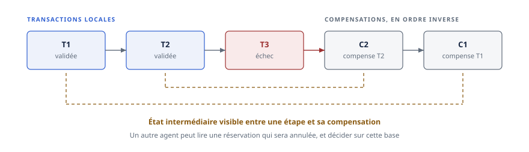
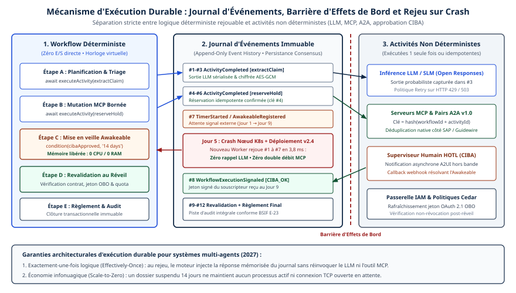
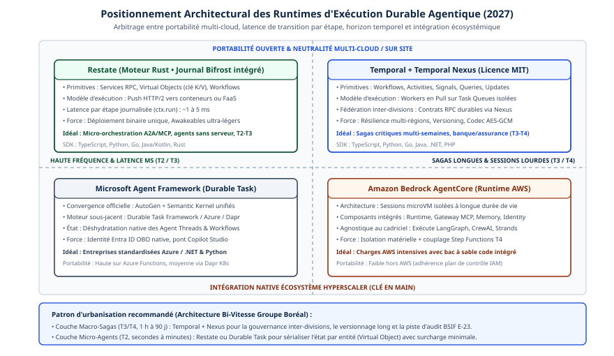

# Chapitre 18 — Exécution durable et transactions

*Question directrice : que se passe-t-il quand un agent tombe en panne au milieu d'une tâche ?*

> **État de référence :** prépublication SagaLLM (arXiv 2503.11951, version 3 du 9 juillet 2025), brouillon IETF `draft-ietf-httpapi-idempotency-key-header-08` du 22 octobre 2026, documentation des éditeurs consultée le 11 novembre 2026. Les numéros entre crochets renvoient aux sources en fin de chapitre; [1] à [13] sont des pages primaires lues pour ce chapitre, [14] n'a pas pu être lue; [15], retrouvée via Crossref à l'audit, n'a pas été exploitée dans la rédaction; [16] et [17] ont été lues le 14 novembre 2026.

Un agent chargé d'un remboursement a annulé la commande, crédité la carte, puis son processus est tué avant le courriel de confirmation. Au redémarrage, trois questions se posent : qu'est-ce qui a été fait, que peut-on refaire sans dommage, et que faut-il défaire ? Un agent qui ne sait pas y répondre recommence tout, et le client est remboursé deux fois, ou ne recommence rien, et la tâche reste à moitié faite.

L'exécution durable répond à la première question : elle garantit qu'un programme reprend là où il s'est arrêté. Elle ne répond pas aux deux autres. La thèse de ce chapitre tient en trois propositions. Un moteur durable garantit la reprise du programme, pas l'unicité de ses effets sur le monde. L'effet unique se construit, outil par outil, avec l'idempotence et la compensation. Ce qui n'est ni idempotent ni compensable se place derrière un point de non-retour explicite. Le modèle de langage ajoute deux contraintes : il ne se rejoue pas à l'identique, et il n'est pas un bon juge de sa propre reprise.

---

## 18.1 Tâches longues et pannes

### Pourquoi les tâches d'agent durent

Une tâche d'agent enchaîne des appels au modèle, des appels d'outils et des attentes : une approbation humaine, un traitement par lots, la réponse d'un autre agent. Les moteurs du marché sont dimensionnés en conséquence. Temporal n'impose aucune limite de durée à une exécution, qu'elle prenne des secondes ou des années [2]. AWS annonce des exécutions pouvant durer jusqu'à un an [9]. Microsoft parle d'orchestrations de plusieurs jours ou semaines [11]. Sur de telles durées, la panne n'est pas un accident : un redéploiement, un quota atteint ou une coupure de réseau surviendront à coup sûr.

### Cinq pannes, deux natures

| Panne | Ce qui est perdu | Qui la traite |
|---|---|---|
| Arrêt du processus | L'état en mémoire, dont le contexte du modèle | Le moteur durable |
| Délai dépassé, coupure de réseau | La réponse; l'effet a peut-être eu lieu | L'idempotence de l'outil |
| Échec d'un système appelé | Rien, mais la tâche est bloquée | Nouvel essai, puis compensation |
| Redéploiement en cours d'exécution | La correspondance entre code et historique | La gestion de versions |
| Plan erroné du modèle | Rien; l'exécution est fidèle à un mauvais plan | La validation indépendante |

Les quatre premières sont des pannes d'infrastructure. La dernière est une panne sémantique : tout s'est exécuté correctement, et le résultat est faux. Un moteur durable ne la voit pas. Il rejouera fidèlement une décision erronée.

Le deuxième cas est le plus retors. La requête est partie, la réponse n'est pas revenue : l'appelant ne sait pas si l'effet s'est produit. MCP l'inscrit désormais dans le protocole : depuis la révision du 28 juillet 2026, une requête dont le flux se rompt est réémise par le client, sous un nouvel identifiant (chapitre 5).

Le premier cas prend chez l'agent une forme propre : la perte de contexte. La fenêtre du modèle est un état volatil. Si elle n'est pas enregistrée, l'agent qui redémarre ne sait plus pourquoi il agissait. SagaLLM range cette perte parmi les quatre faiblesses de la planification par LLM, avec l'autovalidation peu fiable, l'absence de garde-fous transactionnels et la coordination insuffisante entre agents [1].

---

## 18.2 État et checkpointing

### Quel état enregistrer

SagaLLM distingue trois états [1]. L'**état applicatif** décrit les entités du domaine et leurs instantanés. L'**état des opérations** conserve les entrées, les sorties, l'horodatage, les traces de raisonnement du modèle et les métadonnées de compensation. L'**état des dépendances** tient les contraintes, leurs critères de satisfaction et le graphe qui les relie. Cette troisième catégorie est souvent oubliée. Or c'est elle qui permet, après une panne, de savoir quelles étapes en aval sont invalidées.

Cet état d'exécution n'est pas la mémoire de l'agent, qui sert un usage futur et relève du chapitre 14. Sa localisation et la détention de ses clés relèvent du chapitre 46 (section 46.1).

### Deux mécanismes

**L'instantané.** L'état est écrit à intervalles dans un magasin. LangGraph procède ainsi : un *checkpointer* enregistre l'état du graphe pour un fil d'exécution désigné par un `thread_id` [5]. Le moment de l'écriture se règle par un paramètre de durabilité à trois valeurs : `sync` écrit avant le début de l'étape suivante, `async` écrit pendant qu'elle s'exécute, `exit` n'écrit qu'à la sortie du graphe [6]. Le choix est un arbitrage entre débit et fenêtre de perte.

**Le journal rejoué.** Chaque opération est consignée avec son résultat. Après une panne, le code est réexécuté depuis le début, mais les opérations déjà terminées ne sont pas refaites : leur résultat est lu dans le journal. Temporal appelle ce journal l'*Event History*, et le rejeu vérifie que les commandes produites par le code correspondent à l'historique [2]. Restate décrit le même principe [8], AWS aussi : le code repart du début et saute les points de contrôle achevés [9].

### La contrainte de déterminisme

Le rejeu suppose que le code d'orchestration reprenne le même chemin. Microsoft le dit en toutes lettres : déterministe signifie que le code s'exécute de la même manière quand il est rejoué après une panne [11].

Un appel à un modèle de langage ne satisfait pas cette condition. La conséquence, déduite ici du fonctionnement décrit par ces documentations, est qu'un appel au modèle doit être traité comme un effet de bord : il est enveloppé dans une étape dont la sortie est journalisée. Au rejeu, la décision enregistrée est relue; le modèle n'est pas réinterrogé. La boucle de l'agent devient ainsi déterministe par construction, sans que le modèle le soit.

### Granularité, versions, croissance

**L'étape est l'unité de reprise.** Temporal donne un exemple : si une activité enchaîne trois opérations et que la troisième échoue, le nouvel essai refait les trois; il recommande donc de les séparer [4]. Chaque appel d'outil à effet mérite sa propre étape.

**Le code change pendant que la tâche court.** AWS met en garde contre le renommage d'une étape pendant que des exécutions sont en cours : le moteur ne peut plus associer l'état sauvegardé à sa définition [10]. Microsoft demande de vérifier la compatibilité de rejeu avant de brancher un exécutant mis à jour sur d'anciens historiques [11]. Par extension, modifier le prompt système, la liste d'outils ou le modèle d'un agent revient à modifier le code d'une exécution en cours, et demande la même discipline de versions. Le chapitre 34 propose de réunir cet ensemble sous un manifeste de version unique, soumis à une barrière de rejeu (section 34.2).

**L'état grossit.** LangGraph conseille d'élaguer les points de contrôle ou de fixer une politique de rétention [5]. Temporal offre *Continue-As-New*, qui poursuit une exécution dans un nouveau maillon de la même chaîne [2].

**Le piège du pilote.** Les magasins en mémoire de LangGraph perdent tout au redémarrage; la documentation recommande une base de données en production [5]. Un prototype qui « reprend » en démonstration peut donc ne rien reprendre en exploitation.

---

## 18.3 Sémantiques de livraison et idempotence

### Trois sémantiques

La documentation de Kafka publiée par Confluent donne les définitions de référence [12]. **Au plus une fois** : un message peut être perdu, jamais redélivré. **Au moins une fois** : aucun message n'est perdu, mais un message peut être livré plusieurs fois. **Exactement une fois** : chaque message est livré une seule fois, même en cas de panne.

La troisième n'existe qu'à l'intérieur d'un système fermé. Kafka l'obtient en écrivant la position du consommateur dans la même transaction que sa sortie. Dès que la sortie va vers un système externe, il faut que ce système stocke la position avec la donnée; sinon, la garantie par défaut redevient « au moins une fois » [12].

### Ce que les moteurs garantissent vraiment

Les éditeurs formulent cette frontière avec une franchise inégale.

Temporal garantit qu'une activité dont la politique autorise les nouveaux essais sera *observée* comme terminée exactement une fois, tout en précisant qu'elle peut s'exécuter, voire s'achever en partie, plusieurs fois. Le cas type : un exécutant finit le travail, tombe avant d'en rendre compte, et l'activité est relancée [4]. Microsoft est plus direct : le checkpointing durable ne rend ni les outils ni les écritures externes transactionnels ou exécutés exactement une fois; une panne survenue après une écriture externe, mais avant la validation durable, peut faire rejouer l'opération [11]. Restate écrit qu'une invocation s'exécute exactement une fois quelles que soient les pannes [8]; à la lumière des deux précédents, cette promesse se lit comme valable pour ce que le moteur journalise, non pour le système tiers au bout de l'appel.

La règle pratique en découle : **effet unique = livraison au moins une fois + outil idempotent**.

### La clé d'idempotence

Une opération est idempotente si l'exécuter plusieurs fois donne le même résultat que l'exécuter une fois [4]. Une lecture l'est par nature, de même qu'une écriture qui fixe une valeur absolue. Créer, incrémenter, envoyer ou payer ne le sont pas.

Pour ces opérations, l'appelant joint une clé unique, et le système appelé reconnaît les doublons. Temporal précise deux points [4] : l'idempotence est assurée par le service appelé, non par le code de l'activité, et la clé peut combiner l'identifiant d'exécution et celui de l'activité.

Un brouillon de l'IETF normalise ce patron pour HTTP. L'en-tête `Idempotency-Key` rend tolérantes aux pannes des méthodes non idempotentes comme POST et PATCH [7]. Trois règles en ressortent :

- la clé doit être unique et ne doit pas être réutilisée avec un contenu différent; le serveur peut y joindre une empreinte du contenu pour le vérifier;
- un nouvel essai reçu pendant que la requête d'origine est en cours devrait recevoir une réponse 409; une clé réutilisée avec un autre contenu, une réponse 422; une clé manquante là où elle est exigée, une réponse 400;
- la ressource doit publier sa spécification d'idempotence, y compris, s'il y a lieu, sa politique d'expiration des clés.

Le texte en est à la révision 08, document actif du groupe de travail `httpapi`, et n'est pas une RFC.

### Le piège propre aux agents

Deux erreurs de conception annulent la protection.

**Laisser le modèle fabriquer la clé.** Après une reprise, un modèle réinterrogé peut produire un appel légèrement différent et une clé nouvelle : le doublon passe. La clé doit dériver de l'identité durable de l'étape, comme le suggère Temporal, et être injectée par l'orchestrateur. Microsoft donne une consigne voisine pour ses propres réponses sans résultat : ne pas en déduire l'issue de l'historique de conversation, ni les resoumettre automatiquement sous une nouvelle identité [11].

**Confondre identifiant de requête et clé d'idempotence.** Dans MCP, une requête réémise porte un nouvel identifiant (chapitre 5). L'identifiant de protocole ne permet donc pas au serveur de reconnaître un doublon. La clé doit voyager comme argument de l'outil, et le schéma de l'outil doit l'exiger.

La combinaison clé et empreinte a un bénéfice secondaire. Si l'agent, après reprise, renvoie la même clé avec des arguments différents, le serveur répond 422 : la divergence entre le plan d'origine et le plan repris devient visible au lieu de produire un second effet. Le commerce agentique rencontre le même problème sous l'angle de la sécurité, car une réémission légitime ressemble au rejeu d'un mandat par un attaquant (chapitre 10).

---

## 18.4 Patron Saga et compensation

### Le principe

Les outils d'un agent touchent des systèmes qui ne partagent aucun coordinateur de transactions. Le patron Saga remplace la transaction globale par une suite de transactions locales. SagaLLM en reprend la définition d'origine, attribuée à Garcia-Molina et Salem (1987) [1][14] : une transaction de longue durée est découpée en sous-transactions T1 à Tn, chacune atomique localement et associée à une compensation; si une étape échoue, les compensations des étapes déjà validées s'exécutent en ordre inverse, de Cn à C1.



### Ce qui est relâché

Les auteurs disent relâcher les garanties ACID strictes sans dresser le bilan propriété par propriété [1]. La lecture de leur formalisation donne ceci. L'atomicité n'est plus « tout ou rien » : elle est obtenue par compensation. La cohérence est maintenue comme préservation d'invariants entre agents. La durabilité repose sur l'enregistrement des états validés. L'isolation est posée comme exigence, sans mécanisme décrit.

Ce dernier point est le prix du patron. Entre une étape et sa compensation, l'état intermédiaire est visible : un autre agent peut lire une réservation qui sera annulée, et décider sur cette base.

### Compenser n'est pas annuler

Une compensation est une nouvelle action qui rétablit un état acceptable; elle n'efface pas la première. L'exemple de SagaLLM le montre : compenser une réservation de vol, c'est annuler le billet, libérer le siège, rembourser et rétablir le budget [1]. Le client aura vu passer un débit puis un crédit.

La reprise suit cinq étapes dans SagaLLM [1] : détecter l'échec, analyser le graphe de dépendances, exécuter les compensations en ordre inverse, vérifier l'état obtenu, puis replanifier la partie touchée à partir du contexte conservé. Le recours à une personne n'intervient que si la replanification ne satisfait pas les contraintes.

### Qui écrit la compensation

SagaLLM range la vérification formelle du code de compensation généré par un LLM parmi ses travaux futurs [1]. Autrement dit, rien ne garantit aujourd'hui qu'une compensation improvisée par le modèle rétablisse l'état. La règle prudente en découle : la compensation est déclarée par le propriétaire de l'outil, enregistrée avec lui, et l'agent ne fait que la déclencher.

Une compensation s'exécute sous le même régime que le reste, au moins une fois. Elle doit donc être elle-même idempotente, et son échec doit avoir une issue prévue, en général l'escalade vers une personne.

Le patron se décline en orchestration, où un coordinateur déclenche étapes et compensations, ou en chorégraphie, où chaque participant réagit aux événements des autres (chapitre 19).

---

## 18.5 Validation indépendante et reprise

### Ne pas laisser l'agent juger sa reprise

Après une panne, quelqu'un doit décider si l'état est cohérent et quoi faire ensuite. Confier cette décision à l'agent qui a échoué est le choix par défaut, et le moins sûr. SagaLLM soutient que les LLM manquent d'autovalidation robuste et cite des travaux selon lesquels l'autocorrection ne répare pas de façon fiable les erreurs logiques profondes [1].

L'architecture proposée sépare deux contrôles. La **validation intra-agent** vérifie la sortie d'un agent : syntaxe, sémantique, exactitude factuelle, respect des contraintes, préservation du contexte. La **validation inter-agents** vérifie les messages échangés : conformité au contrat, dépendances satisfaites, cohérence entre agents, ordre temporel, accord sur l'état partagé. Un agent de validation global, extérieur aux agents de tâche, voit l'historique, les communications et l'état complets. Trois réponses sont prévues : le rejet, qui déclenche la compensation; l'augmentation, qui ajoute des précisions; la rétroaction, consignée pour adaptation [1].

Ce découpage rejoint un constat du chapitre 21 (section 21.4) : les défauts de vérification forment une catégorie entière des échecs multi-agents, et la seule présence d'un vérificateur ne suffit pas s'il contrôle la forme plutôt que l'objectif.

### Ce que la validation vérifie à la reprise

Trois vérifications s'imposent, la première découlant directement de la section 18.3.

- **Le journal et le monde concordent-ils ?** Pour toute étape dont l'issue est inconnue, l'état du système cible est relu avant tout nouvel essai.
- **Les contraintes tiennent-elles encore ?** Le monde a bougé pendant l'arrêt : un prix a changé, un créneau s'est fermé. C'est le scénario de replanification réactive que SagaLLM met à l'épreuve [1].
- **Les étapes en aval restent-elles valides ?** Le graphe de dépendances désigne celles qu'une compensation invalide.

### Quatre issues

| Situation | Issue |
|---|---|
| Panne transitoire, outil idempotent | Nouvel essai de l'étape |
| Contrainte devenue fausse | Replanification à partir du dernier point de contrôle |
| Objectif inatteignable | Compensation en ordre inverse, puis abandon |
| Compensation en échec ou état incertain | Escalade vers une personne |

Les nouveaux essais se bornent. AWS note que les exécutions durables en échec ne sont pas relancées automatiquement après une invocation asynchrone, et recommande une file de lettres mortes pour conserver l'événement d'origine [10]. Chaque replanification consomme en outre des jetons (chapitre 40).

### Le niveau de preuve

SagaLLM est un argument de conception, pas une mesure. L'évaluation porte sur quatre problèmes du banc d'essai REALM, deux de planification séquentielle et deux de planification réactive, et compare le cadriciel à Claude 3.7, DeepSeek R1, GPT-4o et GPT-o1 employés seuls; les résultats sont décrits cas par cas, sans taux de réussite [1]. Le texte se présente comme un retour d'expérience et renvoie les algorithmes à un article compagnon, ALAS.

---

## 18.6 Moteurs d'exécution durable

### Deux familles

La première réunit des moteurs généralistes, qui hébergent la boucle de l'agent comme n'importe quel workflow. La seconde réunit les cadriciels d'agents dotés de leur propre persistance (chapitre 20). Microsoft trace lui-même la frontière : le stockage de points de contrôle de ses workflows standards aide à reprendre une exécution dans le runtime de l'agent, tandis que son extension durable exécute le workflow sur une infrastructure qui le récupère à travers des exécutants distribués [11].

| Moteur | Mécanisme | Ce que la documentation dit des effets | À noter |
|---|---|---|---|
| Temporal [2][3][4] | Journal d'événements rejoué | Activités à rendre idempotentes; relance automatique selon une politique | Aucune limite de durée; un *heartbeat* sert de point de contrôle interne |
| Restate [8] | Journal rejoué; l'état voyage avec chaque requête | Déduplication par clé d'idempotence | Serveur en un seul binaire; services sans état |
| AWS Lambda durable functions [9][10] | Points de contrôle et rejeu | Étapes avec nouveaux essais; pas de relance automatique de l'exécution | Jusqu'à un an; attentes non facturées |
| Extension durable de Microsoft Agent Framework [11] | Orchestrations déterministes sur Durable Task | Ni transactionnel ni « exactement une fois » pour les écritures externes | Azure Functions ou calcul autogéré; paquets en préversion |
| LangGraph [5][6] | Instantanés par fil | Non traité dans les pages lues | Trois modes de durabilité |

AWS situe par ailleurs ses fonctions durables par rapport à Step Functions : les premières s'écrivent en code dans Lambda, le second est un service distinct fondé sur un langage de graphe [9].

### Ce que les moteurs apportent aux agents

Trois apports dépassent la reprise sur panne.

**L'attente gratuite.** Une exécution suspendue ne consomme pas de calcul chez AWS [9], ni chez Microsoft en hébergement sans serveur [11]. Un point d'approbation humaine qui dure trois jours ne coûte donc rien, ce qui lève un frein à l'humain dans la boucle (chapitre 22).

**La session durable.** L'extension de Microsoft conserve la conversation de l'agent à travers pannes, redémarrages et mises à l'échelle [11]. L'état volatil de la section 18.1 devient un état géré.

**L'historique comme piste d'audit.** Le journal qui sert au rejeu documente aussi ce que l'agent a décidé et fait à chaque étape (chapitres 17 et 33).

### La durabilité entre organisations

Un moteur durable s'arrête à la frontière de l'organisation. Au-delà, ce sont les protocoles qui portent la poignée durable : l'identifiant de tâche de l'extension Tasks de MCP survit à la connexion (chapitre 5), et A2A définit un cycle de vie de tâche (chapitre 6). L'un et l'autre désignent une tâche; ils ne disent rien de ce que le serveur fait d'une réémission. L'effet unique redevient alors une clause d'interface : UCP demande au marchand d'imposer l'idempotence contre les doubles débits (chapitre 10), et le chapitre 45 subordonne tout règlement à un rapprochement à trois voies, un paiement indu se traitant par compensation (section 45.7).

**Deux autres formes.** Deux produits que le tableau ne couvre pas montrent que la durabilité n'exige pas toujours un serveur d'orchestration. DBOS est une bibliothèque : elle enregistre dans Postgres les entrées du workflow et la sortie de chaque étape, puis, après un arrêt, relance le workflow interrompu en sautant les étapes déjà enregistrées. Aucune autre infrastructure que Postgres n'est requise; en contrepartie, le workflow doit être déterministe, les étapes idempotentes, et le débit est borné par le serveur Postgres [16]. Cloudflare Workflows offre le même modèle par étapes sur la plateforme Workers : relances automatiques, état conservé pendant des heures ou davantage, mise en sommeil, et attente d'un événement externe, par exemple une approbation humaine, avec un délai facultatif [17]. Les deux pages décrivent des mécanismes, non des mesures.

Aucun banc d'essai indépendant comparant ces moteurs sous charge agentique n'a été lu pour ce chapitre. Le tableau reflète ce que chaque éditeur dit de son produit.

---

## 18.7 Actions irréversibles : les points de non-retour

### Ce qui ne se compense pas

Certaines actions n'ont pas de compensation : un courriel envoyé, une donnée divulguée, un virement réglé, une suppression définitive, une commande à un équipement (chapitres 28 et 46). La Saga suppose que chaque étape a son inverse. Ces actions brisent l'hypothèse.

### Ordonner autour d'un pivot

La pratique des architectures de microservices, rapportée ici de connaissance générale, classe les étapes d'une Saga en trois groupes : les étapes compensables, une étape pivot après laquelle on ne revient plus, et des étapes réessayables qui finiront par réussir. Le plan d'un agent devrait suivre cet ordre. Tout ce qui peut échouer se place avant le pivot. Après lui, seule la reprise vers l'avant est possible; les étapes restantes doivent donc être idempotentes.

L'ordre n'est pas laissé au modèle. La classe de chaque outil, soit lecture, compensable, pivot ou réessayable, s'inscrit au registre et s'applique par l'orchestrateur ou la passerelle. Les annotations qu'un serveur MCP déclare sur ses propres outils ne suffisent pas, puisque le client doit les tenir pour non fiables (chapitre 5).

### Repousser l'irréversibilité

Quatre techniques réduisent la part de l'irréversible.

- **Réserver avant de confirmer.** Une autorisation de paiement précède la capture; une réservation provisoire précède l'émission. L'action irréversible devient une action compensable suivie d'une confirmation.
- **Préparer sans émettre.** L'agent dépose le courriel ou l'écriture dans une zone d'attente; l'émission est une étape distincte, déclenchée après validation. Pour les données, c'est le patron Write-Audit-Publish (chapitre 47, section 47.5).
- **Rendre l'annulation possible.** GoEX défend la validation après coup : juger une action sur son résultat est souvent plus facile que de la juger d'avance, à condition de pouvoir l'annuler [13].
- **Confiner les dégâts.** Quand l'annulation est impossible, la même proposition borne la portée de ce que l'action peut toucher [13]. Des plafonds de montant et des périmètres d'accès étroits y concourent (chapitre 30).

### L'approbation au pivot

Le pivot est l'endroit naturel d'un point d'approbation humaine. Deux précautions tiennent à l'exécution durable.

L'approbation est un résultat d'étape : elle se journalise comme les autres. Sinon, une reprise repose la question à l'approbateur ou, pire, franchit le pivot sans réponse enregistrée.

L'approbation porte sur des paramètres exacts. Si une replanification modifie le montant ou le destinataire, l'approbation précédente ne vaut plus. L'empreinte de la section 18.3 sert ici : approbation et clé d'idempotence se lient au même contenu. Le protocole LAP fait de cette liaison une primitive : un jeton de confirmation lié à l'empreinte des paramètres et à usage unique (chapitre 7).

Reste le cas où le pivot a été franchi à tort. Il ne relève plus de la transaction, mais de la gestion d'incident (chapitre 34).

---

## Grille de décision

| Décision | Option par défaut | Quand s'en écarter |
|---|---|---|
| Persistance de l'état | Magasin durable dès le premier environnement partagé [É] | Prototype jetable : magasin en mémoire |
| Mécanisme de reprise | Journal rejoué pour les tâches à effets externes [S] | Agent conversationnel sans effet : instantanés par fil |
| Appel au modèle | Étape journalisée, relue au rejeu [S] | — |
| Granularité | Une étape par appel d'outil à effet [É] | Lectures groupées dans une même étape |
| Moment d'écriture | Synchrone avant toute étape à effet [S] | Asynchrone pour les étapes sans effet, si le débit l'exige |
| Garantie visée | Au moins une fois, avec outils idempotents [É] | Au plus une fois pour une action irréversible sans clé possible |
| Clé d'idempotence | Dérivée de l'étape durable, exigée par le schéma de l'outil [É] | Outil idempotent par nature |
| Compensation | Déclarée par le propriétaire de l'outil, idempotente [S] | Jamais générée à la volée pour un système d'enregistrement |
| Décision de reprise | Validateur distinct de l'agent de tâche [S] | Tâche à faible enjeu : nouvel essai borné |
| Action irréversible | Après le pivot, avec approbation liée aux paramètres [S] | Montant sous un plafond fixé par classe de décision |
| Changement de prompt, d'outils ou de modèle | Versionné; les exécutions en cours finissent sur l'ancienne version [S] | Correctif de sécurité : arrêt et compensation |
| Échec définitif | File de lettres mortes et escalade humaine [É] | — |

---

## Points à retenir

- L'exécution durable garantit qu'un programme reprend, pas que ses effets sur le monde n'ont lieu qu'une fois. Microsoft l'écrit explicitement dans sa documentation.
- « Exactement une fois » ne vaut qu'à l'intérieur d'un système fermé. Vers un système externe, l'effet unique s'obtient par une livraison au moins une fois et un outil idempotent.
- La clé d'idempotence dérive de l'étape durable et voyage comme argument de l'outil. Ni le modèle ni l'identifiant de requête du protocole ne peuvent en tenir lieu.
- Un appel au modèle est un effet de bord : sa sortie se journalise et se relit au rejeu.
- Changer le prompt, les outils ou le modèle d'un agent, c'est changer le code d'exécutions en cours.
- Une Saga relâche l'isolation : les états intermédiaires sont visibles des autres agents.
- La compensation appartient au propriétaire de l'outil. Rien ne garantit la justesse d'une compensation générée par le modèle.
- La reprise se décide hors de l'agent qui a échoué. L'appui universitaire de ce principe reste qualitatif.
- Les actions irréversibles se placent après un pivot explicite, avec une approbation journalisée et liée aux paramètres exacts.

---

## Sources

Pages primaires lues le 11 novembre 2026 :

1. [SagaLLM: Context Management, Validation, and Transaction Guarantees for Multi-Agent LLM Planning — arXiv 2503.11951v3](https://arxiv.org/html/2503.11951v3) (résumé et texte)
2. [Temporal — Workflow Execution](https://docs.temporal.io/workflow-execution)
3. [Temporal — Activities](https://docs.temporal.io/activities)
4. [Temporal — Activity Definition](https://docs.temporal.io/activity-definition)
5. [LangGraph — persistance et checkpointers](https://docs.langchain.com/oss/python/langgraph/durable-execution) (l'adresse sert la page sur la persistance)
6. [LangGraph — référence du type `Durability`](https://reference.langchain.com/python/langgraph/types/Durability)
7. [IETF — The Idempotency-Key HTTP Header Field, draft-08](https://datatracker.ietf.org/doc/draft-ietf-httpapi-idempotency-key-header/)
8. [Restate — Durable Execution](https://docs.restate.dev/concepts/durable_execution)
9. [AWS — Lambda durable functions](https://docs.aws.amazon.com/lambda/latest/dg/durable-functions.html)
10. [AWS — Best practices for Lambda durable functions](https://docs.aws.amazon.com/lambda/latest/dg/durable-best-practices.html)
11. [Microsoft Agent Framework — Durable Extension](https://learn.microsoft.com/en-us/agent-framework/hosting/durable-extension) (page datée du 31 août 2026, mise à jour le 6 novembre 2026)
12. [Confluent — Kafka, sémantiques de livraison](https://docs.confluent.io/kafka/design/delivery-semantics.html)
13. [GoEX: Perspectives and Designs Towards a Runtime for Autonomous LLM Applications — arXiv 2404.06921](https://arxiv.org/abs/2404.06921) (résumé, puis extraits relus le 14 novembre 2026)

Sources non lues ou non exploitées dans la rédaction :

14. [Garcia-Molina et Salem, « Sagas », SIGMOD 1987](https://www.cs.cornell.edu/andru/cs711/2002fa/reading/sagas.pdf) — PDF numérisé, illisible par l'outil; citée d'après [1].
15. [Nutakki — Design and Implementation of Agentic AI Pipelines for Enterprise Decision-Making Architecture Patterns for Production Systems (Nexus, *IJIRMPS*, vol. 14, n° 2, 27 avril 2026, DOI 10.37082/ijirmps.v14.i2.233041)](https://www.ijirmps.org/papers/2026/2/233041.pdf) — l'adresse Consensus d'origine redirige (HTTP 302) vers `/sign-up/` et non vers une erreur 403; article et PDF retrouvés à l'audit du 14 novembre 2026, non exploités dans le corps du chapitre.

Pages d'éditeurs lues le 14 novembre 2026 :

16. [DBOS — architecture](https://docs.dbos.dev/architecture)
17. [Cloudflare — Workflows](https://developers.cloudflare.com/workflows/)

## Limites de ce chapitre

- Les sources [1] et [13], d'abord connues par leur seul résumé, ont été relues au-delà du résumé le 14 novembre 2026, par un outil qui en rend des extraits; les écarts relevés sont corrigés dans le texte.
- **L'architecture Nexus, second appui prévu par le plan initial, n'a pas été exploitée dans la rédaction** [15]. La fiche Consensus mène à `/sign-up/`, mais l'article original a été retrouvé via Crossref le 14 novembre 2026 (Sandeep Nutakki, *IJIRMPS*, vol. 14, n° 2, avril 2026, DOI 10.37082/ijirmps.v14.i2.233041, PDF en accès libre présentant Nexus), et ce plan n'en donne que le titre. Le chapitre ne lui emprunte rien.
- L'article d'origine sur les Sagas [14] n'a pas été lu; sa définition est reprise de SagaLLM. Ce que cet article dit des actions non compensables n'a donc pas pu être cité.
- Viennent de la connaissance générale, non d'une page lue : le classement des étapes en compensables, pivot et réessayables; les patrons d'autorisation puis capture et de zone d'attente; l'absence de coordinateur de transactions commun aux systèmes d'entreprise.
- Sont des déductions, non des faits lus : le traitement de l'appel au modèle comme étape journalisée, l'assimilation d'un changement de prompt, d'outils ou de modèle à un changement de version, la lecture restrictive de la promesse de Restate, les deux erreurs de conception de la section 18.3 (la première appuyée en partie par la consigne de Microsoft), et la liaison entre approbation et empreinte.
- La page de LangGraph sur l'exécution durable n'a pas été obtenue : l'adresse sert désormais la page sur la persistance. Les règles de rejeu de ce cadriciel et la valeur par défaut du mode de durabilité ne sont donc pas décrites.
- La publication de SagaLLM dans une revue n'est pas confirmée : l'arXiv n'indique aucune référence de revue, et la page porte un gabarit PVLDB aux champs non remplis. Ses 8 500 derniers caractères n'ont pas été lus.
- Relues à la source pendant l'audit du 12 novembre : [1] (historique des versions, évaluation, conclusion), [4], [7], [8], [9], [10] et [11]. Le statut de préversion de l'extension de Microsoft, auparavant déduit, est confirmé : la page parle de paquets en préversion. Les pages [2], [3], [5], [6], [12] et [13] n'ont pas été relues.
- De DBOS [16] et de Cloudflare Workflows [17], une seule page a été lue, le 14 novembre 2026. Inngest, Dapr et Camunda ne sont pas couverts, faute de pages lues. Aucune donnée d'adoption ni de performance n'est citée.
- Les renvois aux chapitres 7, 10, 34, 45, 46 et 47 reprennent ce que ces chapitres affirment, sans relecture de leurs sources.

## Mise en œuvre — Moteurs d'exécution durable et gestion des cycles de vie de longue durée {.volet}

:::: {.encadre .executive}
::: {.encadre-titre}
**Synthèse exécutive**
:::

- **Enjeu** : un processus d'entreprise ne s'achève pas en trois secondes dans l'onglet d'un navigateur. Il traverse des pannes d'API externes, des redéploiements d'infrastructure, des analyses d'experts tiers et des délais légaux ou humains de plusieurs jours. Des agents exécutés en mémoire vive obligent à choisir entre perdre les dossiers en cours au moindre redémarrage et réexécuter des appels LLM coûteux et des mutations métier déjà commises.
- **Décisions d'architecture** :
  1.  *Irréversible à moyen terme* : confier la progression, les temporisateurs, les politiques de nouvel essai et l'attente d'approbation à un moteur d'exécution durable à journal d'événements immuable, hors des cadriciels de prompts.
  2.  *Structurante dès le cadrage de la plateforme* : adopter une architecture bi-vitesse, avec Temporal pour les sagas longues de plusieurs semaines, très auditables, et Restate ou Durable Task pour la micro-orchestration à haute cadence et le sans-serveur. L'autre voie est d'assumer l'adhérence à un runtime infonuagique intégré (Bedrock AgentCore).
  3.  *Impérative pour la sécurité et la conformité* : chiffrer côté client les charges utiles journalisées (effacement cryptographique, compatible avec la Loi 25 / RGPD) et revalider le monde et les droits après toute mise en veille prolongée.
- **Indicateurs de gouvernance** : taux de survie sans intervention aux redémarrages d'infrastructure (cible : 100 %), taux de double exécution d'effets de bord (cible : 0 %), consommation CPU/RAM des instances en attente d'approbation humaine (mise à l'échelle à zéro) et zéro erreur de non-déterminisme (`NonDeterminismError`) lors des mises en production continues.
::::

## 18.8 Défaillance volatile et fondements formels de l'exécution durable

Prenons un agent d'instruction financière codé selon les habitudes d'une application web `Node.js` ou Python FastAPI, en mémoire vive. Il reçoit une déclaration de sinistre complexe. Il invoque d'abord un modèle multimodal de raisonnement, qui analyse quarante pages de rapport métallurgique (durée : 22 secondes, coût : 0,48 \$ CAD). Il appelle ensuite un outil MCP qui crée une réserve financière provisoire dans le progiciel comptable, puis envoie une demande de validation asynchrone CIBA au souscripteur principal. À réception de la réponse, quarante-huit heures plus tard, il déclenche l'ordre de règlement.

Quatre défaillances ordinaires interrompent cette séquence :

1.  **Éviction de conteneur ou déploiement continu** : trois heures après la notification au souscripteur, le cluster Kubernetes recycle le pod pour appliquer un correctif de sécurité Linux. La pile d'appels en mémoire (`await waitForApproval()`) disparaît, et aucun processus n'attend le clic sur « Approuver » du lendemain matin (section 18.1).
2.  **Point de contrôle naïf** : certaines bibliothèques d'agents sérialisent l'état du graphe dans une table PostgreSQL à la fin de chaque nœud. Si le conteneur plante après que le serveur MCP a débité la réserve dans l'ERP, mais avant que l'acquittement n'atteigne la bibliothèque, le redémarrage relit le dernier point connu. L'agent réinvoque le LLM, ce qui coûte de nouveau 0,48 \$ CAD et peut donner un montant légèrement différent, puis réexécute l'écriture comptable (section 18.3).
3.  **Attente passive coûteuse** : des processus, des coroutines lourdes ou des connexions WebSocket maintenus pendant des heures, dans l'attente d'un humain ou d'un partenaire B2B, immobilisent de la mémoire et saturent les tables de descripteurs réseau (section 18.6).
4.  **Collision de versions sur les dossiers à cycle long** : un dossier d'indemnisation ou d'octroi hypothécaire vit couramment de quatorze à soixante jours, alors que l'équipe livre trois nouvelles versions du flux par semaine. Sans versionnage de l'historique en vol, changer l'ordre de deux étapes corrompt la désérialisation de tous les dossiers ouverts sous la version précédente (section 18.2).

### Modèle formel de l'exécution durable journalisée

L'exécution durable inverse la relation entre le code et la base de données. Le développeur n'a plus à découper sa logique métier en tables d'état et en files de messages : le moteur scinde l'application en deux plans régis par des lois opposées, comme l'illustre la figure ci-dessous.



Formellement, l'exécution d'un workflow est modélisée comme une machine à états déterministe pure $f$ opérant sur un journal d'événements immuable en ajout seul $H_k = \langle e_1, e_2, \dots, e_k \rangle$ persisté avec consensus transactionnel :

$$S_k = f(H_k) = f(\langle e_1, e_2, \dots, e_k \rangle)$$

Cette équation impose une barrière d'effets de bord entre deux types de composants. L'appel au modèle reste du côté des effets, comme le veut la section 18.2.

- **Le code d'orchestration** (workflow dans Temporal, gestionnaire déterministe dans Restate ou Durable Task) : il s'écrit en code impératif séquentiel ordinaire (`if/else`, boucles bornées, `Promise.all`, `try/catch`), mais ne fait aucune entrée-sortie réseau directe, ne lit pas l'horloge système (`Date.now()`) et ne génère aucun nombre aléatoire (`Math.random()`). Il n'agit sur le monde qu'en émettant des commandes vers le moteur durable.
- **Les unités d'effets de bord** (activités dans Temporal, blocs `ctx.run` dans Restate) : le non-déterminisme et les mutations externes résident exclusivement de ce côté, avec les appels d'inférence LLM probabilistes (Open Responses), les invocations d'outils MCP, les délégations A2A v1.0 et les lectures de politiques dynamiques.

Quand une activité d'inférence LLM s'achève au pas $i$, le moteur persiste atomiquement sa charge utile de retour $r_i$ dans l'événement $e_i$ du journal. Si l'exécutant meurt au pas $k > i$, ou s'il a été évincé de la mémoire pendant neuf jours d'attente humaine (mise à l'échelle à zéro), un nouvel exécutant reconstruit l'état exact $S_k$ en rejouant le code du workflow depuis la première ligne. Au pas $i \le k$, l'intercepteur du SDK retrouve l'événement `ActivityTaskCompleted` dans le journal local $H_k$ et retourne en quelques microsecondes la valeur $r_i$ enregistrée, sans franchir le réseau ni rappeler le LLM. À la frontière $k + 1$, non encore inscrite, l'exécution réelle reprend.

### Clé d'idempotence dérivée du journal

Pendant l'exécution initiale d'une activité, une coupure réseau entre le serveur MCP aval et l'exécutant reste une livraison au moins une fois, pilotée par la politique de nouvel essai de l'activité. Pour obtenir un effet unique de bout en bout sur une écriture financière ou logistique, il suffit de combiner la numérotation déterministe du journal avec l'idempotence du serveur MCP décrite à la section 18.3 :

$$K_{\text{idemp}} = \text{HMAC-SHA256}\!\left(K_{\text{dom}}, \; \text{WfId} \;\|\; \text{SeqId}\right)$$

L'identifiant `WfId` (`WorkflowId`) et le numéro de séquence `SeqId` de l’étape (`activityId` dans l’Extrait 18.2, `stepSequenceId` dans l’ADR-012) restent invariants à travers tous les nouveaux essais d'une même activité, et diffèrent d'une étape légitime suivante dans une boucle. Le système d'enregistrement cible (SAP S/4HANA, Guidewire, Stripe) déduplique donc tout doublon réseau transitoire.

---

## 18.9 Panorama architectural comparé des moteurs d'exécution durable en 2027

Quatre plateformes structurent en 2027 l'exécution durable des systèmes agentiques, avec des philosophies d'architecture distinctes. Deux moteurs ouverts sont portables sur toute infrastructure : Temporal et Restate. Deux piles sont étroitement intégrées à un grand écosystème infonuagique : Microsoft Agent Framework sur Durable Task, et Amazon Bedrock AgentCore. La figure ci-dessous les situe. Le tableau de la section 18.6 reprend ce que les éditeurs disent des effets de leur produit; les matrices qui suivent comparent l'architecture et l'exploitation.



### Temporal et Temporal Nexus : sagas critiques de plusieurs semaines

Temporal est issu de travaux fondateurs menés chez AWS et Uber, puis publié sous licence ouverte MIT. Il est en 2027 la référence pour l'orchestration des processus critiques de longue durée (régimes T3 et T4 du chapitre 1) dans la banque, l'assurance, le commerce mondial et l'industrie. Son architecture repose sur un découplage par interrogation active (*pull*) : les exécutants, hébergés dans les réseaux sécurisés de chaque division, ouvrent des connexions sortantes gRPC/mTLS vers des files de tâches nommées, sans exposer de port entrant.

Deux capacités distinguent Temporal dans une grande entreprise multi-divisions :

- **Fédération inter-domaines par Temporal Nexus** : au lieu d'un cluster unique partagé, où une équipe pourrait lire les journaux d'une autre, Nexus permet à un workflow de la division BSN d'invoquer une opération durable exposée par l'espace de noms isolé de la division financière BCA. L'appel passe par un contrat RPC typé, avec propagation des annulations, des délais d'expiration et de l'identité, sans exposer les détails internes de BCA.
- **Outillage du cycle de vie long** : requêtes synchrones (Queries), mutations validées en vol (Updates), migration de version sans coupure (Workflow Versioning / Worker Build IDs) et chiffrement de bout en bout par Payload Codec client. Le serveur Temporal, en nuage ou auto-hébergé, ne voit jamais passer en clair un nom d'assuré ou le texte d'un prompt.

### Restate : micro-orchestration à haute cadence et sans serveur

Restate est conçu par les créateurs originaux d'Apache Flink. Il vise la légèreté opérationnelle et la basse latence (T2 et T3). Écrit en Rust autour d'un journal distribué intégré (*Bifrost*, sans dépendance obligatoire à une base Cassandra ou PostgreSQL externe), il fonctionne comme un proxy inverse placé devant les services d'agents. Ses trois abstractions répondent aux besoins des flottes d'agents :

1.  **Services durables** : gestionnaires RPC dont chaque appel d'outil ou de LLM encapsulé dans `ctx.run(...)` est journalisé.
2.  **Virtual Objects adressables par clé** : objets virtuels avec un seul écrivain par clé (*Single-Writer per Key*). Ils permettent d'associer un agent jumeau à chaque numéro de série de machine (BOR-CMP-90441) ou à chaque panier client, en sérialisant les événements concurrents. La section 18.6 décrit plutôt, pour Restate, un journal rejoué où l'état voyage avec chaque requête, avec des services sans état; elle ne traite pas d'état clé-valeur persistant.
3.  **Modèle *push* HTTP/2 sans serveur** : à la différence des exécutants permanents en boucle d'écoute, Restate pousse les invocations en HTTP/2 (avec flux bidirectionnel) vers des fonctions AWS Lambda, Cloud Run, Knative ou des pods Kubernetes standard. Quand un agent appelle `ctx.awakeable()` pour attendre un webhook A2A ou une réponse humaine, Restate suspend la requête HTTP. La facture de calcul de la fonction tombe à zéro jusqu'à la réception du rappel.

### Microsoft Agent Framework (Durable Task Framework, Azure et Dapr)

Le Microsoft Agent Framework résulte de la convergence opérée par Microsoft entre AutoGen (exploration multi-agents) et Semantic Kernel (socle d'entreprise). Son extension durable s'appuie sur le moteur Durable Task Framework, exécutable sur Azure Durable Functions, sur le planificateur géré Durable Task Scheduler ou, de façon portable, sur Kubernetes via Dapr Workflow. Les paquets de cette extension sont en préversion, et son checkpointing durable ne rend ni les outils ni les écritures externes transactionnels ou exécutés exactement une fois (section 18.6). Le cadriciel unifie l'état conversationnel de l'agent (*Durable Agent Threads*) et l'orchestration déterministe de processus en `.NET` (C#) et Python. Il se couple nativement à la délégation d'identité Microsoft Entra ID On-Behalf-Of et interopère directement avec les agents frontaux Microsoft Copilot Studio.

### Amazon Bedrock AgentCore : sessions microVM persistantes et pile gérée AWS

Amazon Bedrock AgentCore s'adresse aux organisations ancrées sur AWS qui veulent exécuter des graphes d'agents arbitraires (LangGraph, Strands Agents, CrewAI, code Python/TypeScript sur mesure) sans gérer elles-mêmes l'infrastructure d'exécution ni les bacs à sable d'outils. Chaque session d'agent s'exécute dans une microVM dédiée, isolée matériellement, qui peut conserver sa mémoire, son système de fichiers local et ses processus d'arrière-plan pendant plusieurs heures d'activité continue. S'y ajoutent AgentCore Gateway (exposition MCP sécurisée), AgentCore Identity et AgentCore Memory. Pour les sagas réglementaires de plusieurs semaines (T4), l'architecture AWS recommandée associe AWS Step Functions, comme trame d'ensemble, à des sessions Bedrock AgentCore pour les phases de raisonnement intensif. Cette association va au-delà de ce que retient l'exposé : la section 18.6 présente côté AWS les Lambda durable functions (points de contrôle et rejeu, exécutions jusqu'à un an, attentes non facturées) et les situe par rapport à Step Functions, service distinct fondé sur un langage de graphe.

### Matrices d'évaluation et d'urbanisation

| Dimension d’ingénierie | Temporal (+ Nexus) | Restate | Microsoft Agent Framework (Durable Task) | Amazon Bedrock AgentCore |
|:---------------|:--------------------|:-------------------|:----------------------|:----------------------|
| Modèle de transport vers l'agent | *Pull* gRPC sortant par les exécutants, sur files de tâches | *Push* HTTP/2 / gRPC (compatible FaaS sans serveur) | *Trigger* Azure Functions ou *Sidecar* Dapr | Runtime géré AWS, par session microVM isolée |
| Persistance du journal (aucune latence chiffrée, section 18.6) | SQL / Cassandra multi-AZ | Journal Rust Bifrost intégré | Selon le backend de stockage (Scheduler / Azure Storage) | Propre à la session; Step Functions en T4 |
| Horizon maximal de cycle de vie | Aucune limite de durée à une exécution (section 18.1); Continue-As-New natif | Minutes à semaines (Workflows + Awakeables) | Heures à semaines (Durable Orchestrations) | Sessions actives multi-heures; multi-semaines via Step Functions |
| État par entité (acteur virtuel) | Simulé par Workflow-par-Entité | *Virtual Objects* verrouillés par clé; l'exposé décrit des services sans état et un état porté par la requête (section 18.6) | Natif (*Durable Entities* / *Agent Threads*) | Session isolée + service AgentCore Memory |
| Fédération inter-équipes sécurisée | Excellente (Temporal Nexus inter-namespaces) | Bonne via contrats de services HTTP/IDL | Bonne via passerelles Azure API / A2A | Contrôlée par politiques AWS IAM inter-comptes |
| Chiffrement client de bout en bout | Natif (Payload Codec AES-GCM zéro connaissance) | Pris en charge par des intercepteurs de sérialisation du SDK | Chiffrement Azure Key Vault / stockage | Chiffrement AWS KMS géré côté cloud |
| Portabilité et coût de sortie | Maximale (Open Source MIT + Cloud géré multi-régions) | Très élevée (binaire unique BSL / Open + Cloud) | Moyenne-haute (code portable via Dapr, optimal sur Azure) | Faible (fort couplage aux primitives AWS natives) |

| Profil de charge et contrainte métier | Runtime principal recommandé | Justification architecturale | Vigilance opérationnelle |
|:-------------------------|:------------------|:-----------------------------|:--------------------------|
| Saga réglementée multi-jours/semaines (T4, banque BSIF E-23, assurance) | Temporal | Piste d'audit immuable sur longue période, chiffrement par Payload Codec, versionnage fin en vol et isolation Nexus | Dimensionner le compactage Continue-As-New au-delà de 10 000 événements |
| Micro-orchestration d'agents A2A/MCP à haute fréquence ou sans serveur (T2/T3) | Restate | Mise à l'échelle à zéro sur FaaS et verrouillage par clé d'équipement | Encadrer le déterminisme autour des appels `ctx.run` |
| Système d'information centré sur `.NET`, Entra ID et Copilot Studio | Microsoft Agent Framework (Durable Task) | Continuité entre la conversation Teams, la délégation OBO Entra et les workflows C#/Python | Préférer le Durable Task Scheduler dédié aux files de stockage génériques à fort débit |
| Agent analytique lourd exécutant du code Python ou des outils dans un environnement tout AWS | Amazon Bedrock AgentCore (+ Step Functions si T4) | Isolation matérielle microVM clé en main, qui évite de bâtir sa propre flotte de bacs à sable | Encapsuler la logique métier derrière des interfaces propres pour limiter le verrouillage AWS |

---

## 18.10 Patrons de code de production : workflows durables, awakeables et revalidation au réveil

#### Extrait 18.1 — Workflow Temporal de production avec versionnage en vol et approbation CIBA multi-jours

Ce workflow n'importe ni module réseau ni SDK LLM : il orchestre des proxys d'activités typés. Il utilise `patched()` pour introduire sans coupure une règle mineure pendant que des milliers de sinistres dorment en base; une refonte majeure de topologie utilisera le *Worker Deployment Versioning* en mode PINNED, afin que les instances en vol s'achèvent sur leur révision d'origine. Il gère l'attente de quatorze jours, avec relance au troisième jour, et exécute sa compensation dans une portée `CancellationScope.nonCancellable`, pour qu'une annulation externe du dossier n'empêche pas la libération comptable. Le décaissement définitif est l'étape pivot de la section 18.7 : la provision compensable, l'approbation et la revalidation le précèdent.

``` typescript
import {
  proxyActivities,
  defineSignal,
  defineQuery,
  setHandler,
  condition,
  patched,
  CancellationScope,
  ApplicationFailure,
} from "@temporalio/workflow";
import type * as activities from "./claimActivities";

// Configuration différenciée des délais et réessais selon la nature des activités
const {
  extractMetallurgicalReportLlm,
  evaluatePolicyCoverageMcp,
  placeProvisionalReserveMcp,
  releaseProvisionalReserveMcp,
  dispatchCibaApprovalRequest,
  executeFinalSettlementMcp,
} = proxyActivities<typeof activities>({
  startToCloseTimeout: "2 minutes",
  heartbeatTimeout: "20 seconds",
  retry: {
    initialInterval: "2 seconds",
    backoffCoefficient: 2.0,
    maximumInterval: "1 minute",
    maximumAttempts: 4,
    nonRetryableErrorTypes: ["PolicyViolationError", "SchemaValidationError", "UnauthorizedMandateError"],
  },
});

const { revalidateWorldStateAfterWakeup } = proxyActivities<typeof activities>({
  startToCloseTimeout: "30 seconds",
  retry: { maximumAttempts: 3 },
});

export interface CibaDecisionPayload {
  readonly approved: boolean;
  readonly underwriterSubjectId: string;
  readonly signedAssertionJwt: string;
  readonly comment: string;
  readonly decidedAtIso: string;
}

export const cibaApprovalSignal = defineSignal<[CibaDecisionPayload]>(
  "bca.ciba.underwriterDecision"
);
export const claimStatusQuery = defineQuery<{ stage: string; reservedCad: number }>("bca.claim.currentStatus");

export interface ClaimWorkflowInput {
  readonly claimId: string;
  readonly policyNumber: string;
  readonly equipmentSerial: string;
  readonly reportArtifactUri: string;
  readonly initiatingBrokerId: string;
}

export async function adjudicateMachineryBreakdownClaimWorkflow(
  input: ClaimWorkflowInput
): Promise<{ outcome: "SETTLED" | "REJECTED" | "EXPIRED_ESCALATED"; finalAmountCad: number }> {
  let stage = "INITIALIZING";
  let reservedCad = 0;
  let cibaDecision: CibaDecisionPayload | null = null;

  setHandler(claimStatusQuery, () => ({ stage, reservedCad }));
  setHandler(cibaApprovalSignal, (payload) => {
    if (cibaDecision === null) {
      cibaDecision = payload;
    }
  });

  // Étape 1 : Extraction structurée du rapport d'expertise (LLM non déterministe journalisé)
  stage = "EXTRACTING_EVIDENCE";
  const extraction = await extractMetallurgicalReportLlm({
    claimId: input.claimId,
    reportArtifactUri: input.reportArtifactUri,
  });

  // Étape 2 : Vérification de couverture contractuelle via MCP (IBM i / Guidewire)
  stage = "CHECKING_COVERAGE";
  const coverage = await evaluatePolicyCoverageMcp({
    policyNumber: input.policyNumber,
    equipmentSerial: input.equipmentSerial,
    failureRootCauseCode: extraction.rootCauseCode,
    claimedAmountCad: extraction.estimatedRepairCostCad,
  });

  if (!coverage.isEligible) {
    stage = "REJECTED_BY_POLICY";
    return { outcome: "REJECTED", finalAmountCad: 0 };
  }

  // Étape 3 : Constitution d'une provision comptable compensable
  stage = "RESERVING_PROVISION";
  const reservation = await placeProvisionalReserveMcp({
    claimId: input.claimId,
    amountCad: coverage.netPayableCad,
  });
  reservedCad = coverage.netPayableCad;

  try {
    // Seuil HOTL : Au-delà de 15 000 $ CAD, approbation CIBA asynchrone obligatoire (BSIF E-23)
    if (coverage.netPayableCad > 15_000) {
      stage = "AWAITING_UNDERWRITER_CIBA";
      await dispatchCibaApprovalRequest({
        claimId: input.claimId,
        amountCad: coverage.netPayableCad,
        evidenceSummaryUri: extraction.summaryClaimCheckUri,
        escalationTier: "SENIOR_UNDERWRITER",
      });

      // Attente initiale de 3 jours calendaires (0 CPU consommé en mémoire!)
      const answeredWithin3Days = await condition(() => cibaDecision !== null, "3 days");
      if (!answeredWithin3Days) {
        await dispatchCibaApprovalRequest({
          claimId: input.claimId,
          amountCad: coverage.netPayableCad,
          evidenceSummaryUri: extraction.summaryClaimCheckUri,
          escalationTier: "CLAIMS_DIRECTOR_BACKUP",
        });
        // Fenêtre résiduelle de 11 jours (total 14 jours)
        const answeredWithin14Days = await condition(() => cibaDecision !== null, "11 days");
        if (!answeredWithin14Days) {
          await releaseProvisionalReserveMcp({ reservationId: reservation.reservationId });
          reservedCad = 0;
          stage = "EXPIRED_SLA";
          return { outcome: "EXPIRED_ESCALATED", finalAmountCad: 0 };
        }
      }

      if (!cibaDecision!.approved) {
        await releaseProvisionalReserveMcp({ reservationId: reservation.reservationId });
        reservedCad = 0;
        stage = "REJECTED_BY_UNDERWRITER";
        return { outcome: "REJECTED", finalAmountCad: 0 };
      }

      // Évolution sécurisée en vol (déployée sans casser les dossiers déjà démarrés!)
      if (patched("bca-2027-04-post-hibernation-guard")) {
        stage = "REVALIDATING_AFTER_WAKEUP";
        const driftCheck = await revalidateWorldStateAfterWakeup({
          claimId: input.claimId,
          policyNumber: input.policyNumber,
          approverSubjectId: cibaDecision!.underwriterSubjectId,
          signedAssertionJwt: cibaDecision!.signedAssertionJwt,
          expectedNetPayableCad: coverage.netPayableCad,
        });

        if (!driftCheck.canProceed) {
          throw ApplicationFailure.nonRetryable(
            `Dérive post-réveil bloquante : ${driftCheck.blockingReason}`,
            "PostHibernationDriftError"
          );
        }
      }
    }

    // Étape 4 : Décaissement définitif idempotent
    stage = "EXECUTING_SETTLEMENT";
    await executeFinalSettlementMcp({
      claimId: input.claimId,
      reservationId: reservation.reservationId,
      finalAmountCad: coverage.netPayableCad,
    });

    stage = "SETTLED";
    return { outcome: "SETTLED", finalAmountCad: coverage.netPayableCad };
  } catch (err) {
    // Portée non annulable : garantit la libération comptable même si le workflow lui-même est annulé
    if (reservedCad > 0) {
      await CancellationScope.nonCancellable(async () => {
        await releaseProvisionalReserveMcp({ reservationId: reservation.reservationId });
      });
      reservedCad = 0;
    }
    throw err;
  }
}
```

#### Extrait 18.2 — Activités Temporal idempotentes avec clé déterministe et battement de cœur (Heartbeat)

Du côté non déterministe de la barrière, l'activité dérive sa clé d'idempotence des métadonnées immuables du contexte Temporal (`workflowId` + `activityId`). Elle émet un battement de cœur toutes les huit secondes pendant l'appel d'inférence, ce qui permet de détecter en moins de vingt secondes un nœud GPU figé. Elle distingue les erreurs métier définitives des pannes réseau qui justifient un nouvel essai. Le code emploie l'en-tête `X-Idempotency-Key`; l'exposé indique à la place `Idempotency-Key`, que normalise le brouillon de l'IETF (section 18.3).

``` typescript
import { Context, ApplicationFailure } from "@temporalio/activity";
import { createHmac } from "node:crypto";

export function deriveDeterministicIdempotencyKey(domainSalt: string): string {
  const info = Context.current().info;
  return createHmac("sha256", domainSalt)
    .update(
      [info.workflowNamespace, info.workflowExecution.workflowId, info.activityId].join(":")
    )
    .digest("hex");
}

export async function extractMetallurgicalReportLlm(params: {
  claimId: string;
  reportArtifactUri: string;
}): Promise<{
  rootCauseCode: string;
  estimatedRepairCostCad: number;
  summaryClaimCheckUri: string;
}> {
  const ctx = Context.current();
  const hb = setInterval(
    () => ctx.heartbeat({ phase: "awaiting_structured_output", claimId: params.claimId }),
    8_000
  );
  try {
    const response = await fetch("https://agentgateway.internal.boreal.ca/v1/responses", {
      method: "POST",
      signal: ctx.cancellationSignal,
      headers: {
        "Content-Type": "application/json",
        "X-Idempotency-Key": deriveDeterministicIdempotencyKey("bca-llm-extract"),
      },
      body: JSON.stringify({
        model: "boreal-ca-reasoning-tier1",
        input_artifact_uri: params.reportArtifactUri,
        response_format: { type: "json_schema", schema_ref: "ossie://bca/metallurgical-finding.v2" },
      }),
    });

    if (response.status === 422 || response.status === 403) {
      const body = await response.text();
      throw ApplicationFailure.nonRetryable(body, "SchemaValidationError");
    }
    if (!response.ok) {
      throw new Error(`Erreur transitoire passerelle LLM : HTTP ${response.status}`);
    }

    return (await response.json()) as {
      rootCauseCode: string;
      estimatedRepairCostCad: number;
      summaryClaimCheckUri: string;
    };
  } finally {
    clearInterval(hb);
  }
}

export async function placeProvisionalReserveMcp(params: {
  claimId: string;
  amountCad: number;
}): Promise<{ reservationId: string }> {
  const idempotencyKey = deriveDeterministicIdempotencyKey("bca-guidewire-reserve");
  const mcpReply = await invokeBorealMcpTool<{ reservationId: string }>(
    "mcp://bca-guidewire-ledger/reserve_claim_provision",
    {
      idempotencyKey,
      claimId: params.claimId,
      amountCad: params.amountCad,
      currency: "CAD",
    }
  );
  return mcpReply;
}

declare function invokeBorealMcpTool<T>(uri: string, args: Record<string, unknown>): Promise<T>;
```

#### Extrait 18.3 — Micro-orchestration sans serveur sous Restate avec *Virtual Object*, ctx.run et awakeable

Pour les flux opérationnels rapides (T2/T3), où un exécutant permanent par file serait disproportionné, cet extrait Restate montre un Virtual Object indexé par le numéro de série d'un compresseur. Il sérialise les alertes concurrentes, journalise l'appel d'un SLM via `ctx.run`, puis libère la fonction sans serveur grâce à `ctx.awakeable` jusqu'au retour du diagnostic terrain A2A. Cet état clé-valeur (`ctx.get`, `ctx.set`) est celui d'un Virtual Object; la section 18.6 décrit plutôt, pour Restate, un journal rejoué où l'état voyage avec chaque requête, avec des services sans état.

``` typescript
import * as restate from "@restatedev/restate-sdk";

interface TelemetryAlert {
  readonly alertId: string;
  readonly harmonicPeakHz: number;
  readonly bearingTempCelsius: number;
}

interface FieldBenchCallback {
  readonly confirmedWearLevel: "NOMINAL" | "DEGRADED" | "CRITICAL";
  readonly inspectorSpiffeId: string;
}

export const equipmentTriageObject = restate.object({
  name: "bsn.equipmentTriage",
  handlers: {
    handleAnomaly: async (ctx: restate.ObjectContext, alert: TelemetryAlert) => {
      const serialNumber = ctx.key; // Verrouillage exclusif garanti par numéro de série

      const activeIncident = await ctx.get<string>("activeIncidentId");
      if (activeIncident) {
        return { status: "DEDUPLICATED", incidentId: activeIncident };
      }

      ctx.set("activeIncidentId", alert.alertId);
      try {
        // 1. Bloc journalisé : exécuté une seule fois même si le conteneur redémarre ensuite
        const triage = await ctx.run("slm-spectral-classification", async () => {
          const res = await fetch("https://agentgateway.internal.boreal.ca/v1/slm/classify", {
            method: "POST",
            headers: { "Content-Type": "application/json" },
            body: JSON.stringify({ serialNumber, ...alert }),
          });
          if (!res.ok) throw new Error(`Échec SLM HTTP ${res.status}`);
          return (await res.json()) as { confidence: number; suspectComponent: string };
        });

        // 2. Si le doute persiste, création d'un Awakeable durable et mise en veille à 0 CPU
        if (triage.confidence < 0.90) {
          const { id: awakeableId, promise } = ctx.awakeable<FieldBenchCallback>();

          await ctx.run("delegate-a2a-deep-bench", async () => {
            await fetch("https://gateway.boreal.ca/a2a/bsn/acoustic-specialist", {
              method: "POST",
              headers: { "Content-Type": "application/json" },
              body: JSON.stringify({
                serialNumber,
                suspectComponent: triage.suspectComponent,
                callbackAwakeableId: awakeableId,
              }),
            });
          });

          // Suspension sur disque ; le bloc finally libère le verrou même en cas de TimeoutError
          const benchVerdict = await promise.orTimeout({ minutes: 45 });
          return { status: "RESOLVED_AFTER_AWAKEABLE", verdict: benchVerdict.confirmedWearLevel };
        }

        return { status: "RESOLVED_FAST_PATH", component: triage.suspectComponent };
      } finally {
        ctx.clear("activeIncidentId");
      }
    },
  },
});
```

#### Extrait 18.4 — Garde obligatoire de revalidation d'état et de mandat après réveil longue durée

Comme introduit au chapitre 1, après neuf jours d'attente d'un expert ou d'un souscripteur, le monde extérieur et les habilitations de sécurité ont pu changer. Les tenir pour figés est une vulnérabilité de type TOCTOU (*Time-of-Check to Time-of-Use*), dont la section 18.5 décrit la vérification. La fonction ci-dessous est la garde post-hibernation appelée dans l'Extrait 18.1. Elle vérifie cryptographiquement le jeton d'approbation CIBA et interroge en temps réel Microsoft Entra ID et le moteur Cedar pour confirmer que le souscripteur détient toujours son mandat au jour du décaissement. Elle contrôle aussi, sur le système maître, que la police n'a été ni suspendue ni frappée d'un gel antifraude pendant le sommeil du workflow.

``` typescript
export interface PostHibernationCheckInput {
  readonly claimId: string;
  readonly policyNumber: string;
  readonly approverSubjectId: string;
  readonly signedAssertionJwt: string;
  readonly expectedNetPayableCad: number;
}

export interface PostHibernationCheckResult {
  readonly canProceed: boolean;
  readonly blockingReason: string | null;
  readonly refreshedOboToken?: string;
}

export async function revalidateWorldStateAfterWakeup(
  input: PostHibernationCheckInput
): Promise<PostHibernationCheckResult> {
  // 1. Vérifier la signature CIBA et l'habilitation active de l'approbateur AU MOMENT DU RÉVEIL
  const iamCheck = await verifyActiveMandateAndExchangeObo({
    subjectId: input.approverSubjectId,
    cibaJwt: input.signedAssertionJwt,
    targetScope: "bca.claims.settle_high_value",
    amountCad: input.expectedNetPayableCad,
  });

  if (!iamCheck.active || !iamCheck.delegatedToken) {
    return {
      canProceed: false,
      blockingReason: `Mandat approbateur révoqué, expiré ou hors plafond (${iamCheck.reason})`,
    };
  }

  // 2. Relire l'état frais du System of Record (détection de dérive TOCTOU pendant le sommeil)
  const livePolicy = await fetchLivePolicySnapshotMcp(input.policyNumber);

  if (livePolicy.status !== "ACTIVE_IN_FORCE") {
    return {
      canProceed: false,
      blockingReason: `Statut police modifié durant la mise en veille : ${livePolicy.status}`,
    };
  }
  if (livePolicy.fraudFreezeFlag) {
    return {
      canProceed: false,
      blockingReason: "Gel conformité / antifraude activé sur le dossier depuis l'instruction initiale",
    };
  }
  if (livePolicy.remainingAnnualAggregateCad < input.expectedNetPayableCad) {
    return {
      canProceed: false,
      blockingReason:
        `Plafond annuel résiduel insuffisant (${livePolicy.remainingAnnualAggregateCad} CAD ` +
        `disponibles pour ${input.expectedNetPayableCad} CAD requis — sinistre concurrent réglé entre-temps)`,
    };
  }

  return {
    canProceed: true,
    blockingReason: null,
    refreshedOboToken: iamCheck.delegatedToken,
  };
}

declare function verifyActiveMandateAndExchangeObo(args: Record<string, unknown>): Promise<{
  active: boolean;
  reason?: string;
  delegatedToken?: string;
}>;
declare function fetchLivePolicySnapshotMcp(policyNumber: string): Promise<{
  status: string;
  fraudFreezeFlag: boolean;
  remainingAnnualAggregateCad: number;
}>;
```

Le troisième contrôle métier (`remainingAnnualAggregateCad`) couvre un cas limite : pendant que le sinistre A attendait neuf jours la signature d'un expert, un sinistre B plus rapide sur la même police a pu consommer le plafond annuel de couverture. Sans cette revalidation au réveil, l'agent décaisserait au-delà de ce que le contrat prévoit.

---

## 18.11 Ingénierie opérationnelle des cycles longs : évolution, compactage et confidentialité du journal

Sur des dizaines de milliers de sagas simultanées, trois disciplines d'exploitation prolongent la section 18.2.

### Prévenir les erreurs de non-déterminisme

Le rejeu applique le code actuel aux événements passés. Supprimer un appel d'activité ou inverser l'ordre de deux promesses rompt donc la correspondance entre le code et les journaux des instances en cours : le runtime lève une exception protectrice (`NonDeterminismError`) et gèle la progression du dossier jusqu'au déploiement d'un correctif. Deux règles évitent ce risque :

- Toute modification structurelle d'un workflow actif passe soit par une barrière de version explicite (`patched("id-changement")` dans l'Extrait 18.1), soit par l'affectation d'exécution par version de build (*Worker Versioning / Build IDs*). Celle-ci route les anciens dossiers vers les exécutants de la version v2.3 jusqu'à leur extinction naturelle et aiguille les nouveaux dossiers vers la version v2.4.
- Le pipeline CI/CD comprend un test de rejeu automatisé (`WorkflowReplayer`), qui met en œuvre la vérification de compatibilité de rejeu évoquée à la section 18.2. Il télécharge un échantillon d'historiques JSON réels (chiffrés ou synthétiques) des trente derniers jours et vérifie en quelques secondes que la nouvelle branche Git les rejoue sans divergence.

### Compactage d'historique et hygiène d'état

Dans Temporal, par exemple, aucune limite de durée n'est imposée à une exécution (section 18.1), mais l'état grossit : Continue-As-New poursuit l'exécution dans un nouveau maillon de la même chaîne (section 18.2). Un agent jumeau permanent, qui surveille une turbine industrielle vingt-quatre heures sur vingt-quatre, ne doit donc pas boucler indéfiniment (`while (true)`) dans la même exécution.

Tous les $M$ événements (typiquement $M = 1\,000$ transitions ou une fois par période de vingt-quatre heures), le workflow invoque atomiquement la primitive Continue-As-New. Le moteur clôt le journal courant pour l'archivage à froid et instancie une exécution neuve, qui garde le même `WorkflowId`. Il lui transmet seulement l'objet d'état canonique distillé, par exemple 4 Ko de compteurs, de pointeurs vers le graphe bi-temporel Graphiti et de baux actifs. La dette de rejeu technique et la dérive d'accumulation contextuelle sont ainsi purgées.

### Immuabilité du journal et droit à l'oubli (Loi 25 et RGPD)

Le moteur exige un journal immuable pour le rejeu, alors que la Loi 25 au Québec et l'article 17 du RGPD imposent de pouvoir supprimer ou anonymiser les renseignements personnels d'un individu, sur demande légitime ou à l'échéance de rétention. La contradiction n'est qu'apparente. Deux mécanismes conjoints la résolvent :

1.  **Aucun renseignement personnel brut dans les arguments d'orchestration** : le workflow ne manipule que des identifiants pseudonymisés (`subjectRef: "SUBJ-88412"`) et des pointeurs vers le coffre documentaire gouverné.
2.  **Chiffrement par enveloppe et effacement cryptographique** : un Payload Codec client chiffre chaque charge utile d'événement en AES-256-GCM, avec une clé de données dérivée par client et par dossier, logée dans le KMS souverain de l'entreprise. Quand le droit à l'effacement s'exerce après la clôture légale du dossier, la destruction de cette clé rend indéchiffrables les octets archivés dans les journaux historiques. L'intégrité de la chaîne d'audit et la conformité à la vie privée sont ainsi conciliées.

---

## 18.12 Application au fil rouge et éclairages sectoriels

:::: {.encadre .filrouge}
::: {.encadre-titre}
**Fil rouge — Groupe Boréal : Dossier d'indemnisation bris de machine sur 14 jours chez BCA**
:::

**Processus ciblé** : instruction de bout en bout d'un sinistre majeur d'assurance bris de machine (185 000 \$ CAD), à la suite de la rupture de l'arbre principal d'une presse d'emboutissage chez un équipementier automobile ontarien assuré par Boréal Capital & Assurances (BCA).

**Situation antérieure et échec du premier prototype (fin 2026)** : un tel dossier s’étalait sur 29 jours calendaires en médiane, car il dépend d'un rapport métallurgique externe, de vérifications sur les contrats patrimoniaux IBM i (AS/400), d'une contre-expertise tarifaire des pièces avec Boréal Équipements & Logistique (BEL) et de la signature formelle d'un souscripteur principal habilité au-delà de 100 000 \$ CAD. Un premier prototype, construit à l'automne 2026 sur un graphe d'agents Python à points de contrôle simples, a connu deux incidents en recette. Lors d'une mise à jour du conteneur au Jour 4, trois dossiers de test ont réexécuté leur étape de réservation comptable sur l'environnement Guidewire de pré-production. L'absence de revalidation au réveil a laissé passer un décaissement simulé sur une police résiliée entre-temps.

**Architecture durable déployée en production (T1–T2 2027 — Architecture bi-vitesse BCA / BSN)** : l'équipe plateforme du Groupe Boréal déploie un cluster Temporal régional canadien, réservé aux sagas T3/T4 (Montréal / Toronto en réplication synchrone, Payload Codec chiffré par des clés KMS canadiennes pour la conformité à la Loi 25). Restate assure en frontal, chez Boréal Services Numériques (BSN), la déduplication à la milliseconde des rafales télématiques (Extrait 18.3).

1.  **Jour 1 (00 h 00 — 00 h 04)** : à la réception de la déclaration et des photos préliminaires, Temporal démarre le workflow `bca-claim-2027-009412` (Extrait 18.1). L'extraction initiale, la lecture contractuelle encapsulée sur l'IBM i et l'inscription d'une provision prudente idempotente de 185 000 \$ CAD s'exécutent en 3 minutes et 40 secondes.
2.  **Jours 1 à 9 (hibernation à coût nul, déploiements sans effet)** : le dossier exige l'analyse du laboratoire métallurgique indépendant, et le workflow enregistre une attente durable. Pendant ces 9 jours, l'instance consomme 0 millicœur de CPU et 0 Mo de RAM sur les exécutants Kubernetes. Au Jour 5, l'équipe BCA déploie deux mises à jour logicielles (dont l'ajout de la garde `patched("bca-2027-04-post-hibernation-guard")`) et subit un redémarrage planifié de nœuds infonuagiques : aucun des 1 420 dossiers de sinistres actifs en sommeil n'est perturbé.
3.  **Jour 10 (réception du rapport, cellule critique, escalade CIBA)** : le webhook signé du laboratoire dépose le rapport PDF dans le coffre et réveille le workflow. La cellule *Exécuteur–Critique* de BCA (chapitre 16) relève un facteur d'usure normale qui ramène l'indemnité nette admissible à 162 400 \$ CAD. Elle transmet au souscripteur principal une demande d'approbation CIBA accompagnée d'un comparatif visuel A2UI.
4.  **Jours 13 et 14 (relance, revalidation TOCTOU, règlement)** : après une relance automatique au Jour 13, le souscripteur signe cryptographiquement sa validation le Jour 14 à 09 h 12. La garde post-hibernation (Extrait 18.4) confirme en 420 millisecondes que le mandat du souscripteur est actif dans Entra ID, que la police est en règle et que le plafond annuel résiduel couvre les 162 400 \$ CAD. La provision est ensuite ajustée et le virement définitif émis.

**Résultats homologués devant le comité des risques (BSIF E-23)** :

- Zéro doublon transactionnel et 100 % de survie sur 18 déploiements applicatifs réalisés en heures ouvrables.
- Temps de cycle médian des sinistres lourds ramené de 29 jours à 13,5 jours (96 % du temps correspond aux délais physiques externes de laboratoire et de réparation).
- Piste d'audit déterministe exportable en un clic, qui reconstitue chaque entrée, version de modèle, clé d'idempotence et jeton d'approbation CIBA du Jour 1 au Jour 14.
::::

:::: {.encadre .sectoriel}
::: {.encadre-titre}
**Assurance & Crédit Hypothécaire — Orchestrer des dossiers de 30 à 90 jours entre expiration de pièces, blocage de taux et BSIF E-23**
:::

L'octroi d'un prêt hypothécaire résidentiel ou commercial au Canada s'étale typiquement de 30 à 90 jours, de la pré-qualification initiale au décaissement chez le notaire, en passant par la levée des conditions d'inspection, l'évaluation agréée du bien immobilier et la vérification des avis de cotisation fiscale.

Sur cet horizon, chaque preuve documentaire a sa propre date de péremption réglementaire : un blocage de taux d'intérêt expire à 90 jours, une attestation d'emploi à 30 jours, et une cote de bureau de crédit peut se dégrader si l'emprunteur contracte un prêt automobile deux semaines avant la signature notariale. Les institutions financières canadiennes soumises à la ligne directrice BSIF E-23 modélisent donc chaque dossier hypothécaire comme un workflow durable maître, entouré de minuteries parallèles de validité documentaire :

- Tant que les pièces arrivent au fil de l'eau, des exécutants d'extraction (SLM / LLM documentaires) vérifient la cohérence croisée des revenus et n'immobilisent aucune ressource entre deux envois du courtier.
- Si l'acte notarié est repoussé au Jour 42, une minuterie durable invalide l'attestation d'emploi échue, abaisse le statut d'avancement du dossier et déclenche une demande ciblée de talon de paie récent par le portail courtier A2UI.
- Quarante-huit heures avant le décaissement final des fonds en fidéicommis, une garde de revalidation pré-clôture réinterroge les listes de sanctions et recalcule les ratios d'amortissement (ABD/ATD) sur la version exacte de la politique de crédit en vigueur.
::::

:::: {.encadre .sectoriel}
::: {.encadre-titre}
**Santé & Recherche Clinique — Parcours longitudinaux multi-mois, immuabilité du journal et effacement cryptographique (Loi 25 / RGPD)**
:::

Dans l'orchestration des parcours de soins oncologiques ou le suivi d'essais cliniques multicentriques de Phase III s'étendant sur 6 à 24 mois, des agents spécialisés assistent les coordonnateurs de recherche. Ils planifient les examens d'imagerie aux fenêtres protocolaires exactes (J+28, J+84, J+168), détectent tôt les effets indésirables déclarés par le patient et préparent les formulaires de pharmacovigilance.

Ce domaine cumule deux contraintes : aucune tolérance à la perte d'échéance (manquer une fenêtre biologique invalide le point de mesure statistique de l'essai) et une protection stricte des renseignements de santé (Loi sur les renseignements de santé et de services sociaux et Loi 25 au Québec, RGPD en Europe, HIPAA aux États-Unis). L'architecture durable déployée dans les réseaux hospitaliers universitaires repose sur :

1.  Des moteurs durables auto-hébergés sur une infrastructure souveraine certifiée santé, avec Continue-As-New à chaque cycle thérapeutique mensuel.
2.  Une séparation par jeton d'anonymisation : le journal durable ne contient que le code d'inclusion clinique (TRIAL-ONC-4419) et les horodatages protocolaires. Tout retrait de consentement d'un participant déclenche à la fois l'annulation, immédiate et prouvable, de toutes les minuteries futures du workflow et l'effacement cryptographique des charges utiles transitoires hors du dossier médical légal.
::::

---

## 18.13 Décision d’architecture normative et liste de contrôle

:::: {.encadre .adr}
::: {.encadre-titre}
**ADR-012 — Architecture bi-vitesse d'exécution durable (Temporal + Restate) et revalidation obligatoire post-hibernation**
:::

- **Statut** : acceptée \| Périmètre : tous les flux agentiques asynchrones ou mutatifs (L2 à L4, régimes T2 à T4) \| Révision : annuelle
- **Contexte** : l'exécution d'agents multi-étapes dans des processus applicatifs sans état, ou sur les seuls points de contrôle de bibliothèques conversationnelles, provoque des pertes de contexte lors des redéploiements Kubernetes, des doubles appels d'inférence coûteux, des écritures dupliquées dans les progiciels centraux et des failles TOCTOU après l'attente d'une approbation humaine.
- **Options évaluées** :
  1.  *Points de contrôle ad hoc par cadriciel Python/TS sur PostgreSQL* : rejetée. Cette option ne résout ni l'idempotence atomique des effets de bord en vol, ni les minuteries distribuées à l'échelle, ni le versionnage sûr du code sur les dossiers de longue durée.
  2.  *Runtime propriétaire d'un hyperscaler unique pour tout centraliser* : rejetée comme standard global, pour son coût de sortie élevé et son incompatibilité avec les exigences de portabilité hybride Canada / Europe et d'ateliers industriels sur site.
  3.  *Socle d'exécution durable ouvert à deux vitesses (Temporal pour les sagas métier T3/T4, Restate pour la micro-orchestration à haute cadence T2/T3)* : retenue, avec dérogation encadrée vers Durable Task pour les charges exclusivement internes `.NET`/Azure.
- **Décision** :
  1.  Tout flux agentique qui dépasse 30 secondes, enchaîne plus d'une mutation externe ou comporte une attente asynchrone (CIBA, webhook A2A) s'exécute sur un moteur durable homologué. Temporal (fédéré par Temporal Nexus entre divisions) sert les processus critiques de plusieurs jours; Restate sert les objets virtuels par équipement et l'orchestration légère sans serveur.
  2.  Tout appel LLM, MCP ou A2A se place du côté activité (Activity / `ctx.run`) et transmet une clé d'idempotence dérivée par HMAC du couple `(workflowId, stepSequenceId)`.
  3.  Toutes les charges utiles persistées dans les journaux durables sont chiffrées côté client (AES-256-GCM), sans donnée personnelle brute (Loi 25 / RGPD).
  4.  Toute sortie de mise en veille de plus de 15 minutes exécute une activité dédiée de revalidation du mandat IAM et de l'état frais du système d'enregistrement avant toute mutation aval.
- **Conséquences** :
  - *Positives* : résilience aux pannes matérielles et aux déploiements continus, coût CPU nul pendant les attentes humaines de plusieurs semaines, fin des doubles facturations d'inférence et piste d'audit (BSIF E-23).
  - *Négatives / coûts assumés* : apprentissage par les développeurs des règles de déterminisme du code de workflow, tests `WorkflowReplayer` obligatoires en CI/CD et exploitation du service de clés KMS pour le Payload Codec.
- **Condition de révision** : réévaluation annuelle selon la convergence d'interopérabilité des standards CloudEvents et des moteurs durables sans serveur.
::::

### Liste de contrôle de mise en production

Huit points à valider avant d'étendre les workflows durables aux transactions multi-systèmes compensables par chorégraphie (chapitre 19) :

1.  **Pureté déterministe vérifiée** : les fichiers de définition de workflow sont-ils exempts d'appel réseau direct, de lecture d'horloge système non interceptée, de génération aléatoire et de dépendance globale mutable ?
2.  **Tests de rejeu en intégration continue** : le pipeline CI/CD bloque-t-il toute demande de fusion qui provoque une `NonDeterminismError` sur le corpus d'historiques récents de production ?
3.  **Clés d'idempotence de bout en bout** : chaque activité mutative (MCP ou A2A) dérive-t-elle sa clé d'idempotence de l'identifiant d'exécution et du numéro de séquence du journal, plutôt que d'un UUIDv4 aléatoire régénéré à chaque nouvel essai ?
4.  **Classification des exceptions** : les erreurs définitives (rejet de politique Cedar, schéma invalide, autorisation refusée) sont-elles marquées non réessayables (`nonRetryable`), pour éviter de nouveaux essais inutiles ?
5.  **Mise en veille réelle** : les attentes d'approbation humaine CIBA ou de partenaires externes passent-elles exclusivement par des signaux durables et des `awakeables`, sans bloquer de fil d'exécution (`sleep` système et scrutation active interdits) ?
6.  **Garde de revalidation post-hibernation (TOCTOU)** : tout réveil après une suspension de plus de 15 minutes revérifie-t-il l'habilitation active de l'approbateur et l'état courant des entités métier avant l'action finale ?
7.  **Compactage Continue-As-New planifié** : les workflows de longue durée ou récurrents purgent-ils périodiquement leur historique d'événements, en ne transférant qu'un résumé d'état borné ?
8.  **Chiffrement client et effacement cryptographique** : un Payload Codec chiffre-t-il les entrées et sorties journalisées avec des clés sous contrôle de l'entreprise, et aucun renseignement personnel direct n'apparaît-il en clair dans les identifiants de workflow ni dans les métadonnées de recherche ?
