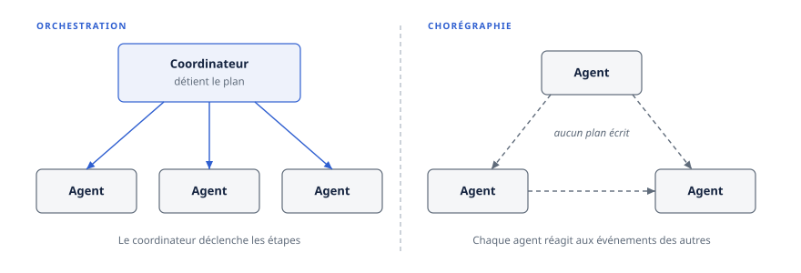
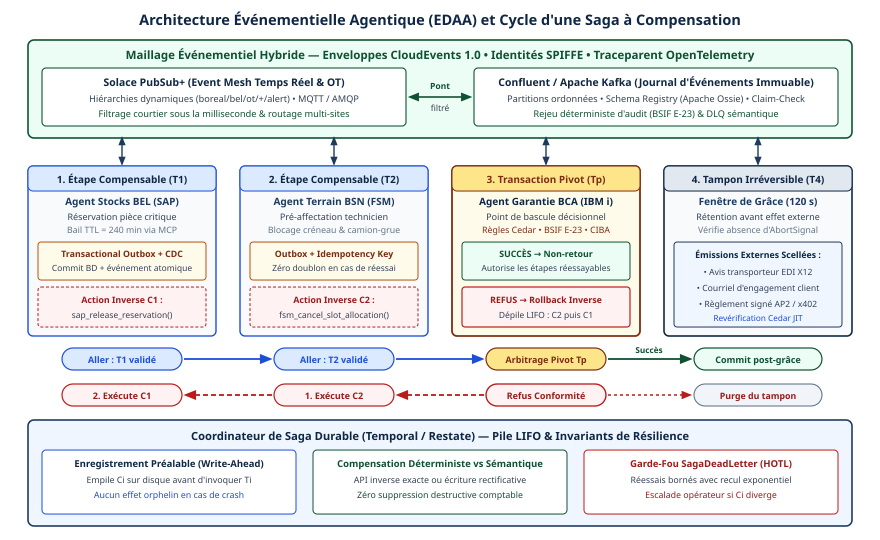

# Chapitre 19 — Orchestration événementielle

*Question directrice : quand des agents doivent-ils réagir à des événements au lieu d'être appelés ?*

> **État de référence :** Apache Flink Agents 0.4, spécification MCP `2026-07-28`, extension Tasks et feuille de route du 22 août 2026, spécification A2A 1.0. Les numéros entre crochets renvoient aux sources en fin de chapitre : [1] à [13] sont des pages primaires; [14] à [16] sont des billets de fournisseurs, signalés comme tels.

La plupart des agents sont appelés : une personne pose une question, un processus invoque une étape, un superviseur délègue. Une bonne part du travail d'une entreprise ne commence pourtant par aucune demande. Une commande est annulée, un capteur dépasse un seuil, un paiement est refusé : le fait se produit, et quelque chose doit s'ensuivre.

L'événement est le bon déclencheur quand le fait existe sans demandeur, quand le travail dure plus longtemps qu'une connexion, ou quand plusieurs consommateurs doivent réagir au même fait. Le journal d'événements vaut ensuite surtout comme substrat : il apporte durabilité, reprise et piste d'audit. La décision reste mieux tenue par un coordinateur explicite : les systèmes documentés orchestrent sur un transport événementiel.

---

## 19.1 Requête-réponse ou événements

Un appel a un destinataire et un demandeur qui attend. Un événement est l'enregistrement d'un fait; il ne nomme pas de destinataire, et celui qui le publie n'attend rien (chapitre 2). Selon la documentation de Kafka, producteurs et consommateurs sont ainsi entièrement découplés [1].

Ce découplage répond à trois situations.

**Le fait précède la demande.** Les auteurs de la proposition Flink Agents décrivent les processus d'entreprise comme asynchrones, à état et continus, et l'agent comme un microservice qui consomme des événements d'affaires au lieu de répondre à des prompts isolés [3].

**Le travail dépasse la connexion.** Un superviseur qui attend de façon synchrone la fin d'une tâche de vingt minutes immobilise des ressources et perd tout si sa connexion tombe (chapitre 18).

**Plusieurs réactions au même fait.** Un événement publié une fois peut être lu par autant de consommateurs qu'il le faut, sans que le producteur les connaisse.

L'équipe RocketMQ d'Alibaba Cloud soutient dans le même sens que les goulots des systèmes multi-agents en production sont opérationnels et non liés à la qualité du modèle : absorption des rafales, isolation des sessions, reprise après panne, auditabilité [15].

| Critère | Requête-réponse | Événements |
|---|---|---|
| Déclencheur | Une demande adressée | Un fait publié |
| Couplage | L'appelant connaît l'appelé | Le producteur ignore les consommateurs |
| Pointe de charge | Subie par l'appelé | Absorbée par le journal |
| Résultat | Dans la réponse | Dans un autre événement, à corréler |
| Vue d'ensemble | Dans le code de l'appelant | À reconstituer à partir du journal |

Les deux dernières lignes sont le prix à payer : il faut corréler, et plus personne ne détient le déroulement complet (section 19.7).

---

## 19.2 Kafka comme dorsale, Flink comme moteur

### Ce que Kafka garantit

Deux propriétés du journal importent pour des agents [1].

- Les événements ne sont pas supprimés après lecture : ils se relisent à volonté pendant une durée de rétention fixée par sujet (*topic*).
- Les événements de même clé vont dans la même partition, et tout consommateur d'une partition les lit dans le même ordre. Avec l'identifiant de dossier ou de session comme clé, on obtient un ordre par dossier, pas un ordre global.

La relecture est la propriété décisive : elle sert à la reprise, aux tests et à l'audit (section 19.4).

### Flink Agents

Un journal ne décide de rien; il faut un moteur qui consomme, garde un état et produit. FLIP-531, proposition de juin 2025 cosignée par Sean Falconer, a lancé Flink Agents comme sous-projet d'Apache Flink [3]. L'argument : Flink apporte déjà la faible latence, la tolérance aux pannes, la gestion d'état et l'intégration à Kafka; il lui manquait les abstractions d'agent. La proposition prévoit l'appel de modèles, l'invocation d'outils (dont MCP), le rejeu de flux historiques et une communication asynchrone entre agents par un stockage de flux tel que Kafka. Elle ne mentionne pas A2A.

La page de téléchargement d'Apache Flink donne la version 0.4 comme la plus récente, compatible avec Flink 1.20 à 2.3 [2]. La documentation présente le projet comme un « Agent OS » de flux : l'agent y devient un opérateur du flux de données, des *Actions* traitent des *Events*, et des *Resources* nommées (modèles, outils, prompts, serveurs MCP) sont réutilisables, avec des API Java, Python et YAML [4].

**Le statut.** Les versions 0.x sont des préversions : API et configuration sont expérimentales et peuvent changer de façon incompatible avant la 1.0 [4].

**La portée des garanties.** La page sur la cohérence distingue deux niveaux [5].

| Configuration | Ce qui est garanti | Ce qui ne l'est pas |
|---|---|---|
| Points de contrôle seuls | Chaque entrée affecte une seule fois l'état et la sortie du job | Actions et appels externes peuvent se répéter; un modèle peut répondre autrement |
| Points de contrôle et Action State Store (Kafka ou Fluss) | Les Actions terminées sont réutilisées, non réexécutées; les appels durables enregistrés sont rejoués | L'effet externe : le magasin ne peut pas valider l'opération et son résultat en une seule transaction |

La documentation en conclut qu'il faut un service idempotent ou un mécanisme de réconciliation [5]. Le « exactement une fois » d'un moteur de flux porte sur son état et ses sorties, pas sur le courriel envoyé par un outil. L'idempotence et la compensation du chapitre 18 restent nécessaires.

---

## 19.3 Le patron d'orchestrateur sur flux

Le patron examiné ici vient d'un article de Sean Falconer, alors chez Confluent, publié par SD Times en février 2025 [14]. C'est un texte de fournisseur accompagné d'une démonstration, pas un retour de production.

Les agents publient leurs messages dans un sujet Kafka. Un job Flink lit chaque message et le soumet à un modèle de langage, appelé en SQL. Le modèle choisit l'agent destinataire à partir de définitions structurées : nom, description, entrée, sortie. Flink transmet le message à cet agent, qui écrit son résultat dans le sujet, et la boucle reprend jusqu'à la fin du travail.

Les agents n'ont aucune dépendance explicite entre eux, et aucune logique de routage n'est codée en dur. L'auteur en attend des décisions en temps réel sans workflow figé et une structure des messages contrôlée par la gouvernance des flux.

**C'est une orchestration.** Malgré le vocabulaire événementiel, un composant central décide de tout. Le patron est le superviseur du chapitre 16, transposé sur un flux : le journal remplace l'appel direct, pas le coordinateur.

**Le routage coûte une inférence par message.** Quand la suite des étapes est connue d'avance, une règle déterministe fait le même travail sans ce coût ni cette variabilité (chapitre 17). Les routeurs comparés au chapitre 44 changent d'ailleurs souvent de choix devant une simple reformulation.

**L'auteur nomme lui-même les limites.** Des agents peuvent engendrer un nombre illimité de tâches, ce qui exige une gestion des ressources; il faut suivre l'avancement, détecter les échecs et replanifier; certains processus demandent un ordre strict [14]. Le patron reporte ces points sur l'exploitation.

---

## 19.4 Sessions rejouables et event sourcing

### La session comme flux

RocketMQ-A2A est le seul système examiné ici présenté comme en production. L'article a été accepté dans le volet industriel de FSE 2026; ce chapitre s'appuie sur le billet de ses auteurs, daté du 16 septembre 2026 [15].

L'idée centrale : modéliser chaque session de collaboration comme un flux d'événements persistant et rejouable, et séparer l'envoi des tâches du retour des résultats.

- Un sujet ordinaire distribue les tâches du superviseur vers des agents exécutants sans état. Les rafales s'accumulent dans la file, pas dans la mémoire des exécutants.
- Un canal léger propre à la session, le LiteTopic, ramène résultats et changements d'état vers le superviseur, dans l'ordre et de façon durable. Ces canaux, créés et détruits à la volée, sont récupérés à l'expiration d'un délai.

Le superviseur ne bloque plus sur la tâche longue d'un exécutant. S'il tombe, le flux de la session est relu depuis le point d'interruption : les tâches reprennent au lieu de recommencer, et le journal structuré des interactions sert de preuve pour l'audit.

Selon le billet, le dispositif est versé au projet Apache RocketMQ et sert notamment la plateforme Model Studio d'Alibaba Cloud.

### L'event sourcing appliqué aux agents

ESAA pousse la même logique à l'échelle d'un projet logiciel [12]. L'agent n'écrit ni dans le projet ni dans le journal : il émet des intentions structurées en JSON. Un orchestrateur déterministe les valide, les consigne dans un journal en ajout seul, applique les changements et en dérive une vue matérialisée, vérifiable par rejeu et empreinte. C'est une prépublication à auteur unique, appuyée sur deux études de cas de petite taille : une illustration, pas une preuve de passage à l'échelle.

Le principe : séparer ce que l'agent *propose* de ce qui est *enregistré comme fait*.

### Rejouer n'est pas réexécuter

Le mot « rejeu » recouvre deux opérations distinctes.

**Relire le journal** reconstitue l'état à partir de faits enregistrés. L'opération est déterministe : c'est celle de RocketMQ-A2A à la reprise, d'ESAA à la vérification, et de l'Action State Store de Flink Agents, qui rejoue les résultats sauvegardés sans rappeler la fonction [5].

**Réexécuter sur des entrées historiques** rappelle le modèle. FLIP-531 en fait un usage délibéré : tests de régression, débogage, analyse de la dérive du modèle, sans effets réels [3]. Le résultat peut différer; c'est justement ce qu'on cherche à mesurer.

Un journal qui ne garde que les entrées permet de réexécuter, pas de reconstituer. Pour reprendre après panne et pour auditer, il faut journaliser aussi les décisions du modèle et les résultats des outils. La documentation de Flink Agents ajoute deux conditions : le rejeu doit préserver l'ordre des entrées par clé, et les enregistrements du magasin doivent être conservés aussi longtemps que les points de reprise qui en dépendent [5].

---

## 19.5 Contrepoints : état interrogeable, capture directe des changements

### L'agent a besoin de l'état, pas du flux

Un agent qui répond à une question n'a que faire de la suite des événements; il lui faut l'état qu'ils décrivent. Le Real-Time Context Engine de Confluent, annoncé en disponibilité générale le 18 août 2026 [16], sert par MCP l'état courant de tables construites sur des sujets Kafka [11]. FLIP-531 revendique la même capacité à l'intérieur de Flink : conserver et interroger le contexte sans magasin externe [3].

Le flux reste en amont, comme mécanisme de fraîcheur, et l'agent interroge par un appel d'outil ordinaire (chapitre 15). Événementiel et requête-réponse occupent deux étages.

### Capter les changements sans dorsale

Un système patrimonial ne publie pas d'événements, mais sa base de données tient un journal de ses modifications. La capture des changements en fait une source d'événements sans toucher à l'application (chapitre 25). Elle n'exige pas de dorsale : la documentation de Debezium décrit un moteur embarqué qui livre les changements directement à l'application, pour celles qui ne veulent pas dépendre d'une grappe Kafka [10].

La documentation en énonce les contreparties : positions de lecture gardées par défaut dans un fichier local, doublons à tolérer après une panne; pour un « exactement une fois » plus rigoureux, elle renvoie à la plateforme complète [10].

Un agent déclenché quelques fois par jour par un changement dans une table n'a pas besoin d'un journal distribué et d'un moteur de flux; un déclencheur direct et un traitement idempotent suffisent.

---

## 19.6 Les événements dans les protocoles : Tasks MCP, notifications A2A

MCP et A2A sont des protocoles de requête-réponse dotés de moyens de dire « ce n'est pas fini ». Aucun n'est un bus de messages.

### MCP

La feuille de route d'août 2026 recense trois mécanismes : l'extension Tasks (chapitre 5), le flux `subscriptions/listen` et les notifications de progression. Elle reconnaît le risque d'avoir trois réponses à la même question, sans cycle de vie, modèle d'annulation ni surface d'erreur communs [6].

`subscriptions/listen` ouvre un flux du serveur vers le client, filtré par types de notifications. La page de la spécification en énumère quatre : changement de la liste d'outils, de prompts ou de ressources, et mise à jour de ressources désignées par leur URI [7]. La notification de mise à jour ne porte que l'URI : c'est un signal, après lequel le client relit la ressource. L'extension Tasks ajoute, par ce même flux, `notifications/tasks`, qui porte l'état complet de la tâche; sa page en conclut qu'un client peut alors s'y fier au lieu d'interroger [13]. Après une rupture, le client peut rouvrir un flux; sur stdio, il le doit, car le serveur ne garde aucun état d'abonnement. La page ne prévoit aucun rattrapage des notifications manquées.

Les événements poussés par le serveur, y compris par webhooks, sont un livrable de la période en cours [6]. Le groupe de travail qui en a la charge, créé le 24 mars 2026 sous le nom Triggers and Events et rebaptisé Tasks and Events le 16 octobre, a pour mission un mécanisme de rappel normalisé, assorti de garanties d'ordre valables sur tous les transports [8]. Sa charte exclut expressément une infrastructure générale de publication-abonnement, et sa proposition sur les événements y figure encore au stade d'idéation, avec une cible de fin avril dépassée. MCP ne normalise donc encore ni déclencheur ni webhook.

### A2A

A2A offre deux voies, décrites au chapitre 6. Le flux livre les événements d'une tâche dans l'ordre où ils ont été produits, et un client déconnecté peut se réabonner : le premier événement reçu est alors l'état courant de la tâche [9]. La spécification prévient toutefois qu'un client qui se reconnecte peut ne pas avoir reçu toutes les mises à jour, et que les messages ne doivent pas être tenus pour un mécanisme de livraison fiable d'information critique.

Les notifications poussées s'adressent aux clients déconnectés. L'agent doit tenter la livraison au moins une fois à chaque webhook configuré; les nouvelles tentatives sont permises à la section 4.3.3, recommandées à la section 13.2. Le client doit accuser réception par un code 2xx et devrait traiter les notifications de façon idempotente, des doublons étant possibles [9]. L'agent devrait aussi rejeter les URL de webhook privées, de bouclage ou locales au lien, contre la falsification de requêtes côté serveur (SSRF, chapitre 6) [9].

### Une même règle : notifier, puis relire

| Mécanisme | Ordre | Livraison | Rattrapage après rupture |
|---|---|---|---|
| MCP `subscriptions/listen`, dont `notifications/tasks` [7] [13] | Non précisé | Tant que le flux est ouvert | Aucun; nouvel abonnement, puis `tasks/get` |
| A2A, flux [9] | Ordre de production | Tant que le flux est ouvert | État courant au réabonnement |
| A2A, notification poussée [9] | Non précisé | Au moins une tentative | Lecture de la tâche |
| Journal Kafka [1] | Par partition | Durable | Relecture du journal |

Dans les deux protocoles, l'état de la tâche fait foi : une notification, même porteuse de l'état complet, peut manquer ou arriver en double, et aucun mécanisme ne rejoue celles qui ont été perdues. Un client traite donc toute notification comme une invitation à relire, relit l'état à chaque reconnexion et interroge périodiquement en l'absence de signal. Une organisation qui a besoin d'une livraison ordonnée, durable et rejouable entre agents doit placer un journal derrière le protocole. C'est ce que fait RocketMQ-A2A, qui donne aux échanges asynchrones de style A2A un flux persistant par session [15].

---

## 19.7 Chorégraphie ou orchestration

En orchestration, un coordinateur détient le plan et déclenche les étapes. En chorégraphie, chaque participant réagit aux événements des autres, et le plan n'est écrit nulle part (chapitre 18).



La chorégraphie découple : ajouter un agent, c'est ajouter un abonné. Avec des agents, elle cumule deux difficultés. Le déroulement n'étant détenu par personne, il faut le reconstituer après coup. Et chaque réaction est une décision non déterministe : un agent qui réagit peut publier des événements qui en font réagir d'autres, sans borne. C'est l'« explosion de tâches » que signale l'article sur l'orchestrateur Flink [14]. Les défauts de spécification et de désalignement du chapitre 21 y trouvent un terrain favorable.

Les trois systèmes lus pour ce chapitre font le même choix : un orchestrateur Flink central [14], un superviseur avec des exécutants sans état [15], un orchestrateur déterministe qui valide les intentions [12]. Tous transportent par événements; aucun ne laisse les agents s'enchaîner librement. L'échantillon est mince, mais sa cohérence indique une pratique : **orchestrer la décision, chorégraphier la diffusion**.

La chorégraphie garde sa place quand trois conditions sont réunies : les réactions sont indépendantes les unes des autres; aucune n'a à être annulée si une autre échoue; aucun ordre n'est requis entre elles. Dès qu'une transaction d'affaires traverse plusieurs agents, il faut un coordinateur, donc une Saga orchestrée (chapitre 18).

Trois garde-fous valent dans tous les cas. Chaque événement porte l'identifiant d'affaires du dossier ou de la demande, distinct de l'`id` d'événement qu'exige CloudEvents (chapitre 2), pour reconstituer une trajectoire (chapitre 33). Au-delà d'un budget par dossier, en événements ou en jetons, le traitement passe à un humain (chapitres 22 et 40). Enfin, le contenu d'un événement est une entrée non fiable : quiconque écrit dans un journal ou une file peut viser l'agent qui le lit, comme le démontre l'injection par les journaux. L'agent déclenché propose, et son action se choisit dans un catalogue borné (chapitres 31 et 47).

---

## Grille de décision

| Décision | Option par défaut | Quand s'en écarter |
|---|---|---|
| Mode de déclenchement | Appel direct [S] | Fait sans demandeur, travail plus long qu'une connexion, plusieurs consommateurs |
| Dorsale d'événements | Aucune tant qu'un déclencheur direct suffit [S] | Relecture, pointes de charge ou consommateurs multiples |
| Moteur d'agents sur flux | Flink Agents à l'essai seulement, vu son statut de préversion [É] | Production si Flink est déjà exploité et qu'une adaptation des API est prévue |
| Contenu du journal | Entrées, décisions du modèle et résultats d'outils [S] | Entrées seules si le seul besoin est le test par réexécution |
| Effets externes | Outils idempotents ou réconciliation [É] | — |
| Coordination | Orchestrateur explicite sur transport événementiel [S] | Chorégraphie pour des réactions indépendantes, sans ordre ni compensation |
| Suivi d'une tâche MCP ou A2A | Notification comme signal, puis relecture de l'état [N] | Interrogation périodique si le client ne peut recevoir d'appel entrant |
| Contexte de l'agent | État interrogeable par un outil [É] | Consommation directe du flux pour un agent qui réagit à chaque événement |
| Action déclenchée par un événement | Proposition, puis procédure d'un catalogue borné [S] | — |

---

## Points à retenir

- L'événement s'impose dans trois cas : fait sans demandeur, travail plus long qu'une connexion, plusieurs consommateurs. Ailleurs, l'appel direct reste plus simple.
- La relecture du journal est la propriété qui compte : elle sert à la reprise, aux tests et à l'audit.
- Flink Agents existe, en version 0.4, mais en préversion. Son « exactement une fois » couvre l'état et les sorties du job, pas les effets externes des outils.
- Rejouer n'est pas réexécuter. Pour reprendre et auditer, le journal doit contenir les décisions du modèle et les résultats des outils, pas seulement les entrées.
- Les systèmes documentés gardent un coordinateur et transportent par événements. La chorégraphie convient aux réactions indépendantes, sans ordre ni compensation.
- MCP et A2A notifient sans rattrapage garanti : l'état de la tâche fait foi et se relit à chaque reconnexion. Les événements poussés et les webhooks de MCP sont encore à l'étude.
- Un événement est une entrée non fiable : l'agent qu'il déclenche propose, et son action se choisit dans un catalogue borné.
- Un agent a le plus souvent besoin de l'état que décrit le flux, pas du flux. À petit volume, une capture directe des changements et un traitement idempotent remplacent la dorsale.

---

## Sources

Pages primaires lues le 11 novembre 2026; [2], [5] à [9] et [13] lues ou relues le 12 novembre :

1. [Apache Kafka — Introduction](https://kafka.apache.org/intro)
2. [Apache Flink — téléchargements (Flink Agents 0.4)](https://flink.apache.org/downloads/)
3. [FLIP-531 — Flink Agents](https://cwiki.apache.org/confluence/display/FLINK/FLIP-531:+Initiate+Flink+Agents+as+a+new+Sub-Project)
4. [Flink Agents — vue d'ensemble](https://nightlies.apache.org/flink/flink-agents-docs-latest/docs/get-started/overview/)
5. [Flink Agents — cohérence](https://nightlies.apache.org/flink/flink-agents-docs-latest/docs/operations/consistency/)
6. [MCP — feuille de route du 22 août 2026](https://modelcontextprotocol.io/development/roadmap.md)
7. [MCP — Subscriptions, spécification 2026-07-28](https://modelcontextprotocol.io/specification/2026-07-28/basic/patterns/subscriptions.md)
8. [MCP — charte du groupe de travail Tasks and Events](https://modelcontextprotocol.io/community/working-groups/tasks-events.md)
9. [Spécification A2A 1.0](https://a2a-protocol.org/latest/specification/) (sections 3, 4.3 et 13.2)
10. [Debezium 3.7 — Debezium Engine](https://debezium.io/documentation/reference/stable/development/engine.html)
11. [Confluent — Real-Time Context Engine, vue d'ensemble](https://docs.confluent.io/cloud/current/ai/real-time-context-engine/overview.html) (début de page)
12. [ESAA: Event Sourcing for Autonomous Agents (arXiv 2602.23193)](https://arxiv.org/abs/2602.23193) (résumé)
13. [MCP — extension Tasks](https://modelcontextprotocol.io/extensions/tasks/overview.md)

Billets de fournisseurs, lus; [15] relu le 12 novembre :

14. [SD Times — orchestrateur multi-agents Flink/Kafka](https://sdtimes.com/how-to-build-a-multi-agent-orchestrator-using-flink-and-kafka/) (S. Falconer, Confluent, février 2025)
15. [Alibaba Cloud — RocketMQ-A2A accepté à ACM FSE 2026](https://www.alibabacloud.com/blog/rocketmq-a2a-paper-accepted-at-acm-fse-defining-a-reliable-collaboration-paradigm-for-ai-agents_603558) (16 septembre 2026); article d'origine non lu, DOI 10.1145/3803437.3805231
16. [Confluent — New in Confluent Intelligence and AI Tools](https://confluent.io/blog/2026-q3-confluent-intelligence-ai-update) (18 août 2026)

## Limites de ce chapitre

- La source [12], d'abord connue par son seul résumé, a été relue au-delà du résumé le 14 novembre 2026, par un outil qui en rend des extraits; les écarts relevés sont corrigés dans le texte.
- **EDAgent (ICDCS 2026)**, nommé parmi les appuis du plan initial, n'a pas été retrouvé et n'est pas utilisé.
- **RocketMQ-A2A** est décrit d'après le billet de ses auteurs, non d'après l'article. Le statut de production reste une affirmation de l'éditeur; les chiffres du billet ont été écartés.
- **L'orchestrateur Flink/Kafka** repose sur un billet de février 2025, antérieur à Flink Agents. Aucun retour de production indépendant n'a été trouvé pour ce patron ni pour Flink Agents, dont la version 0.4 n'est pas datée sur la page lue.
- **ESAA** n'est connu que par son résumé; **Confluent**, par le début d'une page et un billet [16].
- **A2A** : la section 13.2, lue pendant l'audit, lève la réserve sur la sécurité des notifications poussées; elle recommande (SHOULD) les nouvelles tentatives que la section 4.3.3 se borne à permettre (MAY). **MCP** : la page de l'extension Tasks [13] lève l'écart avec le chapitre 5, ses notifications passant par `subscriptions/listen`. Aucune page lue ne précise l'ordre de ces notifications; la relecture à la reconnexion est une recommandation de ce chapitre.
- **CloudEvents** est repris du chapitre 2, sans lecture de sa spécification.
- Les définitions de l'orchestration, de la chorégraphie et de l'event sourcing, l'exemple du superviseur en attente et la capture des changements appliquée au patrimoine relèvent de la connaissance générale. Les conditions d'emploi de la chorégraphie, les garde-fous de la section 19.7 et la grille de décision sont des recommandations de ce chapitre, non des résultats tirés d'une source.
- Le « maillage d'événements » du plan initial et les autres courtiers ne sont pas traités dans cet exposé, faute de source lue; le volet de mise en œuvre présente celui de Solace (section 19.8), et la section 23.3 décrit, d'après la documentation de l'éditeur, la plateforme d'agents bâtie sur ce maillage. DDS, la publication-abonnement de ROS 2, est traitée au chapitre 46.

## Mise en œuvre — Maillage événementiel asynchrone et patron Saga à compensation {.volet}

:::: {.encadre .executive}
::: {.encadre-titre}
**Synthèse exécutive**
:::

- **Enjeu stratégique** : Quand le travail dure plus longtemps qu’une connexion, que plusieurs consommateurs doivent réagir au même fait ou qu’il faut absorber des pointes de charge (section 19.1 et grille de décision), relier des agents autonomes par des appels synchrones bloquants reproduit les fragilités des architectures point-à-point : couplage temporel, tempêtes de réessais quand l’inférence ralentit, états métier incohérents quand une étape aval échoue après des écritures amont déjà validées. L’entreprise agentique repose alors sur un maillage événementiel asynchrone (architecture événementielle agentique, EDAA) couplé au patron Saga à compensation. Hors de ces cas, l’appel direct reste l’option par défaut : aucune dorsale tant qu’un déclencheur direct suffit (grille de décision, après la section 19.7).
- **Décisions architecturales structurantes** :
  1.  *Irréversible à moyen terme* : Proscrire tout verrouillage transactionnel distribué (validation à deux phases, 2PC / XA) entre agents cognitifs; adopter un socle à deux composantes : routage dynamique à basse latence (Solace PubSub+) et journal immuable relisible (Apache Kafka / Confluent).
  2.  *Structurante dès le jour 1* : Classer chaque outil MCP mutatif et chaque délégation A2A v1.0 en quatre catégories (*compensable*, *pivot*, *réessayable*, *irréversible externe*), imposer le patron Transactional Outbox et confiner toute émission externe derrière un tampon à fenêtre de grâce.
  3.  *Réversible par conception* : Le choix des adaptateurs de capture des changements ou des courtiers périphériques (NATS JetStream) en bordure d’usine, tant que l’enveloppe canonique CloudEvents 1.0 est respectée.
- **Indicateurs de gouvernance associés** : Taux de convergence propre des sagas ($\ge 99,9\,\%$), délai de compensation au 95e centile, taux de dérive en file `SagaDeadLetter` ($< 0,1\,\%$) et zéro émission irréversible externe avant validation du point pivot.
::::

## 19.8 De la requête-réponse bloquante à l’architecture événementielle agentique (EDAA)

Le chapitre 18 traite l’avancement d’un flux individuel : un moteur d’exécution durable (Temporal, Restate) le préserve malgré les pannes et les attentes humaines. Deux problèmes d’urbanisation restent à résoudre : propager en temps réel des milliers de faits opérationnels sans coupler chaque producteur à chaque consommateur, et rétablir l’intégrité métier quand une transaction inter-divisions est annulée à mi-parcours.

Dans les premiers graphes multi-agents, l’invocation synchrone domine : l’agent A appelle l’agent B en HTTP, qui attend un serveur MCP C sollicitant un progiciel D. À mesure que le nombre de maillons $m$ croît, la disponibilité effective diminue selon le produit des disponibilités unitaires $a_i$ :

$$A_{\text{sync}}(m) = \prod_{i=1}^{m} a_i \ll \min_{i} a_i$$

Quand chaque maillon dépend d’un moteur d’inférence à latence variable et d’un progiciel aux fenêtres de maintenance propres, cette topologie produit trois pathologies.

1.  **Tempêtes de réessais** : Un quota HTTP 429 ou une lenteur de SAP bloque les appels amont; des réessais non coordonnés multiplient la charge au moment où le service aval tente de se rétablir.
2.  **Rigidité évolutive** : Greffer un agent critique d’audit ou un indexeur mémoriel (Graphiti) sur un flux existant oblige à modifier et à redéployer les agents producteurs.
3.  **Inadéquation au monde physique** : Les capteurs OPC UA, les avis EDI X12 et les écritures comptables sont des flux continus de faits, non des appels de procédure distante.

L’architecture événementielle agentique (EDAA) reprend le découplage de la section 19.1 : capteurs, progiciels et agents publient des faits métiers immuables sur un maillage gouverné; les agents abonnés filtrent ces faits selon leurs mandats NHI, agissent localement et publient en retour leurs résultats ou des signaux de compensation.

Deux formes de charge utile coexistent sur ce maillage, et le choix entre elles est délibéré.

- **Événement de notification mince** : Il signale seulement qu’une transition d’état a eu lieu sur un identifiant métier. Les consommateurs habilités relisent l’état frais par un serveur MCP, avec le contrôle d’accès appliqué à la source (« notifier, puis relire », section 19.6). Cette forme est obligatoire dès que l’événement touche des renseignements personnels soumis à la Loi 25 ou des clauses tarifaires confidentielles.
- **Transfert d’état porté par l’événement** (*Event-Carried State Transfer*, ECST) : Le message embarque la projection normalisée selon l’ontologie Apache Ossie dont les agents aval ont besoin. Il évite les tempêtes de lectures synchrones vers l’IBM i ou SAP S/4HANA quand une dizaine de travailleurs analytiques réagissent au même fait industriel.



### Choix des courtiers : Kafka, Solace et NATS

En 2027, trois familles de courtiers jouent des rôles complémentaires. AGNTCY SLIM (chiffrement de bout en bout *Messaging Layer Security*) s’y ajoute quand des essaims d’agents échangent sur des réseaux non fiables.

- **Apache Kafka / Confluent (journal immuable et relecture dans le temps)** : Journal canonique des sagas, partitionné par clé métier (`equipmentSerialNumber` ou `sagaId`), dont l’ordre et la relecture sont décrits à la section 19.2. Il conserve l’historique sur des mois, alimente les pipelines de contexte (Apache Flink), fournit une piste d’audit chronologique opposable sous BSIF E-23 et permet de réexécuter un incident réel dans un bac à sable OpenEnv pour vérifier la non-régression d’un agent.
- **Solace PubSub+ (maillage dynamique *Event Mesh* et passerelle IT/OT)** : Là où Kafka emploie des sujets plats, Solace route les messages selon des hiérarchies arborescentes fines (jusqu’à 128 niveaux, ex. `boreal/bel/qc/mtl02/compressor/BOR-90441/vibration/critical`), évaluées avec jokers `*` et \> directement par le courtier. Un spécialiste peut souscrire aux seules alertes critiques québécoises sans ingérer le flux nominal européen. La traduction multiprotocole est native (MQTT Sparkplug, AMQP 1.0, REST, WebSockets).
- **NATS + JetStream (périphérie industrielle et micro-coordination)** : Binaire léger à latence sous la milliseconde, NATS convient aux usines sujettes aux coupures WAN et à la coordination de travailleurs d’extraction SLM par diffusion puis collecte des réponses.

| Dimension d’évaluation | Apache Kafka / Confluent | Solace PubSub+ (Event Mesh) | NATS + JetStream |
|:----------------|:----------------------------|:---------------------------|:---------------------------|
| Paradigme primaire | Journal distribué immuable à rétention longue | Maillage orienté routage dynamique et filtrage fin | Messagerie très légère de périphérie |
| Filtrage des sujets | Sujets plats; filtrage délégué aux consommateurs / Flink | Arborescence riche avec jokers évalués par le courtier | Hiérarchie par jetons (. / `*` / \>) rapide en mémoire |
| Protocoles natifs | Binaire Kafka + Kafka Connect / passerelle REST | Multiprotocole natif : MQTT, AMQP 1.0, JMS, REST, WSS | Protocole NATS sobre, support MQTT et WebSockets |
| Ordre et relecture d’audit | Ordre total par partition; relecture de longs historiques (E-23) | Files durables à acquittement fin; relecture bornée au tampon | Flux JetStream répliqués pour fenêtres tactiques |
| Latence p99 intra-zone | 5 à 25 ms (débit séquentiel élevé) | 0,5 à 5 ms (commutation fine à faible gigue) | 0,15 à 2 ms (empreinte minimale inter-conteneurs) |
| Rôle agentique optimal | Journal canonique des sagas, audit, mémoire et analytique | Collecte IT/OT, fédération multi-nuages, routage sélectif | Usines déconnectables, essaims locaux de travailleurs SLM |

Chez Groupe Boréal, Solace capte et filtre à basse latence les signaux OT et applicatifs aux frontières, puis déverse les événements qualifiés dans Kafka par un pont certifié, pour l’orchestration durable et l’audit réglementaire.

Le pont impose un choix de conception : la clé de partitionnement dans Kafka, puisque l’ordre n’est garanti qu’à l’intérieur d’une partition (section 19.2).

- Sur les sujets d’état d’actifs physiques ou contractuels (`bel.equipment.telemetry`, `bca.policy.lifecycle`), la clé est l’identifiant canonique de la ressource métier (BOR-CMP-90441) : une alerte de rétablissement ne peut pas être consommée avant l’alerte de panne qui l’a précédée de 200 millisecondes.
- Sur les sujets de coordination transactionnelle (`boreal.saga.commands`, `boreal.saga.compensations`), la clé est `aigovsagaid` : tous les jalons aller et retour d’une même saga sont sérialisés dans leur ordre causal, sans goulot global entre deux sagas indépendantes.
- Quand des événements franchissent le périmètre de l’entreprise vers un fournisseur logistique externe, la charge utile est encapsulée dans un groupe chiffré AGNTCY SLIM (protocole IETF *Messaging Layer Security*, RFC 9420) : même un courtier relais intermédiaire ne peut lire le contenu métier en clair.

---

## 19.9 Ingénierie de l’événement agentique : CloudEvents 1.0, Transactional Outbox et anti-tempête

Un bus asynchrone sans discipline transactionnelle déplace le désordre sans le résoudre. Trois mécanismes fiabilisent les échanges.

### 1. Éliminer la double écriture : Transactional Outbox et registre d’idempotence

Si un serveur MCP valide un COMMIT SQL de réservation de stock puis tente de publier `InventoryReserved` sur Kafka, un crash ou une coupure réseau entre les deux opérations laisse un stock bloqué sans événement émis. En production, ni un agent ni un serveur MCP ne publie directement sur le courtier à côté d’une écriture en base. La mutation métier et l’insertion dans la table `agent_outbox_events` s’exécutent dans la même transaction ACID locale. Une scrutation SQL périodique générerait une charge inutile : un connecteur de capture des changements (section 19.5) lit plutôt en continu le journal des transactions, Debezium sur le WAL PostgreSQL ou sur les journaux de réplication SAP / IBM i. Il extrait chaque ligne engagée en moins de 15 millisecondes et la publie sur le courtier avec une garantie « au moins une fois ».

Côté consommateur, chaque travailleur ou serveur MCP tient une table de déduplication transactionnelle indexée sur `aigovidempotencykey`. Elle conserve le statut d’exécution (`IN_PROGRESS`, `COMPLETED`) et l’empreinte de la réponse produite. Quand un rééquilibrage de groupe de consommateurs Kafka livre de nouveau un message déjà traité, l’agent restitue le résultat antérieur sans réinvoquer le modèle de langage ni doubler la réservation physique. Avec un registre de schémas (Schema Registry) qui impose la compatibilité ascendante et descendante stricte (*Full Transitive Compatibility*), une saga en veille pendant dix jours survit sans erreur de désérialisation au déploiement d’une nouvelle version d’agent.

### 2. Normaliser l’enveloppe : CloudEvents 1.0 et Claim-Check

Tous les messages adoptent la norme CNCF CloudEvents 1.0, enrichie des attributs de gouvernance agentique (`aigov*`). Pour les artefacts volumineux (liasses PDF, spectres vibratoires), l’émetteur applique le patron Claim-Check : le fichier chiffré réside dans un stockage objet immuable, et l’événement ne transporte que son URI avec une empreinte SHA-256 vérifiable. L’extrait 19.1 réunit l’enveloppe, le contrat de compensation et la référence Claim-Check.

#### Extrait 19.1 — Événement agentique normatif CloudEvents 1.0 avec gouvernance et *Claim-Check*

``` json
{
  "specversion": "1.0",
  "id": "evt-0195f3c8-8a14-7d20-9b41-6c02e4419a08",
  "source": "spiffe://boreal.ca/ns/bel-erp/sa/mcp-sap-inventory",
  "type": "ca.boreal.bel.inventory.part.reserved.v2",
  "subject": "equipment/BOR-CMP-90441/material/INJ-MOD-V12",
  "time": "2027-04-09T14:22:11.408Z",
  "datacontenttype": "application/json",
  "dataschema": "https://schemas.boreal.ca/ossie/v2/inventory-event.schema.json",
  "traceparent": "00-7d4e9a12b8c041559f0218a4c7103e21-89a1c402f1b30042-01",
  "aigovsagaid": "saga-inc-2027-119405",
  "aigovidempotencykey": "saga-inc-2027-119405:step-01:sap-reserve",
  "aigovautonomyceiling": "L3",
  "aigovhopremaining": 3,
  "aigovbudgetremainingcad": "1.05",
  "aigovinitiatingactor": "urn:boreal:iot:bsn-vibration-guardian-v4",
  "data": {
    "reservationDocumentNumber": "SAP-RES-4409812",
    "plantCode": "CA-QC-MIR-01",
    "materialCode": "INJ-MOD-V12",
    "reservedQuantity": 1,
    "unitValuationCad": 14800.00,
    "leaseExpiresAt": "2027-04-09T18:22:11Z",
    "compensationContract": {
      "classification": "COMPENSABLE",
      "mcpServer": "https://agentgateway.internal.boreal.ca/mcp/bel/sap-mm",
      "inverseToolName": "sap_release_spare_part_reservation",
      "correlationParameters": {
        "reservationDocumentNumber": "SAP-RES-4409812",
        "plantCode": "CA-QC-MIR-01"
      }
    },
    "diagnosticClaimCheck": {
      "artifactUri": "s3://boreal-telemetry/2027/04/09/fft-BOR-CMP-90441.parquet",
      "sha256Digest": "9f86d081884c7d659a2feaa0c55ad015a3bf4f1b2b0b822cd15d6c15b0f00a08",
      "encryptionKeyRef": "kms://ca-central-1/boreal-ot-cmk"
    }
  }
}
```

### 3. Prévenir les tempêtes cognitives auto-entretenues (OWASP ASI08)

Dans un maillage, deux agents abonnés au même objet peuvent entrer en résonance sans fin : l’un normalise une fiche, l’autre recalcule un score et republie l’événement. C’est l’explosion de tâches de la section 19.7. Trois verrous déterministes bloquent cette dérive : (a) la décrémentation obligatoire de `aigovhopremaining` à chaque réaction, qui route en quarantaine passive tout message tombé à 0; (b) le filtrage d’auto-causalité, qui ignore toute mutation émise par la même identité SPIFFE ou hors du sous-schéma surveillé; (c) l’isolation après trois échecs vers une file de lettres mortes sémantique (`.dlq`), pour ne jamais bloquer une partition Kafka.

:::: {.encadre .sectoriel}
::: {.encadre-titre}
**Transport aérien & Logistique — Sagas de réacheminement en perturbation majeure (IRROPS)**
:::

Quand un épisode de verglas ferme deux pistes d’un pivot aéroportuaire nord-américain (*Irregular Operations*, IRROPS), une compagnie aérienne et sa filiale cargo doivent recomposer en moins de vingt minutes des dizaines de rotations d’aéronefs, des équipages soumis aux limites légales de temps de service (Transports Canada / FAR Part 117) et des milliers d’expéditions pharmaceutiques sous chaîne du froid.

En 2027, les transporteurs de pointe remplacent les verrous centraux sur le système de services aux passagers (PSS) par un maillage Solace PubSub+ (télémétrie avionique ACARS et portes en temps réel) couplé à Kafka et Temporal :

1.  **Réservations spéculatives à bail court** : L’*Agent Fret Critique* bloque pour 15 minutes de la soute sur un vol partenaire A2A et un camion frigorifique sous douane, pendant que l’*Agent Équipage* vérifie la légalité des pilotes de réserve.
2.  **Compensation immédiate sur veto légal** : Si le contrôleur des temps de repos ou la douane refuse l’itinéraire au point pivot, la saga libère en moins de trois secondes la soute partenaire et le camion. La rétention fantôme de capacité, qui bloquait auparavant le réseau, disparaît.
::::

---

## 19.10 Le patron Saga en environnement probabiliste

Dès qu’un processus modifie plusieurs systèmes d’enregistrement autonomes (SAP, ServiceNow, Guidewire), le protocole de validation à deux phases (2PC / XA) est impraticable : les plateformes SaaS refusent les verrous externes, et un verrou exclusif maintenu pendant dix secondes d’inférence, ou quatre heures d’attente HOTL, bloquerait l’exploitation.

Le patron Saga (Garcia-Molina & Salem) remplace l’atomicité instantanée par une suite de transactions locales $T_1, \dots, T_n$, validées immédiatement et associées à des compensations inverses $C_i$. Toute saga bien formée s’ordonne autour d’une unique transaction pivot $T_p$ :

$$S = \langle T_1, \dots, T_{p-1}, T_p, T_{p+1}, \dots, T_n \rangle$$

Si une étape $T_k$ ($k \le p$) échoue ou essuie un refus de politique, le coordinateur dépile les compensations en ordre inverse strict (LIFO) :

$$\text{Comp}(S, k) = \langle C_{k-1}, C_{k-2}, \dots, C_1 \rangle$$

Le tableau fixe l’ordre des quatre classes d’effets de bord : étapes compensables, pivot unique (point de non-retour décisionnel), étapes réessayables dont la convergence est garantie, puis actions irréversibles externes sous tampon.

| Classe d’effet de bord | Position obligatoire | Propriété formelle | Exemples en entreprise | Exigence sur le serveur MCP / pair A2A |
|:-------------|:----------------|:----------------------|:----------------------|:------------------------|
| 1. Compensable | Avant le pivot ($T_1 \dots T_{p-1}$) | Annulable proprement par une opération inverse $C_i$ | Réservation temporaire SAP, blocage d’agenda technicien | Exposer l’outil inverse, un bail d’expiration (TTL) et l’idempotence |
| 2. Pivot | Bascule unique ($T_p$) | Son succès scelle l’engagement; son échec lance l’annulation | Adjudication de garantie BCA, validation CIBA, mandat AP2 | Atomicité stricte, contrôle complet des politiques Cedar/OPA |
| 3. Réessayable | Après le pivot ($T_{p+1} \dots T_n$) | Aucun refus métier possible; converge par réessai | Imputation analytique interne, mise à jour mémoire ou CRM | Idempotence sur `stepIdempotencyKey` |
| 4. Irréversible | Terminale sous tampon | Traverse la frontière physique ou juridique | Avis EDI externe, courriel client, consigne MES, virement | Passage obligatoire par un tampon à fenêtre de grâce |

### Contre-mesures au déficit d’isolation (ACD sans I) entre sagas concurrentes

Une saga ne fournit pas les garanties d’une transaction relationnelle ACID, mais seulement les garanties ACD : ses mutations intermédiaires sont visibles des autres agents avant que le pivot soit atteint. Deux sagas concurrentes sur le même équipement ou le même plafond de crédit client s’exposent à trois anomalies classiques : mises à jour perdues, lectures sales d’un état qu’une annulation défera trois secondes plus tard, et lectures non reproductibles. Trois contre-mesures s’appliquent au niveau des serveurs MCP.

1.  **Verrous sémantiques** : Toute étape compensable $T_i$ pose sur l’entité métier un indicateur visible d’état transitoire (`status = RESERVED_PENDING_SAGA`, avec `lockedBySagaId` et `leaseExpiresAt`). Un second agent qui inspecte la même pièce critique voit qu’un arbitrage est en cours : il attend l’expiration du bail court ou choisit un dépôt alternatif, au lieu d’écraser l’enregistrement.
2.  **Opérations commutatives** : Préférer, chaque fois que possible, des mutations additives ou soustractives (`debit_quota(delta)`) aux écritures d’écrasement absolu (`set_balance(valeur)`). Leur compensation inverse reste valide quel que soit l’ordre dans lequel d’autres sagas s’intercalent entre $T_i$ et $C_i$.
3.  **Réordonnancement pessimiste des risques** : Placer juste avant le pivot les étapes les plus exposées à la contention ou au rejet réglementaire, pour réduire la durée d’exposition des ressources verrouillées sémantiquement en amont.

### Compensation déterministe, compensation sémantique et orchestration hybride

La compensation déterministe invoque directement une API symétrique sans appel au modèle (`release_reservation`); elle est à privilégier. Dans les processus longs (T3/T4), l’état physique ou comptable peut toutefois changer entre $T_i$ et $C_i$ : une pièce réservée a déjà quitté son rayon d’entrepôt (prélèvement terminé), des frais contractuels de dédit s’appliquent, un taux de change a bougé. Quand l’API inverse signale cette dérive (`STATE_DRIFTED`), le coordinateur exécute un plan de remédiation sémantique pré-homologué (émission d’un bon de réintégration magasin ou d’un avoir sous plafond financier). Si l’écart dépasse la tolérance, il bascule en `SagaDeadLetter` vers un superviseur HOTL.

Dès qu’une transaction d’affaires traverse plusieurs agents, la chorégraphie pure sans coordinateur est proscrite : il faut un coordinateur (section 19.7). Sous régime réglementé (BSIF E-23), elle l’est même pour des réactions indépendantes, ce qui va au-delà de ce que retient la section 19.7 : la chorégraphie y garde sa place quand les réactions sont indépendantes, sans annulation ni ordre requis. Le bus diffuse les faits découplés, comme à la section 19.7, et un coordinateur explicite (Temporal / Restate) pilote l’orchestration durable : il persiste chaque contrat inverse *avant* d’émettre l’action aller, par enregistrement préalable de la compensation. En contrepartie, toute API inverse $C_i$ traite comme un succès idempotent l’absence d’enregistrement (`ALREADY_ABSENT`), quand un délai d’attente réseau ambigu a interrompu $T_i$ avant son exécution réelle. Tout échec survenant *après* le pivot $T_p$ bascule en recouvrement avant, non en annulation, qui serait illégale à ce stade. L’extrait 19.2 implémente ce coordinateur : pile LIFO déterministe, enregistrement préalable, remédiation sémantique plafonnée, escalade en `SagaDeadLetter`.

#### Extrait 19.2 — Coordinateur TypeScript de Saga avec pile LIFO déterministe et sémantique

``` typescript
export type StepKind = "COMPENSABLE" | "PIVOT" | "RETRIABLE";

export interface CompensationPlan {
  readonly stepName: string;
  readonly deterministicUndo: (idempotencyKey: string) => Promise<{
    status: "COMPENSATED" | "STATE_DRIFTED";
    driftReason?: string;
  }>;
  readonly semanticRemediation?: (
    driftReason: string,
    idempotencyKey: string
  ) => Promise<{ status: "REMEDIATED"; adjustmentCostCad: number }>;
}

export interface SagaStep<TResult> {
  readonly name: string;
  readonly kind: StepKind;
  readonly forwardAction: (idempotencyKey: string) => Promise<TResult>;
  readonly buildCompensation?: () => CompensationPlan;
}

export interface DurableSagaJournal {
  persistAhead(sagaId: string, plan: CompensationPlan): Promise<void>;
  recordEvent(sagaId: string, event: string, meta: Record<string, unknown>): Promise<void>;
  escalateDeadLetter(sagaId: string, stepName: string, error: string): Promise<void>;
}

export class AgenticSagaCoordinator {
  private readonly compensationStack: CompensationPlan[] = [];
  private pivotPassed = false;

  constructor(
    private readonly sagaId: string,
    private readonly maxDriftCad: number,
    private readonly journal: DurableSagaJournal
  ) {}

  public async executeStep<TResult>(step: SagaStep<TResult>): Promise<TResult> {
    if (this.pivotPassed && step.kind === "COMPENSABLE") {
      throw new Error(`Invariant violé [${this.sagaId}] : étape compensable interdite après pivot.`);
    }
    if (step.kind === "COMPENSABLE") {
      if (!step.buildCompensation) throw new Error(`Compensation manquante sur '${step.name}'.`);
      const plan = step.buildCompensation();
      // Enregistrement préalable sur disque AVANT l'appel réseau aller (couvre les timeouts ambigus)
      await this.journal.persistAhead(this.sagaId, plan);
      this.compensationStack.push(plan);
    }

    try {
      const res = await step.forwardAction(`${this.sagaId}:fwd:${step.name}`);
      if (step.kind === "PIVOT") this.pivotPassed = true;
      await this.journal.recordEvent(this.sagaId, "STEP_OK", { step: step.name, kind: step.kind });
      return res;
    } catch (err) {
      const reason = err instanceof Error ? err.message : String(err);
      if (!this.pivotPassed) {
        await this.unwindCompensations(reason);
      } else {
        await this.journal.escalateDeadLetter(
          this.sagaId,
          step.name,
          `Recouvrement avant requis après pivot : ${reason}`
        );
      }
      throw err;
    }
  }

  private async unwindCompensations(reason: string): Promise<void> {
    await this.journal.recordEvent(this.sagaId, "ROLLBACK_START", { reason });
    let driftCad = 0;

    while (this.compensationStack.length > 0) {
      const plan = this.compensationStack.pop()!;
      const undoKey = `${this.sagaId}:undo:${plan.stepName}`;
      try {
        const res = await plan.deterministicUndo(undoKey);
        if (res.status === "COMPENSATED") continue;

        if (!plan.semanticRemediation) throw new Error(`Dérive non couverte : ${res.driftReason}`);
        const sem = await plan.semanticRemediation(res.driftReason ?? "DRIFT", `${undoKey}:sem`);
        driftCad += sem.adjustmentCostCad;
        if (driftCad > this.maxDriftCad) {
          throw new Error(`Écart sémantique (${driftCad} CAD) supérieur au plafond (${this.maxDriftCad} CAD)`);
        }
      } catch (compErr) {
        const msg = compErr instanceof Error ? compErr.message : String(compErr);
        await this.journal.escalateDeadLetter(this.sagaId, plan.stepName, msg);
        throw compErr;
      }
    }
  }
}
```

---

## 19.11 Confinement des actions irréversibles : tampon à fenêtre de grâce et coupe-circuit

Aucune API ne permet de « rappeler » un courriel client déjà lu, un avis d’expédition EDI X12 856 transmis à un transporteur routier, une consigne d’usinage envoyée à un MES ou un virement AP2/x402. Un méta-gouverneur d’audit ou une sonde de détection d’intrusion (OWASP ASI01/ASI02) fonctionne souvent en inspection parallèle asynchrone, avec quelques secondes de décalage. Dans un système multi-agents, émettre instantanément vers l’extérieur crée alors une vulnérabilité irrécupérable.

Toute architecture L3/L4 interpose par conséquent, devant ses connecteurs de sortie externes, un tampon à fenêtre de grâce adossé à une table transactionnelle durable. L’intention scellée est retenue pendant une durée calibrée sur la criticité métier (typiquement 60 à 300 secondes, ou jusqu’à réception d’une contresignature cryptographique de l’*Agent Critique* indépendant). Durant cette fenêtre, le tampon écoute les événements d’annulation (`ca.boreal.saga.aborted`) et de révocation d’identité SPIFFE; à l’échéance, il réévalue la politique Cedar/OPA juste-à-temps avant de sceller l’émission externe. L’extrait 19.3 en donne l’implémentation.

#### Extrait 19.3 — Tampon Python asynchrone à fenêtre de grâce pour sorties irréversibles

``` python
from __future__ import annotations
import asyncio
from dataclasses import dataclass
from typing import Awaitable, Callable, Protocol

class PolicyGuard(Protocol):
    async def authorize_jit(self, saga_id: str, spiffe_id: str, action_type: str) -> bool: ...

class SealedEgressConnector(Protocol):
    async def send_external(self, idempotency_key: str, payload: dict) -> str: ...

@dataclass(frozen=True)
class StagedEgressAction:
    action_id: str
    saga_id: str
    spiffe_id: str
    action_type: str
    grace_seconds: int
    payload: dict

class IrreversibleOutboxBuffer:
    def __init__(self, guard: PolicyGuard, connector: SealedEgressConnector) -> None:
        self._guard = guard
        self._connector = connector
        self._aborts: dict[str, dict[str, asyncio.Event]] = {}
        self._aborted_sagas: set[str] = set()

    def trigger_abort(self, saga_id: str) -> None:
        self._aborted_sagas.add(saga_id)
        for ev in self._aborts.get(saga_id, {}).values():
            ev.set()

    async def stage_and_release(
        self,
        item: StagedEgressAction,
        audit: Callable[[str, str], Awaitable[None]],
    ) -> str | None:
        if item.saga_id in self._aborted_sagas:
            await audit(item.saga_id, f"PURGED_PRE_ABORTED:{item.action_id}")
            return None

        abort_ev = asyncio.Event()
        self._aborts.setdefault(item.saga_id, {})[item.action_id] = abort_ev
        await audit(item.saga_id, f"STAGED:{item.action_id}")

        try:
            await asyncio.wait_for(abort_ev.wait(), timeout=float(item.grace_seconds))
            await audit(item.saga_id, f"PURGED_ON_ABORT:{item.action_id}")
            return None
        except asyncio.TimeoutError:
            if item.saga_id in self._aborted_sagas:
                await audit(item.saga_id, f"PURGED_ON_ABORT:{item.action_id}")
                return None
            if not await self._guard.authorize_jit(item.saga_id, item.spiffe_id, item.action_type):
                await audit(item.saga_id, f"BLOCKED_JIT_POLICY:{item.action_id}")
                return None
            key = f"{item.saga_id}:egress:{item.action_id}"
            ext_ref = await self._connector.send_external(key, item.payload)
            await audit(item.saga_id, f"DISPATCHED:{ext_ref}")
            return ext_ref
        finally:
            if saga_waiters := self._aborts.get(item.saga_id):
                saga_waiters.pop(item.action_id, None)
                if not saga_waiters:
                    self._aborts.pop(item.saga_id, None)
```

:::: {.encadre .sectoriel}
::: {.encadre-titre}
**Secteur Financier & Assurance — Contre-passation comptable immuable sous BSIF E-23**
:::

Dans une institution financière ou un assureur soumis aux normes IFRS 17 et à la ligne directrice BSIF E-23 (1er mai 2027), la compensation d’une étape comptable obéit à un interdit : aucune écriture inscrite au journal auxiliaire ou au grand livre ne peut être modifiée ni supprimée (DELETE).

Quand une saga d’indemnisation inscrit en $T_1$ une provision technique de 8 500 \$ CAD dans Guidewire, puis s’interrompt au pivot $T_p$ à la suite de la détection d’un doublon contractuel, l’outil MCP de compensation $C_1$ génère une écriture de contre-passation miroir horodatée. Elle porte la référence `reversesEntryId` ainsi que l’identifiant du modèle et de la règle déclenchante, ce qui préserve la piste d’audit devant le régulateur.
::::

---

## 19.12 Application au fil rouge : annulation inter-divisions chez Groupe Boréal

:::: {.encadre .filrouge}
::: {.encadre-titre}
**Fil rouge — Groupe Boréal : Autopsie d'une annulation inter-divisions sur refus de conformité BCA**
:::

**Incident réel (`saga-inc-2027-119405`)** : Un vendredi à 14 h 22, un compresseur industriel installé chez un client aéronautique à Mirabel émet sur MQTT Sparkplug une alerte critique d’injection. Solace PubSub+ la capte, le pont la transmet à Confluent Kafka, et elle instancie un workflow Temporal piloté par `AgenticSagaCoordinator`.

**Phase aller compensable (1,9 seconde)** :

1.  **Étape $T_1$ — Stocks Boréal Équipements & Logistique (BEL, SAP S/4HANA)** : Après enregistrement préalable de $C_1$, l’*Agent Stocks* réserve l’unique module d’injection INJ-MOD-V12 de l’Est canadien (14 800 \$ CAD, bail 4 h). La table Transactional Outbox valide SAP-RES-4409812 et publie l’extrait 19.1.
2.  **Étape $T_2$ — Terrain Boréal Services Numériques (BSN, ServiceNow FSM)** : Blocage du créneau de 17 h 00 d’un électromécanicien haute tension et d’un camion-atelier (FSM-HOLD-88210). Aucune confirmation client n’est émise avant le pivot.

**Refus au point pivot $T_p$ chez Boréal Capital & Assurances (BCA, 14 h 29)** :

- L’*Agent Garantie* BCA relève sur l’IBM i (AS/400) deux verrous bloquants : le coût (14 800 \$ CAD) dépasse le plafond L3 (5 000 \$ CAD dans Cedar), et le client accuse un impayé litigieux de 94 jours qui suspend la couverture gratuite.
- Sollicitée par escalade asynchrone CIBA / A2UI, la souscriptrice BCA refuse la prise en charge sous garantie et exige un bon de commande prépayé.

**Annulation automatique en ordre LIFO (3,8 secondes)** :

1.  **Zéro fuite externe** : Le signal `ca.boreal.saga.aborted` interdit toute sortie du tampon; aucune promesse erronée de gratuité n’a été envoyée au client.
2.  **Compensation $C_2$ (ServiceNow FSM)** : `fsm_cancel_slot_allocation("FSM-HOLD-88210")` libère en 640 ms le technicien et le camion-atelier, aussitôt réaffectés à une urgence à Laval.
3.  **Compensation $C_1$ (SAP S/4HANA)** : `sap_release_spare_part_reservation("SAP-RES-4409812")` remet aussitôt le module INJ-MOD-V12 en stock disponible à la vente.
4.  **Rebond commercial** : L’événement de clôture déclenche dans Salesforce Agentforce la préparation d’une soumission d’intervention facturable, transmise au directeur de compte en deux minutes.

**Bilan T2 2027 (18 400 sagas)** : 99,94 % de convergence propre (validation ou annulation complète en 3,8 s médianes, 7,4 s au 99e centile); zéro stock fantôme dans SAP S/4HANA, contre une moyenne antérieure de 23 réservations bloquées par semaine; coût moyen d’orchestration d’une annulation inférieur à 0,002 \$ CAD (aucun appel au modèle durant le dépilement déterministe); 11 dossiers seulement (0,06 %) escaladés en `SagaDeadLetter`, à cause de dérives physiques d’entrepôt résolues en moins de quinze minutes par les superviseurs logistiques.
::::

---

## 19.13 Décision d’architecture normative et points de contrôle

Retenir le maillage hybride Solace/Kafka pour toute mutation touchant au moins deux systèmes d’enregistrement, comme le fait l’ADR-013, va au-delà de ce que retient l’exposé : la grille de décision (après la section 19.7) garde l’appel direct par défaut, sans dorsale tant qu’un déclencheur direct suffit, et réserve la dorsale à la relecture, aux pointes de charge ou aux consommateurs multiples.

:::: {.encadre .adr}
::: {.encadre-titre}
**ADR-013 — Maillage événementiel hybride Kafka/Solace et patron Saga à compensation sans 2PC**
:::

- **Statut** : Acceptée \| Périmètre : Fabrique Agentique d’Entreprise (BEL, BCA, BSN) \| Révision : Annuelle
- **Contexte** : Les flux inter-divisions traversent des progiciels hétérogènes (SAP, IBM i, Guidewire, ServiceNow, OT), avec des étapes d’inférence ou d’approbation HOTL incompatibles avec tout verrouillage synchrone.
- **Options évaluées** :
  1.  *Transactions distribuées (2PC / XA)* : Rejetée — indisponible sur les API SaaS et nuisible à la disponibilité des bases centrales.
  2.  *Chorégraphie pure sans coordinateur* : Rejetée — état global opaque, risque de tempêtes d’événements (ASI08) et auditabilité insuffisante sous BSIF E-23.
  3.  *Maillage hybride Solace/Kafka + Sagas orchestrées durablement* : Solace pour le filtrage temps réel IT/OT, Kafka (CloudEvents 1.0 et Outbox) comme journal immuable, coordinateur durable ordonné autour d’un point pivot, avec tampon pour les sorties irréversibles. Retenue.
- **Décision** : Toute mutation touchant au moins deux systèmes d’enregistrement s’exécute sous forme de Saga qui interdit les étapes compensables après le pivot, persiste $C_i$ avant $T_i$, utilise Transactional Outbox et isole les sorties externes derrière un tampon à fenêtre de grâce.
- **Conséquences** :
  - *Positives* : Découplage temporel, résilience aux pannes partielles, relecture d’audit exacte, disparition des réservations fantômes.
  - *Négatives / Coûts assumés* : Gestion explicite de la cohérence finale dans les interfaces AG-UI et développement systématique des outils inverses MCP.
- **Condition de révision** : Réexamen annuel selon l’évolution des standards d’événements de la Linux Foundation AAIF.
::::

### Liste de contrôle de mise en production

Avant d’homologuer un flux multi-agents asynchrone, vérifier les huit points suivants :

1.  **Ordre autour du pivot** : Toutes les étapes pouvant échouer pour cause métier précèdent-elles l’unique pivot $T_p$, ne laissant après lui que des opérations réessayables idempotentes ?
2.  **Enregistrement préalable** : Le descripteur `CompensationPlan` est-il persisté sur disque durable *avant* l’appel réseau de l’action aller $T_i$ ?
3.  **Compensation déterministe prioritaire** : Les annulations $C_i$ appellent-elles des API déterministes sans appel au modèle, les remédiations sémantiques bornées étant réservées aux dérives d’état avérées ?
4.  **Atomicité de la Transactional Outbox** : Les serveurs MCP passent-ils par une table d’envoi transactionnelle alimentée par capture des changements, sans double écriture non atomique ?
5.  **Enveloppe CloudEvents 1.0 et Claim-Check** : Les messages portent-ils `sagaId`, `idempotencyKey`, `hopRemaining` et `traceparent`, et les artefacts lourds transitent-ils par URI signée avec hachage SHA-256 ?
6.  **Baux d’expiration (TTL)** : Chaque réservation amont possède-t-elle un bail d’expiration autonome dans le système d’enregistrement, en cas de retard prolongé de l’annulation ?
7.  **Tampon sur sorties irréversibles** : Les connecteurs externes (EDI, courriel client, paiement, MES) vérifient-ils l’absence d’annulation et la politique Cedar juste avant l’émission ?
8.  **Tests de chaos sur l’annulation** : Tous les chemins $C_k \dots C_1$ et l’escalade `SagaDeadLetter` sont-ils testés par injection automatique de pannes en CI/CD ?
