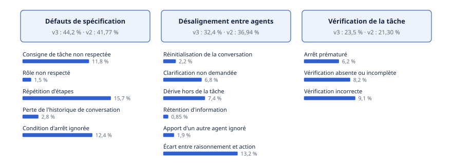

# Chapitre 21 — Fiabilité de la coordination

*Question directrice : pourquoi les systèmes multi-agents échouent-ils ?*

> **État de référence :** taxonomie MAST, version 3 du 26 octobre 2025 (1 642 traces annotées), comparée à la version 2 du 22 avril 2025, d'où viennent les parts par catégorie citées ailleurs dans le compendium; sources [9] et [10] ajoutées, et sources [7] et [8] lues en texte, le 14 novembre 2026. Les numéros entre crochets renvoient aux sources en fin de chapitre, où l'étendue de lecture de chacune est précisée.

Ajouter des agents ne rend pas un système plus fiable. Les auteurs de MAST partent de ce constat : sur les bancs d'essai courants, le gain des systèmes multi-agents sur un agent unique reste souvent minime [1]. Le chapitre 16 a établi quand la coordination paie. Celui-ci examine comment elle casse.

La thèse tient en trois propositions. Les échecs de coordination se classent, et la plupart ne viennent pas d'un agent qui raisonne mal : ils viennent de ce qu'on lui a demandé, de ce qu'il a compris des autres et de ce que personne n'a vérifié. Les remèdes publiés déplacent ces échecs plus qu'ils ne les suppriment, et leurs preuves sont minces. Enfin, la qualité de coordination n'a pas encore d'instrument de mesure fiable, et attribuer automatiquement un échec à un agent reste peu exact.

---

## 21.1 La taxonomie MAST : quatorze modes, trois catégories

### Méthode

MAST (Multi-Agent System Failure Taxonomy) vient d'une équipe de l'Université de Californie à Berkeley [1]. Elle a été construite par théorie ancrée : des experts ont codé 150 traces d'exécution tirées de cinq cadriciels jusqu'à ce que les catégories se stabilisent. L'accord final entre annotateurs est de 0,88 (kappa de Cohen). Un annotateur automatique, fondé sur le modèle o1 d'OpenAI et sur quelques exemples, a ensuite étiqueté le reste des traces; son accord avec les experts est de 0,77 [1].

La version 3 publie le jeu de données complet, MAST-Data : 1 642 traces annotées, issues de sept cadriciels (MetaGPT, ChatDev, HyperAgent, AppWorld, AG2, Magentic-One, OpenManus), sur des tâches de programmation, de mathématiques et d'agent généraliste [1]. La version 2 reposait sur environ 200 traces, issues elles aussi de sept cadriciels [2].

### Les quatorze modes

| Code | Mode d'échec | Part, v2 (%) | Part, v3 (%) |
|---|---|---|---|
| FM-1.1 | Consigne de tâche non respectée | 10,98 | 11,8 |
| FM-1.2 | Rôle non respecté | 0,5 | 1,5 |
| FM-1.3 | Répétition d'étapes | 17,14 | 15,7 |
| FM-1.4 | Perte de l'historique de conversation | 3,33 | 2,8 |
| FM-1.5 | Condition d'arrêt ignorée | 9,82 | 12,4 |
| FM-2.1 | Réinitialisation de la conversation | 2,33 | 2,2 |
| FM-2.2 | Clarification non demandée | 11,65 | 6,8 |
| FM-2.3 | Dérive hors de la tâche | 7,15 | 7,4 |
| FM-2.4 | Rétention d'information | 1,66 | 0,85 |
| FM-2.5 | Apport d'un autre agent ignoré | 0,17 | 1,9 |
| FM-2.6 | Écart entre raisonnement et action | 13,98 | 13,2 |
| FM-3.1 | Arrêt prématuré | 7,82 | 6,2 |
| FM-3.2 | Vérification absente ou incomplète | 6,82 | 8,2 |
| FM-3.3 | Vérification incorrecte | 6,66 | 9,1 |

Par catégorie, dans la version 2, les défauts de spécification pèsent 41,77 % des échecs observés, le désalignement entre agents 36,94 % et la vérification de la tâche 21,30 % [2]. La version 3 renomme la première catégorie « défauts de conception du système »; la somme des parts par mode donne 44,2 %, 32,4 % et 23,5 % [1]. L'article ne publie pas ces totaux : ce sont des sommes calculées ici.

### Ce que la répartition dit

Quatre modes concentrent plus de la moitié des échecs dans les deux versions : la répétition d'étapes, l'écart entre raisonnement et action, la consigne non respectée et la condition d'arrêt ignorée. À l'inverse, la rétention d'information, l'apport ignoré et le rôle non respecté restent chacun sous 2 %.

Les agents font rarement obstruction. Ils tournent en rond, ne savent pas quand s'arrêter et font autre chose que ce qu'ils annoncent.

### Portée

La version 3 rapporte des taux d'échec de 41 % à 86,7 % sur sept systèmes multi-agents à code ouvert [1]. Ces chiffres valent pour des cadriciels évalués sur des bancs d'essai. Ils ne décrivent pas des déploiements d'entreprise, bien qu'une prépublication les présente ainsi dans son résumé [3].

Trois réserves encadrent l'usage de la taxonomie. Ses auteurs ne la disent pas exhaustive. Ils notent que des échecs d'apparence semblable peuvent avoir des causes différentes, et relèvent des corrélations modérées entre certains modes, jusqu'à 0,63 [1]. Enfin, les parts bougent d'une version à l'autre : la clarification non demandée passe de 11,65 % à 6,8 %. Elles décrivent un échantillon de cadriciels et de tâches, non une loi. Ce qui se transpose à l'entreprise est la grille et ses ordres de grandeur.

### Hors des bancs d'essai

MAST lit des traces d'exécution. Une étude de 2026 lit ce que les développeurs signalent : 13 602 billets et demandes de tirage tirés de 40 dépôts de systèmes agentiques à code ouvert, dont 385 fautes analysées à la main [9]. Le portrait qui en sort est celui d'un logiciel ordinaire. Les causes les plus fréquentes sont les schémas de données discordants (28,0 %), la dérive des dépendances (21,9 %) et la complexité de la gestion d'état (14,1 %). Les catégories les plus proches de la coordination, soit le cycle de vie et l'état des agents (délégation, transitions, terminaison) et la coordination du système, comptent 38 et 6 des 385 fautes, soit 9,9 % et 1,6 %, parts calculées ici [9].

Les 145 praticiens consultés pour valider la taxonomie la jugent représentative : 83,8 % y reconnaissent leur expérience. Ils lui reprochent toutefois de sous-représenter la coordination multi-agents. L'un d'eux écrit que, dans ces systèmes, les plus gros problèmes viennent de la coordination entre agents plutôt que des pannes d'outils. Sont cités les messages mal interprétés entre agents, l'injection de prompt en cascade et les dépendances circulaires entre tâches [9].

Les deux lectures se complètent. Un gestionnaire de billets recense ce qui plante : une exception, une erreur de validation, un échec de compilation. Un échec de coordination ne plante pas. Il se propage sans lever d'exception [10] et ne laisse de trace que dans le résultat. Il est donc mal compté là où l'on compte les pannes, et ces parts ne mesurent pas sa fréquence réelle. Aucune des deux sources ne porte sur un déploiement d'entreprise.

---

## 21.2 Défauts de spécification

### Ce que couvre la catégorie

La première catégorie réunit les échecs qui naissent, selon les auteurs, des décisions de conception du système et de consignes pauvres ou ambiguës [2]. Ses cinq modes répondent à cinq questions que le concepteur a laissées ouvertes : que faut-il produire, qui fait quoi, qu'est-ce qui a déjà été fait, que s'est-il dit avant, et quand le travail est-il fini ?

Deux modes dominent. La répétition d'étapes et la condition d'arrêt ignorée totalisent environ 28 % des échecs de la version 3 [1]. Ce sont des défauts de contrôle du déroulement, et non de compétence : l'agent sait faire l'étape, il ignore qu'elle est faite ou que la tâche est close.

### La consigne de délégation

Le billet d'Anthropic sur son système de recherche multi-agents décrit le phénomène de l'intérieur [6]. Un agent principal qui délègue par une consigne courte obtient des sous-agents qui interprètent mal la tâche, dupliquent le travail ou laissent des trous. Dans l'exemple donné, un sous-agent étudie la crise des semi-conducteurs automobiles de 2021 pendant que deux autres refont la même recherche sur les chaînes d'approvisionnement de 2025.

Le billet en tire une règle : chaque délégation porte un objectif, un format de sortie, des indications sur les outils et les sources, et des limites de tâche claires. C'est un témoignage de fournisseur, sans mesure publiée, mais il recoupe la taxonomie.

Il ajoute que de petits changements à l'agent principal modifient de façon imprévisible le comportement des sous-agents [6]. Une spécification multi-agents ne se teste donc pas agent par agent.

### Ce que les interventions montrent

Sur ChatDev, en précisant les rôles, notamment pour que l'agent dirigeant ait le dernier mot, les auteurs de MAST obtiennent une hausse de 9,4 % du taux de réussite, à requête et à modèle inchangés [1][2].

La comparaison de deux cadriciels sur le même banc d'essai est plus instructive. MetaGPT, qui encadre ses agents par des procédures opératoires, présente de 60 % à 68 % moins d'échecs des deux premières catégories que ChatDev, mais 1,56 fois plus d'échecs de vérification [1]. Mieux spécifier réduit une classe d'échecs et en laisse paraître une autre.

Le modèle compte aussi. Dans MetaGPT, GPT-4o commet 39 % moins d'échecs de la première catégorie que Claude 3.7 Sonnet, mais les deux échouent souvent en vérification [1]. Les auteurs conjecturent néanmoins que le progrès des modèles ne suffira pas à couvrir toute la taxonomie.

### Conséquence pratique

Deux éléments d'une spécification gagnent à sortir du prompt. La condition d'arrêt et le plafond d'étapes peuvent être imposés par l'orchestrateur ou par un moteur de processus, qui compte et tranche de façon déterministe (chapitre 17). L'avancement peut résider dans un état durable que chaque agent consulte, au lieu d'un historique de conversation susceptible d'être tronqué (chapitre 18). Le contenu de la délégation relève de l'ingénierie du contexte (chapitre 13). MAST ne teste pas cette répartition.

---

## 21.3 Désalignement entre agents

### Ce que couvre la catégorie

La deuxième catégorie regroupe les ruptures d'interaction et de coordination pendant l'exécution [2]. L'écart entre raisonnement et action en est le mode le plus fréquent, à plus de 13 % des échecs dans les deux versions : l'agent expose un plan correct, puis agit autrement. Viennent ensuite la dérive hors de la tâche et la clarification non demandée, où l'agent poursuit sur une hypothèse au lieu de poser la question [1].

### Un problème que les protocoles ne règlent pas

Aucun de ces modes n'est un défaut de transport. Les messages arrivent, bien formés. C'est leur contenu qui manque, ou l'usage qu'en fait le destinataire.

Les protocoles offrent pourtant le canal. L'extension Tasks de MCP prévoit un état `input_required`, par lequel un serveur signale qu'il lui manque une information (chapitre 5). Rien n'oblige un agent à s'en servir : demander une précision est une décision du modèle, pas une propriété du protocole.

### La divergence d'intention

Une prépublication de mars 2026 nomme une forme particulière de désalignement : la divergence d'intention sémantique [3]. Des agents qui coopèrent forment des interprétations incompatibles d'un objectif commun, sans mécanisme pour s'en apercevoir. L'auteur y voit trois causes : un contexte cloisonné, l'absence de modèle du processus et une communication non structurée entre agents.

Il distingue trois types de conflit :

- l'**intention contradictoire** : un agent approuve ce qu'un autre rejette, sur le même objet;
- la **contention de ressource** : deux agents réclament le même état partagé;
- la **violation causale** : l'action de l'un invalide les préconditions de l'autre.

Le chapitre 12 traite le versant sémantique du phénomène, soit le vocabulaire partagé qui rend les intentions comparables. Ce qui importe ici est la mécanique : chaque agent agit correctement selon sa lecture, et c'est la composition des actions qui est fausse. Aucun contrôle agent par agent ne le détecte.

### La propagation

Un désalignement non détecté se propage. L'étude de Kim et coll. observe une amplification des erreurs plus forte sans point central de vérification, mais son modèle final ne retient pas cette amplification comme prédicteur significatif de la performance : les écarts s'expliquent mieux par l'efficacité et le surcoût de coordination (chapitre 16) [5]. Anthropic note que les agents gardent un état sur de nombreux appels d'outils et que les erreurs s'y composent [6]. Le billet conclut que les domaines qui exigent un contexte partagé par tous les agents, ou de nombreuses dépendances entre eux, se prêtent mal au multi-agents aujourd'hui.

---

## 21.4 Défauts de vérification

### Ce que couvre la catégorie

La troisième catégorie réunit trois modes : l'arrêt prématuré, la vérification absente ou incomplète, et la vérification incorrecte, qui a lieu mais laisse passer l'erreur [1]. Sa part est la plus faible des trois, ce qui ne dit rien de sa gravité : c'est la dernière barrière, celle qui laisse sortir le résultat erroné.

### Des vérificateurs superficiels

Le constat de MAST est ici qualitatif. Beaucoup de vérificateurs ne font que des contrôles superficiels, alors que leur consigne demande un examen complet : ils vérifient que le code compile ou qu'il ne reste pas de commentaire d'attente, non que le programme fait ce qui était demandé [1]. Les auteurs écrivent que la présence d'un vérificateur n'est pas une solution miracle. MetaGPT et ChatDev en comportent, et leurs taux de réussite restent bas.

L'article réclame une vérification à plusieurs niveaux. L'intervention correspondante, une étape de vérification de haut niveau ajoutée à ChatDev, améliore la réussite de 15,6 points sur le banc d'essai ProgramDev [1][2]. C'est le plus grand gain rapporté par les auteurs, qui précisent que les taux d'achèvement demeurent faibles après correction.

### Vérifier l'objectif, pas le format

**Vérifier par rapport à l'objectif.** Un contrôle de forme (schéma valide, code compilable, champ rempli) est nécessaire et peu coûteux. Il ne remplace pas la question de fond : le résultat répond-il à la demande ?

**Juger l'état final.** Anthropic recommande d'évaluer si l'agent a atteint le bon état final, sans exiger un chemin prescrit, surtout quand le travail modifie un état persistant [6].

**Garder des garde-fous déterministes.** Le même billet associe l'adaptabilité de l'agent à des mécanismes classiques : logique de nouvel essai et points de reprise réguliers [6]. Une vérification confiée à un modèle reste probabiliste; un test exécutable ne l'est pas.

Le chapitre 16 fait de la vérification un rôle distinct, le chapitre 18 traite la validation indépendante avant une action irréversible, et le chapitre 47 pose que l'agent qui produit du code n'en fixe pas le critère d'acceptation.

---

## 21.5 Remèdes : consensus sémantique, imputabilité architecturale

### Quatre familles

| Famille | Cible dans MAST | Preuve lue |
|---|---|---|
| Meilleures consignes et rôles | Spécification | +9,4 % sur ChatDev [1] |
| Vérification structurelle | Vérification | +15,6 points sur ChatDev [1] |
| Intergiciel de consensus sémantique | Désalignement | Simulation, un auteur, prépublication [3] |
| Imputabilité architecturale | Spécification, traçabilité | Preuve de concept à deux ou trois agents [4] |

Une cinquième voie précède les autres : ne pas multiplier les agents. Le chapitre 16 établit qu'un agent unique suffit souvent et que la coordination nuit aux tâches séquentielles couplées.

### Le consensus sémantique

Le Semantic Consensus Framework est un intergiciel à six composants [3] : une couche de contexte qui ingère les modèles de workflow de l'entreprise, un graphe d'intentions qui enregistre ce que chaque agent compte faire **avant** d'agir, un moteur qui y détecte les trois types de conflit, un protocole qui les arbitre, un moniteur de dérive et un lien vers les politiques et la piste d'audit.

L'arbitrage suit trois paliers : les règles de gouvernance et de conformité, puis l'autorité de capacité (rang du rôle, pertinence des compétences, exactitude passée), puis l'antériorité de l'intention enregistrée. Si aucun ne tranche, le conflit passe à un opérateur humain avec un rapport structuré.

Le texte impose une réserve que le résumé tait. Les 600 exécutions sont **simulées** : l'auteur précise que son banc reproduit des patrons de coordination et ne fait pas tourner AutoGen, CrewAI et LangGraph avec de vrais appels de modèle [3]. Le taux d'achèvement de 100 % est atteint aussi par la variante privée de la couche de contexte, dont l'apport n'est donc pas isolé. La détection affiche un rappel de 65,2 % et une précision de 27,9 %; l'agent juge servant de comparaison, dont les chiffres sont repris de résultats publiés, obtient 93,2 % de précision. L'auteur reconnaît ces limites, ainsi qu'un essai borné à quatre à six agents et une vérification par paires dont le coût croît comme le carré du nombre d'agents.

Deux idées restent, indépendamment des chiffres. Déclarer l'intention avant l'action rend un conflit détectable avant qu'il ne produise un effet. Et une hiérarchie d'arbitrage écrite d'avance (politique, autorité, antériorité, humain) vaut mieux qu'une négociation improvisée entre agents. L'une et l'autre se mettent en œuvre sans l'intergiciel.

### L'imputabilité comme tactique d'architecture

Becattini, Verdecchia et Vicario, de l'Université de Florence, partent d'un autre angle : dans les cadriciels courants, les relations entre agents sont codées en dur dans la logique d'orchestration, et la question « quel agent répond de quoi » se reconstitue en lisant du code et des journaux [4].

Leur tactique adapte aux agents le patron d'imputabilité de Fowler, conçu pour modéliser les responsabilités dans une organisation, et introduit quatre notions.

| Notion | Rôle |
|---|---|
| Type d'agent | Déclare les capacités, les outils permis, le modèle et ses paramètres |
| Type de relation | Fixe quels types d'agents peuvent se lier, et selon quelles règles |
| Relation entre agents | Lie un commettant (*commissioner*), qui délègue ou supervise, à un agent responsable |
| Périmètre d'exploitation (*operating scope*) | Attache à la relation un devoir mesurable, par exemple une couverture de tests d'au moins 85 % |

La couche de connaissance tient les catalogues versionnés de types et de schémas; la couche opérationnelle, le registre des agents actifs et le magasin des relations en vigueur. Établir une relation consiste à valider les types et les périmètres, à persister la relation et à émettre un événement d'audit. Le prompt de chaque agent est généré à partir de son type, de ses relations et de ses périmètres.

Le lien avec MAST est direct, bien que les auteurs ne le fassent pas. Rôle, supérieur, devoirs et seuils cessent d'être de la prose dans un prompt pour devenir des données validées, soit une réponse structurelle aux défauts de spécification. Et une relation interrogeable dit qui répondait d'un résultat au moment d'un échec.

La preuve reste modeste. L'étude de cas étend l'architecture SALLMA (chapitre 23) et ajoute un agent développeur à une équipe de deux agents. La tactique y évite toute modification du code d'orchestration, contre trois modules touchés dans la version de référence, au prix de 36 lignes de configuration [4]. Les auteurs signalent l'absence d'essai au-delà de trois agents, de mesure de performance et de second domaine, et jugent que l'infrastructure peut être superflue pour un petit système stable. Surtout, l'étude ne mesure aucun taux d'échec : elle montre que l'imputabilité se configure, pas qu'elle fiabilise.

### Ce que montre l'injection de fautes

Une autre voie consiste à provoquer l'échec. MAS-FIRE injecte quinze types de fautes, huit propres à un agent et sept entre agents, dans trois systèmes (MetaGPT, Table-Critic, Camel) animés par deux modèles, GPT-5 et DeepSeek-V3, puis observe ce qui les absorbe [10]. Les auteurs classent ces défenses en quatre étages.

| Étage | D'où vient la tolérance |
|---|---|
| Mécanisme | Structure du système : boucle de critique, vote, chemins redondants |
| Règle | Logique déterministe codée, comme la déduplication des messages |
| Prompt | Robustesse des consignes, qui tiennent les rôles dans les cas limites |
| Raisonnement | Réflexion du modèle, qui détecte une incohérence |

Trois résultats intéressent ce chapitre.

- **La confiance aveugle est la faute la plus destructrice.** Sous la faute que les auteurs nomment ainsi (*blind trust*), le score de robustesse de MetaGPT tombe à 0 % [10].
- **Un meilleur modèle ne protège pas toujours.** Sous cette même faute, Table-Critic garde 70,61 % de robustesse avec DeepSeek-V3 et 6,32 % avec GPT-5 : selon les auteurs, le modèle le plus fort suit plus fidèlement une directive corrompue. Il fait mieux, en revanche, contre l'hallucination et les plans inexécutables [10].
- **La structure compte autant que le modèle.** D'après le résumé, les architectures itératives en boucle fermée neutralisent plus de 40 % des fautes qui font s'effondrer une chaîne linéaire. Les fautes de communication (tempête, cycle ou amplification de messages) sont les moins destructrices dans MetaGPT, dont la robustesse reste au-dessus de 93 % [10].

L'étude recoupe la section 21.2 : les deux étages qui ne dépendent pas du modèle, le mécanisme et la règle, sont ceux que la conception maîtrise. Elle fournit aussi une méthode d'essai, voisine de l'ingénierie du chaos de la section 34.10, qui injecte des pannes d'outils et de protocole plutôt que des fautes entre agents. Sa portée reste étroite : trois systèmes, deux modèles, un seul essai par cas, des comportements étiquetés par un modèle juge, et des fautes de communication éprouvées sur un seul des trois systèmes [10].

---

## 21.6 Évaluer la qualité de coordination

Un taux de réussite final ne dit pas si la coordination a fonctionné. Un système peut réussir malgré une coordination coûteuse, ou échouer pour une raison étrangère aux échanges. Quatre instruments complètent ce taux.

### Classer les échecs

MAST sert de grille d'annotation. Son annotateur automatique atteint 94 % d'exactitude et un kappa de 0,77 face aux experts avec quelques exemples; sans exemple, le kappa tombe à 0,58 [1][2]. L'usage pratique est d'étiqueter un échantillon de traces à chaque version du système et de suivre le déplacement des parts par catégorie. Un correctif qui réduit les défauts de spécification en gonflant ceux de vérification devient alors visible.

### Mesurer le coût de coordination

L'étude de Kim et coll. définit des métriques propres à la coordination, calculées par rapport à un agent unique, à outils et à consignes normalisés [5].

| Métrique | Ce qu'elle mesure |
|---|---|
| Surcoût de coordination | Tours de raisonnement supplémentaires par rapport à l'agent unique |
| Densité de messages | Messages entre agents par tour de raisonnement |
| Redondance | Recouvrement du travail des agents |
| Efficacité de coordination | Réussite rapportée au nombre relatif de tours |
| Amplification des erreurs | Taux d'erreur rapporté à celui de l'agent unique, par tâche ou d'après les traces |

Le surcoût mesuré va de 58 % pour des agents indépendants à 515 % pour une architecture hybride, et le nombre moyen de tours passe de 7,2 pour l'agent unique à 44,3 pour l'architecture hybride [5]. Le texte donne deux définitions différentes de la redondance; la métrique se reprend donc avec prudence.

La comparaison à budget égal est le point de méthode essentiel. Anthropic rapporte que, sur le banc d'essai BrowseComp, la quantité de jetons consommée explique à elle seule environ 80 % de la variance de performance [6]. Un gain multi-agents mesuré sans contrôle de la dépense peut n'être qu'un effet de dépense.

### Suivre des jalons

MultiAgentBench évalue l'achèvement de la tâche et aussi la qualité de la collaboration, au moyen d'indicateurs fondés sur des jalons [8]. Anthropic conseille aussi d'évaluer, dans un workflow complexe, les points où un état précis doit changer [6]. Le principe se transpose : un processus d'affaires a des étapes intermédiaires vérifiables, et un système qui les franchit dans le désordre ou plusieurs fois se signale avant l'échec final.

Le banc invite aussi à la prudence sur les notes de coordination. Son indicateur de jalons est la part des jalons auxquels chaque agent a contribué; sa note de coordination vient d'un modèle qui cote la communication et la planification sur cinq points [8]. Les deux peuvent diverger du résultat : dans le scénario Minecraft, un modèle obtient 75,00 en coordination et 0,21 en réussite de tâche, sur les échelles du tableau des auteurs. Ceux-ci en concluent que la capacité du modèle reste le premier facteur d'achèvement. Ils observent aussi, dans leur seul scénario de recherche, que l'indicateur de jalons baisse quand le nombre d'agents passe de un à sept (essais à un, trois, cinq et sept agents), et que la discussion de groupe est la pire des stratégies de planification essayées [8]. Une note de coordination élevée ne dit donc pas que le travail est fait.

### Attribuer l'échec

Savoir quel agent a causé l'échec, et à quelle étape, est le préalable de toute correction. Sur le jeu de données Who&When, qui réunit les journaux d'échec de 127 systèmes multi-agents, la meilleure méthode désigne le bon agent dans 53,5 % des cas et la bonne étape dans 14,2 % [7]. Certaines méthodes font pire que le hasard, et même les modèles de raisonnement de pointe, comme o1 et DeepSeek R1, n'y atteignent pas un niveau utilisable.

Le texte de l'article précise l'ampleur du problème [7]. Les méthodes essayées ont chacune leur défaut. Donner tout le journal au modèle juge désigne l'agent fautif environ une fois sur deux, mais trouve l'étape moins souvent que le hasard en moyenne; avancer pas à pas trouve mieux l'étape, sans dépasser 25,5 %, valeur atteinte sur un seul sous-ensemble (systèmes générés par algorithme, vérité terrain fournie), ce qui explique qu'elle dépasse les 14,2 % du résumé. L'exactitude baisse à mesure que le journal s'allonge et, pour les plus longs (93 à 130 étapes), l'étape fautive n'est presque jamais trouvée. Combiner les deux méthodes porte l'attribution à l'agent à 57,02 %, pour près de neuf fois plus de jetons. L'annotation humaine elle-même est coûteuse et incertaine : trois experts y ont consacré environ 84 heures pour 184 cas, et ont signalé de 15 % à 30 % d'annotations incertaines [7].

La conséquence est directe. L'analyse de cause après coup ne peut pas reposer sur un juge automatique. L'attribution se prépare à la conception : relations d'imputabilité déclarées (section 21.5), traces qui relient chaque délégation à son auteur (chapitre 33).

Les humains restent donc dans l'évaluation. Anthropic décrit une pratique en trois temps : commencer tôt avec une vingtaine de requêtes, employer un juge automatique muni d'une grille de critères, et conserver des essais manuels, qui ont révélé des défauts que l'automatisation manquait [6]. Le chapitre 33 développe l'évaluation continue.

---

## 21.7 Un problème de conception organisationnelle

Les auteurs de MAST soutiennent qu'une bonne conception multi-agents exige une compréhension des organisations. Ils invoquent Perrow, pour qui des organisations composées d'individus compétents peuvent échouer de façon catastrophique, et la recherche sur les organisations à haute fiabilité, selon laquelle des principes de conception bien définis préviennent de tels échecs [1].

Leurs données appuient la lecture. Avec les mêmes modèles, deux architectures donnent deux profils d'échec différents. Les deux interventions qui améliorent ChatDev portent sur la structure, soit qui a le dernier mot et qui vérifie quoi, et non sur le modèle. La tactique d'imputabilité fait le même chemin en sens inverse : elle emprunte un patron écrit pour décrire des organisations humaines [4].

Un système multi-agents s'interroge donc comme une organisation :

- **Division du travail.** Les tâches sont-elles séparables, ou leur couplage impose-t-il un contexte commun ?
- **Autorité.** Qui tranche un désaccord, et selon quelle règle écrite ?
- **Circulation de l'information.** Que reçoit chaque agent, et que doit-il demander ?
- **Contrôle.** Qui vérifie, par rapport à quel objectif, avec quelle indépendance ?
- **Imputabilité.** Quel agent répond de quel résultat, et quel humain répond de l'agent (chapitre 39) ?

L'analogie a ses limites. Anthropic note que les agents ne sont pas encore bons pour coordonner et déléguer en temps réel [6]. Les mécanismes informels qui rattrapent une organisation humaine mal conçue leur manquent : ce qui n'est pas écrit n'a pas lieu. Les chapitres 22 et 41 traitent la place des humains dans cette organisation.

Entre entreprises, la difficulté s'accroît : nul ne conçoit l'organisation des agents d'un partenaire. La spécification, l'arbitrage et la vérification passent alors par le contrat et par le protocole (chapitres 6 et 36); le chapitre 45 traite la négociation entre entreprises et la collusion.

---

## Grille de décision

| Décision | Option par défaut | Quand s'en écarter |
|---|---|---|
| Un agent ou plusieurs | Un agent tant qu'il suffit; comparaison à budget égal | Tâche décomposable et large (chapitre 16) |
| Contenu d'une délégation | Objectif, format de sortie, limites, condition d'arrêt | Aucun cas |
| Arrêt et plafond d'étapes | Imposés par l'orchestrateur ou le moteur de processus | Exploration sans effet de bord |
| Ambiguïté | L'agent demande une précision | Tâche réversible à faible enjeu |
| Vérification | Rôle distinct, qui contrôle l'objectif | Résultat couvert par un test déterministe |
| Conflit entre agents | Hiérarchie d'arbitrage écrite, humain en dernier recours | Détection automatique seulement après mesure de sa précision |
| Imputabilité | Relations commettant-responsable déclarées, devoirs mesurables | Petit système stable de deux ou trois agents |
| Mesure de la coordination | Échantillon de traces étiqueté selon MAST, surcoût, jalons | — |
| Attribution d'un échec | Revue humaine appuyée sur les traces | Attribution automatique en aide au tri seulement |
| Essai de robustesse | Fautes de coordination injectées avant la mise en production (section 21.5; pour les pannes d'outils et de protocole, section 34.10) | Agent unique, ou tâche sans effet de bord |

---

## Points à retenir

- MAST classe les échecs multi-agents en quatorze modes et trois catégories : spécification, désalignement entre agents, vérification. Dans la version 2, leurs parts sont de 41,77 %, 36,94 % et 21,30 %.
- Dans la version 3, les modes dominants sont la répétition d'étapes, l'écart entre raisonnement et action, la consigne non respectée et la condition d'arrêt ignorée. L'obstruction entre agents est rare.
- Les taux d'échec de 41 % à 86,7 % valent pour des cadriciels à code ouvert sur bancs d'essai, non pour des déploiements d'entreprise.
- Corriger une catégorie en révèle une autre : des procédures strictes réduisent les défauts de spécification et de coordination, et laissent plus d'échecs de vérification.
- Un vérificateur ne suffit pas. Il doit contrôler l'objectif et non le seul format, et s'appuyer sur des tests déterministes là où ils existent.
- Le consensus sémantique repose sur une évaluation simulée et un détecteur peu précis. Ses idées utiles, l'intention déclarée avant l'action et la hiérarchie d'arbitrage, se mettent en œuvre sans lui.
- L'imputabilité architecturale transforme rôles, relations et devoirs en données validées. Elle est démontrée à très petite échelle, sans mesure de fiabilité.
- L'attribution automatique d'un échec à un agent reste peu exacte. Elle se prépare à la conception, par les relations déclarées et les traces.
- Hors des bancs d'essai, les fautes signalées dans les dépôts sont surtout celles d'un logiciel ordinaire. Les échecs de coordination y sont mal comptés, parce qu'ils ne lèvent pas d'exception.
- Sous faute injectée, une boucle de vérification ou une règle déterministe absorbe une partie des fautes, pas toutes : la confiance aveugle traverse aussi un système à boucle de critique. Un modèle plus fort peut suivre plus fidèlement une directive corrompue.
- Fiabiliser un système multi-agents est un travail de conception d'organisation : division du travail, autorité, information, contrôle, imputabilité.

---

## Sources

Pages primaires lues le 11 novembre 2026 :

1. [Cemri et coll. — Why Do Multi-Agent LLM Systems Fail?, version 3 (arXiv 2503.13657v3)](https://arxiv.org/html/2503.13657v3) — prépublication; résumé et premiers trois cinquièmes du texte.
2. [Cemri et coll. — même article, version 2 (arXiv 2503.13657v2)](https://arxiv.org/html/2503.13657v2) — premiers trois cinquièmes du texte.
3. [Acharya — Semantic Consensus: Process-Aware Conflict Detection and Resolution for Enterprise Multi-Agent LLM Systems (arXiv 2604.16339)](https://arxiv.org/html/2604.16339) — prépublication, un seul auteur, v1 du 13 mars 2026; résumé et texte.
4. [Becattini, Verdecchia et Vicario — An Accountability-Based Architectural Tactic for Agent Cooperation in LLM-Based Multi-Agent Systems, IEEE BigData 2025](https://robertoverdecchia.github.io/papers/BigData_2026.pdf) — lu en entier.
5. [Kim et coll. — Towards a Science of Scaling Agent Systems (arXiv 2512.08296v3)](https://arxiv.org/html/2512.08296v3) — prépublication; résumé et première moitié du texte.
6. [Anthropic — How we built our multi-agent research system, 13 juin 2025](https://www.anthropic.com/engineering/multi-agent-research-system) — billet de fournisseur.

Pages lues le 14 novembre 2026 :

7. [Zhang et coll. — Which Agent Causes Task Failures and When? (arXiv 2505.00212, version 3 du 2 juin 2025)](https://arxiv.org/html/2505.00212) — connu d'abord par son résumé; texte lu.
8. [Zhu et coll. — MultiAgentBench (arXiv 2503.01935, version 1)](https://arxiv.org/html/2503.01935) — connu d'abord par son résumé; première moitié du texte.
9. [Shah et coll. — Characterizing Faults in Agentic AI: A Taxonomy of Types, Symptoms, and Root Causes (arXiv 2603.06847, version 2 du 7 mai 2026)](https://arxiv.org/html/2603.06847v2) — prépublication; premiers deux tiers du texte.
10. [Jia et coll. — MAS-FIRE: Fault Injection and Reliability Evaluation for LLM-Based Multi-Agent Systems (arXiv 2602.19843, 23 février 2026)](https://arxiv.org/html/2602.19843) — prépublication; premiers trois quarts du texte.

Aucune source secondaire n'appuie une affirmation du chapitre.

## Limites de ce chapitre

- Les sources [1], [3], [5], [7] et [8], d'abord connues par leur seul résumé, ont été relues au-delà du résumé le 14 novembre 2026, par un outil qui en rend des extraits; les écarts relevés sont corrigés dans le texte.
- Les pages web ont été lues par un outil d'extraction qui condense le texte, sauf [4], lu directement. L'audit a relu par cet outil les parts par mode et les chiffres cités de MAST, les résumés de [3] et [7], les métriques de [5] et les passages cités de [6].
- Les totaux par catégorie de la version 3 sont des sommes calculées. Les annexes de MAST, dont l'étude de cas sur AG2 et les taux d'échec par cadriciel, donnés en figures, n'ont pas été lues. MAST décrit le gain de 9,4 % tantôt comme un ajustement du workflow, tantôt comme une précision des rôles.
- La section des limites de l'étude de Kim et coll. se trouve dans la partie non lue.
- Le lieu de publication de [4], IEEE BigData 2025, vient de la notice OpenAlex, non du document, dont le fichier se nomme « BigData_2026 ».
- La page arXiv date [3] du 13 mars 2026, malgré un identifiant (2604) qui évoque avril.
- Le rattachement de chaque remède à une catégorie de MAST, la répartition proposée en 21.2 et les cinq questions de 21.7 sont des synthèses de ce chapitre, non des résultats publiés.
- Aucune source ne porte sur un système multi-agents d'entreprise en production, y compris après la recherche du 14 novembre 2026 : [9] étudie des dépôts à code ouvert et [10] des fautes injectées en laboratoire. La transposition de leurs résultats reste une hypothèse.
- Les sources [7] à [10] ont été lues le 14 novembre 2026 par l'outil d'extraction, qui ne restitue que le début des textes longs : la fin de [8], de [9] (dont les menaces à la validité) et de [10] n'a pas été lue. Dans [9], les décomptes par catégorie restitués ne totalisent pas les 385 fautes, et les pourcentages semblent calculés sur un dénominateur plus petit; ils sont cités tels quels. Le rapprochement entre ses catégories « cycle de vie et état » et « coordination du système » et la coordination multi-agents est de ce chapitre. La définition exacte de la faute de confiance aveugle de [10] n'a pas été relevée, et le calcul du seuil de 40 % n'apparaît pas dans la partie lue.
- Les sous-sections « Hors des bancs d'essai » (21.1) et « Ce que montre l'injection de fautes » (21.5), les compléments de 21.6 et la ligne « Essai de robustesse » de la grille datent du 14 novembre 2026; cette ligne et le renvoi à l'ingénierie du chaos du chapitre 34 sont des synthèses de ce chapitre.
- Par rapport au plan initial, 21.5 ajoute deux familles de remèdes (consignes, vérification structurelle) et 21.6 l'attribution des échecs.
