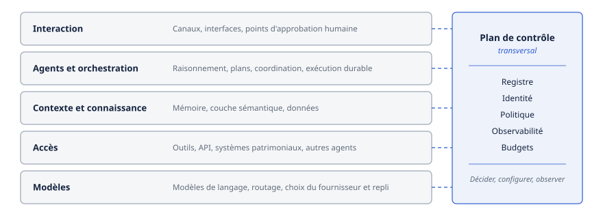

# Chapitre 23 — Architecture de référence

*Question directrice : quelles couches faut-il, et laquelle gouverne ?*

> **État de référence :** sept articles d'architecture logicielle parus de 2023 à 2026 (dont la taxonomie révisée le 9 septembre 2026), la documentation Microsoft sur le registre d'Agent 365 (mise à jour le 17 juin 2026) et le document de la Cloud Security Alliance du 22 juin 2026, dont seule la page de présentation a été lue; pour la section 23.3, huit sources sur le maillage ajoutées le 14 novembre 2026. Les numéros entre crochets renvoient aux sources en fin de chapitre; [12], [13] et [21] sont secondaires.

Les chapitres précédents ont décrit des pièces. Une architecture de référence dit comment ces pièces s'assemblent et, surtout, où se prennent les décisions qui engagent l'entreprise.

La recherche offre ici un appui réel, mais décalé. Les architectures de référence évaluées par les pairs décrivent un agent ou un système d'agents, pas un parc de centaines d'agents répartis sur plusieurs plateformes. À l'échelle de l'entreprise, les modèles viennent d'éditeurs et d'analystes, et aucun n'a fait l'objet d'une validation indépendante. Ce chapitre reprend donc ce que la recherche établit pour le système, et présente comme une synthèse ce qu'il en tire pour l'entreprise.

La thèse tient en une phrase : la couche qui gouverne n'est pas celle qui raisonne. L'autorité loge dans un plan de contrôle distinct des agents, et elle n'est effective que si un plan de données, placé sur le chemin de chaque appel, applique ses décisions.

---

## 23.1 Vue en couches

### À l'échelle de l'agent

L'architecture de référence de Lu et de ses collègues répartit les composants d'un agent en six groupes [1].

| Groupe | Contenu |
|---|---|
| Ingénierie de l'interaction | Collecte du contexte, création de buts (passive ou proactive), persona, gabarits de prompts |
| Mémoire | Court terme (fenêtre de contexte) et long terme (hors fenêtre) |
| Planification | Plans à un ou plusieurs chemins, réflexion |
| Moteur d'exécution | Exécuteur et moniteur de tâches, sélection d'outils et d'agents, registre, coopération multi-agents |
| Modules d'IA responsable | Évaluation continue du risque, enregistreur de type boîte noire, garde-fous, registre des composants (AIBOM) |
| Modèles | Modèle externe, affiné ou interne |

Elle découle d'une revue systématique (57 études, d'après la restitution lue) et a été vérifiée en y projetant deux systèmes existants, MetaGPT et HuggingGPT [1]. Cette vérification repose sur deux cas, et le périmètre est celui d'un agent : les modules d'IA responsable y sont des greffons de l'agent lui-même, et rien dans ce modèle ne gouverne de l'extérieur.

### À l'échelle de l'entreprise

Ici, il ne s'agit plus de structurer un agent, mais de faire cohabiter des agents construits par des équipes et des éditeurs différents. La vue suivante est une synthèse propre à ce chapitre, calée sur le découpage du compendium.

| Couche | Rôle | Chapitres |
|---|---|---|
| Interaction | Canaux, interfaces, points d'approbation humaine | 7, 22 |
| Agents et orchestration | Raisonnement, plans, coordination, exécution durable | 16 à 20 |
| Contexte et connaissance | Mémoire, couche sémantique, données | 12 à 15 |
| Accès | Outils, API, systèmes patrimoniaux, autres agents | 5, 6, 24, 25 |
| Modèles | Modèles de langage, routage, choix du fournisseur et repli | 40, 44, 46 |
| **Plan de contrôle** (transversal) | Registre, identité, politique, observabilité, budgets | 8, 29, 30, 33, 34, 39 |

D'autres découpages circulent. La Cloud Security Alliance annonce dix couches réparties en trois domaines : infrastructure, intelligence et connaissance; agentivité, environnement et exécution; gouvernance et imputabilité [10]. Le cabinet Futurum propose cinq couches (environnement d'exécution, autorité de connaissance, garde-fous de comportement, gouvernance, coordination) et trois fondations transversales [11].

Le nombre de couches varie du simple au double. Une seule propriété se retrouve partout : la gouvernance forme un groupe distinct de l'intelligence.

---

## 23.2 Plan de contrôle et plan de données

Le vocabulaire vient des réseaux. Un plan de contrôle décide de ce qui est permis; un plan de données traite le trafic et applique ces décisions, requête par requête. Des guides de fournisseurs reprennent ce partage pour les agents [13]. Futurum le résume en une formule : les agents décident, les plans de contrôle gouvernent, les environnements d'exécution appliquent, et les systèmes produisent la preuve. L'objectif déclaré est de séparer l'intelligence de l'agent de son autorité [11].

| | Plan de contrôle | Plan de données |
|---|---|---|
| Fonction | Décider, configurer, observer | Exécuter, appliquer |
| Composants | Registre, fournisseur d'identité, moteur de politiques, observabilité, budgets | Environnements d'exécution des agents, passerelles, serveurs d'outils, modèles |
| Rythme | À chaque changement de configuration | À chaque appel |

Deux produits illustrent chacun un côté.

Microsoft présente Agent 365 comme son plan de contrôle pour les agents, avec trois fonctions : observer, gouverner, sécuriser. Le registre d'agents, auparavant visible dans plusieurs portails, y converge, tandis qu'Entra conserve l'identité des agents et les politiques d'accès [8]. Le plan de contrôle n'est donc pas un produit unique, même chez un seul éditeur : l'inventaire et l'identité vivent dans deux consoles, administrées par deux rôles.

Du côté des données, agentgateway, projet hébergé par l'Agentic AI Foundation, se décrit comme un plan de données unifié pour le trafic HTTP, gRPC, MCP, A2A et l'inférence. Il applique l'authentification par JWT, le contrôle d'accès par rôle, des limites de débit, des filtres de prompts et des plafonds budgétaires, et reçoit sa configuration à chaud [9]. Le chapitre 24 compare les passerelles.

### Trois conditions pour gouverner

Un plan de contrôle peut exister sur papier sans rien gouverner. Trois conditions, déduites des sources, séparent les deux cas.

1. **Un chemin obligé.** Une politique ne vaut que si l'appel ne peut pas la contourner. Futurum le dit de sa couche d'exécution : sans elle, les contrôles situés au-dessus sont consultatifs [11].
2. **Un registre qui fait autorité.** Le plan de données ne peut appliquer une règle qu'à un agent ou à un outil qu'il sait nommer. Ce qui n'est pas inscrit ne devrait pas être joignable.
3. **Une preuve.** Chaque décision appliquée laisse une trace reliée à une identité et à une politique, sans quoi la gouvernance ne se démontre pas (chapitres 32 et 33).

La révision sans état de MCP sert la première condition : en recopiant la méthode et le nom de l'outil dans des en-têtes HTTP, elle laisse une passerelle appliquer une règle sans analyser le corps de la requête, à condition que le serveur rejette toute requête dont les en-têtes contredisent le corps (chapitre 5). Quant aux règles que les protocoles ne savent pas exprimer, soit qui décide, qui est consulté et quand un humain tranche, c'est dans le plan de contrôle qu'elles se logent (chapitre 11). Le chapitre 47 applique le même partage au développement : l'agent qui produit ne définit pas le critère d'acceptation et ne publie pas.

---

## 23.3 Le maillage agentique

### Un terme, plusieurs objets

L'expression « maillage agentique » (*agentic AI mesh*) a été popularisée par un rapport de McKinsey de juin 2025, qui n'a pas pu être lu pour ce chapitre. D'après les commentaires qui le résument, il repose sur cinq principes : composabilité, intelligence distribuée, découplage en couches, neutralité envers les fournisseurs et autonomie gouvernée [12]. Aucune des références évaluées par les pairs lues ici ne valide ce modèle.

Depuis, des éditeurs ont repris le mot, sous les formes *agent mesh* et *agentic mesh*, pour désigner des objets différents. Trois ont été lus pour cette section.

| Acception | Ce que le maillage désigne | Mécanisme central | Exemple lu |
|---|---|---|---|
| Réseau | Des contrôles sortis du code des agents et appliqués par l'infrastructure à chaque interaction | Maillage de services (identité de charge de travail, TLS mutuel) et passerelle agentique sur le chemin | Solo.io [15][16] |
| Dorsale événementielle | Une plateforme de développement et d'exécution d'agents coordonnés par un courtier d'événements | Messages A2A publiés sur les sujets du courtier | Solace Agent Mesh [14] |
| Couche de confiance | L'identité des agents et la confiance entre eux, portées par une bibliothèque | Identifiant décentralisé, score de confiance, délégation à portée décroissante | AgentMesh de Microsoft [18] |

**Le réseau.** Solo.io a introduit son *Agent Mesh* le 24 avril 2025, en même temps qu'une passerelle, Agent Gateway, et lui assigne la sécurité, l'observabilité, la découverte et la gouvernance de toutes les interactions d'agents [16]. Sa documentation le définit comme une architecture pour exploiter des agents de façon sûre à grande échelle. L'identité de chaque charge de travail y est délivrée par l'infrastructure (SPIFFE et TLS mutuel), non déclarée par le code. La passerelle, agentgateway dans cette documentation (section 23.2), se place en entrée, en point de passage (*waypoint*) ou en sortie. Elle autorise un appel d'outil MCP selon l'identité de l'agent appelant et le nom de l'outil, plafonne les jetons par identité et rejette l'appel non autorisé [15].

**La dorsale événementielle.** Solace présente Agent Mesh comme une plateforme de développement et d'exécution d'agents, qui coordonne tout sur un maillage d'événements. Tout message entre processus passe par le courtier : les agents publient et s'abonnent à des sujets, le courtier décide qui reçoit quoi, et le format des messages est celui d'A2A. Seul le point d'entrée est exposé à l'extérieur; il authentifie l'utilisateur et décide, avant toute publication, quels agents et quels outils la demande peut atteindre. Un service de plateforme gère les agents, les déploiements et l'audit sans figurer sur le chemin des requêtes [14]. On y reconnaît le partage de la section 23.2; le chemin obligé y est un courtier, non une passerelle (chapitre 19).

**La couche de confiance.** AgentMesh, paquet de l'Agent Governance Toolkit de Microsoft (chapitre 24), se décrit comme la couche de confiance, d'identité et de gouvernance des systèmes d'agents. Chaque agent reçoit un identifiant décentralisé, une paire de clés et un parrain humain nommé; un score de confiance de 0 à 1 000 conditionne la poignée de main entre pairs; un sous-agent ne reçoit qu'une partie des capacités de son parent. La même page énumère ce qui manque : le plan de contrôle du maillage est un répertoire réservé, sans mise en œuvre; la vérification des chaînes de délégation est simulée; l'intégration à SPIRE est une ébauche; les cibles de latence n'ont pas été mesurées [18].

Une quatrième acception, celle du rapport de McKinsey, ne désigne aucun mécanisme : c'est un modèle d'ensemble. Un billet publié par l'IEEE Computer Society en donne une variante en six couches : environnement d'exécution, identité et gouvernance, tissu de communication, abstraction des modèles, observabilité et sûreté, intégration aux systèmes de l'entreprise [19]. C'est un texte d'opinion, sans résultat empirique, dont l'auteur travaille chez un fournisseur infonuagique.

### Ce que le chapitre en retient

Ramené à ses éléments, le maillage désigne trois choses déjà décrites : un registre pour se trouver, des protocoles standards pour se parler (MCP et A2A, chapitres 5 et 6) et un plan de données commun par lequel passe le trafic. C'est une propriété d'infrastructure, calquée sur le maillage de services des architectures de microservices.

Les pages lues y ajoutent une idée commune : l'identité et la politique sont fournies à l'agent de l'extérieur, au lieu d'être déclarées par lui [15][18]. C'est la notion d'« infrastructure d'agents » de Chan et de ses collègues, seul appui évalué par les pairs trouvé pour cette section : des systèmes et des protocoles partagés, extérieurs aux agents, qui servent à attribuer leurs actions, à encadrer leurs interactions, puis à détecter et à corriger les actions nuisibles [20]. Le résumé de l'article n'emploie pas le mot « maillage », et il annonce un catalogue de pistes de recherche, non une évaluation.

### Ce que le maillage de services ne donne pas

L'analogie a ses limites, et un éditeur qui la porte les formule lui-même [17].

- **Trois identités au lieu d'une.** Un maillage de services authentifie une charge de travail. Une action d'agent en engage trois : l'utilisateur humain, l'agent qui agit pour lui et la délégation qui les lie. Les fondre dans un seul compte de service empêche de dire qui agit [17] (chapitres 29 et 30).
- **Une politique qui lit le protocole.** Autoriser par nom d'outil ou plafonner en jetons suppose de comprendre MCP et les appels aux modèles. D'où le remplacement, pour ce trafic, du mandataire par défaut du maillage par une passerelle agentique [15][17] (chapitre 24).
- **Des chemins imprévisibles.** Un microservice suit le même chemin à chaque appel; un agent peut appeler un outil que personne n'avait prévu. Les frontières de confiance doivent donc être plus fines qu'un périmètre [17].

Le même billet en tire une conclusion d'éditeur : garder le maillage de services comme socle et y ajouter ces contrôles au même point d'application, sans second modèle de confiance [17].

### Trois confusions à éviter

**Le maillage n'est pas une topologie de coordination.** Il dit qui *peut* joindre qui; l'orchestration dit qui *appelle* qui, et dans quel ordre (chapitre 16). La taxonomie de Zhou et de ses collègues indique ce qu'il en coûte de confondre les deux. Dans une configuration à forte autonomie, une coordination entièrement distribuée améliore la fiabilité, puisqu'elle supprime le point de défaillance unique, mais dégrade la performance et la maintenabilité, et complique l'IA responsable [3]. Le maillage rend les agents joignables; la conception décide lesquels se parlent, et les modes d'échec du chapitre 21 rappellent pourquoi.

**Le maillage n'est pas un produit interchangeable.** Les trois acceptions ne se substituent pas l'une à l'autre. La première suppose un maillage de services déjà en place. La deuxième fait du courtier d'événements le transport de tous les échanges, ce qui est une décision d'architecture (chapitre 19). La troisième est une bibliothèque, que sa page présente aussi comme un mandataire de gouvernance, et dont le plan de contrôle reste à écrire [18]. Avant de retenir « un maillage », il faut nommer la fonction recherchée : appliquer une politique sur le chemin, transporter les échanges ou établir la confiance entre agents.

**Le maillage s'arrête à la frontière de l'entreprise.** Entre organisations, aucun plan de contrôle n'est commun : dans un espace de données, chaque partie garde le sien, qui négocie avec celui de l'autre, et le transfert passe par un plan de données distinct (chapitre 45). La topologie suit alors les frontières d'autorité (chapitre 16).

### Niveau de preuve

Aucune des pages lues ne rapporte de mesure sur un déploiement. Ce sont des documentations et des billets d'éditeurs, de [14] à [18], et un texte d'opinion [19]. Le seul article paru dans une revue qui nomme un « maillage agentique d'entreprise », revue dont l'évaluation par les pairs n'a pas été vérifiée, est une proposition, connue ici par son seul résumé : un plan de contrôle sémantique qui route selon l'intention, un mandataire de gouvernance accolé à chaque agent (*sidecar*) et un registre distribué pour l'observabilité [21]. Le terme reste un vocabulaire d'éditeurs et de cabinets. Ce chapitre le retient pour la propriété qu'il nomme, non comme un modèle validé.

---

## 23.4 Registres d'agents et de données, planificateurs

L'architecture proposée par Megagon Labs pour les systèmes d'IA composés en entreprise est la référence la plus explicite sur ce point [6]. Elle s'organise autour de deux registres et de trois composants de planification.

| Composant | Rôle |
|---|---|
| Registre d'agents | Métadonnées des agents : description, entrées, sorties, spécifications. Les API, outils et modèles existants s'y inscrivent comme agents |
| Registre de données | Métadonnées des données de l'entreprise, à plusieurs granularités, pour les lacs et les entrepôts |
| Planificateur de tâches | Traduit une demande en plan, sous forme de graphe acyclique, à partir du registre d'agents |
| Coordonnateur de tâches | Exécute le graphe, transmet les sorties, intervient si une contrainte est violée et peut demander un nouveau plan |
| Planificateur de données | Décompose une demande d'accès aux données en sous-tâches, à partir du registre de données |

Les échanges passent par des flux (*streams*) de messages étiquetés, dans le périmètre d'une session. L'article est une proposition : il ne rapporte ni mise en œuvre, ni expérience, ni mesure [6].

Le registre figure aussi parmi les 18 patrons du catalogue de Liu et de ses collègues, qui en donne la contrepartie : centralisation, risque de point de défaillance unique et charge de maintenance [2]. L'architecture de Lu y ajoute deux registres de gouvernance, l'un pour la provenance des composants externes (AIBOM), l'autre pour le versionnage conjoint des modèles et de leurs variantes affinées [1].

Trois enseignements valent pour l'entreprise.

**Le planificateur ne choisit que dans le registre.** Dans le modèle de Megagon, le plan se construit à partir des métadonnées inscrites [6]. Le registre borne donc ce qu'un agent peut envisager de faire. C'est le lien concret entre plan de contrôle et raisonnement.

**Le registre déborde l'annuaire d'identité.** Chez Microsoft, l'inventaire complet d'Agent 365 comprend des agents d'autres éditeurs et des agents dépourvus d'identité Entra, que le portail d'identité ne montre pas [8]. Inventorier et authentifier sont deux fonctions; la première révèle les trous de la seconde.

**Les données méritent leur registre.** Un agent qui ne sait pas où se trouve une donnée la cherchera par essais (chapitre 15).

Le chapitre 8 compare les mécanismes de découverte, et le chapitre 39 traite l'inventaire comme outil de gouvernance.

---

## 23.5 Couche opérationnelle et couche de connaissance

SALLMA, architecture proposée par l'Université de Florence, découpe un système multi-agents en deux couches [7].

La **couche opérationnelle** traite les demandes en temps réel : un agent analyse l'intention, un autre décompose le workflow et l'attribue à des agents spécialisés, un gestionnaire de routage trouve ou fait déployer une instance du workflow, et un gestionnaire de workflow cognitif exécute la chaîne, avec accès aux outils et aux bases.

La **couche de connaissance** ne contient pas le savoir de l'entreprise, malgré son nom. Elle tient trois catalogues : les métamodèles de workflows, les configurations des agents (hyperparamètres, ressources, spécifications) et les modèles de déploiement selon l'environnement, infonuagique ou périphérie.

Les auteurs y voient une application du patron Reflection de Fowler : le système se décrit lui-même sous forme de données, que la couche opérationnelle lit pour se configurer [7]. La preuve est mince. Le prototype repose sur Docker, Kubernetes et LangChain; l'évaluation s'est limitée à deux workflows internes, et les auteurs qualifient leurs observations d'anecdotiques. L'architecture suppose en outre un réseau fiable et des environnements déjà sécurisés.

L'idée dépasse pourtant le prototype. Un agent décrit par des données, et non par du code ou par la prose d'un prompt, peut être validé, versionné et audité avant son exécution. La tactique d'imputabilité du chapitre 21 prolonge ce principe. La couche de connaissance de SALLMA est donc un embryon de plan de contrôle; elle ne se confond pas avec la couche sémantique du chapitre 12.

---

## 23.6 Exigences de qualité de service : coût, précision, latence

Un système d'agents arbitre en continu entre trois grandeurs : ce que coûte une réponse, sa justesse et le temps qu'elle prend. Les sources les nomment toutes, mais aucune ne dit comment les exprimer.

L'architecture de Megagon nomme la précision et la latence parmi les contraintes de production, et vise un fonctionnement économique, sans donner de forme à ces exigences. Seul le coordonnateur les fait respecter : il surveille les délais et les résultats de faible qualité, et déclenche un nouveau plan [6]. La taxonomie de Zhou range la précision et l'efficience (latence, coût de calcul, mise à l'échelle) sous une même qualité, la performance [3], ce qui masque l'arbitrage au lieu de l'exposer. Les experts consultés pour valider son modèle de décision ont d'ailleurs suggéré d'y ajouter une dimension de coût [3].

Le cas le plus instructif est celui de Luna, un assistant fiscal australien dont l'architecture a été évaluée avec la méthode AgentArcEval [4]. Chaque décision y échange une grandeur contre une autre.

| Décision | Gain | Prix |
|---|---|---|
| Ajouter un réordonnanceur (*reranker*) | Précision | Latence et jetons |
| Indexer les décisions fiscales chaque semaine plutôt que chaque jour | Coût | Fraîcheur, donc précision |
| Renoncer à la génération de prompts multiples | Coût | Précision potentielle |
| Reprendre la réponse d'une demande semblable déjà traitée | Latence et coût | Risque de réponse périmée |

L'entreprise doit en tirer une règle que les articles n'énoncent pas : la qualité de service se déclare par classe de tâche, sous forme de budgets explicites en coût, en délai et en seuil de qualité. Le plan de contrôle fixe ces budgets, et le plan de données les fait respecter; les plafonds budgétaires d'agentgateway en sont un exemple [9]. Un quota de jetons tenu à la passerelle se constate après coup et cède sous la concurrence : il faut aussi un plafond par exécution (chapitre 40). Ces budgets se prolongent dans les topologies (chapitre 16), les objectifs de niveau de service (chapitre 34), la discipline financière (chapitre 40) et le routage entre modèles par classe de tâche (chapitre 44).

---

## 23.7 Patrons d'architecture et modèle de décision

### Un catalogue de 18 patrons

Le catalogue de Liu et de ses collègues, tiré de la même revue systématique, décrit chaque patron par son contexte, ses forces et ses compromis [2].

| Famille | Patrons |
|---|---|
| Création du but | Créateur de but passif; créateur proactif |
| Prompts et connaissance | Optimiseur de prompts et de réponses; génération augmentée par récupération |
| Génération du plan | Interrogation en une fois ou incrémentale; plan à un chemin ou à plusieurs |
| Réflexion | Autoréflexion; réflexion croisée; réflexion humaine |
| Coopération | Par vote; par rôles; par débat |
| Sûreté et intégration | Garde-fous multimodaux; registre d'outils et d'agents; adaptateur; évaluateur d'agent |

Le catalogue vise la poursuite de buts et la génération de plans. Il écarte expressément les agents qui agissent au nom d'une autre entité, qui exigeraient une analyse de gouvernance [2]. C'est précisément le cas de l'entreprise.

### Une taxonomie et une matrice de décision

La taxonomie de Zhou et de ses collègues repose sur 66 études, dont 14 prépublications, et recense 74 options d'architecture [3]. Elle les classe selon les capacités fonctionnelles (contexte, planification, mémoire, action, réflexion, apprentissage, accès aux modèles) et les qualités non fonctionnelles, inspirées d'ISO/IEC 25010. Son modèle de décision est une matrice qui relie chaque option à son effet sur chaque qualité.

| Option | Améliore | Dégrade |
|---|---|---|
| Plan à plusieurs chemins | Robustesse; utilisabilité en contexte changeant | Maintenabilité, dont la testabilité |
| Mémoire en langage naturel | Explicabilité, utilisabilité | Performance |
| Mémoire par plongements | Performance | Explicabilité, utilisabilité |
| Coordination entièrement distribuée | Fiabilité | Performance, maintenabilité |

L'article illustre la matrice par un agent d'audit. La fiabilité et la traçabilité y priment, et la latence compte peu puisque le travail se fait par lots. Le choix se porte sur un plan à chemin unique avec autovérification, sur une coordination fédérée et sur une mémoire à long terme [3].

Douze experts, six universitaires et six praticiens, ont donné au modèle une note d'utilité moyenne de 4,58 sur 5. Les auteurs en fixent eux-mêmes la portée : les cotes indiquent un sens probable, pas une ampleur, et chaque case n'a pas été validée [3]. La matrice structure une discussion d'architecture; elle ne la tranche pas.

---

## 23.8 Évaluer une architecture d'agents

Les méthodes classiques d'évaluation, dont ATAM, supposent une structure stable, des exigences connues d'avance et un examen ponctuel. Lu et ses collègues relèvent que les agents défont ces hypothèses [4]. Un agent décompose son but à l'exécution, si bien que l'architecture effective change d'une requête à l'autre. Ses garde-fous deviennent le principal point de contrôle architectural. Et il évolue (modèles, workflows, choix d'outils), de sorte qu'un risque évalué hier a pu changer. ATAM, enfin, ne compte pas explicitement le coût.

AgentArcEval, dérivée d'ATAM, commence par quatre étapes préparatoires : comprendre les buts de l'agent, recenser les besoins de gouvernance, dégager les exigences de qualité et de garde-fous, examiner l'architecture. L'évaluation se scinde ensuite en deux volets [4] :

- **à la conception** : définir des scénarios, les prioriser, analyser risques et compromis, recommander des améliorations;
- **à l'exécution** : surveiller, réévaluer les risques, mettre à jour les scénarios, ce qui relance l'analyse.

Un catalogue fournit un scénario général pour chacun de onze attributs : précision, adaptabilité, efficience, vie privée, sécurité, équité, disponibilité, observabilité, transparence, sûreté et contestabilité.

Appliquée à Luna, la méthode a notamment révélé que le composant de désensibilisation ne couvrait que le prompt de l'utilisateur; l'équipe a étendu les garde-fous à tous les composants [4]. Ce constat rejoint l'architecture de garde-fous multicouches de Shamsujjoha et de ses collègues, bâtie sur 32 études. Aucune barrière n'étant étanche, il en faut plusieurs dont les failles ne s'alignent pas, réparties selon trois axes : les qualités visées, les étapes du traitement (prompts, résultats intermédiaires, résultats finaux) et les artefacts (buts, plans, mémoire, outils, autres agents, modèles) [5].

La preuve reste limitée. AgentArcEval s'appuie sur une seule étude de cas, qualitative, dont deux auteurs sont affiliés à l'éditeur du produit évalué, sans déclaration de conflit d'intérêts; les mesures citées sont des cibles, non des résultats [4]. Les auteurs des garde-fous multicouches placent quant à eux la validation opérationnelle hors du périmètre de leur article [5]. Le chapitre 32 traite de l'assurance.

---

## 23.9 Antipatrons

Les antipatrons qui suivent sont une synthèse de ce chapitre, chacun rattaché à la source qui le suggère.

| Antipatron | Symptôme | Correctif |
|---|---|---|
| Plan de contrôle consultatif | Des politiques écrites, mais des appels qui les contournent [11] | Chemin obligé par le plan de données |
| Registre-vitrine | Un inventaire que rien ne relie à l'exécution; des agents sans identité [8] | Inscription préalable à tout routage |
| Garde-fou d'une seule tranche | Un filtre sur le prompt d'entrée, rien ailleurs [4][5] | Barrières réparties sur les étapes et les artefacts |
| Agent pris pour l'entreprise | Une architecture d'agent recopiée à l'échelle du parc [1] | Vue à deux étages (23.1) |
| Maillage sans topologie | Tout agent peut appeler tout agent, et le fait [3] | Coordination conçue, connectivité bornée par politique |
| Qualité de service implicite | Coût et latence découverts sur la facture [6] | Budgets déclarés par classe de tâche |
| Agent décrit en prose | Rôles et limites enfouis dans des prompts [7] | Configuration déclarative, versionnée |
| Évaluation unique | Une revue d'architecture avant la mise en production, jamais reprise [4] | Réévaluation continue |

Un dernier antipatron tient au marché plutôt qu'à la conception : multiplier les plans de contrôle, un par plateforme, jusqu'à ce qu'aucun ne voie l'ensemble. Le chapitre 27 traite cette fédération.

---

## Grille de décision

| Décision | Option par défaut | Quand s'en écarter |
|---|---|---|
| Où placer l'autorité | Plan de contrôle distinct des agents | Agent unique, sans effet de bord : garde-fous internes |
| Application des politiques | Passerelle sur le chemin de chaque appel d'outil, d'agent et de modèle | Outil local sans donnée sensible |
| Registre | Unique, et condition du routage | Plusieurs plateformes imposées : registres fédérés (chapitre 27) |
| Maillage | Assembler le registre, les protocoles et la passerelle déjà retenus | Produit de maillage si son socle (maillage de services, courtier d'événements) est déjà la norme de l'entreprise |
| Inventaire et identité | Deux fonctions rapprochées régulièrement | — |
| Description des agents | Déclarative, versionnée, validée avant exécution | Prototype |
| Coordination | Centralisée ou fédérée | Distribuée si la résilience prime et que le coût de maintenance est accepté |
| Planification | Plan à chemin unique pour les processus audités | Plusieurs chemins en environnement changeant, avec tests renforcés |
| Mémoire | Langage naturel si l'explicabilité prime | Plongements si la performance prime |
| Qualité de service | Budgets de coût, de délai et de qualité par classe de tâche | — |
| Garde-fous | Plusieurs barrières, sur plusieurs étapes et artefacts | — |
| Évaluation d'architecture | Par scénarios, répétée à l'exécution | Système gelé à faible risque : revue initiale |
| Modèle de référence | La vue à deux étages de ce chapitre, comme point de départ | Cadre imposé par un éditeur ou un régulateur |

---

## Points à retenir

- Les architectures de référence évaluées par les pairs décrivent un agent ou un système. À l'échelle de l'entreprise, les modèles viennent d'éditeurs et d'analystes et ne sont pas validés.
- Le nombre de couches varie selon les sources. La séparation entre l'intelligence et la gouvernance est la seule constante.
- La couche qui gouverne est le plan de contrôle : registre, identité, politique, observabilité, budgets.
- Ce plan ne gouverne qu'à trois conditions : un chemin obligé dans le plan de données, un registre qui fait autorité et une preuve de chaque décision.
- Le maillage agentique est une propriété d'infrastructure, pas une topologie. Rendre les agents joignables ne dispense pas de concevoir leur coordination. Chez les éditeurs, le mot recouvre trois objets distincts (réseau, dorsale événementielle, couche de confiance), et aucune source lue ne rapporte de mesure.
- Un registre d'agents borne ce qu'un planificateur peut envisager; un registre de données lui évite de chercher à l'aveugle.
- Décrire les agents par des données plutôt que par du code ou des prompts les rend validables et auditables.
- Coût, précision et latence s'échangent à chaque décision d'architecture. Les sources les nomment sans les formaliser : c'est à l'entreprise d'en faire des budgets.
- Une architecture d'agents s'évalue par scénarios et se réévalue à l'exécution, puisque le système change après son déploiement.

---

## Sources

Pages primaires lues le 11 novembre 2026 :

1. [Lu et coll. — Towards Responsible Generative AI: A Reference Architecture for Designing Foundation Model based Agents (arXiv 2311.13148)](https://arxiv.org/html/2311.13148v3)
2. [Liu et coll. — Agent Design Pattern Catalogue (arXiv 2405.10467)](https://arxiv.org/html/2405.10467v4) — sections 1 à 4 lues.
3. [Zhou et coll. — A Taxonomy of Architecture Options for Foundation Model-based Agents: Analysis and Decision Model (arXiv 2408.02920, v2 du 9 septembre 2026)](https://arxiv.org/html/2408.02920v2) — v2 annotée « Accepted », sans lieu de parution; relue à l'audit, sauf l'annexe.
4. [Lu et coll. — AgentArcEval: An Architecture Evaluation Method for Foundation Model based Agents (arXiv 2510.21031)](https://arxiv.org/html/2510.21031v1)
5. [Shamsujjoha et coll. — Swiss Cheese Model for AI Safety: multi-layered guardrails (arXiv 2408.02205)](https://arxiv.org/html/2408.02205)
6. [Kandogan et coll. — A Blueprint Architecture of Compound AI Systems for Enterprise (arXiv 2406.00584, Compound AI Systems Workshop, Data+AI Summit 2024)](https://arxiv.org/html/2406.00584)
7. [Becattini, Verdecchia et Vicario — SALLMA: A Software Architecture for LLM-Based Multi-Agent Systems (SATrends 2025)](https://robertoverdecchia.github.io/papers/SATrends_2025.pdf)
8. [Microsoft Learn — Agent Registry convergence with Microsoft Agent 365](https://learn.microsoft.com/en-us/entra/agent-id/agent-registry-convergence)
9. [agentgateway — entrée à l'Agentic AI Foundation](https://agentgateway.dev/blog/2026-06-04-agentgateway-joins-aaif/)
10. [Cloud Security Alliance — AI Agents: Architecture and Control Plane (22 juin 2026)](https://cloudsecurityalliance.org/artifacts/ai-agents-architecture-and-control-plane) — page de présentation seulement.
11. [Futurum — Agent Control Plane Framework (3 avril 2026)](https://futurumgroup.com/press-release/futurum-agent-control-plane-framework-a-reference-model-for-production-ai-agents/) — communiqué; rapport complet réservé aux abonnés.

Sources secondaires :

12. [McKinsey — Seizing the agentic AI advantage (juin 2025)](https://www.mckinsey.com/capabilities/quantumblack/our-insights/seizing-the-agentic-ai-advantage) — page non chargée; principes repris de résumés de recherche.
13. [Gravitee — Blueprinting an AI Agent Control Plane](https://gravitee.io/corpus/gen-1223/electric-on-the-eel/blueprinting-an-ai-agent-control-plane-reference-architecture-data-flows-and-trust-boundaries.html) — page introuvable au 13 novembre 2026 (erreur 404), connue par un résumé de recherche seulement; billet de fournisseur qui reprend le partage « décider / appliquer ».

Pages lues le 14 novembre 2026, pour la section 23.3 :

14. [Solace — Solace Agent Mesh](https://docs.solace.com/Agent-Mesh/agent-mesh.htm) et [Architecture Overview](https://docs.solace.com/Agent-Mesh/Framework/concepts/architecture.htm) — documentation de l'éditeur.
15. [Solo.io — About agentic mesh (Solo Enterprise for Istio 1.31.x)](https://docs.solo.io/istio/1.31.x/agentic-mesh/about/) — documentation de l'éditeur.
16. [Solo.io — Solo.io Launches Agent Gateway and Introduces Agent Mesh (24 avril 2025)](https://solo.io/press-releases/solo-io-launches-agent-gateway-and-introduces-agent-mesh) — communiqué.
17. [Vennam — From service mesh to agentic mesh, Solo.io (13 mai 2026)](https://www.solo.io/blog/from-service-mesh-to-agentic-mesh) — billet de l'éditeur.
18. [Microsoft, Agent Governance Toolkit — AgentMesh](https://microsoft.github.io/agent-governance-toolkit/packages/agent-mesh/) — page du paquet; prise en charge des protocoles cotée « alpha ».
19. [Talukdar — AI Agentic Mesh – A Foundational Architecture for Enterprise Autonomy, IEEE Computer Society, Tech News (3 novembre 2025)](https://www.computer.org/publications/tech-news/trends/ai-agentic-mesh) — billet d'opinion, non évalué par les pairs.
20. [Chan et coll. — Infrastructure for AI Agents (arXiv 2501.10114, v3 du 19 juin 2025; accepté à TMLR)](https://arxiv.org/abs/2501.10114) — résumé seulement.

Source secondaire, pour la même section :

21. Debnath — The Enterprise Agentic Mesh: Architectural Convergence of Semantic Control Planes and Autonomous Multi-Agent Governance, International Journal of Scientific and Research Publications, 2025 — page de la revue non retrouvée; résumé repris d'un index d'articles.

## Limites de ce chapitre

- La source [20], d'abord connue par son seul résumé, a été relue au-delà du résumé le 14 novembre 2026, par un outil qui en rend des extraits; les écarts relevés sont corrigés dans le texte.
- Les pages web ont été lues au moyen d'un outil d'extraction qui en restitue le contenu en le résumant; seul le texte de SALLMA [7] a été lu intégralement.
- Relus à l'audit du 12 novembre 2026 : [3] et [4] (chiffres, cas d'étude, affiliations, réserves des auteurs), [8], [10], [11] et les résumés de [1], [2] et [6]. L'audit a corrigé la structure d'AgentArcEval et deux cotes de la matrice de [3].
- Restent non vérifiés : les 57 études de [1] et [2], absentes de leurs résumés; les 32 études de [5]; la mention de MetaGPT et HuggingGPT dans [1]; l'exclusion, par [2], des agents qui agissent au nom d'autrui; les registres de gouvernance de [1].
- Les lieux de publication donnés par le plan initial (ICSA-C pour [1], Journal of Systems and Software pour [3], ICSA 2025 pour [5]) ne figurent pas sur les pages lues. L'affiliation de [6] à Megagon Labs n'y figure pas non plus; elle est reprise des chapitres 1 et 15, qui citent une version de 2025 de la même architecture (arXiv 2504.08148), non lue ici.
- Du catalogue de patrons [2], la section sur le modèle de décision n'a pas été lue; de la taxonomie [3], la matrice complète en annexe non plus. Les cotes rapportées sont celles que le texte commente, parfois pour une configuration d'ensemble plutôt que pour une option isolée.
- Le document complet de la CSA [10] et le rapport de Futurum [11] n'ont pas été lus : les couches sont nommées d'après une page de présentation et un communiqué, relus à l'audit. Le cadre de Futurum émane d'un cabinet qui vend ses services aux éditeurs et n'a pas été validé sur des déploiements.
- Le rapport de McKinsey sur le maillage agentique [12] n'a toujours pas été lu : sa page n'a pas pu être chargée le 14 novembre 2026, date à laquelle la section 23.3 a été étendue à partir de [14] à [21]. Ce sont des pages d'éditeurs et un billet d'opinion, lus par le même outil d'extraction; [20] n'est connu que par son résumé, et [21] par le résumé qu'en donne un index d'articles, sans que la qualité de la revue ait été évaluée. La recherche de littérature évaluée par les pairs s'est limitée à une requête dans cet index et à deux recherches web : elle n'a rien trouvé qui valide le maillage à l'échelle de l'entreprise.
- Le relevé des acceptions n'est pas exhaustif. Trois éditeurs ont été lus; d'autres emploient le terme, et ni la documentation d'Istio ni celle de kagent n'ont été lues. Les pages de Solace ne décrivent pas la découverte entre agents. La continuité entre l'Agent Gateway du communiqué [16] et l'agentgateway de [9] et de [15] est déduite du nom, non lue.
- La définition du plan de contrôle et du plan de données, de même que l'analogie avec le maillage de services, relèvent de la connaissance générale en réseautique. [13] n'est cité qu'à titre d'indice.
- La vue en couches d'entreprise (23.1), les trois conditions (23.2), le classement des acceptions du maillage et la liste de ses écarts avec le maillage de services (23.3), la règle des budgets (23.6) et les antipatrons (23.9) sont des synthèses de ce chapitre, non des résultats de recherche.
- La documentation d'agentgateway n'a pas été lue pour ce chapitre, seulement son billet d'annonce; le chapitre 24 en décrit davantage.
- Les renvois aux chapitres 40, 44, 45, 46 et 47 reprennent leurs points à retenir ou la section visée, sans relecture de leurs sources.
