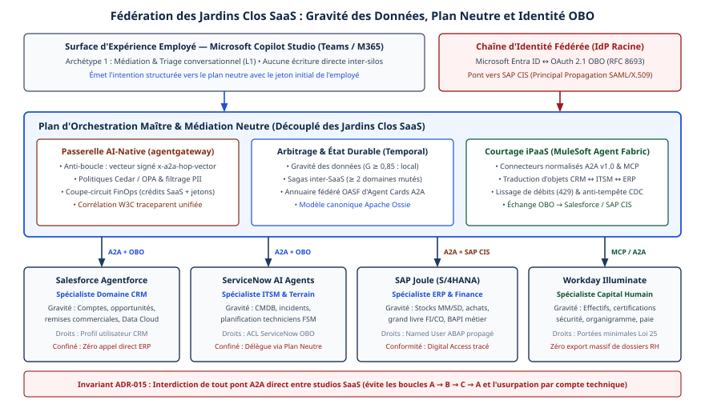

# Chapitre 27 — Stratégie multi-plateformes

*Question directrice : comment vivre avec plusieurs orchestrateurs ?*

> **État de référence :** feuille de route MCP du 22 août 2026, notes de version de MuleSoft Agent Fabric jusqu'au 9 novembre 2026, Règlement (UE) 2023/2854 et ligne directrice B-10 du BSIF. Les numéros entre crochets renvoient aux sources en fin de chapitre; [1] à [10] sont des pages primaires lues, [11] est une note d'analyste, [12] une reproduction du règlement.

Une grande entreprise ne choisit pas son orchestrateur : elle en hérite plusieurs. Les agents arrivent avec le progiciel de gestion, l'outil de gestion des services, la suite bureautique, le fournisseur infonuagique et les équipes qui bâtissent les leurs. Le chapitre 26 a montré que chaque éditeur propose un plan de contrôle et recense les agents des autres, sans qu'aucun gouverne l'ensemble.

La thèse de ce chapitre tient en trois propositions. La pluralité est un état durable, à administrer plutôt qu'à résorber. Ce qui se fédère aujourd'hui est l'inventaire, pas l'application des politiques. L'entreprise doit donc posséder en propre un noyau restreint — registre de référence, identité, politiques, actifs en formats ouverts — et tenir chaque plateforme pour une cible de déploiement remplaçable, ce que le contrat doit rendre vrai.

---

## 27.1 La réalité multi-orchestrateurs

### Un constat d'analyste, pas une mesure

La note de Futurum du 1er juin 2026 décrit une concurrence entre Microsoft, Salesforce, ServiceNow, AWS et Google pour la couche de contrôle de la main-d'œuvre numérique, et affirme que la plupart des entreprises exploiteront des environnements hétérogènes [11]. C'est une opinion d'analyste, adressée aux éditeurs : son sondage n'a pas livré ses valeurs à la lecture, et elle ne traite ni de fédération ni de portabilité. Elle confirme le décor sans outiller la décision.

### Trois niveaux d'orchestration

Le mot « orchestrateur » recouvre trois objets.

| Niveau | Ce qui orchestre | Frontière utile |
|---|---|---|
| Dans une équipe | Un cadriciel (chapitre 20) | Aucune : choix local |
| Dans une plateforme | Le plan de contrôle de l'éditeur (chapitre 26) | MCP vers les systèmes |
| Entre plateformes | Rien, par défaut | A2A entre agents; registre et identité communs |

Le troisième niveau est vide par construction. Les protocoles décrivent des échanges entre deux parties (chapitres 5 et 6); ils ne désignent pas qui tient l'inventaire commun, qui tranche un conflit de politiques ni qui arrête un agent fautif. Entre organisations, la question devient contractuelle (chapitre 45).

### L'argument prudentiel

Viser une plateforme unique supprimerait le problème, au prix d'un autre. La ligne directrice B-10 du BSIF définit le risque de concentration comme la dépendance excessive envers un même tiers, un même sous-traitant ou une même région, et demande aux institutions financières fédérales d'envisager, en infonuagique, des stratégies de résilience comme une conception multinuage [9]. Le texte, de 2023, ne nomme pas les agents; l'appliquer aux plateformes agentiques est une déduction. Une plateforme qui héberge à la fois les agents, leur identité, leur mémoire et leurs traces concentre pourtant plusieurs activités chez un seul tiers.

---

## 27.2 Fédérer registres et gouvernance

### Ce que les mécanismes lus permettent

Quatre mécanismes de rapprochement entre registres ont été lus. Aucun n'est un protocole de fédération entre pairs.

| Mécanisme | Sens | Ce qu'il transporte | Limite relevée |
|---|---|---|---|
| Sous-registre MCP [2] | Tirage depuis le registre amont | Métadonnées de serveurs, statut, enrichissements sous `_meta` | Préversion; aucune garantie de disponibilité ni de durabilité |
| AWS Agent Registry [6] | Publication, synchronisation depuis une URL | Serveurs MCP, agents, compétences, ressources à schéma libre | Détection automatique limitée aux ressources AgentCore d'une organisation AWS |
| Scanners MuleSoft [8] | Détection sur des plateformes tierces | Agents et serveurs trouvés | Ne voit que les plateformes prévues |
| Registre d'Agent 365 [7] | Inventaire unifié | Agents Microsoft et non Microsoft | Contrôles d'identité liés à Entra Agent ID et à sa licence |

Le modèle du sous-registre MCP est le plus instructif. Un agrégateur lit l'API REST du registre officiel à intervalles espacés, de l'ordre de l'heure, et conserve sa propre copie. S'il expose la même spécification OpenAPI, il devient un sous-registre consultable par les hôtes, et peut ajouter ses métadonnées sous une clé à son nom. Seul le statut d'un serveur change en principe; l'agrégateur doit le tenir à jour [2]. C'est une fédération hiérarchique, à sens unique, limitée aux serveurs MCP.

AWS Agent Registry se veut un catalogue unifié et expose un point d'accès MCP que tout client compatible interroge sans SDK d'AWS, avec un jeton du fournisseur d'identité de l'entreprise [6]. Chez Microsoft, Agent 365 devient le registre et le plan de contrôle unifiés, tandis qu'Entra garde l'identité; l'inventaire complet, agents sans identité Entra compris, ne se consulte que dans Agent 365 [7]. Chaque éditeur offre ainsi d'être le registre des autres (chapitre 8).

### L'inventaire se fédère, l'application non

Chez MuleSoft, les scanners détectent les agents d'Amazon Bedrock, de Google Vertex AI et de Microsoft Azure Copilot depuis janvier 2026, ceux de ServiceNow et les serveurs MCP de Kong Gateway depuis octobre. En août, les scanners d'API ont commencé à relever les politiques en place dans Apigee, Azure API Management et Kong Gateway, et des « politiques ouvertes » appliquées aux instances d'API se traduisent en politiques natives chez les fournisseurs qui les prennent en charge, dont Amazon API Gateway. Mais la note du 14 octobre retire l'onglet des politiques pour les instances d'agents et de serveurs MCP gérées par des passerelles tierces, comme Azure API Management ou Amazon API Gateway, au motif que l'application de politiques n'y est pas prise en charge [8].

L'asymétrie est nette : la lecture traverse les plateformes; l'écriture, quand elle les traverse, s'arrête aux API et n'atteint pas les agents. Elle rejoint l'échelle du chapitre 26, où l'agent tiers est presque toujours inventorié, parfois gouverné.

La feuille de route de MCP ne comble pas cet écart. Ses cinq priorités ne comptent ni fédération de registres, ni comportement des passerelles, ni portabilité de la configuration. Ce qui s'en rapproche relève de l'identité : fédération d'identités de charges de travail, ID-JAG (Identity Assertion JWT Authorization Grant) et échange de jetons, confiés à un groupe de travail en formation, et sans engagement ferme [1].

### Un registre de référence, des registres sources

Proposition de ce chapitre :

- **Un registre de référence**, désigné par l'entreprise, comme l'inventaire de gouvernance du chapitre 39, fait autorité sur l'existence, le propriétaire et le statut de chaque agent et de chaque serveur. Les registres des plateformes restent des sources, alimentées localement et lues par synchronisation ou par scanner.
- **Une décision prise une fois, appliquée partout.** L'approbation et le retrait se décident au registre de référence. Leur exécution passe par le point de contrôle de chaque plateforme et par les passerelles (chapitre 24), puisque aucun mécanisme lu ne propage une politique d'agent d'un plan de contrôle à l'autre.
- **Une identité hors plateforme.** L'agent s'authentifie auprès du fournisseur d'identité de l'entreprise (chapitre 29); sans ce point fixe, chaque plateforme réinvente l'agent sous un autre nom.
- **Un socle minimal commun** : identifiant unique, propriétaire nommé, plateforme d'origine, statut, arrêt d'urgence (chapitre 34), traces versées dans un entrepôt commun (chapitre 33). Fédérer davantage aligne les politiques sur la plateforme la moins expressive.

Prendre ce registre chez un éditeur crée une dépendance de plus; l'exploiter soi-même coûte une équipe. Dans les deux cas, son contenu doit rester exportable (section 27.5).

---

## 27.3 Portabilité : agents, compétences, mémoire, configuration

Deux propriétés se confondent sous ce mot. L'**interchangeabilité** permet d'appeler un composant sans savoir où il tourne : c'est ce que donnent les protocoles. La **transférabilité** permet de le déplacer d'une plateforme à une autre : aucun protocole ne la promet.

| Actif | Format ou protocole ouvert | Ce qui reste captif |
|---|---|---|
| Outils | MCP (chapitre 5) | Connexions, secrets, politiques de passerelle |
| Agents | A2A comme frontière d'appel (chapitre 6) | Graphe, état, points de contrôle (chapitre 20) |
| Compétences | Agent Skills [3] | Scripts liés à l'environnement; outils préapprouvés |
| Instructions | AGENTS.md [4] | Tout ce qui n'est pas du texte destiné à l'agent |
| Mémoire | Aucun standard (chapitre 14) | Index, plongements, structures internes |
| Appels au modèle | Open Responses, format commun d'API annoncé [5]; passerelle d'inférence (chapitre 44) | Prompts réglés pour un modèle (chapitre 46) |
| Configuration | Rien | Permissions, garde-fous, routage, approbations |

**Les compétences** sont l'actif le plus transférable. Une skill est un répertoire qui contient un fichier `SKILL.md`, dont deux champs seulement sont obligatoires, `name` et `description`. La spécification marque elle-même les bornes : le champ `compatibility` sert à déclarer le produit visé ou les paquets requis, le champ `allowed-tools` est expérimental et sa prise en charge varie selon les agents, les langages de script dépendent de la mise en œuvre [3]. Le format relève de l'Agentic AI Foundation (AAIF) depuis le 22 octobre 2026; il voyage, mais le comportement se réévalue à l'arrivée (chapitre 13).

**Les instructions** suivent une convention plus légère encore. AGENTS.md est du Markdown ordinaire, sans champ obligatoire. Le format vise les agents de programmation [4]; il ne dit rien des agents d'affaires d'une plateforme d'entreprise.

**La configuration** est le point aveugle. Permissions, garde-fous, règles de routage et circuits d'approbation s'expriment dans le langage de chaque plateforme. La feuille de route de MCP n'évoque que la fourniture sécurisée d'options de configuration aux serveurs, et hors de ses livrables [1].

**La mémoire** n'a pas de format d'échange. Le chapitre 14 recommande de conserver les sources en texte et de reconstruire les index.

Règle de conduite : tout actif transférable vit dans un dépôt de l'entreprise, sous gestion de versions, et la plateforme n'en reçoit qu'une copie déployée. Ce qui ne s'écrit que dans la console d'un éditeur est captif. La preuve se fait par l'essai : redéployer périodiquement un agent représentatif sur une seconde cible et mesurer ce qu'il a fallu réécrire; pour A2A, la trousse de compatibilité du protocole fournit un essai commun (section 26.9).

---

## 27.4 Construire, acheter ou fédérer

La question se pose par couche, non pour l'ensemble.

| Couche | Option par défaut | Raison |
|---|---|---|
| Agent logé dans un système d'enregistrement | Acheter, chez l'éditeur du système | Il possède les données, les droits et le contexte (chapitre 25) |
| Agent transversal ou différenciateur | Construire, exposer par A2A | La logique est un actif; la frontière le rend remplaçable (chapitre 20) |
| Passerelle | Acheter ou adopter un projet ouvert | Fonction d'infrastructure (chapitre 24) |
| Registre de référence, identité, politiques | Posséder | C'est le noyau que l'entreprise ne peut pas déléguer |
| Plan de contrôle d'ensemble | Fédérer | Aucun éditeur ne gouverne les agents des autres comme les siens (chapitre 26) |

Quatre critères font pencher la décision : l'endroit où vivent les données, le caractère différenciateur de la logique, la capacité de l'équipe à exploiter ce qu'elle bâtit, et le coût de sortie.

Fédérer n'est pas gratuit : intégration des registres, double inventaire à réconcilier, traduction des politiques plateforme par plateforme. Trois signaux indiquent qu'il faut plutôt consolider : deux plateformes font la même chose pour les mêmes utilisateurs, une plateforme ne peut pas exposer ses agents dans les deux sens, ou personne ne possède les agents qui y tournent.

---

## 27.5 Clauses contractuelles d'interopérabilité et de sortie

### Deux ancrages lus

**Le règlement européen sur les données** s'applique depuis le 12 septembre 2025 et consacre son chapitre VI au changement de fournisseur de services de traitement de données [10]. Le contrat doit prévoir un préavis d'au plus deux mois, une période de transition de 30 jours civils, portée à sept mois au plus en cas d'impossibilité technique, la liste exhaustive des données et actifs numériques exportables, une période de récupération d'au moins 30 jours, puis l'effacement (article 25). Les frais de changement sont interdits à compter du 12 janvier 2027 (article 29). Les services autres que d'infrastructure doivent offrir sans frais des interfaces ouvertes et, faute de spécification commune, exporter dans un format structuré, couramment utilisé et lisible par machine (article 30). Les services sur mesure et les versions d'essai bénéficient d'exemptions (article 31).

Deux réserves. L'article 2, point 8, vise l'accès à la demande à des ressources informatiques partagées, configurables et élastiques [12]; une plateforme d'agents en logiciel-service s'y range vraisemblablement, sans que ce soit acquis pour chaque offre. Et le texte ne dit pas ce qu'est une donnée exportable pour un agent : prompts, mémoire et traces restent à nommer dans le contrat.

**La ligne directrice B-10** vise les institutions financières fédérales canadiennes [9]. Elle attend des plans de sortie proportionnés au risque, avec un scénario de sortie ordonnée et un scénario sous contrainte pour les ententes critiques. L'entente devrait prévoir un préavis de résiliation, le retour des données dans un format qui permette de poursuivre les activités, et un avis en cas de sous-traitance.

### Clauses à négocier

La liste est une proposition, non un avis juridique.

1. **Standards nommés** : protocole, version, délai de mise à niveau (chapitre 11).
2. **Deux sens, en disponibilité générale** : la plateforme appelle des agents externes et se laisse appeler (chapitre 26).
3. **Inventaire exportable** : accès programmatique au registre, sans supplément.
4. **Liste exhaustive des actifs exportables** : définitions d'agents, prompts, compétences, configuration des outils, mémoire en texte, traces, jeux d'évaluation, journaux d'audit, avec format et fréquence.
5. **Identité** : fournisseur d'identité de l'entreprise accepté pour les agents.
6. **Égalité de traitement des agents tiers**, ou description écrite des écarts.
7. **Préavis en cas de changement de modèle ou de sous-traitant** : un modèle remplacé change le comportement d'un agent (chapitre 46).
8. **Transition** : durée, assistance, frais, récupération, effacement.
9. **Droit de répétition** : un essai de sortie pendant la durée du contrat.

Une clause ne crée pas une capacité technique. Elle ne vaut que si l'essai de sortie réussit avant que la sortie soit nécessaire.

---

## Grille de décision

| Décision | Option par défaut | Quand s'en écarter |
|---|---|---|
| Nombre de plateformes | Admettre la pluralité; plafonner par domaine | Petite organisation, parc chez un seul éditeur |
| Registre de référence | Un seul, désigné, alimenté par les registres sources | Plateforme unique : son registre suffit |
| Application des politiques | Au point de contrôle de chaque plateforme et aux passerelles | Aucun cas : l'inventaire fédéré ne l'assure pas |
| Identité des agents | Fournisseur d'identité de l'entreprise | Agent confiné à une plateforme |
| Périmètre fédéré | Inventaire, identité, arrêt d'urgence, traces | Plus large seulement si chaque plateforme l'exprime |
| Actifs | Dépôt de l'entreprise, formats ouverts, déploiement en copie | Prototype jetable |
| Construire ou acheter | Acheter près des données, construire ce qui différencie | Équipe sans capacité d'exploitation : acheter |
| Contrat | Liste d'actifs exportables, standards versionnés, essai de sortie | Service d'essai ou sans données propres |

---

## Points à retenir

- Plusieurs orchestrateurs coexistent durablement; aucun protocole ne désigne qui gouverne entre eux.
- Ce qui se fédère aujourd'hui est l'inventaire. Chez MuleSoft, les politiques atteignent au mieux les API des passerelles tierces, pas leurs agents ni leurs serveurs MCP.
- Le sous-registre MCP offre un modèle de fédération hiérarchique, limité aux serveurs et en préversion. La feuille de route de MCP ne prévoit ni fédération de registres ni portabilité de la configuration.
- L'entreprise doit posséder un noyau : registre de référence, identité, politiques, actifs en formats ouverts.
- Interchangeabilité n'est pas transférabilité. Les compétences et les instructions se déplacent; la configuration et la mémoire, non.
- Construire, acheter ou fédérer se décide par couche. Fédérer a un coût et tire les politiques vers le plus petit dénominateur.
- Le règlement européen sur les données et la ligne directrice B-10 fournissent des appuis pour les clauses de sortie; ni l'un ni l'autre ne nomme les agents.
- Une clause de sortie se prouve par un essai, pas par sa rédaction.

---

## Sources

Pages primaires lues le 11 novembre 2026 :

1. [MCP — feuille de route, mise à jour du 22 août 2026](https://modelcontextprotocol.io/development/roadmap.md)
2. [Registre MCP — agrégateurs et sous-registres](https://modelcontextprotocol.io/registry/registry-aggregators.md)
3. [Agent Skills — spécification](https://agentskills.io/specification)
4. [AGENTS.md](https://agents.md/)
5. [Agentic AI Foundation — projets](https://aaif.io/projects)
6. [AWS Agent Registry — capacités](https://docs.aws.amazon.com/bedrock-agentcore/latest/devguide/registry-key-capabilities.html)
7. [Microsoft — convergence du registre d'agents vers Agent 365](https://learn.microsoft.com/en-us/entra/agent-id/agent-registry-convergence)
8. [MuleSoft Agent Fabric — notes de version](https://docs.mulesoft.com/general/agent-fabric-release-notes)
9. [BSIF — ligne directrice B-10, gestion du risque lié aux tiers](https://www.osfi-bsif.gc.ca/en/guidance/guidance-library/third-party-risk-management-guideline)
10. [Règlement (UE) 2023/2854 sur les données, chapitre VI](https://eur-lex.europa.eu/legal-content/EN/TXT/HTML/?uri=OJ:L_202302854)

Sources secondaires lues :

11. [Futurum — Who Will Control the Enterprise Agentic Workforce? (1er juin 2026)](https://futurumgroup.com/insights/who-will-control-the-enterprise-agentic-workforce-cios-face-a-new-platform-war/) — note d'analyste.
12. [Springlex — Règlement (UE) 2023/2854, article 2](https://www.springlex.eu/en/packages/data-act/data-act-regulation/article-2/) — reproduction du Journal officiel, lue le 12 novembre 2026.

## Limites de ce chapitre

- Aucune donnée chiffrée sur le nombre de plateformes par entreprise n'a été trouvée; la pluralité repose sur une note d'analyste et sur les constats du chapitre 26.
- Le registre de référence, le socle minimal, les critères de la section 27.4 et la liste de clauses sont des propositions de ce chapitre, sans source externe ni validation juridique.
- Du règlement européen, les articles 23 à 31, 41 et 50 ont été lus en anglais à la rédaction, mais EUR-Lex n'a pas pu être relu à l'audit; l'article 2 l'a été dans une reproduction [12]. Les clauses types de la Commission n'ont pas été lues.
- La page de la ligne directrice B-10, relue à l'audit, n'indique pas sa date d'entrée en vigueur.
- La spécification d'Open Responses n'a pas été lue; seule sa description par la fondation est reprise.
- Les notes de MuleSoft, relues à l'audit, ne donnent ni le statut des fonctions citées ni la liste des fournisseurs qui reçoivent les politiques ouvertes. La documentation de ServiceNow, de Google et de SAP sur la fédération n'a pas été lue.
- Les pages ont été lues au moyen d'un outil d'extraction qui en condense le contenu; une nuance a pu échapper.
- Aucun essai de fédération ou de migration entre plateformes n'a été réalisé ni trouvé.

## Mise en œuvre — Fédération des jardins clos SaaS et problème de l'« orchestrateur d'orchestrateurs » {.volet}

:::: {.encadre .executive}
::: {.encadre-titre}
**Synthèse exécutive**
:::

- **Enjeu stratégique** : aujourd’hui, chaque grand éditeur infonuagique (Microsoft, Salesforce, ServiceNow, SAP, Workday) vend des agents performants sur ses données natives et revendique en même temps le plan d’orchestration de toute l’entreprise. Confier les processus transverses à un seul studio SaaS entraîne trois écueils : dégradation sémantique hors du domaine natif, rupture de la chaîne d’identité nominative et empilement tarifaire (une seule transaction paie des crédits d’actions dans trois suites successives).
- **Décisions d’architecture structurantes** :
  1. *Irréversible à moyen terme* : interdire qu’un progiciel vertical détienne le plan d’orchestration inter-domaines. Chaque studio SaaS reste un agent spécialiste de son domaine, ancré sur sa propre gravité des données.
  2. *Structurante dès le jour 1* : imposer la propagation d’identité de bout en bout (OAuth 2.1 On-Behalf-Of, RFC 8693, de Microsoft Entra ID jusqu’à SAP Cloud Identity Services et Salesforce) et bannir tout compte technique partagé.
  3. *Réversible par conception* : l’outillage de courtage iPaaS (MuleSoft Agent Fabric ou adaptateurs maison) se choisit derrière agentgateway, tant que les échanges horizontaux respectent A2A v1.0 et les schémas canoniques internes.
- **Indicateurs de gouvernance** : indice de localité gravitationnelle ($\ge 85\,\%$ des appels d’outils exécutés par le spécialiste résident), multiplicateur de crédits SaaS ($\le 1{,}25$), traçabilité nominative dans les journaux cibles (100 %) et boucles circulaires inter-plateformes (0 en production).
::::

## 27.6 Coexistence de cinq suites SaaS : Agentforce, ServiceNow AI Agents, SAP Joule, Copilot Studio et Workday

Le chapitre 26 a montré que chaque éditeur propose son plan de contrôle; la section 27.1 a établi que le niveau entre plateformes reste vide. Chaque studio, pris isolément, séduit : pourquoi ne pas laisser l’agent où travaille déjà l’employé piloter les API des applications voisines ?

Dans un groupe qui exploite cinq suites majeures, cette idée ne donne pas une architecture unifiée. Les ventes déploient Salesforce Agentforce, l’exploitation IT ServiceNow AI Agents, la finance SAP Joule sur S/4HANA, les ressources humaines Workday Illuminate, qui protège les dossiers salariés, et la bureautique Microsoft Copilot Studio dans Teams. L’organisation hérite de cinq jardins clos concurrents, dont chacun cherche à réduire les quatre autres au rang de simples tables passives.



### Forces natives et angles morts des cinq suites

1. **Microsoft Copilot Studio (M365, Azure AI Foundry)** : sa force tient à l’ubiquité du canal collaboratif (Teams, Outlook, Microsoft Graph) et à son couplage natif avec Microsoft Entra ID. Il excelle comme agent d’interface et de médiation (Archétype 1). En revanche, coder dans des flux Copilot Studio la logique transactionnelle d’un calcul de marge SAP ou d’un règlement d’assurance crée une couche métier fantôme et fragile, découplée des règles de validation des systèmes d’enregistrement.
2. **Salesforce Agentforce (Atlas Reasoning Engine, Data Cloud)** : adossé au graphe client du CRM, Agentforce est fort sur la qualification d’opportunités, les remises commerciales et la rétention. Hors du CRM, deux frictions apparaissent. La fédération *Zero-Copy* subit des latences incompatibles avec le verrouillage transactionnel de stocks. La facturation en *Flex Credits* par action pénalise tout flux où Agentforce attend passivement le retour d’opérations logistiques tierces.
3. **ServiceNow AI Agents (Now Platform)** : adossé à la CMDB et aux flux ITSM, CSM et FSM, ServiceNow s’impose sur le triage d’incidents et la coordination d’équipes terrain. Cette légitimité s’arrête aux invariants comptables d’un ERP et aux contraintes temps réel d’une usine (OT) : il n’en détient ni l’ontologie fine ni l’intégrité ACID.
4. **SAP Joule et Joule Studio (SAP BTP, S/4HANA)** : ancré dans le SAP Knowledge Graph, qui relie commandes, postes budgétaires et nomenclatures aux services RAP et BAPI, Joule est indispensable pour exécuter une mutation financière ou logistique qui respecte des centaines de contrôles fiscaux. C’est en revanche un canal généraliste peu ergonomique hors des processus ERP, et toute intégration entrante mal gouvernée expose l’entreprise à des régularisations de licences d’accès indirect (*SAP Digital Access*).
5. **Workday Illuminate** : gardien du dossier maître des employés, des habilitations et de la paie, Workday impose un cloisonnement strict. Au titre de la Loi 25 et du RGPD, il est proscrit d’extraire des fiches RH vers la mémoire d’un orchestrateur tiers. Seul le spécialiste interne de Workday évalue l’admissibilité et ne retourne qu’un verdict booléen minimisé.

| Plateforme SaaS | Gravité des données native | Rôle dans la Fabrique | Angle mort hors domaine | Surface d’ouverture | Piège économique et contractuel |
|:-----------|:-----------------|:------------------|:------------------|:----------------|:------------------|
| Microsoft Copilot Studio | Bureautique M365, courriels, réunions, graphe collaboratif | Archétype 1 : interface employé et capture d’intention | Aucune maîtrise des invariants ERP, CRM ou assurances | Client et serveur MCP, A2A, Entra Agent ID | Consommation rapide de *Copilot Credits* sur boucles longues |
| Salesforce Agentforce | Comptes, pipeline commercial, contrats, Data Cloud | Archétype 2 : spécialiste revenu et relation client | Coût et latence élevés sur sagas logistiques ou industrielles | Façade A2A, outils MCP via MuleSoft | Taxation unitaire par action, même sur appels externes simples |
| ServiceNow AI Agents | Incidents, CMDB, catalogue IT, techniciens FSM | Archétype 2 : spécialiste support IT et opérations terrain | Sémantique financière, fiscale et industrielle absente | AI Agent Fabric (A2A + MCP) | Licences *Enterprise* indexées au volume d’orchestrations |
| SAP Joule (S/4HANA) | Grand livre FI/CO, stocks MM/SD, achats, production | Archétype 2 : spécialiste ERP, finance et approvisionnement | Ergonomie transverse limitée hors processus SAP | Compétences A2A sur BTP, serveurs MCP RAP/OData | Requalification en documents *Digital Access* + unités BTP AI |
| Workday Illuminate | Capital humain, paie, habilitations, organigramme | Archétype 2 : spécialiste RH à divulgation minimale | Fermé par conception aux flux commerciaux et industriels | Passerelle A2A restreinte et outils MCP bornés | Contraintes strictes de résidence et confidentialité PII |

---

## 27.7 Gravité des données et plans de contrôle neutres (MuleSoft Agent Fabric, agentgateway, Temporal)

Comment désigner qui orchestre quoi, sans guerre politique entre directions métiers et sans maillage quadratique de $\frac{N(N-1)}{2}$ intégrations point à point ? La réponse repose sur la gravité des données, appliquée au raisonnement agentique.

Déplacer des données brutes hors de leur progiciel maître vers un orchestrateur externe détruit trois propriétés : la gravité ontologique (les règles implicites codées dans SAP ou Salesforce), la gravité sécuritaire (les permissions fines par ligne et par champ) et la gravité transactionnelle (la fraîcheur d’un stock). Pour une tâche $t$ qui sollicite les domaines $D_1, \dots, D_m$, le score d’affinité gravitationnelle envers $D_k$ est :

$$G(t, D_k) = \alpha\, \mu_k(t) + \beta\, \rho_k(t) + \gamma\, \pi_k(t)$$

où $\mu_k(t)$ mesure la fraction des écritures ciblant $D_k$, $\rho_k(t)$ la part des invariants métiers critiques portés par $D_k$, et $\pi_k(t)$ l’indice de confidentialité réglementaire interdisant l’exportation des attributs hors de $D_k$ ($\alpha + \beta + \gamma = 1$). Trois règles d’arbitrage déterministes en découlent :

1. **Localité intra-domaine ($G(t, D_k) \ge 0{,}85$, écriture mono-silo)** : quand une tâche opère presque entièrement dans un seul domaine (par exemple requalifier des opportunités et éditer un devis standard dans Salesforce), le studio natif (Agentforce) l’orchestre localement, sans détour externe.
2. **Enrichissement ponctuel en lecture ($G(t, D_k) \ge 0{,}75$, zéro écriture externe)** : si un agent ServiceNow doit seulement lire un statut de livraison SAP, il émet une lecture par agentgateway vers le serveur MCP de SAP, sans transférer l’orchestration.
3. **Élévation au plan de contrôle neutre (mutations sur $\ge 2$ systèmes d’enregistrement, ou saga longue)** : dès qu’un processus modifie au moins deux silos, exige des compensations transactionnelles ou engage une supervision réglementaire (BSIF E-23), aucun studio SaaS n’est autorisé à être l’orchestrateur maître. La coordination remonte dans le plan neutre de l’entreprise.

### Trois topologies de coordination inter-SaaS

| Critère d’ingénierie | Approche A : studio SaaS élu maître (par exemple tout dans ServiceNow) | Approche B : courtier iPaaS agentique seul (MuleSoft Agent Fabric) | Approche C (référence) : plan neutre hybride (Temporal + agentgateway + iPaaS) |
|:-----------------|:--------------------------|:---------------------------|:----------------------------|
| Indépendance stratégique | Faible : verrouillage fort des graphes et des tarifs | Moyenne : excellente connectivité, adhérence au fournisseur iPaaS | Élevée : état durable et règles de sécurité détenus en propre |
| Sagas longues et compensation | Limitée (expirations de session ou coût de maintien) | Bonne sur flux courts; moins native sur sagas de plusieurs semaines | Optimale : journalisation déterministe, mise en veille gratuite et saga |
| Connectivité certifiée ERP/CRM | Asymétrique envers les éditeurs concurrents | Excellente : connecteurs certifiés SAP, Salesforce, Workday | Excellente : réutilise les adaptateurs certifiés de l’iPaaS comme transport |
| Maîtrise de l’empilement tarifaire | Mauvaise : le studio maître taxe chaque étape déléguée | Modérée : facturation aux flux et aux messages gérés | Optimale : zéro crédit SaaS consommé durant l’attente HOTL ou l’orchestration |
| Sécurité temps réel unifiée | Hétérogène selon les studios | Politiques API classiques + annuaire | Unifiée : inspection MCP/A2A, Cedar et anti-boucle dans agentgateway |

L’architecture de référence (approche C) combine trois briques sans confondre plan d’état et plan de transport. Temporal gouverne l’état durable et les compensations des sagas multi-silos. agentgateway est le point d’application des politiques universel (SPIFFE, Cedar, OpenTelemetry). MuleSoft Agent Fabric, lorsqu’il est déjà présent dans le patrimoine iPaaS, se limite au courtage certifié (*Agent Registry*, *Agent Broker* et connecteurs homologués SAP, Salesforce et Workday, avec lissage des quotas HTTP 429), exposé sous contrats canoniques Apache Ossie. Il ne détient jamais la logique d’état maîtresse. Les limites de l’application des politiques chez MuleSoft sont décrites à la section 27.2. Posséder ce plan neutre, comme le prescrit l’ADR-015 (section 27.11), va au-delà de ce que retient l’exposé : la section 27.4 recommande de fédérer le plan de contrôle d’ensemble, aucun éditeur ne gouvernant les agents des autres comme les siens, et de ne posséder que le registre de référence, l’identité et les politiques.

| Scénario opérationnel type | Domaines sollicités | Orchestrateur élu | Justification architecturale |
|:----------------------------|:---------------------|:-------------------|:------------------------------|
| Génération d’avenant tarifaire commercial standard | Salesforce (95 %), lecture M365 (5 %) | Local : Agentforce | Gravité CRM dominante ($G = 0{,}95$), mutation mono-silo |
| Qualification d’alerte IT et redémarrage infonuagique | ServiceNow (90 %), logs (10 %) | Local : ServiceNow AI Agents | Gravité CMDB/ITSM native en boucle fermée |
| Régularisation comptable mensuelle GR/IR | SAP S/4HANA (100 %) | Local : SAP Joule | Invariants FI/CO exclusifs, zéro exposition externe |
| Retour marchandise : SAV + avoir SAP + technicien + note CRM | ServiceNow + SAP + Salesforce | Plan neutre (Temporal) | Mutations coordonnées sur 3 silos avec compensation atomique |
| Vérification d’habilitation électrique avant intervention | ServiceNow → Workday | Délégation A2A via agentgateway | Confidentialité Loi 25 ($\pi = 1$) : réponse AUTHORIZED/DENIED sans PII |

#### Extrait 27.1 — Contrat A2A v1.0 inter-SaaS normalisé (ServiceNow → plan neutre → SAP Joule)

Ce message JSON-RPC A2A v1.0 montre comment une demande d’allocation de pièce de rechange traverse le plan neutre sans exposer de champ propriétaire de l’éditeur source :

``` json
{
  "jsonrpc": "2.0",
  "id": "a2a-fed-2027-774109",
  "method": "SendMessage",
  "params": {
    "configuration": {
      "acceptedOutputModes": ["application/json"],
      "returnImmediately": true,
      "taskPushNotificationConfig": {
        "url": "https://gateway.boreal.ca/callbacks/temporal/saga-88412",
        "authentication": { "scheme": "Bearer-SPIFFE-SVID" }
      }
    },
    "message": {
      "role": "ROLE_USER",
      "messageId": "msg-sn-to-sap-0041",
      "contextId": "saga-boreal-rma-2027-88412",
      "parts": [
        {
          
          "mediaType": "application/vnd.boreal.ossie.spare-allocation.v2+json",
          "data": {
            "idempotencyKey": "saga-88412-sap-alloc-01",
            "canonicalCustomerUri": "urn:boreal:party:cust-ca-qc-10948",
            "serviceOrderRef": "FSM-2027-992014",
            "materialSku": "STATOR-HV-440",
            "quantity": 1,
            "requestedPlant": "CA01-TRV",
            "maxAutoApproveAmountCad": 3500.00
          }
        }
      ],
      "metadata": {
        "x-a2a-origin-platform": "servicenow-prod-ca",
        "x-a2a-target-platform": "sap-joule-s4-prod",
        "x-a2a-hop-vector": "v1:copilot-m365->temporal-core->servicenow-fsm",
        "x-finops-remaining-budget-cad": 0.85,
        "traceparent": "00-9a8b7c6d5e4f3a2b1c0d9e8f7a6b5c4d-1122334455667788-01"
      }
    }
  }
}
```

### Identités maîtres, contre-pression, compensation et versionnement

L’exploitation quotidienne du plan neutre exige de traiter quatre frictions structurelles, souvent occultées lors des preuves de concept :

- **Désalignement des clés d’entités maîtres** : un même client industriel porte l’identifiant `0018Z00002xK9a` dans Salesforce, le numéro de partenaire BP-1004982 dans SAP S/4HANA et l’enregistrement société `a8f39c11` dans ServiceNow. Si un agent ServiceNow transmet son identifiant interne brut à SAP Joule, la délégation échoue ou déclenche une recherche floue par nom commercial, exposée aux homonymies (facturer la filiale américaine d’un groupe au lieu de sa filiale canadienne). La couche de médiation (MuleSoft Agent Fabric, adossée au graphe de référence Apache Ossie) résout l’URI canonique (`urn:boreal:party:cust-ca-qc-10948`) vers la clé primaire exacte du silo destinataire avant que le modèle cible soit sollicité.
- **Quotas d’API asymétriques (HTTP 429, *Governor Limits*)** : un cluster Kubernetes interne encaisse 2 000 requêtes par seconde, alors que les instances SaaS appliquent des plafonds stricts et hétérogènes (*Salesforce Concurrent API Limits*, *ServiceNow Semaphore Pools*, *Workday Tenant Rate Limits*). Lors d’une reprise d’activité ou d’un incident touchant 800 équipements connectés simultanément, 800 délégations parallèles saturent les sémaphores de ServiceNow et paralysent l’interface web des opérateurs humains. Le plan neutre place donc devant chaque connecteur SaaS une file à seau à jetons (*Token Bucket*) par priorité métier, qui garantit qu’au moins 40 % de la capacité d’API de l’instance reste réservée en tout temps au trafic interactif humain.
- **Compensation sémantique dans les sagas multi-SaaS** : aucun protocole de validation à deux phases (2PC, XA) n’existe entre Salesforce, ServiceNow et SAP, et il ne doit pas en exister. Une saga en trois étapes réserve d’abord une pièce dans SAP (étape 1 réussie), affecte un technicien dans ServiceNow (étape 2 réussie), puis échoue sur la mise à jour contractuelle dans Salesforce à cause d’un blocage de crédit client (étape 3 rejetée). L’orchestration Temporal déroule alors les actions compensatoires inverses déclarées dans le registre (annuler l’affectation FSM, puis libérer la réservation MM par `sap_release_spare_part_reservation`) et ramène l’ensemble des jardins clos à une cohérence à terme vérifiée.
- **Versionnement asynchrone des éditeurs** : l’entreprise ne maîtrise pas le calendrier de déploiement des éditeurs, contrairement à celui de ses microservices internes. Salesforce (trois versions majeures annuelles), ServiceNow (cycles semestriels Washington/Xanadu/Yokohama/Zurich) et Workday mettent à jour leurs moteurs d’agents selon leur propre calendrier. L’équipe plateforme publie dans l’annuaire fédéré OASF des Agent Cards internes versionnées sémantiquement (v2.1, v2.2) derrière MuleSoft Agent Fabric. Elle teste en bac à sable chaque vague de mise à jour sur une batterie d’évaluations de régression avant de basculer le routage du plan neutre. Les autres divisions sont ainsi isolées des changements de comportement d’un studio tiers. Cet annuaire n’est le registre de référence que si l’entreprise le désigne comme tel; sinon il compte parmi les registres sources (section 27.2). Prendre un registre de référence chez un éditeur crée une dépendance de plus : son contenu doit rester exportable (section 27.5).

---

## 27.8 Propagation d’identité fédérée (Entra ID → SAP CIS / Salesforce) et prévention des boucles circulaires

Deux défaillances ruinent en production les architectures multi-SaaS : les comptes techniques génériques, qui écrasent l’identité humaine, et l’emballement circulaire d’agents qui réagissent aux webhooks des plateformes voisines. L’exposé place l’identité de l’agent hors plateforme (section 27.2).

### Propagation nominative de bout en bout

Relier un agent Copilot Studio ou ServiceNow à SAP S/4HANA par un compte statique unique (`SVC_AI_INTEGRATION`) est un motif de blocage immédiat, pour trois raisons :

1. **Escalade de privilèges** : un vendeur limité au Québec pourrait demander à l’agent de modifier un compte européen, sous l’autorité élargie du compte de service.
2. **Perte d’imputabilité (BSIF E-23, SOX, Loi 25)** : dans les tables comptables SAP (BKPF, CDHDR), toutes les écritures portent la signature de `SVC_AI_INTEGRATION`, ce qui rend la séparation des tâches indémontrable.
3. **Exposition en audit de licences ERP** : multiplexer des milliers d’employés derrière un compte technique unique, sans trace d’utilisateur nommé, déclenche des redressements au titre de l’accès indirect.

La solution est de chaîner `OAuth 2.1 On-Behalf-Of (OBO)` (RFC 8693) depuis Microsoft Entra ID jusqu’aux systèmes d’autorisation internes de chaque SaaS, y compris SAP Cloud Identity Services (CIS) pour la *Principal Propagation* vers le noyau ABAP :

- Vers Salesforce Agentforce, l’échange RFC 8693 produit un jeton rattaché par `FederationIdentifier` au profil exact de l’employé, restreint à la portée minimale de la tâche (`sf:agent:quote_read`).
- Vers SAP Joule et S/4HANA, agentgateway échange le jeton Entra ID auprès de SAP CIS en présentant dans `actor_token` le JWT-SVID signé par SPIRE de l’agent appelant. SAP Cloud Connector convertit ensuite l’assertion en certificat X.509 de courte durée vers S/4HANA. La transaction s’exécute sous le SY-UNAME réel de l’employé (par exemple MTREMBLAY), dans le respect de ses objets d’autorisation `M_BEST_WRK`, et l’acteur agentique vérifié est journalisé.
- **Révocation synchrone inter-SaaS (CAE, Shared Signals Framework)** : lorsqu’un changement de poste ou une fin d’emploi est enregistré dans Workday, un signal OpenID SSF (*CAEP / RISC*) part vers Entra ID et agentgateway. Une saga asynchrone de longue durée (Régime T4), lancée trois jours plus tôt par ce collaborateur, voit son renouvellement OBO refusé à son réveil. Aucune écriture posthume n’atteint SAP ou Salesforce, et le dossier en cours est routé vers le gestionnaire hiérarchique successeur.

#### Extrait 27.2 — Courtier TypeScript d’échange RFC 8693 (Entra ID → SAP CIS avec *Principal Propagation*)

Le courtier chaîne l’échange OBO d’Entra ID et l’échange RFC 8693 de SAP CIS, avec le JWT-SVID de l’agent en `actor_token` :

``` typescript
export interface FederatedTokenResult {
  readonly accessToken: string;
  readonly expiresAtEpochSec: number;
  readonly resolvedHumanPrincipal: string;
  readonly grantedScopes: ReadonlyArray<string>;
}

export class CrossSaasOboBroker {
  constructor(
    private readonly entraTokenEndpoint: string,
    private readonly sapCisTokenEndpoint: string,
    private readonly gatewayClientAssertionJwt: () => Promise<string>
  ) {}

  public async exchangeEntraToSapCis(
    incomingSubjectJwt: string,
    callerAgentJwtSvid: string,
    requiredSapScopes: ReadonlyArray<string>
  ): Promise<FederatedTokenResult> {
    // 1. Échange OBO sur STS Entra ID vers l'audience fédérée SAP CIS
    const entraBody = new URLSearchParams({
      grant_type: "urn:ietf:params:oauth:grant-type:token-exchange",
      requested_token_use: "on_behalf_of",
      client_assertion_type:
        "urn:ietf:params:oauth:client-assertion-type:jwt-bearer",
      client_assertion: await this.gatewayClientAssertionJwt(),
      subject_token: incomingSubjectJwt,
      subject_token_type: "urn:ietf:params:oauth:token-type:access_token",
      audience: "api://boreal-sap-cis-federation",
      scope: "openid profile email sap.principal.propagate"
    });

    const entraRes = await fetch(this.entraTokenEndpoint, {
      method: "POST",
      headers: { "Content-Type": "application/x-www-form-urlencoded" },
      body: entraBody.toString()
    });
    if (!entraRes.ok) {
      throw new Error("OBO_ENTRA_REJECTED:" + String(entraRes.status));
    }
    const bridge = (await entraRes.json()) as { access_token: string };

    // 2. Échange RFC 8693 sur SAP CIS avec JWT-SVID SPIFFE signé en actor_token
    const sapBody = new URLSearchParams({
      grant_type: "urn:ietf:params:oauth:grant-type:token-exchange",
      client_assertion_type:
        "urn:ietf:params:oauth:client-assertion-type:jwt-bearer",
      client_assertion: await this.gatewayClientAssertionJwt(),
      subject_token: bridge.access_token,
      subject_token_type: "urn:ietf:params:oauth:token-type:jwt",
      actor_token: callerAgentJwtSvid,
      actor_token_type: "urn:ietf:params:oauth:token-type:jwt",
      resource: "urn:sap:s4hana:boreal-prod-ca01",
      scope: requiredSapScopes.join(" ")
    });

    const sapRes = await fetch(this.sapCisTokenEndpoint, {
      method: "POST",
      headers: { "Content-Type": "application/x-www-form-urlencoded" },
      body: sapBody.toString()
    });
    if (!sapRes.ok) {
      throw new Error("SAP_CIS_PROPAGATION_DENIED:" + String(sapRes.status));
    }

    const data = (await sapRes.json()) as {
      access_token: string;
      expires_in: number;
      scope: string;
      sap_user_alias: string;
    };
    return {
      accessToken: data.access_token,
      expiresAtEpochSec: Math.floor(Date.now() / 1000) + data.expires_in,
      resolvedHumanPrincipal: data.sap_user_alias, // SY-UNAME exact dans S/4HANA
      grantedScopes: data.scope.split(" ")
    };
  }
}
```

### Prévention des boucles circulaires

Les boucles distribuées ($A \to B \to C \to A$) naissent quand des agents autonomes croisent des webhooks de modification de données (*Change Data Capture*). Agentforce modifie la priorité d’un dossier, ce qui alerte ServiceNow; celui-ci demande à SAP Joule un recalcul de délai ATP; S/4HANA publie alors l’événement `SalesOrder.Changed`, qui réveille Agentforce dans une nouvelle session où un simple compteur applicatif `hop_count` repartirait à zéro. agentgateway combine trois barrières déterministes contre ces appels circulaires :

- **Vecteur d’origine signé (`x-a2a-hop-vector`)** : chaque nœud traversé s’ajoute à un vecteur signé par HMAC-SHA256 avec une clé secrète de la passerelle, vérifié en temps constant après contrôle strict de la longueur en octets. La requête est rejetée en moins d’une milliseconde (`409 LOOP_DETECTED`) si la cible demandée figure déjà parmi les ancêtres du vecteur ou si le budget résiduel ne décroît pas strictement.
- **Disjoncteur d’oscillation par entité métier, avec déduplication de livraison** : les bus SaaS (*Salesforce Platform Events*, *SAP Event Mesh*) livrent leurs webhooks selon une sémantique de livraison « au moins une fois ». La passerelle déduplique donc d’abord les réessais réseau légitimes par `eventId`, puis comptabilise les mutations distinctes par identifiant canonique (`urn:boreal:order:SO-99182`) sur une fenêtre glissante de 120 secondes. Au-delà de trois réévaluations rapides, l’entité passe en quarantaine HOTL.
- **Marquage d’origine dans les champs techniques des systèmes d’enregistrement** : chaque écriture qu’un spécialiste effectue pour le compte d’une saga renseigne un attribut technique dédié (`LastModifiedByAgentSagaId`), ce qui évite le premier rebond inutile d’un webhook CDC. Les règles de déclenchement sortant de Salesforce (*Platform Events*), de ServiceNow (*Business Rules*) et de SAP (*Event Mesh*) filtrent en amont toute mutation qui porte déjà l’identifiant d’une saga active. Cela coupe à la source 95 % du bruit événementiel parasite.

#### Extrait 27.3 — Garde-fou anti-boucle par vecteur signé et détection d’oscillation (agentgateway)

`CrossPlatformLoopGuard` vérifie le vecteur signé, déduplique les livraisons et applique les plafonds de sauts, de budget et d’oscillation :

``` typescript
import { createHmac, timingSafeEqual } from "node:crypto";

export interface HopEntry {
  readonly nodeId: string;
  readonly timestampMs: number;
}

export interface CorrelationVectorHeader {
  readonly sagaId: string;
  readonly canonicalEntityUri: string;
  readonly remainingBudgetCad: number;
  readonly hops: ReadonlyArray<HopEntry>;
  readonly signatureHex: string;
}

export interface HopInspectionResult {
  readonly header: CorrelationVectorHeader;
  readonly deduplicatedReplay: boolean;
}

export class CrossPlatformLoopGuard {
  private readonly seenEventIds = new Map<string, number>();
  private readonly entityTouchWindow = new Map<string, number[]>();

  constructor(
    private readonly gatewaySecret: Buffer,
    private readonly maxHops: number = 6,
    private readonly maxTouchesPerTwoMin: number = 3
  ) {}

  public inspectAndAppendHop(
    hdr: CorrelationVectorHeader,
    eventId: string,
    nextNodeId: string,
    hopCostCad: number
  ): HopInspectionResult {
    const expected = this.sign(
      hdr.sagaId,
      hdr.canonicalEntityUri,
      hdr.remainingBudgetCad,
      hdr.hops
    );
    const provided = Buffer.from(hdr.signatureHex, "hex");
    if (
      provided.byteLength !== expected.byteLength ||
      !timingSafeEqual(provided, expected)
    ) {
      throw new Error("SECURITY_VIOLATION: Invalid x-a2a-hop-vector signature");
    }

    const now = Date.now();
    for (const [id, ts] of this.seenEventIds) {
      if (now - ts >= 120_000) this.seenEventIds.delete(id);
    }
    if (this.seenEventIds.has(eventId)) {
      return { header: hdr, deduplicatedReplay: true };
    }

    if (hdr.hops.length >= this.maxHops) {
      throw new Error("LOOP_GUARD_MAX_HOPS_EXCEEDED:" + hdr.sagaId);
    }
    if (hdr.hops.some((h) => h.nodeId === nextNodeId)) {
      const path = hdr.hops.map((h) => h.nodeId).join("->") + "->" + nextNodeId;
      throw new Error("CIRCULAR_SAAS_LOOP_DETECTED:" + path);
    }

    const nextBudget = Number((hdr.remainingBudgetCad - hopCostCad).toFixed(4));
    if (hopCostCad <= 0 || nextBudget < 0) {
      throw new Error("FINOPS_BUDGET_EXHAUSTED:" + hdr.sagaId);
    }

    const prevTouches = this.entityTouchWindow.get(hdr.canonicalEntityUri) ?? [];
    const recent = prevTouches.filter((t) => now - t < 120_000);
    if (recent.length >= this.maxTouchesPerTwoMin) {
      throw new Error("WEBHOOK_OSCILLATION_CIRCUIT_OPEN:" + hdr.canonicalEntityUri);
    }
    this.seenEventIds.set(eventId, now);
    recent.push(now);
    this.entityTouchWindow.set(hdr.canonicalEntityUri, recent);

    const updatedHops = [...hdr.hops, { nodeId: nextNodeId, timestampMs: now }];
    const nextSig = this.sign(
      hdr.sagaId,
      hdr.canonicalEntityUri,
      nextBudget,
      updatedHops
    ).toString("hex");

    return {
      header: {
        sagaId: hdr.sagaId,
        canonicalEntityUri: hdr.canonicalEntityUri,
        remainingBudgetCad: nextBudget,
        hops: updatedHops,
        signatureHex: nextSig
      },
      deduplicatedReplay: false
    };
  }

  private sign(
    sagaId: string,
    entity: string,
    budget: number,
    hops: ReadonlyArray<HopEntry>
  ): Buffer {
    const hopChain = hops
      .map((h) => h.nodeId + "@" + String(h.timestampMs))
      .join(",");
    const raw = `${sagaId}|${entity}|${budget.toFixed(4)}|${hopChain}`;
    return createHmac("sha256", this.gatewaySecret).update(raw, "utf8").digest();
  }
}
```

---

## 27.9 Éclairages sectoriels : fusions-acquisitions et gouvernance FinOps des licences SaaS

:::: {.encadre .sectoriel}
::: {.encadre-titre}
**Fusions-acquisitions multinationales (M&A) : fédérer en 90 jours deux parcs SaaS hétérogènes**
:::

Quand un groupe industriel acquiert un concurrent international, fusionner les instances SAP S/4HANA et Salesforce de l’acquéreur avec l’Oracle Fusion ERP et le Dynamics 365 de la cible exige de vingt-quatre à trente-six mois. Pendant ce temps, les synergies commerciales et la mutualisation des stocks restent en général gelées.

La fédération A2A v1.0 sous plan de contrôle neutre permet un patron d’intégration M&A « Jour 90 », sans migration préalable des bases :

1. La filiale acquise garde ses systèmes d’enregistrement intacts. Elle publie en six semaines trois spécialistes A2A alignés sur les schémas canoniques du groupe (Stock Filiale, Crédit Client, Billet SAV) et isole derrière cette façade ses règles fiscales et tarifaires historiques.
2. Une relation de confiance entre locataires (Entra ID B2B Direct Connect ou OIDC fédéré) relie les identités sans fusionner brutalement les annuaires Active Directory, ce qui préserve le cloisonnement réglementaire durant les audits post-clôture.
3. Dès le quatre-vingt-dixième jour, le plan neutre interroge en parallèle le spécialiste SAP historique et le spécialiste Oracle de la nouvelle filiale. L’expérience client et logistique est unifiée deux ans avant l’éventuelle convergence ERP. Lorsque la migration finale de la filiale vers SAP S/4HANA a lieu, deux ans plus tard, la bascule consiste à mettre à jour l’URL cible de l’Agent Card dans le registre OASF, sans réécrire une seule ligne dans les agents appelants du reste du groupe.
::::

:::: {.encadre .sectoriel}
::: {.encadre-titre}
**Gouvernance FinOps et licences : la quadruple taxation inter-SaaS**
:::

Les studios agentiques SaaS facturent des unités propriétaires (*Copilot Credits*, *Flex Credits*, *ServiceNow Assists*, *SAP AI Units*), à la différence des API REST classiques. Si Copilot Studio (Taxe 1) délègue l’orchestration à ServiceNow (Taxe 2), qui sollicite Agentforce (Taxe 3) puis SAP Joule (Taxe 4 et exposition *Digital Access*), une simple vérification dont l’inférence réelle coûte 0,03 \$ CAD finit facturée entre 3,80 \$ CAD et 6,50 \$ CAD.

Trois règles neutralisent cet empilement :

- **Privilégier MCP sur API standard pour le déterministe** : pour lire trois champs ou bloquer un article codifié, le plan neutre invoque un serveur MCP adossé à l’API standard incluse au contrat de base. Il réserve l’appel A2A vers Joule ou Agentforce aux tâches qui exigent un raisonnement métier complexe.
- **Exiger des tarifs « Headless A2A » décotés** : au renouvellement des contrats, pour les appels machine à machine préqualifiés, avec portabilité annuelle des crédits non consommés.
- **Surveiller le multiplicateur de crédits SaaS** : une alerte FinOps se déclenche dès qu’un flux dépasse 1,25 fois le coût de l’étape principale.
::::

---

## 27.10 Application au fil rouge : fédération des suites SaaS chez Groupe Boréal

:::: {.encadre .filrouge}
::: {.encadre-titre}
**Fil rouge — Groupe Boréal : fédération de Copilot Studio, Agentforce, ServiceNow, SAP Joule et Workday**
:::

**Impasse politique et technique initiale (T1 2027)** : au lancement du lot transversal de la Fabrique Agentique Boréal (14 500 employés, 6,8 G\$ CAD), chaque division défend son studio éditeur comme plan maître :

- Les ventes de Boréal Services Numériques (BSN) veulent que Salesforce Agentforce pilote directement les ordres ServiceNow, les garanties Guidewire de Boréal Capital & Assurances (BCA) et les avoirs dans SAP S/4HANA.
- Les opérations terrain de BSN veulent faire de ServiceNow AI Agents la tour de contrôle unique, qui lirait dans Workday les dossiers d’habilitation électrique des techniciens, en contradiction avec la Loi 25 et la ligne directrice BSIF E-23 applicable à BCA.
- La finance de Boréal Équipements & Logistique (BEL) refuse tout accès externe hors de SAP Joule et chiffre à 1,4 M\$ CAD le risque de redressement *SAP Digital Access* lié aux comptes techniques partagés. Un prototype reliant directement ServiceNow et Salesforce venait en outre de consommer 18 500 crédits en quarante minutes lors d’un emballement de webhooks croisés.

**Architecture déployée sous ADR-015 (T2 2027)** :

1. Microsoft Copilot Studio devient l’unique canal conversationnel interne dans Teams (L1), sans connecteur direct d’écriture vers l’ERP, le CRM ou le SIRH.
2. **Ancrage par gravité des données** : Agentforce gouverne le pipeline commercial, ServiceNow la CMDB et la répartition FSM, SAP Joule les écritures complexes MM/SD/FI, et Workday Illuminate répond par un simple booléen AUTHORIZED/DENIED sur les habilitations RH (Loi 25).
3. **Orchestration neutre et sobriété FinOps** : Temporal, agentgateway et les connecteurs certifiés de MuleSoft Agent Fabric coordonnent toute saga qui touche au moins deux silos, avec des serveurs MCP déterministes pour les opérations courantes.
4. **Propagation OBO intégrale** : `CrossSaasOboBroker` relie Entra ID à Salesforce et à SAP CIS (*Principal Propagation*) et inscrit le SY-UNAME exact de chaque gestionnaire dans S/4HANA.

**Résultats mesurés après 90 jours** :

- **Coût complet en crédits SaaS et inférence par saga** : réduit de 4,15 \$ CAD (projection d’un maillage de studios) à 0,68 \$ CAD (-83,6 %).
- **Boucles inter-webhooks en production** : 0 (19 cycles transitifs bloqués par `CrossPlatformLoopGuard`).
- **Auditabilité de l’identité SAP et Loi 25** : 100 % d’écritures nominatives tracées, zéro export de fiches RH hors de Workday.
::::

---

## 27.11 Décision d’architecture normative et points de contrôle

:::: {.encadre .adr}
::: {.encadre-titre}
**ADR-015 — Ancrage des agents spécialistes selon la gravité des données et fédération par plan de contrôle neutre**
:::

- **Statut** : Acceptée \| Périmètre : Fabrique Agentique d’Entreprise (tous domaines SaaS) \| Révision : annuelle
- **Contexte** : l’exploitation simultanée de Microsoft 365, Salesforce, ServiceNow, SAP S/4HANA et Workday expose l’entreprise à des conflits de plans de contrôle, à des boucles réactives de webhooks, à une perte d’identité humaine et à une multiplication des coûts de crédits éditeurs.
- **Options évaluées** :
  1. *Élection d’un studio SaaS unique comme orchestrateur universel* : rejetée. Verrouillage stratégique fort, perte des invariants métiers tiers et surtaxe systématique de tous les flux.
  2. *Maillage pair à pair direct entre studios SaaS* : rejetée. Complexité $O(N^2)$, cécité de sécurité et vulnérabilité critique aux boucles circulaires.
  3. *Fédération selon la gravité des données sous plan de contrôle neutre* : retenue. Exécution locale intra-silo ($G \ge 0{,}85$), orchestration durable neutre (Temporal, agentgateway et médiation iPaaS) dès que deux silos sont mutés, et propagation OAuth 2.1 OBO obligatoire.
- **Décision** : (a) tout appel inter-SaaS transite obligatoirement par agentgateway; (b) les sagas mutatives multi-domaines sont orchestrées par le moteur durable neutre; (c) les comptes techniques partagés sont interdits au profit de RFC 8693 (Entra ID → SAP CIS, Salesforce, ServiceNow); (d) les lectures et écritures structurées simples utilisent MCP sur API standard plutôt qu’une délégation conversationnelle taxée à l’acte.
- **Conséquences** :
  - *Positives* : maîtrise des coûts FinOps et des licences ERP, respect natif des permissions par ligne et des autorisations ABAP, prévention des boucles circulaires, intégration M&A accélérée.
  - *Négatives et coûts assumés* : gouvernance continue du modèle canonique d’échange et maintien de la chaîne cryptographique Entra ID ↔︎ SAP CIS.
- **Condition de révision** : évolution des clauses tarifaires inter-agents A2A des grands éditeurs ou refonte majeure du parc SaaS.
::::

### Liste de contrôle de mise en production

Avant d’ouvrir en production un flux qui fédère plusieurs plateformes SaaS, validez huit exigences :

1. **Qualification de gravité** : le score $G(t, D_k)$ confirme-t-il le choix entre l’orchestration locale intra-SaaS et l’élévation vers le plan neutre ?
2. **Blocage des ponts directs** : les politiques réseau des instances SaaS interdisent-elles tout appel A2A ou webhook direct d’un studio vers un autre sans passage par agentgateway ?
3. **Propagation nominative intégrale** : la chaîne OAuth 2.1 OBO (RFC 8693) préserve-t-elle l’identité humaine jusqu’au système cible (y compris SY-UNAME via SAP CIS), sans compte technique partagé ?
4. **Arbitrage contractuel FinOps** : l’impact en crédits éditeurs et en *SAP Digital Access* a-t-il été validé, avec MCP sur API standard pour les opérations déterministes ?
5. **Vecteur anti-boucle signé** : l’en-tête `x-a2a-hop-vector`, signé par HMAC, est-il inspecté à chaque saut pour rejeter tout cycle $A \to B \to C \to A$ ?
6. **Amortisseur de webhooks CDC** : un disjoncteur par entité canonique empêche-t-il les événements de mise à jour (`SalesOrder.Changed`, etc.) de provoquer le réveil infini des agents ?
7. **Divulgation minimale RH** : les appels vers Workday retournent-ils seulement des verdicts qualifiés, sans jamais exporter de dossiers personnels bruts (Loi 25, RGPD) ?
8. **Contrats canoniques découplés** : les échanges A2A utilisent-ils les schémas métiers internes versionnés plutôt que les identifiants propriétaires d’un éditeur ?
