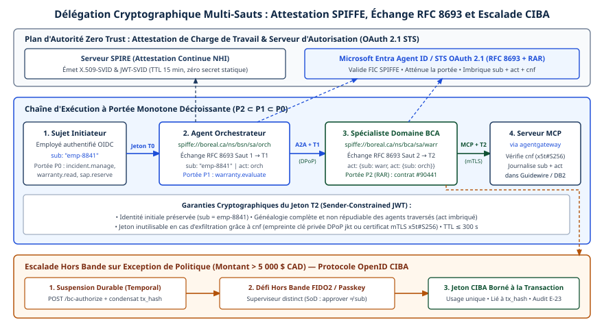

# Chapitre 30 — Autorisation et délégation

*Question directrice : comment limiter ce qu'un agent peut faire, et le prouver ?*

> **État de référence :** spécification MCP `2026-07-28` et feuille de route du 22 août 2026; brouillon `draft-ietf-wimse-aims-01` du 2 novembre 2026, qui remplace `draft-klrc-aiagent-auth` [5]; RFC 8693 et RFC 9396; Authorization API 1.0 d'AuthZEN. Les numéros entre crochets renvoient aux sources en fin de chapitre; toutes sont des pages primaires lues pour ce chapitre ([13] en résumé seulement), sauf [16] et [17], marquées secondaires.

L'identité dit qui est l'agent et pour qui il agit (chapitre 29). L'autorisation dit ce qu'il peut faire, sur quoi, et pendant combien de temps. Pour un logiciel classique, la réponse s'écrit une fois, parce que le chemin d'exécution est connu. Un agent choisit ses outils en cours de route, à partir d'un contexte qu'un tiers peut avoir influencé, et il confie parfois une partie du travail à d'autres agents. Le droit accordé au départ voyage donc plus loin que ne le voit la personne qui l'a accordé.

La question directrice a deux moitiés. Limiter : réduire le droit à ce que la tâche exige, et le réduire encore à chaque délégation. Prouver : pouvoir montrer après coup quel droit existait, qui l'avait accordé et quelle règle a tranché.

La thèse tient en trois phrases. Les standards règlent bien le premier saut, entre un utilisateur, un client et un serveur. Ils règlent mal la suite : la chaîne de sous-agents, la décision opération par opération, la preuve qu'un humain a approuvé. En attendant, un droit n'est un contrôle que s'il est porté par un jeton étroit et court, décidé hors de l'agent, et consigné; ce qui repose sur la bonne conduite de l'agent (annotation, manifeste, confirmation à l'écran) n'est qu'un signal.

---

## 30.1 Moindre privilège et outils trop permissifs

### Pourquoi le privilège enfle

Le moindre privilège suppose de connaître la tâche. Or le brouillon de l'IETF sur la gestion de l'identité des agents (AIMS) place hors de son périmètre la traduction d'une mission en exigences d'autorisation : c'est une étape de planification, laissée à chaque mise en œuvre [4]. Faute de savoir ce dont l'agent aura besoin, on lui donne large.

Le projet OWASP MCP Top 10, encore en bêta, en fait son deuxième risque : des permissions mal délimitées qui s'étendent avec le temps [14].

### Trois étages de sur-permission

Le privilège excessif se loge à trois étages, selon une grille propre à ce chapitre.

**Le jeton.** Le guide de sécurité de MCP décrit le scénario type : un serveur publie toutes ses portées, le client les demande toutes, et un jeton aux portées génériques (`files:*`, `admin:*`) fuit par un journal ou la mémoire [2]. Le vol d'un tel jeton ouvre tous les outils d'un coup, sa révocation interrompt tous les flux, et une portée fourre-tout masque dans la piste d'audit l'intention de chaque opération. Le remède prescrit est progressif : un ensemble initial minimal, limité à la découverte et à la lecture, puis une élévation ciblée quand une opération privilégiée est tentée [1][2].

Une tension subsiste. Quand la réponse 401 n'indique aucune portée, le client devrait demander toutes celles que le serveur déclare dans `scopes_supported`, champ censé ne contenir que le minimum nécessaire au fonctionnement de base [1]. Le moindre privilège dépend donc de la discipline du serveur : déclarer peu, réclamer avec précision.

**L'outil.** Une portée ne peut pas être plus fine que l'outil qu'elle protège. Un outil qui exécute une requête SQL arbitraire reste trop permissif, quelle que soit la portée exigée : le droit réel se trouve dans l'argument. Découper un outil générique en outils étroits donne un sens aux portées étroites. Les annotations par lesquelles un outil se dit en lecture seule ne comptent pas : le protocole les tient pour non fiables (chapitre 5).

**Le justificatif en aval.** MCP interdit à un serveur d'accepter ou de relayer un jeton qui n'a pas été émis pour lui [1]. Le serveur appelle donc le système protégé avec un autre justificatif. Si c'est un compte de service aux droits étendus, les droits de l'utilisateur ne bornent plus ce que fait l'outil : le serveur devient un délégué plus puissant que chacun de ses appelants. AIMS prévoit que l'outil échange le jeton reçu contre un jeton propre à la ressource visée, et qualifie d'antipatron le fait qu'un outil relaie aux services le jeton reçu de l'agent [4].

---

## 30.2 Chaînes de délégation et autorité réduite des sous-agents

### Usurper ou déléguer

La RFC 8693 distingue deux sémantiques [6]. Dans l'usurpation, l'agent reçoit les droits de l'utilisateur et en devient indiscernable. Dans la délégation, il garde une identité distincte, et le jeton, composite, nomme les deux parties. Seule la seconde laisse une trace de qui a agi. AIMS la retient : l'utilisateur ou le système figure dans la revendication `sub`, l'agent dans `client_id`, et le serveur de ressources doit se servir des deux pour décider [4].

### Ce que la chaîne perd

Quand un agent en mandate un autre, la RFC 8693 permet d'imbriquer des revendications `act` : la plus externe désigne l'acteur courant, les plus profondes les acteurs antérieurs. Le texte précise toutefois que ces acteurs antérieurs sont informatifs et n'entrent pas dans la décision d'accès [6]. À deux sauts de profondeur, le serveur de ressources décide donc sur la foi de l'utilisateur et du dernier agent seulement. Rien ne garantit que les agents intermédiaires avaient le droit de déléguer, ni qu'ils ont réduit ce qu'ils transmettaient.

AIMS ne comble pas ce vide. Le brouillon ne mentionne pas la revendication `act`, ne représente pas de chaîne d'acteurs, et son champ d'audit « sujet délégant » est au singulier. Sa seule règle d'atténuation porte sur la suite d'échanges qui produit les jetons de transaction : la portée de chaque jeton ne peut jamais excéder celle du jeton présenté pour l'obtenir [4]. Il recommande en revanche de pouvoir reconstituer la chaîne d'exécution complète d'une tâche [4], ce que le jeton seul ne permet pas.


### L'état des travaux

| Mécanisme | Ce qu'il apporte | Ce qui manque | Statut |
|---|---|---|---|
| Échange de jeton (RFC 8693) | Nouveau jeton, portée et audience choisies; `act` | Chaîne informative; un appel au serveur d'autorisation par saut | RFC [6] |
| Transaction Tokens | JWT de courte durée, lié à une transaction, qui conserve identité et contexte le long de la chaîne d'appels | Valable dans un seul domaine de confiance; n'est pas un jeton d'accès | Brouillon du groupe OAuth, envoi à l'IESG visé pour décembre 2026 [8][10] |
| Délégation atténuée vérifiable | Chaîne signée, vérifiable hors ligne maillon par maillon | Voir ci-dessous | Brouillon individuel visant la voie normative, 27 octobre 2026 [9] |

Le dernier mécanisme montre vers quoi tend la réflexion. Chaque jeton enfant porte son autorité dans une entrée `authorization_details` et s'engage sur son parent par une empreinte. Un vérificateur contrôle, sans appeler de serveur d'autorisation, que chaque saut est un sous-ensemble du précédent, que la profondeur reste sous un maximum, que le mandant est le même partout, que l'expiration ne dépasse jamais celle du parent et que le porteur détient la clé [9].

Ses limites, reconnues par l'auteur, mesurent la difficulté du problème. Des agents frères peuvent chacun respecter leur plafond et le dépasser ensemble : un budget global exige un registre partagé, hors du jeton. La révocation est retardée par le cache du vérificateur. La comparaison des portées est syntaxique, si bien que deux déploiements peuvent lire différemment la même chaîne [9]. D'autres brouillons individuels circulent, dont un sur des jetons atténuables hors ligne [16] et un sur un en-tête de délégation vérifié maillon par maillon [17].

Côté instances, la feuille de route de MCP pose le problème en toutes lettres : un agent lance des sous-agents qui devraient recevoir une autorité plus étroite que la sienne. Le groupe de travail Agent Identity, chargé d'y répondre, est en formation; il doit s'appuyer sur l'échange de jeton de la RFC 8693 et sur l'ID-JAG [3]. La charte du groupe OAuth de l'IETF prévoit de nouveaux mécanismes pour l'autorisation des agents automatisés qui agissent pour des utilisateurs, sans jalon daté [10].

### En attendant

Quatre règles se déduisent de ces textes et ne dépendent d'aucun brouillon :

- un sous-agent ne reçoit jamais le jeton de son parent; il en obtient un par échange auprès du serveur d'autorisation;
- le jeton enfant vise une seule audience, porte moins de droits et expire avant celui du parent;
- la profondeur de délégation est bornée par la politique, non par l'agent;
- l'orchestrateur consigne la chaîne complète, puisque le jeton ne la porte pas de façon probante.

---

## 30.3 Autorisation par opération

### La portée ne suffit pas

La RFC 9396, publiée en mai 2023, part d'un constat : la portée OAuth convient à des demandes grossières et ne peut exprimer ni un paiement précis ni un droit d'écriture fichier par fichier [7]. Elle ajoute le paramètre `authorization_details`, un tableau d'objets typés dont les champs communs désignent le lieu (`locations`), les opérations (`actions`), les types de données, la ressource (`identifier`) et le niveau de privilège. L'exemple du texte est une initiation de paiement, avec montant et créancier.

Trois propriétés rendent ce mécanisme utile ici. Le serveur d'autorisation rejette tout type ou champ inconnu. Il renvoie avec le jeton les détails réellement accordés, que l'utilisateur a pu réduire. Il les transmet au serveur de ressources, dans le jeton ou par introspection, et ce dernier applique ce qui a été approuvé [7]. La RFC ne donne pas de méthode générale pour comparer deux demandes : la logique est propre à chaque type.

### Où en sont les protocoles d'agents

MCP s'en tient aux portées, mais les rend dynamiques. Le serveur peut déterminer les portées requises d'après les arguments et le contexte de la requête, puis les réclamer par une réponse 403; le client refait une autorisation et réémet l'appel [1]. L'élévation se fait bien opération par opération, mais ce qui est accordé reste une chaîne de caractères, valable pour tous les appels suivants.

La RFC 9396 ne figure pas parmi les textes sur lesquels s'appuie l'autorisation de MCP [1]. AIMS ne la cite pas non plus; le brouillon demande seulement à l'agent de ne solliciter que les portées et les détails d'autorisation minimaux [4]. L'autorisation par opération portée par le jeton existe donc dans OAuth, mais aucun profil ne l'applique aux agents.

### Trois lieux de décision

**À l'émission du jeton.** Les Transaction Tokens lient le contexte de la transaction, par exemple un montant, à un jeton de courte durée [4][8].

**Dans le serveur de ressources.** Le guide de MCP range parmi les erreurs le fait de tenir les portées d'un jeton pour suffisantes sans logique d'autorisation côté serveur [2]. Le serveur connaît l'objet visé et son propriétaire, ce qu'aucun jeton générique ne dit. La même règle vaut pour les identifiants d'état : en posséder un n'est pas un droit [2].

**À la passerelle.** Elle décide outil par outil, avant que l'appel n'atteigne le serveur (section 24.2).

Cette finesse a un coût : chaque élévation est un aller-retour, parfois une interaction avec l'utilisateur. La spécification demande au serveur de réclamer en une fois toutes les portées d'une opération, et au client de borner ses tentatives [1]. Deux limites débordent ce chapitre : des approbations trop fréquentes ne contrôlent plus rien (section 22.5), et une suite d'actions permises une à une peut former une trajectoire qui ne l'est pas (section 32.1).

---

## 30.4 Attestation de présence humaine

### Ce que le jeton ne dit pas

Un serveur de ressources qui reçoit un jeton ne sait pas dans quelle situation il a été utilisé. Trois cas se confondent : une personne a consenti au départ, puis s'est absentée; une personne vient d'approuver cette action précise; personne n'est là, et l'agent tourne sans surveillance. Ces trois cas justifient des décisions différentes.

La feuille de route de MCP le reconnaît : l'autorisation du protocole suppose une personne devant un navigateur au moment du consentement, alors que l'appelant agit de plus en plus pour un utilisateur absent. Elle mentionne l'attestation de présence humaine, qui distinguerait un client interactif d'un agent sans surveillance, parmi les sujets en discussion qui pourraient entrer dans le périmètre du futur groupe de travail [3]. Ce n'est pas un livrable. Aucun standard ne couvre ce besoin aujourd'hui.

### Une confirmation locale n'est pas une preuve

AIMS est ici le texte le plus net [4]. Le serveur d'autorisation peut juger qu'une demande exige une confirmation explicite; il devrait alors la refuser ou obtenir une autorisation supplémentaire. Toute confirmation interactive doit être liée à un octroi vérifiable émis par le serveur d'autorisation. L'agent ne doit pas tenir pour suffisante une simple confirmation dans son interface locale. Il devrait la traduire en événement OAuth, par exemple une élévation au moyen de CIBA, le flux d'authentification par canal secondaire d'OpenID.

La raison est structurelle. Un bouton « Approuver » dans l'hôte est invisible du serveur de ressources et de l'auditeur. Un agent détourné par injection peut affirmer qu'il a été pressé. Seul un octroi émis hors de l'agent prouve qu'un humain authentifié a répondu, et le brouillon recommande d'authentifier l'utilisateur par un mécanisme résistant à l'hameçonnage, comme une clé d'accès [4].

Le brouillon admet une lacune : CIBA ne prévoit qu'une demande lancée par le client, et la confirmation en cours d'exécution appelle une spécification supplémentaire [4]. La RFC 9396 permet de joindre des détails d'autorisation à une demande CIBA [7]; associer les deux lierait l'approbation à une opération décrite. Ce rapprochement est une déduction de ce chapitre, aucun profil ne le définit. Le choix des décisions qui exigent un humain relève du chapitre 22.

---

## 30.5 Manifestes de permissions

### Un fichier déclaratif pour le web

La prépublication « Permission Manifests for Web Agents », signée par le Lightweight Agent Standards Working Group (décembre 2025, révisée en janvier 2026), part d'un constat : `robots.txt` a été conçu pour l'exploration, non pour des agents qui remplissent des formulaires et cliquent. Les exploitants de sites n'ont le choix qu'entre bloquer tout trafic automatisé et imposer une authentification lourde [12].

Les auteurs proposent un manifeste JSON, `agent-permissions.json`, publié sous `/.well-known/` ou désigné page par page au moyen d'une balise de lien. Il comporte quatre sections [12] :

- `metadata` : version du schéma, date, auteur;
- `resource_rules` : des règles qui associent un verbe (lire, cliquer, soumettre un formulaire), un sélecteur CSS, un indicateur d'autorisation et des modificateurs tels qu'une limite de débit ou l'exigence d'un humain dans la boucle;
- `action_guidelines` : des directives en langage naturel, graduées de « doit » à « ne devrait pas »;
- `api` : des renvois vers une API équivalente, de type OpenAPI, MCP ou A2A, que l'agent est invité à préférer à la manipulation de la page.

### Un signal, pas un contrôle

Les auteurs le disent eux-mêmes : la conformité est volontaire et le format, non exécutoire par conception. Un agent malveillant ignore le fichier. Les directives en langage naturel sont difficiles à faire respecter et peuvent servir de vecteur d'injection; le contenu du manifeste doit être traité comme une entrée non fiable. L'article ne présente ni évaluation empirique ni donnée d'adoption, seulement deux mises en œuvre de référence [12].

Ici, c'est la ressource qui annonce ce qu'elle accepte. Les déclarations de ce genre sont de force inégale.

| Déclaration | Qui déclare | Qui l'applique |
|---|---|---|
| `agent-permissions.json` [12] | Le site | Personne; conformité volontaire |
| Annotations d'outil (chapitre 5) | Le serveur MCP | Personne; non fiables par défaut |
| `scopes_supported` [1] | Le serveur de ressources | Le serveur d'autorisation et le serveur |
| Politique d'usage ODRL (chapitre 45) | Le fournisseur de données | Le connecteur; ODRL ne prescrit aucune application |
| Politique codifiée (section 30.6) | L'entreprise | Un point d'application |

Deux usages s'en dégagent. Pour les agents qui naviguent sur des sites tiers, le cadriciel devrait vérifier les règles structurées avant toute commande, de façon déterministe, et ne jamais injecter les directives en langage naturel comme des instructions de confiance. Pour les sites de l'entreprise, le manifeste indique aux agents bien conçus le canal voulu, sans remplacer l'autorisation.

Une autre prépublication, lue en résumé, suit la voie inverse : traduire en contrôles d'accès vérifiables, par extension d'OAuth 2.0 et d'OpenID Connect, des permissions que l'utilisateur exprime en langage naturel [13].

---

## 30.6 Politiques codifiées et points d'application

### Séparer la décision de l'application

L'Authorization API 1.0 du groupe AuthZEN de l'OpenID Foundation, spécification finale publiée le 11 janvier 2026, normalise le dialogue entre un point d'application, qui intercepte la requête, et un point de décision, qui tranche [11]. La question tient en quatre éléments : un sujet, une action, une ressource et un contexte. La réponse est un booléen, accompagné au besoin de motifs ou d'obligations. Des interfaces de recherche renvoient ce qu'un sujet peut atteindre, ce qui permet de filtrer les outils présentés à un agent avant qu'il les appelle.

Le langage de politique est hors du périmètre de cette spécification [11]. AIMS va dans le même sens : une politique peut s'exprimer dans n'importe quel format codifié, pourvu qu'elle soit versionnée, révisable et évaluée de façon cohérente. Le brouillon précise qu'un langage commun n'est pas nécessaire, la confiance entre domaines passant par les jetons (chapitres 29 et 45). Il cite l'interface d'AuthZEN pour interroger un point de décision externe [4]. Le choix du langage revient donc à l'entreprise; l'interface, elle, est normalisée.

### Où appliquer

| Point d'application | Ce qu'il peut décider | Sa limite |
|---|---|---|
| Serveur d'autorisation | Émettre ou non, portée, audience, durée | Ignore les arguments de l'appel, sauf détails d'autorisation |
| Passerelle | Outil permis, quota, approbation (chapitre 24) | Ignore les règles d'affaires du système |
| Serveur de ressources | Objet, propriétaire, montant | Une mise en œuvre par serveur |
| Hôte ou cadriciel | Confirmation, filtrage des outils | Situé dans la frontière de l'agent; ne prouve rien |

Les trois premiers se complètent; le quatrième ne remplace aucun d'eux. Le brouillon « MCP Security Gateway » de Microsoft, détaillé au chapitre 24, illustre un piège : la liste de refus y prime et toute erreur vaut refus, mais une liste d'autorisation vide laisse passer tous les outils [15]. Le moindre privilège demande une configuration délibérée.

### Prouver

AIMS donne ici la réponse la plus précise [4]. Un déploiement doit tenir des journaux d'audit durables, où toute altération est décelable, et suffisants pour reconstituer le comportement de l'agent et son contexte d'autorisation. Sept champs au minimum y figurent : l'identifiant authentifié de l'agent, le sujet délégant, la ressource ou l'outil, l'action et la décision, l'horodatage et un identifiant de corrélation, l'état de posture ou de risque, et les événements de révocation avec leur cause.

Un destinataire de signaux de révocation ou de risque, diffusés par exemple par le Shared Signals Framework, doit appliquer sans retard indu l'autorisation réduite, et ne doit plus utiliser les jetons ni les décisions mis en cache qui ont cessé d'être valides [4]. Le délai n'est pas chiffré.

Le guide de MCP demande de journaliser chaque élévation, portée demandée et portée accordée [2]. Dans l'interface d'AuthZEN, un refus est une réponse HTTP 200 dont la décision vaut faux [11] : il faut compter les décisions, non les codes d'erreur. Enfin, consigner la version de la politique qui a tranché rend la décision rejouable (déduction de ce chapitre).

Le manque d'audit et de télémétrie est le huitième risque du classement OWASP [14]. La séparation entre trace, échantillonnable, et piste d'audit, jamais échantillonnée, relève du chapitre 33.

---

## Grille de décision

| Décision | Option par défaut | Quand s'en écarter |
|---|---|---|
| Portées initiales | Ensemble minimal, lecture et découverte; élévation à la demande | Flux sans utilisateur : portées préapprouvées par politique; site déconnecté : droits répartis avant la coupure (chapitre 46) |
| Conception des outils | Étroits, un effet par outil | Outil générique derrière une règle sur ses arguments |
| Justificatif en aval | Obtenu par échange de jeton, lié à l'appelant | Système patrimonial sans OAuth : compte de service restreint et audit renforcé |
| Délégation à un sous-agent | Jeton neuf, plus étroit, plus court, par échange en ligne; profondeur bornée | Aucun cas pour le relais du jeton parent |
| Opérations à fort enjeu | Décision dans le serveur de ressources, sur l'objet et le montant | Détails d'autorisation (RFC 9396) si le serveur d'autorisation les gère |
| Preuve d'approbation humaine | Octroi émis par le serveur d'autorisation | Confirmation locale pour les actions réversibles et à faible enjeu |
| Manifestes de sites tiers | Règles structurées appliquées par le cadriciel | Directives en langage naturel : jamais comme instructions |
| Politique | Codifiée, versionnée, évaluée hors de l'agent | Très petit parc : listes à la passerelle |
| Piste d'audit | Sept champs d'AIMS, plus la chaîne et la version de politique | — |

---

## Points à retenir

- Le moindre privilège se joue à trois étages : le jeton, l'outil et le justificatif que le serveur emploie en aval. Le troisième peut dépasser les droits de chaque appelant.
- MCP inscrit l'élévation progressive dans son flux, mais le résultat dépend du serveur, qui doit déclarer peu et réclamer avec précision.
- Dans une chaîne de délégation, les acteurs antérieurs sont informatifs selon la RFC 8693, et aucune norme adoptée ne garantit l'atténuation de saut en saut. En attendant, chaque saut repasse par le serveur d'autorisation, et l'orchestrateur consigne la chaîne.
- L'autorisation par opération existe dans OAuth (RFC 9396) sans profil pour les agents; elle se décide aujourd'hui dans le serveur de ressources et à la passerelle.
- Une confirmation dans l'interface de l'agent n'est pas une preuve; seul un octroi émis par le serveur d'autorisation en est une. L'attestation de présence humaine n'a pas de standard.
- Un manifeste de permissions est un signal volontaire, et son texte libre est une entrée non fiable.
- AuthZEN normalise l'interface entre point d'application et point de décision; le langage de politique reste un choix d'entreprise.
- Prouver, c'est tenir un journal de chaque décision où toute altération se détecte, et appliquer les révocations aux décisions mises en cache.

---

## Sources

Pages primaires lues le 11 novembre 2026 :

1. [MCP — Autorisation, spécification 2026-07-28](https://modelcontextprotocol.io/specification/2026-07-28/basic/authorization.md)
2. [MCP — Security Best Practices](https://modelcontextprotocol.io/docs/2026-07-28/tutorials/security/security_best_practices.md)
3. [MCP — Feuille de route, mise à jour du 22 août 2026](https://modelcontextprotocol.io/development/roadmap.md)
4. [IETF — draft-ietf-wimse-aims-01, AI Identity Management System](https://www.ietf.org/archive/id/draft-ietf-wimse-aims-01.txt)
5. [IETF — draft-klrc-aiagent-auth, remplacé par [4]](https://datatracker.ietf.org/doc/draft-klrc-aiagent-auth/)
6. [RFC 8693 — OAuth 2.0 Token Exchange](https://www.rfc-editor.org/rfc/rfc8693.html)
7. [RFC 9396 — OAuth 2.0 Rich Authorization Requests](https://www.rfc-editor.org/rfc/rfc9396.html)
8. [IETF — draft-ietf-oauth-transaction-tokens](https://datatracker.ietf.org/doc/draft-ietf-oauth-transaction-tokens/)
9. [IETF — draft-asor-wimse-agent-delegation-chain-03](https://www.ietf.org/archive/id/draft-asor-wimse-agent-delegation-chain-03.html)
10. [IETF — charte du groupe de travail OAuth](https://datatracker.ietf.org/wg/oauth/about/)
11. [OpenID AuthZEN — Authorization API 1.0](https://openid.net/specs/authorization-api-1_0.html)
12. [Permission Manifests for Web Agents (arXiv 2601.02371)](https://arxiv.org/abs/2601.02371)
13. [Authenticated Delegation and Authorized AI Agents (arXiv 2501.09674)](https://arxiv.org/abs/2501.09674) — résumé seulement
14. [OWASP MCP Top 10 — page du projet](https://owasp.org/www-project-mcp-top-10/)
15. [Microsoft — MCP Security Gateway 1.0, brouillon](https://microsoft.github.io/agent-governance-toolkit/specs/MCP-SECURITY-GATEWAY-1.0/)

Sources secondaires (résultat de recherche seulement, pages non lues) :

16. [IETF — draft-niyikiza-oauth-attenuating-agent-tokens-00](https://www.ietf.org/archive/id/draft-niyikiza-oauth-attenuating-agent-tokens-00.html)
17. [IETF — draft-hamr-oauth-agent-delegation-01](https://www.ietf.org/archive/id/draft-hamr-oauth-agent-delegation-01.html)

## Limites de ce chapitre

- Les pages ont été lues par un outil qui en restitue un résumé. L'audit du 12 novembre a relu, avec citations, AIMS [4], la spécification [1] et la feuille de route [3] de MCP, [5], [9], [10], [11] et le résumé de [12]; les énoncés qui en dépendent sont confirmés ou corrigés. Les mots-clés attribués aux RFC 8693 et 9396 et au guide [2] n'ont pas été relus.
- AIMS est un brouillon de groupe de travail, de statut visé informatif; [9], [16] et [17] sont des brouillons individuels. Aucun n'est une norme; tous peuvent changer ou expirer.
- La charte OAuth lue (version 06) n'affiche pas de date d'approbation; une révision en juin 2026, relevée dans un résultat de recherche, n'a pas été confirmée et n'est pas reprise.
- CIBA et le Shared Signals Framework sont décrits d'après AIMS, sans lecture de leurs spécifications; [8] et [15] n'ont pas été relus pendant l'audit. Les fiches détaillées des risques OWASP n'ont pas été lues.
- Les trois étages de sur-permission, le découpage des outils, les quatre règles de la section 30.2, le tableau des points d'application et le rapprochement entre CIBA et la RFC 9396 sont des analyses de ce chapitre, non des énoncés de norme.
- Aucun langage de politique n'est comparé, faute de source lue. Aucun chiffre d'adoption ou d'efficacité n'est cité : les sources lues n'en donnent pas.
- Le passage entre domaines (chaînage d'identité, ID-JAG) est laissé au chapitre 29, et les politiques d'usage entre organisations au chapitre 45.

## Mise en œuvre — Identités non humaines (NHI) de première classe et délégation cryptographique {.volet}

:::: {.encadre .executive}
::: {.encadre-titre}
**Synthèse exécutive**
:::

- **Enjeu d’affaires et de risque** : Un agent autonome peut s’authentifier en réutilisant le jeton interactif de l’employé (usurpation) ou au moyen d’un compte de service statique aux droits étendus, partagé entre plusieurs flux. Ce double raccourci supprime la non-répudiation comptable, élargit le rayon d’impact de toute injection de prompt (OWASP ASI03) et met l’organisation en défaut devant les obligations prudentielles de traçabilité nominative (BSIF E-23, SOX, Loi 25).
- **Décisions architecturales structurantes** :
  1.  *Irréversible et fondatrice* : Supprimer toute clé d’API statique au profit d’identités non humaines (NHI) de première classe, attestées cryptographiquement au démarrage de la charge de travail (SPIFFE/SPIRE) et gouvernées dans l’annuaire d’entreprise (Microsoft Entra Agent ID), avec un parrain humain obligatoire.
  2.  *Structurante sur chaque flux* : Imposer à chaque frontière entre agents (A2A v1.0) ou vers un serveur d’outils (MCP) un échange de jetons OAuth 2.1 conforme à la RFC 8693, qui préserve le sujet initial (`sub`), empile la généalogie des acteurs (`act`) et réduit strictement la portée fonctionnelle et financière (RFC 9396, RAR).
  3.  *Réversible par configuration* : Le mécanisme de liaison cryptographique du jeton au détenteur : mTLS (RFC 8705) sur le maillage interne, DPoP (RFC 9449) pour les franchissements infonuagiques ou partenaires.
- **Indicateurs de gouvernance associés** : Taux de couverture d’attestation matérielle/logique NHI (cible : 100 % des agents L2+), durée de vie médiane des justificatifs émis (cible : $\le 300\,\text{s}$ pour les jetons d’accès, $\le 15\,\text{min}$ pour les SVID), ratio d’atténuation des permissions par saut de délégation et délai de révocation globale d’une identité d’agent compromise.
::::

## 30.7 Impasse du jeton humain emprunté et du compte de service statique face aux graphes dynamiques

La gestion des identités et des accès (IAM) classique connaît deux appelants. Le premier est la personne présente derrière un écran, authentifiée par fédération OpenID Connect (OIDC) et par authentification multifacteur (FIDO2/WebAuthn). Le second est le démon logiciel déterministe, lot nocturne ou microservice d’intégration, doté d’un identifiant technique fixe (*service principal*) et dont le graphe d’appels a été codé en dur, puis validé avant la mise en production.

Un système multi-agents de troisième génération ne relève d’aucun des deux. La séquence d’appels d’un agent orchestrateur n’est pas figée à la compilation : elle émerge de la décomposition d’un objectif métier, confronté à un contexte événementiel variable. L’agent exécute des dizaines de requêtes inter-domaines par minute, reste exposé à la confusion entre données et instructions (OWASP ASI01) et travaille souvent de façon asynchrone, à 3 heures du matin, quand l’employé à l’origine du mandat est hors ligne.

Quand une organisation plaque ses patrons IAM traditionnels sur une flotte agentique sans les adapter, elle tombe dans l’un des deux antipatrons observés lors de la vague 2024–2025.

### Antipatron 1 : l’emprunt brut du jeton humain

L’application cliente capture le jeton d’accès OAuth de l’utilisateur connecté et le transmet tel quel, dans l’en-tête `Authorization: Bearer`, à l’agent d’interface. Celui-ci le relaie à un agent spécialiste, qui le présente à un serveur MCP ou à une API d’entreprise. MCP interdit à un serveur d’accepter ou de relayer un jeton qui n’a pas été émis pour lui (section 30.1). D’un agent à l’autre, la règle est qu’un sous-agent ne reçoit jamais le jeton de son parent (section 30.2). Cette pratique ouvre trois failles :

1.  **Héritage du rayon d’impact humain.** Un directeur financier ou un ingénieur principal détient légitimement, au cours de sa journée, des droits étendus sur des dizaines de modules (SAP, Workday, SharePoint, Snowflake). Il demande à un agent de « synthétiser les pénalités de retard du fournisseur X à partir du dossier courriel ». Si un document joint contient une charge d’injection indirecte, le relais de son jeton confère momentanément à l’agent la capacité technique d’approuver un virement ou d’extraire la grille salariale de sa division.
2.  **Perte de la distinction dans les journaux d’audit.** Pour le système d’enregistrement cible, une écriture faite directement par Marie Tremblay à son poste de travail et une écriture hallucinée par un agent qui détient son jeton produisent la même trace d’audit. Dans un litige réglementaire ou une fraude interne, la valeur probante des journaux est perdue.
3.  **Rupture sur les régimes asynchrones (T3 et T4).** Quand le jeton interactif initial expire, après soixante minutes, une saga durable suspendue dans Temporal ou Restate échoue. Les équipes pressées en viennent souvent à réclamer la portée `offline_access` et à stocker des jetons de rafraîchissement humains à longue durée de vie dans les bases d’état applicatives, où ils offrent une cible de choix à un attaquant.

### Antipatron 2 : le compte de service partagé aux droits étendus

Pour contourner l’expiration des sessions humaines et permettre le déclenchement par événements (Kafka, OPC UA, webhooks), de nombreuses équipes passent à l’extrême opposé. Elles provisionnent un compte de service unique pour l’orchestrateur ou le serveur MCP, avec un secret client statique, souvent renouvelé tous les douze à vingt-quatre mois, et l’union des permissions requises par tous les utilisateurs possibles.

Ce raccourci généralise à l’entreprise le cas du serveur plus puissant que chacun de ses appelants (section 30.1) : c’est le problème du délégué confus. Le système cible (Guidewire, Salesforce ou SAP S/4HANA) ne voit que l’identité générique `svc-boreal-ai-prod`. Ses contrôles natifs de sécurité au niveau des lignes (RLS) deviennent inopérants, puisque le compte technique a le droit de lire toutes les filiales. Le cloisonnement entre utilisateurs repose alors sur un filtre WHERE que l’agent ou son connecteur construit dynamiquement, c’est-à-dire sur la couche la plus exposée aux manipulations sémantiques.

### Loi d’atténuation monotone sur un graphe de délégation

La loi qui suit est une cible de conception. Aucune norme adoptée ne garantit l’atténuation de saut en saut : en attendant, chaque saut repasse par le serveur d’autorisation et l’orchestrateur consigne la chaîne (section 30.2). Dans un graphe d’exécution dynamique de $k$ sauts successifs entre un sujet initiateur $u$ et des acteurs non humains $a_1, a_2, \dots, a_k$, le modèle de confiance zéro agentique impose que l’ensemble des permissions effectives $P_i$ au saut $i$ obéisse à une loi d’intersection et d’atténuation monotone stricte :

$$P_i \subseteq P_{i-1} \cap M(a_i) \cap R_i, \quad P_0 = D(u) \cap S_0$$

$D(u)$ et $S_0$ bornent les droits initiaux de la session humaine. $M(a_i)$ est le plafond maximal de permissions homologué statiquement sur le gabarit (*Blueprint*) de l’agent $a_i$. $R_i$ est le sous-ensemble minimal d’opérations que requiert la seule sous-tâche déléguée au saut $i$. Deux corollaires en découlent :

- **Aucune amplification de privilèges.** Dans ce modèle, un agent aval $a_i$ n’exerce jamais un droit que l’initiateur humain $u$ n’a pas, même si son connecteur technique le permettrait. Inversement, un utilisateur très privilégié ne peut pas forcer un agent spécialisé de lecture (L1) à écrire hors de son mandat $M(a_i)$.
- **Décroissance monotone du rayon d’impact.** Plus l’exécution approche des feuilles spécialisées du graphe ($P_k \subset \dots \subset P_1 \subset P_0$), plus le jeton transporté est étroit, éphémère et lié à un objet métier précis, par exemple un seul numéro de série d’équipement et un plafond monétaire explicite.

Le tableau compare les quatre approches d’identité observées dans l’industrie.

| Critère d’évaluation (confiance zéro) | Clé d’API / Compte statique partagé | Emprunt brut du jeton humain | Flux `client_credentials` isolé par agent | Cible 2027 : NHI attestée (SPIFFE) + RFC 8693 atténué |
|:-----------------|:--------------------|:--------------------|:-------------------|:----------------------|
| Identité de l’initiateur (`sub`) | Perdue (écrasée par le compte technique) | Présente mais non distinguée de l’agent | Absente (contexte purement machine) | Préservée de bout en bout et vérifiable |
| Généalogie des agents (`act`) | Inexistante | Inexistante (usurpation opaque) | Limitée au dernier appelant direct | Chaîne imbriquée (`act`), informative selon la RFC 8693 et consignée par l’orchestrateur (section 30.2) |
| Principe du moindre privilège | Violé (union de tous les cas d’usage) | Violé (hérite de 100 % des droits humains) | Statique par classe d’agent | Dynamique par tâche (RFC 9396 RAR) |
| Résistance au vol de jeton | Nulle (secret rejouable partout, long TTL) | Faible (jeton rejouable jusqu’à expiration) | Moyenne si secret stocké en coffre | Forte (mTLS / DPoP + TTL $\le 5\,\text{min}$) |
| Compatibilité asynchrone (T3/T4) | Oui, mais hors de tout contrôle nominatif | Non (échoue à l’expiration de session) | Oui pour événements purement techniques | Native (mandats bornés + escalade CIBA) |
| Homologation BSIF E-23 / Loi 25 | Non conforme (échec d’audit critique) | Non conforme (défaut de non-répudiation) | Partielle (flux techniques sans PII) | Conforme (auditabilité et SoD prouvables) |

---

## 30.8 Identité cryptographique et provenance d’agent : SPIFFE/SPIRE, Entra Agent ID et W3C DIDs

Élever les agents au rang d’identités non humaines (NHI) de première classe exige de séparer trois préoccupations que les architectures historiques confondaient : l’attestation physique et logique de la charge de travail, la gouvernance dans l’annuaire d’entreprise et la fédération de provenance entre organisations.

### Couche 1 : attestation continue sans secret sur disque avec SPIFFE et SPIRE

Le problème du secret zéro est le défaut d’origine des identités machines. Pour récupérer ses clés dans un coffre-fort numérique, un conteneur doit déjà détenir un premier secret d’amorçage, injecté par variable d’environnement ou fichier monté. Ce secret peut fuir par un journal d’erreur, un instantané disque ou une attaque par exécution de code (ASI05).

SPIFFE (projet gradué de la CNCF) et son implémentation de référence SPIRE n’exigent aucun secret pré-partagé (section 29.4). Quand un pod qui héberge un agent spécialiste démarre sur un nœud Kubernetes ou une machine virtuelle :

1.  L’agent SPIRE local du nœud, lui-même attesté matériellement par un module TPM 2.0 ou par un jeton d’instance infonuagique signé, inspecte hors bande le processus appelant par l’API locale Unix (*Workload API*). Il interroge directement le noyau Linux, le démon de conteneurs (`containerd`) et l’API `kubelet`.
2.  Il vérifie un ensemble strict de sélecteurs d’attestation : espace de noms Kubernetes, compte de service, signature cryptographique et condensat SHA-256 exact de l’image OCI de l’agent, voire le condensat de son paquet de configuration immuable.
3.  Quand tous les sélecteurs concordent, et alors seulement, SPIRE délivre en mémoire vive un SVID (*SPIFFE Verifiable Identity Document*) sous deux formes : un certificat X.509-SVID pour le chiffrement et l’authentification mutuelle mTLS du transport, et un JWT-SVID de courte durée (typiquement 15 minutes, renouvelé automatiquement à mi-vie) qui encode l’identifiant canonique, tel que `spiffe://boreal.ca/ns/bca-prod/sa/warranty-adjudicator-v2`.

### Couche 2 : gouvernance d’annuaire, *Blueprints* et parrainage humain (Microsoft Entra Agent ID)

SPIFFE prouve quel code s’exécute sur quelle infrastructure. Il ne gère ni les politiques d’entreprise, ni les revues d’accès trimestrielles, ni la responsabilité hiérarchique. C’est le rôle du plan de gouvernance d’annuaire, que Microsoft Entra Agent ID incarne en 2026–2027, avec des extensions NHI équivalentes chez Okta, Ping et AWS IAM.

Ces annuaires distinguent les agents des *service principals* applicatifs par trois primitives (section 29.2) :

- **Le gabarit d’identité (*Agent Identity Blueprint*).** Modèle déclaratif immuable qui décrit une classe d’agent : son niveau d’autonomie L1–L4, les portées maximales $M(a_i)$ qu’il pourra solliciter en délégation, sa classification de risque BSIF E-23 et ses justificatifs d’identité fédérés (*Federated Identity Credentials*, FIC), qui pointent vers l’émetteur SPIRE de l’entreprise.
- **L’instance d’identité d’exécution (*Agent Identity*).** Entité distincte, instanciée à partir du Blueprint pour un environnement ou une division. Elle a ses propres journaux de connexion, ses politiques d’accès conditionnel, qui évaluent l’état de conformité du cluster ou le score de risque en temps réel, et un interrupteur de désactivation immédiate.
- **Le parrain humain obligatoire.** Aucune identité d’agent ne peut être créée ni maintenue active sans être rattachée nominativement, dans l’annuaire, à un responsable métier et à un propriétaire technique actifs dans le SIRH (Workday). Si le parrain quitte l’organisation ou change de division, un flux de gouvernance d’identité (IGA) transfère la responsabilité sous 72 heures ou suspend automatiquement le renouvellement des jetons de l’agent.

### Couche 3 : provenance entre entreprises par W3C DIDs et Verifiable Credentials

Quand la Fabrique Agentique franchit les frontières de l’entreprise, ni le domaine de confiance SPIFFE interne (`boreal.ca`) ni le locataire Entra ID ne sont partagés. C’est le cas lorsque l’*Agent Approvisionnement* de Boréal négocie par A2A v1.0 des délais et des pénalités avec l’*Agent Commercial* d’un aciériste allemand.

Pour éviter le retour aux clés d’API bilatérales, ingérables à l’échelle de 2 000 fournisseurs, l’écosystème inter-entreprises 2027 (notamment sous l’impulsion d’AGNTCY et des profils A2A B2B) s’appuie sur les standards du W3C : les identifiants décentralisés (W3C DID v1.0, méthodes `did:web` ou `did:webvh` avec historique de clés vérifiable), couplés aux attestations vérifiables (W3C Verifiable Credentials Data Model 2.0). Les DID sont présentés à la section 29.6. L’agent externe publie ses clés publiques de signature sous son domaine DNS corporatif durci (DNSSEC et transparence des clés). Lors de la poignée de main A2A, il présente une attestation vérifiable signée par la chambre de commerce, un auditeur externe ou la direction juridique de son entreprise. Elle établit son mandat légal et son plafond d’engagement contractuel.

#### Extrait 30.1 — Attestation locale SPIRE et document de provenance externe W3C DID / VC 2.0

Le bloc YAML enregistre l’agent dans SPIRE et exige la correspondance simultanée du compte Kubernetes et du condensat exact de l’image signée. Le bloc JSON est l’attestation W3C VC 2.0 exposée lors d’une fédération A2A externe :

``` yaml
# 30.1a — Enregistrement déclaratif SPIRE (CRD Kubernetes Controller Manager)
apiVersion: spire.spiffe.io/v1alpha1
kind: ClusterSPIFFEID
metadata:
  name: bca-warranty-adjudicator-prod
spec:
  spiffeIDTemplate: >-
    spiffe://boreal.ca/ns/{{ .PodMeta.Namespace }}/sa/{{
    .PodSpec.ServiceAccountName }}
  jwtIssuer: "https://spire-oidc.identity.boreal.ca"
  ttl: "15m"
  podSelector:
    matchLabels:
      app.kubernetes.io/name: "warranty-adjudicator"
      agent.boreal.ca/autonomy-tier: "L3"
      agent.boreal.ca/bsif-e23-class: "tier-2-material"
  namespaceSelector:
    matchLabels:
      environment: "production"
      division: "bca"
  workloadSelectorTemplates:
    - "k8s:sa:warranty-adjudicator-v2"
    - "k8s:container-image-sha256:8f4e2b9c71d03a6ef92c14b7085a3e19\
      d4f72c80b165e9a43c4b901a6d2e5f18"
```

``` json
{
  "@context": [
    "https://www.w3.org/ns/credentials/v2",
    "https://schemas.agntcy.org/credentials/agent-mandate/v1"
  ],
  "id": "urn:uuid:7c9e6679-7425-40de-944b-e07fc1f90ae7",
  "type": ["VerifiableCredential", "EnterpriseAgentMandateCredential"],
  "issuer": {
    "id": "did:web:boreal.ca:legal-entity",
    "name": "Groupe Boréal Inc. (LEI: 549300BOREALCA2027X9)"
  },
  "validFrom": "2027-01-15T00:00:00Z",
  "validUntil": "2027-04-15T00:00:00Z",
  "credentialStatus": {
    "id": "https://trust.boreal.ca/status/2027/mandates#4412",
    "type": "BitstringStatusListEntry",
    "statusPurpose": "revocation",
    "statusListIndex": "4412",
    "statusListCredential": "https://trust.boreal.ca/status/2027/mandates"
  },
  "credentialSubject": {
    "id": "did:web:agents.boreal.ca:bel:procurement-negotiator",
    "spiffeFederationBinding":
      "spiffe://boreal.ca/ns/bel-prod/sa/procurement-negotiator",
    "agentCardUrl": "https://agents.boreal.ca/bel/proc/agent-card.json",
    "authorizedActions": [
      "rfq.issue",
      "delivery.reschedule",
      "po.propose_amendment"
    ],
    "maxBindingCommitmentCad": 25000,
    "humanSponsorRole": "VP Approvisionnement Industriel BEL"
  },
  "proof": {
    "type": "DataIntegrityProof",
    "cryptosuite": "eddsa-jcs-2022",
    "created": "2027-01-15T08:30:00Z",
    "verificationMethod": "did:web:boreal.ca:legal-entity#key-ed25519-2027-01",
    "proofPurpose": "assertionMethod",
    "proofValue": "z4oJ8h7R9mKpL2xQvN5tWzY3cBfD6gHjM1nPqRsTuVwXyZ8aBcDe"
  }
}
```

L’entrée `BitstringStatusListEntry` (liste de révocation du W3C par champ de bits compressé) permet à un partenaire externe de vérifier en une milliseconde, sans appel téléphonique ni divulgation d’information confidentielle, que le mandat de l’agent négociateur de Boréal n’a pas été révoqué dans l’heure précédente.

---

## 30.9 Délégation multi-sauts OAuth 2.1 OBO, RFC 8693 (sub/act), atténuation RAR et escalade CIBA

Le mandat d’un utilisateur humain, ou d’un événement métier authentifié, traverse une chaîne d’agents spécialistes jusqu’au serveur MCP final. Chaque agent y porte l’identité ancrée dans SPIFFE et gouvernée dans l’annuaire. Quatre briques assurent la propagation : OAuth 2.1, l’échange de jetons (RFC 8693), les requêtes d’autorisation riches (RFC 9396, RAR) et les preuves de possession (mTLS, RFC 8705; DPoP, RFC 9449). Cette combinaison va au-delà de ce que retient l’exposé. Ni MCP ni AIMS ne s’appuient sur la RFC 9396, et aucun profil ne l’applique aux agents (section 30.3).



### Anatomie du flux d’échange RFC 8693 à délégation explicite

En mode délégation (section 30.2), la RFC 8693 distingue le `subject_token`, qui représente la chaîne d’autorité courante jusqu’au sujet initial, de l’`actor_token`, ou de l’assertion client JWT-SVID, qui prouve l’identité de l’agent demandeur.

À chaque saut $i$, l’agent appelant contacte le STS (*Security Token Service*), serveur d’autorisation de l’entreprise ou Entra ID, avant d’invoquer un pair A2A ou un serveur MCP :

1.  **Authentification sans secret de l’agent appelant.** L’agent s’authentifie auprès du point de terminaison `/token` en présentant son JWT-SVID SPIFFE frais par `client_assertion` (RFC 7523).
2.  **Jeton amont et restriction par RAR.** L’agent fournit dans `subject_token` le jeton reçu à l’entrée, désigne l’audience (`audience`) unique du prochain destinataire et précise la restriction des droits par `authorization_details` (RFC 9396, section 30.3). Une chaîne comme `sap.spare_parts.reserve` ignore les paramètres métiers. Un objet structuré `authorization_details` permet d’encoder dans le jeton signé que l’agent aval ne peut réserver qu’une seule unité de la pièce ROTOR-KIT-HX9 pour le dossier SN-WO-773190, sous un plafond de 5 000 \$ CAD.
3.  **Liaison à la clé de l’agent et garde-fous anti-rejeu.** L’agent joint un en-tête DPoP (RFC 9449, section 29.5), signé avec une clé privée asymétrique générée en mémoire non exportable, ou présente son certificat X.509-SVID en mTLS. Le STS inscrit l’empreinte SHA-256 de la clé publique dans la revendication `cnf` (*Confirmation*) et impose un plafond de profondeur de délégation (`max_act_depth <= 4`). À l’appel de l’outil MCP, la passerelle vérifie que la preuve DPoP lie la méthode HTTP (`htm`), l’URI exacte sans paramètres de requête (`htu`), le condensat du jeton d’accès (`ath`) et un défi serveur frais (DPoP-Nonce), avec un cache anti-rejeu sur `jti`. Un jeton ou une preuve interceptés dans un journal restent inexploitables ailleurs.

#### Extrait 30.2 — Requête HTTP d’échange RFC 8693 + RAR + DPoP et jeton JWT résultant

La requête est émise au saut n° 2 par l’*Agent Spécialiste Garantie* de BCA, qui s’apprête à invoquer le serveur MCP adossé à Guidewire et IBM i. Elle est suivie de la charge utile décodée du jeton T2 que le STS délivre :

``` http
POST /oauth2/v2.1/token HTTP/1.1
Host: sts.identity.boreal.ca
Content-Type: application/x-www-form-urlencoded
DPoP: eyJ0eXAiOiJkcG9wK2p3dCIsImFsZyI6IkVTMjU2IiwiandrIjp7Imt0...

grant_type=urn:ietf:params:oauth:grant-type:token-exchange
&client_id=agent-bca-warranty-adjudicator-prod
&client_assertion_type=
  urn:ietf:params:oauth:client-assertion-type:jwt-bearer
&client_assertion=eyJhbGciOiJFUzI1NiIsInR5cCI6IkpXVCJ9.eyJzdWI...
&subject_token=eyJhbGciOiJFUzI1NiIsInR5cCI6ImF0K2p3dCJ9.eyJzdW...
&subject_token_type=urn:ietf:params:oauth:token-type:access_token
&audience=mcp://gateway.boreal.ca/mcp/bca-guidewire-contracts
&scope=bca.warranty.preauthorize
&authorization_details=[{"type": "boreal_warranty_adjudication",
  "actions": ["preauthorize_claim"], "equipmentSerial": "BOR-CMP-90441",
  "maxAmountCad": 4500.00, "sagaId": "saga-inc-2027-088412"}]
```

``` json
{
  "iss": "https://sts.identity.boreal.ca",
  "sub": "emp-8841-marc.lavoie@boreal.ca",
  "aud": "mcp://gateway.boreal.ca/mcp/bca-guidewire-contracts",
  "iat": 1773588420,
  "exp": 1773588720,
  "jti": "tok-t2-9f81c3a4-7b2e-4d19-8a50-62e41c90b312",
  "client_id": "agent-bca-warranty-adjudicator-prod",
  "ent_sponsor": "emp-1042-claire.desjardins@boreal.ca",
  "scope": "bca.warranty.preauthorize",
  "act": {
    "sub": "spiffe://boreal.ca/ns/bca-prod/sa/warranty-adjudicator-v2",
    "blueprint_id": "bp-bca-warranty-tier2",
    "act": {
      "sub": "spiffe://boreal.ca/ns/bsn-prod/sa/maint-orchestrator-v4",
      "blueprint_id": "bp-bsn-orchestrator-tier2"
    }
  },
  "authorization_details": [
    {
      "type": "boreal_warranty_adjudication",
      "actions": ["preauthorize_claim"],
      "equipmentSerial": "BOR-CMP-90441",
      "maxAmountCad": 4500.00,
      "sagaId": "saga-inc-2027-088412"
    }
  ],
  "cnf": {
    "jkt": "0ZcOCORZNYy-DWpqq30jZyJGHTN0d2HglBV3uiguA4I",
    "x5t#S256": "bwcK0esc3ACC3DB2Y5_lESsXE8o9ltc05O89jdN-dg2"
  }
}
```

Ce jeton `at+jwt` (RFC 9068) tient en un bloc signé de moins de deux kilo-octets et vaut exactement cinq minutes (`exp - iat = 300`). Le serveur MCP destinataire y vérifie l’employé initiateur (`sub`), le responsable hiérarchique de l’agent (`ent_sponsor`), le plafond financier autorisé (4500.00 CAD sur le seul équipement BOR-CMP-90441) et la preuve que la connexion provient du conteneur attesté (`cnf`). Il y lit aussi les acteurs antérieurs (`act` imbriqué); selon la RFC 8693, ils sont informatifs et n’entrent pas dans la décision d’accès, et l’orchestrateur consigne la chaîne (section 30.2).

### Approbation asynchrone hors bande par OpenID CIBA pour l’escalade HOTL

Quand le devis estimé de réparation atteint 7 850 \$ CAD, il excède le plafond autonome L3 de 5 000 \$ CAD codé dans le Blueprint de l’agent. L’agent s’exécute en arrière-plan, dans un travailleur Temporal, sans navigateur ouvert : il ne peut pas rediriger (HTTP 302) vers une mire de connexion. Envoyer un simple lien cliquable par courriel ou par clavardage exposerait l’organisation à l’hameçonnage interne et à l’approbation inattentive.

CIBA, le flux d’authentification par canal secondaire d’OpenID (section 30.4), sépare l’approbation de la session de l’agent, dans le temps et dans le canal. Aucun standard ne couvre pourtant l’attestation de présence humaine : CIBA ne prévoit qu’une demande lancée par le client, et la confirmation en cours d’exécution appelle une spécification supplémentaire (section 30.4). La séquence suivante n’est donc pas un profil normalisé :

1.  **Demande signée.** L’agent, ou le moteur d’orchestration qui agit comme client confidentiel attesté, soumet une requête signée au point de terminaison `/bc-authorize` du fournisseur d’identité. Elle désigne le groupe de souscripteurs habilités, un jeton de notification à usage unique (`client_notification_token`), un message de liaison lisible (`binding_message`) et le condensat cryptographique exact de la transaction proposée (`tx_hash`).
2.  **Veille durable.** Le moteur durable met l’activité en veille persistante (`awakeable`, ou attente d’un signal webhook en mode CIBA *Ping*/*Push*), sans consommer de fil CPU pendant les minutes ou les heures d’attente.
3.  **Signature locale.** Sur le téléphone corporatif sécurisé d’un souscripteur admissible, l’application d’authentification affiche les paramètres clés de l’engagement (montant, bénéficiaire, écart détecté) et exige une signature biométrique locale FIDO2, par clé d’accès, liée au condensat `tx_hash`.
4.  **Séparation des tâches.** Le fournisseur d’identité vérifie une règle de séparation des tâches (SoD) : l’approbateur CIBA ne doit être ni le sujet initiateur `sub` du flux, ni le développeur qui a déployé l’agent. Il notifie ensuite l’orchestrateur et émet un jeton d’approbation à usage unique, verrouillé sur cette seule transaction.

#### Extrait 30.3 — Coordinateur TypeScript d’approbation hors bande OpenID CIBA avec contrôle SoD

Le coordinateur lance la demande CIBA, attend le rappel, récupère les jetons, puis vérifie la séparation des tâches, l’assurance d’authentification et le condensat de la transaction :

``` typescript
import { createHash, randomBytes } from "node:crypto";
import { jwtVerify, createRemoteJWKSet } from "jose";

export interface HighValueClaimIntent {
  readonly sagaId: string;
  readonly initiatingSubjectId: string;
  readonly equipmentSerial: string;
  readonly amountCad: number;
  readonly beneficiaryVendorId: string;
}

export interface VerifiedCibaApproval {
  readonly approvalJti: string;
  readonly approverSubjectId: string;
  readonly transactionHash: string;
  readonly scopedAccessToken: string;
}

const JWKS = createRemoteJWKSet(
  new URL("https://sts.identity.boreal.ca/.well-known/jwks.json")
);

export function computeCanonicalTxHash(intent: HighValueClaimIntent): string {
  const canonical = JSON.stringify({
    amountCad: intent.amountCad.toFixed(2),
    beneficiaryVendorId: intent.beneficiaryVendorId,
    equipmentSerial: intent.equipmentSerial,
    initiatingSubjectId: intent.initiatingSubjectId,
    sagaId: intent.sagaId,
  });
  return createHash("sha256").update(canonical, "utf8").digest("base64url");
}

export async function initiateAndVerifyCibaStepUp(
  intent: HighValueClaimIntent,
  spiffeClientAssertion: string,
  waitForPingCallback: (
    authReqId: string,
    expectedNotificationToken: string,
    timeoutMs: number
  ) => Promise<void>
): Promise<VerifiedCibaApproval> {
  const txHash = computeCanonicalTxHash(intent);
  const shortCode = txHash.slice(0, 6).toUpperCase();
  const notificationToken = randomBytes(24).toString("base64url");
  const amtStr = intent.amountCad.toFixed(2);

  // 1. Initiation hors bande sur le point CIBA signé avec JWT-SVID (mode Ping)
  const initUrl = "https://sts.identity.boreal.ca/openid/ciba/bc-authorize";
  const initRes = await fetch(initUrl, {
    method: "POST",
    headers: { "Content-Type": "application/x-www-form-urlencoded" },
    body: new URLSearchParams({
      client_id: "agent-bca-warranty-adjudicator-prod",
      client_assertion_type:
        "urn:ietf:params:oauth:client-assertion-type:jwt-bearer",
      client_assertion: spiffeClientAssertion,
      client_notification_token: notificationToken,
      login_hint_token: "role:bca-senior-underwriter-l4",
      scope: "openid bca.warranty.approve_high_value",
      binding_message:
        `BCA-${shortCode} : Autoriser ${amtStr} CAD (${intent.equipmentSerial})`,
      request_context: JSON.stringify({ tx_hash: txHash, saga_id: intent.sagaId }),
      requested_expiry: "14400", // Fenêtre SLA de 4 heures maximum
    }),
  });

  if (!initRes.ok) {
    throw new Error(`Échec d'initiation CIBA : HTTP ${initRes.status}`);
  }
  const { auth_req_id, expires_in } = (await initRes.json()) as {
    auth_req_id: string;
    expires_in: number;
  };

  // 2. Mise en veille durable sans scrutation active (validation du jeton Ping)
  await waitForPingCallback(auth_req_id, notificationToken, expires_in * 1000);

  // 3. Récupération du jeton après signature FIDO2 du souscripteur
  const tokenRes = await fetch("https://sts.identity.boreal.ca/oauth2/v2.1/token", {
    method: "POST",
    headers: { "Content-Type": "application/x-www-form-urlencoded" },
    body: new URLSearchParams({
      grant_type: "urn:openid:params:grant-type:ciba",
      auth_req_id,
      client_id: "agent-bca-warranty-adjudicator-prod",
      client_assertion_type:
        "urn:ietf:params:oauth:client-assertion-type:jwt-bearer",
      client_assertion: spiffeClientAssertion,
    }),
  });

  if (!tokenRes.ok) {
    throw new Error(`Approbation CIBA refusée ou expirée : HTTP ${tokenRes.status}`);
  }
  const { id_token, access_token } = (await tokenRes.json()) as {
    id_token: string;
    access_token: string;
  };

  // 4. Vérification cryptographique d'intégrité et de séparation des tâches (SoD)
  const { payload } = await jwtVerify(id_token, JWKS, {
    issuer: "https://sts.identity.boreal.ca",
    audience: "agent-bca-warranty-adjudicator-prod",
  });

  const approverSub = String(payload.sub ?? "");
  const approvedTxHash = String(payload.tx_hash ?? "");
  const amr = Array.isArray(payload.amr) ? payload.amr : [];

  if (!approverSub || approverSub === intent.initiatingSubjectId) {
    throw new Error(
      "Violation critique SoD : l'approbateur CIBA doit différer de l'initiateur."
    );
  }
  if (!amr.includes("hwk") && !amr.includes("fido")) {
    throw new Error("Assurance insuffisante : signature matérielle FIDO2 exigée.");
  }
  if (approvedTxHash !== txHash) {
    throw new Error("Intégrité rompue : condensat tx_hash divergent.");
  }

  return {
    approvalJti: String(payload.jti),
    approverSubjectId: approverSub,
    transactionHash: txHash,
    scopedAccessToken: access_token,
  };
}
```

### Gouvernance du cycle de vie des identités NHI d’agents

Les comptes d’employés suivent les processus d’embauche et de départ. Les identités d’agents prolifèrent au rythme des déploiements CI/CD, et sans gouvernance du cycle de vie les identités orphelines s’accumulent en quelques trimestres (section 29.2). Le tableau définit la norme opérationnelle en six phases.

| Phase du cycle de vie | Événement déclencheur | Contrôles obligatoires d’ingénierie et IGA | Indicateur / SLA de conformité |
|:---------------------|:----------------------|:---------------------------------|:-----------------------|
| 1. Conception & Blueprint | Création d’une nouvelle classe d’agent (L1–L4) | Définition du plafond $M(a_i)$, affectation de deux parrains humains (Workday), revue BSIF E-23 | Zéro *Blueprint* sans parrain actif ni cote d’autonomie |
| 2. Amorçage attesté | Déploiement CI/CD signé (Sigstore) en cluster | Vérification du condensat OCI par SPIRE, fédération FIC sans secret vers Entra Agent ID | 0 secret statique stocké en variable ou volume |
| 3. Exécution & Rotation | Activité opérationnelle nominale | Rotation automatique des SVID aux 15 min, échange RFC 8693 par saut (TTL $\le 5\,\text{min}$), liaison DPoP/mTLS | 100 % d’appels MCP mutatifs sous jeton contraint |
| 4. Revue périodique | Échéance mensuelle ou dérive télémétrique | Analyse d’écart entre portées accordées au Blueprint et portées réellement utilisées | Élagage automatique des portées inutilisées après 30 jours |
| 5. Quarantaine d’urgence | Alerte SOC (ASI01/ASI10) ou départ du parrain | Révocation instantanée du `ClusterSPIFFEID` + signal OpenID CAEP vers agentgateway | Blocage effectif multi-régions en $< 2\,\text{s}$ |
| 6. Décommissionnement | Retrait d’une version ou fin de programme | Suppression des FIC, révocation des W3C VC externes, scellement WORM des journaux sur 7 ans | Zéro identité NHI dormante active au-delà de 14 jours |

---

## 30.10 Application au fil rouge et éclairages sectoriels

:::: {.encadre .filrouge}
::: {.encadre-titre}
**Fil rouge — Groupe Boréal : Refonte IAM sur Microsoft Entra Agent ID et SPIRE pour tracer chaque chaîne de délégation**
:::

**Situation de départ (T4 2026)** : L’audit déclencheur du chapitre 1 a porté sur les 47 initiatives agentiques du Groupe Boréal (14 500 employés, 6,8 G\$ CAD). L’équipe de sécurité a découvert 19 agents non déclarés et un incident majeur : un assistant interne utilisait un jeton de compte de service partagé (`svc-copilot-hr-fin`), doté d’un droit de lecture élargi sur Workday et Snowflake, ce qui exposait potentiellement les dossiers médicaux d’invalidité d’employés québécois (risque de sanction sévère sous la Loi 25). Sur le cœur patrimonial IBM i (AS/400) de Boréal Capital & Assurances (BCA), toutes les requêtes automatisées arrivaient sous un profil générique unique, QUSERAPI, ce qui interdisait toute démonstration de séparation des tâches devant les inspecteurs du BSIF.

**Architecture déployée (T1–T2 2027)** :

1.  **Suppression des secrets statiques par SPIRE hybride.** L’équipe plateforme déploie un plan de contrôle SPIRE fédéré, qui couvre les clusters Kubernetes infonuagiques (AKS Canada Central pour BSN) et les nœuds Linux sur site proches des usines BEL et du système central BCA. Les 28 classes d’agents homologuées reçoivent chacune un `ClusterSPIFFEID` verrouillé sur le condensat SHA-256 de leur image conteneur signée en CI/CD.
2.  **Gouvernance par Microsoft Entra Agent ID.** Chaque classe d’agent est déclarée comme *Agent Identity Blueprint*, rattaché par *Federated Identity Credential* à l’émetteur OIDC de SPIRE, avec un double parrainage obligatoire (un directeur métier divisionnaire et un architecte responsable). Les clés d’API des 19 agents non conformes sont coupées à la passerelle réseau.
3.  **Pont d’audit patrimonial vers IBM i (DB2 for i).** L’obstacle technique le plus redouté chez BCA était de préserver la chaîne RFC 8693 devant un AS/400 trentenaire, qui ignore tout d’OAuth 2.1. L’équipe encapsule les programmes RPG dans un serveur MCP dédié, placé derrière agentgateway. Ce serveur vérifie le jeton `at+jwt` contraint par mTLS, puis appelle, à l’ouverture de chaque transaction DB2, la procédure système `QSYS2.SET_CLIENT_INFO` avec `CLIENT_USERID = sub` (l’employé initiateur), `CLIENT_APPLNAME = act.sub` (l’identifiant SPIFFE de l’agent) et `CLIENT_ACCTNG = jti` (l’identifiant unique du jeton et de l’approbation CIBA). Les journaux natifs immuables QAUDJRN de l’IBM i reflètent ainsi toute la chaîne agentique, sans qu’une seule ligne de COBOL ou de RPG métier soit réécrite.

**Résultats mesurés après 90 jours** :

- **Secrets statiques et clés d’API de comptes d’agents en production** : passage de 64 secrets dispersés à 0.
- **Réduction de la surface de permissions active par appel** : -94 % en moyenne grâce à l’atténuation RFC 8693 + RAR par équipement et par dossier.
- **Latence additionnelle mesurée par saut d’échange STS + vérification DPoP** : 6,8 ms au 95e centile (négligeable devant les 400 à 1 800 ms d’inférence modèle), avec validation sans réserve lors du pré-audit BSIF E-23 d’avril 2027.
::::

:::: {.encadre .sectoriel}
::: {.encadre-titre}
**Secteur Financier — Piste d'audit nominative exigée par BSIF E-23 et séparation des tâches (SoD) cryptographique**
:::

Pour les institutions financières fédérales canadiennes soumises à la ligne directrice BSIF E-23 au 1er mai 2027 (ainsi qu’aux contrôles internes SOX 404 et DORA en Europe), la gouvernance du risque de modèle ne s’arrête pas à la qualité statistique des prédictions. Elle exige une preuve opposable de l’attribution des décisions et de l’inviolabilité des délégations de pouvoirs financiers.

Dans une chaîne d’indemnisation d’assurance ou de restructuration de prêt outillée par des agents, trois invariants cryptographiques doivent pouvoir être reconstitués après coup devant un auditeur externe, pour toute écriture comptable :

1.  **Non-répudiation tripartite.** Le journal immuable (WORM, rétention minimale de 7 ans) lie, dans un même enregistrement signé, le sujet initiateur (`sub`), la version exacte du Blueprint et du modèle qui a formulé la proposition (`act` + attributs OpenTelemetry `gen_ai.request.model`) et, au-delà du seuil autonome, l’identité humaine distincte qui a apposé sa signature matérielle FIDO2 par CIBA.
2.  **Séparation des tâches cryptographique, entre agents et entre humain et agent.** Comme un analyste crédit ne peut approuver son propre décaissement, un *Agent Critique* (Archétype 5), chargé de contrôler la conformité d’un dossier instruit par un *Agent Spécialiste* (Archétype 2), doit posséder un SPIFFE ID distinct et un Blueprint distinct, et ne partager aucun jeton d’état mutable avec l’agent évalué. Le STS refuse d’émettre un jeton de décaissement final si la revendication `act` ne contient pas les deux attestations indépendantes ou un jeton CIBA d’un supérieur habilité.
3.  **Revalidation de fraîcheur après mise en veille (T4).** Quand une instruction de sinistre suspendue plusieurs jours se réveille, tout jeton antérieur est échu. Le STS réévalue en temps réel le statut actif de l’initiateur et du parrain dans l’annuaire avant d’accorder un nouveau mandat RFC 8693.
::::

:::: {.encadre .sectoriel}
::: {.encadre-titre}
**Santé & Secteur Public (Loi 25 / RGPD) — Finalité déclarée, minimisation des portées et expiration stricte sur données personnelles**
:::

Dans les réseaux hospitaliers, les organismes publics et toute entreprise qui traite des renseignements personnels sensibles au sens de la Loi 25 québécoise ou de l’article 9 du RGPD, l’accès légitime à une donnée dépend de sa finalité déclarée. Un agent administratif mandaté pour planifier un rendez-vous d’imagerie n’a aucun motif légal de lire les notes psychiatriques du dossier patient, même s’il interroge le même serveur FHIR encapsulé en MCP.

Utiliser des objets `authorization_details` (RFC 9396) dans l’échange RFC 8693 permet d’encoder obligatoirement un attribut normalisé `purposeOfUse` (par exemple `urn:oid:2.16.840.1.113883.5.8#APPT` en santé, ou un code du registre de consentement Loi 25). Le serveur MCP en aval refuse tout champ hors du périmètre strictement nécessaire à cette finalité, masque dynamiquement les identifiants directs avant le retour au contexte du LLM quand l’opération ne les requiert pas, et interdit structurellement d’émettre un jeton de rafraîchissement (`refresh_token`) sur des portées qui touchent aux renseignements personnels.
::::

---

## 30.11 Décision d’architecture normative et points de contrôle

L’ADR suivant va au-delà de ce que retient l’exposé. Il exige l’empilement de `act`, la RFC 9396 à chaque saut et CIBA pour toute approbation asynchrone, alors que les acteurs antérieurs de la RFC 8693 sont informatifs (section 30.2), qu’aucun profil n’applique la RFC 9396 aux agents (section 30.3) et que CIBA ne prévoit qu’une demande lancée par le client (section 30.4).

:::: {.encadre .adr}
::: {.encadre-titre}
**ADR-018 — Identité NHI unique par classe d'agent et échange de jetons RFC 8693 à portée atténuée à chaque saut**
:::

- **Statut** : Acceptée \| Périmètre : Identité IAM & confiance zéro \| Révision : Semestrielle
- **Contexte** : L’exécution de processus métiers transversaux par des flottes d’agents autonomes asynchrones rend caducs l’emprunt de jetons interactifs humains (sur-privilégiation, perte d’audit, échec hors ligne) comme les comptes de service partagés (vulnérabilité du délégué confus, secrets statiques exposés).
- **Options évaluées** :
  1.  *Clés d’API par agent stockées dans un coffre-fort central* : Elles isolent mieux qu’un compte unique, mais restent des secrets statiques exportables, perdent l’identité de l’utilisateur initiateur (`sub`) et n’atténuent pas les droits par tâche. Rejetée.
  2.  *Propagation du jeton utilisateur OAuth initial à travers la chaîne* : Elle préserve `sub`, mais viole le moindre privilège, empêche l’isolation par audience et échoue dès que la saga dépasse la durée de session interactive. Rejetée.
  3.  *Attestation de charge de travail SPIFFE/SPIRE fédérée à l’annuaire NHI (Entra Agent ID), échange obligatoire RFC 8693 + RAR à chaque saut avec jetons contraints (DPoP/mTLS), et escalade asynchrone OpenID CIBA* : Retenue.
- **Décision** : (a) Tout agent de niveau L1 à L4 reçoit un Blueprint nominatif, avec un parrain humain actif, et s’authentifie exclusivement par SVID éphémère (`TTL <= 15 min`), sans aucun secret persistant; (b) tout franchissement de frontière A2A ou MCP exige un échange RFC 8693 qui produit un jeton `at+jwt` (`TTL <= 5 min`) d’audience unique, contraint cryptographiquement (`cnf`), qui préserve `sub`, empile `act` et restreint les paramètres sensibles par la RFC 9396; (c) toute approbation humaine sur un flux asynchrone passe par OpenID CIBA, avec une signature matérielle FIDO2 liée au condensat `tx_hash`.
- **Conséquences** :
  - *Positives* : Suppression des secrets statiques d’agents, confinement du rayon d’impact à la sous-tâche courante, conformité native aux audits BSIF E-23 et Loi 25, prise en charge des sagas multi-jours.
  - *Négatives / Coûts assumés* : Exploitation d’une infrastructure SPIRE à haute disponibilité, latence réseau marginale de 4 à 8 ms par saut d’échange STS, et mise à niveau des serveurs MCP patrimoniaux pour qu’ils inspectent les revendications `sub`, `act` et `authorization_details`.
- **Condition de révision** : Révision semestrielle, alignée sur les travaux du groupe de travail OAuth de l’IETF sur les profils de délégation agentique native.
::::

### Liste de contrôle de mise en production

Avant qu’un agent ou un serveur MCP franchisse l’étape d’homologation sécurité en production, chacun des huit points suivants doit être validé :

1.  **Zéro secret statique.** L’agent démarre-t-il et s’authentifie-t-il auprès du STS exclusivement par une identité attestée SPIFFE (JWT-SVID ou X.509-SVID), sans clé d’API ni mot de passe stocké en variable d’environnement, fichier de configuration ou image conteneur ?
2.  **Parrainage nominatif actif.** L’*Agent Identity Blueprint* possède-t-il un propriétaire métier et un responsable technique actifs dans le SIRH, avec suspension automatique programmée en cas d’orphelinat ?
3.  **Interdiction du relais de jeton.** La passerelle agentgateway et chaque serveur MCP rejettent-ils systématiquement (HTTP 401/403) tout jeton dont la revendication `aud` ne désigne pas explicitement et uniquement leur propre URI canonique ?
4.  **Atténuation monotone et RAR.** Chaque saut de délégation RFC 8693 réduit-il l’ensemble des portées au strict nécessaire et borne-t-il les montants, quantités ou identifiants d’objets critiques dans `authorization_details` (RFC 9396) ?
5.  **Preuve de possession active (`cnf`).** Les jetons d’accès émis pour des opérations L2+ sont-ils liés cryptographiquement à la clé éphémère de l’agent, par mTLS (RFC 8705) ou DPoP (RFC 9449), avec une vérification anti-rejeu du `jti` ?
6.  **Traçabilité `sub` + `act` jusqu’au disque.** Les connecteurs vers les systèmes d’enregistrement (y compris patrimoniaux) propagent-ils le sujet initial (`sub`) et la chaîne d’acteurs (`act`) jusque dans les journaux d’audit applicatifs et les bases de données ?
7.  **Intégrité transactionnelle CIBA et SoD.** Pour toute escalade HOTL, la signature FIDO2 porte-t-elle sur le condensat SHA-256 exact des paramètres de l’action, en interdisant à l’initiateur d’approuver sa propre transaction ?
8.  **Fédération B2B révocable.** Si l’agent interagit avec des partenaires externes par A2A, ses attestations W3C DID / VC 2.0 comportent-elles une échéance courte et une liste de révocation `BitstringStatusList` vérifiée à chaque session ?
