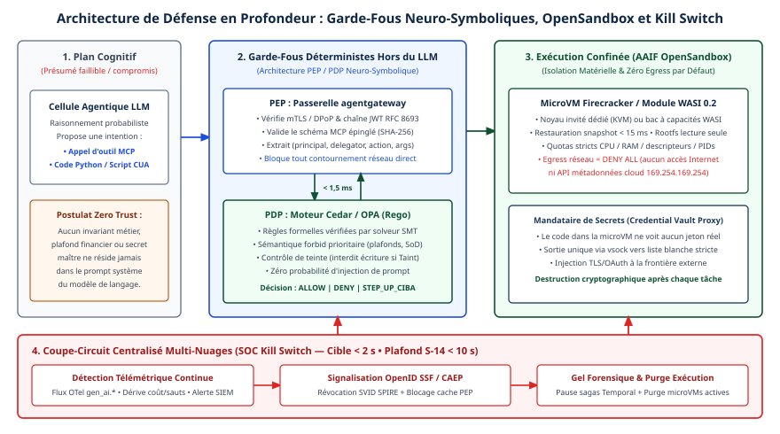

# Chapitre 32 — Assurance

*Question directrice : comment démontrer qu'un système d'agents se comporte comme prévu ?*

> **État de référence :** prépublication arXiv 2608.01558 (3 août 2026), NIST SP 800-207 (août 2020), Agentic Trust Framework (billet du 2 février 2026), AIUC-1 dans sa livraison du 15 octobre 2026, page du groupe W3C Agent Conformance and Benchmarking consultée le 11 novembre 2026. Les numéros entre crochets renvoient aux sources en fin de chapitre; [13] et [14] sont secondaires.

Les chapitres 29 à 31 répondent à trois questions : qui est l'agent, que peut-il faire, qu'est-ce qui le menace. Il en reste une quatrième, celle d'un comité de risque, d'un auditeur ou d'un client : sur quoi repose l'affirmation que le système fait ce qui est prévu, et rien d'autre ? « Assurance » désigne ici cette démonstration, et non la couverture financière d'un sinistre, traitée au chapitre 36.

Pour un logiciel déterministe, la démonstration s'appuie sur des tests répétables et sur la revue du code. Un agent choisit ses actions à l'exécution, à partir d'un contenu qu'il ne maîtrise pas. La thèse de ce chapitre est qu'en novembre 2026 aucune preuve unique ne suffit. L'assurance se compose de quatre éléments partiels : des invariants vérifiés sur la trajectoire entière, une application des règles placée hors de l'agent, une attestation par un tiers et des tests adverses adaptatifs. Chacun a une limite connue.

---

## 32.1 Limites du contrôle action par action

### Ce que voit un garde-fou

La plupart des contrôles déployés autour des agents jugent une action à la fois : cet appel d'outil est-il permis, cet argument est-il valide, cette sortie contient-elle une donnée sensible ? Les points d'application du chapitre 30 fonctionnent ainsi. Ils sont nécessaires, mais un contrôle sans état ignore ce que les actions précédentes ont déjà fait.

Une prépublication d'août 2026 (Lotfi, Shanto, Karim et Bertino) en fait son argument central : des actions permises une à une peuvent, ensemble, violer une contrainte du système [1]. Deux exemples :

- Un agent d'ordonnancement d'un réseau 5G abaisse peu à peu la priorité d'une tranche réservée à la sécurité publique. Chaque réallocation passe les vérifications locales; la fenêtre de rétablissement imposée par la norme est pourtant dépassée.
- Un agent clinique accélère plusieurs congés d'hôpital, chacun justifié, et enfreint la durée d'observation cumulée prévue par le parcours de soins.

Aucun adversaire n'intervient : la violation naît de la trajectoire.

Le même article relève qu'un agent peut effectuer des milliers d'appels d'outils pendant qu'un humain n'examine qu'une poignée de décisions [1]. L'approbation au cas par cas ne corrige pas le défaut : l'approbateur voit une action, pas la série (chapitre 22).

### Ce que les protocoles ne relient pas

Le constat le plus utile pour un architecte : les protocoles d'outils définissent les actions disponibles, les normes d'un domaine définissent les séquences permises, et rien ne relie les deux [1]. Un outil MCP se décrit par un nom, une description et des schémas (chapitre 5). Une règle comme « jamais après telle autre opération » n'y a pas de place.

Trois familles de règles échappent ainsi au contrôle par action.

- **Le cumul** : un plafond qui porte sur la somme des actions, non sur chacune.
- **L'ordre** : une action interdite après une autre, ou exigée avant; la séparation des tâches en est le cas classique.
- **La durée** : une fenêtre à respecter, un délai maximal entre deux états.

---

## 32.2 Assurance de trajectoire

### Deux définitions

L'article emploie deux notions sans les définir formellement [1]. Le **confinement comportemental**, qu'il tient pour le défi le plus fondamental, consiste à maintenir une trajectoire d'exécution dans l'enveloppe de comportement fixée par les normes applicables. L'**assurance de trajectoire**, terme de son titre, se lit ici comme la vérification que la trajectoire, à mesure qu'elle évolue, satisfait les contraintes du système pendant toute l'exécution, et non aux seuls points de décision.

### Pourquoi les mécanismes actuels ne suffisent pas

| Mécanisme | Limite relevée par l'article [1] |
|---|---|
| Gardes à l'exécution | Sans état; jugent une action isolée |
| Compilation d'une politique en spécification formelle par un modèle de langage | Ni complétude ni fidélité garanties |
| Moniteurs probabilistes appris sur des traces | Non ancrés dans une politique explicite |
| Règles temporelles appliquées à l'exécution | Écrites à la main, pour un seul agent |
| Bancs d'essai | La plupart ne comportent pas de politique explicite |

### Trois surfaces, un même argument

L'article étend le raisonnement au-delà de l'agent isolé [1]. À l'échelle d'un agent, il n'existe pas de séparation fiable entre données et instructions. Entre agents, les capacités annoncées dans une Agent Card A2A sont autodéclarées et l'identité ne se propage pas d'un saut de délégation au suivant (chapitres 6 et 30). Sous les deux, le routeur qui choisit un modèle par requête forme une troisième surface (chapitre 44).

Les auteurs concluent que la sécurité devrait être une propriété vérifiable des architectures, des protocoles et des environnements d'exécution, et non une couche facultative de recommandations.

### Le statut de la proposition

Ce texte est un article de vision de six pages, accepté au volet « Visionary » du ACM AI Leadership Summit 2026 [1]. Il ne rapporte aucune expérience et ne propose aucun système. L'assurance de trajectoire est, à ce jour, un programme de recherche et non un produit.

### Ce qui est faisable maintenant

Ces gestes sont une déduction de ce chapitre, non de l'article.

1. **Écrire les invariants.** Pour chaque processus confié à un agent, recenser les règles de cumul, d'ordre et de durée, et les exprimer sous une forme vérifiable par programme.
2. **Les vérifier dans un composant à état, hors de l'agent.** Une passerelle (chapitre 24) ou un moteur d'orchestration déterministe (chapitre 17) tient le compte que l'agent ne tient pas. Le patron Simplex en est la forme en sûreté fonctionnelle; hors connexion, un plafond cumulatif se répartit d'avance en droits (chapitre 46).
3. **Rattacher chaque action à une trajectoire.** Sans identifiant de corrélation, aucune reconstitution n'est possible (chapitres 30 et 33).
4. **Prévoir la sortie.** Un seuil d'alerte avant la violation, puis l'arrêt, la compensation (chapitre 18) ou l'escalade vers un humain (chapitre 22).

Ces invariants restent écrits à la main : c'est la limite même que l'article relève, et leur complétude n'est pas démontrée.

---

## 32.3 Zero trust appliqué aux agents

### Le modèle de référence

La publication NIST SP 800-207, d'août 2020, définit le zero trust comme un paradigme centré sur la protection des ressources, fondé sur la prémisse que la confiance n'est jamais accordée implicitement et doit être évaluée en continu [2]. L'identité y couvre les personnes et les entités non humaines. Tout accès passe par un point de décision et un point d'application. Ce qui se trouve au-delà du dernier point d'application forme une « zone de confiance implicite », où tout est tenu pour également fiable; l'objectif est de la réduire au minimum.

Le texte énonce sept principes [2]. Quatre s'appliquent directement à un agent.

| Principe de SP 800-207 | Lecture pour un agent |
|---|---|
| 3. Accès par session, au moindre privilège; l'accès à une ressource n'en ouvre aucune autre | Un jeton par ressource et par tâche, sans relais (chapitre 5) |
| 4. Politique dynamique, qui peut inclure des attributs comportementaux | La décision peut tenir compte de la trajectoire |
| 6. Autorisation réévaluée pendant la transaction | Révocation en cours de tâche (chapitre 30) |
| 7. Collecte étendue sur l'état des actifs et des communications | Télémétrie d'agent (chapitre 33) |

### Où se trouve la zone de confiance implicite

Pour un agent, cette zone est la fenêtre de contexte. Un résultat d'outil, un document récupéré, le message d'un autre agent : tout ce qui y entre est traité par le modèle au même niveau, faute de séparation fiable entre données et instructions [1]. Un point d'application logé dans l'agent se trouve donc à l'intérieur de la zone qu'il devrait garder. Le contrôle doit se situer entre l'agent et la ressource. Le chapitre 30 aboutit à la même conclusion pour l'approbation : recueillie dans l'hôte, elle ne prouve rien.

SP 800-207 précise que ses principes visent le travail au sein d'une organisation ou avec des partenaires, non les processus publics anonymes [2]. Les agents qui traitent avec des tiers inconnus sortent donc de son périmètre (chapitre 29).

### L'Agentic Trust Framework

La Cloud Security Alliance a publié le 2 février 2026 un billet présentant l'Agentic Trust Framework (ATF), spécification ouverte sous licence CC BY 4.0 qui transpose le zero trust aux agents [3]. Elle s'organise en cinq éléments, chacun résumé par une question : identité (qui es-tu ?), comportement (que fais-tu ?), gouvernance des données (que consommes-tu, que produis-tu ?), segmentation (où peux-tu aller ?) et réponse aux incidents (et si tu dérapes ?).

L'ATF ajoute quatre niveaux d'autonomie : *Intern* (observer et signaler), *Junior* (recommander, chaque action étant approuvée), *Senior* (agir dans des garde-fous, avec notification après coup), *Principal* (agir en autonomie dans un domaine). Passer au niveau suivant exige de franchir cinq portes : performance, validation de sécurité, valeur d'affaires, dossier d'incidents et approbation de gouvernance [3].

L'apport du cadre est de lier la preuve accumulée à l'autonomie accordée, idée qu'on retrouve aux chapitres 22 et 34. Trois réserves s'imposent. Le billet est signé par l'auteur du cadre, Josh Woodruff, de MassiveScale.AI, et non par un comité. Les seuils chiffrés de promotion (durée au palier, exactitude, disponibilité) sont des choix d'auteur. Les correspondances réglementaires y sont qualifiées d'illustratives [3]. Selon la presse spécialisée, la CSA aurait repris l'intendance de la spécification en mai 2026 [14]. Aucune donnée d'adoption indépendante n'a été trouvée.

---

## 32.4 Certification et conformité

### Des instruments de natures différentes

Les cadres cités ensemble dans les appels d'offres ne font pas le même travail.

| Instrument | Nature | Certifiable | Ce qu'il permet d'affirmer |
|---|---|---|---|
| AIUC-1 | Norme privée de certification d'agents | Oui, pour un an [4] | Un agent donné a passé un audit et des évaluations techniques |
| ISO/IEC 42001 | Système de management de l'IA | Oui [13] | L'organisation gère son IA; pas de contrôles techniques propres aux agents (chapitre 35) |
| CSA MAESTRO | Méthode de modélisation des menaces | Non [8] | Une analyse structurée a été menée |
| OWASP Top 10 for Agentic Applications | Liste de risques | Non [13] | Un vocabulaire commun (chapitre 31) |
| W3C Agent Conformance and Benchmarking | Groupe communautaire | Non; rien de publié [7] | Rien encore |

### AIUC-1

AIUC-1 se présente comme la certification technique de la sécurité des agents. Elle est maintenue par l'Artificial Intelligence Underwriting Company [4]. Ses exigences se répartissent en six domaines : données et vie privée, sécurité, sûreté, fiabilité, imputabilité, société [4][6].

Le processus compte quatre étapes [4]. Le cadrage fige la version de la norme pour un an. AIUC mène les évaluations et annonce de 1 000 à 5 000 scénarios de test, puis des reprises trimestrielles. Un auditeur accrédité examine ensuite les contrôles. Le certificat vaut un an.

La norme est révisée chaque trimestre. Les titres des livraisons de 2026 donnent la direction : exigences de preuve en janvier; sécurité de MCP et permissions d'agents en avril; agents de programmation en juillet; modèles à poids ouverts et tests par des tiers en octobre [5]. Le site affiche des correspondances avec MITRE ATLAS, ISO 42001, le règlement européen, le NIST AI RMF et les listes OWASP, et présente comme certifiés des agents de Cursor, Fin, ElevenLabs, Harvey, UiPath, KPMG et Sierra [4][5].

Quatre réserves s'imposent.

**La portée.** Le certificat vise l'agent d'un fournisseur, sur une version figée de la norme. Il ne dit rien du déploiement chez l'acheteur : ses outils, ses données, ses permissions. Un billet de fournisseur le dit aussi : le certificat reflète les contrôles à un moment donné, et l'acheteur doit encore tester et surveiller ce qu'il déploie [13].

**L'indépendance.** La société qui maintient la norme mène aussi les évaluations adverses. L'audit revient à un tiers accrédité, mais un seul auditeur est nommé, Schellman, dont l'accréditation a été annoncée le 3 février 2026 [4][5].

**La vérifiabilité.** La liste complète des contrôles n'a pas été lue pour ce chapitre [6]. L'affirmation selon laquelle la certification couvre les dix risques agentiques d'OWASP est un titre de l'éditeur [5].

**Le rythme.** Une révision trimestrielle suit la menace, mais deux certificats émis à six mois d'écart n'attestent pas la même chose.

### Le groupe W3C

Le groupe communautaire Agent Conformance and Benchmarking a été proposé le 25 août 2026 et lancé le 30 [7]. Il veut produire des méthodes ouvertes et reproductibles pour mesurer si des ressources web et des systèmes d'agents répondent aux exigences des agents autonomes. Les livrables prévus comprennent une grille de préparation, un jeu de contrôles de gouvernance, des suites de conformité exécutables et un format de rapport.

La page recense 29 participants et aucun document. Elle rappelle qu'un groupe communautaire ne représente pas nécessairement les vues du W3C. C'est un chantier à suivre, pas un référentiel.

### MAESTRO et le dossier interne

MAESTRO, cadre de Ken Huang publié par la CSA le 6 février 2025, décompose un système agentique en sept couches (chapitre 31) [8]. Pour l'assurance, un modèle de menaces documenté justifie le choix des invariants et des tests.

Aucun de ces instruments ne remplace un dossier tenu par l'entreprise : invariants retenus, preuves que les contrôles s'appliquent hors de l'agent, résultats de tests, journaux d'audit (chapitre 30). Les obligations réglementaires relèvent du chapitre 35.

---

## 32.5 Tests adverses

### L'attaquant joue en second

Une défense évaluée contre une liste fixe d'attaques n'est pas évaluée. Une prépublication d'octobre 2025 l'a montré : douze défenses récentes contre le débridage et l'injection de prompt, qui rapportaient pour la plupart un taux de succès d'attaque proche de zéro, cèdent le plus souvent à plus de 90 % devant un attaquant adaptatif, c'est-à-dire qui connaît la défense et optimise contre elle [9].

### Les bancs statiques surestiment

AutoDojo, prépublication de juin 2026 révisée en septembre, transpose l'argument aux agents [10]. Ce banc d'essai génère en boîte noire des injections indirectes adaptées à l'agent et à la défense visés. Sur dix défenses et cinq modèles, les auteurs concluent que les bancs statiques surestiment souvent l'efficacité des défenses, que la plupart sacrifient beaucoup d'utilité ou restent vulnérables, et que les tâches sous-spécifiées sont les plus exposées. Une consigne vague est donc à la fois une cause d'échec (chapitre 21) et une surface d'attaque.

### L'application hors bande : un signal, pas une preuve

Une troisième prépublication examine les défenses qui appliquent une politique déterministe hors du modèle, plutôt que d'entraîner celui-ci à refuser [11]. Elle les rattache à trois notions classiques : protection d'intégrité, moniteur de référence, moindre privilège. Dans une reproduction que ses auteurs qualifient d'indépendante, sur un sous-échantillon du banc AgentDojo, l'une d'elles, Progent, ramène le succès moyen des attaques de 25,8 % à 4,2 %; les auteurs, affiliés à un éditeur d'outils de sécurité d'agents, n'ont pas fait évaluer le texte par les pairs; une attaque adaptative écrite à la main ne le fait pas remonter (2,6 %).

Les auteurs bornent eux-mêmes ce résultat : un seul point de mesure, un petit modèle à poids ouverts, un seul gabarit d'attaque, aucune attaque optimisée en boîte blanche. Il est compatible avec l'hypothèse qu'une application hors bande résiste mieux qu'une détection dans le modèle, sans l'établir. Il va dans le sens de la section 32.3.

### Un programme de tests

La CSA a publié le 28 mai 2025 un guide de tests adverses pour l'IA agentique [12]. Il demande d'éprouver des flux complets et non des comportements de modèle isolés, de couvrir les dépendances entre agents et de mener l'exercice en continu.

Cinq règles s'en dégagent.

1. Tester le système déployé, avec ses outils et ses permissions, non le modèle seul.
2. Employer un attaquant adaptatif; un score sur banc statique est une borne optimiste.
3. Mesurer ensemble sécurité et utilité : une défense qui bloque tout ne démontre rien.
4. Rejouer les tests à chaque changement de modèle, de prompt ou d'outil, ou à chaque passage à un modèle distillé (chapitres 34 et 47).
5. Ajouter des tests de trajectoire sans adversaire, qui vérifient les invariants de la section 32.2.

---

## Grille de décision

| Décision | Option par défaut | Quand s'en écarter |
|---|---|---|
| Unité de contrôle | L'action et la trajectoire [S] | Agent en lecture seule, sans effet cumulatif : l'action suffit |
| Lieu de vérification des invariants | Composant à état hors de l'agent [S] | — |
| Point d'application des politiques | Entre l'agent et la ressource [N] | Contrôle dans l'hôte en complément seulement |
| Niveau d'autonomie | Accordé par paliers, sur preuve consignée [É] | Tâche réversible à faible enjeu |
| Certificat d'un fournisseur | Critère de présélection, complété par des tests internes [É] | Jamais comme preuve unique |
| Évaluation d'une défense | Attaquant adaptatif; sécurité et utilité mesurées ensemble [M] | Banc statique comme test de non-régression |
| Fréquence des tests | À chaque changement de modèle, de prompt ou d'outil [S] | — |

---

## Points à retenir

- Des actions permises une à une peuvent violer ensemble une règle du système, sans adversaire. Les règles de cumul, d'ordre et de durée échappent au contrôle par action.
- L'assurance de trajectoire est un programme de recherche. Écrire les invariants et les vérifier hors de l'agent est faisable maintenant, sans garantie de complétude.
- Pour un agent, la zone de confiance implicite est la fenêtre de contexte. Le point d'application se place entre l'agent et la ressource.
- L'Agentic Trust Framework lie la preuve accumulée à l'autonomie accordée. Son adoption n'est pas mesurée.
- AIUC-1 est la seule certification propre aux agents repérée. Elle atteste l'agent d'un fournisseur pour un an, non son déploiement chez l'acheteur. Le groupe W3C sur la conformité, lancé en août 2026, n'a rien publié.
- Une défense évaluée sur un banc statique est souvent surestimée; seul un attaquant adaptatif donne une mesure crédible.
- L'application déterministe hors du modèle est une piste prometteuse, sur la foi d'un seul résultat à petite échelle.
- Démontrer, en 2026, c'est assembler un dossier de preuves partielles et en nommer les limites.

---

## Sources

Pages primaires lues le 11 novembre 2026 :

1. [Securing Agentic AI: From Per-Action Checks to Trajectory Assurance (arXiv 2608.01558)](https://arxiv.org/abs/2608.01558) — notice et texte HTML.
2. [NIST SP 800-207, Zero Trust Architecture](https://nvlpubs.nist.gov/nistpubs/SpecialPublications/NIST.SP.800-207.pdf) — section 2.
3. [CSA — The Agentic Trust Framework](https://cloudsecurityalliance.org/blog/2026/02/02/the-agentic-trust-framework-zero-trust-governance-for-ai-agents)
4. [AIUC-1 — page d'accueil](https://www.aiuc-1.com/)
5. [AIUC-1 — fil des publications](https://www.aiuc-1.com/research) — titres et dates seulement.
6. [AIUC-1 — présentation de la norme](https://standard.aiuc-1.com/)
7. [W3C Agent Conformance and Benchmarking Community Group](https://www.w3.org/community/agent-conformance/)
8. [CSA — MAESTRO](https://cloudsecurityalliance.org/blog/2025/02/06/agentic-ai-threat-modeling-framework-maestro)
9. [The Attacker Moves Second (arXiv 2510.09023)](https://arxiv.org/abs/2510.09023) — résumé.
10. [AutoDojo (arXiv 2606.15057)](https://arxiv.org/abs/2606.15057) — résumé.
11. [Adaptive Evaluation of Out-of-Band Defenses (arXiv 2606.26479)](https://arxiv.org/abs/2606.26479) — résumé.
12. [CSA — Agentic AI Red Teaming Guide](https://cloudsecurityalliance.org/artifacts/agentic-ai-red-teaming-guide) — page de présentation.

Sources secondaires :

13. [Pillar Security — cadres de sécurité pour agents](https://www.pillar.security/blog/best-ai-security-frameworks-for-ai-agents-2026) — billet de fournisseur, lu.
14. [Campus Technology — la CSA élargit ses travaux sur l'IA agentique (6 mai 2026)](https://campustechnology.com/articles/2026/05/06/cloud-security-alliance-expands-focus-on-governance-and-assurance-for-agentic-ai-systems.aspx) — résumé de recherche seulement, page non lue.

## Limites de ce chapitre

- Les sources [9], [10] et [11], d'abord connues par leur seul résumé, ont été relues au-delà du résumé le 14 novembre 2026, par un outil qui en rend des extraits; les écarts relevés sont corrigés dans le texte.
- Les pages ont été lues au moyen d'un outil qui en restitue une synthèse; une nuance a pu se perdre. Seul le texte de SP 800-207 a été lu directement.
- Pour [9], [10] et [11], seuls les résumés ont été lus. Ce sont des prépublications; leur évaluation par les pairs n'a pas été vérifiée.
- La liste des contrôles d'AIUC-1 et le texte de ses livraisons trimestrielles n'ont pas été lus. Les nombres de scénarios de test sont ceux qu'annonce l'éditeur. L'activité d'assurance d'AIUC relève de la section 36.5.
- Le caractère certifiable d'ISO/IEC 42001 et le statut de la liste OWASP reposent sur un billet de fournisseur [13], concordant avec les chapitres 31 et 35; les documents d'origine n'ont pas été lus.
- La spécification ATF sur GitHub, le guide de tests adverses de la CSA et la page [14] n'ont pas été lus.
- L'audit du 12 novembre 2026 a relu [1] (notice et texte), [3], [4], [5], [7], [10] et [11].
- Les lectures « pour un agent » de SP 800-207, les trois familles de règles, les quatre gestes de la section 32.2 et les cinq règles de la section 32.5 sont des déductions de ce chapitre.

## Mise en œuvre — Défense en profondeur : bacs à sable, garde-fous neuro-symboliques et coupe-circuits {.volet}

:::: {.encadre .executive}
::: {.encadre-titre}
**Synthèse exécutive**
:::

- **Enjeu d’affaires et de risque** : Même avec une identité NHI en place (chapitre 30) et des schémas MCP épinglés (chapitre 31), un modèle de langage reste un moteur probabiliste faillible : une entrée inédite peut le tromper, et il peut inventer un paramètre destructeur. Une architecture qui confie le dernier mot de sécurité à une consigne du prompt système, ou qui exécute le code généré par un agent dans un conteneur partagé, s’expose à une compromission d’infrastructure (ASI05) ou à une dérive financière incontrôlée (ASI08/ASI10).
- **Décisions architecturales structurantes** :
  1.  *Irréversible et non négociable* : Externaliser 100 % des invariants métiers et de sécurité hors du modèle, vers un point de décision (PDP) déterministe fondé sur Cedar ou OPA (Rego), évalué en coupure obligatoire sur la passerelle agentgateway, qui joue le rôle de point d’application (PEP).
  2.  *Structurante pour l’exécution de code et l’usage d’ordinateur (CUA)* : Exclure l’exécution sur un noyau hôte partagé. Le code s’exécute dans des bacs à sable matériels éphémères (microVMs Firecracker ou modules WASI), pilotés par le protocole OpenSandbox de la Linux Foundation AAIF, sans sortie réseau par défaut.
  3.  *Opérationnelle dès la mise en service* : Relier toute la flotte à un coupe-circuit SOC multi-nuages, testé chaque trimestre, qui révoque les identités, fige les sagas durables et détruit les bacs à sable actifs sous le plafond d’homologation de dix secondes (cible interne : moins de deux secondes).
- **Indicateurs de gouvernance associés** : Taux de couverture des outils mutatifs par des règles formelles Cedar/OPA vérifiées par solveur SMT (cible : 100 %), latence d’évaluation du PDP au 99e centile ($< 2\,\text{ms}$), pourcentage de bacs à sable dont la sortie réseau est refusée par défaut (100 %), temps d’arrêt effectif mesuré en exercice (MTTR-Stop $< 2{,}0\,\text{s}$, plafond normatif $< 10\,\text{s}$).
::::

## 32.6 Isolation d’exécution : microVMs (Firecracker), OpenSandbox (AAIF) et bacs à sable WebAssembly (WASI)

Le principe directeur est de présumer la compromission cognitive du modèle. Un agent d’analyse financière qui écrit et exécute un script Python sur une feuille de calcul envoyée par un tiers, un agent d’ingénierie qui compile un correctif sur un dépôt de code, un agent d’usage d’ordinateur (CUA) qui pilote un navigateur complet sur un portail externe sans API : chacun exécute, par définition, du code non fiable généré dynamiquement sous l’influence d’entrées potentiellement hostiles (OWASP ASI05).

### Pourquoi le conteneur Linux standard (Docker / runc) ne suffit pas face à ASI05

Encapsuler l’interpréteur Python ou le navigateur de l’agent dans un conteneur Kubernetes ordinaire ne constitue pas un bac à sable suffisant. Les espaces de noms Linux (`namespaces`) et les groupes de contrôle (`cgroups`) d’un conteneur OCI standard restreignent la visibilité, mais le conteneur partage le noyau Linux de l’hôte (plus de 30 millions de lignes de code C, plus de 300 appels système `syscalls`) avec tous les autres pods du même nœud.

Un attaquant qui oriente la génération de code vers une vulnérabilité noyau récente (escalade de privilèges), qui épuise des descripteurs internes ou qui sonde le réseau local du cluster fait régulièrement céder la paroi d’un conteneur `runc` ordinaire. En 2027, l’isolation d’exécution se répartit donc en trois primitives complémentaires, fédérées par une couche protocolaire ouverte.

### Les trois primitives d’isolation et le standard fédérateur OpenSandbox (AAIF)

1.  **Noyaux d’espace utilisateur (gVisor / `runsc`)** : gVisor intercepte les appels système de l’application invitée dans un noyau de sécurité écrit en Go, en espace utilisateur (*Sentry*), et ne laisse passer vers le noyau hôte qu’une fraction restreinte de primitives. C’est un compromis adapté au durcissement de serveurs MCP existants : pas de pénalité mémoire lourde, mais un surcoût sur les entrées/sorties disque intensives.
2.  **Micro-machines virtuelles matérielles (Firecracker / Cloud Hypervisor sur KVM)** : Conçu pour le calcul multi-locataire hostile, Firecracker établit une frontière de virtualisation matérielle complète (Intel VT-x / AMD-V / ARM Virtualization Extensions), avec un moniteur minimal écrit en Rust (\~50 000 lignes de code, sans périphériques patrimoniaux superflus). Chaque session d’agent dispose de son propre noyau Linux invité. Grâce à la restauration différentielle d’instantanés mémoire (chargement paresseux `uffd`), une microVM Python préchauffée, avec `pandas`, `polars` et `scipy` déjà en mémoire, démarre en 8 à 15 millisecondes, ce qui rend l’isolation matérielle compatible avec un usage interactif.
3.  **Bacs à sable à capacités WebAssembly (WASI 0.2+ Component Model)** : Pour un connecteur de transformation déterministe, un parseur documentaire ou un outil MCP léger qui n’exige pas un système d’exploitation POSIX complet, WebAssembly offre des garanties par construction : mémoire linéaire bornée, aucun appel système implicite et modèle de capacités explicites. Un module WASI ne voit ni l’horloge, ni le système de fichiers, ni une prise réseau tant que l’hôte ne lui remet pas la poignée correspondante. Le démarrage prend de 0,2 à 2 millisecondes, pour une empreinte de quelques mégaoctets.
4.  **La couche d’abstraction ouverte OpenSandbox (Linux Foundation AAIF)** : Versé à l’*Agentic AI Foundation* aux côtés de MCP et A2A, OpenSandbox lève le verrouillage fournisseur des environnements d’exécution d’agents en normalisant un *Sandbox Protocol* : une API de cycle de vie (`create`/`pause`/`snapshot`/`destroy`) et une API d’exécution de commandes et de fichiers. L’équipe code son agent une seule fois contre le SDK OpenSandbox : le flux tourne sur un conteneur local en développement et passe sans modification à un pool haute densité de microVMs Firecracker sur Kubernetes en production.

OpenSandbox intègre aussi deux contrôles contre l’exfiltration de données : le refus de toute sortie réseau par défaut (`defaultEgress: DENY_ALL`) et un mandataire externe de justificatifs (*Credential Vault Proxy*). Au lieu d’injecter un jeton OAuth ou une clé API dans une variable d’environnement de la microVM, où le code généré par l’agent pourrait le lire par `os.environ` et l’exfiltrer par stéganographie, on retire toute interface réseau routable à la microVM. Elle ne communique que par un canal `vsock` avec un mandataire de l’hôte, qui vérifie la destination contre une liste blanche stricte et ajoute l’en-tête Authorization à l’extérieur de la frontière de virtualisation.

| Dimension d’ingénierie | Conteneur OCI standard (`runc`) | Noyau utilisateur (gVisor) | MicroVM matérielle (Firecracker) | Composant WebAssembly (WASI 0.2) | OpenSandbox (AAIF sur Firecracker) |
|:--------------|:----------------|:-----------------|:----------------|:------------------|:-----------------|
| Frontière de sécurité | Noyau hôte partagé (`namespaces`/`seccomp`) | Interception `syscalls` en espace utilisateur | Virtualisation CPU matérielle (KVM) | Mémoire linéaire et capacités Wasm | Matérielle KVM + mandataire de secrets hors VM |
| Démarrage (à froid / depuis un instantané) | 150 – 400 ms | 200 – 500 ms | 125 ms à froid / \< 15 ms depuis un instantané | 0,2 – 2 ms | 10 – 18 ms (pool préchauffé) |
| Surcoût mémoire par instance | \~15 Mo | \~35 – 60 Mo | \~25 – 45 Mo (avec déduplication) | 1 – 5 Mo | \~30 Mo actif / 0 Mo mis sur disque |
| Compatibilité de l’écosystème | 100 % Linux natif | \~97 % Linux (hors ioctl bas niveau) | 100 % Linux, binaires C/Python, CUA | Langages compilables vers `wasm32-wasip2` | 100 % Linux + API unifiée multi-SDK |
| Protection des secrets et sortie réseau | Configuration CNI manuelle fragile | Configuration CNI externe | Réseau TAP à configurer soi-même | Aucune capacité réseau par défaut | Natif : refus de la sortie + injection externe |
| Cas d’usage nominal 2027 | Orchestrateurs internes déterministes | Serveurs MCP métiers internes | Exécution de code Python/Bash arbitraire | Parseurs, validateurs et greffons rapides | Standard d’entreprise pour le code d’IA et les CUA |

Le gabarit suivant décrit l’environnement de l’analyste Python de Boréal : aucune entrée réseau, sortie refusée par défaut, secrets injectés hors de la VM.

#### Extrait 32.1 — Profil déclaratif OpenSandbox sans egress réseau et mandataire de secrets hors VM

``` yaml
apiVersion: sandbox.aaif.org/v1
kind: SandboxTemplate
metadata:
  name: boreal-python-analyst-isolated
  namespace: boreal-agent-sandboxes
spec:
  runtimeClass: "firecracker-kvm-snapshot"
  baseSnapshotId: "snap-py312-polars-202702-signed"
  lifecycle:
    maxWallClockSeconds: 180
    idleSuspendAfterSeconds: 30
    destroyAndScrubMemoryOnExit: true
  resources:
    vcpuCount: 2
    memoryMiB: 512
    maxPids: 64
    ephemeralScratchMiB: 256
  filesystem:
    rootReadOnly: true
    writablePaths: ["/tmp/work"]
    blockHostMounts: true
  networkPolicy:
    ingress: "NONE"
    defaultEgress: "DENY_ALL"
    # Bloque matériellement l'IMDS 169.254.169.254 et fd00:ec2::254
    blockCloudMetadataIp: true
    allowedVsockProxyRoutes:
      - name: "internal-snowflake-readonly-gateway"
        destinationHost: "agentgateway.internal.boreal.ca"
        destinationPort: 443
        allowedPathPrefix: "/mcp/bca-snowflake-analytics/"
        credentialInjection:
          # Le secret n'entre jamais dans la RAM de la microVM invitée
          mode: "HOST_SIDE_PROXY_INJECT"
          tokenExchangeAudience:
            "mcp://gateway.boreal.ca/mcp/bca-snowflake-analytics"
          maxRequestsPerSession: 12
```

------------------------------------------------------------------------

## 32.7 Évaluation continue PDP/PEP hors du modèle : OPA (Rego), Cedar et raisonnement automatisé

OpenSandbox confine où et comment le code s’exécute. Il reste à décider quels appels d’outils MCP et quelles délégations A2A l’agent a le droit d’émettre. Ce volet part de l’hypothèse qu’un système probabiliste ne se sécurise pas uniquement avec un second système probabiliste : un modèle juge placé devant l’agent principal réduit le bruit statistique, mais laisse une probabilité jointe d’échec strictement positive face à une entrée adversariale bien construite. La section 32.5 ne l’établit pas : elle donne un signal, non une preuve, sur un seul point de mesure.

Pour tout invariant d’affaires, réglementaire ou de sécurité (plafond d’engagement en dollars, interdiction d’écrire depuis une session teintée par un document externe, séparation des tâches, restriction horaire), la vérification s’exécute dans un moteur symbolique déterministe, placé hors de portée du modèle de langage. Le PEP et le PDP décrits plus bas relèvent des gestes 1 et 2 de la section 32.2 : écrire les invariants, les vérifier hors de l’agent.



### Architecture neuro-symbolique PEP / PDP en coupure obligatoire

L’architecture de la figure sépare le raisonnement neuronal, qui propose une intention d’action, du contrôle symbolique, qui statue sur son admissibilité :

1.  Le point d’application (PEP, agentgateway) intercepte 100 % des requêtes JSON-RPC MCP (`tools/call`) et des messages A2A (`SendMessage`). Aucun serveur MCP d’entreprise n’accepte de trafic réseau direct qui contournerait la passerelle (verrouillage mTLS mutuel). Le PEP valide le jeton RFC 8693, extrait le sujet humain (`sub`), l’agent immédiat (`act.sub`) et l’étiquette de teinte de la session (`sessionTaint`), puis désérialise les arguments typés de l’outil demandé.
2.  Le point de décision (PDP, Cedar ou OPA) évalue cette requête d’autorisation en mémoire locale (bibliothèque embarquée en Rust ou en Go dans le PEP, ou démon auxiliaire (*sidecar*) Unix) contre le référentiel de politiques signées de l’entreprise, en 0,4 à 1,5 milliseconde. Il retourne l’un de trois verdicts : `ALLOW` (transmission immédiate au serveur MCP), `DENY` (rejet avec trace d’audit SIEM) ou `STEP_UP_CIBA` (déclenchement du flux d’approbation humaine hors bande décrit au chapitre 30).

### Choisir entre Open Policy Agent (Rego) et Cedar

Les deux moteurs ouverts dominants en 2027 ont chacun leur domaine :

- **OPA (Rego)**, projet gradué de la CNCF dérivé de Datalog, est expressif sur des documents JSON arbitrairement imbriqués. Il reste la référence pour valider des manifestes d’infrastructure Kubernetes, des configurations de déploiement CI/CD ou des graphes complexes de routage réseau.
- **Cedar**, langage de politiques ouvert conçu autour de la vérification formelle et adopté pour la gouvernance des agents, apporte trois propriétés aux systèmes d’autorisation transactionnels :
  1.  **Terminaison bornée et évaluation sub-milliseconde** : Cedar interdit les boucles non bornées et la récursion générale, ce qui garantit un temps d’évaluation prévisible, en microsecondes pour le moteur seul; les autres chiffres de ce volet, de 0,4 à 2 millisecondes, visent l’appel complet au PDP.
  2.  **Priorité du refus (`forbid` l’emporte sur `permit`)** : Par défaut tout est interdit; une action n’est autorisée que s’il existe au moins une clause `permit` applicable et aucune clause `forbid` satisfaite. Une équipe de sécurité centrale peut ainsi poser trois règles `forbid` cardinales qu’aucune politique `permit` locale, écrite par une division métier, ne peut affaiblir par inadvertance.
  3.  **Vérification par solveurs SMT (raisonnement automatisé)** : La sémantique de Cedar se traduit en formules décidables, et Cedar exclut les flottants IEEE 754 au profit d’entiers 64 bits (`Long`), par exemple en cents, pour éliminer tout contournement par arrondi binaire. Le pipeline CI/CD prouve donc avant la mise en production, pour toute requête $q = (p, a, r, c)$, qu’une politique révisée $P'$ respecte l’invariant $\text{Inv}(q)$ :

$$\forall q,\; \text{Cedar}(P', q) = 1 \implies \text{Inv}(q) = 1$$

La preuve porte sur la politique, relativement à l’invariant écrit. La complétude des invariants reste la limite relevée à la section 32.2.

En pratique, OPA (Rego v1) gouverne l’admission d’infrastructure en CI/CD et sur Kubernetes, et Cedar statue en temps réel sur chaque transaction MCP. La politique OPA suivante refuse tout gabarit dont la classe d’exécution n’est ni Firecracker sous KVM ni WASI, dont la sortie réseau n’est pas refusée par défaut, ou dont une route injecte le secret dans la VM.

#### Extrait 32.2 — Politique d’admission OPA (Rego v1) validant les gabarits OpenSandbox

``` rego
package boreal.admission.sandbox

import rego.v1

default allow := false

allow if {
    count(deny) == 0
}

deny contains msg if {
    input.kind == "SandboxTemplate"
    not input.spec.runtimeClass in {"firecracker-kvm-snapshot", "wasmtime-wasi-p2"}
    msg := sprintf("Runtime interdit hors KVM/WASI : %v", [input.metadata.name])
}

deny contains msg if {
    input.kind == "SandboxTemplate"
    input.spec.networkPolicy.defaultEgress != "DENY_ALL"
    msg := "Politique réseau defaultEgress != DENY_ALL refusée (ASI05)"
}

deny contains msg if {
    some route in input.spec.networkPolicy.allowedVsockProxyRoutes
    route.credentialInjection.mode != "HOST_SIDE_PROXY_INJECT"
    msg := sprintf("Secret injecté dans la VM sur la route %v", [route.name])
}
```

Les cinq politiques Cedar suivantes expriment les invariants de Boréal : deux autorisations selon le montant, puis trois clauses `forbid` inconditionnelles.

#### Extrait 32.3 — Politique déterministe Cedar gouvernant les outils MCP financiers et logistiques

``` cedar
// Politique d'entreprise Boréal — Gouvernance déterministe des appels MCP
// Montants exprimés en cents entiers 64 bits (Long) pour décidabilité SMT.

// 1. AUTORISATION NOMINALE L3 : Pré-autorisation garantie (<= 5 000,00 $ CAD)
permit (
  principal is Boreal::AgentIdentity,
  action == Boreal::McpTool::"bca_guidewire__preauthorize_warranty_claim",
  resource is Boreal::WarrantyContract
)
when {
  principal.blueprintId == "bp-bca-warranty-tier2" &&
  principal.attestationValid == true &&
  resource.division == "BCA" &&
  context.hasValidOboToken == true &&
  context.toolArgs.amountCentsCad <= 500000 &&
  context.remainingSagaHops >= 1
};

// 2. AUTORISATION AVEC ESCALADE CIBA VALIDÉE (5 000,01 $ à 50 000,00 $ CAD)
permit (
  principal is Boreal::AgentIdentity,
  action == Boreal::McpTool::"bca_guidewire__preauthorize_warranty_claim",
  resource is Boreal::WarrantyContract
)
when {
  principal.blueprintId == "bp-bca-warranty-tier2" &&
  principal.attestationValid == true &&
  resource.division == "BCA" &&
  context.hasValidOboToken == true &&
  context.toolArgs.amountCentsCad > 500000 &&
  context.toolArgs.amountCentsCad <= 5000000 &&
  context.remainingSagaHops >= 1 &&
  context.cibaApprovalPresent == true &&
  context.cibaVerifiedTxHash == context.computedArgsHash
};

// 3. GARDE-FOU INCONDITIONNEL (FORBID #1) : Séparation des tâches (SoD)
// Aucun approbateur CIBA ne peut autoriser un dossier qu'il a lui-même initié.
forbid (
  principal,
  action == Boreal::McpTool::"bca_guidewire__preauthorize_warranty_claim",
  resource
)
when {
  context.cibaApprovalPresent == true &&
  context.cibaApproverSub == context.initiatingHumanSub
};

// 4. GARDE-FOU INCONDITIONNEL (FORBID #2) : Suivi de teinte (Anti-ASI01/ASI06)
// Une session teintée par une source externe ne peut muter un tiers payé.
forbid (
  principal,
  action in [
    Boreal::McpTool::"bel_sap_ap__update_vendor_bank_account",
    Boreal::McpTool::"bel_sap_mm__override_delivery_address"
  ],
  resource
)
when {
  context.sessionTaint == "UNTRUSTED_EXTERNAL"
};

// 5. GARDE-FOU INCONDITIONNEL (FORBID #3) : Coupe-feu budgétaire et gel SOC
forbid (principal, action, resource)
when {
  principal.killSwitchQuarantined == true ||
  context.sagaConsumedCentsCad >= context.sagaMaxBudgetCentsCad
};
```

La règle `FORBID #2` compare une valeur que le modèle ne peut pas altérer. Même si une technique d’injection de prompt inédite contournait entièrement la vigilance du modèle, l’appel à `update_vendor_bank_account` échouerait sur l’évaluation déterministe de `context.sessionTaint == "UNTRUSTED_EXTERNAL"`.

------------------------------------------------------------------------

## 32.8 Coupe-circuits SOC multi-nuages et révocation des états et des jetons

La dernière ligne de défense répond à la question qu’un conseil d’administration ou un régulateur (BSIF, article 14 du règlement européen sur l’IA sur le contrôle humain effectif) pose au CISO : en combien de secondes le centre d’opérations de sécurité (SOC) peut-il arrêter une flotte d’agents en boucle divergente, ou compromise un dimanche soir sur deux nuages distincts, sans corrompre la comptabilité en cours ? Le coupe-circuit met en œuvre, en urgence, la révocation en cours de tâche que la section 32.3 tire du principe 6 de SP 800-207.

### Pourquoi la désactivation dans l’annuaire IAM ne suffit pas en urgence

Dans une architecture distribuée, désactiver le compte dans l’annuaire d’identité n’a d’effet qu’après cinq à soixante minutes :

- les jetons d’accès JWT déjà émis restent acceptés localement jusqu’à leur `exp` si les passerelles ne reçoivent pas de flux de révocation actif;
- les workflows durables en cours dans Temporal ou Restate gardent leurs files de tâches actives et poursuivent leurs réessais automatiques;
- les bacs à sable OpenSandbox déjà démarrés poursuivent leurs calculs en mémoire vive.

À l’inverse, un interrupteur unique qui couperait toute l’IA de l’entreprise au moindre incident localisé paralyserait inutilement le support client et la logistique. Le coupe-circuit respecte un plafond normatif d’homologation inférieur à dix secondes de bout en bout (S-14, y compris vers des nœuds périphériques distants) et vise moins de deux secondes sur ses plans de contrôle infonuagiques. Il s’articule en quatre paliers, pilotés par le protocole OpenID Shared Signals Framework (SSF / CAEP, *Continuous Access Evaluation Profile*).

| Palier de coupe-circuit | Déclencheurs automatiques ou SOC | Actions atomiques coordonnées (passerelle, STS, moteur d’exécution, bac à sable) | MTTR-Stop cible | Protocole de reprise contrôlée |
|:---------------|:----------------------|:--------------------------|:--------|:--------------------------|
| Palier 1 — Chirurgical (saga unitaire) | Dépassement du budget ou des sauts d’une saga, boucle locale détectée (ASI08) | Invalidation du `sagaId` dans le cache d’agentgateway, signal `pause` sur le workflow Temporal, destruction du bac à sable associé. | \< 500 ms | Inspection de l’historique d’événements par l’équipe AgentOps; compensation de la saga ou reprise corrigée. |
| Palier 2 — Connecteur (outil ou serveur MCP) | Alerte de changement après approbation (SHA-256), erreurs 5xx en grand nombre ou anomalie d’exfiltration sur un outil | Fermeture du disjoncteur sur la route MCP dans agentgateway; mise en attente durable des sagas dépendantes, sans perte d’état. | \< 1,0 s | Revalidation Sigstore du serveur MCP, rotation des identifiants aval, réouverture progressive. |
| Palier 3 — Classe d’agent (*Blueprint*) | Comportement déviant systémique (ASI10), vulnérabilité sur un prompt ou un modèle précis | Diffusion CAEP révoquant tous les jetons où `act.blueprint_id == X`; retrait du `ClusterSPIFFEID` dans SPIRE; gel forensique des sagas actives. | \< 2,0 s | Retour à la version N-1 signée du *Blueprint*, campagne de tests adverses de non-régression, approbation du CISO. |
| Palier 4 — Domaine ou région | Incident cyber majeur multi-systèmes ou compromission d’un cluster régional | Bascule globale d’agentgateway en lecture seule (L1) ou coupure franche; arrêt de tous les pools OpenSandbox de la zone. | \< 2,0 s | Activation du plan de continuité métier manuel ou déterministe; audit forensique complet avant réarmement par paliers. |

Sur les moteurs durables (Temporal, Restate), le coupe-circuit de palier 3 exécute par défaut un gel forensique (suspension de la file de travailleurs) plutôt qu’un arrêt forcé (`terminate`) des sagas engagées à mi-chemin. Figer l’état exact sur disque préserve la preuve pour l’enquête du SOC et permet d’exécuter ensuite les transactions de compensation des réservations déjà faites (chapitre 18), sans stocks verrouillés ni écritures comptables orphelines.

Le playbook SOAR suivant exécute le coupe-circuit de palier 3 : cinq opérations en parallèle, puis un reçu signé.

#### Extrait 32.4 — Orchestrateur Python automatisé de Kill Switch SOC multi-nuages

``` python
# Playbook SOAR / SOC — Coupe-Circuit Palier 3 (Gel d'un Blueprint d'agent)
from __future__ import annotations
import asyncio
import hashlib
import hmac
import json
import time
from dataclasses import dataclass

@dataclass(frozen=True)
class KillSwitchOrder:
    incident_id: str
    blueprint_id: str
    spiffe_id_uri: str
    temporal_task_queue: str
    initiated_by_soc_analyst: str
    reason: str

@dataclass(frozen=True)
class KillSwitchReceipt:
    incident_id: str
    elapsed_ms: float
    caep_broadcast_ok: bool
    gateway_quarantine_nodes: int
    spire_entry_evicted: bool
    temporal_queue_paused: bool
    sandboxes_terminated: int
    audit_hmac_sha256: str

async def execute_tier3_agent_killswitch(
    order: KillSwitchOrder,
    ssf_transmitter,
    gateway_control_plane,
    spire_server_client,
    temporal_admin_client,
    opensandbox_fleet_client,
    worm_audit_signing_key: bytes,
) -> KillSwitchReceipt:
    t0 = time.perf_counter()

    # Exécution parallèle sur les 5 plans de contrôle (cible < 2 000 ms)
    async def broadcast_caep_revocation() -> bool:
        return await ssf_transmitter.publish_security_event(
            event_type=(
                "https://schemas.openid.net/secevent/caep/"
                "event-type/credential-change"
            ),
            subject={"format": "uri", "uri": order.spiffe_id_uri},
            reason_admin=f"[{order.incident_id}] {order.reason}",
        )

    async def quarantine_on_all_gateways() -> int:
        # Pousse principal.killSwitchQuarantined = true dans le cache Cedar
        return await gateway_control_plane.quarantine_blueprint_globally(
            blueprint_id=order.blueprint_id, ttl_seconds=86400
        )

    async def revoke_spire_workload_identity() -> bool:
        return await spire_server_client.suspend_registration_by_spiffe_id(
            order.spiffe_id_uri
        )

    async def freeze_durable_workflows_forensically() -> bool:
        # Gèle la file d'activités sans détruire l'historique d'événements
        return await temporal_admin_client.pause_task_queue_dispatch(
            task_queue=order.temporal_task_queue,
            reason=f"SOC KillSwitch {order.incident_id}",
        )

    async def purge_active_microvms() -> int:
        return await opensandbox_fleet_client.terminate_by_label(
            label_selector=f"agent.boreal.ca/blueprint={order.blueprint_id}",
            scrub_memory=True,
        )

    async with asyncio.TaskGroup() as tg:
        t_caep = tg.create_task(broadcast_caep_revocation())
        t_gw = tg.create_task(quarantine_on_all_gateways())
        t_spire = tg.create_task(revoke_spire_workload_identity())
        t_temp = tg.create_task(freeze_durable_workflows_forensically())
        t_sbx = tg.create_task(purge_active_microvms())

    elapsed_ms = round((time.perf_counter() - t0) * 1000.0, 2)
    payload_for_worm = json.dumps(
        {
            "incident_id": order.incident_id,
            "blueprint_id": order.blueprint_id,
            "analyst": order.initiated_by_soc_analyst,
            "elapsed_ms": elapsed_ms,
            "timestamp_epoch": int(time.time()),
        },
        sort_keys=True,
    ).encode("utf-8")
    signature = hmac.new(
        worm_audit_signing_key, payload_for_worm, hashlib.sha256
    ).hexdigest()

    return KillSwitchReceipt(
        incident_id=order.incident_id,
        elapsed_ms=elapsed_ms,
        caep_broadcast_ok=t_caep.result(),
        gateway_quarantine_nodes=t_gw.result(),
        spire_entry_evicted=t_spire.result(),
        temporal_queue_paused=t_temp.result(),
        sandboxes_terminated=t_sbx.result(),
        audit_hmac_sha256=signature,
    )
```

------------------------------------------------------------------------

## 32.9 Application au fil rouge et éclairages sectoriels

:::: {.encadre .filrouge}
::: {.encadre-titre}
**Fil rouge — Groupe Boréal : déploiement du PDP Cedar vérifié formellement et exercice trimestriel du coupe-circuit SOC**
:::

**Défi opérationnel (T2 2027)** : À l’approche de l’ouverture généralisée de la Fabrique Agentique Boréal aux trois divisions (BSN, BCA et BEL), le comité des risques du conseil d’administration exige deux garanties avant d’autoriser le passage à l’autonomie supervisée L3 sur 15 000 événements quotidiens : (1) la preuve mathématique qu’aucune hallucination de modèle ne peut violer les plafonds de délégation financière ni la Loi 25; (2) la démonstration chronométrée qu’une dérive du type « boucle d’achat à 41 000 \$ CAD », vécue fin 2026, est désormais stoppée en moins de trois secondes.

**Architecture mise en production** :

1.  **Référentiel unifié de 142 politiques Cedar vérifiées par SMT** : Toutes les passerelles agentgateway, déployées en actif-actif sur Azure Canada Central et dans les centres de données sur site de Montréal, embarquent le moteur Cedar en Rust. À chaque demande de tirage Git qui modifie une politique d’accès aux outils MCP, l’analyseur formel `cedar-spec-checker` vérifie 18 théorèmes d’invariance (dont la séparation des tâches BCA, le blocage d’écriture sous teinte externe et le plafond budgétaire par saga). Latence ajoutée mesurée en production : 0,62 ms au 99e centile.
2.  **Pool OpenSandbox sur Firecracker pour l’analytique et les CUA** : Les travailleurs d’analyse vibratoire Python de BSN et les agents d’automatisation d’écrans patrimoniaux de BCA sont migrés des conteneurs standards vers un pool préchauffé de microVMs Firecracker géré par OpenSandbox, avec `defaultEgress: DENY_ALL` et restauration d’instantané en 12 millisecondes.
3.  **Premier exercice trimestriel d’arrêt d’urgence (mai 2027)** : Sans prévenir l’équipe de garde du SOC, l’équipe d’ingénierie du chaos injecte un comportement d’agent déviant (ASI10 + ASI08) sur un clone de production de l’*Agent Réapprovisionnement* de BEL, programmé pour tenter 80 réservations inter-usines par minute et exfiltrer un journal vers une IP externe.

**Chronométrage relevé lors de l’exercice** :

- **$t + 0{,}0\,\text{s}$** : La première tentative de connexion sortante hors liste blanche est bloquée par le pare-feu `vsock` d’OpenSandbox.
- **$t + 1{,}1\,\text{s}$** : Le détecteur de vélocité OpenTelemetry repère l’anomalie de cadence des appels MCP et déclenche automatiquement l’ordre de coupe-circuit de palier 3 (Extrait 32.4).
- **$t + 2{,}4\,\text{s}$ (`MTTR-Stop = 1,3 s` après détection)** : Les 14 instances agentgateway bloquent le *Blueprint*, le `ClusterSPIFFEID` est suspendu, 9 workflows Temporal en vol sont figés en pause forensique et 4 microVMs Firecracker actives sont détruites avec effacement de la mémoire.
- **Impact métier et financier constaté** : 0,00 \$ CAD de perte, 0 écriture erronée dans SAP S/4HANA, reprise nominale sur la version saine précédente en 11 minutes après compensation automatique des baux de réservation.
::::

:::: {.encadre .sectoriel}
::: {.encadre-titre}
**Fournisseurs infonuagiques et SaaS — Isolation multi-locataire du code généré à la volée**
:::

Un éditeur SaaS B2B offre à ses 22 000 entreprises clientes des agents capables d’exécuter des transformations de données personnalisées ou des scripts d’extension. Une évasion de bac à sable ne compromet pas seulement l’éditeur : elle franchit la frontière entre locataires concurrents. Trois mesures supplémentaires s’imposent en environnement multi-locataire hostile :

1.  **Aucune réutilisation de microVM entre locataires** : Un instantané de base vierge peut être partagé en lecture seule (copie sur écriture). Dès qu’une instance Firecracker a reçu le moindre octet du locataire A, elle n’est jamais recyclée pour le locataire B : elle est détruite et ses pages mémoire sont remises à zéro par l’hyperviseur (`MADV_DONTNEED` / `mem_scrub`).
2.  **Canaux auxiliaires du processeur** : Désactivation de l’hyperthreading ou ordonnancement de cœur dédié sur les nœuds qui exécutent du code généré arbitraire, pour neutraliser les canaux auxiliaires micro-architecturaux du cache CPU (L1TF, MDS, variantes Spectre).
3.  **Chiffrement éphémère par locataire des volumes de travail** : Tout espace temporaire `/tmp/work` monté dans la microVM utilise une clé symétrique volatile, générée pour la seule durée de la tâche et purgée à la fin du processus Firecracker.
::::

:::: {.encadre .sectoriel}
::: {.encadre-titre}
**Opérations cyber-physiques et énergie — Modes de repli sûrs à l’activation d’un coupe-circuit**
:::

Dans un centre de tri automatisé, une centrale hydroélectrique ou une usine chimique, déclencher un coupe-circuit informatique sans avoir conçu la physique sous-jacente peut être aussi dangereux que l’anomalie initiale. Si un agent d’optimisation énergétique pilote des consignes de chauffage ou de débit et qu’un palier 3 le fige, les équipements physiques ne doivent pas rester bloqués sur une valeur transitoire instable.

L’architecture IT/OT impose une convention de bail court à battement de cœur côté automate programmable (PLC / SCADA) : toute consigne d’optimisation suggérée par le *System of Action* porte une validité bornée (par exemple 60 secondes). Quand le coupe-circuit SOC fige l’agent et interrompt le renouvellement du bail validé par le jumeau numérique, l’automate bascule sans à-coup vers sa loi de commande nominale locale, déterministe et pré-programmée (état de repli sûr). L’installation reste ainsi continue sur le plan physique, sans dépendre du réseau informatique.
::::

------------------------------------------------------------------------

## 32.10 Décision d’architecture normative et points de contrôle

:::: {.encadre .adr}
::: {.encadre-titre}
**ADR-020 — Découplage systématique des garde-fous déterministes (Cedar/OPA) et exécution en microVM isolée**
:::

- **Statut** : Acceptée \| Périmètre : sécurité à l’exécution et SOC \| Révision : semestrielle
- **Contexte** : Les modèles de langage restent probabilistes et vulnérables aux entrées adversariales inédites. Leur confier le respect des plafonds métiers, ou exécuter le code qu’ils produisent dans des conteneurs à noyau partagé, crée un risque inacceptable d’escalade système (ASI05) et de pertes opérationnelles rapides (ASI08/ASI10).
- **Options évaluées** :
  1.  *Garde-fous purement neuronaux (modèles modérateurs en série) et conteneurs Docker standards* : Coût initial faible, mais aucune garantie formelle d’invariance et exposition directe du noyau Linux hôte aux évasions de code généré. Rejetée.
  2.  *Validation humaine synchrone sur 100 % des actions et machines virtuelles lourdes traditionnelles* : Dégrade la vélocité métier, induit le biais d’approbation réflexe (ASI09) et impose 30 à 60 secondes de démarrage par tâche. Rejetée.
  3.  *Architecture neuro-symbolique (PEP agentgateway + PDP Cedar vérifié par SMT), isolation OpenSandbox sur microVMs Firecracker ou WASI sans sortie réseau, et coupe-circuit SOC à quatre paliers via OpenID SSF/CAEP* : Retenue.
- **Décision** : (a) Tout appel d’outil MCP mutatif ou toute délégation A2A est évalué hors du modèle par un PDP déterministe (Cedar en temps réel, OPA en admission CI/CD) dont les clauses `forbid` cardinales sont prouvées par raisonnement automatisé; (b) toute exécution de code généré, d’analyse de fichiers tiers ou de session CUA s’effectue exclusivement dans un bac à sable éphémère à virtualisation matérielle (Firecracker) ou à capacités WASI, via OpenSandbox, en politique `DENY_ALL` sortante et avec injection des secrets hors de la VM; (c) chaque classe d’agent est raccordée au coupe-circuit SOC, testé chaque trimestre lors d’un exercice chronométré (plafond d’homologation `< 10 s`, cible automatisée `MTTR-Stop < 2 s`).
- **Conséquences** :
  - *Positives* : Vérification hors du modèle du respect des limites financières et de la séparation des tâches, relativement aux invariants écrits (l’exposé y voit un signal, non une preuve, à la section 32.5; la complétude de ces invariants n’est pas démontrée, section 32.2), immunité du cluster hôte face au code malveillant généré, arrêt d’urgence quasi instantané sans corruption transactionnelle.
  - *Négatives / coûts assumés* : Nœuds supportant la virtualisation imbriquée ou le métal nu (KVM `/dev/kvm`) pour Firecracker, et gouvernance conjointe des schémas Cedar entre architectes métiers et SecOps.
- **Condition de révision** : Réévaluation semestrielle selon l’évolution des performances du modèle de composants WASI et des spécifications OpenSandbox au sein de la Linux Foundation AAIF.
::::

### Liste de contrôle de mise en production

Au terme des volets consacrés à l’identité, à la sécurité zero trust et à la résilience cyber (chapitres 30 à 32), huit exigences se vérifient avant toute ouverture au trafic réel :

1.  **Aucun invariant dans le prompt** : Les limites financières, règles de séparation des tâches, plages horaires et restrictions de teinte sont-elles codées dans un PDP déterministe (Cedar/OPA) externe au modèle, plutôt que dans les consignes textuelles de l’agent ?
2.  **Passage obligé par le PEP** : L’architecture réseau (mTLS, politiques CNI) interdit-elle à un pod d’agent d’appeler un serveur MCP en contournant l’évaluation PEP/PDP de la passerelle agentgateway ?
3.  **Preuve formelle en CI/CD** : Les clauses `forbid` critiques des politiques Cedar sont-elles vérifiées par solveur SMT à chaque déploiement, afin de prouver l’absence de régression d’autorisation ?
4.  **Virtualisation matérielle du code dynamique** : Toute exécution d’interpréteur (Python, Bash, JS) ou de navigateur CUA pilotée par un agent tourne-t-elle dans une microVM dédiée (Firecracker) ou un composant WASI détruit après usage, et jamais dans un conteneur qui partage le noyau hôte ?
5.  **Refus de la sortie réseau par défaut et blocage des métadonnées** : Les bacs à sable bloquent-ils par défaut toute sortie Internet ainsi que l’adresse de métadonnées infonuagiques (169.254.169.254), en limitant la communication au seul canal `vsock` contrôlé ?
6.  **Secrets hors de la mémoire invitée** : Les jetons d’accès aux services autorisés sont-ils injectés à l’extérieur de la microVM par un mandataire de l’hôte (*Credential Vault Proxy*), de sorte que le code de l’agent ne lise jamais le secret brut ?
7.  **Coupe-circuit SOC à gel forensique** : Le playbook de coupe-circuit révoque-t-il ensemble les SVID/JWT (CAEP), les routes agentgateway et les microVMs, tout en mettant les sagas Temporal/Restate en pause conservatoire pour préserver l’audit et les compensations ?
8.  **Homologation trimestrielle par exercice** : Le temps d’arrêt effectif de bout en bout a-t-il été mesuré sous le plafond normatif de 10 secondes (et sous la cible automatisée MTTR-Stop de 2 secondes) lors d’un test réel d’injection de compromission, au cours des 90 derniers jours ?
