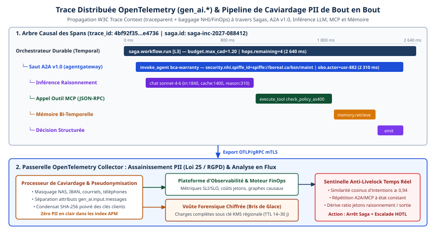

# Chapitre 33 — Observabilité et évaluation

*Question directrice : comment savoir ce qu'un système d'agents a fait, et s'il l'a bien fait ?*

> **État de référence :** conventions sémantiques GenAI d'OpenTelemetry telles qu'elles figurent sur la branche `main` du dépôt `open-telemetry/semantic-conventions-genai` le 11 novembre 2026 (aucune version publiée), et cinq articles parus entre juin 2024 et septembre 2026. Les numéros entre crochets renvoient aux sources en fin de chapitre; toutes sont des pages primaires lues pour ce chapitre, sauf [15], marquée secondaire, et [16], connue par son résumé et relevée le 14 novembre 2026.

Un service classique se surveille par trois signaux : disponibilité, latence, taux d'erreur. Un agent peut les satisfaire tous les trois et accomplir la mauvaise tâche : répondre vite, sans erreur technique, à côté de la demande. La question directrice se dédouble donc. Savoir ce que le système a fait relève de l'observabilité; savoir s'il l'a bien fait relève de l'évaluation.

Les deux travaillent le même matériau : la trajectoire, c'est-à-dire la suite ordonnée des décisions, des appels de modèle et des appels d'outils qui mène d'une demande à un résultat. L'observabilité la consigne, l'évaluation la juge.

Ni l'une ni l'autre n'est stabilisée. Les conventions OpenTelemetry qui décrivent les traces d'agents sont toutes au statut « Development », et l'évaluation en production repose d'abord sur des humains. D'où la thèse de ce chapitre : l'entreprise ne peut déléguer ni son schéma de télémétrie à un standard encore mouvant, ni son jugement de qualité à un banc d'essai public.

---

## 33.1 Que tracer

### La trajectoire, pas la requête

Une trace distribuée est un arbre de spans, chacun décrivant une opération bornée dans le temps. Les conventions GenAI d'OpenTelemetry donnent à cet arbre un vocabulaire propre aux agents [3][4][5].

| Opération | Ce que le span décrit | Question à laquelle il répond |
|---|---|---|
| `invoke_workflow` | Un flux dont l'application fixe le déroulement | Quel processus s'est exécuté ? |
| `invoke_agent` | Un agent dont le modèle pilote le déroulement par ses appels d'outils | Quel agent a décidé ? |
| `plan` | Une étape de planification ou de décomposition | Qu'avait-il l'intention de faire ? |
| Inférence | Un appel au modèle de langage | Avec quel modèle, à quel coût en jetons ? |
| `execute_tool` | Un appel d'outil | Qu'a-t-il fait, et avec quels arguments ? |
| Récupération, mémoire | Une recherche de contexte, une lecture ou écriture en mémoire | Sur quoi s'est-il appuyé ? |

La convention distingue `invoke_workflow` et `invoke_agent` par l'auteur du flux de contrôle : l'application dans le premier cas, le modèle dans le second [4]. C'est la frontière entre région déterministe et région agentique du chapitre 17, inscrite dans la trace.

### Quatre familles d'information

Les attributs recommandés se rangent en quatre familles [4][9].

**L'identité.** `gen_ai.agent.id`, `gen_ai.agent.name` et `gen_ai.agent.version` désignent l'agent. L'identifiant devrait être celui, stable, que la plateforme attribue, et non un identifiant d'instance en mémoire. Ces attributs font la jonction avec l'identité des agents (chapitre 29) et leur inventaire (chapitre 39).

**La décision.** Le modèle demandé, la raison de fin de génération, l'outil appelé. Les arguments et le résultat d'un appel d'outil ne sont pas captés par défaut (section 33.4).

**Le coût.** `gen_ai.usage.input_tokens` et `gen_ai.usage.output_tokens`. Le total d'entrée comprend les jetons servis depuis le cache, le total de sortie les jetons de raisonnement, et si un fournisseur rapporte deux décomptes, c'est le décompte facturé qui se consigne [4]. La trace devient la source de l'imputation des coûts (chapitre 40).

**L'issue.** `error.type` en cas d'échec, et le résultat d'une évaluation, qui dispose de son propre événement (section 33.6).

### Trace et piste d'audit

Une trace sert au diagnostic et peut être échantillonnée. Une piste d'audit sert à rendre compte et doit être complète. Nubank, qui exploite des agents de service à la clientèle à l'échelle de cent millions d'utilisateurs, décrit la seconde : chaque appel d'outil est journalisé avec ses entrées, ses sorties, sa latence et ses erreurs, à des fins de conformité, de débogage et d'analyse après coup [12].

La règle pratique est de produire les deux à partir de la même instrumentation, puis de les séparer : la piste d'audit n'est jamais échantillonnée et suit les règles de conservation du domaine. Le chapitre 24 traite de l'enregistrement d'audit exigé d'une passerelle.

---

## 33.2 Conventions OpenTelemetry : portée et instabilité

### Ce que les conventions couvrent

L'index du dépôt recense trois groupes de documents [3]. Les signaux de base : inférence, plongements (*embeddings*), exécution d'outil, récupération, invocation d'agent distant, spans d'agent, événements, exceptions, métriques, génération en temps réel. Les conventions propres à une technologie : Anthropic, Azure AI Inference, AWS Bedrock, OpenAI. Et deux protocoles : MCP et A2A (chapitres 5 et 6).

### Rien n'est stable

Chaque document lu pour ce chapitre porte le statut « Development » : l'index, les spans d'agent, les spans GenAI, les événements, l'invocation d'agent distant, MCP et A2A [3][4][5][6][7][8][9]. Ce statut autorise des changements incompatibles.

L'instabilité est aussi organisationnelle. La page des conventions GenAI sur le site d'OpenTelemetry ne contient plus qu'un avis : le contenu a été déplacé vers un dépôt dédié [1]. Ce dépôt n'a publié aucune version. Son journal des changements se réduit à une section « Unreleased » vide, et son fichier de présentation indique « TODO » à la place de l'adresse du schéma [2][10]. Il n'existe donc aucun numéro de version auquel épingler une mise en œuvre, hors un identifiant de commit.

Une analyse indépendante, mise à jour le 3 novembre 2026, précise la chronologie [15]. Selon elle, la version 1.42.0 des conventions générales, du 12 juin 2026, a déprécié et déplacé tout le contenu `gen_ai.*`; c'est la dernière coupe versionnée. Elle rapporte trois ruptures antérieures : le renommage des compteurs de jetons, le remplacement de `gen_ai.system` par `gen_ai.provider.name`, puis la scission du span `invoke_agent` en une variante cliente et une variante interne. Elle signale le retrait de la métrique `gen_ai.client.token.usage` sur `main`, le 22 septembre 2026, et relève que les cadriciels n'émettent pas tous la même génération d'attributs. Son constat de statut concorde avec les pages primaires.

### Un décalage avec les protocoles

La convention MCP illustre un second risque : le retard sur le protocole décrit. La page lue cite en exemple la version `2025-06-18` du protocole et renvoie à la spécification `2025-11-25`. Elle recommande l'attribut `mcp.session.id` et définit deux métriques de durée de session [7]. Or la révision `2026-07-28` de MCP a supprimé la session (chapitre 5). La page, relue en entier, ne mentionne ni cette révision ni le mode sans état. Un serveur conforme à la révision de juillet n'a pas de session à rapporter.

### Ce qu'il faut en conclure

OpenTelemetry reste le format d'échange à retenir : la spécification MCP y renvoie elle-même la journalisation qu'elle abandonne (chapitre 5). Mais un produit « compatible OpenTelemetry » ne garantit pas un schéma : c'est l'opinion de l'analyse citée, que les faits lus appuient [15].

1. **Tenir un schéma interne.** Tableaux de bord, alertes et évaluations lisent un modèle de données propre à l'entreprise, pas les attributs `gen_ai.*` bruts. C'est aussi la condition d'un entrepôt de traces commun à plusieurs plateformes (chapitre 27).
2. **Normaliser au collecteur.** La traduction entre générations d'attributs se fait à un seul endroit, à l'entrée de l'entrepôt.
3. **Épingler et vérifier.** Chaque instrumentation est fixée à une version, et un span réellement exporté est inspecté à chaque mise à jour.
4. **Garder ses attributs hors de l'espace `gen_ai.*`**, pour éviter une collision avec une future convention.

---

## 33.3 Corrélation entre agents

Dans un système multi-agents, la question « qui a décidé quoi » traverse des processus et des protocoles. Trois identifiants se partagent le travail, et aucun ne suffit seul.

| Identifiant | Portée | Limite |
|---|---|---|
| Contexte de trace (`traceparent`) | Une chaîne d'appels synchrones | Se rompt quand le travail reprend dans un autre processus ou plus tard |
| `gen_ai.conversation.id` | Une conversation ou un contexte | N'existe que si la plateforme en fournit un |
| Identifiant de tâche (`a2a.task.id`) | Une tâche de longue durée | Propre à un protocole |

### Vers les outils : MCP

La convention MCP fixe le mécanisme. Le contexte de trace est injecté dans l'objet `params._meta` de la requête, sous les clés `traceparent`, `tracestate` et `baggage`; le récepteur l'extrait et en fait le parent distant de son span [7]. Le span client MCP est toujours le parent du span serveur. Le contexte de la couche de transport se consigne par des liens de span, parce qu'une requête MCP peut s'étaler sur plusieurs requêtes HTTP et qu'une requête HTTP peut porter plusieurs messages MCP.

Une règle évite les doublons : si l'instrumentation GenAI trace déjà l'exécution de l'outil, l'instrumentation MCP devrait enrichir ce span plutôt qu'en créer un second [7].

### Vers les autres agents : A2A

L'instrumentation A2A ne rapporte que les requêtes du protocole, pas les opérations d'agent de plus haut niveau. Son span peut être l'enfant d'un span d'invocation d'agent distant [8][9].

Trois règles comptent pour la corrélation [8]. L'identifiant de contexte d'A2A se consigne dans `gen_ai.conversation.id`. La tâche se suit par `a2a.task.id` et `a2a.task.state`. Et l'interrogation périodique d'une tâche produit des spans frères sous le span parent de l'agent, non des enfants de l'envoi initial; menée dans un autre processus ou sans le contexte parent, elle produit des traces séparées, que seul l'identifiant de tâche relie.

Deux lacunes sont à noter. La page lue ne décrit pas comment le contexte de trace passe du client au serveur A2A, et ne donne aucune consigne pour les notifications poussées [8]. La convention d'invocation d'agent distant ne dit pas comment le span client se rattache au span interne de l'agent appelé [9].

### L'identifiant de conversation n'est pas un bouche-trou

`gen_ai.conversation.id` ne se renseigne que si un identifiant réel existe. Il ne faut lui substituer ni un UUID neuf, ni l'identifiant de trace, ni une empreinte du contenu [4][9]. Au sein d'un même processus, il peut se propager aux instrumentations imbriquées [3]. Rien n'est prévu pour le maintenir cohérent d'un agent à l'autre.

### Conséquence d'architecture

Une trace unique ne survit pas à l'exécution durable. Un dossier qui attend une approbation, puis reprend sur une autre machine, produit plusieurs traces (chapitres 18 et 22). La corrélation de bout en bout exige donc un identifiant d'affaires, celui du dossier ou de la demande, porté par chaque événement (chapitre 19) et recopié sur chaque span racine.

Cet identifiant conditionne aussi l'attribution des échecs, que les méthodes automatiques réussissent mal (chapitre 21) : la trace qui relie chaque délégation à son auteur se prépare à la conception.

---

## 33.4 Données sensibles dans la télémétrie

### Le contenu est exclu par défaut

Les prompts, les réponses, les instructions système et les arguments d'outils contiennent ce que l'entreprise a de plus sensible : renseignements personnels, données de clients, secrets d'affaires. Les conventions en tirent une règle nette : une instrumentation ne devrait pas capter ce contenu par défaut [5].

La variable `OTEL_INSTRUMENTATION_GENAI_CAPTURE_CONTENT` règle le comportement. Elle vaut `NO_CONTENT` par défaut, et une valeur invalide y ramène. Elle régit les messages, les instructions système, les arguments et résultats d'outils, les requêtes de récupération et les enregistrements de mémoire [5].

| Option | Mécanisme | Usage prévu par la convention |
|---|---|---|
| Ne rien consigner | Valeur par défaut | Production, sauf décision contraire |
| Consigner dans la trace | Attributs `gen_ai.input.messages`, `gen_ai.output.messages`, `gen_ai.system_instructions` | Volume maîtrisable et stockage conforme, par exemple en préproduction |
| Stocker à part et consigner une référence | Attributs suffixés `_ref`, qui portent un URI | Recommandé en production quand le volume ou la sensibilité l'exige |

### La référence externe

La troisième option est la plus utile en entreprise. Le contenu part vers un stockage distinct, doté de ses propres contrôles d'accès; la trace ne garde qu'un pointeur [5]. L'équipe d'exploitation voit la structure et les coûts sans lire les conversations.

Deux mises en garde l'accompagnent [4][9]. L'URI ne doit pas embarquer de justificatif, comme les paramètres d'une URL signée. Et il peut révéler à lui seul des métadonnées de stockage.

La convention prévoit un crochet (`hook`) qui reçoit le contenu avant son envoi et peut le modifier, quelle que soit la décision d'échantillonnage du span [5]. C'est le point d'insertion naturel du masquage.

### Les fuites latérales

Le contenu ne passe pas seulement par les attributs prévus pour lui. Les conventions signalent comme sensibles les définitions d'outils, que la variable de capture ne régit pas, et le message d'une exception [4][5]. Côté A2A, le corps des requêtes HTTP est un attribut facultatif, désactivé par défaut [8]. L'explication en texte libre d'un résultat d'évaluation peut recopier un fragment de conversation; la page des événements ne donne aucune consigne à ce sujet [6]. Les bagages (`baggage`) propagés avec le contexte de trace voyagent enfin jusque chez le tiers appelé.

L'analyse indépendante déjà citée signale que l'instrumentation Python lit encore `OTEL_INSTRUMENTATION_GENAI_CAPTURE_MESSAGE_CONTENT`, et non la variable de la convention [15]. Seule l'inspection de ce qui est exporté établit donc ce qui quitte le processus.

### La tension avec l'évaluation

Sans contenu, une trace dit ce que l'agent a fait, pas s'il a eu raison. Nubank décrit le compromis qu'elle applique : champs sensibles masqués dans les journaux, durées de conservation liées aux obligations légales, et accès aux conversations et aux jeux d'évaluation accordé par rôle, journalisé et limité dans le temps [12].

Le patron qui s'en dégage sépare deux zones. La zone de télémétrie reçoit la structure, les coûts et les scores. La zone de contenu reçoit les conversations, sous accès restreint et clés détenues par l'entreprise (chapitre 46); les évaluateurs, humains ou automatiques, y travaillent et n'en font sortir que des résultats. La boucle qui tire des exemples d'entraînement des traces y puise aussi, après masquage (chapitre 47). Les obligations propres au Québec et au Canada relèvent du chapitre 38.

---

## 33.5 Évaluer : humains, juges automatiques, simulation

### L'état de la pratique

L'étude *Measuring Agents in Production* (MAP) repose sur vingt études de cas et un sondage de 306 réponses valides, dont 86 portent sur des systèmes déployés [11]. À la question des méthodes d'évaluation, que 31 répondants seulement ont traitée (figure 8), 74 % s'appuient surtout sur l'évaluation humaine, 52 % emploient un modèle de langage comme juge et 42 % des vérifications à base de règles. Les trois quarts des équipes étudiées évaluent sans jeu de bancs d'essai, et toutes celles qui emploient un juge automatique le doublent d'une revue humaine.

Ces chiffres se lisent avec les réserves des auteurs : participation volontaire, équipes concentrées dans les Amériques, entretiens plutôt qu'audits.

### Trois instruments

| Instrument | Ce qu'il mesure bien | Sa limite |
|---|---|---|
| Humain expert | La justesse dans un domaine, les cas inédits | Ne suit pas le volume |
| Juge automatique | Un critère précis, à grande échelle | Ne vaut que par son étalonnage |
| Simulation | Le comportement sur plusieurs tours, la constance | Dépend du réalisme de l'utilisateur simulé |

### Le juge automatique s'étalonne

Le cas de Nubank, publié à KDD 2026, est le plus détaillé des textes lus [12]. Les critères sont binaires. Trois analystes étiquettent chaque échantillon avec une justification écrite, et la majorité l'emporte. Les auteurs estiment que quelques centaines d'étiquettes suffisent. Le prompt du juge est ensuite optimisé contre ces étiquettes.

L'optimisation améliore l'exactitude du juge sur le jeu de test pour chacun des quatre critères rapportés, par exemple de 68,88 % à 88,89 % sur l'un d'eux. Et l'accord entre deux modèles juges munis du prompt initial peut être nul : un kappa de Cohen de 0,000 entre GPT-4.1 et GPT-4.1-mini, ce dernier rangeant tous les cas dans une seule classe, porté à 0,745 après optimisation.

Un juge non étalonné mesure le modèle qui juge autant que l'agent jugé; changer de modèle juge, c'est changer d'instrument, et cela exige un nouvel étalonnage contre des étiquettes humaines. L'article affirme imposer un seuil minimal d'accord avec les humains, sans le chiffrer dans le texte lu.

### La simulation mesure la constance

Le banc d'essai τ-bench en fixe le modèle [13]. Un modèle de langage joue l'utilisateur; l'agent dispose d'outils et d'une politique à respecter. Le succès se juge en comparant l'état final de la base de données à un état cible annoté, et non le texte produit. Une métrique, pass^k, mesure la fiabilité sur plusieurs essais d'une même tâche.

Le résumé de l'article rapporte qu'un agent fondé sur gpt-4o réussissait moins de la moitié des tâches, et que pass^8 tombait sous 25 % dans le commerce de détail. Ces chiffres datent de 2024. Deux principes demeurent : juger l'état du système plutôt que le discours de l'agent, et répéter l'essai, parce qu'un succès isolé surestime la fiabilité.

Nubank rapporte que ses métriques de simulation hors ligne vont de pair avec les résultats en ligne : les variantes dont le taux d'échec hors ligne baisse le plus sont celles dont la satisfaction mesurée monte le plus [12]. L'article parle d'une forte corrélation sans en donner le coefficient, et le texte lu ne décrit pas la construction des utilisateurs simulés. L'assurance fondée sur la trajectoire entière relève du chapitre 32.

---

## 33.6 Évaluation continue à coût maîtrisé

### Une boucle, pas une étape

Chez Nubank, l'évaluation forme une boucle : évaluation hors ligne, simulation, déploiement progressif à partir de 1 % du trafic, mesures en ligne, puis retour vers les jeux d'évaluation [12]. Les mesures en ligne sont des indicateurs d'affaires : NPS transactionnel (tNPS), taux de libre-service (part des demandes résolues sans transfert à un humain), taux d'escalade, taux d'erreur. Pour la livraison de cartes, l'essai comparatif rapporte un gain de 37 points de tNPS et de 29 points de libre-service par rapport à la variante initiale, sans valeur absolue; l'agent reste environ 10 points de tNPS sous les experts humains [12] (chapitre 42).

La boucle sert aussi de filet lors d'un changement de modèle. Le passage de GPT-4.1 à GPT-5 a réduit le taux d'échec sur trois critères, l'a aggravé sur la concision des réponses, et il a fallu modifier le prompt [12]. Sans jeu d'évaluation, cette régression n'aurait été vue qu'en production.

### Les leviers de coût

Juger une trajectoire par un modèle ajoute des appels d'inférence à ceux de l'agent. Aucun des textes lus en entier ne chiffre ce coût; ils décrivent en revanche des leviers. Une prépublication, connue par son résumé, mesure un coût voisin, la part du banc qu'il faut rejouer (fin de la section).

| Levier | Principe | Source |
|---|---|---|
| Règles | Des vérifications déterministes, sans appel de modèle | [11] |
| Petit juge | Un modèle léger classe; le modèle fort ne sert qu'à optimiser le prompt du juge | [12] |
| Aiguillage par confiance | Les sorties à faible confiance vont aux experts; un échantillon aléatoire des autres est contrôlé | [11] |
| Filtre hors ligne | Les variantes faibles sont écartées avant l'essai en ligne, plus coûteux | [12] |
| Peu d'étiquettes | Quelques centaines d'exemples suffisent à étalonner un juge | [12] |
| Échantillonnage | L'évaluation porte sur une fraction du trafic | [4] |

Le dernier levier touche à l'instrumentation. Les conventions demandent que le nom de l'agent, l'opération et le modèle soient posés à la création du span, pour servir aux décisions d'échantillonnage [4]. On peut ainsi évaluer davantage un agent récemment modifié. L'échantillon aléatoire des sorties jugées sûres reste indispensable : lui seul révèle un juge trop confiant.

### Consigner le verdict

Les conventions définissent un événement, `gen_ai.evaluation.result` [6]. Il porte le nom du critère, un score numérique, une étiquette, une explication en texte libre et l'identifiant de la réponse évaluée. Il devrait être rattaché au span de l'opération jugée.

L'étiquette a une raison d'être : un même score peut signifier des choses opposées d'un système d'évaluation à l'autre, la valeur 1 désignant ici « pertinent » et là « non pertinent » [6].

Rattaché à la trace, le verdict se lit dans le même entrepôt que la latence et le coût, par agent, par version et par outil. C'est le fondement des objectifs de niveau de service fondés sur les résultats (chapitre 34). Cet événement est lui aussi au statut « Development ».

### Une mesure du coût

Une prépublication de 2026 chiffre le problème sur un agent d'analyse en production, qui sert des dizaines de milliers d'utilisateurs actifs par mois [16]. Ses auteurs comparent, sur 574 exécutions historiques du banc interne, quatre façons d'éviter de tout rejouer : l'échantillonnage aléatoire, la reprise de résultats antérieurs, des sous-ensembles fixes représentatifs et un test adaptatif. Le test adaptatif est le plus fidèle : 200 questions, soit 38,5 % d'une exécution complète, suffisent pour une erreur moyenne de 1,03 point. L'équipe a pourtant déployé des sous-ensembles fixes, stratifiés par difficulté, plus simples à exploiter; ils se transposent sans recalibrage à cinq autres familles d'agents. Le texte n'est connu ici que par son résumé, et il mesure une part du banc rejoué, non un coût en dollars.

---

## 33.7 Bancs d'essai d'entreprise

### Pourquoi les bancs publics ne suffisent pas

Les praticiens interrogés donnent trois raisons d'écarter les bancs d'essai publics [11]. Les domaines réglementés manquent de données publiques. La personnalisation par client rend un banc standard impraticable. Et un banc bâti pour un déploiement se réutilise mal ailleurs.

Les bancs publics qui imitent l'entreprise gardent deux usages : présélectionner un modèle, et servir de gabarit de conception. EnterpriseBench réunit ainsi 500 tâches dans quatre domaines, avec des sources fragmentées et des hiérarchies de contrôle d'accès; son résumé rapporte 41,8 % d'achèvement pour le meilleur agent testé [14]. Le chapitre 15 compare cinq bancs de ce type. Aucun ne mesure un déploiement réel.

### Construire le sien

Parmi les vingt cas de MAP, cinq équipes ont bâti un banc sur mesure : une à partir de zéro, avec une vérité de référence étiquetée par des experts, et quatre en le synthétisant à partir de tests existants, de journaux ou de billets de soutien [11]. Le chemin le plus court part donc de ce que l'entreprise possède déjà, et l'entrepôt de traces en est la première source.

Six propriétés d'un banc interne utile se dégagent des textes lus.

1. **Il sort de la production.** Les cas viennent de trajectoires réelles, y compris celles qui ont échoué.
2. **Il juge un état.** Le critère de réussite est un état vérifiable du système, non une ressemblance de texte [13].
3. **Il répète.** Chaque tâche s'exécute plusieurs fois, et la constance se rapporte à part [13].
4. **Il contient des refus.** Les demandes à ne pas satisfaire et les règles d'accès y figurent (chapitre 15).
5. **Il garde un jeu réservé.** Nubank répartit ses données d'étalonnage en 40 % pour l'entraînement, 30 % pour la validation et 30 % pour le test [12].
6. **Il est versionné.** Un score ne se compare qu'à version de banc, de juge et de modèle constante.

Un tel banc est un actif de l'entreprise. C'est lui qui dit si un agent survit à un changement de modèle ou de plateforme (chapitres 20 et 27), et si un palier de modèle moins coûteux (chapitre 44) ou un modèle distillé (chapitre 47) suffit.

---

## Grille de décision

| Décision | Option par défaut | Quand s'en écarter |
|---|---|---|
| Format de télémétrie | OpenTelemetry, conventions GenAI | Plateforme fermée : exiger au moins un export |
| Schéma consommé par les tableaux de bord | Schéma interne, alimenté par normalisation au collecteur | Parc d'un seul cadriciel, à version épinglée |
| Version des conventions | Commit épinglé, span exporté vérifié à chaque mise à jour | — |
| Capture du contenu | Désactivée en production | Préproduction, ou stockage conforme et volume maîtrisé |
| Contenu nécessaire à l'évaluation | Stockage distinct, référence dans la trace, accès par rôle | — |
| Corrélation de bout en bout | Identifiant d'affaires sur chaque span racine et chaque événement | Flux entièrement synchrone : le contexte de trace suffit |
| Piste d'audit | Distincte de la trace, jamais échantillonnée | — |
| Évaluateur | Règles, puis juge étalonné (réétalonné à chaque changement de modèle juge), puis expert sur les cas incertains | Faible volume ou risque élevé : revue humaine intégrale |
| Critère de réussite | État final vérifiable, sur plusieurs essais | Tâche sans état observable : grille de critères jugée |
| Banc d'essai | Interne, tiré des traces de production | Présélection d'un modèle : banc public |
| Mise en service d'une variante | Filtre hors ligne, puis fraction du trafic | — |

---

## Points à retenir

- Les signaux classiques ne détectent pas un agent qui accomplit la mauvaise tâche. Il faut tracer la trajectoire et juger son résultat.
- Les conventions GenAI d'OpenTelemetry couvrent l'inférence, les outils, les agents, MCP et A2A. Toutes sont au statut « Development », et leur dépôt dédié n'a publié aucune version.
- La convention MCP lue décrit encore des sessions que la révision `2026-07-28` a supprimées. Un schéma interne et une normalisation au collecteur protègent de ces décalages.
- Le contexte de trace ne survit pas à l'exécution durable. Un identifiant d'affaires est nécessaire.
- Le contenu des échanges est exclu de la télémétrie par défaut. Le stockage par référence concilie exploitation et évaluation.
- Dans l'étude MAP, l'évaluation repose surtout sur des humains, et tout juge automatique observé est doublé d'une revue humaine.
- Un juge automatique s'étalonne contre des étiquettes humaines; changer de modèle juge, c'est changer d'instrument.
- Le coût de l'évaluation continue se maîtrise par un petit juge, l'aiguillage par confiance et l'échantillonnage. Une seule étude, connue par son résumé, mesure qu'un sous-ensemble du banc suffit à suivre un agent en production.
- Le banc d'essai utile est interne, tiré des traces, fondé sur des états vérifiables et répété.

---

## Sources

Pages primaires lues le 11 novembre 2026; [2], [5], [7], [11], [12] et [14] relues le 12 novembre 2026 :

1. [OpenTelemetry — conventions GenAI, avis de déplacement](https://opentelemetry.io/docs/specs/semconv/gen-ai/)
2. [Dépôt open-telemetry/semantic-conventions-genai](https://github.com/open-telemetry/semantic-conventions-genai)
3. [Index des conventions GenAI](https://github.com/open-telemetry/semantic-conventions-genai/tree/main/docs/gen-ai)
4. [Spans d'agent et de cadriciel](https://raw.githubusercontent.com/open-telemetry/semantic-conventions-genai/main/docs/gen-ai/gen-ai-agent-spans.md)
5. [Spans GenAI — consignation du contenu](https://raw.githubusercontent.com/open-telemetry/semantic-conventions-genai/main/docs/gen-ai/gen-ai-spans.md)
6. [Événements GenAI — résultat d'évaluation](https://raw.githubusercontent.com/open-telemetry/semantic-conventions-genai/main/docs/gen-ai/gen-ai-events.md)
7. [Conventions MCP](https://raw.githubusercontent.com/open-telemetry/semantic-conventions-genai/main/docs/gen-ai/mcp.md)
8. [Conventions A2A](https://raw.githubusercontent.com/open-telemetry/semantic-conventions-genai/main/docs/gen-ai/a2a.md)
9. [Invocation d'agent distant](https://raw.githubusercontent.com/open-telemetry/semantic-conventions-genai/main/docs/gen-ai/client-invoke-agent.md)
10. [Journal des changements du dépôt](https://raw.githubusercontent.com/open-telemetry/semantic-conventions-genai/main/CHANGELOG.md)
11. [Measuring Agents in Production (arXiv 2512.04123, v4)](https://arxiv.org/html/2512.04123v4)
12. [Building Customer Support AI Agents at 100M-User Scale — Nubank, KDD 2026 (arXiv 2606.08867)](https://arxiv.org/html/2606.08867v1)
13. [τ-bench (arXiv 2406.12045)](https://arxiv.org/abs/2406.12045) — résumé seulement.
14. [EnterpriseBench (arXiv 2510.27287, EMNLP 2025)](https://arxiv.org/abs/2510.27287) — résumé seulement.

Source secondaire :

15. [John Hodge — état des conventions GenAI d'OpenTelemetry, mis à jour le 3 novembre 2026](https://john-hodge.com/blog/opentelemetry-genai-semantic-conventions/) — billet d'un particulier, lu et relu le 12 novembre 2026.

Résumé seulement, relevé le 14 novembre 2026 :

16. [She et coll. — Efficient Benchmarking in Production: A Study of an Evolving LLM Agent (arXiv 2609.21267)](https://arxiv.org/abs/2609.21267)

## Limites de ce chapitre

- Les pages ont été lues au moyen d'un outil d'extraction qui résume le texte; les noms d'attributs et les valeurs sont repris tels que rapportés, sans relecture du texte brut. La fin de la page MCP [7] a été relue à l'audit; la seconde moitié de l'article [11] n'a pas été lue.
- La date du déplacement des conventions, l'historique des renommages et le retrait de `gen_ai.client.token.usage` viennent de la seule source secondaire [15]; les notes de version du dépôt principal n'ont pas été lues.
- MAP exprime en pourcentage (75 %) la part des équipes sans banc d'essai, que ce chapitre et le chapitre 42 rendent par « les trois quarts ».
- Le sens du statut « Development », le caractère échantillonnable des traces et la propagation des bagages jusqu'au tiers appelé relèvent de la connaissance générale d'OpenTelemetry.
- Les documents sur l'exécution d'outil, la récupération, les métriques et les fournisseurs n'ont pas été lus; le tableau de la section 33.1 les décrit d'après l'index et les pages voisines.
- Les sections 33.5 à 33.7 reposent en bonne partie sur un seul déploiement, celui de Nubank, décrit par ses auteurs et non vérifié de façon indépendante.
- La séparation de la trace et de la piste d'audit, le patron à deux zones, l'ordre des évaluateurs dans la grille et les six propriétés d'un banc interne sont des synthèses de ce chapitre, non des prescriptions d'une source.
- Une seule étude du coût de l'évaluation continue a été trouvée, le 14 novembre 2026 [16]. Elle n'est connue que par son résumé, porte sur un seul agent et ne donne pas de coût en dollars.
- Aucun produit d'observabilité commercial n'est comparé.

## Mise en œuvre — Observabilité distribuée de bout en bout avec OpenTelemetry GenAI {.volet}

:::: {.encadre .executive}
::: {.encadre-titre}
**Synthèse exécutive**
:::

- **Enjeu stratégique** : Dans une architecture multi-agents asynchrone, la surveillance applicative classique (APM) devient aveugle : deux agents pris dans une boucle de reformulation stérile, ou qui propagent une hallucination initiale, ne renvoient que des codes HTTP 200 OK et des latences unitaires nominales, jusqu’à l’épuisement des budgets ou la corruption d’un dossier métier. Sans observabilité sémantique distribuée, l’entreprise perd la maîtrise de son délai de diagnostic (MTTR) et sa capacité de preuve réglementaire.
- **Décisions architecturales structurantes** :
  1.  *Irréversible à moyen terme* : Imposer les conventions ouvertes OpenTelemetry `gen_ai.*` et la propagation W3C Trace Context sur chaque saut (Temporal, A2A v1.0, MCP, passerelles LLM, mémoire), sans SDK de traçage propriétaire captif d’un seul cadriciel. Ces conventions étant toutes au statut « Development » (section 33.2), cette imposition s’accompagne d’un schéma interne, d’une normalisation au collecteur et de l’épinglage d’une version.
  2.  *Structurante dès le jour 1* : Déployer une collecte à double couloir via OpenTelemetry Collector, qui sépare physiquement la voie opérationnelle, caviardée de tout renseignement personnel (Loi 25, RGPD), d’une voûte forensique chiffrée par juridiction, lue sous procédure de bris de glace.
  3.  *Réversible par conception* : Choisir le moteur analytique et de visualisation en aval, que le protocole OTLP découple des agents producteurs.
- **Indicateurs de gouvernance associés** : Continuité causale des traces inter-divisions (TCR global $\ge 99,5\,\%$, et $\ge 99,8\,\%$ sur les flux L3), délai moyen d’identification de cause racine (MTTR \< 15 min), interception des boucles sémantiques ($\le 3$ tours) et zéro fuite PII dans les index de télémétrie.
::::

## 33.8 Ce que l’APM ne voit pas

En production agentique, les défaillances les plus coûteuses ne lèvent aucune exception réseau. Quatre phénomènes échappent aux sondes APM :

1.  **Défaillance épistémique silencieuse (OWASP ASI08)** : Un extracteur interprète à contresens une clause d’avenant mal numérisée et transmet par A2A v1.0 un objet JSON syntaxiquement valide à un agent aval. Les schémas passent, les requêtes HTTP s’achèvent en 200 OK, mais la mutation finale viole la politique commerciale.
2.  **Verrouillage actif de courtoisie (*livelock* sémantique)** : Quand un outil MCP retourne un résultat vide ou ambigu, l’agent reformule ses paramètres et sollicite un pair spécialiste, qui lui renvoie une demande de précision : le dialogue devient circulaire. Le superviseur réseau observe une disponibilité de 100 %, la progression métier est nulle et la consommation de jetons croît.
3.  **Non-localité temporelle des sagas durables** : Un flux orchestré par Temporal ou Restate s’exécute quelques secondes, dort quarante-huit heures dans l’attente d’une approbation CIBA, puis reprend sur un autre nœud. Outre la rupture de trace décrite à la section 33.3, les traceurs conçus pour des appels synchrones faussent les centiles de latence : ils confondent l’attente métier et la lenteur technique.
4.  **Boîtes noires de plusieurs éditeurs** : Dès qu’un processus traverse un agent Python interne, Salesforce Agentforce, ServiceNow et SAP S/4HANA, le traceur propre à chaque cadriciel fragmente l’investigation en silos horodatés différemment, sans clé de corrélation commune.

Pour restaurer une visibilité unifiée sans verrouillage fournisseur, OpenTelemetry reste le format d’échange à retenir (section 33.2). Ses conventions GenAI (`gen_ai.*`) sont toutefois toutes au statut « Development », et leur dépôt n’a publié aucune version : il faut tenir un schéma interne, normaliser au collecteur et épingler chaque instrumentation à une version (section 33.2).

L’observabilité reconstruit ainsi l’arbre causal qui relie l’intention initiale, la chaîne de délégation NHI, les cycles d’inférence, les appels MCP et les accès mémoire, et elle assainit les charges utiles sensibles avant toute écriture dans un index partagé.



------------------------------------------------------------------------

## 33.9 Hiérarchie de spans et continuité W3C Trace Context

Pour instrumenter une fabrique multi-agents de façon homogène en 2027, chaque transaction suit une hiérarchie de cinq strates de spans, qui reprend les opérations de la section 33.1 et que corrèlent les en-têtes W3C Trace Context (`traceparent`, `tracestate`) et W3C Baggage.

### Les cinq strates de spans d’une transaction agentique

- **Strate 1 — Enveloppe de saga durable (`saga.workflow.run`)** : Ouvert par le plan de contrôle déterministe dès l’événement déclencheur, ce span porte l’identifiant `saga.id`, le code processus (`business.process.code`) et le plafond d’autonomie (L1–L4). Quand une saga entre en veille prolongée (`awakeable` ou escalade HOTL), le segment actif est clos et le segment de reprise y est relié par un lien de span, plutôt que de garder un span ouvert trois jours. Le graphe causal est préservé (section 33.3) sans polluer les histogrammes de latence active.
- **Strate 2 — Saut de délégation horizontale (`invoke_agent` sur A2A v1.0)** : Chaque délégation vers un pair spécialiste génère un couple de spans CLIENT / SERVER, qui consignent `gen_ai.agent.id`, la version de l’Agent Card et la chaîne d’identité non humaine (`security.nhi.spiffe_id`, `security.obo.actor`) issue de l’échange RFC 8693. Les conventions lues ne décrivent ni le passage du contexte de trace du client au serveur A2A, ni le rattachement du span client au span interne de l’agent appelé (section 33.3) : pour relier ces traces, l’exposé retient l’identifiant de tâche (`a2a.task.id`) et l’identifiant d’affaires, recopié sur chaque span racine.
- **Strate 3 — Cycle d’inférence (`chat {gen_ai.request.model}`)** : Ce span consigne le fournisseur (`gen_ai.provider.name`, qui remplace l’attribut déprécié `gen_ai.system`), le modèle demandé (`gen_ai.request.model`), le modèle effectivement servi après routage ou repli (`gen_ai.response.model`), les motifs d’arrêt (`gen_ai.response.finish_reasons`) et la ventilation des jetons : entrée au tarif plein, écriture et lecture dans le cache de préfixe, jetons de raisonnement et jetons de sortie.
- **Strate 4 — Invocation verticale d’outil (`execute_tool` sur MCP)** : Le contexte de trace passe par `params._meta`, selon le mécanisme de la section 33.3. Le span enregistre `gen_ai.tool.name`, `gen_ai.tool.call.id`, la clé d’idempotence et le statut d’exécution.
- **Strate 5 — Accès contextuel et mémoire (`memory.retrieve` / `memory.commit`)** : L’interrogation du graphe bi-temporel (Graphiti) ou de la couche sémantique (Apache Ossie) représente souvent le tiers de la latence d’un tour. Tracer le nombre d’entités extraites et l’horizon de validité temporelle permet de distinguer une hallucination du modèle d’un défaut de récupération contextuelle.

| Espace d’attributs | Clé normalisée (OpenTelemetry / extension) | Type | Obligatoire | Rôle opérationnel, sécuritaire et FinOps |
|:---------------|:----------------------------|:------------|:-------------|:------------------------------|
| Opération et modèle | `gen_ai.operation.name` | `string` | Oui | Étape normalisée (`chat`, `invoke_agent`, `execute_tool`, `embeddings`) |
| Opération et modèle | `gen_ai.provider.name` | `string` | Oui | Plateforme cible (`anthropic`, `openai`, `vertex_ai`, `vllm_internal`) |
| Opération et modèle | `gen_ai.request.model` / `gen_ai.response.model` | `string` | Oui | Suivi des bascules de modèle (cascade SLM/LLM ou repli sur panne) |
| Identité agentique | `gen_ai.agent.id` & `gen_ai.agent.version` | `string` | Oui | Lien exact avec le registre SemVer+Intent, pour l’audit BSIF E-23 |
| Outillage MCP | `gen_ai.tool.name` & `mcp.idempotency_key` | `string` | Si outil | Preuve de non-duplication des effets de bord et fiabilité par serveur MCP |
| Comptabilité des jetons | `gen_ai.usage.input_tokens` / `output_tokens` | `int` | Oui | Base volumétrique brute de chaque appel d’inférence |
| Comptabilité avancée | `gen_ai.usage.cache_read.input_tokens` / `cache_write.input_tokens` | `int` | Oui | Mesure directe du taux d’affinité et du coût d’amorçage du cache de préfixe |
| Comptabilité avancée | `gen_ai.usage.reasoning.output_tokens` | `int` | Si applicable | Surveillance du calcul de raisonnement |
| Sécurité et NHI | `security.nhi.spiffe_id` & `security.obo.actor` | `string` | Oui | Preuve non répudiable de la chaîne de délégation machine et humaine |
| Gouvernance de la saga | `saga.id` & `finops.budget.remaining_cad` | `string`/`double` | Oui | Imputation du coût par résultat et coupe-circuit budgétaire en ligne |

#### Extrait 33.1 — Instrumentation TypeScript d’un appel MCP propageant W3C Trace Context et Baggage

Le client ouvre un span `execute_tool`, injecte `traceparent`, `tracestate` et `baggage` dans `params._meta`, puis ferme le span quelle que soit l’issue. L’extrait place `saga.id` et le budget restant dans le baggage envoyé au serveur MCP et copie le message de l’exception dans le statut du span; l’exposé range les bagages parmi les fuites latérales, parce qu’ils voyagent jusque chez le tiers appelé, et signale le message d’une exception comme sensible (section 33.4).

``` typescript
import { context, propagation, SpanKind, SpanStatusCode, trace } from "@opentelemetry/api";

const tracer = trace.getTracer("boreal.agentic.fabric", "2027.1");

export interface McpToolInvocation {
  readonly serverUri: string;
  readonly toolName: string;
  readonly callId: string;
  readonly idempotencyKey: string;
  readonly sagaId: string;
  readonly actorSpiffeId: string;
  readonly remainingBudgetCad: number;
  readonly args: Record<string, unknown>;
}

export async function invokeInstrumentedMcpTool<TResult>(
  req: McpToolInvocation,
  transportSend: (uri: string, rpcPayload: unknown) => Promise<TResult>
): Promise<TResult> {
  const activeBaggage = propagation.getBaggage(context.active()) ?? propagation.createBaggage();
  const ctxWithBaggage = propagation.setBaggage(
    context.active(),
    activeBaggage
      .setEntry("saga.id", { value: req.sagaId })
      .setEntry("finops.remaining_cad", { value: req.remainingBudgetCad.toFixed(4) })
  );

  return context.with(ctxWithBaggage, () =>
    tracer.startActiveSpan(
      `execute_tool ${req.toolName}`,
      {
        kind: SpanKind.CLIENT,
        attributes: {
          "gen_ai.operation.name": "execute_tool",
          "gen_ai.tool.name": req.toolName,
          "gen_ai.tool.call.id": req.callId,
          "mcp.server.uri": req.serverUri,
          "mcp.idempotency_key": req.idempotencyKey,
          "saga.id": req.sagaId,
          "security.nhi.spiffe_id": req.actorSpiffeId,
        },
      },
      async (span) => {
        try {
          const carrier: Record<string, string> = {};
          propagation.inject(context.active(), carrier);

          const rpcPayload = {
            jsonrpc: "2.0",
            id: req.callId,
            method: "tools/call",
            params: {
              name: req.toolName,
              arguments: req.args,
              _meta: {
                traceparent: carrier["traceparent"],
                tracestate: carrier["tracestate"],
                baggage: carrier["baggage"],
              },
            },
          };

          const result = await transportSend(req.serverUri, rpcPayload);
          span.setStatus({ code: SpanStatusCode.OK });
          return result;
        } catch (err) {
          span.recordException(err as Error);
          span.setStatus({ code: SpanStatusCode.ERROR, message: (err as Error).message });
          throw err;
        } finally {
          span.end();
        }
      }
    )
  );
}
```

`req.args` et `result` ne sont délibérément pas copiés dans les attributs du span, afin d’éviter une dissémination non contrôlée de données sensibles.

### Échantillonnage en queue

Quand le volume dépasse plusieurs millions de spans par heure, conserver chaque trace consultative L1 coûte inutilement cher en stockage chaud. L’échantillonnage aléatoire en tête (classique, à 5 % dès l’entrée) est pourtant une erreur : au début d’une saga, personne ne sait si elle s’achèvera nominalement en quatre secondes ou si elle dégénérera au septième tour en oscillation sémantique ou en rejet de politique Cedar.

L’architecture de collecte place donc en amont un routage par hachage cohérent du `trace_id` (`loadbalancingexporter`), indispensable pour qu’une saga répartie sur plusieurs réplicas de collecteurs ne soit pas évaluée par fragments incomplets. Un échantillonnage différé en queue suit : il garde les spans en tampon jusqu’à la clôture du segment actif et applique quatre règles déterministes, par ordre de priorité :

1.  **Rétention à 100 % des transactions mutatives (L2, L3, L4)** : Toute saga susceptible d’altérer un système d’enregistrement, ou assujettie à BSIF E-23, est conservée en entier pour l’auditabilité réglementaire et le calcul exact du coût par résultat.
2.  **Rétention à 100 % des anomalies techniques, sécuritaires et cognitives** : Toute trace qui comporte un statut d’erreur, un refus Cedar/OPA, une escalade HOTL, un arrêt de la sentinelle anti-livelock ou un coût unitaire supérieur au 95e centile est archivée.
3.  **Rétention à 100 % des cohortes de qualification (canari, mode fantôme) et des tests canaris HOTL** : Toute révision en cours d’homologation progressive (chapitre 34) ou d’étalonnage de la vigilance humaine (chapitre 41) échappe à la réduction d’échantillon, pour préserver la puissance statistique des portes de sécurité.
4.  **Échantillonnage stratifié (5 à 10 %) des interactions L1 nominales** : Les requêtes documentaires en lecture seule, réussies du premier coup sous le seuil de latence, ne sont sous-échantillonnées pour l’index de traces qu’après l’extraction exacte des compteurs de jetons et de latence par le connecteur `spanmetrics`, ce qui garde la comptabilité FinOps exacte.

Ces règles vont au-delà de ce que retient l’exposé : une trace peut y être échantillonnée, et les conventions demandent que le nom de l’agent, l’opération et le modèle soient posés à la création du span pour servir aux décisions d’échantillonnage (section 33.6). La piste d’audit, produite par la même instrumentation, est distincte de la trace et jamais échantillonnée (section 33.1) : la rétention à 100 % dans l’index de traces n’en tient pas lieu.

------------------------------------------------------------------------

## 33.10 Confidentialité des traces : observer sans violer la Loi 25 ni le RGPD

Le diagnostic d’une erreur de raisonnement demande le contexte complet (`gen_ai.input.messages`) et la sortie brute (`gen_ai.output.messages`), que la section 33.4 exclut de la télémétrie par défaut. Ces textes libres contiennent des renseignements personnels, des secrets industriels ou des données financières : les indexer en clair dans un outil central d’observabilité viole la Loi 25 au Québec et le RGPD en Europe.

En entreprise réglementée, l’architecture de référence 2027 applique le patron à deux zones de la section 33.4 par une collecte à double couloir, exécutée par des instances régionales d’OpenTelemetry Collector :

1.  **Couloir opérationnel assaini (100 % du flux, rétention 13 mois)** : Destiné aux équipes SRE et FinOps, il conserve les métadonnées causales, les identités NHI, les latences et les jetons. Il supprime les charges textuelles brutes, pseudonymise tout identifiant client par un condensat SHA-256 poivré (secret rotatif sous KMS) et filtre les motifs PII résiduels (NAS, courriel, IBAN).
2.  **Couloir forensique sous scellés (« bris de glace », erreurs et actes L3/L4, rétention 14 à 30 jours)** : Avant tout caviardage, l’embranchement forensique filtre les seuls segments éligibles et chiffre les charges complètes avec une clé KMS résidant dans la juridiction légale (Montréal ou Francfort). Leur lecture ponctuelle exige un mandat d’incident doublement approuvé et journalisé dans le SIEM.

Ce dispositif ne prévoit aucun accès au contenu pour l’évaluation. Ce cloisonnement va au-delà de ce que retient la section 33.4 : l’exposé y prévoit une zone de contenu distincte, sous accès restreint, où les évaluateurs, humains ou automatiques, travaillent et d’où ils ne font sortir que des résultats; la boucle d’exemples d’entraînement y puise aussi, après masquage.

#### Extrait 33.2 — Pipeline OpenTelemetry Collector avec masquage PII et routage souverain

Le collecteur reçoit les spans en OTLP et les duplique par un connecteur. La voie assainie pseudonymise les identifiants et masque les motifs personnels; la voie forensique ne retient que les spans L3, L4 ou en erreur, qu’elle envoie vers un seau chiffré.

``` yaml
receivers:
  otlp:
    protocols:
      grpc:
        endpoint: 0.0.0.0:4317

processors:
  batch:
    send_batch_size: 2048
    timeout: 2s

  filter/forensic_scope:
    error_mode: ignore
    traces:
      span:
        - 'attributes["autonomy.level"] != "L3" and attributes["autonomy.level"] != "L4" and status.code != STATUS_CODE_ERROR'

  transform/pseudonymize:
    trace_statements:
      - context: span
        statements:
          - set(attributes["customer.pseudo_id"], SHA256(Concat([attributes["customer.raw_id"], env("PII_PEPPER_2027")], ""))) where attributes["customer.raw_id"] != nil
          - delete_key(attributes, "customer.raw_id")

  redaction/strict_pii:
    allow_all_keys: true
    blocked_key_patterns:
      - "^gen_ai\\.(input|output)\\.messages$"
      - "^mcp\\.tool\\.(raw_arguments|raw_result)$"
    blocked_values:
      - "\\b\\d{3}[-\\s]?\\d{3}[-\\s]?\\d{3}\\b"                      # NAS Canadien
      - "[a-zA-Z0-9._%+-]+@[a-zA-Z0-9.-]+\\.[a-zA-Z]{2,}"             # Courriel
      - "\\b[A-Z]{2}\\d{2}[A-Z0-9]{4}\\d{7}([A-Z0-9]?){0,16}\\b"      # IBAN

connectors:
  forward/forensic_split: {}

exporters:
  otlp/observability_clean:
    endpoint: https://telemetry-core.internal.boreal.ca:4317
  awss3/forensic_vault_ca_qc:
    s3uploader:
      region: ca-central-1
      s3_bucket: boreal-forensic-traces-qc-encrypted
      server_side_encryption: aws:kms
      kms_key_id: arn:aws:kms:ca-central-1:112233445566:key/boreal-loi25-vault

service:
  pipelines:
    traces/ingest:
      receivers: [otlp]
      exporters: [forward/forensic_split]
    traces/clean_apm:
      receivers: [forward/forensic_split]
      processors: [transform/pseudonymize, redaction/strict_pii, batch]
      exporters: [otlp/observability_clean]
    traces/forensic_vault:
      receivers: [forward/forensic_split]
      processors: [filter/forensic_scope, batch]
      exporters: [awss3/forensic_vault_ca_qc]
```

:::: {.encadre .sectoriel}
::: {.encadre-titre}
**Conformité Loi 25 (Québec) & RGPD — Concilier explicabilité algorithmique et droit à l'effacement**
:::

L’article 12.1 de la Loi 25 (comme l’article 22 du RGPD) impose à l’organisation qui prend une décision exclusivement automatisée de pouvoir communiquer à la personne concernée les renseignements utilisés ainsi que les principaux facteurs et paramètres de la décision, tout en respectant les obligations de minimisation et de désindexation.

Le chiffrement par enveloppe individualisée concilie ces exigences dans la voûte forensique. La structure logique de la décision (version de l’agent, règles Cedar évaluées, seuils appliqués, outils MCP invoqués), exempte de PII, est archivée à long terme; les fragments personnels sont chiffrés sous une clé propre au dossier client (DEK enveloppée par KMS). Pendant le délai légal de contestation, l’explication exacte se reconstruit en quelques secondes devant la Commission d’accès à l’information (CAI). À l’échéance, ou sur demande légitime d’effacement, la destruction contrôlée de la clé client rend les fragments irréversiblement illisibles sur le stockage immuable, sans fausser les agrégats statistiques d’audit.
::::

------------------------------------------------------------------------

## 33.11 SLI et SLO cognitifs, détection des boucles sémantiques

L’équipe AgentOps pilote la production par cinq indicateurs de niveau de service (SLI) cognitifs, extraits en continu des spans OpenTelemetry, en complément du taux d’erreur HTTP 5xx et de la charge GPU.

| Indicateur (SLI agentique) | Définition sur les spans OTel | Cible SLO (L3) | Pathologie détectée | Action automatisée |
|:----------------|:------------------------|:----------------|:---------------------|:--------------------|
| Continuité causale (TCR) | Part des sagas sans span orphelin sur tous les sauts A2A/MCP | $\ge 99,8\,\%$ | Connecteur muet ou perte d’en-tête sur courtier | Blocage du composant en CI/CD |
| Efficacité d’outillage (TER) | Ratio d’appels `execute_tool` valides et utiles par saga | $\ge 92,0\,\%$ | Schéma JSON ambigu ou dérive d’API amont | Alerte au propriétaire MCP et repli de modèle |
| Convergence de boucle | Nombre p99 de tours cognitifs par résultat validé | $\text{p99} \le 6\text{ tours}$ | Verrouillage de courtoisie ou consigne contradictoire | Coupure immédiate par la sentinelle en flux |
| Amplification réflexive | Ratio $\text{reasoning\_tokens} / \text{output\_tokens}$ | $\le 8,0\times$ | Sur-réflexion sur entrée floue | Plafonnement dynamique de `max_reasoning_tokens` |
| Taux de désaveu HOTL | Part des propositions corrigées ou rejetées par l’humain | $< 4,0\,\%$ | Dérive sémantique silencieuse | Campagne de recalibrage τ-bench |

La cible de continuité causale suppose, sur les sauts A2A, un passage du contexte de trace du client au serveur que la convention A2A lue ne décrit pas (section 33.3).

### Détection des boucles sémantiques

Attendre l’épuisement passif du plafond `maxRemainingHops` gaspille latence et budget. Une boucle sémantique ne répète jamais mot pour mot la même phrase : le modèle reformule légèrement la même intention d’appel. Pour l’intercepter dès le deuxième cycle stérile, un analyseur en flux projette l’intention normalisée de chaque étape en un vecteur léger $\mathbf{e}_t$ et évalue, sur les $m$ derniers pas, le score de stagnation sémantique :

$$\mathcal{S}_{\text{loop}}(t) = \max_{1 \le j \le m} \cos\!\left(\mathbf{e}_t, \mathbf{e}_{t-j}\right) \cdot \mathbb{I}\!\left(\Delta \text{État}(t) = 0\right)$$

La similarité cosinus sur une fenêtre $m=5$ capte le bégaiement direct ($j=1$) comme l’oscillation ping-pong entre deux agents ($j=2$). Le terme $\mathbb{I}(\Delta \text{État}(t) = 0)$ épargne l’agent qui itère légitimement sur plusieurs lignes de commande distinctes, puisque l’empreinte d’état métier évolue alors à chaque pas.

#### Extrait 33.3 — Sentinelle Python de détection temps réel de *livelock* sémantique

La sentinelle garde, par saga, les cinq dernières signatures d’étape. Elle compare l’intention de l’étape courante à celle des étapes passées de même empreinte d’état, et interrompt la saga après deux détections consécutives de stagnation.

``` python
from collections import deque
from dataclasses import dataclass, field
import numpy as np
from typing import Deque, Dict, Optional

@dataclass
class StepSignature:
    step_index: int
    intent_vector: np.ndarray        # Vecteur normalisé L2 (dim=384, SLM d'embedding local)
    state_hash_after: str            # Condensat SHA-256 des faits métiers acquis par la saga

@dataclass
class SagaLoopWindow:
    history: Deque[StepSignature] = field(default_factory=lambda: deque(maxlen=5))
    consecutive_stagnant_hits: int = 0

class SemanticLivelockDetector:
    def __init__(self, similarity_threshold: float = 0.94, max_stagnant_hits: int = 2) -> None:
        self.threshold = similarity_threshold
        self.max_hits = max_stagnant_hits
        self._sagas: Dict[str, SagaLoopWindow] = {}

    def evaluate_span_event(self, saga_id: str, current: StepSignature) -> Optional[str]:
        window = self._sagas.setdefault(saga_id, SagaLoopWindow())
        max_sim, matched_step = 0.0, None

        for past in window.history:
            if past.state_hash_after == current.state_hash_after:
                sim = float(np.dot(current.intent_vector, past.intent_vector))
                if sim > max_sim:
                    max_sim, matched_step = sim, past.step_index

        window.history.append(current)

        if max_sim >= self.threshold:
            window.consecutive_stagnant_hits += 1
            if window.consecutive_stagnant_hits >= self.max_hits:
                return f"LIVELOCK_ABORT: saga={saga_id} sim={max_sim:.3f} (pas {current.step_index}~{matched_step})"
        else:
            window.consecutive_stagnant_hits = 0
        return None
```

:::: {.encadre .sectoriel}
::: {.encadre-titre}
**Secteur financier (BSIF E-23) et industrie IT/OT — Horodatage synchronisé et intégrité forensique**
:::

Dans deux environnements critiques, un simple index de recherche ne donne pas aux traces une force probante suffisante :

- Sous la ligne directrice BSIF E-23 (1er mai 2027), l’institution financière doit démontrer aux inspecteurs que la piste d’audit reliant la version du modèle, l’évaluation Cedar et l’octroi L3 est inaltérable. La pratique normative consiste à sceller toutes les cinq minutes un arbre de Merkle sur les lots de spans décisionnels et à en ancrer la racine signée dans un stockage WORM indépendant de l’équipe d’exploitation.
- En milieu industriel IT/OT, corréler une recommandation prédictive infonuagique avec l’historien de procédés d’usine exige une synchronisation horaire stricte (NTP / PTP IEEE 1588) et l’écriture du `trace_id` directement dans le journal transactionnel MES/SCADA.
::::

------------------------------------------------------------------------

## 33.12 Application au fil rouge : observabilité unifiée chez Groupe Boréal

:::: {.encadre .filrouge}
::: {.encadre-titre}
**Fil rouge — Groupe Boréal : corréler quatre silos technologiques et abaisser le MTTR de 6,5 heures à 9 minutes**
:::

**Obstacle initial au lancement du pilote transversal (janvier 2027)** : Sur le flux de maintenance prédictive qui relie BSN (ServiceNow), BCA (IBM i et Guidewire) et BEL (SAP S/4HANA), 3,2 % des sagas expiraient au bout de dix minutes sans erreur HTTP apparente. Chaque diagnostic mobilisait quatre équipes, qui fouillaient des journaux incompatibles pendant 6,5 heures en moyenne.

**Architecture déployée (février 2027)** :

1.  **Propagation universelle** : OpenTelemetry `gen_ai.*` est activé sur agentgateway, Temporal et tous les serveurs MCP, y compris l’adaptateur IBM i, par `_meta.traceparent`.
2.  **Collecteurs souverains à double couloir** : Des grappes OpenTelemetry Collector sont déployées à Montréal (`ca-central-1`, périmètre Loi 25 / BSIF) et à Francfort (`eu-central-1`, périmètre RGPD). Un audit d’injection confirme 0 fuite PII en clair sur 1,4 million de spans.
3.  **Résolution du bogue fantôme** : Dès le lendemain, la vue cascade révèle en 9 minutes la cause des expirations : sur d’anciens avenants BCA antérieurs à 2019, aux caractères EBCDIC mal convertis, un serveur MCP renvoyait une chaîne tronquée sans erreur; l’*Agent Garantie* et l’*Agent Extracteur* entraient alors dans un verrouillage actif de courtoisie de sept reformulations, qui empêchait l’étape SAP de démarrer.

**Résultats mesurés à T2 2027** :

- **Continuité causale (TCR)** : 99,91 % à travers les trois divisions.
- **MTTR cognitif moyen** : ramené de 6,5 heures à 9 minutes.
- **Sentinelle anti-livelock** : 1 840 boucles interceptées dès la 2e répétition stérile (3e tour) au premier trimestre, ce qui économise 14 600 \$ CAD d’inférence inutile et soulage aux heures de pointe le serveur central IBM i patrimonial.
::::

------------------------------------------------------------------------

## 33.13 Décision d’architecture normative et points de contrôle

:::: {.encadre .adr}
::: {.encadre-titre}
**ADR-021 — Standardisation sur OpenTelemetry GenAI et collecte souveraine à double couloir PII**
:::

- **Statut** : Acceptée \| Périmètre : Observabilité AgentOps (L1–L4) \| Révision : Semestrielle
- **Contexte** : L’exploitation de flux multi-agents inter-progiciels est aveugle aux pannes sémantiques et aux boucles actives, tandis que la journalisation brute des invites expose l’organisation à des infractions à la Loi 25 et au RGPD.
- **Options évaluées** :
  1.  *Traceurs propriétaires par cadriciel d’agents* : Incapables de relier ServiceNow, Agentforce, Temporal et IBM i; risque élevé de verrouillage. Rejetée.
  2.  *Journalisation textuelle brute dans un SIEM central* : Coût prohibitif, absence de métriques natives sur les jetons et surexposition des PII. Rejetée.
  3.  *Instrumentation OpenTelemetry `gen_ai.*` + W3C Trace Context avec collecteurs régionaux à double couloir* : Format d’échange à retenir (section 33.2), dont les conventions restent toutefois au statut « Development »; séparation stricte entre télémétrie assainie et voûte forensique chiffrée par juridiction. Retenue.
- **Décision** : Tout orchestrateur, agent, passerelle IA et serveur MCP doit propager `traceparent`/`baggage` et émettre ses spans en OTLP selon `gen_ai.*`. Aucun message brut non caviardé ne rejoint l’index général; l’accès aux charges forensiques exige une procédure de bris de glace journalisée, sous clé régionale. Imposer `gen_ai.*` à chaque composant va au-delà de ce que retient la section 33.2, où ces conventions, toutes au statut « Development », se consomment par un schéma interne alimenté par normalisation au collecteur, avec une instrumentation épinglée à une version.
- **Conséquences** :
  - *Positives* : Vision causale unifiée, base exacte du coût par résultat, conformité Loi 25 / RGPD / BSIF E-23, portabilité du moteur analytique en aval.
  - *Négatives / coûts assumés* : Exploitation des collecteurs et des seaux chiffrés régionaux, maintien des règles de masquage.
- **Condition de révision** : Révision semestrielle suivant l’évolution des conventions OpenTelemetry GenAI, dont le dépôt n’a publié aucune version (section 33.2).
::::

### Liste de contrôle de mise en production

1.  **Continuité W3C intégrale** : Les en-têtes `traceparent` et `baggage` traversent-ils sans coupure HTTP (A2A, dont la convention lue ne décrit pas ce passage : section 33.3), JSON-RPC (`_meta` dans MCP), courtiers (Kafka/Solace) et moteurs durables ?
2.  **Pauses longues liées par des liens de span** : Les attentes asynchrones (HOTL, CIBA) utilisent-elles des liens de span pour préserver les centiles de latence active ?
3.  **Ventilation granulaire des jetons** : Chaque span d’inférence distingue-t-il entrée pleine, lectures du cache de préfixe, jetons de raisonnement et jetons de sortie ?
4.  **Généalogie NHI présente** : Les attributs `security.nhi.spiffe_id` et `security.obo.actor` sont-ils attachés à chaque span mutatif ?
5.  **Zéro PII dans le couloir chaud** : Un test automatisé d’injection de motifs personnels (NAS, courriel, IBAN) confirme-t-il leur absence de l’index courant ?
6.  **Voûte forensique souveraine** : Les charges complètes d’investigation résident-elles dans la juridiction légale requise, sous chiffrement KMS, TTL court et double approbation ?
7.  **Sentinelle anti-livelock active** : La détection en flux de la stagnation d’état et de la similarité d’intentions coupe-t-elle les boucles avant l’épuisement du budget ?
8.  **Alertes SLI/SLO cognitifs** : L’exploitation surveille-t-elle l’efficacité des outils MCP, l’amplification réflexive et le taux de rejet HOTL ?
