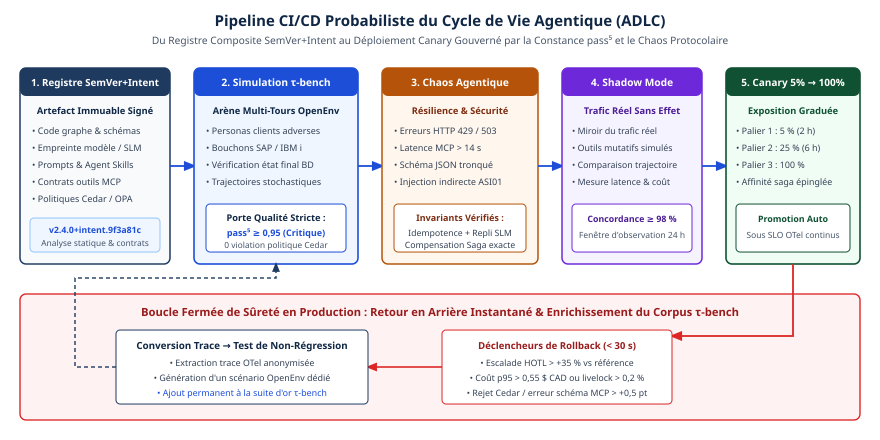

# Chapitre 34 — Exploitation

*Question directrice : comment opérer des agents au quotidien ?*

> **État de référence :** littérature AgentOps parue de novembre 2024 à octobre 2026. Les numéros entre crochets renvoient aux sources en fin de chapitre; [1] à [8] sont des pages primaires lues pour ce chapitre, dont [7] par son seul résumé ([3] ayant été relue au-delà du résumé le 14 novembre 2026); [9] est secondaire; [10], page d'éditeur, a été lue le 14 novembre 2026.

Un service classique tombe en panne bruyamment : codes d'erreur, latence, alertes. Un agent peut rester disponible, rapide et peu coûteux tout en accomplissant la mauvaise tâche, et le tableau de bord reste vert [4]. L'exploitation d'agents hérite de l'ingénierie de la fiabilité des sites (SRE), mais en déplace trois éléments : l'indicateur, qui devient le résultat vérifié plutôt que le code de retour; le levier, qui devient l'autonomie accordée en plus du rythme des mises en production; l'unité de changement, qui s'étend du code au prompt, au modèle, aux outils et à la mémoire.

Le niveau de preuve est modeste : des taxonomies, des relevés et une simulation, sans validation sur des incidents de production. Le chapitre 33 traite de ce qu'il faut tracer et évaluer; celui-ci, de ce qu'on fait des signaux.

---

## 34.1 AgentOps : périmètre et rôles

### Un terme, trois découpages

Dong, Lu et Zhu définissent AgentOps comme un paradigme DevOps spécialisé pour les agents, fondé sur la traçabilité de leurs artefacts tout au long du cycle de vie [1]. Leur taxonomie, tirée d'une cartographie de dix-sept outils, découpe par ce qu'on observe : neuf types de segments de trace (agent, raisonnement, planification, flux de travail, tâche, outil, évaluation, garde-fou, appel au modèle).

Le relevé de Wang et coll. découpe par étapes d'exploitation : surveillance, détection d'anomalies, analyse de cause, résolution [2]. Moshkovich et Zeltyn proposent une chaîne en six étapes, de l'observation du comportement à l'automatisation en cours d'exécution, et nomment quatre publics : développeurs, testeurs, ingénieurs de fiabilité et utilisateurs d'affaires [3]. Un catalogue de dix patrons d'architecture AgentOps est aussi paru en 2026 [9]; il n'a pas été lu ici.

### Ce qui change par rapport à un service

Solanke oppose les hypothèses d'exploitation d'un service à celles d'un agent [4].

| Dimension | Service classique | Agent |
|---|---|---|
| Preuve de succès | Code de retour, latence, disponibilité | Changement vérifié de l'état du système cible |
| D'une exécution à l'autre | Même entrée, même sortie | Même entrée, plans et résultats différents |
| Échec silencieux | Rare | Courant : l'agent déclare réussie une tâche échouée |
| Rayon d'impact | Borné par la requête | Borné seulement par les permissions d'outils |
| Événements de changement | Code et configuration | S'y ajoutent prompt, modèle, outils et mémoire |

Les erreurs se composent d'étape en étape : si chaque étape réussit indépendamment 99 fois sur 100, une tâche de vingt étapes réussit environ 82 fois sur 100 [4]. La fiabilité par étape doit dépasser de loin la cible par tâche.

### Les rôles

Les sources offrent trois repères, pas d'organigramme. La responsabilité du comportement d'un agent se partage entre son propriétaire, le fournisseur du modèle et les fournisseurs d'outils externes [1]. Les correctifs de conception (redondance, garde-fous, reprise) reviennent aux architectes et aux ingénieurs; les correctifs de prompts, aux spécialistes du modèle [2]. L'autorité d'agir s'applique hors du modèle, par un moteur de politiques [4][5].

De là, une répartition minimale, proposée ici : un propriétaire nommé par agent, qui répond de ses objectifs de niveau de service (chapitre 39); une équipe de plateforme, qui tient le déploiement, les traces et le mécanisme d'arrêt; une fonction de vérification indépendante du propriétaire, qui définit les contrôles de résultat (chapitre 41).

---

## 34.2 Déploiement et versions

### Tout changement est un déploiement

Les changements de prompt, de modèle, d'outil et de mémoire sont, selon [4], la source la plus courante de régression. Chacun se traite donc comme une mise en production de code.

La littérature est moins avancée sur ce qu'on versionne. La taxonomie de [1] consigne la version de l'outil et celle du modèle, et traite du versionnage des prompts; elle ne dit rien du versionnage de l'agent lui-même. Ce chapitre propose un manifeste de version : un seul numéro pour l'ensemble formé du modèle épinglé, des prompts, des schémas d'outils et des politiques de garde-fous et de mémoire. Sans cette unité, un retour arrière ne sait pas à quoi revenir.

### La barrière de rejeu

Un essai unique ne prouve rien quand le comportement varie d'une exécution à l'autre. La mesure retenue par [4], issue du banc τ-bench (chapitre 33), est pass^k : la probabilité que l'agent réussisse une tâche à chacune de k tentatives indépendantes. La barrière de mise en production devient une suite de tâches rejouées, avec un seuil sur pass^k; l'exemple illustratif de l'article est 90 % sur quatre tentatives.

### Le déploiement par paliers

Un changement peut être correct dans son état final et dangereux pendant son application. Le relevé NetOps/AIOps en tire une règle : appliquer un changement comme un protocole et non comme un appel unique, les invariants devant tenir à chaque état intermédiaire; déployer en canari, valider, puis élargir [5]. La politique de [4] ajoute une probation : après tout changement, l'agent fonctionne sous supervision pendant un délai fixé.

### Les dépendances qu'on ne maîtrise pas

Le modèle change quand le fournisseur le met à jour : la réponse est d'épingler la version [4]. Épingler ne protège pas du retrait du modèle, qui exige un modèle de secours qualifié d'avance (chapitre 46). Les outils changent aussi : les modifications de configuration des serveurs MCP causent souvent des anomalies d'action [2], d'où la recommandation de versionner les schémas d'outils et de valider les arguments [4]. La fenêtre de dépréciation de MCP (chapitre 5) ne couvre pas les changements propres à chaque serveur.

---

## 34.3 Objectifs de niveau de service fondés sur les résultats

### Quatre couches d'indicateurs

Solanke organise les indicateurs de niveau de service en quatre couches, chacun étant un rapport de bons événements sur événements valides [4].

| Couche | Indicateur | Bons événements | Cible d'exemple |
|---|---|---|---|
| Plateforme | Disponibilité | Appels au modèle réussis | 99,9 % |
| Étape | Succès des appels d'outils | Appels bien formés, autorisés, sans erreur | 99,5 % |
| Tâche | Succès vérifié | Tâches dont l'état final passe un contrôle indépendant | 95 % |
| Garde-fou | Intégrité du périmètre | Actions exécutées dans le périmètre accordé | 100 % (budget nul) |

Les cibles sont illustratives; elles se fixent par flux de travail, à partir d'une mesure de référence. La surveillance classique ne couvre que la première couche.

### L'ancre : le succès vérifié

L'indicateur central est le succès vérifié : l'état final du système cible passe un contrôle indépendant, sans égard au compte rendu de l'agent. Trois sources de vérification, de confiance inégale [4] :

- des **contrôles déterministes**, qui lisent le système cible après l'intervention, par exemple pour confirmer qu'une alerte s'est éteinte et le reste;
- une **revue humaine** sur un échantillon fixe, sur toute escalade et sur toute tâche que l'agent signale comme incertaine;
- des **juges automatiques** pour le reste, après étalonnage sur des étiquettes humaines (chapitre 33).

Là où un contrôle déterministe existe, c'est lui qui définit l'indicateur. Selon une étude que cite l'article, les agents déclaraient réussies 45 à 48 % de leurs tâches échouées quand eux seuls pouvaient modifier l'état du système, contre 3 % sous vérification indépendante; aucun juge automatique essayé n'y dépassait une AUROC de 0,65.

Les indicateurs de garde-fou ont un budget nul : toute violation, comme une écriture hors périmètre, est un incident. Le coût par tâche entre aussi dans le jeu d'objectifs (chapitre 40).

L'auteur reconnaît une limite : certaines tâches n'ont pas d'état final vérifiable par machine.

### Ce que montre la simulation

L'article évalue l'approche par une simulation de Monte Carlo : sept classes de défaillance (section 34.5), 300 incidents injectés par classe, soit 2 100, laissés sans correction pendant 24 heures [4].

- La surveillance de plateforme détecte toutes les pannes de plateforme, mais ne se déclenche que dans 1,7 % des essais au plus pour les six autres classes.
- La surveillance par étape détecte les défaillances d'outils et une partie des défaillances de coordination, rien d'autre.
- La surveillance du succès vérifié est la seule à détecter chaque classe, dans 89,7 % à 100 % des essais, sans fausse alerte. Sa faiblesse est le délai : de 3,5 à 10,6 heures en médiane, car une régression modérée consomme le budget trop lentement pour déclencher une alerte rapide.

Les hypothèses sont synthétiques : les résultats montrent le comportement relatif des configurations, non des valeurs de production.

---

## 34.4 Budgets d'erreur et autonomie accordée

### Le mécanisme classique

En SRE, le budget d'erreur vaut un moins l'objectif. La politique type de Google stipule qu'une fois le budget de quatre semaines épuisé, tous les changements cessent, sauf les correctifs prioritaires et de sécurité, jusqu'au retour dans l'objectif [6]. Le budget règle un seul levier : le rythme du changement.

### Un second levier : l'autonomie

Un agent en offre un second : la politique de Solanke lie l'autonomie à la consommation du budget [4].

| Niveau | Ce que fait l'agent | Condition d'entrée |
|---|---|---|
| L3 — Autonome | Agit dans son périmètre sans approbation | Aucune alerte de consommation active |
| L2 — Supervisé | Les actions à fort impact exigent une approbation humaine | Consommation lente du budget; probation après tout changement |
| L1 — Assistance | L'agent propose, une personne exécute | Consommation rapide ou budget épuisé |
| L0 — Arrêté | Aucune action | Violation de garde-fou exécutée, depuis tout niveau |

La descente est automatique. La remontée exige un correctif qui passe la barrière de rejeu, puis une période calme au niveau L2, de 24 heures par exemple. C'est la variante chiffrée de la règle asymétrique du chapitre 22.

### La règle sensible au changement

Les régressions suivant surtout un changement, la politique ajoute une règle : pendant six heures après tout changement, l'agent reste au niveau L2 et le seuil d'alerte est abaissé. En simulation, cette règle ramène la détection médiane des régressions induites par un changement de 3,6 à 6,0 heures vers 44 à 63 minutes, au prix de 1,14 fausse alerte par 30 jours avec un changement quotidien [4].

### Le contrat d'assurance opérationnelle

Le budget dit quand changer de niveau, pas ce qu'un niveau exige. Le relevé NetOps/AIOps comble ce vide par un « contrat d'assurance opérationnelle » : à chaque palier d'autonomie correspondent des outils permis, une preuve exigée, des barrières, des devoirs de déploiement, de retour arrière et d'audit, et des budgets d'exécution [5].

| Palier | Preuve exigée | Barrières et devoirs |
|---|---|---|
| A. Copilote, lecture seule | Observations liées à leur provenance | Caviardage, limites de débit; trace de preuve |
| B. Analyste | Hypothèses, vérification des contradictions | Règles d'arrêt, escalade; aucune écriture sans supervision |
| C. Planificateur-exécuteur, écriture limitée | Diff candidat, préconditions, estimation du risque, preuve de retour arrière | Vérification non contournable, approbations, canari; registre de changement signé, fenêtre d'observation |
| D. Boucle fermée | État des moniteurs, conditions de déclenchement, preuve de rétablissement | Enveloppe d'action stricte, retour arrière automatique; journal signé, audits périodiques |

Les auteurs en font un gabarit, non une mise en œuvre validée. Lecture proposée ici : le contrat fixe les conditions de chaque palier, le budget déclenche le passage de l'un à l'autre.

### Deux réserves

La supervision a son propre mode de défaillance : Solanke signale la lassitude du consentement et recommande des approbations rares, précises et formulées en conséquences plutôt qu'en étapes [4] (chapitre 22); le relevé NetOps conclut que l'approbation humaine ne suffit pas à elle seule [5]. Et dans un système multi-agents, attribuer une défaillance à un agent, donc à un budget, reste un problème ouvert [4].

---

## 34.5 Détection d'anomalies et analyse de cause

### Classer par signal, non par cause

Solanke range sept classes de défaillance selon le signal qui les révèle [4].

| Classe | Signal de détection | Première réponse |
|---|---|---|
| F1 Planification | Nombre d'étapes hors norme; appels répétés | Plafonner étapes et dépenses |
| F2 Usage d'outils | Erreurs de schéma; codes d'erreur | Valider les arguments; versionner les schémas |
| F3 Contexte et mémoire | Baisse de la qualité de récupération | Borner le contexte; faire expirer la mémoire |
| F4 Faux succès | La déclaration de l'agent contredit le contrôle d'état | Ne compter « terminé » qu'après vérification |
| F5 Périmètre et sécurité | Refus de politique; outil hors périmètre | Échouer en position fermée; arrêter |
| F6 Coordination | Actions en double; boucles de délégation | Un propriétaire par tâche |
| F7 Plateforme et changement | Télémétrie classique; écarts alignés sur un changement | Épingler les versions; rejouer |

Seules F2 et F7 lèvent de façon fiable les erreurs que surveille l'outillage classique. F1, F3, F4 et F6 apparaissent surtout par une baisse du succès vérifié.

Le relevé de Wang et coll. classe plutôt par lieu : anomalies internes à un agent (raisonnement, planification, action, mémoire, environnement) et anomalies entre agents (spécification de tâche, sécurité, communication, confiance, comportement émergent, terminaison) [2]. Il constate qu'aucune méthode efficace ne détecte les comportements émergents; les défaillances de coordination sont traitées au chapitre 21.

### L'analyse de cause

Le même relevé range les causes en trois familles : le système, le modèle, l'orchestration. Une anomalie peut relever de plusieurs à la fois; l'attribution demande une traçabilité de bout en bout (chapitre 33), et l'inférence causale automatisée figure parmi les problèmes ouverts [2].

Les défaillances graduelles sont les plus lentes à détecter; Solanke suggère d'ajouter des indicateurs avancés, comme le nombre d'étapes et la qualité de la récupération [4]. Un correctif n'est jamais local : modifier un agent perturbe le système entier, si bien que tout correctif est une hypothèse provisoire, à valider sur plusieurs tours [2].

### Le dossier d'incident

Le relevé NetOps décrit l'enregistrement d'audit minimal : version de la politique, provenance des preuves, appels d'outils avec arguments et sorties, diffs proposés et exécutés, résultats des vérifications, dans un journal inviolable [5]. Pour l'analyse rétrospective, la politique type de Google offre un seuil transposable : tout incident qui consomme plus de 20 % du budget de quatre semaines en exige une [6].

---

## 34.6 Retour arrière, arrêt d'urgence et seuils de preuve

### Trois mécanismes à ne pas confondre

**Le retour arrière de version** ramène l'agent à un manifeste antérieur (section 34.2).

**Le retour arrière d'état** restaure un instantané de la mémoire, du plan ou de l'environnement; il dépend d'une représentation d'état bien structurée [2]. Il n'annule pas les effets déjà produits dans les systèmes externes, qui relèvent de la compensation (chapitre 18).

**L'arrêt d'urgence** retire toute capacité d'agir. Dans la politique de Solanke, c'est le niveau L0 [4].

### Un arrêt hors du modèle

Deux sources convergent : l'autorité s'applique par un moteur de politiques qui échoue en position fermée et journalise chaque refus [4], et par des barrières que le modèle ne peut pas contourner [5]. Le droit européen formule l'exigence pour les systèmes à haut risque : la personne chargée de la supervision doit pouvoir interrompre le système par un bouton d'arrêt ou une procédure équivalente qui l'amène à un état sûr [8], exigence applicable à l'annexe III dès le 2 décembre 2027 (chapitres 22 et 35).

Aucune source lue ne précise le sort des tâches en cours à l'arrêt; le relevé s'en tient à des règles d'arrêt (budget épuisé, preuve manquante, barrière échouée) [5]. Proposition de ce chapitre : puisque l'annulation d'une tâche MCP est coopérative (chapitre 5), l'arrêt ne peut pas s'en remettre au protocole. Il coupe à la passerelle ou révoque les jetons (chapitres 24 et 30); un site déconnecté exige un arrêt local (chapitre 46). Dans un parc multi-plateformes, il fait partie du socle commun (chapitre 27).

### La preuve exigée croît avec l'autorité

Le relevé NetOps sépare proposer et exécuter : le modèle propose un changement, une barrière indépendante décide de l'exécution après avoir vérifié la politique, les invariants de l'état visé et l'intégrité de la preuve [5]. Un billet ou un guide d'intervention peut nourrir une hypothèse, pas autoriser une action privilégiée. Les journaux sont même une surface d'injection démontrée : l'action se choisit dans un catalogue de procédures bornées (chapitre 47). Le risque d'un changement combine rayon d'impact, nouveauté et couverture par les tests; une faible couverture réduit l'autonomie.

Une méthode de réponse aux incidents bloque de même toute action qui modifie l'état tant que la preuve requise manque, et la recueille par des vérifications bornées en lecture seule [7].

Le retour arrière se mesure aussi : rappel des déclenchements sur les canaris nuisibles, faux retours arrière sur les canaris sains, délai entre déclenchement et rétablissement. Un taux brut de retours arrière ne signifie rien [5].

Bilan : la preuve est assez solide pour l'assistance en lecture et le diagnostic, nettement plus mince au-delà. Aucun système retenu par le relevé ne démontre une boucle fermée large et assurée de façon indépendante [5].

### Ce que les plateformes fournissent

Une documentation d'éditeur montre la forme que prend le retour arrière de version. Dans l'environnement d'exécution d'Amazon Bedrock AgentCore, chaque mise à jour crée une version immuable, qui porte toute la configuration nécessaire à l'exécution [10]. Les appelants passent par des points d'accès nommés : celui par défaut suit toujours la dernière version, les autres ne changent que sur ordre explicite. La page ne parle pas de retour arrière; on en déduit que revenir en arrière consiste à repointer le point d'accès de production vers une version antérieure, sans rien reconstruire.

Ce mécanisme ne réalise qu'une partie du manifeste de version de la section 34.2 : il fige ce que la plateforme connaît, soit le conteneur, le protocole et les réglages de réseau, non le modèle servi ailleurs, les outils de tiers ni la mémoire. Il ne couvre ni l'état que l'agent a déjà modifié, qui relève du retour arrière d'état, ni les effets externes, qui relèvent de la compensation (chapitre 18). Il comporte aussi un piège : un appelant resté sur le point d'accès par défaut reçoit toute nouvelle version sans palier.

Pour l'arrêt, la documentation lue ailleurs dans l'ouvrage donne deux formes : le blocage d'un agent au registre de Microsoft Agent 365 et sa désactivation par son parrain dans Entra (chapitres 8 et 39). Aucune de ces pages ne chiffre un délai d'arrêt.

---

## 34.7 Dérive

Modèles, prompts, API d'outils et signaux sous-jacents dérivent, parfois sans bruit [5]. S'y ajoutent la mémoire, qui se périme ou s'empoisonne, et la documentation d'exploitation, qui vieillit plus vite que les déploiements [4][5].

La simulation distingue deux régimes [4]. La dérive brusque suit un changement; la règle sensible au changement la détecte en une heure environ. La dérive graduelle n'a pas de déclencheur : la dérive de contexte est détectée après 10,6 heures en médiane, une fois consommés environ 5 % du budget mensuel. C'est le cas le moins bien couvert.

Quatre gestes y répondent :

- **Épingler** les versions de modèle et **rejouer** la suite d'essais avant tout changement [4]; la rejouer aussi à intervalles fixes est une extension proposée ici.
- **Faire expirer et auditer** la mémoire [4] (chapitre 14).
- **Surveiller des indicateurs avancés** : nombre d'étapes, qualité de la récupération [4].
- **Éprouver sous conditions dégradées** : télémétrie manquante, tardive ou contradictoire. Si l'agent devient plus autonome sous ces contraintes, l'évaluation est trop indulgente [5].

---

## Grille de décision

| Décision | Option par défaut | Quand s'en écarter |
|---|---|---|
| Indicateur principal | Succès vérifié par contrôle déterministe du système cible [M] | Pas d'état final vérifiable : échantillon humain et juges étalonnés |
| Unité de version | Manifeste unique : modèle, prompts, schémas d'outils, politiques [S] | — |
| Mise en production | Suite rejouée avec seuil sur pass^k, puis canari [S] | Lecture seule à faible enjeu : essai simple |
| Après un changement | Probation supervisée, seuil d'alerte abaissé [M] | Changements très fréquents : les regrouper |
| Autonomie | Réglée par le budget; descente automatique, remontée après rejeu et période calme [S] | Preuve insuffisante pour le palier : rester au palier inférieur |
| Écriture dans un système | Séparation proposer-exécuter, barrière hors du modèle [S] | Aucun cas |
| Arrêt d'urgence | Passerelle ou révocation des jetons [S] | Site déconnecté : arrêt local |
| Analyse rétrospective | Incident qui consomme plus de 20 % du budget [S] | Toute violation de garde-fou |
| Retour arrière de version | Retour au manifeste antérieur; là où la plateforme offre des versions immuables et des points d'accès nommés [10], repointer le point d'accès [S] | Jamais le point d'accès par défaut en production |

---

## Points à retenir

- La surveillance classique ne voit pas un agent qui accomplit la mauvaise tâche. L'indicateur d'ancrage est le succès vérifié, mesuré indépendamment du compte rendu de l'agent.
- Prompt, modèle, outils et mémoire sont des unités de changement, soumises à une barrière de rejeu et à une probation.
- Le budget d'erreur règle deux leviers : le rythme du changement et l'autonomie accordée. La descente est automatique, la remontée se mérite.
- Les garde-fous ont un budget nul, et l'arrêt d'urgence s'applique hors du modèle.
- La preuve exigée croît avec l'autorité : le modèle propose, une barrière indépendante autorise.
- Retour arrière de version, retour arrière d'état et arrêt d'urgence sont trois mécanismes distincts. Aucun n'efface les effets externes déjà produits, qui relèvent de la compensation.
- La dérive graduelle est le cas le moins bien détecté.
- L'ensemble repose sur des taxonomies, des relevés et une simulation. La validation sur des incidents réels reste à faire.

---

## Sources

Pages primaires lues le 11 novembre 2026 :

1. [Dong, Lu et Zhu — AgentOps: Enabling Observability of LLM Agents (arXiv 2411.05285)](https://arxiv.org/abs/2411.05285) — prépublication.
2. [Wang et coll. — A Survey on AgentOps (arXiv 2508.02121)](https://arxiv.org/abs/2508.02121) — prépublication.
3. [Moshkovich et Zeltyn — Taming Uncertainty via Automation (arXiv 2507.11277)](https://arxiv.org/abs/2507.11277) — prépublication, résumé puis extraits relus le 14 novembre 2026.
4. [Solanke — From AIOps to AgentOps, WJAETS 21(01), 2026](https://wjaets.com/sites/default/files/fulltext_pdf/WJAETS-2026-0466.pdf) — texte intégral.
5. [Bilal et coll. — Large Language Models for Agentic NetOps and AIOps (arXiv 2605.12729, version 4; Computer Science Review 63, 2027)](https://arxiv.org/abs/2605.12729) — sections I à X.
6. [Google — The Site Reliability Workbook, politique type de budget d'erreur](https://sre.google/workbook/error-budget-policy/)
7. [Bodapati Venkata — Evidence-Gated Search, JCSTS 8(5), 2026](https://al-kindipublisher.com/index.php/jcsts/article/view/12302) — résumé seulement.
8. [Règlement européen sur l'IA, article 14](https://artificialintelligenceact.eu/article/14/) — site de consultation non officiel.

Source secondaire :

9. [Xia et coll. — AgentOps Pattern Catalogue (SSRN 5534588; Information and Software Technology, 2026)](https://papers.ssrn.com/sol3/papers.cfm?abstract_id=5534588) — page inaccessible; repris du plan initial et d'un résumé de recherche.

Page d'éditeur lue le 14 novembre 2026 :

10. [AWS — AgentCore Runtime versioning and endpoints](https://docs.aws.amazon.com/bedrock-agentcore/latest/devguide/agent-runtime-versioning.html)

## Limites de ce chapitre

- La source [3], d'abord connue par son seul résumé, a été relue au-delà du résumé le 14 novembre 2026, par un outil qui en rend des extraits; les écarts relevés sont corrigés dans le texte.
- **VeriOps-Agent**, appui prévu par le plan initial pour les seuils de preuve, n'a pas été retrouvé à la source. La section 34.6 s'appuie sur [5] et, par son seul résumé, sur [7], dont les résultats chiffrés ne sont pas repris.
- Le catalogue [9] n'a pas été lu, (l'URL SSRN renvoie HTTP 403 anti-robot le 14 novembre 2026; notice bibliographique confirmée sur Crossref via le DOI 10.1016/j.infsof.2026.108307, *Information and Software Technology*, vol. 200); ses dix patrons ne sont ni nommés ni discutés.
- Les chiffres de [4], revérifiés à l'audit dans son texte courant, viennent d'une simulation signée d'un seul auteur; la qualité de la revue n'a pas été évaluée. Ses tableaux, brouillés à l'extraction, n'ont servi qu'à reconstituer celui des classes. L'étude sur les faux succès qu'il cite (arXiv 2606.09863) n'a pas été lue.
- [5] a été lu par extraits résumés, et seul son résumé a été relu à l'audit : le détail des paliers et ses équations n'ont pas été revérifiés.
- Sont des propositions de ce chapitre : la répartition des rôles, le manifeste de version, le rapprochement entre contrat d'assurance et budget d'erreur, l'arrêt d'urgence à la passerelle, le rejeu périodique et la transposition aux agents du seuil d'analyse rétrospective de Google.
- L'article 14 a été lu sur un site non officiel, non dans le Journal officiel.
- Une seule documentation d'éditeur a été lue, celle d'AWS sur les versions et les points d'accès [10], le 14 novembre 2026. Les mécanismes de retour arrière des autres plateformes (chapitre 26) ne sont pas décrits, et le rapprochement avec le manifeste de version est une lecture de ce chapitre.

## Mise en œuvre — Cycle de vie ADLC, CI/CD probabiliste, simulation (τ-bench) et ingénierie du chaos {.volet}

:::: {.encadre .executive}
::: {.encadre-titre}
**Synthèse exécutive**
:::

- **Enjeu stratégique** : Transposer les pipelines d’intégration continue du logiciel déterministe (`assert f(x) == y`) ou les bancs d’essai statiques à tour unique du MLOps expose un programme agentique à des régressions en production. Un agent qui affiche 92 % de réussite sur des questions isolées échoue souvent une fois sur deux dans un dialogue réel de huit tours, qui mêle ambiguïté humaine, mutations d’état et lenteurs d’API.
- **Décisions architecturales structurantes** :
  1.  *Irréversible à moyen terme* : Adopter un cycle de vie agentique (ADLC) fondé sur un registre d’agents immuable, versionné en SemVer + Intent. Toute modification de prompt, de paquet Agent Skills, de schéma MCP, de poids de modèle ou de politique Cedar produit un artefact qualifié.
  2.  *Structurante dès le jour 1* : Remplacer $\text{pass}@k$ et les juges automatiques superficiels par des environnements multi-tours normalisés (OpenEnv, famille $\tau$-bench), qui vérifient l’état final exact des bases simulées, et exiger une constance $\text{pass}^k$ stricte ($\text{pass}^5 \ge 0,95$ sur les parcours critiques).
  3.  *Réversible par conception* : Calibrer les paliers de déploiement progressif (mode fantôme, canari à 5 % → 25 % → 100 %) et composer les profils adversariels injectés dans la suite de chaos.
- **Indicateurs de gouvernance associés** : Score de constance $\text{pass}^5$ par domaine critique, survie sans corruption d’état sous chaos protocolaire (taux de survie au chaos = 100 %), temps de retour arrière automatisé inférieur à 30 s, conversion systématique des incidents réels en tests permanents.
::::

## 34.8 Du SDLC déterministe à l’ADLC : gouverner six vitesses de changement par SemVer + Intent

Le cycle de vie agentique (ADLC) prolonge celui du génie logiciel classique (SDLC). Son unité de livraison est l’agent complet, composite et immuable, versionné en SemVer + Intent : c’est le manifeste de version proposé à la section 34.2, ici précisé.

Le comportement d’un spécialiste L3 résulte de six couches qui évoluent à des cadences distinctes : le contrat A2A externe, le point de contrôle exact du modèle (LLM ou SLM), les compétences modulaires (Agent Skills) avec les schémas JSON des serveurs MCP invoqués, le prompt système avec les directives de dépôt (`AGENTS.md`), les politiques déterministes Cedar ou OPA qui bornent son enveloppe d’action, et le code d’infrastructure. Une modification de l’une d’elles est qualifiée par un pipeline CI/CD qui revalide l’ensemble. Les sections 34.1 et 34.2 ajoutent la mémoire aux unités de changement, et le manifeste de version regroupe les politiques de garde-fous et de mémoire; ces six couches ne la nomment pas.



Dans la notation `MAJEUR.MINEUR.CORRECTIF+intent.<empreinte>`, les trois segments numériques suivent la compatibilité contractuelle de l’Agent Card A2A v1.0; le suffixe d’intention scelle cryptographiquement toutes les dépendances cognitives et protocolaires.

| Couche modifiée de l’artefact | Exemple concret de changement | Impact SemVer + Intent | Suites de qualification CI/CD obligatoires |
|:-------------------|:---------------------------|:-------------------|:---------------------------------|
| 1. Contrat A2A externe | Rupture sur `outputSchema` d’une compétence publiée | Incrément MAJEUR (3.0.0) | Contrats consommateurs, suite complète $\tau$-bench ($\text{pass}^5$), chaos complet, canari long |
| 2. Modèle (LLM / SLM) | Nouvelle révision de poids ou ajustement du budget de raisonnement | Incrément MINEUR + nouvel `intent` | Suite complète $\tau$-bench ($\text{pass}^5$), étalonnage coût/latence, mode fantôme de 24 h |
| 3. Agent Skills et schémas MCP | Ajout d’un 9e outil MCP ou refonte d’un module Agent Skill | Incrément MINEUR (2.5.0) | Tests de surcharge d’outils, simulation multi-tours, chaos sur le nouvel outil |
| 4. Prompt système et `AGENTS.md` | Clarification d’une règle de priorité documentaire | Incrément CORRECTIF + nouvel `intent` | Suite ciblée $\tau$-bench ($\text{pass}^5$ cas d’or) + contrôle anti-injection |
| 5. Politiques Cedar / OPA | Abaissement du seuil HOTL de 5 000 \$ CAD à 3 500 \$ CAD | Révision liée au manifeste | Preuve formelle déterministe (100 % cas limites) + simulation escalade CIBA |
| 6. Code d’infrastructure pur | Optimisation du sérialiseur OTLP hors graphe et hors prompts | Incrément CORRECTIF (2.4.2) | Tests unitaires/intégration déterministes + test de fumée |

#### Extrait 34.1 — Manifeste normatif du Registre d’Agents d’Entreprise (SemVer + Intent)

Le pipeline CI signe ce manifeste avant sa publication dans l’annuaire interne compatible AGNTCY / OASF; il interdit tout écart entre le banc d’essai et la production.

``` yaml
apiVersion: agentops.boreal.ca/v1
kind: AgentReleaseManifest
metadata:
  agentId: boreal-bca-warranty-adjudicator
  version: "2.4.0+intent.9f3a81c"
  division: BCA
  autonomyLevel: L3
  regulatoryClassification:
    bsifE23MaterialityTier: Tier-2-High
    quebecLoi25AutomatedDecision: true
    ownerTeam: coe-garanties-bca@boreal.ca
spec:
  a2aCardDigest:
    "sha256:d0ad65640398d3fdab95fa3c7b6719e1fe574f9f0d94ef071c9d08d9a7770867"
  cognitivePinning:
    # Point de contrôle daté fixe (alias flottant interdit)
    primaryModel: "claude-sonnet-4-6-20261114"
    fallbackSlm: "oci://registry.boreal.ca/slm/qwen3-14b-warranty:3.1.0"
    fallbackSlmDigest:
      "sha256:2bcf2ed0dcfe35c6aca8780afe3d7e9940f39a341e79cff8d402c0f59ddf4b6a"
    temperature: 0.0
    maxReasoningTokens: 2048
    systemPromptDigest:
      "sha256:c8728ba34fbba31aa8a4cc64ad8626bd25dbb5316437f4c59f508c9f5df55c68"
  packagedSkills:
  - name: "as400-endorsement-clause-parser"
    version: "1.3.2"
    digest:
      "sha256:8cb8d13abb2adc37dd0d12b8085270d0fa24e20928ac7cadf30693346fdefdf8"
  pinnedMcpDependencies:
  - serverUri: "https://mcp.bca.internal.boreal.ca/as400-contracts"
    schemaVersion: "2027.02"
    allowedTools:
      - "get_master_lease_contract"
      - "list_active_warranty_endorsements"
      - "issue_provisional_coverage_token"
  policyBundle:
    engine: cedar
    bundleVersion: "bca-warranty-pdp-v4.8"
    digest:
      "sha256:a20a4166692c30cc694a9fe543e4a314eef7a05a4021efd3cb127415e300f95c"
  homologationGates:
    benchmarkSuite: "boreal-taubench-bca-warranty-v5"
    requiredPassPower5Critical: 0.95
    requiredPassPower5Global: 0.88
    requiredChaosSurvivalRate: 1.00
    maxP95CostPerOutcomeCad: 0.45
```

La directive `cognitivePinning` applique l’épinglage de la section 34.2 : aucun agent L2 ou L3 (échelle d’autonomie de l’ouverture, section 0.4) ne peut référencer un alias flottant tel que `latest`; l’identifiant daté exact du modèle (ou le condensat SHA-256 des poids d’un SLM interne) est figé dans le manifeste.

------------------------------------------------------------------------

## 34.9 Simulation multi-tours (OpenEnv et famille $\tau$-bench) : $\text{pass}^k$ plutôt que $\text{pass}@k$

Évaluer un agent sur cinquante paires statiques question-réponse, notées par similarité textuelle ou par un juge automatique indulgent, laisse échapper les échecs d’un dialogue. L’agent échoue rarement au premier tour : il échoue au quatrième quand l’interlocuteur se ravise, au cinquième quand un retour d’outil MCP est ambigu, au sixième quand il oublie une restriction contractuelle lue au début de l’échange.

Deux standards complémentaires structurent l’évaluation avant déploiement en 2027 :

1.  **Environnements d’évaluation normalisés (OpenEnv, Linux Foundation AAIF)** : OpenEnv encapsule de façon reproductible un jumeau transactionnel léger : un état initial de base de données (contrats, stocks, billets), des serveurs MCP simulés déterministes et des sondes d’invariants métiers.
2.  **Bancs d’essai interactifs $\tau$-bench, $\tau^2$-bench et $\tau^3$-bench** : le harnais confronte l’agent à un simulateur d’utilisateur ou de pair piloté par un objectif, qui varie ses formulations et distille ses informations au fil du dialogue. Le verdict ne repose pas sur la qualité du texte généré, mais sur l’égalité déterministe entre l’état final de la base après la conversation et l’état cible unique que dictent les règles d’affaires.

### La mesure $\text{pass}^k$

La section 34.2 définit $\text{pass}^k$. Il s’oppose à $\text{pass}@k$, que la synthèse de code assistée utilise volontiers : la probabilité qu’au moins un essai parmi $k$ générations résolve le problème. Ce critère vaut quand un compilateur filtre gratuitement dix essais avant d’en retenir un. En opérations d’entreprise, la contrainte est inverse : l’agent n’a pas cinq essais devant un client ou un règlement financier, et il doit réussir chacun des $k$ dossiers analogues malgré la variabilité des dialogues. Sur $n$ exécutions indépendantes d’un scénario ayant produit $c$ succès, les deux mesures divergent :

$$\text{pass}@k = 1 - \frac{\binom{n - c}{k}}{\binom{n}{k}}, \qquad \text{pass}^k = \frac{\binom{c}{k}}{\binom{n}{k}} \approx \left(\frac{c}{n}\right)^k$$

Un agent dont la précision unitaire est $p = 0,80$ obtient un $\text{pass}@5 = 1 - 0,20^5 = 99,97\,\%$, mais son $\text{pass}^5 = 0,80^5$ tombe à 32,77 % : au moins une faute métier dans deux tiers des séries de cinq dossiers. Exiger $\text{pass}^5 \ge 0,95$ sur les parcours critiques impose une fiabilité unitaire minimale de $0,95^{1/5} \approx 98,98\,\%$, qui ne peut être atteinte qu’en déportant calculs et garde-fous dans des outils MCP déterministes et des règles Cedar. Ce seuil, comme ceux du manifeste de l’extrait 34.1, va au-delà de ce que retient la section 34.2 : un seuil sur $\text{pass}^k$, dont l’exemple illustratif est 90 % sur quatre tentatives.

Avec exactement $n = k = 5$ trajectoires par scénario, l’estimateur combinatoire sans biais $\binom{c}{5}/\binom{5}{5}$ est binaire ($\{0, 1\}$) pour un scénario isolé. La barrière de promotion évalue donc la moyenne $\overline{\text{pass}^5}$ sur un corpus minimal de $M \ge 100$ scénarios par domaine, vérifie la borne inférieure de l’intervalle de confiance de Wilson à 95 %, et impose zéro violation de politique sur chaque scénario critique.

### Étalonnage des simulateurs

Le modèle qui anime l’utilisateur simulé, comme les évaluateurs sémantiques auxiliaires, demande une hygiène méthodologique. Trois pièges faussent les bancs d’essai internes mal conçus :

- **Collusion de famille de modèles** : quand l’utilisateur simulé (ou un juge de conformité rédactionnelle) vient de la même famille de poids que l’agent évalué, tous deux partagent des angles morts corrélés, ce qui gonfle le score $\text{pass}^5$ de 6 à 11 points par rapport au trafic humain réel. La norme d’architecture impose une hétérogénéité croisée : l’agent testé fait face à des profils animés par une famille de modèles distincte.
- **Dérive vers des dialogues trop coopératifs** : les modèles alignés par apprentissage par renforcement produisent par défaut des utilisateurs simulés courtois, structurés et patients. La distribution des profils est donc stratifiée à partir des grappes observées dans les traces anonymisées (messages elliptiques de trois mots, fautes de frappe sur les références d’équipement, impatience explicite dès le quatrième tour).
- **Primauté de l’assertion déterministe** : comme à la section 34.3, le contrôle déterministe prime. Au moins 80 % de la décision de passage repose sur l’inspection programmatique de l’état final des tables simulées, des événements Kafka émis et des journaux Cedar. Les 20 % restants, confiés à un modèle critique indépendant, se limitent aux propriétés non relationnelles : absence de divulgation d’instructions internes, clarté de l’explication fournie au client (Loi 25), justesse du résumé transmis à un superviseur HOTL.

| Référentiel / Métrique | Topologie d’interaction simulée | Mode de vérification du verdict | Angle mort corrigé | Usage cible dans le pipeline ADLC |
|:----------------|:-------------------------|:--------------------|:--------------------|:------------------|
| Évaluation à tour unique | Question isolée → Réponse statique | Similarité lexicale ou juge automatique | Aucun suivi d’état ni d’outil | Filtrage rapide des extracteurs L0/L1 |
| $\tau$-bench (classique) | Agent outillé (MCP) $\leftrightarrow$ utilisateur simulé; seul l’agent mute la base | Assertion exacte sur l’état final de la base + politique | Détecte l’oubli de règles sur 5 à 15 tours | Barrière CI standard de tout spécialiste L2/L3 |
| $\tau^2$-bench (double contrôle) | L’agent et l’utilisateur agissent simultanément sur l’état partagé | Convergence de l’état couplé (monde client + SI) | Détecte les conflits quand le client agit en parallèle | Dépannage technique interactif, support IT/OT |
| Environnements fédérés | Graphe multi-agents A2A complet sous horizons longs et bruit | État distribué multi-domaines + budget/sécurité | Détecte les pannes en cascade (ASI08) inter-divisions | Homologation des sagas transversales L3 |
| Seuil $\text{pass}^5$ vs $\text{pass}@1$ | $k=5$ trajectoires stochastiques par scénario (profils variés) | Exigence de 5/5 convergences sans violation | Écarte les agents performants mais irréguliers | Critère bloquant de mise en production |

:::: {.encadre .sectoriel}
::: {.encadre-titre}
**Service client à haut volume (télécoms, commerce, SaaS) : double contrôle et incohérence humaine**
:::

Dans un centre de contact qui traite 80 000 interactions par jour, les agents échouent principalement parce que l’interlocuteur modifie lui-même l’état du monde et change d’intention en cours de dialogue, ce que modélise $\tau^2$-bench.

Pendant qu’un agent diagnostique une passerelle optique, l’abonné débranche un câble sans le mentionner, refuse une option au tour 4, exige la résiliation au tour 6, puis accepte un technicien au tour 9 en changeant d’adresse. La suite OpenEnv d’un service client à fort volume doit donc tester systématiquement quatre archétypes synthétiques :

1.  L’interlocuteur fragmentaire, qui tait les informations clés tant que l’agent ne pose pas les questions de diagnostic.
2.  L’acteur à double contrôle, qui modifie un paramètre local ou un panier dans un autre canal et invalide les lectures faites trois tours plus tôt.
3.  L’indécis contradictoire, qui inverse sa demande après une pré-réservation : l’agent doit déclencher l’outil de compensation avant d’engager la nouvelle action.
4.  Le négociateur persuasif hors politique, qui invoque une urgence émotionnelle crédible pour obtenir un geste commercial supérieur au plafond L3.
::::

------------------------------------------------------------------------

## 34.10 Ingénierie du chaos agentique

Réussir $\text{pass}^5 \ge 0,95$ sur des serveurs simulés qui répondent en 40 millisecondes ne suffit pas. L’incident initial du Groupe Boréal (41 000 \$ CAD consommés en onze heures un dimanche chez BEL, sur une erreur HTTP 429 mal gérée) montre que la sûreté d’un agent se juge à son comportement quand son environnement se dégrade.

L’ingénierie du chaos agentique applique au pipeline CI/CD l’épreuve sous conditions dégradées de la section 34.7 : elle injecte cinq classes de perturbations reproductibles sur les flux MCP et A2A.

1.  **Chaos de débit et de transport (HTTP 429, 503, coupures SSE)** : vérifier que l’agent respecte Retry-After, n’invente jamais une confirmation fictive lorsque l’outil échoue (faux succès) et bascule proprement vers le repli ou la mise en veille.
2.  **Chaos de latence asymétrique** : injecter un délai de 14 secondes sur un serveur MCP patrimonial pour prouver que les clés d’idempotence bloquent toute double écriture en cas de relance d’activité Temporal.
3.  **Chaos de dérive sémantique et de troncature** : retourner un JSON valide mais partiel (`null` inattendu, devise non convertie) pour vérifier que l’agent déclenche une escalade HOTL plutôt que d’inventer une valeur.
4.  **Chaos de préconditions périmées** : simuler l’épuisement de la dernière pièce entre la lecture et la réservation pour valider l’exécution exacte des compensations de la saga.
5.  **Chaos adversariel (OWASP ASI01 / ASI04)** : insérer dans les textes qu’un outil documentaire retourne une injection indirecte qui tente de provoquer un appel d’outil non autorisé.

#### Extrait 34.2 — Harnais Python d’évaluation multi-tours OpenEnv calculant $\text{pass}^5$ sous chaos MCP

Le proxy injecte des erreurs HTTP 429 reproductibles par graine et compte les clés d’idempotence reçues. La fonction rejoue chaque scénario dans une base neuve, compare l’état final à l’état attendu et ne valide la barrière que si les seuils critique et global sont atteints, sans violation de politique.

``` python
from dataclasses import dataclass
import math
import random
from typing import Callable, Dict, Sequence

@dataclass
class ScenarioSpec:
    scenario_id: str
    critical: bool
    initial_db_snapshot: Dict[str, object]
    expected_final_db_state: Dict[str, object]
    user_goal_prompt: str

class McpChaosProxy:
    """Proxy OpenEnv injectant des fautes protocolaires reproductibles par graine."""
    def __init__(self, real_router: Callable, seed: int, rate_429: float = 0.15) -> None:
        self._router = real_router
        self._rng = random.Random(seed)
        self._rate_429 = rate_429
        self.mutating_keys_seen: Dict[str, int] = {}

    async def call_tool(self, tool_name: str, args: Dict[str, object]) -> Dict[str, object]:
        idem_key = str(args.get("idempotencyKey", ""))
        if idem_key:
            self.mutating_keys_seen[idem_key] = self.mutating_keys_seen.get(idem_key, 0) + 1
        if self._rng.random() < self._rate_429:
            raise RuntimeError("HTTP_429_RATE_LIMITED: Retry-After=2")
        return await self._router(tool_name, args)

async def evaluate_suite_pass_power_k(
    suite: Sequence[ScenarioSpec],
    run_episode_fn: Callable,
    n_trials: int = 5,
    k: int = 5,
) -> Dict[str, object]:
    if n_trials < k:
        raise ValueError("n_trials doit être supérieur ou égal à k")
    crit_scores, all_scores, policy_violations = [], [], 0

    for scenario in suite:
        successes = 0
        for trial in range(n_trials):
            world_db = copy_deep_snapshot(scenario.initial_db_snapshot)
            chaos_proxy = McpChaosProxy(real_router=bind_db_tools(world_db), seed=1000 + trial)

            report = await run_episode_fn(
                goal=scenario.user_goal_prompt,
                persona_variant=trial,
                mcp_gateway=chaos_proxy,
                max_turns=12,
            )

            db_matches = (world_db == scenario.expected_final_db_state)
            safe_exec = (report.cedar_denials == 0 and not report.uncompensated_side_effects)
            if not safe_exec:
                policy_violations += 1
            if db_matches and safe_exec:
                successes += 1

        score_k = math.comb(successes, k) / math.comb(n_trials, k)
        all_scores.append(score_k)
        if scenario.critical:
            crit_scores.append(score_k)

    mean_crit = sum(crit_scores) / max(len(crit_scores), 1)
    mean_global = sum(all_scores) / max(len(all_scores), 1)
    return {
        "pass_power_k_critical": round(mean_crit, 4),
        "pass_power_k_global": round(mean_global, 4),
        "policy_violations": policy_violations,
        "gate_passed": (mean_crit >= 0.95 and mean_global >= 0.88 and policy_violations == 0),
    }
```

Une violation de politique Cedar ou un effet de bord non compensé (`policy_violations > 0`) bloque la promotion du manifeste candidat, quel que soit le score moyen.

La section 34.6 renvoie à la compensation les effets externes déjà produits, mais certaines actions ne se compensent pas. Une réservation de stock interne se libère par une transaction inverse; un courriel juridique déjà expédié à un client externe ou un télégramme EDI transmis à un douanier ne se retire pas si la dernière étape de la saga échoue dix secondes plus tard. Quand le proxy provoque une panne tardive à l’étape finale d’une saga multi-divisions, le harnais vérifie que les connecteurs externes irréversibles appliquent le patron de boîte d’envoi différée : l’outil MCP enregistre l’intention d’envoi en tampon et n’émet physiquement la communication vers l’extérieur qu’après validation complète de la saga par l’orchestrateur durable (ou expiration d’une fenêtre de rétractation HOTL de quatre-vingt-dix secondes).

:::: {.encadre .sectoriel}
::: {.encadre-titre}
**Secteur financier (BSIF E-23 au 1er mai 2027) : industrialiser la validation indépendante des modèles**
:::

Sous la ligne directrice BSIF E-23, la deuxième ligne de défense (gestion indépendante du risque de modèle) ne peut plus mettre six semaines à valider manuellement des agents mis à jour deux fois par mois.

Le couple SemVer + Intent et OpenEnv permet une homologation continue gouvernée :

1.  L’équipe indépendante des risques maintient son propre référentiel scellé de scénarios $\tau$-bench et de chaos, inaccessible en écriture aux équipes de développement pour exclure tout sur-ajustement aux tests.
2.  Toute révision mineure qui reste dans l’enveloppe architecturale approuvée (Cedar intact, même niveau d’autonomie) et franchit 100 % des barrières $\text{pass}^5$ et de survie au chaos sur ce banc scellé reçoit en vingt minutes un certificat d’homologation numérique, archivé avec le manifeste. Les comités humains sont réservés aux changements majeurs.
::::

------------------------------------------------------------------------

## 34.11 Déploiement progressif : mode fantôme et canari épinglé par saga

La section 34.2 décrit le déploiement par paliers et la probation. Une version SemVer + Intent validée en simulation traverse en production deux étapes, orchestrées par agentgateway et Temporal :

1.  **Mode fantôme sans effet de bord** : la passerelle duplique en asynchrone 10 à 20 % du trafic réel vers la version candidate. Tous les outils MCP de lecture interrogent les données réelles; tous les outils MCP mutatifs sont interceptés par un bouchon sans écriture. Un comparateur mesure pendant 24 heures la concordance des décisions, la latence et l’écart de coût par rapport à la version active, avant d’exposer le moindre client.
2.  **Canari épinglé par saga** : la version d’un agent ne change jamais au milieu d’une conversation ou d’une saga multi-tours en cours. Le routeur oriente 5 % des nouvelles sagas vers le candidat et épingle cette version dans l’état durable de la saga jusqu’à sa clôture. Si un SLO OpenTelemetry dérive, le contrôleur rebascule en moins de 30 secondes 100 % des nouvelles sagas sur la version stable (retour arrière de version, section 34.6).

#### Extrait 34.3 — Politique déclarative de déploiement *Canary* et de retour en arrière automatique (*rollback*)

La politique déclare le miroir de trafic du mode fantôme, les paliers du canari, l’épinglage par `saga.id` et les conditions de retour arrière automatique, évaluées toutes les 30 secondes.

``` yaml
apiVersion: agentops.boreal.ca/v1
kind: ProgressiveRolloutPolicy
metadata:
  targetAgent: boreal-bca-warranty-adjudicator
  candidateVersion: "2.4.0+intent.9f3a81c"
  baselineVersion: "2.3.4+intent.41b02e8"
spec:
  routingStrategy:
    stickinessKey: "saga.id"                  # Épinglage strict de version sur toute la vie de la saga
    shadowStage:
      enabled: true
      trafficMirrorPercent: 15
      duration: 24h
      mutatingMcpMode: "dry-run-intercept"
      minDecisionConcordance: 0.98
    canarySteps:
      - weightPercent: 5
        bakeDuration: 2h
        minCompletedSagas: 80
      - weightPercent: 25
        bakeDuration: 6h
        minCompletedSagas: 400
      - weightPercent: 100
        bakeDuration: 0h
  automatedRollbackTriggers:
    evaluationInterval: 30s
    conditions:
      - metric: "otel.gen_ai.livelock_abort_rate"
        operator: ">"
        threshold: 0.002                      # > 0,2 % de boucles sémantiques -> Rollback immédiat
      - metric: "otel.cedar.policy_denial_rate_delta"
        operator: ">"
        threshold: 0.005                      # Hausse > +0,5 pt de rejets Cedar
      - metric: "otel.hotl.escalation_rate_relative_increase"
        operator: ">"
        threshold: 0.35                       # Hausse relative > +35 % d'escalades HOTL
      - metric: "finops.p95_cost_per_saga_cad"
        operator: ">"
        threshold: 0.55
  postIncidentAutomation:
    exportFailedTracesToOpenEnvQueue: true    # Boucle fermée : trace d'échec -> futur test tau-bench
```

La directive finale referme la boucle avec le chapitre 33 : chaque désaveu HOTL ou retour arrière du canari extrait automatiquement la trace anonymisée pour enrichir la suite permanente $\tau$-bench.

------------------------------------------------------------------------

## 34.12 Application au fil rouge : le filet à 1 200 scénarios du Groupe Boréal

:::: {.encadre .filrouge}
::: {.encadre-titre}
**Fil rouge — Groupe Boréal : le critère pass\^5 a bloqué une régression invisible au pass@1**
:::

**Dispositif en place (mars 2027)** : Le Centre d’Excellence Agentique exploite un environnement OpenEnv de 1 200 scénarios multi-tours, issus des dossiers historiques et de traces anonymisées : 450 scénarios garantie/crédit-bail BCA (dont 120 critiques BSIF E-23), 400 scénarios logistiques BEL et 350 scénarios télématiques BSN. Chaque candidature exécute 6 000 conversations simulées ($k=5$) en 14 minutes, pour un coût de 38 \$ CAD, grâce à des profils simulés animés par des SLM calibrés.

**Interception critique en pré-production (semaine 11 de 2027)** : Une équipe soumet la révision `2.5.0+intent.c092d1b` de l’*Agent Garantie BCA*, qui adopte une nouvelle révision de modèle 25 % moins coûteuse. Au premier essai ($\text{pass}@1$), le score global semble progresser à 93,8 % (contre 93,1 % en production).

Le pipeline ADLC bloque pourtant la promotion à l’étape chaos et $\tau$-bench :

- Sur le segment critique des « Compresseurs opérés hors plage thermique avec avenant nordique », la constance $\text{pass}^5$ tombe de 96,4 % à 68,2 % dès que le proxy de chaos injecte 6 secondes de latence ou un HTTP 429 sur le serveur MCP télématique.
- L’analyse montre que le nouveau modèle, pour abréger sa chaîne d’actions face à un outil lent, présumait une fois sur douze que l’absence de relevé valait conformité et pré-autorisait indûment 4 200 \$ CAD sur des contrats exclus.

**Correction structurelle et bilan (T2 2027)** : En déplaçant la vérification de présence du relevé télématique hors du prompt vers une règle déterministe Cedar bloquante, la version `2.5.1+intent.f441a9e` remonte à $\text{pass}^5 = 98,1\,\%$ et à 100 % de survie au chaos, puis valide 24 heures de mode fantôme à 99,4 % de concordance. Cet incident de pré-production est archivé comme cas d’école interne : une métrique moyenne à essai unique masque les queues de distribution dangereuses. Sur le semestre, Groupe Boréal effectue 18 mises en production hebdomadaires avec 0 incident P1 et obtient le quitus d’audit BSIF E-23 trois semaines avant l’échéance légale du 1er mai 2027.
::::

------------------------------------------------------------------------

## 34.13 Décision d’architecture normative et points de contrôle

:::: {.encadre .adr}
::: {.encadre-titre}
**ADR-022 — Cycle ADLC gouverné par SemVer+Intent, portes de constance pass\^5 et déploiement Canary**
:::

- **Statut** : Acceptée \| Périmètre : Qualité ADLC & CI/CD (L2–L3) \| Révision : Semestrielle
- **Contexte** : Les modifications non coordonnées de prompts, de modèles ou de schémas MCP, et les tests superficiels à tour unique, exposent l’entreprise à des régressions silencieuses dans des dialogues multi-tours soumis aux aléas réseau et humains.
- **Options évaluées** :
  1.  *Édition des prompts à chaud hors pipeline CI/CD* : Aucune traçabilité; non conforme à BSIF E-23 et à ISO/IEC 42001. Rejetée.
  2.  *Tests unitaires classiques complétés par 50 questions statiques en $\text{pass}@1$* : Aveugle à l’inconstance stochastique, aux dérives multi-tours et aux pannes sous HTTP 429. Rejetée.
  3.  *Pipeline ADLC sur registre immuable SemVer+Intent, simulation d’état OpenEnv / $\tau$-bench en $\text{pass}^5$, chaos protocolaire et déploiement en mode fantôme puis canari* : Concilie vélocité hebdomadaire et sûreté démontrable. Retenue.
- **Décision** : Toute livraison L2–L3 requiert un manifeste signé SemVer + Intent, qui fige modèles, prompts, Agent Skills, contrats MCP et politiques Cedar. La promotion exige $\text{pass}^5 \ge 0,95$ sur le corpus critique, 100 % de survie au chaos, un mode fantôme sans mutation pour tout changement de modèle et un canari épinglé par `saga.id` avec retour arrière automatisé.
- **Conséquences** :
  - *Positives* : Suppression des régressions furtives de modèles, capitalisation d’un patrimoine de tests métiers reproductibles, homologation réglementaire fluide.
  - *Négatives / coûts assumés* : Budget de calcul des simulations multi-tours en CI et maintenance des bouchons d’état OpenEnv.
- **Condition de révision** : Révision semestrielle des seuils $\text{pass}^k$ selon la criticité métier.
::::

### Liste de contrôle de mise en production

1.  **Épinglage SemVer + Intent complet** : Le manifeste fige-t-il l’identifiant daté du modèle (zéro alias `latest`), les condensats SHA-256 des prompts et des Agent Skills, les schémas MCP et le paquet Cedar ?
2.  **Assertion sur l’état final** : La suite OpenEnv / $\tau$-bench valide-t-elle l’état exact des tables simulées plutôt que la seule apparence textuelle de la réponse ?
3.  **Barrière bloquante $\text{pass}^5$** : Chaque scénario critique réussit-il de façon constante sur cinq trajectoires stochastiques distinctes ($\text{pass}^5 \ge 0,95$) ?
4.  **Profils à double contrôle et contradictoires** : La simulation éprouve-t-elle les revirements d’intention et les actions concurrentes de l’utilisateur ($\tau^2$-bench) ?
5.  **Résilience au chaos protocolaire et sécuritaire** : L’agent maintient-il l’idempotence, la compensation de la saga et le refus d’inventer sous HTTP 429/503, latence extrême et injections indirectes ?
6.  **Étanchéité du mode fantôme** : En mode fantôme sur trafic réel, 100 % des appels MCP mutatifs sont-ils bloqués par un intercepteur sans écriture en production ?
7.  **Affinité de version par saga en canari** : Une saga démarrée sur une révision conserve-t-elle cette même révision jusqu’à sa clôture ?
8.  **Conversion automatique d’incident en test** : Chaque retour arrière du canari ou désaveu HOTL alimente-t-il systématiquement le corpus permanent de non-régression ?
