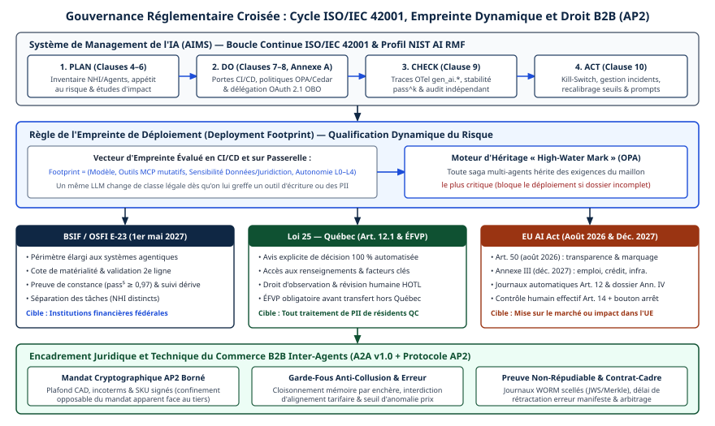

# Chapitre 38 — Canada et Québec

*Question directrice : quel cadre s'applique ici ?*

> **État de référence :** stratégie fédérale « AI for All » (4 juin 2026), projet de loi C-36 à l'étape de la deuxième lecture, ligne directrice E-23 du BSIF (en vigueur le 1er mai 2027), Énoncé de principes québécois (édition 2025) et guide du MCN sur l'IA agentique (2026). Les numéros entre crochets renvoient aux sources en fin de chapitre; [1] à [15] sont des pages primaires lues pour ce chapitre, [16] et [17] n'ont pas pu l'être; [18] à [22] ont été ajoutées le 14 novembre 2026, dont [20] et [21] sont secondaires et [22] n'a pas pu être lue.

Une entreprise qui déploie des agents au Canada cherche d'abord la loi sur l'IA. Il n'y en a pas, ni fédérale ni québécoise. Le cadre applicable est un empilement : le droit de la protection des renseignements personnels, une ligne directrice sectorielle pour les institutions financières fédérales et, pour les administrations, des instruments administratifs, dont deux guides récents sur l'IA agentique.

Cet empilement a un centre de gravité : la décision automatisée. Or savoir si une décision est « fondée exclusivement sur un traitement automatisé » ne dépend pas du modèle de langage. Cela dépend de l'endroit où un humain intervient, donc de l'orchestration. La conformité se joue donc ici dans l'architecture : points de validation, contenu des journaux, inventaire, trajet des données. Les deux guides publics, sans force obligatoire pour le secteur privé, décrivent le socle de contrôles qu'un donneur d'ordre public ou un régulateur attendra vraisemblablement.

---

## 38.1 Le paysage fédéral : pas de loi sur l'IA, une stratégie

« AI for All », lancée le 4 juin 2026, est une stratégie de cinq ans en trois piliers : bâtir la confiance, créer des occasions, renforcer la souveraineté [1]. Elle vise à faire passer l'adoption de l'IA d'un peu plus de 12 % à 60 % d'ici 2034. Le pilier de la confiance annonce une modernisation des cadres législatifs, une protection accrue des renseignements personnels et un régime de sécurité en ligne. Le communiqué ne nomme aucune loi propre à l'IA. Les agents n'y figurent qu'une fois : des agents « de confiance » promis aux étudiants du postsecondaire.

Le projet de loi C-36, déposé le 15 juin 2026 par le ministre de l'Intelligence artificielle et de l'Innovation numérique, édicte la Loi visant à protéger la vie privée et les données des consommateurs [2][3]. C'est une réforme de la protection des renseignements personnels dans le secteur privé, pas une loi sur l'IA. Au 12 novembre 2026, il est inscrit à l'étape de la deuxième lecture à la Chambre des communes, sans débat consigné ni étude en comité [3].

Quatre éléments du texte de première lecture concernent les agents [4].

- **Une définition large.** Le « système décisionnel automatisé » est une technologie qui sert à « appuyer ou remplacer le jugement de décideurs humains » (art. 2). Un agent qui prépare une décision est visé, pas seulement celui qui la rend seul.
- **Une transparence générale.** L'organisation expliquerait, dans ses politiques, l'usage de ces systèmes pour prédire, recommander ou décider (art. 62).
- **Une explication sur demande.** Si la décision peut avoir des effets juridiques ou une incidence importante comparable, l'individu obtiendrait les types de renseignements utilisés, leur provenance et les principaux facteurs, puis pourrait présenter ses observations à un employé habilité à réviser (art. 63).
- **Une évaluation avant tout transfert hors du Canada** (art. 57).

Le document d'information annonce des sanctions administratives pouvant atteindre 10 millions de dollars ou 3 % des recettes globales brutes, et une nouvelle Commission canadienne de la sécurité numérique et de la protection des données, dotée d'un pouvoir d'ordonnance [2].

C-36 reste un projet : il peut être amendé, et son entrée en vigueur est renvoyée à un décret [4]. Selon le résumé d'une analyse de cabinet non lue en entier, son volet sur l'IA est plus étroit que celui du projet C-27, jamais adopté [16].

---

## 38.2 Secteur public fédéral : décisions automatisées

Le gouvernement fédéral encadre ses propres systèmes par un instrument administratif, la Directive sur la prise de décisions automatisée du Conseil du Trésor, dont l'outil d'application est l'évaluation de l'incidence algorithmique (EIA) [6]. L'EIA est un questionnaire obligatoire qui classe un système en quatre niveaux d'incidence, de « peu ou pas d'incidence » à « incidence très élevée ». Les exigences de la Directive se resserrent d'un niveau à l'autre.

Selon la page de l'EIA, une première évaluation se fait au début de la conception, une seconde avant la mise en production. L'évaluation est revue quand la fonctionnalité ou la portée du système change. Les résultats sont publiés sur le Portail du gouvernement ouvert.

**Le champ d'application.** Le guide fédéral sur la portée de la Directive le précise [18]. La Directive vise l'automatisation, complète ou partielle, d'une décision administrative, soit une décision qui peut toucher les droits, les privilèges ou les intérêts d'une personne ou d'une entreprise. Elle s'applique donc aussi quand un agent public rend la décision finale : recommander des options à un décideur est dans le champ, comme l'est un agent conversationnel dont les agents publics se servent pour arrêter une conduite. Elle couvre les systèmes conçus ou acquis après le 1er avril 2020 et ceux qui sont modifiés de façon importante, dans une centaine d'institutions fédérales, et ne se limite pas à l'IA : un système à base de règles est visé autant qu'un modèle avancé. La recherche et l'expérimentation, sans effet sur de vrais clients, en sont exclues. La page nomme l'IA générative parmi les technologies couvertes; elle ne mentionne pas les agents.

La règle de revue pèse sur un agent plus que sur un système classique. Brancher un nouvel outil élargit ce que l'agent peut faire; c'est, selon la lecture proposée ici, un changement de portée. Un registre d'outils tenu à jour (chapitre 8) devient alors une pièce de conformité.

Le Secrétariat du Conseil du Trésor publie aussi un Guide sur l'utilisation de l'intelligence artificielle agentive, destiné aux ministères et organismes [5]. La page, datée du 15 septembre 2026, distingue quatre niveaux d'autonomie, de l'assistance à l'autonomie adaptative, et demande de vérifier si le cas d'utilisation est visé par la Directive, sans fixer de seuil. La section 38.5 le compare au guide québécois.

---

## 38.3 Institutions financières : la ligne directrice E-23

La ligne directrice E-23 du Bureau du surintendant des institutions financières (BSIF), sur la gestion du risque de modélisation, a été publiée le 11 septembre 2025 et prend effet le 1er mai 2027 pour toutes les institutions financières fédérales [7][8].

Le texte ne contient ni le mot « agentic » ni le mot « agent » [8]. Il prévoit toutefois que des modèles à autoapprentissage dynamique et à prise de décision autonome pourraient se répandre.

La définition du modèle est volontairement large [7][8] : l'application d'hypothèses ou de techniques statistiques, y compris les méthodes d'IA et d'apprentissage automatique, avec une entrée, un traitement et un résultat. Les attentes ne varient pas selon l'approche algorithmique. Le texte s'organise en trois résultats attendus et douze principes couvrant le cycle de vie complet.

| Attente de E-23 | Portée pour un système d'agents |
|---|---|
| Inventaire : identifiant, propriétaire, origine, cote de risque, usages approuvés, dépendances [8] | Recoupe l'inventaire des agents (chapitre 39) |
| Cote de risque inhérent qui règle l'intensité des contrôles [8] | La cote d'un agent devrait refléter les actions permises, pas seulement le modèle |
| Modèles de tiers cotés individuellement, selon la ligne directrice B-10 [7][8] | Le modèle de langage d'un fournisseur est un modèle de tiers |
| Critères internes de changement important pour un modèle autoapprenant [7] | Question ouverte pour un agent à mémoire persistante (chapitre 14) |
| Approbation avant tout changement [7] | Versions des instructions, des outils et des modèles (chapitre 34) |

La colonne de droite est une lecture, non le texte du BSIF. La cote de risque des usages d'IA générative est laissée au jugement de chaque institution [7].

E-23 ne vise que les institutions de compétence fédérale.

### Institutions à charte québécoise : la ligne directrice de l'AMF

Les institutions à charte québécoise relèvent de l'Autorité des marchés financiers (AMF). Son site refusant les requêtes, sa Ligne directrice sur l'utilisation de l'intelligence artificielle n'a pas pu être lue [22]. Ce qui suit vient de deux analyses de cabinets, qui concordent [20][21].

La version définitive a été publiée le 7 avril 2026, après une consultation tenue à l'automne 2025, et prend effet le 1er mai 2027, le même jour que E-23 [20]. Elle vise les assureurs autorisés, les coopératives de services financiers, les sociétés de fiducie autorisées et les institutions de dépôts autorisées, pour toute utilisation d'un système d'IA, qu'elle touche ou non le dossier d'un client [20][21].

| Attente rapportée | Portée pour un système d'agents |
|---|---|
| Répertoire centralisé des systèmes d'IA [20][21] | Même inventaire que pour E-23 (chapitre 39) |
| Cote de risque par système, tenue à jour, qui module validation, approbations et surveillance; sa détermination est laissée à l'institution [20][21] | La cote d'un agent devrait refléter les actions permises |
| Un membre de la haute direction imputable de l'ensemble des systèmes d'IA; un responsable par système, pendant tout son cycle de vie [20][21] | Recoupe le responsable nommé par agent |
| Normes de surveillance par niveau de risque, avec une attention particulière aux systèmes autonomes ou à calibrage dynamique [20][21] | Seul passage rapporté qui vise l'autonomie |
| Explication claire et simple des décisions prises ou recommandées; possibilité pour le client de demander l'intervention d'une personne; mention de tout contenu généré avec un système d'IA [20][21] | Vise aussi la décision recommandée, plus large que l'article 12.1 (section 38.4) |
| EFVP lorsqu'un système traite des renseignements personnels [21] | Renvoie à la Loi 25 |

Aucune des deux analyses ne relève de mention de l'IA agentique. La définition du système d'IA, proche de celle de l'OCDE, note seulement que ces systèmes présentent des degrés variables d'autonomie et d'adaptabilité après déploiement [20][21]. Selon l'une d'elles, la version définitive a retiré le rôle confié à la fonction de gestion des risques et la mention de l'audit interne, qui figuraient dans le projet de 2025 [21]. La colonne de droite est une lecture de ce chapitre.

### Valeurs mobilières : l'avis 11-348 des ACVM

Les personnes inscrites et les émetteurs relèvent du droit des valeurs mobilières. L'avis 11-348 du personnel des Autorités canadiennes en valeurs mobilières (ACVM), du 5 décembre 2024, explique comment ce droit s'applique aux systèmes d'IA [19]. Son principe : c'est l'activité, et non la technologie, qui est réglementée. Il ne nomme pas les agents, mais traite de l'autonomie. Les attentes quant à l'intervention humaine varient selon l'étendue des services fournis et le degré d'autonomie du système, et cette intervention suppose un niveau d'explicabilité approprié.

Pour la gestion de portefeuille, le personnel est net. Un système qui concevrait des portefeuilles de façon autonome et discrétionnaire, sans qu'une personne physique inscrite prenne les décisions finales, mettrait la personne inscrite en difficulté de démontrer sa conformité; le personnel ne croit pas possible, à ce stade, de substituer des systèmes d'IA aux représentants-conseils [19]. C'est, parmi les textes canadiens lus, la position la plus explicite sur une décision qu'un agent ne devrait pas prendre seul.

---

## 38.4 Québec : décisions automatisées dans la Loi 25

Parmi les textes examinés, la seule règle en vigueur qui vise expressément la décision automatisée dans le secteur privé est québécoise. L'article 12.1 de la Loi sur la protection des renseignements personnels dans le secteur privé, introduit par la Loi 25, impose trois obligations à l'entreprise qui utilise des renseignements personnels pour rendre une décision fondée exclusivement sur un traitement automatisé [9] :

1. en informer la personne, au plus tard au moment où la décision lui est communiquée;
2. lui indiquer, sur demande, les renseignements utilisés, les raisons ainsi que les principaux facteurs et paramètres ayant mené à la décision, et son droit de faire rectifier ces renseignements;
3. lui donner l'occasion de présenter ses observations à un membre du personnel en mesure de réviser la décision.

**La date.** L'article 12.1 est inséré par l'article 110 de la Loi 25. Celui-ci ne figure dans aucune des exceptions de l'article 175, qui fixe l'entrée en vigueur générale au 22 septembre 2023 [9], ce qui tranche entre les sources secondaires.

**La sanction.** Le défaut d'informer la personne ou de lui permettre de présenter ses observations est passible d'une sanction administrative pécuniaire, plafonnée à 10 millions de dollars ou 2 % du chiffre d'affaires mondial [9].

**Le mot « exclusivement ».** L'article 65.2 de la Loi sur l'accès impose la même règle, dans les mêmes termes, aux organismes publics. La page gouvernementale qui l'explique en donne une lecture utile [10] : la décision est exclusivement automatisée quand elle est prise sans aucune intervention humaine; une intervention mineure, sans répercussion réelle, n'écarte pas l'article; un outil qui remet un rapport à un employé, lequel décide, n'est pas visé. Transposer cette lecture à l'article 12.1 est une analogie, raisonnable vu l'identité des textes.

| | Loi 25, art. 12.1 [9] | Projet de loi C-36 [4] |
|---|---|---|
| Statut | En vigueur depuis le 22 septembre 2023 | Deuxième lecture |
| Déclencheur | Décision exclusivement automatisée | Système qui appuie ou remplace le jugement humain |
| Information | Systématique, au moment de la décision | Explication générale dans les politiques |
| Explication | Sur demande | Sur demande, si effets juridiques ou incidence importante |
| Révision | Observations à un membre du personnel habilité | Observations à un employé habilité |

Trois conséquences d'architecture en découlent.

**La qualification se fait par point de décision.** Un même agent peut préparer dix dossiers sous validation humaine et en trancher un onzième seul. Seul ce dernier déclenche l'article 12.1. Une approbation de pure forme ne protège pas.

**L'explication exige une trace.** Il faut retrouver quels renseignements l'agent a consultés et quels facteurs ont pesé. Le premier relève de la journalisation des appels d'outils (chapitre 33). Le second, plus difficile avec un modèle de langage, plaide pour loger la règle de décision dans un composant déterministe, l'agent se bornant à réunir les faits (chapitre 17).

**La révision exige un chemin.** L'orchestration prévoit une voie de reprise humaine, vers une personne qui a l'autorité de modifier la décision (chapitre 22).

La Loi 25 impose par ailleurs une évaluation des facteurs relatifs à la vie privée (EFVP) pour tout projet d'acquisition, de développement ou de refonte d'un système d'information qui traite des renseignements personnels [9]. Un projet d'agents en est un.

**La conservation et l'effacement.** Les fins accomplies, l'entreprise détruit le renseignement ou l'anonymise, sauf délai légal de conservation (art. 23); conserver ou détruire en contravention à la loi est passible d'une sanction administrative pécuniaire [9]. C-36 prévoirait un retrait sur demande, notamment après le retrait du consentement (art. 54), et une conservation limitée au temps nécessaire, mais suffisante pour répondre à une demande d'explication (art. 52 et 53) [4]. Pour un agent, l'échéance vise la mémoire, les traces, les copies chez les fournisseurs et les données d'entraînement qui en sont tirées (chapitre 47); le chemin d'effacement se conçoit comme à la section 14.6.

---

## 38.5 Administration publique québécoise : guide sur l'IA agentique, Énoncé de principes

Le ministère de la Cybersécurité et du Numérique (MCN) encadre l'usage de l'IA par les organismes publics [11]. Trois instruments se superposent.

**Une déclaration annuelle.** L'arrêté 2024-01 du 28 février 2024 oblige les organismes publics à déclarer chaque année leurs initiatives d'IA [14]. Le portrait qui en résulte recense, au 15 juin 2026, 432 initiatives dans 157 organismes, contre 258 et 83 un an plus tôt. Aucune catégorie n'isole les agents; la catégorie « décision automatisée » compte une seule initiative (chapitre 42).

**Un énoncé de principes.** L'édition 2025 de l'Énoncé est l'annexe de l'arrêté 2025-02 du 3 décembre 2025 [12]. Elle compte douze principes, dont trois visent les systèmes autonomes :

- la responsabilité : l'organisme demeure entièrement responsable des décisions, actions et impacts de ses systèmes, « même lorsque ceux-ci fonctionnent de manière autonome »;
- l'autonomie et la supervision humaine, principe qui nomme l'IA agentique et exige des mécanismes de validation, d'intervention ou d'arrêt;
- la souveraineté numérique (section 38.6).

L'Énoncé s'applique même lorsque l'organisme recourt à des fournisseurs, et l'organisme doit s'assurer que ceux-ci le respectent. Il atteint ainsi l'entreprise privée.

**Un guide sur l'IA agentique.** Le Guide sur l'utilisation responsable de l'intelligence artificielle agentique, daté de 2026, n'ajoute pas un cadre; il applique les cadres existants aux systèmes capables d'agir [13]. Son idée centrale : plus un système peut agir, accéder à des outils et enchaîner des étapes, plus les exigences de gouvernance, de supervision, de traçabilité et de contrôle des coûts s'élèvent.

Un agent ne se retient pas par défaut : il faut d'abord écarter l'amélioration de processus, l'automatisation classique et l'assistant sans capacité d'action. Le guide prévoit un parcours d'autorisation en trois étapes — filtrer le cas d'usage, vérifier la préparation du pilote, puis celle de la production — et des premiers pilotes internes, réversibles et assortis d'un plafond budgétaire.

Il cite le guide fédéral, avec lequel il converge.

| Contrôle | Guide fédéral [5] | Guide québécois [13] |
|---|---|---|
| Accès | Lecture seule par défaut; liste courte d'opérations | Moindre privilège; l'agent ne peut élargir ses permissions |
| Validation humaine | Avant toute opération qui modifie l'état d'un système, sauf effet minime et réversible | Avant toute action à incidence significative; jamais symbolique |
| Journaux | Horodatés : outils, opérations, autorisations; hors de portée de l'agent | Reconstitution complète, coûts compris; hors de portée de l'agent |
| Arrêt | Interrupteur d'urgence indépendant | Arrêt et retour au mode manuel prévus dès la conception |
| Inventaire | Identifiants clairs pour les agents | Registre des agents; gestion des versions |
| Coûts | Non traités en propre | Plafond de consommation |
| Protocoles | Aucune mention de MCP ni d'A2A | Aucune mention de MCP ni d'A2A |

Aucun des deux guides ne prescrit de protocole. Ils énoncent des exigences de résultat; les satisfaire au moyen de MCP, d'une passerelle ou d'un plan de contrôle reste une décision d'architecture (chapitres 5, 23 et 24). Le guide québécois demande toutefois, pour un système multi-agents, de documenter l'orchestration, les rôles, les transferts et les validations humaines.

---

## 38.6 Souveraineté et partenariats

Le chapitre 37 distingue la résidence des données du contrôle juridictionnel. Les textes d'ici touchent les deux.

**Au fédéral, une politique d'offre.** Le troisième pilier d'« AI for All » promet des fondations souveraines — calcul, infonuagique, connectivité, données, talent — et un supercalculateur public d'IA [1]. L'État y est présenté comme client d'ancrage des entreprises canadiennes. Le communiqué annonce une Sovereign Technology Alliance et fait état de douze partenariats internationaux, dont l'Union européenne. Il chiffre des cibles de croissance et d'emploi, pas le budget des programmes.

**Au Québec, un principe opposable aux organismes publics.** Le douzième principe de l'Énoncé leur demande de réduire leur dépendance envers les fournisseurs étrangers, de garder le plus possible le contrôle des modèles, des données et des infrastructures, et de favoriser, lorsque possible, des fournisseurs québécois ou canadiens offrant des solutions hébergées au Québec [12]. La note de tendances du MCN de juillet 2026 prévoit que l'hébergement des données, l'origine des modèles, la réversibilité contractuelle et la dépendance aux fournisseurs deviendront des critères de décision explicites [15].

**Dans le secteur privé, une obligation d'évaluation.** L'article 17 de la loi québécoise sur le secteur privé exige une EFVP avant de communiquer un renseignement personnel à l'extérieur du Québec, ou d'y confier son traitement [9]. L'évaluation tient compte du régime juridique de l'État de destination; la communication suppose une protection adéquate et une entente écrite. C-36 prévoirait une évaluation analogue (art. 57) [4].

Un système d'agents multiplie les trajets à évaluer : l'inférence chez un fournisseur de modèles, ou chez un autre quand un routeur bascule (chapitre 44), l'appel d'un serveur MCP distant, la délégation à l'agent d'un partenaire (chapitre 45), l'exportation de traces vers une plateforme d'observabilité. L'EFVP d'un agent se dresse donc à partir de la carte de ses états et de ses flux (chapitre 46), et un outil ou une route ajoutés peuvent ouvrir un nouveau trajet. L'inférence confidentielle et les clés détenues par l'entreprise sont des mesures de protection à y faire valoir.

---

## 38.7 Conséquences pour les entreprises

| Situation | Textes à considérer | Force |
|---|---|---|
| Entreprise qui traite des renseignements personnels au Québec | Loi 25 : art. 12.1, art. 17, EFVP [9] | Loi en vigueur |
| Entreprise de compétence fédérale ou active hors Québec | LPRPDE, régime actuel; C-36 s'il est adopté [3][4] | Projet à surveiller |
| Institution financière fédérale | E-23, avec B-10 pour les tiers [7][8] | Attentes du régulateur au 1er mai 2027 |
| Institution financière à charte québécoise | Ligne directrice de l'AMF sur l'IA [20][21] | Attentes du régulateur au 1er mai 2027 |
| Personne inscrite en valeurs mobilières | Avis 11-348 des ACVM [19] | Indications du personnel sur le droit existant |
| Fournisseur d'un organisme public québécois | Énoncé de principes et guide [12][13] | Indirecte, contractuelle |
| Fournisseur d'un ministère fédéral | Directive, EIA et guide [5][6] | Indirecte, contractuelle |

Quatre dispositions valent dans presque tous les cas.

1. **Classer chaque point de décision.** Pour chaque agent, établir s'il rend, à l'égard d'une personne, une décision sans intervention humaine réelle.
2. **Journaliser pour expliquer.** Les journaux reconstituent les renseignements consultés, les outils appelés et les validations humaines, et restent hors de portée de l'agent.
3. **Tenir un inventaire unique.** Un registre des agents, avec propriétaire, finalité, systèmes connectés, niveau d'autonomie et cote de risque, sert à la fois le guide québécois, E-23 et la gouvernance interne (chapitre 39).
4. **Cartographier les flux sortants.** Chaque fournisseur de modèle, serveur distant et agent tiers est un destinataire à évaluer.

Les obligations étrangères s'ajoutent à ce cadre sans le remplacer (chapitre 35). Quant à savoir qui répond des actes d'un agent (chapitre 36), l'Énoncé québécois et les deux guides tranchent pour l'administration : l'organisme demeure responsable.

---

## Grille de décision

| Décision | Option par défaut | Quand s'en écarter |
|---|---|---|
| Référentiel de contrôles, faute de loi sur l'IA | Socle commun des guides fédéral et québécois | Secteur doté d'un cadre plus strict, comme E-23 |
| Décision visant une personne | Validation humaine réelle avant la décision | Automatisation complète assumée : appliquer l'article 12.1 en entier |
| Logique de décision | Composant déterministe; l'agent réunit les faits | Aucune décision individuelle en jeu |
| Première mise en œuvre | Pilote interne, réversible, plafonné | Encadrement renforcé et validation spécialisée |
| Inférence et outils hors Québec | EFVP préalable et entente écrite | Aucun renseignement personnel dans le flux |
| Marché public québécois | Hébergement au Québec, fournisseur québécois ou canadien | Justification documentée par l'organisme |
| Institution financière fédérale | Agents inscrits à l'inventaire E-23 dès maintenant | — |
| Institution financière à charte québécoise | Même inventaire et même cote de risque que pour E-23, pour le 1er mai 2027 | — |
| Gestion de portefeuille discrétionnaire | Décision finale prise par une personne physique inscrite | — |
| Ajout d'un outil à un agent | Réévaluation du risque et de l'EFVP | Outil sans accès à des données ni à des actions sensibles |
| Mémoire et traces d'un agent | Durée fixée par finalité, puis destruction ou anonymisation | Délai de conservation imposé par une loi |

---

## Points à retenir

- Le Canada n'a pas de loi sur l'IA. « AI for All » annonce des lois sur la vie privée et la sécurité en ligne, pas un régime propre aux agents.
- Le projet de loi C-36, non adopté, réforme la protection des renseignements personnels; sa définition du système décisionnel automatisé couvre aussi les systèmes qui appuient une décision.
- L'article 12.1 de la loi québécoise sur le secteur privé est en vigueur depuis le 22 septembre 2023 : information, explication sur demande, révision par une personne habilitée.
- Le caractère « exclusivement » automatisé d'une décision est une propriété de l'orchestration. Une validation de pure forme ne le fait pas disparaître.
- E-23 prend effet le 1er mai 2027. Elle ne nomme pas les agents, mais sa définition du modèle et ses attentes d'inventaire et de cote de risque s'y appliquent sans peine. La ligne directrice de l'AMF sur l'IA prend effet le même jour pour les institutions à charte québécoise; elle n'est connue ici que par des analyses de cabinets.
- En valeurs mobilières, le personnel des ACVM ne croit pas possible, à ce stade, de substituer un système d'IA au représentant-conseil pour une décision discrétionnaire.
- Les guides fédéral et québécois convergent : moindre privilège, validation humaine avant toute action à effet, journaux hors de portée de l'agent, arrêt, inventaire.
- Aucun de ces textes ne mentionne MCP ni A2A. Ils fixent des résultats, pas des moyens.
- L'Énoncé québécois s'étend aux fournisseurs des organismes publics et fait de la souveraineté numérique un critère de choix.
- Chaque appel d'un agent qui transmet un renseignement personnel hors Québec est une communication à évaluer au préalable. Ce qu'il conserve, mémoire et traces comprises, se détruit ou s'anonymise une fois la fin accomplie.

---

## Sources

Pages primaires lues le 11 novembre 2026 :

1. [Premier ministre du Canada — lancement d'« AI for All »](https://www.pm.gc.ca/en/news/news-releases/2026/06/04/prime-minister-carney-launches-ai-all-canadas-new-national-artificial)
2. [ISDE — document d'information sur C-36](https://www.canada.ca/fr/innovation-sciences-developpement-economique/nouvelles/2026/06/document-dinformation--le-gouvernement-du-canada-presente-un-projet-de-loi-visant-a-proteger-la-vie-privee-des-canadiens-a-lere-numerique.html)
3. [LEGISinfo — C-36](https://www.parl.ca/legisinfo/fr/projet-de-loi/45-1/c-36)
4. [C-36 — texte de première lecture](https://www.parl.ca/DocumentViewer/fr/45-1/projet-loi/C-36/premiere-lecture) — première moitié lue.
5. [Canada — Guide sur l'utilisation de l'IA agentive](https://www.canada.ca/fr/gouvernement/systeme/gouvernement-numerique/innovations-gouvernementales-numeriques/utilisation-responsable-ai/guide-utilisation-intelligence-artificielle-agentive.html)
6. [Canada — Évaluation de l'incidence algorithmique](https://www.canada.ca/fr/gouvernement/systeme/gouvernement-numerique/innovations-gouvernementales-numeriques/utilisation-responsable-ai/evaluation-incidence-algorithmique.html)
7. [BSIF — lettre d'accompagnement de E-23](https://www.osfi-bsif.gc.ca/en/guidance/guidance-library/guideline-e-23-model-risk-management-2027-letter)
8. [BSIF — ligne directrice E-23 (2027)](https://www.osfi-bsif.gc.ca/en/guidance/guidance-library/guideline-e-23-model-risk-management-2027)
9. [Loi 25 — L.Q. 2021, chapitre 25](https://www.publicationsduquebec.gouv.qc.ca/fileadmin/Fichiers_client/lois_et_reglements/LoisAnnuelles/fr/2021/2021C25F.PDF)
10. [Québec — Décision fondée exclusivement sur un traitement automatisé](https://www.quebec.ca/gouvernement/travailler-gouvernement/normes-gouvernance-pratiques-internes/protection-des-renseignements-personnels/technologie-et-droit-a-la-protection-des-renseignements-personnels/decision-traitement-automatise)
11. [Québec — Utilisation responsable de l'IA](https://www.quebec.ca/gouvernement/numerique/intelligence-artificielle-administration-publique/utilisation-responsable-intelligence-artificielle)
12. [MCN — Énoncé de principes, édition 2025](https://cdn-contenu.quebec.ca/cdn-contenu/adm/min/cybersecurite_numerique/Publications/Strategie_IA/Enonce_IA.pdf)
13. [MCN — Guide sur l'IA agentique](https://cdn-contenu.quebec.ca/cdn-contenu/adm/min/cybersecurite_numerique/Intelligence_artificielle/GU_IA_Agentique.pdf)
14. [Québec — Portrait des utilisations de l'IA](https://www.quebec.ca/gouvernement/numerique/intelligence-artificielle-administration-publique/portrait)
15. [MCN — Grandes tendances numériques, juillet 2026](https://cdn-contenu.quebec.ca/cdn-contenu/adm/min/cybersecurite_numerique/Transformation_numerique/DOC_tendances_numerique_juillet_2026.pdf)

Sources non lues :

16. [Blakes — réforme fédérale](https://www.blakes.com/fr-ca/perspectives/nouvelle-tentative-du-canada-pour-reformer-le-cadre-federal-de-protection-des-renseignements-personn/) — résumé de recherche seulement.
17. [Directive sur la prise de décisions automatisée](https://www.tbs-sct.canada.ca/pol/doc-fra.aspx?id=32592) — requête rejetée par le serveur.

Sources ajoutées le 14 novembre 2026 :

18. [Canada — guide sur la portée de la Directive sur la prise de décisions automatisée (page datée du 15 septembre 2026)](https://www.canada.ca/en/government/system/digital-government/digital-government-innovations/responsible-use-ai/guide-scope-directive-automated-decision-making.html) — page primaire lue.
19. [ACVM — Avis 11-348 du personnel et de consultation, Applicabilité du droit canadien des valeurs mobilières à l'utilisation des systèmes d'intelligence artificielle dans les marchés des capitaux (5 décembre 2024)](https://fcnb.ca/sites/default/files/2024-12/Avis%2011-348%20du%20personnel%20des%20ACVM%20et%20de%20consultation%20-%20Applicabilit%C3%A9%20du%20droit%20canadien%20des%20valeurs%20mobili%C3%A8res%20%C3%A0%20l%E2%80%99utilisation%20des%20syst%C3%A8mes%20d%E2%80%99intelligence%20artificielle%20dans%20les%20march%C3%A9s%20des%20capitaux.pdf) — texte officiel, copie hébergée par la Commission des services financiers et des services aux consommateurs du Nouveau-Brunswick; lu par passages.
20. [Blakes — L'AMF publie sa ligne directrice sur l'utilisation de l'intelligence artificielle (20 avril 2026)](https://www.blakes.com/fr-ca/perspectives/l-amf-publie-sa-ligne-directrice-sur-l-utilisation-de-l-intelligence-artificielle-ce-que-les-insti/) — analyse de cabinet, secondaire.
21. [BLG — L'AMF publie ses attentes sur l'utilisation de l'IA (12 mai 2026)](https://www.blg.com/fr/insights/2026/05/amf-publie-ses-attentes-sur-lutilisation-de-lia) — analyse de cabinet, secondaire.
22. [AMF — Ligne directrice sur l'utilisation de l'intelligence artificielle, Bulletin de l'AMF, vol. 23, no 13](https://lautorite.qc.ca/files/pdf/bulletin/2026/vol23no13/vol23no13_5.pdf) — non lue : erreur 403.

## Limites de ce chapitre

- La Directive fédérale [17] n'a pas pu être lue, ni à l'audit ni le 14 novembre 2026. Son champ d'application est décrit d'après le guide sur sa portée [18]; ses exigences par niveau et sa date ne sont pas décrites, et la section 38.2 repose pour le reste sur la page de l'EIA.
- Les pages web [1] à [8], [10], [11] et [14] ont été lues au moyen d'un outil d'extraction automatique, sans recollationnement des citations. Les documents [9], [12], [13] et [15] ont été lus en texte intégral. [1], [3], [4], [5], [8] et [9] ont été relus à l'audit du 12 novembre 2026.
- Seule la première moitié du texte de C-36 a été lue; les sanctions viennent du document ministériel [2]. Le sort du projet C-27 vient de la connaissance générale et d'un résumé de recherche [16], comme la mention de la LPRPDE en 38.7, dont le régime d'effacement n'est pas décrit.
- L'article 12.1 est cité d'après le texte sanctionné de 2021, la version codifiée étant inaccessible; les modifications ultérieures n'ont pas été vérifiées. Aucune décision ni ligne directrice de la Commission d'accès à l'information n'a été lue.
- L'encadrement des institutions financières à charte québécoise est décrit, depuis le 14 novembre 2026, d'après deux analyses de cabinets [20][21]. Le site de l'AMF refuse les requêtes (erreur 403) : la ligne directrice elle-même [22] n'a pas été lue, pas plus que la Ligne directrice de l'AMF sur la gestion du risque de modèle, et l'adresse donnée en [22] vient d'un résultat de recherche non vérifié. L'avis 11-348 [19] a été lu par recherche de passages dans une copie officielle, non en entier; les suites de sa consultation n'ont pas été cherchées. Le droit des autres provinces n'est pas traité.
- Les ajouts du 14 novembre 2026 sont le paragraphe sur le champ d'application de la Directive (38.2), les deux sous-sections de 38.3 et les lignes correspondantes du tableau de 38.7, de la grille et des points à retenir. Les colonnes « Portée pour un système d'agents » sont des lectures de ce chapitre.
- Le guide québécois ne porte pas de date plus précise que 2026, et celle du guide fédéral est la date sans libellé affichée sur sa page. Les lectures proposées en 38.2, 38.3, 38.4 et 38.6 sont des inférences, non des positions des autorités.

## Mise en œuvre — Conformité réglementaire internationale et canadienne, et droit B2B inter-agents {.volet}

:::: {.encadre .executive}
::: {.encadre-titre}
**Synthèse exécutive**
:::

- **Enjeu stratégique** : Trois changements convergent en 2027 et mettent fin à l’immunité réglementaire des prototypes d’IA : l’application progressive de l’EU AI Act (août 2026, puis décembre 2027), l’entrée en vigueur le 1er mai 2027 de la ligne directrice BSIF E-23 au Canada, conjuguée à la Loi 25 au Québec, et la formation autonome de contrats B2B entre agents logiciels. Traiter ces obligations par des comités documentaires manuels paralyse les livraisons et expose l’entreprise à des sanctions pécuniaires et à des engagements commerciaux involontaires.
- **Décisions architecturales structurantes** :
  1.  *Irréversible à moyen terme* : Déployer un système de management de l’IA (AIMS) unique, conforme à ISO/IEC 42001, comme dorsale centrale, puis projeter ses contrôles vers chaque juridiction (BSIF E-23, Loi 25, EU AI Act, NIST AI RMF).
  2.  *Structurante dès la conception* : Qualifier le niveau d’exigence légale selon l’empreinte de déploiement complète de la saga, vérifiée automatiquement en porte CI/CD.
  3.  *Structurante pour le commerce externe* : Subordonner tout agent négociateur B2B à un accord-cadre bilatéral préalable et à un mandat cryptographique borné (AP2) opposable aux tiers.
- **Indicateurs de gouvernance** : Couverture du registre AIMS (100 % des identités NHI actives), délai de génération d’un dossier d’audit opposable (cible : moins de 4 heures), couverture explicative de l’art. 12.1 de la Loi 25 (100 %) et zéro dépassement de plafond sur les mandats AP2.
::::

## 38.8 Système de management certifiable ISO/IEC 42001 et alignement NIST AI Agent Standards

Une charte déclarative et un tableur remplis une seule fois avant la mise en ligne ne suffisent pas pour une fabrique multi-agents de troisième génération : les consignes évoluent chaque quinzaine, le routage alterne entre SLM locaux et LLM frontières, et l’ajout d’un seul outil MCP mutatif modifie le risque juridique de toute une chaîne. Une revue statique rédigée six mois plus tôt n’a plus de valeur probatoire devant un régulateur.

L’industrialisation de 2027 substitue à l’audit ponctuel un système de management de l’IA (AIMS) certifiable selon `ISO/IEC 42001:2023`, câblé dans le plan de contrôle logiciel. Bâtie sur la structure harmonisée commune à ISO/IEC 27001, cette norme permet de mutualiser près de 40 % du socle de cybersécurité existant (audits internes, revues de direction, actions correctives). Elle ajoute trente-huit contrôles normatifs dans son Annexe A, dédiés à l’évaluation d’impact sociétal et individuel (A.5), au cycle de vie probabiliste (A.6), à la lignée des données (A.7), à l’information des parties concernées (A.8) et à la gouvernance des fournisseurs tiers (A.10).

### Du cycle PDCA d’ISO/IEC 42001 et des travaux du NIST au code exécutable

Pour éviter la dérive bureaucratique, l’architecte arrime ISO/IEC 42001 au NIST AI Risk Management Framework (AI RMF 1.0 : *Govern, Map, Measure, Manage*) ainsi qu’aux livrables 2026–2027 de l’AI Agent Standards Initiative du NIST, centrés sur trois axes : les standards portés par l’industrie, les protocoles communautaires et la recherche sur l’authentification et l’identité des agents.

Les quatre phases PDCA d’ISO/IEC 42001 correspondent à des composants techniques vérifiables :

- **Planifier (*Plan*, clauses 4 à 6)** : Le registre OASF matérialise l’inventaire obligatoire (A.4.2). Aucun certificat SPIFFE n’est émis sans finalité métier déclarée, étude d’impact et seuils d’appétit au risque.
- **Déployer (*Do*, clauses 7 et 8)** : Les contrôles de l’Annexe A s’exécutent dans les portes CI/CD (signature des serveurs MCP, bancs adversariaux) et dans les politiques Cedar ou OPA évaluées en ligne par agentgateway.
- **Évaluer (*Check*, clause 9)** : Les traces normalisées OpenTelemetry `gen_ai.*` et les campagnes périodiques de stabilité multi-essais $\text{pass}^k$ alimentent en continu les tableaux de conformité et la validation indépendante.
- **Corriger (*Act*, clause 10)** : Toute dérive ou violation déclenche une remédiation tracée, du repli automatique de L3 vers L2 jusqu’à la révocation immédiate des jetons OAuth 2.1 par l’interrupteur d’urgence.

Le contrôle A.10 vise la chaîne d’approvisionnement agentique. Lorsqu’un orchestrateur interne invoque un serveur MCP fourni par un éditeur tiers ou délègue une sous-tâche A2A à l’agent d’un partenaire infonuagique, le périmètre de responsabilité du système de management s’étend à cette frontière externe. L’entreprise exige une nomenclature logicielle et cognitive signée (AI-SBOM référençant la famille de modèle, la politique de rétention zéro des invites et les sous-traitants ultérieurs) avant d’inscrire le connecteur au catalogue autorisé.



### Règle de l’empreinte de déploiement

Une cote de risque fixe attribuée à un modèle de langage est une erreur d’architecture : un modèle n’a pas de statut légal hors contexte. Un même SLM de 8 milliards de paramètres présente un risque minimal lorsqu’il résume un manuel public, relève de la Loi 25 s’il traite le dossier d’un client québécois, bascule sous BSIF E-23 s’il pré-autorise une indemnité d’assurance et tombe sous l’Annexe III de l’EU AI Act s’il filtre des candidatures à Paris.

La section 38.4 qualifie la décision à chaque point de décision; la règle suivante étend ce principe à tous les régimes. La classe réglementaire d’une saga $S$ composée d’acteurs $a \in S$ obéit à la règle du maillon le plus critique, évaluée sur son empreinte de déploiement :

$$\mathcal{C}_{\text{reg}}(S) = \max_{a \in S} \Phi\bigl(M_a, \mathcal{T}_a, \mathcal{D}_a, \mathcal{J}_a, L_a\bigr)$$

Dans cette formule, $M_a$ désigne le modèle utilisé, $\mathcal{T}_a$ la nature des outils MCP connectés (lecture, écriture financière ou physique), $\mathcal{D}_a$ la sensibilité des données, $\mathcal{J}_a$ les juridictions d’établissement et d’impact, et $L_a \in \{\text{L0}, \dots, \text{L4}\}$ le plafond d’autonomie sans approbation humaine préalable.

#### Extrait 38.1 — Fiche automatisée d’empreinte réglementaire évaluée en CI/CD (deployment-footprint.yaml)

Versionné dans le dépôt Git de chaque agent, ce manifeste est vérifié par OPA à chaque fusion. Tout ajout d’outil mutatif ou d’extension géographique bloque le déploiement tant que les approbations requises manquent au registre AIMS, et le seuil de constance $\text{pass}^5$ passe de 0,95 (socle général du chapitre 34) à 0,97 dès que le flux relève du palier matériel BSIF E-23. Le palier (`osfiE23ModelRiskTier`) et la durée de conservation de sept ans (`wormDecisionLogRetentionYears`) sont des choix de l’entreprise : la section 38.3 laisse la cote de risque des usages d’IA générative au jugement de chaque institution, et la section 38.4 retient pour les traces une durée fixée par finalité, puis la destruction ou l’anonymisation, sauf délai légal de conservation (art. 23).

``` yaml
apiVersion: aims.boreal.ca/v2027.1
kind: AgentDeploymentFootprint
metadata:
  agentId: "boreal-bca-warranty-adjudicator"
  version: "2.4.1"
  aimsRegistryRef: "AIMS-REC-2027-019"
  namedBusinessOwner: "vp-souscription-bca@boreal.ca"
footprintVector:
  businessDomain: "insurance_warranty_adjudication"
  autonomyCeiling: "L3" # Autonome <= 5 000 CAD, sinon escalade HOTL
  jurisdictionsImpacted: ["CA-FED-OSFI", "CA-QC", "EU-FR"]
  dataSensitivity:
    containsPersonalData: true
    crossBorderInferenceAllowed: false
    inferenceResidencyRegion: "ca-central-montreal"
  connectedMcpTools:
    - uri: "mcp://bca-core/contracts.read"
      mutative: false
    - uri: "mcp://bca-core/warranty.preauthorize"
      mutative: true
      maxFinancialImpactCad: 5000
derivedComplianceProfile:
  iso42001ImpactTier: "HIGH"
  osfiE23ModelRiskTier: "TIER_2_MATERIAL"
  quebecLaw25Art12_1Applicable: true
  euAiActClassification: "TRANSPARENCY_ART50_ONLY"
mandatoryGates:
  requireSignedEfvp: true
  requireIndependentE23ValidationSignoff: true
  minPassPower5StabilityScore: 0.97
  wormDecisionLogRetentionYears: 7
```

------------------------------------------------------------------------

## 38.9 Calendrier 2026–2027 : EU AI Act (art. 50 et Annexe III déc. 2027), BSIF E-23 (1er mai 2027) et Loi 25

Une fabrique transatlantique ou pancanadienne n’a pas à fragmenter son code en trois silos régionaux : l’architecture s’aligne sur l’exigence commune la plus forte, qui satisfait en même temps les échéances 2026–2027.

### Union européenne : transparence (août 2026) et haut risque (décembre 2027)

Le `Règlement (UE) 2024/1689` s’applique de façon extraterritoriale dès que les sorties d’un agent sont utilisées dans l’Union. Après l’interdiction des pratiques inacceptables et l’obligation de maîtrise de l’IA (art. 4, février 2025), puis les règles GPAI (août 2025), deux jalons gouvernent les systèmes agentiques en 2026–2027 :

- **Août 2026 (art. 50, transparence)** : Tout agent d’interface (AG-UI, voix WebRTC, courriel autonome) informe la personne physique qu’elle interagit avec une IA, et les contenus synthétiques produits portent un marquage lisible par machine (métadonnées signées C2PA).
- **Décembre 2027 (Annexe III, haut risque)** : Les agents qui opèrent dans l’emploi, l’octroi de crédit aux particuliers, l’assurance vie ou santé ou les infrastructures critiques relèvent des articles 8 à 15. Selon l’ajustement réglementaire européen, la pleine exigibilité sectorielle est fixée au 2 décembre 2027, sans lien avec la disponibilité des normes harmonisées CEN-CENELEC. Quatre briques logicielles sont à livrer : gestion itérative des risques (art. 9), dossier technique généré depuis le code (art. 11 et Annexe IV), journalisation automatique sur toute la durée de vie (art. 12) et contrôle humain effectif muni d’un bouton d’arrêt (art. 14).

L’article 25 vise les entreprises utilisatrices : une organisation qui modifie substantiellement la finalité d’un agent acheté sur étagère, en lui greffant de nouveaux outils MCP dans un domaine de l’Annexe III, devient fournisseur et endosse l’ensemble des obligations de marquage et d’évaluation de conformité.

### Canada fédéral : ligne directrice E-23 du BSIF (1er mai 2027)

La date d’effet et la définition du modèle figurent à la section 38.3. Pour les institutions financières fédérales, le texte ne nomme pas les agents, mais sa définition large du modèle s’y applique sans peine. Trois exigences structurent la conception; la validation indépendante, la surveillance continue et le plan de repli vont au-delà de ce que retient la section 38.3 de E-23, soit l’inventaire, la cote de risque inhérent, la cote individuelle des modèles de tiers selon la ligne directrice B-10 et l’approbation avant tout changement :

1.  **Proportionnalité par matérialité et autonomie** : Un graphe autonome L3 reçoit une cote de risque inhérent supérieure à celle d’un copilote L1, ce qui entraîne des contrôles et une fréquence de revue accrus.
2.  **Validation indépendante (2e ligne)** : Toute mise en service ou modification substantielle d’un agent matériel requiert l’audit d’une équipe indépendante de celle qui l’a construit, qui vérifie les hypothèses, les bornes déterministes et la stabilité stochastique.
3.  **Surveillance continue et risque tiers** : L’institution demeure imputable des modèles et des serveurs MCP externes; elle surveille la dérive en continu et maintient un plan de repli testé.

### Québec : Loi 25 (article 12.1 et EFVP)

La Loi 25 est en vigueur (section 38.4). Les sanctions administratives atteignent 10 M\$ CAD ou 2 % du chiffre d’affaires mondial; les sanctions pénales, 25 M\$ CAD ou 4 % (art. 90.12 et 91 LPRPSP). Deux contraintes pèsent directement sur les architectures agentiques :

- **Décisions exclusivement automatisées (art. 12.1)** : L’avis, l’explication sur demande et la révision humaine décrits à la section 38.4 s’appliquent lorsqu’un agent L3 ou L4 tranche seul une décision sur une personne physique, à partir de ses renseignements personnels, sans condition d’effet : « effets juridiques ou incidence importante » est la condition du projet de loi C-36 (art. 63; section 38.1), non de l’article 12.1. Une approbation humaine réflexe de trois secondes ne désactive pas l’article devant la Commission d’accès à l’information (CAI).
- **EFVP et transferts hors Québec (art. 3.3 et 17)** : Tout système agentique qui traite des renseignements personnels requiert une EFVP dès sa conception, puis avant tout envoi de contexte vers une région d’inférence située hors du Québec (section 38.6).

| Dimension | ISO/IEC 42001 | NIST AI RMF & Agent Init. | EU AI Act (UE) | BSIF E-23 (Canada) | Loi 25 (Québec) |
|:------------|:---------------|:-----------------|:------------------|:------------------|:------------------|
| **Statut 2026–2027** | Norme AIMS certifiable volontaire | Référentiel volontaire & standards d’agents | Loi : art. 50 (août 2026); Annexe III (déc. 2027) | Attentes du régulateur au 1er mai 2027 (section 38.7) | Loi en vigueur (CAI) |
| **Déclencheur** | Périmètre AIMS déclaré | Tout système ou agent IA exploité | Sortie utilisée dans l’UE / domaines sensibles | Modèle au sens large de la définition, agents compris (section 38.3) | Traitement ou décision sur des renseignements personnels (résidents du Québec) |
| **Inventaire** | Registre A.4.2 & études d’impact A.5 | Cartographie acteurs & flux (*Map*) | Dossier Annexe IV & base UE | Inventaire global incluant les tiers et l’IA non déclarée | Registre des renseignements personnels & EFVP dès la conception |
| **Explicabilité** | Transparence envers les parties prenantes (A.8) | Bancs d’essai `pass^k` & lignée (*Measure*) | Journaux art. 12 & marquage art. 50 | Limites conceptuelles & suivi de dérive | Divulgation des facteurs et paramètres (art. 12.1) |
| **Contrôle humain** | Selon matrice de risque (A.9) | Seuils bornés & interrupteurs d’urgence (*Manage*) | Supervision anti-biais & arrêt (art. 14) | Séparation des tâches & plan de contingence | Droit d’observations devant un réviseur habilité |
| **Preuve Fabrique** | GitOps AIMS + `footprint.yaml` | CI/CD `pass^k` + SPIFFE / OBO | OTel `gen_ai.*` + C2PA + HOTL | Approbation 2e ligne + agentgateway | Jeton JSON WORM + résidence `ca-central` |

#### Extrait 38.2 — Journal de preuve opposable conforme à l’article 12.1 de la Loi 25 et à l’article 12 de l’EU AI Act

La règle finale est évaluée par Cedar, et l’agent se borne à réunir les faits (section 38.4). L’architecture sépare donc l’extraction factuelle de cette règle, puis scelle en stockage immuable (WORM) la fiche exacte des facteurs déterminants, ce qui exclut toute rationalisation après coup par le modèle de langage :

``` json
{
  "decisionId": "DEC-QC-2027-0094821",
  "timestampIso": "2027-06-18T14:22:09.412Z",
  "exclusivelyAutomated": true,
  "applicableRegimes": ["CA-QC-LOI25-ART12.1", "CA-FED-OSFI-E23-TIER2"],
  "subjectRef": "SUBJ-SHA256-8f91c2a044e8b712",
  "agentLineage": {
    "sagaId": "saga-claim-2027-44109",
    "specialistAgent": "boreal-bca-microlease-adjuster@2.1.0",
    "modelRegion": "ca-central-montreal",
    "policyEngine": "cedar-bca-rules@2027.05.1"
  },
  "personalDataInputsUsed": [
    { "field": "payment_delinquency_days_12m", "value": 47, "source": "BCA-IBMi-Ledger" },
    { "field": "requested_extension_cad", "value": 4200, "source": "Portal-AGUI" }
  ],
  "principalFactorsAndParameters": [
    {
      "factorCode": "RULE_DELINQ_THRESHOLD",
      "parameterRule": "payment_delinquency_days_12m <= 30 requis en approbation autonome L3",
      "observedValue": 47,
      "impact": "DETERMINING_REJECTION_FACTOR"
    }
  ],
  "outcome": "DECLINED_AUTO_ELIGIBLE_FOR_HUMAN_REVIEW",
  "citizenRights": {
    "noticeSentIso": "2027-06-18T14:22:10.105Z",
    "humanReviewUri": "https://portail.boreal.ca/recours-humain/DEC-QC-2027-0094821",
    "assignedQueue": "bca-quebec-underwriters-hotl",
    "slaBusinessHours": 16
  },
  "wormSignatureJws": "eyJhbGciOiJFUzI1NiIsImtpZCI6ImJvcmVhbCJ9..MEYCIQ..."
}
```

:::: {.encadre .sectoriel}
::: {.encadre-titre}
**Institutions financières canadiennes — Plan de mise en conformité pour l’échéance BSIF E-23 du 1er mai 2027**
:::

Quatre actions, coordonnées entre l’architecture et l’équipe de risque de modèle (MRM), permettent de tenir le jalon du 1er mai 2027 sans geler les projets :

1.  **Agents non déclarés** : Corréler les journaux réseau, Entra ID et passerelles API pour rapatrier 100 % des assistants et agents SaaS (Copilot, Agentforce, ServiceNow) dans l’inventaire E-23.
2.  **Triage de matérialité** : Séparer architecturalement les agents de lecture et de synthèse (palier 3, homologation allégée sous 5 jours) des agents qui instruisent l’octroi, la tarification ou l’indemnisation (paliers 1 et 2), afin de préserver la capacité de validation de 2e ligne.
3.  **Validation stochastique outillée** : Exiger un score $\text{pass}^5 \ge 0{,}97$ sur un jeu d’or gelé de 300 dossiers historiques et 100 cas adversariaux, et la preuve que les plafonds financiers sont exécutés hors modèle par Cedar ou OPA.
4.  **Avenants fournisseurs tiers et rejouabilité septennale** : Imposer un préavis contractuel de 30 jours avant tout retrait d’un modèle épinglé et tester semestriellement le basculement vers un modèle de repli. Les points de contrôle infonuagiques sont dépréciés tous les 12 à 18 mois, alors que l’entreprise veut rejouer sur sept ans une décision soumise à l’inspection BSIF E-23 : le protocole d’audit ne réexécute donc jamais un ancien LLM. Il rejoue de façon déterministe dans Cedar le triplet archivé en WORM (faits structurés extraits, condensat du paquet de règles et certificat d’homologation SemVer + Intent), ce qui établit la conformité de la décision historique.
::::

------------------------------------------------------------------------

## 38.10 Droit des contrats B2B conclus entre agents autonomes, responsabilité civile et anti-collusion

En 2027, A2A v1.0 et le protocole AP2 (*Agent Payments Protocol*) permettent la conclusion directe d’achats B2B entre l’agent acheteur d’un client industriel et l’agent commercial d’un fournisseur.

### Imputabilité directe, mandat apparent et erreur inexcusable

Ni le Code civil du Québec (`C.c.Q.`), ni la *common law* canadienne ou américaine ne confèrent de personnalité juridique à un agent logiciel. La *Loi concernant le cadre juridique des technologies de l’information* (LCCJTI), la *Loi uniforme sur le commerce électronique* (LUCE, art. 21) et l’*Uniform Electronic Transactions Act* (UETA, art. 14) valident toutefois les contrats formés par l’interaction d’« agents électroniques » sans relecture humaine acte par acte. Tout engagement émis par l’agent B2B de l’entreprise engage donc directement sa personne morale.

L’architecture AP2 dissocie la formation de l’engagement commercial du déblocage des fonds : le mandat signé autorise la réservation contractuelle du lot chez le fournisseur, mais l’ordre de règlement reste subordonné à un rapprochement tripartite déterministe (bon de commande signé, avis d’expédition EDI/télématique et réception physique confirmée dans l’ERP). Le risque de décaissement irréversible sur une livraison fictive est ainsi écarté.

Si un agent acheteur mal borné commande par hallucination d’unité 5 000 bobines d’acier au lieu de 50 auprès d’un fournisseur de bonne foi, l’entreprise peut difficilement plaider la nullité : en droit civil (`art. 1400 C.c.Q.`) comme en *common law*, l’erreur inexcusable née d’une négligence de paramétrage ne vicie pas le consentement, et l’exposition publique de l’agent crée l’apparence d’un pouvoir d’achat valide (analogue au mandat apparent de l’`art. 2163 C.c.Q.`).

Au regard de la Loi sur la concurrence du Canada (art. 45 et 90.1), du *Sherman Act* et de l’article 101 du TFUE, les enchères inter-agents présentent deux risques anticoncurrentiels : l’alignement tarifaire tacite entre agents qui partagent les mêmes heuristiques de prix, et la divulgation accidentelle des tarifs confidentiels d’un concurrent dans une invite de négociation (violation d’un NDA et collusion *Hub-and-Spoke*).

Quand un cocontractant subit un dommage causé par une faute d’orchestration (double prélèvement, annulation intempestive d’un créneau logistique critique), la répartition de la responsabilité entre l’entreprise déployante, l’intégrateur système et le fournisseur du modèle fondationnel ne se présume pas en faveur de l’entreprise : les conditions générales des fournisseurs d’API plafonnent systématiquement leur responsabilité indirecte. L’entreprise articule donc son plafond contractuel externe avec une police d’assurance cyber et erreurs professionnelles étendue aux actes d’agents autonomes, laquelle exige en retour la présence vérifiable des verrous techniques résumés ci-dessous.

| Risque juridique B2B autonome | Qualification légale | Défaillance technique type | Parade contractuelle (MSA) | Garde-fou déterministe |
|:----------------|:-------------------|:--------------------|:----------------------|:---------------------|
| **Dépassement de pouvoir** | Mandat apparent (`art. 2163 C.c.Q.`) | Commande excédant la délégation interne | Inopposabilité au-delà du jeton AP2 présenté | Mandat AP2 signé HSM vérifié avant accord |
| **Hallucination prix / unité** | Erreur inexcusable (`art. 1400 C.c.Q.`) | Confusion tonne/kg ou clause qualité omise | Seul l’objet JSON typé fait foi + rétractation 30 min | Schéma JSON strict + blocage si écart prix $> 12\,\%$ |
| **Répudiation d’accord** | Défaut d’intégrité (LCCJTI / UETA) | Contestation de l’offre finale acceptée | Valeur probante reconnue des reçus cosignés | Canonisation RFC 8785 + double signature WORM |
| **Collusion ou fuite NDA** | Entente illicite (Loi sur la concurrence) | Fuite du prix d’un rival dans la contre-offre | Isolation contractuelle et interdiction d’alignement | Mémoire cloisonnée par enchère + filtre DLP sortant |
| **Injection adverse B2B** | Dol (`art. 1401 C.c.Q.`) | Invite cachée dans un catalogue distant | Résolution de plein droit pour manœuvre déloyale | Désinfection des entrées + signataire AP2 séparé |

#### Extrait 38.3 — Clause-cadre contractuelle B2B et garde-fou technique anti-collusion (AP2 / TypeScript)

L’encadrement associe une stipulation expresse de l’accord-cadre électronique et un vérificateur déterministe isolé du modèle de langage :

``` typescript
/* CLAUSE-CADRE NORMATIVE (AVENANT B2B COMMERCE AGENTIQUE - ART. 4) :
 * "Seule une charge utile JSON conforme au schéma AP2-Order-v1, revêtue des signatures
 * JWS valides des deux Parties et comprise dans les plafonds numériques du jeton AP2
 * Mandate préalablement notifié, forme un engagement valide. Tout échange textuel libre
 * demeure dépourvu d'effet juridique. Toute transaction affichant un écart unitaire > 12 %
 * à l'indice de référence peut être résolue sans frais dans les 30 minutes suivant scellement."
 */
export interface Ap2SignedMandate {
  readonly allowedSkus: ReadonlyArray<string>;
  readonly maxUnitPriceCad: Record<string, number>;
  readonly maxTotalCommitCad: number;
  readonly expiresAtEpochMs: number;
}

export interface ProposedB2bOrder {
  readonly sku: string;
  readonly quantity: number;
  readonly agreedUnitPriceCad: number;
  readonly benchmarkUnitCad: number;
  readonly outboundMessage: string;
  readonly confidentialCompetitorTokens: ReadonlyArray<string>;
}

export function verifyB2bAgentCommitment(
  mandate: Ap2SignedMandate,
  order: ProposedB2bOrder,
  nowEpochMs: number
): { readonly approved: boolean; readonly reason?: string } {
  if (nowEpochMs >= mandate.expiresAtEpochMs) {
    return { approved: false, reason: "AP2_MANDATE_EXPIRED" };
  }
  const skuCap = mandate.maxUnitPriceCad[order.sku];
  const totalCad = order.quantity * order.agreedUnitPriceCad;
  if (
    !mandate.allowedSkus.includes(order.sku) ||
    order.quantity <= 0 ||
    skuCap === undefined ||
    order.agreedUnitPriceCad > skuCap ||
    totalCad > mandate.maxTotalCommitCad
  ) {
    return { approved: false, reason: "MANDATE_BOUNDARY_EXCEEDED" };
  }
  if (
    order.benchmarkUnitCad <= 0 ||
    Math.abs(order.agreedUnitPriceCad - order.benchmarkUnitCad) / order.benchmarkUnitCad > 0.12
  ) {
    return { approved: false, reason: "MANIFEST_PRICE_ANOMALY_HOLD_FOR_HOTL" };
  }
  const msgLower = order.outboundMessage.toLowerCase();
  for (const token of order.confidentialCompetitorTokens) {
    if (token.length > 2 && msgLower.includes(token.toLowerCase())) {
      return { approved: false, reason: "ANTITRUST_AND_NDA_DISCLOSURE_BLOCKED" };
    }
  }
  return { approved: true };
}
```

:::: {.encadre .sectoriel}
::: {.encadre-titre}
**Secteur public, santé et assurance de personnes — Souveraineté documentaire et Loi 25**
:::

Dans les organismes publics québécois, le réseau de la santé (LRSSS) et l’assurance de personnes, deux exigences s’ajoutent : aucune opacité algorithmique sur l’admissibilité d’un citoyen ou d’un patient, et résidence souveraine stricte des dossiers sensibles. Le patron de référence place une passerelle locale de pseudonymisation réversible en amont de l’orchestrateur (elle remplace NAM, NAS et identité civile par des jetons éphémères gardés au Québec), impose l’inférence sur des modèles hébergés localement et interdit tout refus en mode L3 autonome : l’agent ne produit qu’un projet d’analyse sourcé (L2), soumis à la signature d’un agent public ou d’un clinicien imputable.
::::

------------------------------------------------------------------------

## 38.11 Application au fil rouge : homologation croisée et premier pilote d’achat B2B chez Groupe Boréal

:::: {.encadre .filrouge}
::: {.encadre-titre}
**Fil rouge — Groupe Boréal : un référentiel AIMS unique pour trois régimes légaux et premier contrat autonome AP2**
:::

**Blocage initial (T1 2027)** : Trois équipes de conformité (Europe pour l’EU AI Act, filiale financière BCA pour BSIF E-23, siège montréalais pour la Loi 25) exigeaient chacune des formulaires Word distincts, ce qui portait le délai d’homologation d’une version d’agent à 9,5 semaines.

**Solution déployée (T2–T3 2027)** :

1.  **Dorsale GitOps ISO/IEC 42001** : Adoption du manifeste unique `deployment-footprint.yaml` (extrait 38.1), contrôlé par OPA. Les rapports $\text{pass}^5$, les politiques Cedar et les traces OpenTelemetry génèrent automatiquement la liasse d’audit.
2.  **BSIF E-23 et Loi 25 chez BCA** : Classification des 14 agents financiers (3 de palier 2 matériel, 11 de palier 3 interne) et archivage systématique du jeton d’explicabilité WORM (extrait 38.2) pour chaque décision de crédit-bail PME québécoise. Lors de la revue préparatoire BSIF E-23, début avril 2027, BCA a extrait en 2 h 15 la preuve complète de 18 400 décisions et obtenu un feu vert sans réserve avant le 1er mai 2027.
3.  **Pilote d’achat B2B AP2 chez BEL** : Signature d’un avenant électronique avec six fournisseurs nord-américains de fixations haute résistance. L’*Agent Réapprovisionnement Spot* négocie de nuit via A2A v1.0 sous un mandat AP2 plafonné à 15 000 \$ CAD, protégé par `verifyB2bAgentCommitment` (extrait 38.3).

**Résultats audités sur 4 mois** : Délai d’homologation réduit à 18 minutes (palier 3) et 4 jours (palier 2); 312 commandes B2B autonomes conclues sans litige, 2 erreurs d’unités bloquées préventivement, gain tarifaire moyen de 3,8 % et cycle d’achat spot ramené de 5 jours à 22 minutes.
::::

------------------------------------------------------------------------

## 38.12 Décision d’architecture normative et points de contrôle

La fiche ADR-024 fixe les conditions d’homologation juridique et contractuelle de toute boucle agentique de l’entreprise.

:::: {.encadre .adr}
::: {.encadre-titre}
**ADR-024 — Qualification réglementaire dynamique par empreinte de déploiement et mandats B2B bornés**
:::

- **Statut** : Acceptée \| Périmètre : Fabrique Agentique Groupe \| Révision : Semestrielle
- **Contexte** : L’exploitation d’agents au Canada, au Québec, aux États-Unis et dans l’Union européenne cumule les exigences de BSIF E-23, de la Loi 25 et de l’EU AI Act, et expose la société au risque de mandat apparent lors de transactions B2B autonomes.
- **Options évaluées** :
  1.  *Comités manuels par juridiction* : Rejetée — lenteur (9,5 semaines) et dérive documentaire.
  2.  *Alignement uniforme de tous les agents sur le régime haut risque maximal* : Rejetée — blocage disproportionné des cas internes sans risque.
  3.  *AIMS unique ISO/IEC 42001 piloté par manifeste d’empreinte de déploiement en CI/CD et mandats AP2 signés HSM*. Retenue.
- **Décision** : (a) Tout agent déclare un `deployment-footprint.yaml` bloquant en CI/CD, évalué selon le maillon le plus critique; (b) toute décision exclusivement automatisée sur renseignements personnels produit un jeton d’explicabilité WORM avec voie de révision humaine effective; (c) tout achat B2B inter-agents exige un avenant-cadre signé, un jeton AP2 borné et un filtre déterministe anti-collusion.
- **Conséquences** : Auditabilité réglementaire en moins de 4 heures et confinement juridique des engagements externes, au prix du maintien continu des règles OPA, d’un archivage WORM septennal et de l’enrôlement contractuel préalable des fournisseurs.
::::

### Liste de contrôle de mise en production

1.  **Registre AIMS complet** : Chaque identité NHI active pointe-t-elle vers une entrée ISO/IEC 42001 valide et un manifeste `deployment-footprint.yaml` vérifié en CI/CD ?
2.  **Règle du maillon critique** : La saga multi-agents hérite-t-elle automatiquement du régime réglementaire le plus strict parmi les outils et les données sollicités ?
3.  **Homologation BSIF E-23** : Les agents matériels disposent-ils d’une validation indépendante de 2e ligne, d’un score $\text{pass}^k$ documenté et d’un plan de repli pour les tiers ?
4.  **Explicabilité Loi 25 (art. 12.1)** : Toute décision exclusivement automatisée sur renseignements personnels génère-t-elle l’avis obligatoire, les facteurs déterministes exacts et un recours humain effectif ?
5.  **Résidence et EFVP** : Une EFVP signée couvre-t-elle chaque flux de renseignements personnels, avec blocage technique de toute inférence hors des régions autorisées ?
6.  **Obligations EU AI Act** : La divulgation de l’IA (art. 50), le marquage synthétique C2PA et les journaux automatiques (art. 12) sont-ils actifs pour les utilisateurs européens ?
7.  **Mandat B2B AP2 opposable** : Tout agent négociateur externe est-il encadré par un avenant bilatéral et un jeton AP2 signé bornant montants, SKU et validité ?
8.  **Anti-collusion et preuve WORM** : Les sessions d’enchères sont-elles isolées, filtrées contre toute fuite de prix concurrents et scellées après canonisation RFC 8785 ?
