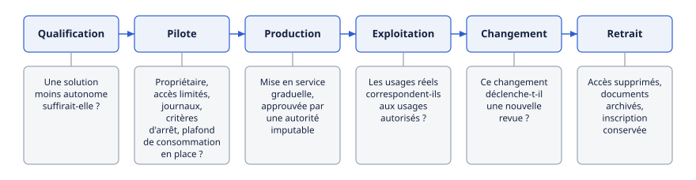

# Chapitre 39 — Gouvernance interne

*Question directrice : comment une organisation garde-t-elle la maîtrise de ses agents ?*

> **État de référence :** cadre de Singapour pour l'IA agentique, version 1.5 du 20 mai 2026, mise à jour le 5 juin; enquête McKinsey sur la confiance envers l'IA, publiée le 25 mars 2026; guides québécois (2026) et fédéral (page datée du 15 septembre 2026) sur l'IA agentique; documentation des éditeurs dans son état d'octobre 2026. Les numéros entre crochets renvoient aux sources en fin de chapitre, toutes des pages primaires lues pour ce chapitre sauf [11] et [14]; [12] à [15] ont été ajoutées le 14 novembre 2026, [13] et [15] n'étant que la page de présentation et le communiqué de rapports non lus.

Protocoles, passerelles, identités et journaux sont des mécanismes. Aucun ne dit qui, dans l'organisation, décide qu'un agent existe, en répond et le retire.

L'enquête de McKinsey sur la confiance envers l'IA situe le retard à cet endroit. Menée de décembre 2025 à janvier 2026 auprès d'environ 500 organisations, elle ajoute à ses dimensions de maturité la gouvernance et les contrôles de l'IA agentique. Le score moyen passe de 2,0 à 2,3, mais environ un tiers seulement des organisations atteignent le niveau 3 ou plus en stratégie, en gouvernance et en gouvernance de l'IA agentique. Près des deux tiers des répondants citent la sécurité et le risque comme premier obstacle à la mise à l'échelle des agents [1]. Ces résultats sont déclaratifs et viennent d'un cabinet qui conseille sur le sujet.

La thèse de ce chapitre : la maîtrise tient à quatre objets que les cadres lus décrivent de façon convergente — un inventaire, un cycle de vie à portes d'autorisation, un responsable nommé par agent, quelques politiques proportionnées à l'autonomie — et à une instance qui les fait vivre. Aucun n'est fourni par un protocole ni, en entier, par une plateforme.

---

## 39.1 Inventaire des agents

### Un actif, donc un registre

On ne gouverne que ce qu'on a recensé. Le NIST AI RMF fait de l'inventaire des systèmes d'IA une sous-catégorie de sa fonction Govern [5]. Le guide du ministère de la Cybersécurité et du Numérique du Québec (MCN), destiné aux organismes publics, est plus direct : un agent se gère comme un actif numérique, et l'organisation tient un registre des agents [3]. Le cadre de Singapour, lancé en janvier 2026 [11], y arrive par l'identité : pour éviter la prolifération, toutes les identités d'agent et leurs permissions devraient être émises et suivies par un système centralisé, pour suivre les agents déployés, repérer les anomalies et retirer les identités inutiles [2].

### Que consigner

| Champ | Demandé par |
|---|---|
| Identifiant unique | Singapour [2], guide fédéral [4], E-23 [6] |
| Propriétaire d'affaires et responsable technique | MCN [3], Entra [9], E-23 [6] |
| Finalité et usages approuvés | MCN [3], E-23 [6] |
| Niveau d'autonomie | MCN [3] |
| Systèmes connectés, données accessibles, dépendances | MCN [3], E-23 [6] |
| Cote de risque | E-23 [6] |
| Version | E-23 [6] |
| État de déploiement, date de la prochaine revue | MCN [3], E-23 [6] |
| Origine : interne, éditeur, partenaire | E-23 [6], Workday [10] |

La ligne directrice E-23 du BSIF, qui prend effet le 1er mai 2027, ne nomme pas les agents; son inventaire de modèles, tenu à l'échelle de l'entreprise, sert ici de gabarit (chapitre 38).

Le MCN distingue l'IA agentique, catégorie de systèmes, de l'agent, instance concrète utilisée dans un cas d'usage déterminé [3] : c'est l'instance qui s'inscrit. Dans le registre d'Agent 365, un même agent Copilot Studio peut figurer plusieurs fois, sous des types d'éditeur différents; chaque entrée a son cycle de vie, et retirer l'une ne retire pas l'autre [7].

### Plusieurs registres, aucun complet

Chez Microsoft, le registre d'Agent 365 se veut l'inventaire unifié, agents tiers compris, tandis qu'Entra ne montre que les agents dotés d'une identité Entra [8]. Il affiche deux compteurs : les agents sans propriétaire, et les agents « non gérés », créés ou administrés hors d'Agent 365, donc sans sa protection ni son observabilité [7]. Chez Workday, l'Agent System of Record enregistre aussi des agents externes et partenaires, mais plusieurs rapports ne couvrent que les agents conçus par Workday [10].

Une organisation multi-plateformes a donc plusieurs registres partiels, auxquels s'ajoutent le registre de découverte des serveurs MCP (chapitre 8) et, dans une institution financière, l'inventaire de modèles. L'inventaire de gouvernance est un objet distinct : il agrège ces sources et porte les champs qu'elles n'ont pas, comme la cote de risque et la décision d'autorisation. La fédération technique des registres relève du chapitre 27.

Il s'alimente par deux voies. La déclaration : l'inscription au registre conditionne le passage en production [3]. La découverte, pour les agents que personne n'a déclarés : aucun cadre lu ne la décrit, mais le compteur d'agents non gérés en montre la nécessité. Les outils de détection des plateformes ne voient que leur périmètre (chapitres 8 et 27); au-delà, les journaux du fournisseur d'identité et des passerelles en sont la matière (chapitres 24 et 29).

---

## 39.2 Cycle de vie

### Des portes d'autorisation

Le guide québécois propose un parcours d'autorisation en trois étapes : filtrer le cas d'usage, vérifier la préparation du pilote, vérifier la préparation à la production [3]. Les autres sources le portent à six étapes.

| Étape | Décision | Appui |
|---|---|---|
| Qualification | Une solution moins autonome suffirait-elle ? | [3] |
| Pilote | Propriétaire, accès limités, journaux, critères d'arrêt et plafond de consommation sont-ils en place ? | [3] |
| Production | Mise en service graduelle, approuvée par une autorité imputable | [2][3] |
| Exploitation | Les usages réels correspondent-ils aux usages autorisés ? | [3] |
| Changement | Ce changement déclenche-t-il une nouvelle revue ? | [2][3] |
| Retrait | Accès supprimés, documents archivés, inscription conservée | [4][6] |

E-23 décrit un cycle voisin pour les modèles : conception, revue, déploiement, surveillance, déclassement [6].

**Le maintien en production ne se présume pas.** Selon le MCN, un agent devrait pouvoir être suspendu ou retiré si les incidents se répètent, si les coûts deviennent imprévisibles, si les journaux sont insuffisants ou si la supervision réelle diminue. La revue périodique vérifie aussi si une solution plus simple peut désormais remplacer l'agent [3].

**Le changement est une porte.** Le MCN demande de versionner modèle, instructions, règles, connecteurs et outils, et de réévaluer les risques quand l'un d'eux évolue [3]. La version 1.5 du cadre de Singapour ajoute des déclencheurs explicites de revue, car modifier un agent peut avoir des effets en cascade [2]. Un serveur MCP qui modifie ses outils change ainsi un agent dont la configuration n'a pas bougé (chapitres 5 et 31). Le modèle aussi change sans qu'on touche à l'agent, par routage (chapitre 44), bascule de secours (chapitre 46) ou distillation (chapitre 47); la revue porte alors d'avance sur la politique de routage et les modèles qualifiés, ce que ce chapitre déduit.

**Le retrait est une étape.** Le NIST demande des procédures de mise hors service qui n'accroissent pas les risques [5]. Le guide fédéral les détaille : suppression des accès, archivage des documents, consignation des leçons [4]. L'inscription survit au retrait : E-23 veut que les modèles déclassés restent à l'inventaire pendant une période jugée raisonnable [6], et Workday conserve l'historique d'un agent archivé [10].

Le retrait de l'identité est traité au chapitre 29; le déploiement, les versions et le retour arrière, au chapitre 34.

---

## 39.3 Imputabilité

### Le principe

Les trois textes publics lus disent la même chose : l'autonomie de l'agent ne déplace pas la responsabilité. Pour Singapour, les organisations qui déploient des agents et les humains qui les supervisent restent responsables de leurs actes [2]. Pour le guide fédéral, la responsabilité revient en fin de compte à la personne désignée [4]. Pour le MCN, l'organisme demeure responsable des effets, des erreurs et des actions associés à l'agent [3]. La responsabilité juridique envers les tiers est traitée au chapitre 36.

Le cadre de Singapour nomme deux difficultés pratiques : les actes d'un agent émergent d'interactions plutôt que d'une logique fixe, et plusieurs acteurs interviennent le long du cycle de vie, ce qui dilue la responsabilité [2].

### Deux rôles par agent

Le MCN distingue le propriétaire de l'agent, qui approuve la finalité, les limites d'autorité, les accès, les risques résiduels et les décisions de poursuite, de suspension ou de retrait, du responsable technologique [3].

Entra Agent ID inscrit cette séparation dans l'annuaire. Le parrain (*sponsor*), représentant d'affaires, est obligatoire à la création; le propriétaire (*owner*), administrateur technique, est facultatif. Le parrain peut désactiver un agent, mais pas le réactiver [9]. Le vocabulaire piège : le « propriétaire » du MCN correspond au parrain d'Entra, non à son *owner*.

La supervision opérationnelle et les utilisateurs complètent la répartition [3] (chapitre 41).

### Trois cas qui défont l'imputabilité

**Le départ du responsable.** Un agent partagé devient sans propriétaire quand le compte de son créateur est supprimé [7]. Le guide fédéral demande de désigner un remplaçant et de suspendre, de réaffecter ou de désactiver les agents d'une personne qui quitte son poste, sauf transfert explicite [4]. Entra admet certains groupes comme parrains [9], ce qui assure la continuité, mais rend la responsabilité moins personnelle.

**Le sous-agent.** Le guide fédéral veut des rôles désignés et consignés pour les sous-agents aussi [4]. Singapour rattache chaque identité à un agent superviseur, à un utilisateur ou à une unité [2]. La chaîne de délégation relève du chapitre 30.

**Le tiers.** Singapour recommande de clarifier la répartition des obligations dans les contrats et d'exiger des fournisseurs de la transparence sur les capacités de l'agent et le traitement des données. Faute de moyens de contrôle — clés à portée limitée, identité par agent, journal des appels d'outils —, il conseille une autre solution ou un cas d'usage restreint [2].

### Ce que dit l'enquête

Chez McKinsey, les organisations qui attribuent explicitement la responsabilité de l'IA responsable obtiennent un score moyen de 2,6, contre 1,8 pour celles sans fonction clairement imputable [1]. C'est une association, non une preuve de causalité.

---

## 39.4 Instances de décision

Aucun des textes lus ne prescrit un comité. Ils fixent ce qui doit être décidé, et à quel niveau.

**La direction.** Le NIST attend d'elle qu'elle assume les décisions sur les risques liés au développement et au déploiement [5]. Singapour confie aux décideurs clés — conseil, direction, chefs d'unité — les objectifs, les cas d'usage permis, les limites d'accès aux données, l'approche de gouvernance et les processus d'escalade [2]. E-23 demande à la haute direction de définir les rôles, de veiller aux compétences et de rendre compte au conseil [6].

**L'autorisation.** Le MCN veut un passage en production approuvé par une autorité imputable et une gouvernance multidisciplinaire : sécurité, protection des renseignements personnels, données, juridique, finances, selon le cas d'usage et le risque [3]. Dans E-23, l'approbateur est typiquement un comité ou une fonction supérieure, et la cote de risque fixe le niveau d'approbation et l'intensité de la revue [6].

Ce chapitre en déduit une structure à trois niveaux, qu'aucune source ne prescrit.

| Niveau | Décide | Rythme |
|---|---|---|
| Direction | Appétit pour le risque, cas d'usage permis et interdits, politiques | Annuel, et après un incident majeur |
| Instance d'autorisation multidisciplinaire | Passage des portes pour les agents à risque élevé; dérogations | Au besoin |
| Propriétaire de l'agent | Poursuite, suspension, retrait; changements courants | Continu |

Deux précautions. La proportionnalité d'abord : le MCN prévoit un encadrement proportionné pour un usage expérimental, interne et réversible, des validations renforcées pour un agent qui modifie des données [3]; une instance qui examine tout devient un goulot. L'adaptation ensuite : Singapour parle de gouvernance adaptative et se présente comme un document vivant [2]. L'instance doit donc comprendre la technologie; or près de 60 % des répondants de McKinsey citent les lacunes de connaissances et de formation comme premier obstacle à l'IA responsable, contre environ 50 % un an plus tôt [1].

Le choix entre centre d'excellence et modèle fédéré est traité au chapitre 41.

---

## 39.5 Politiques

Les cadres lus convergent sur un petit nombre de règles.

| Politique | Règle | Appui | Détail |
|---|---|---|---|
| Recours à un agent | Seulement si une solution moins autonome ne suffit pas | [3] | Ch. 17 |
| Inscription | Aucun agent en production hors de l'inventaire | [3] | — |
| Accès | Moindre privilège; délégation bornée par les droits de l'humain qui autorise | [2][3] | Ch. 30 |
| Supervision | Approbation humaine avant toute action à enjeux élevés ou irréversible; refus par défaut si l'approbation est indisponible | [2] | Ch. 22 |
| Intégrité des contrôles | L'agent ne peut ni élargir ses permissions, ni modifier ses règles, ni effacer ses journaux | [3] | Ch. 22, 47 |
| Arrêt | Mécanisme indépendant de l'agent; personne habilitée connue; retour manuel testé | [3][4] | Ch. 34 |
| Changement | Déclencheurs de revue définis | [2] | Ch. 34 |
| Coûts | Plafond de consommation et seuils d'alerte | [3] | Ch. 40 |
| Tiers | Obligations contractuelles, transparence exigée | [2][5] | Ch. 27, 36, 45 |

**La proportionnalité.** Le guide québécois la résume : plus un système peut agir, accéder à des outils et enchaîner des étapes seul, plus les exigences doivent être élevées [3]. Singapour retient comme facteurs de risque l'étendue des actions, leur réversibilité et le niveau d'autonomie [2]. Une politique unique serait trop lourde pour les uns, trop légère pour les autres.

**L'application.** Une politique écrite ne retient pas un agent. Elle n'a d'effet que traduite en contrôle à un point d'application : fournisseur d'identité, passerelle, plan de contrôle (chapitres 24 et 30). Ce raisonnement d'architecture n'est pas dans les sources, qui demandent toutefois de vérifier que les contrôles, supervision humaine comprise, restent efficaces [2][3].

---

## 39.6 Assurance : lignes de défense et audit interne

Les sections précédentes disent qui décide et qui répond. Reste à savoir qui vérifie que le dispositif fonctionne. Les cadres propres aux agents lus pour ce chapitre demandent que les contrôles restent efficaces [2][3], sans dire qui s'en assure de façon indépendante.

### Le modèle des trois lignes

Le modèle de l'Institute of Internal Auditors (IIA), révisé en 2020, répartit les rôles [12]. La direction en porte deux types. Les rôles de première ligne livrent les produits et les services, et gèrent le risque. Ceux de deuxième ligne apportent expertise, surveillance et remise en question, par exemple en conformité ou en sécurité de l'information. L'audit interne, troisième ligne, fournit une assurance indépendante et objective sur l'adéquation et l'efficacité de la gouvernance et de la gestion des risques. Son indépendance tient à ce qu'il rend compte à l'organe de gouvernance, accède sans entrave aux personnes et aux données, et ne porte aucune responsabilité de gestion. Le modèle précise que ces « lignes » distinguent des rôles, non des structures, et que la gestion du risque reste une responsabilité de première ligne.

Le tableau suivant, propre à ce chapitre, transpose ces rôles à un parc d'agents.

| Ligne | Qui | Objets |
|---|---|---|
| Première | Le propriétaire de l'agent et son responsable technique | Finalité, limites, exploitation, incidents (39.3) |
| Deuxième | Risque, conformité, sécurité, protection des renseignements personnels | Politiques (39.5), cote de risque, revue aux portes (39.2) |
| Troisième | Audit interne | Exhaustivité de l'inventaire, respect des portes, effectivité de la supervision humaine |

L'instance d'autorisation de la section 39.4 relève de la deuxième ligne. Trois vérifications reviennent à la troisième, parce qu'aucun responsable d'agent n'a intérêt à les faire : rapprocher l'inventaire des journaux d'identité et de passerelle, pour y chercher les agents non déclarés (39.1); contrôler sur échantillon que les changements ont bien rouvert la revue (39.2); vérifier que l'approbation humaine est exercée, et non machinale (chapitre 22).

### Ce que demandent les régulateurs financiers

E-23 exige l'indépendance là où elle compte le plus : la revue d'un modèle doit être indépendante de son développement, et la cote de risque en règle la fréquence, l'intensité et l'étendue. Le texte ne mentionne ni l'audit interne ni les lignes de défense; il renvoie à la ligne directrice du BSIF sur la gouvernance d'entreprise [6]. Du côté québécois, selon une analyse de cabinet, la version définitive de la ligne directrice de l'AMF sur l'IA a retiré le rôle confié à la fonction de gestion des risques et la mention de l'audit interne, qui figuraient dans le projet de 2025 [14] (chapitre 38). Les deux textes laissent donc à l'institution le soin de placer l'assurance.

### L'état de préparation

Deux enquêtes donnent un ordre de grandeur, avec leurs limites. Selon un rapport de la Cloud Security Alliance, commandé par un éditeur de sécurité, 54 % des organisations déclarent de 1 à 100 agents non autorisés, 15 % seulement disent que plus des trois quarts de leurs agents ont un responsable défini, et 43 % utilisent quatre plateformes d'agents ou plus [13]. La page lue ne donne ni la taille ni la composition de l'échantillon.

Du côté de l'audit, une enquête de l'Internal Audit Foundation et d'AuditBoard, menée au dernier trimestre de 2025 auprès de 373 dirigeants d'audit interne nord-américains, porte sur la fraude facilitée par l'IA. Moins de 40 % jugent leur fonction prête à la détecter, 55 % citent le manque de personnel compétent, et 51 % conseillent déjà la direction sur la gouvernance de l'IA [15]. L'audit interne conseille donc plus qu'il n'assure, et aucune de ces enquêtes ne mesure l'assurance fournie sur des agents.

---

## Grille de décision

| Décision | Option par défaut | Quand s'en écarter |
|---|---|---|
| Inventaire | Un inventaire de gouvernance unique, alimenté par les registres des plateformes [N] | Une seule plateforme : son registre, complété des champs manquants |
| Agents non déclarés | Découverte par les journaux d'identité et de passerelle, puis inscription ou blocage [S] | — |
| Responsable | Un propriétaire d'affaires et un responsable technique nommés [N] | Agent personnel à faible risque : le créateur tient les deux rôles |
| Départ du responsable | Suspension jusqu'à réattribution [N] | Parrainage par un groupe, si une personne répondante y est désignée |
| Autorisation | Portes de qualification, de pilote et de production [N] | Usage interne et réversible : approbation déléguée, documentation légère |
| Instance | Multidisciplinaire, saisie selon la cote de risque [N] | Petite organisation : un responsable désigné et des avis ponctuels |
| Changement | Revue déclenchée par tout changement de modèle, d'outil ou de source de données [N] | Routage entre modèles : revue de la politique et des modèles qualifiés |
| Assurance | Audit interne, sur l'inventaire, les portes et la supervision effective [S] | Petite organisation : revue par une personne étrangère à l'exploitation des agents |

---

## Points à retenir

- La gouvernance est le point faible mesuré : environ un tiers des organisations interrogées par McKinsey atteignent le niveau 3 ou plus en gouvernance de l'IA agentique.
- Un agent se gère comme un actif : inscrit, versionné, surveillé, retiré.
- Les registres des plateformes sont partiels. L'inventaire de gouvernance les agrège, avec la cote de risque et la décision d'autorisation.
- Le changement et le retrait sont des portes du cycle de vie : un outil ou un modèle qui change rouvre la revue.
- L'autonomie ne déplace pas la responsabilité. Chaque agent a un responsable d'affaires et un responsable technique, sous-agents et agents d'un employé qui part compris.
- Aucun des cadres lus ne prescrit de comité. Ils exigent une direction qui assume le risque et une autorité imputable qui autorise.
- Les politiques sont peu nombreuses, proportionnées, et n'ont d'effet qu'appliquées à un point de contrôle technique.
- Dire qui décide et qui répond ne suffit pas : une troisième ligne vérifie l'inventaire, les portes et la supervision. Les cadres propres aux agents ne la nomment pas, et E-23 n'attend d'indépendance, dans le texte lu, que pour la revue des modèles et leur approbation.

---

## Sources

Pages primaires lues le 11 novembre 2026 :

1. [McKinsey — State of AI trust in 2026: Shifting to the agentic era (25 mars 2026)](https://www.mckinsey.com/capabilities/tech-and-ai/our-insights/tech-forward/state-of-ai-trust-in-2026-shifting-to-the-agentic-era)
2. [IMDA — Model AI Governance Framework for Agentic AI, version 1.5 (20 mai 2026, mise à jour le 5 juin 2026)](https://www.imda.gov.sg/-/media/imda/files/about/emerging-tech-and-research/artificial-intelligence/mgf-for-agentic-ai.pdf)
3. [MCN — Guide sur l'utilisation responsable de l'intelligence artificielle agentique (2026)](https://cdn-contenu.quebec.ca/cdn-contenu/adm/min/cybersecurite_numerique/Intelligence_artificielle/GU_IA_Agentique.pdf)
4. [Gouvernement du Canada — Guide sur l'utilisation de l'intelligence artificielle agentive (page datée du 15 septembre 2026)](https://www.canada.ca/fr/gouvernement/systeme/gouvernement-numerique/innovations-gouvernementales-numeriques/utilisation-responsable-ai/guide-utilisation-intelligence-artificielle-agentive.html)
5. [NIST — AI RMF 1.0, fonctions du cadre](https://airc.nist.gov/airmf-resources/airmf/5-sec-core/)
6. [BSIF — ligne directrice E-23, Gestion du risque de modélisation (2027)](https://www.osfi-bsif.gc.ca/en/guidance/guidance-library/guideline-e-23-model-risk-management-2027)
7. [Microsoft — Agent Registry in Microsoft 365 admin center](https://learn.microsoft.com/en-us/microsoft-365/admin/manage/agent-registry)
8. [Microsoft — Agent Registry convergence with Microsoft Agent 365](https://learn.microsoft.com/en-us/entra/agent-id/agent-registry-convergence)
9. [Microsoft Entra Agent ID — owners, sponsors, and managers](https://learn.microsoft.com/en-us/entra/agent-id/identity-platform/agent-owners-sponsors-managers)
10. [Workday — Agent System of Record, considérations de configuration](https://doc.workday.com/admin-guide/en-us/workday-ai/agents/setup-considerations--agent-system-of-record.html)

Source secondaire :

11. [Allen & Gledhill — lancement du cadre de Singapour (13 février 2026)](https://www.allenandgledhill.com/sg/publication/articles/32314/launches-new-model-ai-governance-framework-for-agentic-ai)

Sources ajoutées le 14 novembre 2026, pour la section 39.6 :

12. [Institute of Internal Auditors — The IIA's Three Lines Model (juillet 2020)](https://www.theiia.org/globalassets/documents/resources/the-iias-three-lines-model-an-update-of-the-three-lines-of-defense-july-2020/three-lines-model-updated-english.pdf) — principes 3 à 5 lus dans le texte.
13. [Cloud Security Alliance — Enterprise AI Security Starts with AI Agents (15 avril 2026)](https://cloudsecurityalliance.org/artifacts/enterprise-ai-security-starts-with-ai-agents) — page de présentation d'un rapport commandé par Zenity.
14. [BLG — L'AMF publie ses attentes sur l'utilisation de l'IA (12 mai 2026)](https://www.blg.com/fr/insights/2026/05/amf-publie-ses-attentes-sur-lutilisation-de-lia) — analyse de cabinet, secondaire.
15. [Institute of Internal Auditors — communiqué sur l'enquête de l'Internal Audit Foundation et d'AuditBoard (17 février 2026)](https://www.theiia.org/en/content/communications/press-releases/2026/new-survey-from-the-iia-and-auditboard-report-reveals-growing-awareness-of-ai-enabled-fraud-varying-perception-of-audit-preparedness/) — communiqué; rapport non lu.

## Limites de ce chapitre

- Du rapport McKinsey, seul le texte a été lu; les graphiques, donc les scores par dimension, n'étaient pas lisibles. Rechargée sans succès à l'audit, la page n'a été recoupée que par un résumé de recherche (score moyen, échantillon, période). L'enquête est déclarative et non évaluée par les pairs.
- Du cadre de Singapour, la synthèse et les passages sur l'identité, l'imputabilité, la supervision et le changement ont été lus, puis relus à l'audit; le reste a été survolé.
- Les pages [3], [4], [6], [7] et [10] ont été relues à l'audit et confirment le texte; [5] n'a été lue que par extraction automatique. Le guide du MCN ne porte que l'année 2026; la date du guide fédéral est celle, sans libellé, de sa page.
- La documentation des éditeurs décrit des fonctions, non leur efficacité. ServiceNow, Salesforce, AWS et Google n'ont pas été examinés (chapitre 26).
- ISO/IEC 42001 n'a pas été lue (chapitre 35).
- La structure à trois niveaux, la découverte par les journaux, la revue des politiques de routage et le principe d'application technique des politiques sont des raisonnements de ce chapitre.
- Les seules données citées sur les agents non autorisés et sans responsable viennent de la page de présentation d'un rapport commandé par un éditeur [13], qui ne donne pas la taille de l'échantillon. Aucune donnée indépendante sur le nombre d'agents par organisation n'a été trouvée.
- La section 39.6 date du 14 novembre 2026. La transposition des trois lignes aux agents et les trois vérifications confiées à l'audit interne sont des propositions de ce chapitre. Du modèle de l'IIA [12], seuls les principes 3 à 5 ont été lus. Le passage sur l'AMF repose sur une analyse de cabinet [14], le texte du régulateur n'ayant pas pu être chargé. L'enquête [15], connue par son communiqué, porte sur la fraude facilitée par l'IA, non sur l'audit des agents. La ligne directrice du BSIF sur la gouvernance d'entreprise n'a pas été lue.
