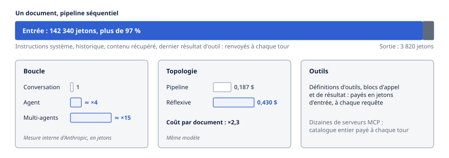
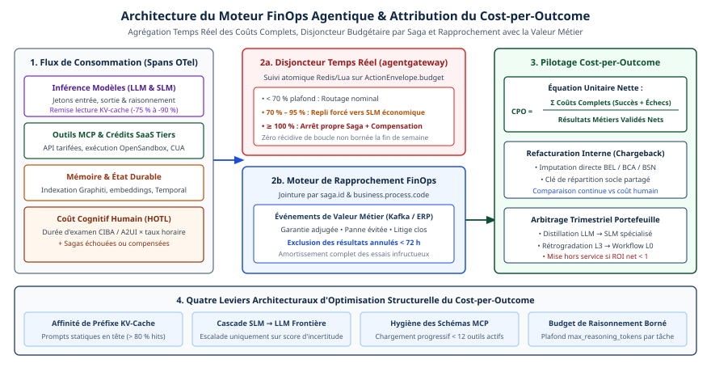

# Chapitre 40 — FinOps agentique

*Question directrice : combien coûte un agent, et que rapporte-t-il ?*

> **État de référence :** communiqué State of FinOps 2026 (19 février 2026), page « FinOps for AI » de la FinOps Foundation (mise à jour du 28 octobre 2026), annonce de la Tokenomics Foundation (4 août 2026) et pages de prix des éditeurs affichées le 11 novembre 2026. Les numéros entre crochets renvoient aux sources en fin de chapitre, toutes lues pour ce chapitre; [3] et [10] sont des prépublications, [4] et [6] des billets de fournisseurs. Les montants sont en dollars américains.

Une licence logicielle a un prix. Un agent a une distribution de coûts : la même demande peut se régler en trois appels au modèle ou en trente, selon le chemin que prend le raisonnement. La facture dépend d'une trajectoire que personne n'a écrite d'avance, et elle arrive après les faits.

La discipline qui gère les dépenses infonuagiques, le FinOps, a pris acte du problème sans le résoudre. Presque toutes les pratiques FinOps gèrent désormais des dépenses d'IA [1], mais la FinOps Foundation ne publie aucun cadre propre aux agents, et sa page de référence constate qu'aucune méthode n'est admise pour imputer le coût d'une charge multi-agents [5].

Ce chapitre défend trois idées. Le coût d'un agent vient surtout du contexte relu à chaque tour, pas du texte produit : les leviers portent sur l'entrée. Le contrôle doit s'exercer pendant l'exécution, puisque la facture vient trop tard. Et l'unité de compte doit être le résultat réussi, car ni le prix du jeton ni la « résolution » facturée par un éditeur ne disent ce qu'un agent rapporte.

---

## 40.1 Coûts en cascade

### Le jeton facturé n'est pas le jeton saisi

L'inférence se paie au jeton, en entrée et en sortie. Ce que l'utilisateur écrit n'en est qu'une petite part : l'application y ajoute les instructions système, l'historique et le contenu récupéré [5]. Dans une boucle agentique, cet ajout se répète, car chaque tour renvoie au modèle l'historique de la tâche, augmenté du dernier résultat d'outil.



Un banc d'essai sur l'extraction de données dans 10 000 dépôts réglementaires en donne la mesure [3]. Dans un pipeline séquentiel, un document consomme 142 340 jetons d'entrée pour 3 820 jetons de sortie. L'entrée pèse plus de 97 % du volume, et la proportion est la même dans les trois autres architectures testées. Sur la page de prix d'Anthropic, le jeton de sortie coûte cinq fois le jeton d'entrée [7]; même à ce rapport, l'entrée reste de loin le premier poste.

### Trois multiplicateurs

**La boucle.** Anthropic rapporte, à partir de ses propres systèmes, qu'un agent consomme environ quatre fois plus de jetons qu'une conversation, et un système multi-agents environ quinze fois plus [6]. C'est une mesure interne publiée dans un billet d'ingénierie de juin 2025, pas un résultat reproduit.

**La topologie.** Dans le banc d'essai, le coût par document passe de 0,187 $ pour le pipeline à 0,430 $ pour l'architecture réflexive, soit 2,3 fois plus, avec le même modèle [3]. Le chapitre 16 détaille ce compromis entre coût et précision.

**Les outils.** Les définitions d'outils voyagent dans chaque requête et se paient en jetons d'entrée, comme les blocs d'appel et de résultat. S'y ajoute une instruction système propre à l'usage d'outils, de 286 à 804 jetons selon le modèle et le réglage `tool_choice` sur la page d'Anthropic [7]. Certains outils exécutés chez le fournisseur ont leur tarif : la recherche web y coûte 10 $ les 1 000 recherches. Un hôte branché sur des dizaines de serveurs MCP paie le catalogue entier à chaque tour, d'où l'intérêt de la découverte progressive des outils, que l'hôte ou la passerelle assure en attendant le protocole (chapitres 5 et 13).

### Les postes hors inférence

| Poste | Mécanisme |
|---|---|
| Durée d'exécution | Facturation au temps de session : 0,08 $ l'heure active pour les agents gérés d'Anthropic, en sus des jetons [7] |
| Résidence des données | Multiplicateur de 1,1 sur tous les jetons quand l'inférence est restreinte aux États-Unis, pour les modèles 4.6 et suivants [7] (chapitre 37) |
| Nouveaux essais | Chaque replanification ou réémission consomme des jetons (chapitre 18) |
| Évaluation | Les juges automatiques sont eux-mêmes des appels au modèle (chapitre 33) |
| Révision humaine | Temps des personnes qui valident ou corrigent (chapitre 22) |

La Tokenomics Foundation, créée sous l'égide de la Linux Foundation, annonce un modèle de référence du coût total de l'IA et un cadre, Big-T, pour classer la complexité en jetons d'une charge avant de choisir un modèle [11]. Ce sont des livrables annoncés; aucune spécification publiée n'a été lue.

---

## 40.2 Attribution des coûts

### Un périmètre acquis, une méthode absente

L'enquête State of FinOps 2026, menée auprès de 1 192 répondants dont les organisations totalisent plus de 83 milliards de dollars de dépenses infonuagiques annuelles, établit que 98 % des pratiques gèrent des dépenses d'IA, contre 31 % deux ans plus tôt [1]. Le FinOps de l'IA y est la première priorité à venir. Le communiqué ne mentionne toutefois ni les agents ni l'IA agentique.

La page « FinOps for AI » de la fondation nomme les obstacles [5]. Les nouvelles références de facturation et les factures directes des fournisseurs de modèles arrivent souvent sans étiquettes. Pour les charges multi-agents, aucune méthode n'est admise.

### Ce qu'il faut pour imputer

Faute de méthode établie, l'imputation se construit avec trois éléments décrits dans d'autres chapitres; leur assemblage est une synthèse, pas une norme.

**Une clé.** Chaque appel au modèle porte l'identité de l'agent (chapitre 29), l'identifiant de l'exécution et le centre de coûts. Sans identité distincte, tous les agents d'une plateforme se confondent sous une même clé d'API.

**Un point de mesure.** La trace est la source naturelle : les conventions OpenTelemetry prévoient des attributs de consommation de jetons, encore instables (chapitre 33). La passerelle en est une autre, puisque le trafic vers les modèles y passe (chapitre 24). La politique `llm-token-limit` d'Azure API Management, par exemple, tient un compteur par clé calculée et peut renvoyer le nombre de jetons consommés dans un en-tête de réponse [12].

**Un format.** FOCUS, la spécification ouverte de données de facturation, est produite nativement par toutes les grandes plateformes infonuagiques, et ses utilisateurs réclament son extension aux charges d'IA [1]. La Tokenomics Foundation annonce une télémétrie de coût des jetons dans FOCUS 1.5 et les versions suivantes [11]. Ce point n'a pas été vérifié dans la spécification.

### Trois difficultés propres aux agents

**Le coût partagé.** Un orchestrateur sert plusieurs demandes; un sous-agent sert plusieurs orchestrateurs. Le cache de prompts complique le calcul : la première requête paie l'écriture à prix majoré, les suivantes lisent à prix réduit [7]. Imputer au coût réel pénalise le premier appelant.

**Le coût délégué.** Quand un agent en appelle un autre hors de l'organisation (chapitre 6), le coût de l'agent distant n'apparaît que dans le prix qu'il facture; un rapprochement à trois voies contrôle cette facture (chapitre 45).

**L'unité.** Le coût par jeton ne dit rien à un gestionnaire. La Tokenomics Foundation propose d'exprimer le coût de service par appel plutôt que par jeton [11]; la FinOps Foundation liste le coût par inférence et le coût par résultat réussi [5]. Pour un agent, l'unité utile est la tâche, puis le résultat (section 40.5).

Une règle prudente en découle : montrer d'abord les coûts aux équipes sans les refacturer, et ne refacturer qu'une fois la clé d'imputation fiable.

---

## 40.3 Garde-fous à l'exécution

La FinOps Foundation range les boucles d'agents parmi les anomalies à surveiller [5]. Sa consigne pour les projets débutants : fixer d'avance des limites de coût et de temps. Une alerte de facturation n'y suffit pas, car elle suit la dépense. Le plafond doit se trouver sur le chemin de l'appel.

### Une défense en couches

| Garde-fou | Où | Ce qu'il arrête | Limite |
|---|---|---|---|
| Plafond d'itérations | Boucle de l'agent | La boucle sans fin | Ne borne pas la taille d'un tour (chapitre 17) |
| Débit de jetons par minute | Passerelle | Les pointes | Ignore la dépense cumulée |
| Quota de jetons par période | Passerelle | Le dépassement d'enveloppe | Comptage imparfait |
| Budget d'appels d'outils | Passerelle MCP | Le martèlement d'un système | Compte des appels, pas des dollars (chapitre 24) |
| Limite de paiement | Portefeuille ou passerelle | L'achat non voulu | Absente de x402 et de MPP; à poser dans un mandat ou en amont (chapitre 10) |
| Arrêt d'urgence | Plan de contrôle | Tout | Brutal (chapitre 34) |

### Ce qu'un quota garantit vraiment

La politique d'Azure API Management accepte un débit par minute, un quota par période (de l'heure à l'année), ou les deux. Le dépassement du débit renvoie un code 429; celui du quota, un code 403 [12].

Quatre réserves l'accompagnent. Sans estimation préalable, la requête qui franchit la limite part quand même : le dépassement se constate à la réponse, et seules les requêtes suivantes sont bloquées. Des requêtes concurrentes peuvent excéder temporairement le plafond. En flux continu, les jetons sont estimés et non comptés. Enfin, chaque passerelle tient son compteur : dans un déploiement multirégional, les décomptes ne s'additionnent pas.

Un quota est donc un frein, pas un mur. Un système multi-agents qui lance vingt branches en parallèle peut dépasser son enveloppe avant le retour du premier décompte. Les plafonds budgétaires d'agentgateway et de MuleSoft (chapitre 24) n'ont pas été lus ici.

### Trois choix de conception

**La clé du compteur.** L'exemple d'Azure indexe le débit sur l'adresse IP et le quota sur l'abonnement [12]. Pour des agents, la clé pertinente est l'identité de l'agent, combinée à la tâche.

**L'échelle du budget.** Un quota mensuel protège le budget annuel, pas contre une tâche qui dérape. Il faut aussi un plafond par exécution, proportionné à la valeur de la tâche.

**Le comportement à l'épuisement.** Trois réponses existent : refuser, basculer vers un modèle moins cher, ou s'en remettre à un humain (chapitre 22). Une tâche interrompue à mi-chemin a déjà consommé ses jetons; vérifier le solde avant une étape chère vaut mieux que couper après, et une tâche arrêtée doit pouvoir reprendre sans rejouer ses effets (chapitre 18).

---

## 40.4 Modèles de tarification : au siège, à la consommation, au résultat

Deux étages de prix coexistent. L'entreprise qui construit ses agents achète de l'inférence. Celle qui achète des agents empaquetés se voit proposer trois modèles, parfois par le même éditeur.

### L'inférence

La FinOps Foundation recense des formules reprises de l'infonuagique [5] : à la demande, remises sur engagement, capacité provisionnée (un débit fixe, facturé qu'il serve ou non), traitement par lots à rabais, abonnement, paliers de volume.

### Les agents empaquetés

Le tableau reprend les prix affichés par les éditeurs à la date de rédaction. Ce sont des prix de liste, négociables.

| Éditeur | Unité facturée | Prix affiché | Ce que l'unité recouvre |
|---|---|---|---|
| Salesforce Agentforce [8] | Action | 500 $ les 100 000 crédits; 20 crédits par action, soit 0,10 $ | Une action de l'agent, réussie ou non |
| Salesforce Agentforce [8] | Conversation | 2 $ | Une conversation avec un client |
| Salesforce Agentforce [8] | Siège | 125 $ par utilisateur par mois | Usage illimité par les employés |
| Intercom Fin [9] | Résultat (*outcome*) | À partir de 0,99 $ | Voir ci-dessous |
| Zendesk [4] | Résolution automatisée | 1,50 $ | Résolution sans humain, vérifiée par Zendesk |

Chez Salesforce, crédits et conversations ne peuvent pas coexister dans une même organisation, et les crédits inutilisés ne sont pas reportés [8]. Le prix de Zendesk est cité dans la foire aux questions d'un billet de l'éditeur, non dans une grille tarifaire [4].

### Qui porte le risque

Zendesk résume lui-même le compromis [4]. Au siège, le client risque de payer des licences inutilisées. À la consommation, il risque de voir les coûts monter sans résultat garanti. Au résultat, le risque se déplace vers la définition et la vérification de ce résultat. Forrester note de son côté que le passage du siège à la consommation distend le lien entre l'usage et les résultats d'affaires, et rapporte chez ses clients une forte incertitude sur les prix [2].

### Le résultat est une définition contractuelle

La tarification au résultat aligne le prix sur la valeur si le résultat est bien défini. Or les définitions lues divergent.

Chez Intercom, un résultat est compté quand le client confirme la résolution, mais aussi quand il ne demande rien de plus, ou quand l'agent mène une procédure à terme, transferts compris [9]. Le silence du client vaut succès. Chez Zendesk, seule la résolution « vérifiée » est facturable, et c'est Zendesk qui évalue les conversations; une conversation se clôt après deux heures par défaut en messagerie, prolongeables à soixante-douze, et soixante-douze heures après le premier courriel [4]. La page ne décrit pas de procédure de contestation propre à l'éditeur; elle conseille d'en prévoir une au contrat.

Dans les deux cas, le fournisseur mesure ce qu'il facture. Zendesk range lui-même les différends sur la définition ou la vérification du résultat parmi les risques de ce modèle [4].

Trois conséquences en découlent. La définition du résultat, sa vérification et un droit d'audit figurent au contrat (chapitre 36). Le client mesure lui-même la résolution réelle, par exemple par les recontacts sur le même sujet. Et la comparaison entre offres se fait en ramenant chaque prix à la même unité, le cas réellement réglé, que l'éditeur facture l'action, la conversation ou la résolution.

---

## 40.5 Mesurer la valeur

### Le constat

Les organisations augmentent leurs dépenses d'IA plus vite qu'elles n'apprennent à en mesurer les résultats : c'est le diagnostic de Forrester au sortir de la conférence FinOps X 2026 [2]. Ses analystes demandent de relier la consommation de jetons aux revenus, à la productivité et aux résultats pour les clients. L'enquête State of FinOps va dans le même sens : la gestion de la valeur de l'IA est la compétence la plus recherchée, et plusieurs organisations demandent à leurs équipes de financer l'IA par des gains d'efficacité [1].

Le chapitre 4 rapporte un obstacle plus élémentaire : selon l'étude MAP, 39 % seulement des répondants comparent leur agent à une solution non agentique. Sans base de comparaison, la valeur ne se démontre pas.

### Le coût par résultat réussi

L'indicateur le plus utile de la page de la FinOps Foundation est le coût des résultats qui atteignent la barre de qualité [5] : le coût total des exécutions, ratées comprises, divisé par le nombre de résultats conformes.

Le banc d'essai financier permet de l'illustrer [3]. L'exactitude par document, soit la part des documents dont tous les champs sont corrects, y va de 0,648 à 0,758 (chapitre 16).

| Architecture | Coût par document | Exactitude par document | Coût par document entièrement correct |
|---|---|---|---|
| Pipeline séquentiel | 0,187 $ | 0,648 | 0,29 $ |
| Fan-out | 0,221 $ | 0,672 | 0,33 $ |
| Hiérarchique | 0,261 $ | 0,718 | 0,36 $ |
| Réflexive | 0,430 $ | 0,758 | 0,57 $ |

La dernière colonne est un calcul fait pour ce chapitre, non un résultat de l'article. Elle montre deux choses. Le coût par succès dépasse le coût par tâche de 32 % à 54 %. Et le classement ne dit rien tant qu'on ignore le coût d'un document fautif : si sa correction par une personne coûte quelques dollars, l'architecture la plus précise devient la moins chère. La valeur se décide dans ce que coûte l'erreur.

### La valeur de la tâche borne l'architecture

Anthropic tire de ses mesures une règle simple : un système multi-agents ne se justifie que pour des tâches dont la valeur paie le surcroît de performance [6]. Dans l'une de ses évaluations, la consommation de jetons expliquait à elle seule 80 % de la variance de performance. Dépenser plus de jetons achète de la performance; reste à savoir ce que vaut le point supplémentaire.

### Deux précautions

**Un rendement ne vaut que ses intrants**, prévient la FinOps Foundation [5]. Un gain de productivité déclaré n'est pas une économie constatée.

**La part de travail accomplie sans intervention humaine**, mesure que la Tokenomics Foundation annonce vouloir normaliser [11], dit ce que l'agent fait seul, pas s'il le fait bien. Elle se lit avec le succès vérifié (chapitre 34).

---

## 40.6 Leviers : routage de modèles, cache, décomposition

Puisque l'entrée domine, les leviers rentables agissent sur ce que le modèle relit et sur le modèle qui le lit. Les chiffres du banc d'essai portent sur l'architecture hiérarchique, à partir de 0,261 $ par document et d'un F1 de 0,929 [3].

| Levier | Effet mesuré | Contrepartie |
|---|---|---|
| Cache de prompts | Lecture à 0,1 fois le prix d'entrée sur la plupart des modèles, 0,05 ou 0,025 fois sur certains récents; écriture à 1,25 fois (cinq minutes) ou 2 fois (une heure) [7] | Un changement en tête du préfixe annule le gain (chapitre 13) |
| Traitement par lots | Rabais de 50 % en entrée et en sortie, cumulable avec le cache [7] | Asynchrone; exclu des sessions d'agents gérés |
| Cache sémantique | 0,171 $ (−34,5 %), F1 0,924 [3] | Réponse périmée ou mal appariée |
| Routage à deux niveaux | 0,127 $ (−51,3 %), F1 0,912 [3] | Perte de précision |
| Relance adaptative | 0,247 $ (−5,4 %), F1 inchangé [3] | Gain modeste |
| Les trois précédents combinés | 0,148 $, F1 0,924, 30,2 s contre 46,2 s [3] | Complexité d'exploitation |

### Le cache d'abord

Le cache de prompts est le seul levier sans effet sur la qualité : le modèle reçoit le même contexte. D'après la page d'Anthropic, il devient rentable dès la première relecture pour une durée de cinq minutes, et dès la deuxième pour une heure [7]. Une boucle agentique, qui renvoie le même préfixe à chaque tour, en est le cas d'usage idéal. La condition est de construction : le stable en tête, le variable à la fin. C'est pourquoi MCP recommande aux serveurs un ordre d'outils déterministe (chapitre 5).

### Le routage ensuite

Le routage attribue à chaque étape un modèle à sa mesure. Le banc d'essai en montre le gain et le prix : le coût baisse de moitié, le F1 perd 1,7 point [3]. Tout confier à un modèle léger ramène le coût à 0,044 $, mais le F1 tombe à 0,843. Une prépublication plus ancienne, RouteLLM, annonce des coûts réduits de plus de moitié dans certains cas, sans perte de qualité sur ses bancs d'essai [10].

La FinOps Foundation propose l'indicateur correspondant, l'adéquation du modèle : la part des requêtes envoyées à un modèle plus capable et plus cher que nécessaire [5]. La passerelle est le lieu naturel de ce routage, activé par classe de tâche (chapitre 44); distiller un petit modèle pour une tâche étroite prolonge le levier (chapitre 47).

### La décomposition enfin

Décomposer, c'est réduire ce que chaque appel relit. Trois gestes y contribuent : confier à du code déterministe ce qui n'exige pas de raisonnement (chapitre 17), donner à chaque sous-agent un contexte étroit (chapitre 13), et choisir la topologie la moins chère qui atteint la barre de qualité (chapitre 16). La décomposition n'est pas gratuite : dans le banc d'essai, le fan-out consomme 18 % de jetons de plus que le pipeline, ses branches relisant des contextes qui se chevauchent [3], et chaque frontière entre agents ajoute un risque de coordination (chapitre 21).

Ces chiffres viennent d'une prépublication, sur un seul domaine, aux tarifs de janvier 2025 [3]. Le sens des compromis est utilisable; les valeurs exactes ne se transposent pas.

---

## Grille de décision

| Décision | Option par défaut | Quand s'en écarter |
|---|---|---|
| Unité de compte | Coût par résultat réussi | Pilote sans barre de qualité : coût par exécution |
| Clé d'imputation | Identité d'agent, exécution, centre de coûts | Agent unique : clé d'API dédiée |
| Point de mesure | Passerelle et traces, rapprochées de la facture | Très petit parc : rapports du fournisseur |
| Refacturation | Affichage des coûts seulement | Clé d'imputation éprouvée |
| Plafonds | Par exécution et par période, sur l'identité de l'agent | — |
| Épuisement du budget | Vérification avant l'étape chère, puis recours à un humain | Faible enjeu : bascule vers un modèle moins cher |
| Achat d'un agent | Consommation plafonnée | Résultat, si le client peut le vérifier; siège, si l'usage est massif et régulier |
| Ordre des leviers | Cache de prompts, lots, routage, topologie | Tâche interactive : pas de lots |
| Système multi-agents | Seulement si la valeur de la tâche paie le surcoût | — |

---

## Points à retenir

- Le coût d'un agent est une distribution, pas un prix. Il dépend du nombre de tours, de la topologie et des outils chargés.
- L'entrée domine : dans le banc d'essai lu, plus de 97 % des jetons sont relus, non produits.
- Presque toutes les pratiques FinOps gèrent des dépenses d'IA, mais aucun cadre FinOps propre aux agents n'existe, et l'imputation multi-agents n'a pas de méthode admise.
- L'imputation exige une identité d'agent, un point de mesure et un format commun. Les deux derniers reposent sur des standards instables ou seulement annoncés.
- Un quota de jetons à la passerelle est un frein, pas un mur : il se constate après coup et cède sous la concurrence. Il faut aussi un plafond par exécution.
- La tarification au résultat déplace le risque vers la définition du résultat, que le fournisseur mesure lui-même.
- La valeur se mesure au coût par résultat réussi, comparé à une base de référence et au coût de l'erreur.
- Le cache de prompts vient en premier, car il ne touche pas à la qualité. Le routage réduit davantage le coût, au prix d'une perte de précision à mesurer.

---

## Sources

Pages primaires lues le 11 novembre 2026 :

1. [Linux Foundation — State of FinOps 2026, communiqué du 19 février 2026](https://www.linuxfoundation.org/press/state-of-finops-survey-ai-value-and-skills-top-priorities-as-finops-matures-across-technology-value-98-manage-ai-90-saas-64-licensing-48-data-center-1)
2. [Forrester — Dollars and Sense at FinOps X 2026, billet du 23 juin 2026](https://www.forrester.com/blogs/dollars-and-sense-at-finops-x-2026-is-ai-value-management-bigger-than-finops/)
3. [Kulkarni et Kulkarni — Benchmarking Multi-Agent LLM Architectures for Financial Document Processing (arXiv 2603.22651v1)](https://arxiv.org/html/2603.22651v1) — prépublication.
4. [Zendesk — Outcome-based pricing, mise à jour du 29 octobre 2026](https://www.zendesk.com/blog/ai/agentic-ai/outcome-based-pricing/) — billet de l'éditeur.
5. [FinOps Foundation — FinOps for AI Overview, mise à jour du 28 octobre 2026](https://www.finops.org/wg/finops-for-ai-overview/)
6. [Anthropic — How we built our multi-agent research system, 13 juin 2025](https://www.anthropic.com/engineering/multi-agent-research-system) — billet du fournisseur.
7. [Anthropic — Pricing, documentation de la plateforme](https://platform.claude.com/docs/en/about-claude/pricing)
8. [Salesforce — Agentforce Pricing](https://www.salesforce.com/agentforce/pricing/)
9. [Intercom — Pricing](https://www.intercom.com/pricing)
10. [Ong et coll. — RouteLLM: Learning to Route LLMs with Preference Data (arXiv 2406.18665)](https://arxiv.org/abs/2406.18665) — prépublication; résumé seulement.
11. [Linux Foundation — lancement de la Tokenomics Foundation, communiqué du 4 août 2026](https://linuxfoundation.org/press/linux-foundation-launches-the-tokenomics-foundation-to-define-the-economics-and-roi-of-ai-value)
12. [Microsoft Learn — politique `llm-token-limit` d'Azure API Management](https://learn.microsoft.com/en-us/azure/api-management/llm-token-limit-policy)

Sources secondaires : aucune. Le constat de l'étude MAP vient du chapitre 4; les plafonds d'agentgateway et de MuleSoft, du chapitre 24.

## Limites de ce chapitre

- Les pages ont été lues au moyen d'un outil d'extraction; une nuance de formulation peut avoir échappé. L'audit a relu [1], [3], [4], [5], [7], [9], [11] et [12], pas [2], [6], [8] ni [10]. Les prix des éditeurs sont des prix de liste relevés le 11 novembre 2026; la page de Salesforce ne porte pas de date.
- Le rapport State of FinOps 2026 n'a été lu que par son communiqué. La spécification FOCUS, le rapport Forrester AI Value Matrix et les livrables de la Tokenomics Foundation n'ont pas été lus; ils sont présentés comme annoncés.
- L'« étude sur la génération de workflows » citée par le plan initial n'a pas été retrouvée ni utilisée.
- Le résumé et les tableaux du banc d'essai [3] se contredisent par endroits : le résumé donne la configuration optimisée à 1,15 fois le coût du pipeline, les tableaux à 0,79 fois, et l'article dit ailleurs le fan-out économe en jetons. Ses coûts en dollars n'ont pas pu être rapprochés de ses décomptes de jetons; les prix de liste du modèle utilisé relèvent ici de la connaissance générale. Le coût par document entièrement correct et la part des jetons d'entrée sont des calculs faits pour ce chapitre.
- Les multiples de consommation [6] sont des mesures internes d'un fournisseur, datées de 2025; aucune mesure indépendante n'a été trouvée.
- Un seul fournisseur de modèles (Anthropic) et une seule passerelle (Azure API Management) ont été lus. Les règles de cache, de lots et de quotas diffèrent ailleurs.
- La proposition d'imputation (40.2), les choix de conception (40.3), les conséquences contractuelles (40.4) et l'ordre des leviers (40.6) sont des synthèses de l'auteur, non des pratiques documentées.

## Mise en œuvre — FinOps agentique : gouvernance économique et Cost-per-Outcome {.volet}

:::: {.encadre .executive}
::: {.encadre-titre}
**Synthèse exécutive**
:::

- **Enjeu stratégique** : Le tarif catalogue au million de jetons baisse chaque année, mais la facture réelle des systèmes agentiques dérape souvent à la hausse : boucles inter-agents, raisonnement étendu, réinjection des schémas MCP et crédits d’action des éditeurs SaaS s’additionnent. Une facture mensuelle globale d’API signale le dépassement trente jours trop tard et ne distingue pas les agents créateurs de marge des agents déficitaires.
- **Décisions architecturales structurantes** :
  1.  *Irréversible à moyen terme* : Adopter le coût complet par résultat métier validé (*Cost-per-Outcome*, CPO) comme unité de gouvernance économique, en amortissant le coût des sagas avortées, des compensations et du temps de révision humaine (HOTL) sur les seuls dossiers résolus avec succès.
  2.  *Structurante dès le jour 1* : Implanter dans agentgateway et dans l’`ActionEnvelope` un disjoncteur budgétaire progressif en temps réel, qui fait passer un flux vers un petit modèle (SLM) économique avant d’interrompre proprement toute saga qui atteint son plafond monétaire.
  3.  *Réversible par conception* : La répartition du trafic entre modèles frontières infonuagiques et SLM spécialisés, réarbitrée chaque trimestre selon le couple coût/constance $\text{pass}^5$.
- **Indicateurs de gouvernance associés** : *Cost-per-Outcome* net par processus, comparé au coût humain de référence; taux de lecture du cache de préfixe ($\ge 75\,\%$); part des appels absorbés par des SLM ($\ge 70\,\%$); taux trimestriel de rationalisation du portefeuille.
::::

## 40.7 Le prix au million de jetons et le coût complet des systèmes multi-agents

Une direction financière qui budgète une initiative agentique avec la grille linéaire des copilotes de 2024 (nombre de requêtes multiplié par mille jetons) sous-estime le coût réel de production d’un facteur 8 à 25.

Cet écart tient à la dynamique multiplicative d’une saga autonome L3/L4. Un seul événement métier déclenche un orchestrateur qui sollicite trois spécialistes A2A; chacun exécute quatre cycles *ReAct* avec huit outils MCP et du raisonnement étendu, soit de quinze à trente inférences successives, chacune relisant l’historique et les schémas d’outils (section 40.1). L’ordonnancement qui casse l’affinité du cache ou les réessais d’une API tierce font monter la dépense sans alerte.



Les sept postes de coûts directs et cachés d’une transaction agentique, avec leur part typique dans un système non optimisé :

| Poste de coût complet | Mécanisme d’inflation en production | Part typique (non optimisé) | Levier d’optimisation (Standard 2027) |
|:----------------------|:------------------------------|:----------------|:------------------------------|
| **1. Jetons d’entrée répétés (prompts et schémas MCP)** | Réinjection à chaque tour de dizaines de schémas JSON verbeux, sans affinité de cache | 28 % – 38 % | Préfixes statiques canoniques, affinité de cache (lecture à 0,1 fois le prix d’entrée sur la plupart des modèles, section 40.6), moins de 12 outils actifs |
| **2. Jetons de raisonnement** | Génération de 4 000 à 12 000 jetons internes invisibles (tarif de sortie) sur des cas simples | 20 % – 35 % | Triage préalable par SLM et plafond `max_reasoning_tokens` par classe de tâche |
| **3. Échanges inter-agents (A2A)** | Prose narrative entre pairs au lieu de structures JSON compactes Apache Ossie | 8 % – 14 % | Sorties structurées strictes (Open Responses), sans politesse machine à machine |
| **4. Crédits d’action SaaS et API tierces** | Débit unitaire par appel d’agent éditeur, même lors de réessais ou de lectures vides | 10 % – 20 % | Cache de lecture à TTL court sur la passerelle et déduplication par clé d’idempotence |
| **5. Mémoire bi-temporelle et état durable** | Extraction d’entités par LLM à chaque écriture Graphiti et à chaque transition Temporal | 5 % – 9 % | Extraction déportée sur un SLM quantifié, en lot asynchrone; indexation sélective |
| **6. Sagas avortées, boucles et compensations** | Dossiers qui consomment 90 % de leur budget avant d’échouer sans résultat métier | 6 % – 15 % | Sentinelle anti-livelock (chapitre 33) et contrôle déterministe précoce des préconditions |
| **7. Révision humaine (HOTL)** | Temps d’examen d’un expert qualifié sur des escalades mal ciblées | Souvent omis; poste majeur du coût total | Calibrage des seuils Cedar et vue A2UI centrée sur le différentiel de preuves |

### Démonstration arithmétique sur une saga type de dix étapes

Le calcul ci-dessous retient une remise de 80 % sur l’entrée : c’est une hypothèse, car l’exposé relève une lecture du cache de préfixe à 0,1 fois le prix d’entrée sur la plupart des modèles, et à 0,05 ou 0,025 fois sur certains récents (section 40.6).

Deux implémentations d’une même saga d’instruction de dossier, à dix étapes cognitives, montrent l’effet du levier architectural :

- **Architecture naïve (Génération 2 non optimisée)** : Chaque étape appelle un modèle frontière (entrée à 3,00 \$ CAD / M jetons, sortie et raisonnement à 15,00 \$ CAD / M jetons), recharge 18 000 jetons de contexte et de catalogues d’outils non cachés, génère 2 500 jetons de raisonnement latent et 600 jetons de prose, et subit 18 % de sagas avortées ou reprises manuellement. Le coût direct d’une exécution atteint environ 1,01 \$ CAD, et 1,46 \$ CAD par résultat validé une fois amortis les échecs et la surcharge d’escalade HOTL. Sur 50 000 dossiers mensuels, la dépense annuelle atteint 876 000 \$ CAD.
- **Architecture AgentOps gouvernée (Standard 2027)** : Huit des dix étapes (qualification, extraction, formatage MCP, synthèse) passent par un SLM spécialisé à 0,12 \$ CAD / M jetons. Les deux seules étapes d’arbitrage complexe sollicitent le modèle frontière, avec un préfixe ordonné qui obtient 85 % de lectures en cache (remise de 80 % sur l’entrée) et un budget de raisonnement plafonné à 1 024 jetons. Le taux de réussite du premier coup franchit 96 %. Le coût complet amorti tombe à 0,13 \$ CAD par résultat validé, soit 78 000 \$ CAD par an pour le même volume métier : la facture est divisée par plus de onze et le temps de réponse médian diminue de 64 %.

------------------------------------------------------------------------

## 40.8 Modèle et attribution du *Cost-per-Outcome* (CPO)

Une facture mensuelle brute de *« 420 millions de jetons pour 18 400 \$ CAD »* ne dit pas si la plateforme crée de la richesse ou subventionne du gaspillage. L’unité d’œuvre métier auditable est le *Cost-per-Outcome* net (CPO), qui reprend le coût par résultat réussi de la section 40.5.

Un résultat métier validé n’est ni un message affiché, ni la fin technique d’un flux de travail sans exception : c’est l’accomplissement vérifié et durable de l’objectif d’affaires (garantie instruite non contestée sous 72 h, intervention préventive confirmée, facture rapprochée et comptabilisée). Pour que le coût des échecs ne soit pas masqué, le CPO net se calcule sur l’ensemble $\mathcal{S}$ des sagas exécutées sur la période, réussies, échouées ou compensées :

$$\text{CPO}_{\text{net}} = \frac{\sum_{s \in \mathcal{S}} \left( C_{\text{inf}}(s) + C_{\text{mcp}}(s) + C_{\text{mem}}(s) + C_{\text{hotl}}(s) \right)}{N_{\text{validés}} - N_{\text{annulés}}}$$

Dans cette équation, $C_{\text{inf}}(s)$ cumule le coût exact des *spans* d’inférence (tarif plein hors cache, tarif d’amorçage et de lecture du cache, tarif de sortie couvrant génération et raisonnement). $C_{\text{mcp}}(s)$ additionne les crédits d’outils tiers et les bacs à sable OpenSandbox, $C_{\text{mem}}(s)$ intègre les opérations de mémoire et d’exécution durable, et $C_{\text{hotl}}(s)$ valorise le temps réel de révision humaine au taux horaire chargé de l’approbateur. Au dénominateur, toute décision annulée ou reprise manuellement sous 72 heures ($N_{\text{annulés}}$) est déduite.

Le calcul de $C_{\text{inf}}(s)$ comporte un piège d’instrumentation : les fournisseurs d’inférence rapportent différemment les jetons lus en cache. Certains incluent `cache_read_input_tokens` dans `input_tokens`, d’autres ne rapportent dans `input_tokens` que le reliquat non caché. La passerelle agentgateway normalise donc `gen_ai.usage.input_tokens` en volume total d’entrée avant l’export OTLP, et l’entrepôt analytique protège la soustraction par un plancher `GREATEST(..., 0)`.

Hausser la constance $\text{pass}^5$ (chapitre 34) ou couper les boucles dès la deuxième répétition stérile (chapitre 33) réduit donc le CPO net.

#### Extrait 40.1 — Requête SQL analytique d’attribution du *Cost-per-Outcome* sur les *spans* OpenTelemetry

Exécutée toutes les heures dans l’entrepôt analytique alimenté par le flux OTel assaini, la requête rapproche les coûts complets des événements métiers validés :

``` sql
WITH span_costs AS (
    SELECT
        s.attributes['saga.id']::STRING                        AS saga_id,
        s.attributes['business.process.code']::STRING          AS process_code,
        GREATEST(
            COALESCE(s.attributes['gen_ai.usage.input_tokens']::INT, 0)
            - COALESCE(s.attributes['gen_ai.usage.cache_read_input_tokens']::INT, 0),
            0
        )                                                      AS uncached_in_tokens,
        COALESCE(
            s.attributes['gen_ai.usage.cache_read_input_tokens']::INT, 0
        )                                                      AS cached_in_tokens,
        COALESCE(s.attributes['gen_ai.usage.output_tokens']::INT, 0)
          + COALESCE(s.attributes['gen_ai.usage.reasoning_tokens']::INT, 0)        AS billable_out_tokens,
        COALESCE(s.attributes['mcp.external_api_cost_cad']::DOUBLE, 0.0)           AS mcp_api_cost_cad,
        COALESCE(s.attributes['memory.op_cost_cad']::DOUBLE, 0.0)                  AS mem_op_cost_cad,
        COALESCE(s.attributes['hotl.review_seconds']::DOUBLE, 0.0) * (84.0 / 3600) AS hotl_labor_cost_cad,
        p.uncached_in_per_1m_cad,
        p.cached_in_per_1m_cad,
        p.output_per_1m_cad
    FROM otel_clean.genai_spans s
    LEFT JOIN finops.model_pricing_catalog p
        ON s.attributes['gen_ai.response.model']::STRING = p.model_id
       AND s.start_time BETWEEN p.effective_from AND p.effective_to
    WHERE s.start_time >= DATEADD('day', -30, CURRENT_TIMESTAMP())
),
saga_full_cost AS (
    SELECT
        saga_id,
        ANY_VALUE(process_code) AS process_code,
        SUM(
            (uncached_in_tokens / 1e6) * COALESCE(uncached_in_per_1m_cad, 0)
          + (cached_in_tokens   / 1e6) * COALESCE(cached_in_per_1m_cad, 0)
          + (billable_out_tokens / 1e6) * COALESCE(output_per_1m_cad, 0)
          + mcp_api_cost_cad
          + mem_op_cost_cad
          + hotl_labor_cost_cad
        ) AS total_saga_cost_cad
    FROM span_costs
    GROUP BY saga_id
)
SELECT
    c.process_code,
    COUNT(c.saga_id)                                                       AS total_sagas_launched,
    COUNT_IF(o.outcome_status = 'VALIDATED' AND NOT o.reopened_within_72h) AS net_validated_outcomes,
    ROUND(SUM(c.total_saga_cost_cad), 2)                                   AS total_spend_cad,
    ROUND(
        SUM(c.total_saga_cost_cad)
        / NULLIF(COUNT_IF(o.outcome_status = 'VALIDATED' AND NOT o.reopened_within_72h), 0),
        4
    )                                                                      AS net_cost_per_outcome_cad
FROM saga_full_cost c
LEFT JOIN business_events.saga_outcomes o
    ON c.saga_id = o.saga_id
GROUP BY c.process_code
ORDER BY total_spend_cad DESC;
```

:::: {.encadre .sectoriel}
::: {.encadre-titre}
**Tarification des éditeurs SaaS en 2027 : pièges des crédits d’action et de la tarification au résultat**
:::

Les éditeurs SaaS B2B combinent désormais crédits d’action prépayés et tarification au résultat (section 40.4). Quatre garde-fous s’imposent à la négociation :

1.  **Gratuité contractuelle des erreurs et des vérifications d’idempotence** : Aucun crédit n’est débité lorsqu’un appel A2A ou MCP échoue (HTTP 429/5xx), renvoie un résultat vide ou rejoue une clé d’idempotence déjà exécutée.
2.  **Définition bilatérale et auditable du résultat** : Un abandon client ne compte pas comme une résolution; la facturation s’ancre sur un statut transactionnel vérifié, sans réouverture sous 72 heures.
3.  **Aucune surtaxe IA sur l’accès aux données du client** : Garantir que l’interrogation des tables métiers du client par des agents externes, via des serveurs MCP, ne subisse pas un tarif dissuasif destiné à imposer l’agent propriétaire de l’éditeur.
4.  **Plafonds programmables sans majoration punitive** : Exiger des alertes API en temps réel à 80 % et à 95 % de l’enveloppe, raccordées au moteur FinOps interne.
::::

------------------------------------------------------------------------

## 40.9 Disjoncteur budgétaire en temps réel et quatre leviers structurels

Pour qu’un emballement financier nocturne ne se reproduise pas, la gouvernance descend dans le plan de données synchrone (agentgateway) : un disjoncteur budgétaire progressif par saga réalise le plafond par exécution de la section 40.3. L’exposé tient toutefois un quota de jetons à la passerelle pour un frein, non pour un mur : le dépassement se constate après coup et des requêtes concurrentes peuvent excéder le plafond (section 40.3).

Chaque `ActionEnvelope` porte un plafond `maxTotalCostCad` proportionné à l’enjeu métier (p. ex. 1,20 \$ CAD pour une maintenance prédictive standard). À chaque traversée de la passerelle, un compteur atomique cumule la dépense de la saga et applique trois régimes gradués :

- **Zone nominale (\< 70 % du plafond)** : Routage vers les modèles nominaux du manifeste SemVer + Intent.
- **Zone d’économie forcée (`70 % à 100 %`)** : Plutôt que d’interrompre une saga presque achevée, la passerelle bascule l’appel vers le SLM de repli économique et limite `max_reasoning_tokens` afin de conclure proprement la synthèse.
- **Zone de coupure franche (`≥ 100 %`)** : Rejet immédiat `FINOPS_BUDGET_EXHAUSTED`; Temporal déclenche les compensations requises et la mise en file d’examen humain.

#### Extrait 40.2 — Middleware TypeScript de disjoncteur budgétaire progressif sur agentgateway

Le middleware cumule le coût de la saga, puis renvoie sa décision : poursuite, repli vers le SLM ou arrêt.

``` typescript
export interface BudgetStateStore {
  incrementAndGetCost(sagaId: string, deltaCostCad: number, ttlSeconds: number): Promise<number>;
}

export interface GatewayRoutingDecision {
  readonly action: "ALLOW_NOMINAL" | "DOWNGRADE_TO_SLM" | "ABORT_BUDGET_EXCEEDED";
  readonly effectiveModel: string;
  readonly effectiveMaxReasoningTokens: number;
  readonly remainingBudgetCad: number;
}

export async function enforceSagaBudgetPolicy(
  sagaId: string,
  maxBudgetCad: number,
  requestedModel: string,
  fallbackSlmModel: string,
  requestedReasoningTokens: number,
  lastStepCostCad: number,
  store: BudgetStateStore
): Promise<GatewayRoutingDecision> {
  const consumedCad = await store.incrementAndGetCost(sagaId, lastStepCostCad, 86_400);
  const ratio = consumedCad / maxBudgetCad;
  const remaining = Math.max(0, maxBudgetCad - consumedCad);

  if (ratio >= 1.0) {
    return {
      action: "ABORT_BUDGET_EXCEEDED",
      effectiveModel: "none",
      effectiveMaxReasoningTokens: 0,
      remainingBudgetCad: 0,
    };
  }
  if (ratio >= 0.70) {
    return {
      action: "DOWNGRADE_TO_SLM",
      effectiveModel: fallbackSlmModel,
      effectiveMaxReasoningTokens: Math.min(requestedReasoningTokens, 256),
      remainingBudgetCad: remaining,
    };
  }
  return {
    action: "ALLOW_NOMINAL",
    effectiveModel: requestedModel,
    effectiveMaxReasoningTokens: requestedReasoningTokens,
    remainingBudgetCad: remaining,
  };
}
```

Quatre leviers d’architecture, dont les principes figurent à la section 40.6, réduisent structurellement de 50 à 75 % le numérateur du CPO, à constance $\text{pass}^5$ égale :

1.  **Affinité stricte du cache de préfixe** : D’après la page de prix d’Anthropic, la lecture d’un préfixe déjà en cache coûte 0,1 fois le prix d’entrée sur la plupart des modèles, et 0,05 ou 0,025 fois sur certains récents (section 40.6) : il faut pour cela bannir tout horodatage ou UUID dynamique en tête de consigne système. Constitution statique et schémas d’outils triés figés en début de contexte, plus routage par affinité d’agent, portent le taux de lecture du cache au-delà de 80 %.
2.  **Cascade asymétrique SLM $\rightarrow$ LLM frontière** : Confier 75 % des étapes atomiques (triage, extraction JSON, formatage MCP) à des SLM de 7 à 14 milliards de paramètres, affinés sur les traces d’or validées au chapitre 34, pour un vingtième du coût d’un modèle frontière.
3.  **Allègement des schémas MCP** : Limiter chaque spécialiste à moins de douze outils cohérents plutôt que de recharger quarante définitions JSON verbeuses à chaque tour.
4.  **Traitement par lots différé sur les régimes T3/T4** : Diviser par deux le tarif fournisseur sur les analyses documentaires dont l’échéance opérationnelle tolère quelques heures.

### Arbitrage entre API infonuagiques gérées et grappes GPU internes

Faut-il auto-héberger ses modèles sur accélérateurs dédiés ou consommer des API facturées au jeton ? En 2027, la réponse FinOps est une architecture d’écrêtage hybride.

Pour les modèles frontières généralistes, dont l’obsolescence est trimestrielle, l’auto-hébergement reste déficitaire hors contraintes régaliennes : la sous-utilisation nocturne des grappes coûte plus cher que la marge infonuagique. Le calcul change avec un socle de spécialistes SLM (7B à 32B, servis par vLLM ou SGLang en lots continus) dont le taux d’occupation GPU dépasse 48 % sur 24 heures, lissé la nuit par les tâches analytiques T3/T4. Le coût marginal interne au million de jetons tombe alors 60 à 75 % sous les tarifs publics, et la résidence locale des données est garantie. La passerelle agentgateway absorbe le trafic de base à l’interne et ne déborde vers les API infonuagiques que lors des pointes ou pour les 20 % de raisonnements frontières complexes.

:::: {.encadre .sectoriel}
::: {.encadre-titre}
**Industrie et logistique à faible marge : protéger la marge unitaire lors des perturbations opérationnelles**
:::

Dans la distribution industrielle ou le transport, la marge nette d’une commande courante dépasse rarement 5 % (parfois moins de 8 \$ CAD). Lors d’un blizzard ou d’un blocage portuaire qui déclenche la replanification simultanée de 12 000 expéditions, laisser chaque saga activer son raisonnement maximal absorberait toute la marge des commandes sauvées.

La règle FinOps industrielle indexe donc le plafond de l’enveloppe sur la marge contributive (`maxTotalCostCad = min(PlafondAbsolu, 0,08 * MargeCommande)`). Les flux courants passent par des heuristiques L0 et des SLM sobres; l’orchestration cognitive profonde est réservée aux équipements critiques soumis à des pénalités SLA majeures.
::::

------------------------------------------------------------------------

## 40.10 Refacturation interne et rationalisation trimestrielle du portefeuille

Financer toute l’inférence sur le budget central des TI encourage la prolifération d’agents d’utilité marginale. Passer de l’affichage des coûts à la refacturation interne réelle aux centres de coûts métiers responsabilise immédiatement les divisions. Cette refacturation, que l’ADR-023 impose à tout flux L2–L4, va au-delà de ce que retient l’exposé : afficher d’abord les coûts sans les refacturer, et ne refacturer qu’une fois la clé d’imputation fiable (section 40.2 et grille de décision).

Quand une saga transversale franchit plusieurs divisions (par exemple une alerte télématique initiée chez BSN, qui sollicite un spécialiste garantie chez BCA puis une réservation chez BEL), la règle d’imputation propage le centre de coûts donneur d’ordre (`finops.origin_cost_center`) dans le W3C Baggage. L’intégralité du coût variable est refacturée au processus métier bénéficiaire du résultat final. Une division qui fournit des outils MCP ou A2A n’a ainsi pas à brider ses propres quotas pour se protéger des demandes internes.

#### Extrait 40.3 — Politique déclarative de refacturation interne (*Chargeback*) multi-divisions

La politique déclare l’imputation, le socle partagé et, pour chaque division, les seuils mensuels et le comportement au dépassement :

``` yaml
apiVersion: finops.boreal.ca/v1
kind: InternalChargebackPolicy
metadata:
  fiscalYear: 2027
  currency: CAD
  billingCadence: monthly
spec:
  directVariableAttribution:
    correlationKey: "saga.id"
    passThroughAtActualCost:
      - "otel.gen_ai.inference_spend"
      - "otel.mcp.external_saas_credits"
  sharedPlatformAllocation:
    monthlyFixedPoolCad: 28500.00
    allocationFormula: "70% pro-rata sagas + 30% pro-rata jetons totaux"
  businessUnits:
    - divisionId: BEL
      costCenter: "CC-4100-LOG-MFG"
      monthlySoftAlertCad: 18000.00
      monthlyHardCapCad: 24000.00
      overCapBehavior: "restrict-l1-assistants-preserve-l3-production"
    - divisionId: BCA
      costCenter: "CC-2200-FIN-INS"
      monthlySoftAlertCad: 22000.00
      monthlyHardCapCad: 30000.00
      overCapBehavior: "require-vp-ciba-override"
    - divisionId: BSN
      costCenter: "CC-3300-SAAS-OPS"
      monthlySoftAlertCad: 32000.00
      monthlyHardCapCad: 42000.00
      overCapBehavior: "enforce-slm-tier-on-standard-tenants"
```

Chaque trimestre, le comité conjoint (CTO, CFO, métiers) arbitre le registre d’agents selon quatre décisions normatives :

| Profil observé sur 90 jours | Constance $\text{pass}^5$ | CPO par rapport à la référence (humain ou L0) | Décision obligatoire du comité de portefeuille |
|:--------------------|:-----------------|:---------------------------|:-----------------------------------|
| **1. Champion stratégique** | $\ge 0,95$ | Gain net $> 3\times$ et forte baisse du délai de cycle | **Industrialiser et étendre** : déploiement multi-pays et durcissement des contrats MCP |
| **2. Efficace mais dispendieux** | $\ge 0,95$ | Valeur prouvée, mais coût LLM élevé à grand volume | **Distiller (LLM $\rightarrow$ SLM)** : affiner un SLM interne sur les traces d’or (-85 % de coût) |
| **3. Sur-ingénierie cognitive** | $\ge 0,92$ | Arbre de décision fixe payé au tarif d’un agent L3 | **Rétrograder en L0 déterministe** : convertir en workflow Temporal ou en SQL pur |
| **4. Zombie ou destructeur de marge** | $< 0,85$ ou usage marginal | CPO complet supérieur à celui du processus initial (révision humaine incluse) | **Mettre hors service sous 15 jours** : révoquer l’identité NHI et libérer le budget |

------------------------------------------------------------------------

## 40.11 Application au fil rouge : gouvernance économique chez Groupe Boréal

:::: {.encadre .filrouge}
::: {.encadre-titre}
**Fil rouge — Groupe Boréal : Zéro récidive de l'incident à 41 000 \$ CAD et baisse de 61 % du coût par dossier**
:::

**Point de départ (Automne 2026)** : Groupe Boréal dépensait 74 000 \$ CAD/mois sur 47 initiatives disparates sans indicateur de valeur et venait de subir la boucle incontrôlée de onze heures sur erreur HTTP 429 à 41 000 \$ CAD un dimanche chez BEL. Le mandat exécutif exigeait -55 % de coût d’inférence par dossier traité.

**Transformation FinOps sur T1–T2 2027** :

1.  **Disjoncteur par saga** : Activation universelle du disjoncteur `enforceSagaBudgetPolicy` sur agentgateway. Lors d’une panne réelle de la passerelle EDI X12 d’un transporteur, un dimanche de février, 42 sagas logistiques basculent en SLM à 0,84 \$ CAD puis se mettent proprement en pause à 1,20 \$ CAD : la facture totale de l’incident est contenue à 50,40 \$ CAD, contre 41 000 \$ CAD quatre mois plus tôt.
2.  **Cache et distillation SLM** : La normalisation des préfixes système fait passer le taux de lecture du cache de 19 % à 84,6 %, tandis que deux SLM de 14 milliards de paramètres hébergés chez BSN absorbent 76 % des appels d’inférence du groupe sans dégrader le score $\text{pass}^5$.
3.  **Rationalisation du portefeuille** : La première revue de refacturation interne, en mars 2027, conduit à mettre hors service 7 agents « zombies » déficitaires, à rétrograder 4 pseudo-agents en workflows déterministes Temporal L0 (coût divisé par 400), et à réallouer l’enveloppe dégagée vers l’extension européenne de la plateforme télématique.

**Bilan audité à fin T2 2027** :

- **Baisse du coût moyen d’inférence et d’orchestration par dossier validé** : -61,4 % (au-delà de la cible exécutive de -55 % fixée dans le mandat annuel).
- ***Cost-per-Outcome* net du flux de maintenance prédictive** : abaissé de 0,38 \$ CAD lors du pilote initial à 0,19 \$ CAD tout compris (révision humaine et échecs amortis), pour 3 400 \$ CAD de casse matérielle et de pénalités contractuelles évitées en moyenne par intervention.
- **Variance budgétaire mensuelle** : stabilisée sous ±3,5 %, ce qui fait de l’intelligence artificielle une ligne industrielle à marge unitaire gouvernée, et non plus un centre de coûts imprévisible.
::::

------------------------------------------------------------------------

## 40.12 Décision d’architecture normative et points de contrôle

:::: {.encadre .adr}
::: {.encadre-titre}
**ADR-023 — Pilotage FinOps par le Cost-per-Outcome, disjoncteurs par saga et refacturation interne**
:::

- **Statut** : Acceptée \| Périmètre : FinOps IA & Contrôle de Gestion \| Révision : Semestrielle
- **Contexte** : L’autonomie multi-agents expose l’entreprise à une forte variance des coûts unitaires (boucles, raisonnement étendu, crédits SaaS) que les plafonds mensuels globaux ne détectent qu’après sinistre, sans corrélation avec la valeur créée.
- **Options évaluées** :
  1.  *Quotas mensuels globaux par clé d’API* : Paralyse toute une division en fin de mois lorsqu’un seul agent dérive. Rejetée.
  2.  *Sélection systématique du modèle le moins cher au million de jetons* : Dégrade $\text{pass}^5$, multiplie réessais et escalades HOTL, et renchérit le coût complet par résultat. Rejetée.
  3.  *Gouvernance par le Cost-per-Outcome net (CPO), disjoncteur progressif par saga sur agentgateway et refacturation interne* : Protège chaque transaction en temps réel et aligne l’architecture sur la marge métier vérifiée. Retenue.
- **Décision** : Tout flux L2–L4 doit définir un événement formel de résultat validé, imposer un plafond `maxTotalCostCad` dans son `ActionEnvelope` contrôlé par disjoncteur progressif, refacturer ses coûts complets (échecs et HOTL inclus) à sa division métier et subir un arbitrage trimestriel de portefeuille.
- **Conséquences** :
  - *Positives* : Risque d’emballement financier freiné, non exclu (un plafond est un frein, pas un mur : section 40.3), élimination naturelle des cas d’usage sans ROI, autofinancement du socle par les gains unitaires prouvés.
  - *Négatives / Coûts assumés* : Instrumentation des événements de clôture métier dans les systèmes d’enregistrement et mise à jour continue du barème multi-modèles.
- **Condition de révision** : Révision semestrielle des barèmes fournisseurs et des seuils de distillation SLM.
::::

### Liste de contrôle de mise en production

1.  **Événement métier joint** : Un événement transactionnel vérifiable alimente-t-il automatiquement le dénominateur net du *Cost-per-Outcome* (hors réouvertures sous 72 h) ?
2.  **Amortissement intégral** : Le numérateur du CPO inclut-il les sagas échouées, les compensations, les crédits d’outils tiers et le temps de révision humaine ?
3.  **Disjoncteur progressif actif** : Chaque saga porte-t-elle un plafond `maxTotalCostCad` appliqué en ligne par agentgateway, avec repli SLM à 70 % et arrêt propre à 100 % ?
4.  **Affinité de cache vérifiée** : Les préfixes système sont-ils exempts de champs dynamiques, pour plus de 75 % de lectures en cache ?
5.  **Plafond de raisonnement borné** : Le paramètre `max_reasoning_tokens` est-il calibré par tâche plutôt que laissé sans limite ?
6.  **Cascade SLM prioritaire** : Les tâches atomiques d’extraction et de triage sont-elles servies par des SLM qualifiés en $\text{pass}^5$ ?
7.  **Protection contre la double taxation SaaS** : Les connecteurs d’agents tiers excluent-ils le débit de crédits sur erreurs techniques et doublons d’idempotence ?
8.  **Rattachement de la refacturation et arbitrage** : Chaque agent possède-t-il un centre de coûts métier imputable et une revue trimestrielle planifiée ?
