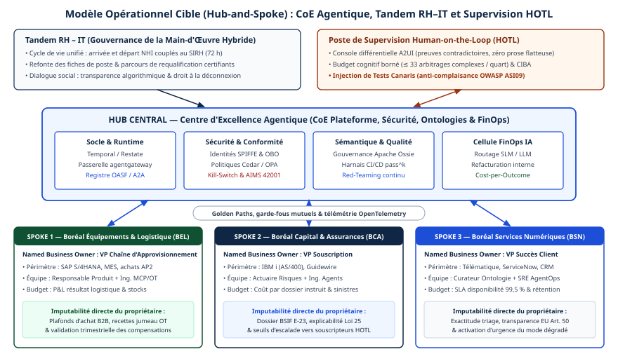

# Chapitre 41 — Modèle opérationnel

*Question directrice : comment s'organise une entreprise où des agents travaillent ?*

> **État de référence :** articles de McKinsey du 26 septembre 2025 et du 5 octobre 2026, enquête State of AI du 25 août 2026, six travaux de recherche parus de 2022 à 2026. Les numéros entre crochets renvoient aux sources en fin de chapitre : [1] à [10] ont été lues, les articles savants par leur résumé sauf [6]; [11] est secondaire; [12] a été ajoutée le 14 novembre 2026.

Les chapitres précédents traitent l'agent comme un objet technique. Or un agent en production a un propriétaire, des approbateurs et des collègues qui reçoivent ses sorties, relations qu'aucun protocole ne décrit.

Deux littératures en parlent, sans dire la même chose. Les cabinets de conseil décrivent une organisation aplatie, faite de petites équipes qui supervisent des dizaines d'agents. La recherche évaluée par les pairs montre qu'une équipe humain-IA ne fait pas mieux, en moyenne, que le meilleur des deux pris seul, et que les humains délèguent mal.

Thèse de ce chapitre : la ressource rare d'une organisation agentique est la capacité humaine de supervision et de jugement, pas le nombre d'agents. Le modèle opérationnel doit donc répartir le travail par conception, traiter la supervision comme un rôle et protéger les parcours qui forment le jugement.

---

## 41.1 L'organisation agentique : petites équipes orientées résultats

### Le modèle proposé

McKinsey nomme « organisation agentique » un paradigme où humains et agents travaillent côte à côte à grande échelle, et le décline en cinq piliers : modèle d'affaires, modèle opérationnel, gouvernance, main-d'œuvre et culture, technologie et données [1]. Le pilier opérationnel repose sur trois idées.

**Des flux conçus d'abord pour l'IA.** Le processus est repensé de bout en bout, et les humains y sont réintroduits de façon sélective : au-dessus de la boucle pour orienter, dans la boucle là où le contact humain compte [1].

**L'équipe agentique.** Un petit groupe multidisciplinaire possède et supervise les flux d'agents qui livrent un résultat d'affaires complet, par exemple l'accueil d'un client ou la clôture des comptes [1].

**Un réseau plutôt qu'une hiérarchie.** L'organigramme céderait la place à un réseau d'équipes qui s'échangent des tâches et des résultats, avec des structures de décision plates et un fort partage de contexte [1].

L'article de 2026 précise l'outil. La « carte d'orchestration » (*orchestration chart*) indique quels humains et quels agents se réunissent autour d'un résultat, ce que fait chacun, quels transferts subsistent et où l'imputabilité demeure [2]. Autonomie, accès, supervision et escalade deviennent des éléments de la conception du travail.

### Ce qui appuie le modèle

L'article de 2025 se présente lui-même comme un relevé de signaux précoces.

| Affirmation | Fondement déclaré | Portée |
|---|---|---|
| Deux à cinq personnes supervisent de 50 à 100 agents spécialisés [1] | Expérience des auteurs auprès de clients | Anecdote; aucune mesure publiée |
| Les organisations les plus avancées s'organisent davantage en équipes transversales de bout en bout [2] | Enquête auprès de plus de 700 dirigeants | Association; méthode non publiée |
| Près des trois quarts des organisations les plus performantes ont refondu leurs flux, contre un quart des autres [3] | Enquête mondiale annuelle | Déclaratif; association |

Deux nuances viennent des auteurs eux-mêmes. Il n'existe pas de structure gagnante unique : le point commun des organisations avancées est d'organiser le travail de bout en bout et de réduire les transferts [2]. Et aplatir ne crée de valeur que si la coordination supprimée est remplacée par une meilleure information, des droits de décision plus clairs et un jugement humain plus solide [2]. L'enjeu est réel : chez les clients du cabinet, les rôles de coordination ont crû de 1,5 à 2 fois plus vite que les rôles opérationnels en cinq ans [2].

### L'écart avec la pratique

L'organisation agentique est une direction, pas un état constaté. Selon l'enquête de 2026, 40 % des répondants d'organisations d'au moins un milliard de dollars de revenus disent mettre des agents à l'échelle dans au moins une fonction, et huit répondants sur dix déclarent un gain de productivité personnelle [3]. Mais 37 % seulement font état d'un effet positif sur le résultat d'exploitation [3], et 11 % des organisations auraient atteint le stade où le travail lui-même est repensé [2]. L'étude MAP montre des agents à courte portée : 68 % exécutent moins de dix étapes avant une intervention humaine [11] (chapitre 4).

Pour McKinsey, l'organisation existante devient la contrainte [2]. Le diagnostic est plausible, mais il vient d'un cabinet qui vend cette transformation.

---

## 41.2 Complémentarité humain-agent : ce que dit la recherche

### Une définition exigeante

La complémentarité désigne les conditions dans lesquelles une équipe humain-IA fait mieux que les humains seuls et mieux que l'IA seule. Un cadre publié en 2026 dans PNAS Nexus la fonde sur l'intelligence collective et sur trois processus cognitifs : raisonnement, mémoire, attention [5]. Il recense cinq facteurs sociotechniques, dont le calibrage de la confiance et la structure de la tâche, et cinq principes de conception : définir les buts et les contraintes, répartir les rôles, orchestrer l'attention et l'interrogation, bâtir des infrastructures de connaissance, former et évaluer en continu [5].

Montrer qu'un employé assisté fait mieux que sans aide ne démontre pas la complémentarité : il faut aussi battre l'agent seul.

### Ce que mesure la méta-analyse

Vaccaro, Almaatouq et Malone ont agrégé 106 expériences et 370 tailles d'effet, tirées d'études parues de janvier 2020 à juin 2023 [6].

| Comparaison | Taille d'effet (g de Hedges) | Lecture |
|---|---|---|
| Combinaison contre humain seul | 0,64 | L'IA améliore nettement l'humain |
| Combinaison contre le meilleur des deux | −0,23 | En moyenne, la combinaison fait moins bien |
| Idem, tâches de décision | −0,27 | Perte |
| Idem, tâches de création | 0,19 (non significatif) | Gain possible, non établi |
| Idem, quand l'humain seul surpasse l'IA | 0,46 | Gain |
| Idem, quand l'IA seule surpasse l'humain | −0,54 | Perte |

L'ajout d'explications ou d'un indice de confiance de l'IA ne modifie pas significativement ces résultats [6]. Les auteurs recommandent d'attribuer chaque sous-tâche au partenaire qui y excelle, plutôt que de laisser à l'humain la décision finale sur la tâche entière [6].

### Ce que montre l'expérience de terrain

Une expérience préenregistrée chez Procter & Gamble a réparti au hasard 776 professionnels sur de vrais problèmes d'innovation : seuls ou à deux, avec ou sans IA générative [7]. Les personnes seules munies de l'IA ont égalé les équipes qui n'en avaient pas. Avec l'IA, les propositions devenaient équilibrées entre technique et commercial, quelle que soit la spécialité de leur auteur [7]. Le résultat appuie l'idée d'équipes plus petites, mais pour des tâches de création et avec un assistant, non un agent autonome.

### Ce qu'il faut en tirer

Une revue systématique du Journal of Organizational Behavior situe les facteurs qui façonnent la relation entre humains et IA à trois niveaux : individu, groupe, organisation [8]. Agir sur un seul niveau, par exemple former les individus, ne suffit donc pas.

1. **« Un humain plus un agent » n'est pas une garantie.** Quand l'agent est meilleur que l'humain sur une tâche de décision, l'ajout d'un humain décideur tend à dégrader le résultat [6].
2. **La répartition se fait par avantage relatif, tâche par tâche.** Elle suppose de mesurer séparément l'humain seul, l'agent seul et la combinaison, ce que peu d'organisations font.
3. **La supervision se justifie par l'imputabilité, non par la performance.** Un point d'approbation existe parce qu'une personne doit répondre d'une action irréversible (chapitres 22 et 39). Il ne faut pas en attendre une meilleure décision moyenne.

Réserve : ces travaux portent sur des aides à la décision et des assistants, pas sur des agents qui agissent par des outils.

---

## 41.3 Déléguer : conception du travail et confiance

### Les humains délèguent mal

Une expérience publiée dans Information Systems Research compare deux sens de délégation sur une tâche de classification [9]. Quand l'IA délègue une partie des cas aux humains, l'équipe dépasse l'IA seule, même si les humains sollicités sont peu performants. Quand ce sont les humains qui délèguent à l'IA, aucun gain n'apparaît.

L'explication des auteurs écarte l'aversion pour les algorithmes : les participants appréciaient l'aide et suivaient une stratégie cohérente. Ce qui leur manquait est la métaconnaissance, c'est-à-dire la capacité d'évaluer ce qu'ils savent et ne savent pas. Les auteurs la décrivent comme un trait inconscient [9], donc peu sensible à une simple consigne.

Un modèle opérationnel qui laisse chaque employé décider quoi confier à l'agent repose sur la faculté humaine la moins fiable de l'expérience.

### Concevoir plutôt que laisser choisir

- **La règle remplace le choix individuel.** Ce que l'agent traite seul, ce qu'il propose et ce qui lui est interdit se fixe par classe de décision (chapitre 22) et s'inscrit dans la carte d'orchestration [2].
- **L'escalade part de l'agent.** Le sens de délégation qui fonctionne est celui où le système renvoie des cas à l'humain [9], sur des critères définis d'avance.
- **L'humain reçoit une rétroaction sur son propre jugement.** Sans mesure de ses erreurs, il ne peut pas calibrer ce qu'il confie. Cette déduction est propre à ce chapitre.
- **La charge cognitive se règle.** Trop peu d'engagement mène à une dépendance excessive envers l'IA; trop de responsabilités ajoutées, à la surcharge [2].

### La confiance, côté équipe

Une expérience en laboratoire du Journal of Management Information Systems a fait varier la nature d'un coéquipier (humain ou IA) et sa performance [10]. Les coéquipiers IA ont été jugés plus compétents et plus intègres que les humains, mais moins bienveillants. Les écarts se compensent : ni la confiance globale ni la volonté de travailler avec l'IA ne diffèrent. La satisfaction à l'égard du processus de travail, elle, est plus faible avec un coéquipier IA [10].

Le risque dominant n'est donc pas le rejet, mais double : une confiance mal calibrée, visible dans la fatigue d'approbation (chapitre 22), et une expérience de travail appauvrie. Quand le système rédige le premier jet, l'humain se sent moins producteur que réviseur du travail d'un autre [2].

### La confiance, côté organisation

Selon McKinsey, 70 % des répondants se disent personnellement prêts pour l'IA, alors que 27 % des dirigeants jugent leur organisation prête [2]. La confiance des employés dans le soutien de l'organisation est associée à la valeur créée, à chaque stade de maturité [2]; l'article ne publie pas la méthode de l'enquête.

---

## 41.4 Rôles de supervision

### Trois profils, selon McKinsey

L'article de 2025 annonce trois profils [1] :

- des **superviseurs en M**, généralistes à l'aise avec l'IA, qui orchestrent agents et humains à travers plusieurs domaines;
- des **experts en T**, spécialistes qui repensent les flux, traitent les exceptions et garantissent la qualité;
- des **employés de première ligne augmentés**, qui passent moins de temps dans les systèmes et plus avec les personnes.

Ces profils de compétences ne disent pas qui répond de quoi.

### Les rôles à attribuer

Le tableau rassemble les responsabilités réparties par les chapitres de gouvernance et d'exploitation; l'assemblage est une proposition de ce chapitre.

| Rôle | Répond de | Renvoi |
|---|---|---|
| Propriétaire de l'agent | Finalité, limites d'autorité, poursuite ou retrait | Chapitre 39 |
| Responsable d'équipe agentique | Résultat d'affaires de bout en bout; répartition du travail entre humains et agents | [1][2] |
| Expert de domaine | Exceptions, cas limites, qualité | [1] |
| Approbateur | Actions irréversibles ou à fort enjeu, cas par cas | Chapitre 22 |
| Équipe de plateforme | Déploiement, traces, mécanisme d'arrêt, modèle de secours | Chapitres 34 et 46 |
| Vérification indépendante | Contrôles de résultat, audit d'échantillon | Chapitres 33 et 34 |

Une même personne peut tenir deux rôles dans une petite équipe, sauf ceux de propriétaire et de vérificateur du même agent; le chapitre 47 applique la même séparation à l'agent qui produit du code.

### La capacité de supervision borne l'échelle

Selon l'article de 2025, l'adoption sera plafonnée par la capacité de supervision que les humains peuvent fournir, ce qui fait de la gouvernance un goulot possible [1]. La supervision changerait donc de nature : plutôt que de réviser ligne à ligne, les responsables définiraient des politiques, surveilleraient les cas atypiques et régleraient le degré d'intervention humaine [1].

La pratique varie. En mars 2025, avant la vague des agents, 27 % des répondants disaient que des employés révisaient tout le contenu produit par l'IA générative avant usage; une part comparable disait qu'au plus 20 % de ce contenu était vérifié [4].

Aucune source lue ne fournit de norme pour le nombre d'agents qu'une personne peut superviser. La charge réelle dépend du taux d'exceptions, de la réversibilité des actions et de la qualité des demandes d'approbation, toutes mesurables (chapitres 22 et 34).

### Les agents de contrôle

McKinsey propose d'intégrer aux flux des agents critiques, des agents garde-fous et des agents de conformité [1]. Ils raccourcissent la file d'attente humaine sans déplacer l'imputabilité, qui reste humaine dans l'article même, et leur fiabilité s'établit comme celle de tout agent; un juge automatique s'étalonne contre des étiquettes humaines (chapitre 33).

---

## 41.5 Compétences

### Ce qui prend de la valeur

Trois compétences sont dites en demande croissante : la résolution de problèmes de bout en bout, la conception de systèmes et la reconnaissance des cas limites où les agents échouent [1]. Des employés sans formation technique apprendraient à gérer des flux agentiques aussi vite que des ingénieurs [1]; l'affirmation repose sur des observations précoces, non sur une étude.

La recherche suggère une quatrième compétence, la métaconnaissance [9] : savoir ce qu'on sait conditionne la délégation.

### Le problème de la relève

L'expertise se construit en faisant le travail d'entrée : l'analyste apprend en analysant. Si les agents absorbent ce travail, le gain de productivité d'aujourd'hui peut devenir un déficit de jugement demain [2]. Or le jugement est précisément ce que les rôles de supervision exigent.

Le modèle opérationnel doit donc prévoir comment se forme un superviseur qui n'a jamais exécuté la tâche supervisée. McKinsey avance trois réponses : la pratique délibérée et la rétroaction à la place du travail d'entrée disparu, des gestionnaires qui coordonnent moins et font davantage exercer un jugement à conséquences croissantes, et des cheminements qui récompensent la maîtrise d'un métier et l'orchestration d'agents plutôt que la taille de l'équipe dirigée [2].

### Former par rôle

L'article de 2026 décrit une institution financière passée d'une formation générale à un apprentissage par rôle, avec accompagnement entre pairs, développement propre aux gestionnaires et démonstrations répétées en situation réelle [2]. Du côté réglementaire, l'obligation européenne de maîtrise de l'IA a été allégée par le Digital Omnibus (chapitre 35), tandis que la ligne directrice E-23 du BSIF demande à la haute direction de veiller aux compétences (chapitre 39).

### Emploi et perte de pratique

Deux effets sur les personnes débordent la question des compétences à acquérir. Le premier est l'emploi : la section 41.6 rapporte ce que les répondants d'une enquête déclarent des effectifs [3]; les essais relevés à la section 48.8 mesurent la productivité d'assistants, non l'emploi ni les agents. Le second est la perte de pratique. Selon un article de position, un superviseur qui ne fait plus la tâche perd peu à peu la capacité de juger le travail de l'agent, et la révision de routine tourne à l'approbation machinale [12] (section 22.5); l'effet n'est pas mesuré chez des superviseurs d'agents.

Un article de position propose contre cet effet des mesures qui relèvent du modèle opérationnel : des exercices du métier sans IA, une alternance entre travail assisté et travail non assisté, du temps de révision prévu à l'horaire, et l'abandon des objectifs de productivité qui découragent l'examen [12]. Leur efficacité n'a pas été mesurée.

---

## 41.6 Conduite du changement

### L'adoption sans transformation

Le constat de 2026 est paradoxal : les employés utilisent l'IA chaque jour, et les flux de travail, les droits de décision, les incitatifs et les pratiques de gestion restent intacts [2]. En 2025 déjà, la refonte des flux était, parmi 25 attributs testés, celui qui pesait le plus sur l'effet déclaré de l'IA générative sur le résultat d'exploitation; 21 % des organisations utilisatrices disaient avoir refondu au moins certains flux [4]. Le modèle statistique n'explique toutefois qu'une faible part de la variance (R² de 0,20) et repose sur des déclarations [4].

Le taux d'utilisation est donc un mauvais indicateur de changement. Les marqueurs utiles portent sur la structure : transferts supprimés, composition des équipes modifiée, gestion du rendement révisée [2].

### Dire où va le gain

Les attentes sur l'emploi dépassent les faits. En 2026, 14 % des répondants d'organisations utilisatrices disent que l'IA a contribué à une baisse des effectifs dans l'année, alors que 32 % l'anticipaient un an plus tôt; 39 % prévoient une baisse pour l'année suivante [3].

McKinsey recommande de rendre explicite l'usage de la capacité libérée : plus de production, un travail différent, une charge plus soutenable, un coût moindre, ou une combinaison [2]. Une société des sciences de la vie fixe ainsi des principes avant les cas particuliers : l'IA appuie le travail sans remplacer l'expertise ni la supervision humaines, et l'employé demeure imputable du travail assisté [2].

### Les leviers

- **Un mandat doté d'autorité.** La transformation traverse affaires, technologie, talents et risque; il faut un dirigeant capable de déplacer budgets et talents rares et de trancher [2].
- **L'exemple de la direction.** D'après un résumé de l'enquête, les organisations les plus performantes déclarent deux fois plus souvent un engagement démontré de leurs dirigeants et des processus définis de mesure de l'effet [3].
- **Un domaine vitrine.** Repenser un ou deux domaines de bout en bout pour apprendre en situation, plutôt que multiplier les pilotes [1].
- **L'apprentissage dans le travail.** Champions internes, démonstrations hebdomadaires, cercles de pairs [2].

---

## 41.7 Centre d'excellence ou modèle fédéré

### Ce que font les organisations

La seule donnée lue sur la structure date de mars 2025 et vise l'IA générative, non les agents [4]. Elle décrit une centralisation sélective :

- le risque, la conformité et la gouvernance des données suivent souvent un modèle entièrement centralisé, de type centre d'excellence;
- les talents techniques et l'adoption des solutions suivent le plus souvent un modèle hybride, mi-central, mi-réparti;
- les organisations de moins de 500 millions de dollars de revenus centralisent plus volontiers aussi ces deux éléments.

### Ce que propose McKinsey

L'article de 2025 range la montée en puissance d'un centre d'excellence en IA parmi les premiers gestes [1]. Celui de 2026 décrit une capacité d'exécution, l'« usine de missions agentiques » : elle prend un résultat d'affaires, refond le travail en flux hybride, construit agents et contrôles, puis laisse des actifs réutilisables [2]. Le responsable d'affaires y apporte le résultat visé, les contraintes et l'imputabilité; les fonctions de risque, de conformité, juridique et de ressources humaines y siègent dès le départ, et la propriété du produit est attribuée au lancement, non après le pilote [2].

### Une répartition par fonction

La question « centre ou fédération » est mal posée : la réponse diffère selon la fonction. Le tableau, synthèse propre à ce chapitre, s'appuie sur [2], [4] et les chapitres cités.

| Fonction | Placement | Raison |
|---|---|---|
| Politiques, classes de décision, appétit pour le risque | Central | Une règle par organisation (chapitre 39) |
| Identité, registre, passerelle, observabilité, routage d'inférence, arrêt d'urgence | Central, en plateforme | Contrôle uniforme; réutilisation (chapitres 23, 24, 29, 33, 34, 44) |
| Évaluation et vérification indépendante | Central ou partagé | Indépendance à l'égard du propriétaire |
| Refonte des flux de travail | Fédéré, appuyé par une équipe centrale | Exige la connaissance du domaine |
| Propriété et supervision des agents | Fédéré | L'imputabilité suit le résultat d'affaires |

Deux modes de défaillance encadrent le choix. Un centre qui examine tout devient un goulot (chapitre 39). Une fédération sans plateforme ni règles communes produit une prolifération d'agents sans contexte ni pilotage, que McKinsey tient pour une recette de chaos [1]. La feuille de route du chapitre 43 fixe l'ordre : la plateforme commune avant le deuxième agent.

---

## Grille de décision

| Décision | Option par défaut | Quand s'en écarter |
|---|---|---|
| Unité d'organisation | Petite équipe responsable d'un résultat de bout en bout, avec un propriétaire nommé par agent | Séparation des tâches imposée par la réglementation : conserver la frontière fonctionnelle |
| Répartition du travail | Par avantage relatif, tâche par tâche, consignée dans une carte d'orchestration | Tâche sans mesure comparative : humain décideur, puis mesurer |
| Qui décide de déléguer | La conception du travail, par classe de décision; l'escalade part de l'agent | Création ou exploration à faible enjeu : discrétion individuelle |
| Point d'approbation | Justifié par l'imputabilité et l'irréversibilité | Jamais pour « améliorer » une décision où l'agent est meilleur |
| Dimensionnement de la supervision | Selon la charge mesurée d'exceptions et d'approbations | Aucun ratio publié d'agents par personne n'est à reprendre |
| Formation | Par rôle, en situation, avec rétroaction sur le jugement | Sensibilisation générale : comme socle seulement |
| Relève | Pratique délibérée là où l'agent absorbe le travail d'entrée | Métiers dont le travail d'entrée n'est pas automatisé |
| Structure de pilotage | Central pour les règles et la plateforme, fédéré pour la refonte et la propriété | Petite organisation ou démarrage : tout centraliser |
| Mesure du changement | Flux refondus et résultats | Le taux d'utilisation ne renseigne que sur l'adoption |

---

## Points à retenir

- L'organisation agentique de McKinsey, faite de petites équipes orientées résultats qui supervisent des flux d'agents, s'appuie sur des cas de clients et des enquêtes déclaratives. C'est une direction, pas un état constaté.
- En moyenne, une combinaison humain-IA fait mieux que l'humain seul, mais moins bien que le meilleur des deux. Le gain apparaît quand l'humain est le plus fort sur la tâche.
- La supervision humaine se justifie par l'imputabilité, non par une meilleure décision moyenne.
- Les humains délèguent mal, faute de savoir évaluer ce qu'ils savent. La délégation se fixe par conception, et l'escalade part de l'agent.
- L'obstacle n'est pas le rejet des agents, mais une confiance mal calibrée et une satisfaction moindre à l'égard du processus de travail.
- La capacité de supervision borne la mise à l'échelle. Aucun ratio d'agents par superviseur n'est établi.
- Si les agents absorbent le travail d'entrée, la relève des superviseurs doit être organisée délibérément.
- Le changement se mesure à la refonte des flux, des rôles et des incitatifs, pas au taux d'utilisation.
- Centre d'excellence ou fédération : le choix se fait fonction par fonction, règles et plateforme au centre, refonte et propriété des agents dans les domaines.
- Un article de position soutient que la supervision s'use si le superviseur ne pratique plus le métier; l'effet n'est pas mesuré. L'alternance entre travail assisté et travail non assisté est proposée, sans mesure d'efficacité.

---

## Sources

Pages primaires lues le 11 novembre 2026 :

1. [McKinsey — The agentic organization: Contours of the next paradigm for the AI era (26 septembre 2025)](https://www.mckinsey.com/capabilities/people-and-organization/our-insights/the-agentic-organization-contours-of-the-next-paradigm-for-the-ai-era)
2. [McKinsey — AI is changing work; now it has to change the organization (5 octobre 2026)](https://www.mckinsey.com/capabilities/people-and-organization/our-insights/ai-is-changing-work-now-it-has-to-change-the-organization)
3. [McKinsey — The state of AI in 2026: On the road to ROI (25 août 2026)](https://www.mckinsey.com/capabilities/quantumblack/our-insights/the-state-of-ai) — lecture partielle.
4. [McKinsey — The State of AI: How organizations are rewiring to capture value (12 mars 2025)](https://www.mckinsey.com/capabilities/quantumblack/our-insights/the-state-of-ai-how-organizations-are-rewiring-to-capture-value) — lecture partielle.
5. [Gonzalez et coll. — Toward a science of human–AI teaming for decision making, PNAS Nexus 5(3), 2026](https://par.nsf.gov/biblio/10696564-toward-science-humanai-teaming-decision-making-complementarity-framework) — notice et résumé.
6. [Vaccaro, Almaatouq et Malone — When combinations of humans and AI are useful (arXiv 2405.06087; Nature Human Behaviour, 2024)](https://arxiv.org/abs/2405.06087) — texte de la prépublication.
7. [Dell'Acqua et coll. — The Cybernetic Teammate (NBER, document de travail 33641, avril 2025)](https://www.nber.org/papers/w33641) — résumé.
8. [Bankins et coll. — A multilevel review of artificial intelligence in organizations, Journal of Organizational Behavior 45(2), 2024](https://merit.url.edu/en/publications/a-multilevel-review-of-artificial-intelligence-in-organizations-i/) — notice et résumé.
9. [Fügener et coll. — Cognitive Challenges in Human–Artificial Intelligence Collaboration, Information Systems Research 33(2), 2022](https://ideas.repec.org/a/inm/orisre/v33y2022i2p678-696.html) — notice et résumé.
10. [Dennis, Lakhiwal et Sachdeva — AI Agents as Team Members, Journal of Management Information Systems 40(2), 2023](https://jmis-web.org/articles/1614) — notice et résumé.

Source secondaire :

11. [Measuring Agents in Production (étude MAP, arXiv 2512.04123)](https://arxiv.org/abs/2512.04123) — repris du chapitre 4, non relu ici.

Source ajoutée le 14 novembre 2026 :

12. [Mitchell, Ghosh et Passi — AI Agents Push Humans Out of the Loop (arXiv 2608.23642, version 3 du 6 septembre 2026)](https://arxiv.org/html/2608.23642) — article de position, lu le 14 novembre 2026 pour le chapitre 22; premiers cinq sixièmes du texte.

## Limites de ce chapitre

- Le rapport State of Organizations 2026 de McKinsey, cité par le plan initial, n'a pas été lu. L'article [2] le remplace; la méthode des enquêtes qu'il cite n'y est pas publiée.
- Les enquêtes [3] et [4] ont été lues partiellement, sans leurs figures. À l'audit, les pages de McKinsey n'ont pas répondu; des résumés de recherche web confirment le titre et la date de [3], ses parts de 40 %, 37 %, 14 %, 32 % et 39 % et l'écart de refonte des flux. L'engagement des dirigeants « deux fois plus souvent » n'y figure que dans un résumé secondaire.
- Les chiffres de [2] n'ont pas pu être relus à l'audit; un résumé attribue les 11 % à une autre page de McKinsey.
- Les travaux [5], [7], [8], [9] et [10] ne sont connus que par leur résumé. L'article [7] aurait depuis paru dans Organization Science avec un échantillon légèrement différent (résumé de recherche non vérifié).
- La recherche citée en 41.2 et 41.3 précède les agents à base de modèle de langage ou porte sur des assistants. Sa transposition aux agents autonomes est une hypothèse de ce chapitre.
- Aucune étude évaluée par les pairs n'a été trouvée sur le nombre d'agents qu'une personne peut superviser, ni sur l'efficacité comparée d'un centre d'excellence et d'un modèle fédéré.
- Le lien entre travail d'entrée et formation de l'expertise (41.5) relève de la connaissance générale et de l'argument de [2], non d'une mesure.
- La sous-section « Emploi et perte de pratique » (41.5) date du 14 novembre 2026. Elle n'apporte aucune mesure nouvelle sur l'emploi : elle renvoie à la section 41.6 pour les effectifs déclarés et à la section 48.8 pour la productivité des assistants, et repose, pour la perte de pratique, sur un article de position [12].
- Les tableaux de 41.4 et de 41.7 sont des synthèses de ce chapitre.

## Mise en œuvre — Modèle opérationnel cible, facteur humain (HOTL) et prospective 2028–2030 {.volet}

:::: {.encadre .executive}
::: {.encadre-titre}
**Synthèse exécutive**
:::

- **Enjeu stratégique** : superposer un maillage technique transversal (MCP, A2A, moteurs durables) à une organisation restée en silos produit soit un goulot centralisé, soit des agents orphelins dont plus personne ne maîtrise ni les coûts ni la dérive métier. Par ailleurs, lorsque la fiabilité autonome approche les 90 %, la complaisance cognitive des superviseurs (OWASP ASI09) réduit la validation humaine à une formalité si le poste de travail n’est pas instrumenté.
- **Décisions organisationnelles et architecturales structurantes** :
  1.  *Irréversible culturellement* : déployer un modèle opérationnel Hub-and-Spoke, qui articule un centre d’excellence agentique resserré (plateforme, sécurité, ontologies, FinOps) et des cellules métiers fédérées où chaque boucle active relève d’un propriétaire métier nominatif (*Named Business Owner*) et d’une gouvernance conjointe RH–IT.
  2.  *Structurante dès la mise en service* : fonder la supervision *Human-on-the-Loop* (HOTL) sur des vues différentielles sans prose persuasive, un plafond d’arbitrages par quart et des tests canaris continus d’attention humaine.
  3.  *Préparatoire sans regret (2028–2030)* : fonder les investissements de 2027 sur l’agilité cryptographique, des politiques formelles hors prompts et des moniteurs déterministes, pour accueillir plus tard les marchés B2B liquides, l’auto-conception vérifiée et la *Physical AI* sans refonte du socle.
- **Indicateurs de gouvernance** : agents actifs dotés d’un propriétaire métier nominatif valide dans le SIRH (100 %), taux d’interception des tests canaris HOTL ($\ge 92\,\%$), taux de requalification interne des coordonnateurs touchés, ratio de création de valeur nette sur *Cost-per-Outcome*.
::::

## 41.8 Organisation Hub-and-Spoke : centre d’excellence agentique, propriétaires métiers nommés et tandem RH-IT

Les deux défaillances de la section 41.7 se reconnaissent à des symptômes précis. Dans un laboratoire central éloigné des opérations d’usine, de souscription ou de logistique, la file d’attente dépasse neuf mois en deux trimestres, l’équipe maîtrise mal les cas limites de SAP ou Guidewire et les directions métiers contournent le blocage en achetant clandestinement des agents SaaS non gouvernés. Dans la décentralisation sans socle partagé d’identité, d’ontologie ni de FinOps, cinq départements recodent cinq connecteurs incompatibles vers le même référentiel client et, lors d’un incident critique, l’auteur initial du prompt a changé de poste depuis des mois sans successeur désigné.

### Centre d’excellence et cellules métiers

Le modèle fédéré de la section 41.7 prend ici la forme Hub-and-Spoke : l’infrastructure, la sécurité et la sémantique commune sont centralisées; la logique de domaine, le budget d’usage et la supervision opérationnelle restent au plus près des lignes d’affaires.



1.  **Le *Hub*, centre d’excellence agentique** : une équipe de douze à vingt-cinq spécialistes (pour un groupe de 10 000 à 20 000 personnes), qui ne code pas la logique métier des divisions. Elle livre des chemins pavés : exploitation du moteur d’exécution durable (Temporal / Restate), administration d’agentgateway et du registre OASF/AIMS, gouvernance ontologique (Apache Ossie), harnais d’évaluation CI/CD $\text{pass}^k$, politiques globales Cedar/OPA et pilotage FinOps IA (capacités GPU/API, routage SLM/LLM, refacturation interne au *Cost-per-Outcome*).
2.  **Les *Spokes*, cellules métiers fédérées** : installée dans chaque division, la cellule réunit experts métiers, ingénieurs d’intégration MCP/orchestration, curateur d’ontologie locale et superviseurs HOTL. Avec les gabarits certifiés du *Hub*, elle livre un agent spécialiste homologué en quelques semaines. Sur le plan économique, la relation entre le *Hub* et les *Spokes* passe en six mois d’une simple visibilité des coûts (*Showback*) à une refacturation analytique directe (*Chargeback*) : le *Hub* absorbe le coût fixe du socle mutualisé, tandis que chaque *Spoke* paie mensuellement ses exécutions réelles au *Cost-per-Outcome*, ce qui incite les métiers à préférer les SLM spécialisés à des appels inutiles à des modèles frontières coûteux.

### Propriétaire métier nominatif et tandem RH–IT

Le rôle de propriétaire de l’agent (section 41.4) se précise ainsi, pour éviter les « agents zombies » : aucune identité NHI d’agent de niveau L2, L3 ou L4 ne reste active sans rattachement à un propriétaire métier nominatif (*Named Business Owner*) en exercice. Ce cadre métier, et non l’administrateur technique, porte quatre responsabilités : le budget d’exécution sur son compte de résultat (P&L), la cosignature des seuils d’escalade HOTL, la revue trimestrielle d’exactitude métier et l’obligation d’actionner l’arrêt d’urgence dès qu’une règle commerciale devient caduque.

Le tandem RH–IT synchronise quatre processus autrefois séparés :

- **Couplage direct SIRH – registre d’agents** : lorsqu’un propriétaire métier nominatif quitte son poste ou change de rôle dans Workday, un webhook ouvre un délai de soixante-douze heures pour transférer la tutelle à son successeur; sans signature, le plan de contrôle rétrograde automatiquement ses agents de L3 vers L2 (validation humaine systématique) et gèle leurs signatures externes.
- **Conception conjointe des postes hybrides** : avant d’automatiser les tâches répétitives d’une équipe, le tandem redessine le rôle humain cible, pour enrichir le travail analytique et éviter un poste résiduel fragmenté.
- **Arbitrage capacitaire unifié** : les comités budgétaires comparent sur une grille commune le recrutement humain, l’impartition et le budget d’inférence agentique, rapportés au résultat métier.
- **Certification de littératie IA** : aucun superviseur HOTL ne reçoit ses droits d’approbation CIBA sans validation pratique d’un parcours sur les biais d’automatisation et la lecture critique de preuves. Cette règle va au-delà de ce que retient l’exposé : l’obligation européenne de maîtrise de l’IA (article 4 de l’EU AI Act) a été allégée par le Digital Omnibus (section 41.5, chapitre 35).

| Activité du cycle de vie agentique | Hub — centre d’excellence (plateforme) | CISO, Juridique & Risques | Cellule FinOps IA | Direction RH | Propriétaire métier nominatif | Ingénierie de la cellule |
|:--------------------|:--------------|:---------------|:------------|:----------|:--------------|:------------|
| **Socle (agentgateway, moteur d’exécution durable)** | **R / A** | C | C | I | I | C |
| **Ontologie Ossie & contrats A2A** | **A** | I | I | I | C | **R** |
| **Spécialiste métier & serveurs MCP** | C | C | I | I | **A** | **R** |
| **Qualification Footprint & dossier E-23** | C | **A** | I | I | C | **R** |
| **Plafonds financiers & seuils HOTL** | I | C | C | C | **A / R** | C |
| **Quotas jetons & suivi *Cost-per-Outcome*** | C | I | **R** | I | **A** | C |
| **Postes hybrides, requalification & social** | I | C | I | **A / R** | **R** | I |
| **Arrêt d’urgence** | **R** | **A / R** | C | I | **A / R** | C |

*(Légende RACI : R = Réalisateur, A = Approbateur imputable, C = Consulté, I = Informé.)*

#### Extrait 41.1 — Charte d’investiture exécutable d’un *Named Business Owner* (ownership-charter.yaml)

Synchronisée chaque jour avec le SIRH, la charte relie la flotte active à son dirigeant métier imputable :

``` yaml
apiVersion: governance.boreal.ca/v2027.1
kind: NamedBusinessOwnerCharter
metadata:
  charterId: "OWN-BEL-2027-008"
  effectiveDate: "2027-04-01"
  reviewCadenceDays: 90
subjectAgentFleet:
  sagaOrAgentIds: ["boreal-bel-spot-procurement", "boreal-bel-sap-inventory"]
  autonomyGranted: "L3"
accountableExecutive:
  employeeWorkdayId: "EMP-CA-004192"
  fullName: "Marc-Antoine Lavoie"
  roleTitle: "VP Chaîne d'Approvisionnement (BEL)"
  costCenterCode: "CC-4100-LOG-MFG"
  backupDelegateWorkdayId: "EMP-CA-006811"
operationalMandateAndCaps:
  monthlyInferenceAndInfraCapCad: 18500
  maxSingleTransactionCommitmentCad: 15000
  mandatoryBusinessKpis:
    minOrderAccuracyRate: 0.992
    minHotlCanaryCatchRate: 0.92
orphanedAgentPolicy:
  hrStatusTrigger: ["TERMINATED", "LEAVE_EXTENDED", "ROLE_CHANGED"]
  gracePeriodHours: 72
  automaticFallbackAction: "DOWNGRADE_TO_L2_HITL_AND_FREEZE_AP2_SIGNING"
```

------------------------------------------------------------------------

## 41.9 Ergonomie cognitive du Human-on-the-Loop (HOTL) et complaisance d’automatisation (ASI09)

L’escalade vers un opérateur humain en mode *Human-on-the-Loop* (HOTL) est le dernier recours pour les cas ambigus et les exigences légales (EU AI Act art. 14, Loi 25 art. 12.1, BSIF E-23). Or le référentiel OWASP Top 10 for Agentic Applications (ASI09, *Human-Agent Trust Exploitation*) relève un paradoxe, confirmé par l’ergonomie aéronautique : plus l’automatisation est fiable au quotidien, plus la vigilance réelle du superviseur se dégrade vite. Cette dégradation est la fatigue d’approbation évoquée à la section 41.3. Selon l’exposé, un point d’approbation se justifie par l’imputabilité, non par la performance (section 41.2) : l’effectivité visée ci-dessous est celle d’un examen réellement exercé, non d’une meilleure décision moyenne.

### Pourquoi la supervision classique échoue

Deux facteurs cognitifs affaiblissent l’approbateur :

1.  **Chute de vigilance sur signaux rares (*Mackworth Decrement*)** : devant un flux dont 95 % des propositions pré-instruites sont justes, l’approbateur cesse vite d’inspecter les pièces justificatives; le temps médian d’examen tombe sous cinq secondes, c’est l’approbation réflexe.
2.  **Biais de fluidité persuasive** : même lorsqu’il hallucine ou subit une injection adverse, un LLM rédige sa recommandation dans un style posé, structuré et convaincant, qui affaiblit l’esprit critique.

### Quatre règles de conception du poste HOTL

La console A2UI et le routeur d’escalade appliquent quatre règles, pour que le filet humain soit effectif et opposable aux régulateurs :

- **Règle 1 — Vue différentielle contradictoire** : aucun paragraphe élogieux rédigé par l’agent demandeur. L’écran présente côte à côte les valeurs brutes des systèmes sources, la règle exacte qui a motivé l’escalade, une contre-hypothèse critique (avocat du diable) produite par un agent indépendant et l’impact irréversible chiffré.
- **Règle 2 — Fonction de forçage cognitif** : sur les dossiers matériels, la saisie active d’un paramètre vérifié dans la pièce source (franchise retenue, code d’exclusion) remplace le bouton unique « Approuver » et précède le déblocage de l’authentification CIBA.
- **Règle 3 — Plafond de charge cognitive** : l’attention soutenue se budgète, ce qui chiffre le réglage de la charge évoqué à la section 41.3. Le plafond $N_{\text{max}}^{\text{quart}}$ d’arbitrages complexes par quart de durée nette $T_{\text{effectif}}$ s’écrit :

$$N_{\text{max}}^{\text{quart}} = \left\lfloor \frac{T_{\text{effectif}} \cdot \eta_{\text{vig}}}{t_{\text{analyse}}^{\text{min}}} \right\rfloor$$

Pour $T_{\text{effectif}} = 360\text{ min}$, un coefficient de maintien de vigilance $\eta_{\text{vig}} = 0{,}65$ et un examen sérieux incompressible $t_{\text{analyse}}^{\text{min}} = 7\text{ min}$, la charge maximale s’établit à 33 dossiers complexes par quart. Au-delà, le système met les sagas non urgentes en file durable plutôt que de presser l’examen. Ce plafond calculé va au-delà de ce que retient l’exposé : aucune norme publiée ne fixe la charge d’un superviseur, et la supervision se dimensionne selon la charge mesurée d’exceptions et d’approbations (section 41.4).

- **Règle 4 — Tests canaris d’attention** : la plateforme insère au hasard (3 à 5 % du volume) des dossiers synthétiques plausibles qui contiennent une anomalie subtile connue d’avance (garantie échue la veille, numéro de série discordant), afin de mesurer l’étanchéité réelle du contrôle humain. Si l’interface A2UI les présente à l’identique d’un dossier réel (*aveugle* côté opérateur), leur enveloppe Temporal porte un scellé `dryRunCanary` bloqué sur agentgateway, de sorte qu’une approbation accidentelle ne déclenche jamais d’écriture ni de virement effectif dans un système d’enregistrement (*System of Record*).

#### Extrait 41.2 — Protocole anti-complaisance cognitive HOTL par tests canaris (ASI09 / TypeScript)

Ce capteur s’évalue sur une fenêtre glissante d’au moins cinq canaris, pour écarter le bruit de début de quart. En cas d’érosion de l’attention, il durcit automatiquement la friction de l’interface et ralentit le flux entrant :

``` typescript
export interface HotlReviewSample {
  readonly isSyntheticCanary: boolean;
  readonly expectedCanaryAction?: "REJECT" | "MODIFY";
  readonly humanDecision: "APPROVE" | "REJECT" | "MODIFY";
  readonly dwellSeconds: number;
  readonly evidenceLinksOpened: number;
  readonly minExpectedDwellSeconds: number;
}

export interface HotlQueueStatus {
  readonly canaryCatchRate: number;
  readonly suspectedRubberStampRate: number;
  readonly state: "HEALTHY" | "DRIFT_WARNING" | "ASI09_MITIGATION_ACTIVE";
  readonly actions: ReadonlyArray<string>;
}

export function assessHotlQueueVigilance(
  samples: ReadonlyArray<HotlReviewSample>,
  minCanarySampleSize: number = 5
): HotlQueueStatus {
  const canaries = samples.filter((s) => s.isSyntheticCanary);
  const caught = canaries.filter(
    (c) => c.humanDecision === c.expectedCanaryAction || c.humanDecision === "REJECT"
  );
  const hasStatQuorum = canaries.length >= minCanarySampleSize;
  const canaryCatchRate = canaries.length > 0 ? caught.length / canaries.length : 1.0;

  const liveApprovals = samples.filter(
    (s) => !s.isSyntheticCanary && s.humanDecision === "APPROVE"
  );
  const hastyApprovals = liveApprovals.filter(
    (s) => s.dwellSeconds < s.minExpectedDwellSeconds && s.evidenceLinksOpened === 0
  );
  const suspectedRubberStampRate =
    liveApprovals.length > 0 ? hastyApprovals.length / liveApprovals.length : 0.0;

  if ((hasStatQuorum && canaryCatchRate < 0.85) || suspectedRubberStampRate > 0.15) {
    return {
      canaryCatchRate,
      suspectedRubberStampRate,
      state: "ASI09_MITIGATION_ACTIVE",
      actions: [
        "FORCE_ACTIVE_PARAMETER_ENTRY_UI",
        "THROTTLE_L3_ESCALATION_RATE_25_PCT",
        "ALERT_OPERATIONS_LEAD_FOR_SHIFT_RELIEF"
      ]
    };
  }
  if ((hasStatQuorum && canaryCatchRate < 0.92) || suspectedRubberStampRate > 0.08) {
    return {
      canaryCatchRate,
      suspectedRubberStampRate,
      state: "DRIFT_WARNING",
      actions: ["EMPHASIZE_CONTRASTIVE_DEVIL_ADVOCATE_PANEL"]
    };
  }
  return { canaryCatchRate, suspectedRubberStampRate, state: "HEALTHY", actions: [] };
}
```

:::: {.encadre .sectoriel}
::: {.encadre-titre}
**Relations de travail, conduite du changement et requalification — Du coordonnateur au superviseur de flotte**
:::

Dans un contexte syndiqué ou conventionné, au Canada comme en Europe, la transformation des métiers administratifs de coordination repose sur trois engagements explicites :

1.  **Finalité non disciplinaire garantie par entente** : les métriques d’interception des tests canaris sont agrégées par file pour calibrer l’ergonomie et la formation; une charte cosignée interdit leur usage pour sanctionner individuellement un salarié.
2.  **Parcours certifiant de 120 heures** : les anciens coordonnateurs, détenteurs de la mémoire concrète des exceptions clients et des écrans patrimoniaux, forment le meilleur vivier interne pour devenir superviseurs d’exceptions HOTL, curateurs d’ontologies métier et analystes qualité AgentOps.
3.  **Simulateur de relève pour les juniors** : pour éviter que l’automatisation des cas simples ne prive les nouvelles recrues d’apprentissage terrain (problème de relève de la section 41.5), un jumeau de rejeu soumet aux analystes juniors des dossiers historiques réels à instruire avant confrontation avec les vétérans.
::::

------------------------------------------------------------------------

## 41.10 Horizon 2028–2030 : marchés B2B autonomes liquides, auto-conception vérifiée et Physical AI

Les trajectoires de 2028–2030 restent des hypothèses plausibles : des verrous scientifiques, normatifs et physiques ne sont pas résolus fin 2026–2027.

### Trois frontières après 2027 et leurs verrous

1.  **Marchés B2B autonomes liquides (2028–2029)** : au-delà des relations bilatérales pré-contractualisées du chapitre 38, la généralisation des identifiants d’entités juridiques vérifiables (vLEI de la GLEIF) et des annuaires AGNTCY ouvrira des bourses sectorielles instantanées (fret spot, flexibilité électrique industrielle, capacité GPU). *Verrou critique* : l’instauration de coupe-circuits systémiques de place de marché, capables d’enrayer les krachs éclairs que provoqueraient des milliers d’agents réagissant en millisecondes au même choc externe.
2.  **Auto-conception agentique sous preuve formelle (2029–2030)** : des méta-architectes synthétiseraient à la volée de nouveaux sous-agents et adaptateurs protocolaires. *Verrou scientifique* : tant que la validation reste purement statistique, l’auto-modification en production restera bannie des secteurs critiques (BSIF E-23, santé, énergie). Son adoption exigera une synthèse neuro-symbolique vérifiée, où chaque graphe généré s’accompagne d’une preuve formelle vérifiable par machine (Lean 4, TLA+, solveurs SMT sur politiques Cedar) attestant la terminaison et l’inviolabilité des invariants.
3.  ***Physical AI* incarnée et identités NHI post-quantiques (2028–2030)** : l’intégration entre orchestrateurs d’entreprise (A2A/MCP) et modèles Vision-Langage-Action (VLA) qui pilotent des robots mobiles et des cellules d’assemblage se heurte au verrou de la certification déterministe de sûreté machine (IEC 61508 / ISO 13849). Par ailleurs, la conservation septennale des journaux WORM et des mandats AP2 face à la menace *Harvest Now, Decrypt/Forge Later* impose d’amorcer la migration des signatures vers des suites composites hybrides post-quantiques (ECDSA P-256 + ML-DSA-65 selon NIST FIPS 204). Comme chaque signature ML-DSA-65 occupe 3 309 octets (\~4,5 Ko en Base64url), on l’applique dès maintenant aux scellés WORM et aux mandats externes AP2, tout en conservant des jetons par référence sur les sauts RFC 8693 internes, afin de ne pas saturer les tampons d’en-têtes HTTP de 8 Ko.

| Horizon 2028–2030 | Hypothèse plausible | Verrou non résolu fin 2026–2027 | Décision « sans regret » dès 2027 |
|:---------------|:----------------------------|:----------------------------|:----------------------------|
| **Marchés B2B liquides** | Enchères spot inter-agents via vLEI et règlement séquestré instantané | Coupe-circuits contre les krachs éclairs et fiscalité transfrontalière temps réel | Adopter A2A v1.0, les mandats AP2 et préparer l’identité vLEI |
| **Auto-conception vérifiée** | Synthèse dynamique de sous-graphes prouvés formellement avant déploiement | Passage à l’échelle des preuves automatiques (Lean 4 / TLA+) sur SI complexes | Externaliser dès maintenant toute politique critique hors prompt dans Cedar |
| ***Physical AI* (VLA)** | Jonction directe entre sagas métiers et robotique industrielle polyvalente | Certification IEC 61508 de contrôleurs neuronaux continus | Interposer des jumeaux numériques et une enveloppe matérielle de sûreté |
| **NHI post-quantiques** | Signatures hybrides ML-DSA sur SPIFFE, OBO et archives WORM | Taille des en-têtes HTTP post-quantiques et maturité HSM | Garantir l’agilité cryptographique dans agentgateway et les journaux |

#### Extrait 41.3 — Invariant formel Cedar préparant l’auto-conception vérifiée et l’agilité post-quantique (horizon 2028–2030)

Exprimés dès 2027 dans un langage décidable qu’un solveur SMT peut analyser (tel Cedar Automated Reasoning), les interdits structurels garantissent qu’un futur méta-agent proposant un sous-graphe en 2029 ne pourra ni s’auto-octroyer des privilèges, ni signer avec un algorithme cryptographique déprécié :

``` cedar
// Invariant 1 : Interdiction absolue d'auto-élévation ou d'homologation sans preuve formelle
forbid (
  principal is Boreal::Agent,
  action == Boreal::Action::"RegisterDynamicSubAgent",
  resource is Boreal::AgentRegistry
)
unless {
  context.smtProofVerified == true &&
  principal.delegatedScopes.containsAll(context.proposedScopes) &&
  resource.namedBusinessOwnerStatus == "ACTIVE_WORKDAY"
};

// Invariant 2 : Agilité cryptographique — rejet des signatures non hybrides post-quantiques sur WORM
forbid (
  principal is Boreal::Agent,
  action == Boreal::Action::"SealLongTermAuditRecord",
  resource is Boreal::WormVault
)
unless {
  ["ES256_MLDSA65_HYBRID", "MLDSA87_FIPS204"].contains(context.signatureSuite)
};
```

:::: {.encadre .sectoriel}
::: {.encadre-titre}
**Industrie manufacturière et robotique (Physical AI) — L’architecture Simplex pour l’usine 2029**
:::

Pour faire coopérer un modèle robotique VLA adaptatif avec des opérateurs humains sous norme IEC 61508 SIL 3, le patron de référence est l’architecture Simplex matériellement isolée : le modèle neuronal propose des trajectoires optimales, mais un moniteur cinématique déterministe, formellement prouvé et logé sur un microcontrôleur temps réel distinct, audite chaque commande. Dès que l’état projeté s’approche de la frontière de collision ou de surcouple, le moniteur coupe le canal neuronal et passe la main à un contrôleur de repli certifié, qui met la cellule en arrêt sûr. C’est le pendant cyber-physique du découplage entre plan de contrôle et cellule autonome décrit dans ce compendium.
::::

------------------------------------------------------------------------

## 41.11 Application au fil rouge : bilan à 12 mois de la Fabrique Agentique Boréal et réorganisation des métiers

:::: {.encadre .filrouge}
::: {.encadre-titre}
**Fil rouge — Groupe Boréal : bilan chiffré à 12 mois (T4 2026 – T4 2027) et transformation des métiers**
:::

**Point de départ (T4 2026)** : 47 prototypes dispersés, dont 19 *Shadow Agents*, une boucle incontrôlée de onze heures sur erreur HTTP 429 qui a coûté 41 000 \$ CAD, des comptes de service sur-privilégiés qui compromettaient la conformité à la Loi 25 et à BSIF E-23, et 46 heures de coordination manuelle entre ServiceNow (BSN), IBM i (AS/400) (BCA) et SAP S/4HANA (BEL).

**Bilan audité à 12 mois (décembre 2027)** :

1.  **Gouvernance Hub-and-Spoke en régime établi** : un centre d’excellence de 16 spécialistes à Montréal soutient les trois cellules divisionnaires, qui exploitent 28 agents spécialistes réutilisables et 11 sagas transversales, couverts à 100 % par neuf propriétaires métiers nominatifs investis (Extrait 41.1). Aucun *Shadow Agent* ne subsiste.
2.  **Performance opérationnelle, conformité et HOTL** : le délai médian de résolution passe de 46 heures à 11 minutes (88,6 % en autonomie L3, 11,4 % en escalade HOTL). L’homologation est acquise sans réserve majeure sous BSIF E-23 (1er mai 2027), Loi 25 (art. 12.1) et EU AI Act (art. 50). Le taux d’interception des tests canaris se maintient à 95,2 % sur l’année.
3.  **Bilan financier vérifié** : le coût complet annuel d’exploitation (plateforme, SLM internes traitant 79 % des volumes et LLM frontières sur les 21 % complexes) s’établit à 1,94 M\$ CAD (*Cost-per-Outcome* moyen pondéré tous processus de 0,41 \$ CAD, dont 0,19 \$ CAD sur la maintenance prédictive). Les gains bruts et bris évités atteignent 16,74 M\$ CAD, soit 14,80 M\$ CAD de valeur nette créée et un ROI net de 7,6 fois la mise dès le premier exercice.
4.  **Transition sociale sans licenciement** : sur les 42 coordonnateurs autrefois absorbés par la ressaisie inter-systèmes, zéro suppression sèche d’emploi; après 120 heures de formation certifiante RH–IT, 24 sont devenus superviseurs d’exceptions HOTL, 11 curateurs d’ontologies et analystes qualité dans les cellules, et 7 conseillers grands comptes.
5.  **Feuille de route 2028–2030 approuvée par le conseil d’administration** : sur ce socle rentable et auditable, Boréal a voté trois chantiers pluriannuels prudents : l’adoption de l’identité vérifiable vLEI fin 2028 pour étendre les achats AP2 de BEL au fret routier nord-américain, la migration hybride post-quantique ML-DSA des archives septennales de BCA et un premier banc d’essai *Simplex* de chariots robotisés VLA dans l’entrepôt de Montréal-Est.
::::

------------------------------------------------------------------------

## 41.12 Décision d’architecture, transition vers l’entreprise étendue et points de contrôle

:::: {.encadre .adr}
::: {.encadre-titre}
**ADR-025 — Modèle Hub-and-Spoke, propriétaire métier nominatif et vigilance HOTL instrumentée**
:::

- **Statut** : Acceptée \| Périmètre : Entreprise & Ressources Humaines \| Révision : Annuelle
- **Contexte** : une fabrique multi-agents techniquement saine dérive rapidement si aucun cadre métier n’est imputable de ses résultats, si les mouvements RH créent des boucles orphelines, ou si la complaisance cognitive vide le contrôle humain de sa substance (OWASP ASI09).
- **Options évaluées** :
  1.  *Propriété exclusivement IT* : Rejetée — la DSI ne détient ni le budget d’affaires ni la légitimité d’arbitrage métier.
  2.  *Décentralisation intégrale dans les métiers* : Rejetée — fragmentation ontologique et non-conformité ISO/IEC 42001 / BSIF E-23.
  3.  *Fédération Hub-and-Spoke avec charte obligatoire de propriétaire métier nominatif couplée au SIRH et tests canaris continus sur les files HOTL*. Retenue.
- **Décision** : (a) séparer le centre d’excellence (socle, sécurité, ontologies, FinOps) des cellules métiers; (b) exiger pour tout agent L2–L4 un propriétaire métier nominatif actif, avec rétrogradation automatique sous 72 heures en cas de vacance dans le SIRH; (c) imposer sur toute file HOTL une vue différentielle, un plafond cognitif par quart et un taux d’interception des canaris $\ge 92\,\%$, à finalité non disciplinaire.
- **Conséquences** : imputabilité économique et réglementaire permanente et preuve empirique de l’effectivité du contrôle humain, en contrepartie d’une intégration SIRH–registre et d’un investissement soutenu en requalification interne.
::::

### Vers la partie IX

Une fois la fabrique interne en régime nominal, deux chantiers s’ouvrent en partie IX, après le plan de données d’inférence du chapitre 44. Le premier (chapitres 45 et 46) franchit les frontières de confiance légale, de juridiction infonuagique et de connectivité permanente : interconnecter les agents à ceux de centaines de partenaires B2B par des espaces de données régulés (Dataspace EDC / ODRL et identité vLEI) sans divulguer ni prix de réserve ni marges internes; protéger la souveraineté cognitive face aux lois extraterritoriales par des enclaves matérielles GPU TEE et la reprise après sinistre cognitif (Cognitive DR); opérer en coupure réseau totale sur des sites industriels distants ou robotisés (CRDT, pont ROS 2 sous enveloppe matérielle Simplex).

Le second (chapitre 47) applique la fabrique gouvernée au système d’information lui-même : décapsuler les cœurs patrimoniaux RPG/COBOL par une usine logicielle à séparation des devoirs (Agentic SDLC), protéger automatiquement les contrats de données et les SLO d’exploitation (Agentic DataOps et SRE autonome), et réduire trimestre après trimestre les coûts d’inférence par compilation déclarative et distillation continue LLM → SLM.

### Liste de contrôle de mise en production

1.  **Partage *Hub-and-Spoke*** : la matrice RACI entre le centre d’excellence et les cellules métiers fédérées est-elle formalisée et appliquée sans chevauchement ?
2.  **Couverture par un propriétaire métier nominatif** : chaque boucle active possède-t-elle un propriétaire métier nominatif portant son budget FinOps, ses SLI d’exactitude et son droit d’arrêt ?
3.  **Protection anti-orphelinat SIRH** : tout départ ou changement de poste dans le SIRH déclenche-t-il le transfert de tutelle sous 72 heures ou le repli automatique de l’agent en L2 ?
4.  **Ergonomie différentielle HOTL** : les consoles d’arbitrage affichent-elles les pièces sources et une contre-hypothèse critique plutôt qu’un texte persuasif généré par l’agent demandeur ?
5.  **Budget d’attention humaine** : le volume d’escalades complexes par superviseur et par quart respecte-t-il un plafond cognitif explicite évitant l’approbation réflexe ?
6.  **Tests canaris anti-ASI09** : un flux continu d’escalades synthétiques canaris vérifie-t-il l’attention effective des files HOTL dans un cadre transparent et non punitif ?
7.  **Pacte de requalification et relève** : le tandem RH–IT opère-t-il les parcours certifiants pour les coordonnateurs reconvertis ainsi que le simulateur d’entraînement des juniors ?
8.  **Préparation sans regret 2028–2030** : l’agilité cryptographique, l’externalisation des règles dans Cedar/OPA et l’isolation matérielle IT/OT préparent-elles le socle aux évolutions post-2027 ?
