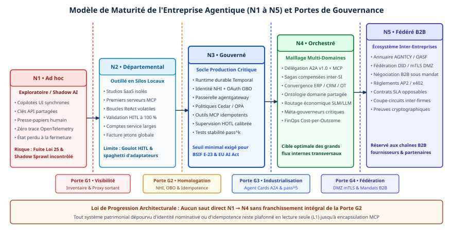

# Chapitre 43 — Maturité et prospective

*Question directrice : par où commencer, et vers quoi aller ?*

> **État de référence :** feuille de route de MCP du 22 août 2026, page de l'initiative du NIST mise à jour le 9 novembre 2026, règlement (UE) 2026/1744. Ce chapitre est une synthèse : ses propositions reposent sur les chapitres cités par « (chapitre N) », et les numéros entre crochets renvoient aux pages relues pour dater l'état des lieux. Le modèle de maturité, la feuille de route et les scénarios sont des propositions de l'ouvrage, non des résultats de recherche. Les chapitres 44 à 47, ajoutés ensuite, approfondissent quatre sujets sans modifier ces conclusions.

Les protocoles d'accès aux outils et d'échange entre agents sont utilisables; l'identité des agents, les registres, l'observabilité et la gouvernance ne sont pas stabilisés (chapitre 4). Une entreprise ne peut ni attendre que tout soit fixé, ni bâtir comme si tout l'était.

Ce chapitre propose un modèle de maturité par domaine d'affaires, une feuille de route où le contrôle précède l'autonomie, puis trois scénarios pour 2027-2030 et leurs signaux. La thèse : commencer étroit, posséder le noyau de gouvernance et n'élargir l'autonomie que sur preuve sont trois choix qui restent bons dans tous les scénarios envisagés.

---

## 43.1 Modèle de maturité

### Ce que mesurent les modèles existants

Les **échelles d'autonomie** classent ce qu'un agent a le droit de faire. Celle de la Cloud Security Alliance compte six niveaux, de 0 à 5 [5]; son auteur la présente comme une proposition à discuter et juge le niveau 5 inapproprié en entreprise. Une telle échelle qualifie un agent, pas l'organisation qui l'exploite (chapitres 1 et 22).

Les **modèles de pratique** classent ce qu'une équipe sait faire. Une prépublication propose une pyramide à quatre étages, de l'ingénierie de prompt à celle de spécification, sans validation mesurée [6] (chapitre 13).

La **grille d'interopérabilité** du chapitre 3 évalue une relation, entre deux agents ou entre un agent et un outil, sur cinq niveaux d'entente, chacun noté de 0 à 3.

Il manque une vue par domaine d'affaires, qui relie ces mesures à une décision : étendre ou consolider.

### Cinq stades

Le modèle qui suit est une proposition de l'ouvrage, sans validation empirique. Il ordonne les sept critères de l'entreprise agentique (chapitre 1) en stades cumulatifs et attache à chacun une preuve de sortie.

| Stade | État | Preuve de sortie | Chapitres |
|---|---|---|---|
| 0 — Essais | Assistants et prototypes; aucune écriture en production | Un cas retenu, avec base de référence mesurée | 4, 40 |
| 1 — Agent borné | Un agent écrit dans un système d'enregistrement, dans un espace d'action fermé | Limites appliquées hors du prompt; succès vérifié sur un banc d'essai interne | 17, 22, 33 |
| 2 — Parc gouverné | Identité propre, responsable nommé et inscription à l'inventaire pour chaque agent; chemin obligé par une passerelle | Inventaire rapproché du trafic observé; exécution reconstituée à partir des traces | 23, 24, 29, 39 |
| 3 — Composition | Des agents de sources différentes coopèrent par des protocoles standard, avec registre interne et exécution durable | Relations au stade 2 de la grille du chapitre 3; essai de reprise et de compensation réussi | 3, 8, 18, 21 |
| 4 — Autonomie réglée | L'autonomie de chaque classe de décision s'élargit et se retire selon des mesures | Retrait automatique démontré; coût par résultat réussi suivi; essai de sortie de plateforme | 22, 27, 34, 40, 44 |

**Le stade se mesure par domaine d'affaires.** Une même entreprise peut être au stade 3 dans son service à la clientèle et au stade 0 en finance.

**Le stade est celui du critère le plus faible.** Un domaine où des agents se composent par A2A sans inventaire ni responsable nommé est au stade 1, pas au stade 3 : il fonctionne, et personne n'en répond.

**Le sommet n'est pas une cible.** Le stade visé dépend du risque. Un domaine d'actions irréversibles ou réglementées peut rester durablement au stade 2, avec approbation humaine, et ce choix se défend.

### Où en sont les déploiements observés

L'étude Measuring Agents in Production combine 20 études de cas et un sondage dont 86 réponses, sur 306 valides, décrivent des systèmes en production ou en pilote. Elle dépeint des agents de stade 1 : 68 % exécutent moins de dix étapes avant une intervention humaine (« au plus dix » selon le résumé), 14 cas sur 20 pilotent par prompt un modèle du commerce sans en ajuster les poids, 74 % des répondants dépendent surtout d'une évaluation humaine [3]. L'étude ne mesure pas les stades 2 à 4. Le chapitre 42 va dans le même sens : un seul déploiement à grande échelle trouvé dans un article évalué par les pairs, aucun cas documenté de MCP, d'A2A ou d'un système multi-agents en production. Le stade 3 n'a donc pas d'exemple publié, et le modèle sert à ordonner des décisions, non à situer une entreprise par rapport à une moyenne de marché, qu'aucune source lue ne fournit.

---

## 43.2 Feuille de route d'adoption

### Quatre jalons

La feuille de route se découpe en jalons franchis sur preuve, non en trimestres.

**Jalon 1 : choisir.** Le premier cas réunit quatre propriétés : une tâche bornée, des effets réversibles, un résultat vérifiable sans se fier au compte rendu de l'agent, une base de référence déjà mesurée (chapitres 16, 34 et 40). Un agent unique outillé suffit. Ce jalon produit aussi le banc d'essai interne, tiré de cas réels (chapitre 33).

**Jalon 2 : fonder.** Avant un deuxième agent, l'entreprise met en place le noyau qu'elle doit posséder : registre de référence, identité par agent, politiques appliquées à une passerelle, traces dans un schéma qu'elle maîtrise (chapitres 23 et 27). Ce jalon ne livre aucune fonctionnalité visible, d'où la tentation de le sauter. Son report coûte cher : un inventaire dressé après coup doit retrouver des agents non déclarés, ce qu'aucun cadre lu ne décrit (chapitre 39).

**Jalon 3 : étendre.** Un second domaine s'ajoute, puis la composition entre agents. Les outils qui produisent des effets deviennent idempotents ou compensables, et les processus longs passent sous exécution durable (chapitre 18). Les relations qui traversent une frontière d'organisation s'évaluent une à une avec la grille du chapitre 3; un réseau de partenaires relève du chapitre 45.

**Jalon 4 : élargir l'autonomie.** L'approbation humaine se retire classe de décision par classe de décision, sur la foi des mesures accumulées, avec un mécanisme de retrait qui ne dépend pas d'une personne (chapitres 22 et 34). Le rythme est borné par la capacité de supervision, pour laquelle aucun ratio d'agents par personne n'est établi (chapitre 41).

### La règle d'ordre

**Le contrôle précède l'autonomie.** Chaque jalon installe le moyen de vérifier le suivant : le banc d'essai avant la production, l'inventaire avant la prolifération, la compensation avant l'irréversible.

**Le stable se standardise, l'instable s'isole.** Le cœur de MCP et ses extensions stables peuvent porter une architecture (chapitre 5). L'identité des agents et la télémétrie ne le peuvent pas encore : le groupe de travail de MCP est en formation [1], et les conventions d'OpenTelemetry restent au statut « Development » (chapitre 33) [8]. Dans les deux cas, une couche interne (émetteur de jetons, schéma de traces) évite qu'un changement de standard se propage à tous les agents.

### Les échéances externes

| Échéance | Objet | Effet sur la feuille de route |
|---|---|---|
| 1er mai 2027 | Entrée en vigueur de la ligne directrice E-23 du BSIF pour les institutions financières fédérales [10] | Inventaire des modèles et cote de risque; le texte ne nomme pas les agents (chapitre 38) |
| Février à août 2027 | Horizon de six à douze mois de la feuille de route de MCP [1] | Prochaine révision à prévoir : événements, identité, forme des résultats d'outils |
| Été 2027, au plus tôt | Fin de la fenêtre minimale de dépréciation ouverte en juillet 2026 (chapitre 5) | Migration des fonctions dépréciées à terminer |
| 2 décembre 2027 | Application des obligations de l'AI Act au haut risque de l'annexe III [9] | Inventaire, traçabilité et supervision prêts pour les usages visés (chapitre 35) |
| 2 août 2028 | Même application pour l'annexe I [9] | Agents intégrés à des produits réglementés |

Le jalon 2 sert pour chacune : un inventaire d'agents rattachés à des responsables répond à une partie de chaque obligation (chapitre 38).

---

## 43.3 Scénarios 2027-2030

### Deux incertitudes

Parmi les six hypothèses du chapitre 4, deux portent sur des questions que l'entreprise ne tranche pas et qui commandent son architecture.

**La couche standard montera-t-elle jusqu'à l'identité et à la gouvernance ?** Elle s'arrête aujourd'hui à l'accès aux outils et aux échanges entre agents. Une analyse de cinq protocoles, en prépublication, conclut que la gouvernance est une couche d'architecture manquante au-dessus des standards plutôt qu'une fonction à leur ajouter [7].

**Les plans de contrôle se fédéreront-ils ?** Plusieurs éditeurs vendent chacun le leur, et ce qui se fédère aujourd'hui se limite à l'inventaire (chapitre 27).

Ces deux questions, auxquelles s'ajoute la géopolitique des standards (chapitre 11), donnent trois scénarios. Aucune probabilité ne leur est attachée.

| Scénario | Ce qui se produit | Ce qui prend de la valeur | Ce qui en perd |
|---|---|---|---|
| A — Socle étendu | Un profil d'identité d'agent est publié et adopté; les registres se fédèrent par une interface commune; la télémétrie se stabilise | Les actifs en formats ouverts; la capacité de changer de plateforme | Les couches d'isolation internes, devenues superflues |
| B — Archipel | Les standards restent aux niveaux technique et syntaxique; chaque plateforme gouverne ses agents | Le noyau possédé; les clauses de sortie éprouvées | Le pari sur une plateforme unique |
| C — Blocs | Les modèles de confiance divergent par juridiction, autour de racines d'identité et d'exigences de souveraineté distinctes | L'architecture régionalisée; la preuve portable d'un domaine à l'autre | Les agents conçus pour un seul espace de confiance |

Le scénario B prolonge l'état de 2026. Le scénario A suppose que les chantiers ouverts aboutissent, dont l'identité d'agent que vise la feuille de route de MCP, en coordination avec les groupes OAuth et WIMSE de l'IETF [1]. Le scénario C n'exclut pas les deux autres : une multinationale peut vivre A ou B à l'intérieur d'un bloc, et C entre les blocs (chapitres 11 et 37). Les lettres diffèrent du chapitre 11 : Blocs prolonge sa « bifurcation régionale » (B); l'Archipel est voisin de sa « prolifération » (C).

### Une variable transversale : la portée des agents

L'ouvrage suppose que les agents en production restent bornés et que le verrou tient à la conception du système plus qu'au modèle (chapitre 4, hypothèses H2 et H3). La taxonomie MAST recense quatorze modes d'échec, dont la plupart tiennent à la conception et à la coordination [4] (chapitre 21). Si une génération de modèles faisait disparaître ces échecs, le jalon 4 s'atteindrait plus vite. Les jalons 1 à 3 resteraient nécessaires : un agent plus capable a toujours besoin d'une identité, d'un inventaire et d'une piste d'audit.

### Ce qui vaut dans tous les cas

Quatre investissements sont sans regret : le noyau possédé (registre, identité, politiques, traces), les outils idempotents, le banc d'essai interne et l'essai de sortie. À l'inverse, deux paris sont fragiles dans au moins un scénario : confier toute la gouvernance à une seule plateforme (fragile en B et en C), et bâtir en propre ce qu'un standard s'apprête à fournir (coûteux en A).

---

## 43.4 Signaux à surveiller

| Signal | État au 11 novembre 2026 | Ce qu'un changement indiquerait |
|---|---|---|
| Identité d'agent dans MCP | Groupe de travail en formation; DPoP à finaliser [1] | Profil publié : scénario A; révision des émetteurs de jetons internes |
| Registre MCP | Préversion; ruptures et remises à zéro possibles avant la disponibilité générale [12] | Disponibilité générale : fédération de registres envisageable |
| Conventions GenAI d'OpenTelemetry | Statut « Development » (chapitre 33); dépôt dédié sans version publiée [13] | Version stable : retrait possible du schéma interne (chapitre 33) |
| Initiative du NIST | Lignes directrices volontaires annoncées sans date; aucun profil d'interopérabilité mentionné [2] | Publication datée : repère pour les secteurs réglementés |
| Gouvernance dans les protocoles | Aucun des cinq protocoles analysés n'encode l'ensemble des primitives de gouvernance [7] | Extension officielle d'approbation ou d'audit : scénario A sur la couche qui manque le plus |
| Projets de l'AAIF | Dix projets, sur trois niveaux depuis septembre 2026 (chapitre 11); la page des projets n'affiche pas ces niveaux [11] | Promotion ou archivage d'un projet dont dépend l'architecture (chapitre 11) |
| Portée des agents en production | Moins de dix étapes pour 68 % des agents étudiés [3] | Étude comparable montrant des parcours longs : hypothèse H2 à revoir |
| Échecs de coordination | Quatorze modes recensés [4] | Analyse refaite sur des modèles récents : hypothèse H3 confirmée ou infirmée |
| Protocoles ouverts en production | Aucun cas documenté (chapitre 42) | Étude évaluée par les pairs sur un déploiement MCP ou A2A : premier appui empirique à la thèse du chapitre 1 |

**Chaque signal a un responsable et une source primaire désignée.** Une synthèse de presse ne suffit pas : le profil d'interopérabilité que des sources secondaires prêtent au NIST ne figure pas sur la page de l'initiative [2].

**Chaque signal est rattaché à une décision qu'il ferait changer.** Sans cela, il n'est qu'une lecture.

**La revue est périodique.** Un rythme trimestriel convient : la feuille de route de MCP porte sur six à douze mois [1].

---

## 43.5 Dix recommandations

1. **Commencer par un agent unique et borné**, sur une tâche dont le résultat se vérifie. Le multi-agents se justifie par une tâche décomposable, non par principe (chapitre 16).
2. **Mesurer avant d'automatiser.** Une base de référence, un succès vérifié indépendamment de l'agent et un coût par résultat réussi précèdent toute extension (chapitres 33 et 40).
3. **Posséder le noyau** : registre de référence, identité, politiques et traces, en formats ouverts. Le reste peut s'acheter (chapitre 27).
4. **Donner à chaque agent une identité propre et un responsable nommé.** Ni clé partagée, ni justificatif visible du modèle (chapitres 29 et 39).
5. **Imposer un chemin obligé.** Une politique qu'aucun point de contrôle technique n'applique n'est pas une politique (chapitres 23 et 24).
6. **Standardiser sur le stable, isoler l'instable.** Le cœur des protocoles d'un côté; de l'autre, l'identité, la télémétrie et les extensions bêta derrière des couches internes (chapitres 5, 6 et 33).
7. **Concevoir pour la réémission.** Outils idempotents, compensation tenue par le propriétaire de l'outil, pivot explicite avant l'irréversible (chapitre 18).
8. **Gouverner par classe de décision.** L'autonomie s'élargit sur preuve et se retire sur signal; une limite écrite seulement dans un prompt n'en est pas une (chapitres 22 et 34).
9. **Traiter la fiabilité multi-agents comme une conception d'organisation** : division du travail, autorité, vérification de l'objectif et non du seul format (chapitre 21).
10. **Préparer la sortie et la conformité dès le premier agent.** Une clause de sortie se prouve par un essai, et un modèle de secours qualifié d'avance prépare la perte d'un fournisseur (chapitre 46); un inventaire tenu à jour est le premier geste de conformité (chapitres 27, 35 et 38).

### Retour sur la thèse

Le chapitre 1 pose que l'interopérabilité et l'orchestration conditionnent la mise à l'échelle. Au terme de l'ouvrage, la thèse tient comme argument et reste à prouver par la mesure, faute de cas publié (chapitre 42). Les protocoles règlent les niveaux technique et syntaxique; le sens, l'organisation et la confiance reviennent à l'entreprise (chapitre 3). La fiabilité d'un système multi-agents relève de sa conception (chapitre 21). Les recommandations qui précèdent restent bonnes si la thèse se révèle trop optimiste.

---

## Grille de décision

| Décision | Option par défaut | Quand s'en écarter |
|---|---|---|
| Unité d'évaluation de la maturité | Le domaine d'affaires, noté par son critère le plus faible | Très petite organisation : une seule évaluation |
| Stade à atteindre avant un second domaine | Stade 2 | Second domaine limité à des prototypes sans écriture |
| Ordre des investissements | Noyau de gouvernance avant la composition | Agent unique en lecture seule |
| Standard instable (identité, télémétrie) | Couche interne d'isolation | Standard devenu stable et pris en charge des deux côtés |
| Élargissement de l'autonomie | Par classe de décision, sur mesures, avec retrait automatique | Actions irréversibles ou réglementées : approbation maintenue |
| Hypothèse de planification | Scénario B, avec les investissements sans regret | Signaux convergents vers A ou C |

---

## Points à retenir

- La maturité se mesure par domaine d'affaires et par preuve, non par le nombre d'agents déployés. Le stade est celui du critère le plus faible.
- Les échelles d'autonomie et les modèles de pratique existants sont des propositions non validées. Le modèle en cinq stades de ce chapitre l'est aussi.
- Les déploiements étudiés se situent au stade 1 : agents courts, pilotés par prompt, évalués par des personnes. Aucun cas publié ne montre MCP, A2A ou un système multi-agents en production.
- La feuille de route avance par jalons franchis sur preuve. Le contrôle précède l'autonomie, et le noyau de gouvernance est le jalon à ne pas sauter.
- Deux incertitudes commandent l'horizon 2030 : l'extension des standards à l'identité et à la gouvernance, et la fédération des plans de contrôle.
- Le scénario de l'archipel prolonge l'état de 2026. Le noyau possédé, les outils idempotents, le banc d'essai interne et l'essai de sortie valent dans les trois scénarios.
- Deux échéances fermes encadrent la période : le 1er mai 2027 pour les institutions financières fédérales canadiennes, le 2 décembre 2027 pour le haut risque européen de l'annexe III.

---

## Sources

Pages primaires lues le 11 novembre 2026 :

1. [MCP — feuille de route, mise à jour du 22 août 2026](https://modelcontextprotocol.io/development/roadmap.md)
2. [NIST — AI Agent Standards Initiative](https://www.nist.gov/caisi/ai-agent-standards-initiative)
3. [Measuring Agents in Production (arXiv 2512.04123, version 4)](https://arxiv.org/abs/2512.04123) — résumé; première moitié du texte relue le 12 novembre 2026.
4. [Why Do Multi-Agent LLM Systems Fail? (arXiv 2503.13657, version 3)](https://arxiv.org/abs/2503.13657) — résumé.
5. [Cloud Security Alliance — Leveling Up Autonomy in Agentic AI, 28 janvier 2026](https://cloudsecurityalliance.org/blog/2026/01/28/levels-of-autonomy)
6. [Context Engineering: From Prompts to Corporate Multi-Agent Architecture (arXiv 2603.09619, version 2)](https://arxiv.org/abs/2603.09619) — résumé; prépublication.
7. [Governance Gaps in Agent Interoperability Protocols (arXiv 2606.31498)](https://arxiv.org/abs/2606.31498) — résumé; prépublication.
8. [OpenTelemetry — conventions sémantiques GenAI (page déplacée)](https://opentelemetry.io/docs/specs/semconv/gen-ai/)
9. [AI Act Explorer — Digital Omnibus on AI, règlement (UE) 2026/1744](https://artificialintelligenceact.eu/ai-act-explorer/digital-omnibus/) — reproduction non officielle, première moitié.
10. [BSIF — ligne directrice E-23, lettre d'accompagnement](https://www.osfi-bsif.gc.ca/en/guidance/guidance-library/guideline-e-23-model-risk-management-2027-letter)
11. [Agentic AI Foundation — projets](https://aaif.io/projects)
12. [Le registre MCP](https://modelcontextprotocol.io/registry/about)
13. [OpenTelemetry — dépôt semantic-conventions-genai](https://github.com/open-telemetry/semantic-conventions-genai) — lu le 12 novembre 2026.

Sources secondaires : aucune.

## Limites de ce chapitre

- Le modèle de maturité, les jalons, les scénarios et les recommandations sont des propositions de synthèse, non validées; aucune source lue ne répartit les entreprises par stade.
- Les articles [4], [6] et [7] ont été lus par leur résumé seulement; [3], par son résumé et la première moitié de son texte. Les pages [2], [5], [8] à [11] et [13] ont été lues par un outil qui en extrait le contenu; seules [1] et [12] l'ont été en texte intégral. Relues à l'audit : [1] à [4], [8] et [11]. Le règlement [9] a été lu sur un site non officiel, pour sa première moitié. Le texte de E-23, lu pour le chapitre 38, confirme l'inventaire et la cote de risque.
- MAP écrit « au plus dix étapes » dans son résumé, « moins de dix » dans son corps, sans expliquer l'écart; son 74 % porte sur 31 réponses.
- Les renvois « (chapitre N) » reprennent ces chapitres sans relecture de leurs sources; ils ont été vérifiés sur leurs points à retenir et, pour les chapitres 3, 4, 11, 13 et 39, sur la section visée.
- L'intervalle « février à août 2027 » est déduit de l'horizon de six à douze mois annoncé le 22 août 2026; la feuille de route ne date pas la prochaine révision.
- Le statut « Development » des conventions d'OpenTelemetry vient du chapitre 33; ni la page [8] ni le dépôt [13] ne l'affichent.

## Mise en œuvre — Modèle de maturité de l'entreprise agentique (niveaux 1 à 5) et antipatterns {.volet}

:::: {.encadre .executive}
::: {.encadre-titre}
**Synthèse exécutive**
:::

- **Enjeu stratégique** : une entreprise peut ne pas manquer d’initiatives en intelligence artificielle et souffrir d’une prolifération non gouvernée de prototypes locaux (*Shadow Agent Sprawl*) qui ne franchissent pas les exigences de sécurité, d’idempotence et d’auditabilité. Aucune source lue ne répartit les entreprises par stade (section 43.1) : l’ampleur de ce phénomène n’est pas établie. Passer de l’exploration (N1) au maillage autonome multi-domaines (N4) sans le socle industriel (N3) mène à des incidents majeurs et à un blocage par la conformité.
- **Décisions d’architecture** :
  1. *Irréversible à l’échelle du groupe* : instituer quatre portes d’homologation bloquantes (G1 à G4), appliquées par des politiques exécutables en CI/CD et non par de simples revues documentaires.
  2. *Structurante dès le cadrage* : exiger un diagnostic d’aptitude patrimoniale sur chaque système d’enregistrement avant d’autoriser toute écriture agentique.
  3. *Réversible et pragmatique* : fixer un niveau de maturité cible par processus, en plafonnant un flux interne à N2 ou N3 quand la fédération inter-entreprises N5 n’apporte aucun gain économique net.
- **Indicateurs de gouvernance associés** : couverture du registre des actifs agentiques (cible : 100 %, aucun agent fantôme mutatif), score composite de maturité par division, taux de mutualisation des serveurs MCP homologués et économies annuelles tirées du décommissionnement d’antipatterns.
::::

## 43.6 Grille d’évaluation en 5 niveaux (ad hoc, départemental, gouverné, orchestré, fédéré B2B)

Les référentiels de maturité analytique ou de *MLOps* ne voient pas le risque propre à l’entreprise agentique : un agent détient des identités déléguées, invoque des outils transactionnels et modifie l’état des systèmes d’enregistrement. Une organisation excellente en science des données prédictive reste au niveau N1 si ses prototypes partagent des clés API statiques, ignorent les fenêtres de traitement par lots de son ERP et s’exécutent sans persistance durable ni compensation transactionnelle.

Cette grille ordonne la progression en cinq niveaux (N1 à N5), évalués sur six dimensions orthogonales. Elle se distingue des cinq stades de la section 43.1, numérotés de 0 à 4 et mesurés par domaine d’affaires : les deux échelles ne se correspondent pas. Comme les stades, elle est une proposition de l’ouvrage, sans validation empirique.



### Définition des cinq niveaux

- **Niveau 1 — Ad hoc et exploratoire.** Assistants conversationnels synchrones et scripts isolés, sur des sessions personnelles ou des clés API partagées. L’employé sert de presse-papiers entre les applications. Ni inventaire central, ni télémétrie OpenTelemetry : le risque d’exfiltration de données (Loi 25) est maximal et l’effet sur les délais de traversée inter-systèmes est nul.
- **Niveau 2 — Départemental outillé.** Agents déployés dans le studio fermé d’un éditeur SaaS unique, ou reliés à de premiers serveurs MCP locaux. L’état réside en mémoire volatile et les comptes de service restent sur-privilégiés. L’approbation humaine systématique (HITL à 100 %) déplace le goulot d’étranglement vers les gestionnaires.
- **Niveau 3 — Gouverné, durable et auditable.** Passage obligé de toute production critique. Exécution durable (Temporal, Restate); identité non humaine (NHI SPIFFE) avec échange de jetons OAuth 2.1 On-Behalf-Of; chemin obligé par agentgateway, sous politiques Cedar/OPA; outils MCP idempotents; supervision humaine sur score de risque (HOTL); tests automatisés $\text{pass}^5$.
- **Niveau 4 — Orchestré multi-domaines.** Maillage transversal qui relie ventes, finance, ateliers IT/OT, logistique et systèmes patrimoniaux par A2A v1.0 et une ontologie partagée. Sagas de plusieurs jours à compensation distribuée; routage économique dynamique entre SLM et LLM, piloté au coût par résultat réussi.
- **Niveau 5 — Écosystème fédéré B2B.** Délégation directe entre les flottes d’agents d’entreprises partenaires (fournisseurs, transporteurs, assureurs), par les annuaires AGNTCY/OASF, une fédération mTLS/DID en DMZ, des protocoles transactionnels vérifiables (AP2, x402) et des coupe-circuits inter-organisations.

:::: {.encadre .important}
::: {.encadre-titre}
**Important**
:::

**Principe du juste niveau cible.** Le niveau N5 n’est pas la cible obligatoire de chaque initiative. Le niveau visé dépend du risque (section 43.1) : selon le flux, les niveaux N3 (intra-domaine) et N4 (transversal interne) peuvent constituer l’optimum de rentabilité et de sécurité. Comme le stade d’un domaine (section 43.1), le niveau effectif d’un système est celui de son maillon le plus faible : un graphe multi-agents N4 qui utilise une clé API statique (N1) reste classé N1.
::::

| Dimension d’audit | N1 — Ad hoc | N2 — Départemental | N3 — Gouverné (socle) | N4 — Orchestré SI | N5 — Fédéré B2B |
|:--------------|:--------------|:--------------|:-------------------|:------------------|:------------------|
| 1. Architecture et état | Clavardage synchrone sans état | Boucle ReAct locale en mémoire vive | Exécution durable (Temporal/Restate) + cellules bornées | Sagas compensées multi-SI (IT/OT, ERP, CRM) | Sagas inter-firmes sous SLA contractuels |
| 2. Interopérabilité | Copier-coller manuel humain | Adaptateurs d’éditeur / MCP isolés | Catalogue interne de serveurs MCP idempotents | Bi-couche AAIF : MCP vertical + A2A v1.0 horizontal | Découverte AGNTCY/OASF + mandats AP2/x402 |
| 3. Identité et sécurité | Session personnelle ou clé API en clair | Compte de service statique large | Identité NHI (SPIFFE) + OAuth 2.1 OBO + Cedar | Atténuation des portées à chaque saut A2A | Fédération mTLS/DID, DMZ et coupe-circuits croisés |
| 4. Qualité et traces | Aucune trace structurée | Journaux applicatifs locaux épars | Traces OpenTelemetry `gen_ai.*` + banc CI/CD $\text{pass}^5$ | Évaluation continue + méta-gouverneurs indépendants | Journaux d’audit signés opposables entre tiers |
| 5. Supervision humaine | Exécuteur intégral (L0/L1) | Approbateur HITL à 100 % (L2) | Superviseur HOTL sur seuil via CIBA/A2UI (L3) | Gouvernance des politiques et arbitrage d’exceptions | Définition des mandats et plafonds B2B |
| 6. Pilotage FinOps | Abonnements individuels dispersés | Facture brute mensuelle de jetons | Quotas durs par enveloppe et imputation analytique | Pilotage au coût par résultat réussi et routage SLM/LLM | Règlement automatisé à la transaction B2B |

---

## 43.7 Anatomie des antipatterns : Shadow Sprawl, God Agent, pavage de processus défaillants

Ce volet distingue sept antipatterns structurels, identifiables par télémétrie. Cette liste est une proposition, non validée; aucune correspondance n’est établie avec la taxonomie MAST, qui recense quatorze modes d’échec, dont la plupart tiennent à la conception et à la coordination (section 43.3). Les voici :

1. **Shadow Agent Sprawl (prolifération d’agents fantômes).** Automatisations assemblées dans des outils no-code avec les jetons OAuth personnels d’employés. Invisibles du SOC, elles exposent des données régies par la Loi 25 à des API non homologuées et s’arrêtent sans alerte au départ du collaborateur.
2. **God Agent (agent omniscient monolithique).** Un agent unique qui cumule un prompt de dix mille mots et quarante outils disparates (finance, stock, support). Sa précision baisse, ses jetons de contexte augmentent et la séparation des tâches n’est plus respectée sous BSIF E-23.
3. **Paving the Cow Path (pavage du chaos bureaucratique).** Un premier agent rédige un courriel ou un PDF récapitulatif qu’un second agent du service voisin réextrait par reconnaissance optique vers l’ERP. La chaîne numérise une friction obsolète qu’un appel structuré MCP ou un événement Kafka élimine avec une fiabilité de 100 %.
4. **Agent-Washing et LLM-for-Everything (vernis agentique).** Rebaptiser « agent » une tâche planifiée ordinaire, ou remplacer une requête SQL exacte et un barème tarifaire par une inférence probabiliste coûteuse et faillible.
5. **Chatty Mesh (maillage bavard non borné).** Deux agents pairs échangent en langage naturel, sans schéma A2A ni plafond `maxRemainingHops`, et bouclent en reformulations polies jusqu’à épuisement du budget.
6. **Adapter Spaghetti (spaghetti de connecteurs dédiés).** Des connecteurs SAP ou ServiceNow spécifiques sont codés dans trente dépôts de projets, au lieu de mutualiser un serveur MCP officiel par domaine métier.
7. **HITL Theater (théâtre de validation humaine).** Un opérateur reçoit des centaines d’approbations routinières, validées par réflexe en deux secondes (OWASP ASI09) : la lenteur administrative s’ajoute à l’absence de contrôle réel sur les cas critiques.

| Antipattern | Symptôme télémétrique | Risque (OWASP / légal) | Remédiation architecturale |
|:--------------|:------------------------------|:--------------------------|:----------------------------|
| Shadow Sprawl | Flux DNS/TLS vers API LLM hors passerelle; jetons personnels actifs la nuit | ASI03 (abus d’identité), infraction Loi 25 / RGPD | Proxy sortant obligatoire + amnistie G1 + identités NHI |
| God Agent | $> 12$ outils exposés; prompt $> 4\,000$ jetons; $\text{pass}^5 < 70\,\%$ | ASI02 (abus d’outils), échec de la séparation des tâches E-23 | Découpage en spécialistes de domaine (A2A) à périmètre MCP étroit |
| Paving Cow Path | Un agent génère du texte ou un PDF aussitôt analysé par un autre agent interne | Gaspillage FinOps, perte d’intégrité sémantique | Contrat d’événement typé (AsyncAPI) ou invocation MCP directe |
| LLM-for-Everything | Coût $> 0,05$ \$ CAD pour un calcul ou un routage déterministe | Erreurs arithmétiques, latence $100\times$ injustifiée | Remplacement immédiat par une table DMN ou un microservice API |
| Chatty Mesh | Plus de 4 sauts inter-agents par tâche; échanges non typés | ASI08 (cascade), épuisement du budget de jetons | `ActionEnvelope` (`maxRemainingHops`) + schémas JSON A2A |
| Adapter Spaghetti | Plus de 2 connecteurs distincts maintenus vers le même progiciel | Dette $M \times N$, règles d’idempotence incohérentes | Serveur MCP unique par domaine derrière agentgateway |
| HITL Theater | Temps médian de revue $< 4\text{ s}$; approbation $> 99,2\,\%$ | ASI09 (complaisance humaine), goulot d’étranglement | Bascule HOTL sur score de risque + gardes déterministes Cedar |

:::: {.encadre .sectoriel}
::: {.encadre-titre}
**Secteur public et parapublic — maîtrise de l’IA fantôme, Loi 25 et reddition de comptes algorithmique**
:::

Dans les ministères, les réseaux de santé et les organismes publics, le *Shadow Agent Sprawl* compromet la légalité des actes administratifs. Au Québec, la Loi 25 exige une évaluation des facteurs relatifs à la vie privée (ÉFVP) préalable à tout transfert hors juridiction; l’article 65.2 de la Loi sur l’accès impose d’informer le citoyen de toute décision fondée exclusivement sur un traitement automatisé, ainsi que des paramètres déterminants. Trois verrous s’appliquent dès les portes G1 et G2 :

1. **Registre opposable.** Aucun agent non inventorié ne manipule un dossier d’usager, de prestation ou de marché public.
2. **Souveraineté réseau.** Le filtrage par agentgateway bloque tout envoi de renseignements personnels non anonymisés hors des régions infonuagiques souveraines homologuées.
3. **Traçabilité des paramètres décisionnels.** Les règles déterministes (DMN) et les pièces sources sont journalisées de façon immuable, pour motiver toute décision contestée.
::::

---

## 43.8 Méthode de diagnostic d’architecture patrimoniale

Connecter une flotte d’agents asynchrones à un patrimoine applicatif vieux de vingt ans, sans diagnostic préalable, sature les pools de connexions historiques ou produit des écritures corrompues lors des réessais. Avant toute ouverture en écriture (L2+), le diagnostic patrimonial (*Brownfield Assessment*) note chaque système d’enregistrement de $0$ à $100$ selon cinq critères pondérés :

1. **Transactionnalité et idempotence ($c_1$, poids $0,25$).** API métier atomique à clé d’idempotence native, ou CRUD bas niveau ou terminal 5250/3270.
2. **Propagation d’identité granulaire ($c_{\text{sec}}$, poids $0,25$).** Jetons délégués nominatifs (OAuth 2.1 OBO), ou compte technique global aveugle.
3. **Fraîcheur et sémantique d’état ($c_3$, poids $0,20$).** Flux événementiel en temps réel (CDC), ou lots nocturnes qui gèlent les soldes.
4. **Primitives de compensation ($c_4$, poids $0,15$).** Existence d’opérations d’annulation ou d’avoir permettant de participer à une saga.
5. **Fidélité du bac à sable ($c_5$, poids $0,15$).** Capacité d’exécuter les bancs $\text{pass}^5$ hors production.

Une clause éliminatoire sur la sécurité ($\tau_{\text{min}} = 60$) interdit de compenser une faille d’auditabilité par la richesse fonctionnelle :

$$S_{\text{ready}} = \left(\sum_{d=1}^{5} w_d c_d\right) \mathbb{I}(c_{\text{sec}} \ge \tau_{\text{min}})$$

Si $S_{\text{ready}} < 50$ (ou $c_{\text{sec}} < 60$), le système reste en lecture seule (L1) jusqu’à l’interposition d’une façade MCP qui gère en externe un registre ACID d’idempotence, un limiteur de concurrence (*bulkhead*) et une piste d’audit nominative. Ce cloisonnement protège notamment les tables de verrous pessimistes (SAP ENQUEUE ou sous-systèmes interactifs QINTER sur IBM i) contre les rafales synchronisées de réessais, qui paralysent en quelques secondes un cœur transactionnel dimensionné pour le rythme de frappe humain. Entre $50$ et $75$, l’écriture bornée est permise sous quotas stricts et recul exponentiel temporisé (*full jitter*); à $75$ et plus, le système est qualifié natif N3/N4.

#### Extrait 43.1 — Manifeste YAML d’évaluation patrimoniale (*Brownfield Readiness Manifest*)

Ce manifeste consigne le diagnostic des contrats IBM i de Boréal Capital & Assurances (BCA).

``` yaml
apiVersion: fabric.boreal.ca/v1alpha2
kind: SystemOfRecordAssessment
metadata:
  systemId: bca-core-ibmi-contracts
  division: "Boréal Capital & Assurances (BCA)"
  regulatoryRegimes: ["BSIF-E23", "QC-LOI-25"]
spec:
  legacyProfile:
    protocol: "TN5250 / RPG-ILE Stored Procedures"
    nightlyBatchFreezeUtc: "03:00-04:15"
    maxSafeConcurrencyRps: 15
  readinessScores:
    transactionalIdempotency: 40
    identityPropagationSec: 70
    semanticFreshness: 65
    compensationPrimitives: 55
    sandboxFidelity: 60
  remediationFacade:
    mcpServer: "mcp-bca-ibmi-warranty-facade"
    externalIdempotencyLedger: "PostgreSQL ACID (TTL 7d)"
    bulkheadMaxConcurrentCalls: 8
    batchFreezePolicy: "PAUSE_IN_TEMPORAL_UNTIL_0416_UTC"
  verdict:
    computedScore: 57.75
    autonomyCeiling: "L3_PREAUTH_UNDER_5000_CAD"
    directTableWriteForbidden: true
```

#### Extrait 43.2 — Moteur Python d’audit de portefeuille et de triage des antipatterns

Ce moteur trie les initiatives du portefeuille : il retourne le niveau, l’action retenue et les alertes.

``` python
from dataclasses import dataclass
from typing import Literal

Action = Literal["PROMOTE", "REMEDIATE", "QUARANTINE_L1", "DECOMMISSION"]

@dataclass(frozen=True)
class Initiative:
    id: str
    mutates_sor: bool
    has_nhi: bool
    shared_api_key: bool
    tool_count: int
    idempotent_tools: bool
    durable_backbone: bool
    pass5: float | None
    trivial_deterministic_rule: bool
    unapproved_pii: bool

def triage_initiative(item: Initiative) -> tuple[str, Action, list[str]]:
    alerts: list[str] = []
    if item.trivial_deterministic_rule:
        return ("N1", "DECOMMISSION", ["ANTIPATTERN:LLM_FOR_EVERYTHING"])

    if item.unapproved_pii or item.shared_api_key:
        alerts.append("BLOCKER_G1:SHADOW_AI_OR_SHARED_SECRET")
        if item.mutates_sor:
            return ("N1", "QUARANTINE_L1", alerts)

    if item.tool_count > 12:
        alerts.append(f"ANTIPATTERN:GOD_AGENT({item.tool_count}_TOOLS)")
    if item.mutates_sor and (not item.idempotent_tools or not item.has_nhi):
        alerts.append("BLOCKER_G2:MISSING_NHI_OR_IDEMPOTENCY")
        return ("N1", "QUARANTINE_L1", alerts)

    if not item.durable_backbone or item.pass5 is None or item.pass5 < 0.95:
        alerts.append("GAP_G2:NEEDS_DURABLE_RUNTIME_AND_PASS5")
        return ("N2", "REMEDIATE", alerts)

    return ("N2", "REMEDIATE", alerts) if alerts else ("N3_READY", "PROMOTE", ["OK"])
```

---

## 43.9 Trajectoire de migration incrémentale et jalons de gouvernance

Pour assainir l’existant sans pousser les métiers vers la clandestinité par un moratoire, la migration suit quatre vagues aux durées indicatives (la section 43.2 découpe la feuille de route en jalons franchis sur preuve, non en trimestres), articulées autour des portes G1 à G4, avec des briques mutualisées plus rapides à adopter que le développement sauvage :

1. **Vague 1 (semaines 1–6) — porte G1, visibilité et confinement.** Amnistie déclarative de 30 jours et routage obligatoire du trafic LLM sortant vers la passerelle d’observation. À J+45, les clés personnelles sont révoquées et les initiatives mutatives non conformes sont mises en quarantaine en lecture seule (`QUARANTINE_L1`).
2. **Vague 2 (mois 2–4) — porte G2, socle N3 et façades MCP.** L’équipe plateforme livre les premiers serveurs MCP d’entreprise (ERP, CRM, ITSM, façades patrimoniales), avec OAuth 2.1 OBO, registres d’idempotence et limiteurs de concurrence (*bulkhead*). Le passage sur exécution durable est obligatoire, comme l’attestation CI/CD $\text{pass}^5 \ge 0,95$ : la porte G2 atteste les deux.
3. **Vague 3 (mois 5–8) — porte G3, maillage N4 et bascule HOTL.** Publication des Agent Cards A2A v1.0, exécution fantôme comparée aux décisions humaines pendant quinze jours, puis ouverture du mode HOTL, piloté au coût par résultat réussi.
4. **Vague 4 (mois 9–12+) — porte G4, fédération B2B N5 ciblée.** Ouverture sélective en DMZ mTLS vers les partenaires stratégiques, sous mandats plafonnés et coupe-circuits bilatéraux.

Les équipes n’adhèrent aux quatre portes que si le chemin pavé existe. Le portail interne développeur ne se contente pas d’édicter des interdits : il génère en quelques minutes un squelette de service pré-câblé (identité SPIFFE, client agentgateway, instrumentation OpenTelemetry `gen_ai.*`, enveloppe `ActionEnvelope`, harnais de test CI/CD $\text{pass}^5$). Quand la conformité N3 devient l’option de moindre effort, l’incitation au contournement clandestin disparaît d’elle-même. En exploitation, l’homologation reste révocable en temps réel : si la télémétrie continue relève un recul du taux d’acceptation des gardes ou une alerte OWASP ASI, la passerelle abaisse le plafond d’autonomie de L3 (HOTL) à L2 (HITL) ou à L1 sans redéploiement applicatif.

#### Extrait 43.3 — Politique déterministe Cedar automatisant la Porte G2 dans le pipeline CI/CD

Cette politique Cedar automatise la porte G2 : elle autorise la promotion d’une version conforme et refuse toute clé d’API partagée ou donnée personnelle sans ÉFVP approuvée.

``` cedar
permit (
    principal is Fabric::CiPipeline,
    action == Fabric::Action::"PromoteToProd",
    resource is Fabric::AgentRelease
)
when {
    resource.inRegistry == true &&
    resource.toolCount <= 12 &&
    (
        resource.autonomyLevel == "L1" ||
        (
            resource.hasSpiffeId == true &&
            resource.usesDurableBackbone == true &&
            resource.mutativeToolsIdempotent == true &&
            resource.sorReadinessScore >= 50 &&
            resource.pass5Permille >= 950
        )
    )
};

forbid (
    principal,
    action == Fabric::Action::"PromoteToProd",
    resource is Fabric::AgentRelease
)
when {
    resource.usesSharedApiKey == true ||
    (resource.touchesPii == true && resource.efvpApproved == false)
};
```

:::: {.encadre .sectoriel}
::: {.encadre-titre}
**Groupes industriels et croissance externe (M&A) — intégrer des filiales hétérogènes par fédération N4 plutôt que par refonte ERP**
:::

Lors d’acquisitions industrielles successives, harmoniser SAP S/4HANA à la maison mère avec NetSuite ou un ERP spécialisé dans les filiales acquises demande classiquement trois à cinq ans de migration lourde. Le niveau N4 ouvre une voie d’intégration post-fusion en huit semaines : le système de la nouvelle filiale est encapsulé derrière un serveur MCP dédié et un *Agent Spécialiste de Filiale*, qui expose les contrats canoniques A2A v1.0 du groupe (disponibilité de stock, commande interne, garantie). Les synergies opérationnelles entre sociétés sont captées dès le premier trimestre sous gouvernance N3/N4, sans attendre l’unification comptable pluriannuelle.
::::

---

## 43.10 Application au fil rouge : rationalisation des 47 pilotes dispersés du Groupe Boréal

:::: {.encadre .filrouge}
::: {.encadre-titre}
**Fil rouge — Groupe Boréal : cartographie et rationalisation des 47 pilotes dispersés vers une feuille de route N1 à N4**
:::

**Diagnostic initial (décembre 2026).** La porte G1 est activée (amnistie déclarative ramenée de 30 jours à trois semaines, inspection DNS/TLS sortante) sur le périmètre des 14 500 employés et des 6,8 G\$ CAD d’activité du Groupe Boréal Inc. L’équipe d’architecture recense 47 initiatives dites agentiques, réparties entre Boréal Équipements & Logistique (BEL, 14), Boréal Capital & Assurances (BCA, 11), Boréal Services Numériques (BSN, 18) et les fonctions centrales (4), dont 19 *Shadow Agents* non déclarés. La maturité effective du groupe plafonne à N1,4.

**Verdict du triage architectural (janvier 2027).** Le diagnostic patrimonial (Extrait 43.1) et l’algorithme de triage (Extrait 43.2) produisent quatre décisions entérinées par la direction générale :

1. **14 initiatives décommissionnées (DECOMMISSION — 30 %).** Neuf cas d’*Agent-Washing* (barèmes de remises et routages postaux recodés en tables DMN en trois jours, pour un coût d’exécution divisé par 4 000) et cinq assistants non conformes, dont l’assistant RH qui lisait des dossiers Loi 25 par un compte partagé.
2. **11 initiatives confinées en lecture seule (QUARANTINE_L1 — 23 %).** Elles comprennent le prototype d’achat responsable, qui a consommé 41 000 \$ CAD en onze heures de boucle HTTP 429, et trois agents qui écrivaient sans garde vers l’IBM i de BCA ($S_{\text{ready}} = 38/100$ avant façade).
3. **15 initiatives consolidées (REMEDIATE — 32 %).** Dix-huit connecteurs redondants sont fusionnés en 9 serveurs MCP officiels derrière agentgateway; grâce au registre externe d’idempotence et au limiteur de concurrence (*bulkhead*) limité à 8 appels simultanés, l’IBM i de BCA passe à $S_{\text{ready}} = 57,75$. Deux *God Agents* de soutien (31 et 28 outils) sont scindés en spécialistes bornés ($\le 9$ outils).
4. **7 flux phares promus vers N3 $\rightarrow$ N4 (PROMOTE — 15 %).** 80 % des investissements 2027 se concentrent sur sept sagas à fort rendement prouvé, dont la maintenance prédictive inter-divisions (chapitre 1) et le diagnostic borné sous contrôle BSIF E-23 (chapitre 17).

**Impact vérifié à T+90 jours (fin T1 2027).** Économie récurrente de 620 000 \$ CAD/an en licences redondantes et fuites de jetons; 100 % des agents actifs munis d’identités SPIFFE nominatives; pré-audit interne BSIF E-23 validé avant l’échéance du 1er mai 2027; indice du groupe passé de N1,4 à N3,1.
::::

---

## 43.11 Décision d’architecture normative et points de contrôle

:::: {.encadre .adr}
::: {.encadre-titre}
**ADR-003 — Adoption d'un portail d'homologation gradué par niveau de maturité et d'exposition**
:::

- **Statut** : Acceptée \| Périmètre : Groupe Boréal (toutes divisions et filiales) \| Révision : semestrielle
- **Contexte** : la dispersion de 47 initiatives non gouvernées exposait le groupe à des infractions Loi 25 et BSIF E-23, à une dette $M \times N$ de connecteurs et à des dérives FinOps, tandis qu’un comité uniforme pour de simples essais L1 pousserait à la clandestinité.
- **Options évaluées** :
  1. *Autonomie départementale sans registre central* : rejetée — perpétue le *Shadow Sprawl* et interdit toute fédération A2A sûre.
  2. *Validation manuelle mensuelle identique de L0 à L4* : rejetée — goulot d’étranglement qui freine l’expérimentation saine.
  3. *Portail d’homologation gradué par portes automatisées (G1–G4)* : enregistrement léger automatisé en 24 h pour les bacs à sable en lecture seule (L1 hors données sensibles), et vérification bloquante en CI/CD (Cedar) dès qu’un agent requiert des mutations (L2+), l’accès à des données réglementées ou un maillage inter-domaines (N3/N4). Retenue.
- **Décision** : tout actif agentique est inscrit au registre dès G1. Aucune promotion en production de niveau L2 ou supérieur n’est permise sans passage automatisé de la porte G2, qui atteste : (a) une identité NHI dédiée, sans secret partagé; (b) un score patrimonial $S_{\text{ready}} \ge 50$ sur chaque système muté; (c) au plus douze outils MCP, tous idempotents; (d) une exécution durable et un score $\text{pass}^5 \ge 0,95$.
- **Conséquences** :
  - *Positives* : disparition de l’IA fantôme mutative, mutualisation des serveurs MCP, conformité continue vérifiable par audit externe.
  - *Négatives / coûts assumés* : maintien d’un registre actif, de gabarits MCP clés en main et d’un harnais d’évaluation CI/CD dédié.
- **Condition de révision** : réévaluation semestrielle des pondérations du diagnostic patrimonial à mesure de la modernisation du patrimoine applicatif.
::::

### Liste de contrôle de mise en production

Confirmez ces huit points :

1. **Couverture réseau, porte G1.** L’inspection DNS/TLS sortante atteste-t-elle que 100 % du trafic d’inférence passe par la passerelle d’entreprise et correspond à un agent recensé ?
2. **Suppression des secrets statiques.** Les clés d’API personnelles et les comptes génériques découverts à l’inventaire ont-ils tous été remplacés par des identités NHI dédiées ?
3. **Élimination du vernis agentique.** Les cas d’usage purement déterministes ont-ils été réorientés vers des tables DMN ou des API classiques ?
4. **Scission des God Agents.** Chaque agent respecte-t-il le plafond de douze outils cohérents et la séparation des tâches réglementaire ?
5. **Score patrimonial homologué.** Chaque système d’enregistrement ciblé en écriture possède-t-il un manifeste d’aptitude qui documente son idempotence, ses fenêtres de gel nocturne et sa capacité maximale ?
6. **Consolidation en façades MCP.** Les adaptateurs dupliqués ont-ils été remplacés par un serveur MCP officiel par domaine, muni d’un limiteur de concurrence (*bulkhead*) ?
7. **Plafonnement de la cible.** Le niveau visé (N2, N3, N4 ou N5) est-il justifié par la valeur métier réelle, sans sur-ingénierie N5 inutile ?
8. **Verrouillage Cedar/OPA en CI/CD.** La porte G2 bloque-t-elle techniquement toute mise en production dépourvue d’ÉFVP Loi 25 ou d’attestation $\text{pass}^5 \ge 0,95$ ?
