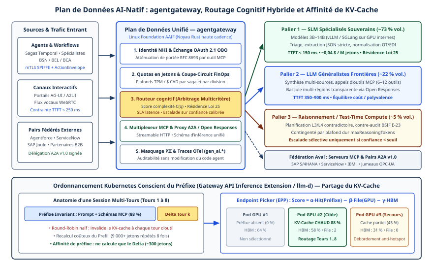

# Chapitre 44 — Plan de données d'inférence et routage cognitif

*Question directrice : comment réduire la latence et le coût d'inférence à grande échelle sans perdre en précision sur les tâches complexes ?*

> **État de référence :** faits arrêtés au 11 novembre 2026; documentation d'agentgateway (« latest »), dépôt d'Agent Router, site de la Gateway API Inference Extension, llm-d 1.0. Les numéros entre crochets renvoient aux sources en fin de chapitre : [1] à [8] et [15] sont des pages de projets, [9] à [13] des prépublications, dont quatre lues par leur seul résumé.

Un agent appelle un modèle à chaque tour et relit chaque fois presque tout ce qui précède : dans le banc d'essai du chapitre 40, plus de 97 % des jetons sont relus, non produits. À grande échelle, la facture et le délai d'un système agentique se décident donc dans la couche qui achemine ces appels. Le chapitre 24 traitait la passerelle du trafic d'outils; celui-ci traite le trafic vers les modèles.

Deux décisions se prennent sur ce chemin, le choix du modèle et le choix de la réplique, et elles n'obéissent pas aux mêmes signaux. La seconde se standardise sur Kubernetes et ne touche pas à la qualité des réponses; la première reste un pari, que les routeurs mesurés gagnent sur les requêtes faciles et perdent sur les difficiles. Enfin, presque tous les gains chiffrés publiés viennent des projets eux-mêmes.

---

## 44.1 De la passerelle d'API au plan de données d'inférence

Une passerelle d'API répartit des requêtes à peu près équivalentes entre des répliques interchangeables. L'inférence rompt les deux hypothèses.

Les requêtes ne se valent pas : leur coût se compte en jetons, et la réponse est un flux dont la durée dépend de ce que le modèle produit. Les répliques non plus : un serveur de modèles garde en mémoire l'état calculé pour les préfixes déjà vus, de sorte qu'une réplique peut répondre bien plus vite qu'une autre à la même requête (section 44.4). S'ajoute une décision qu'une passerelle d'API ne prenait pas : choisir le modèle, ce qui engage la qualité du résultat.

La Gateway API Inference Extension nomme ce déplacement : elle étend une passerelle conforme à Gateway API en « passerelle d'inférence », dotée d'un routage et d'un équilibrage de charge conscients du modèle [6].

| Décision | Question | Signaux | Effet sur la qualité |
|---|---|---|---|
| Choix du modèle | Quel modèle, avec quel effort de raisonnement ? | Classe de tâche, attributs de la requête, score de difficulté | Direct |
| Choix de la réplique | Quel serveur, parmi ceux qui servent ce modèle ? | État du cache, file d'attente, adaptateurs chargés | Nul : même modèle, même contexte |

« Routage cognitif », expression absente des sources lues, désigne ici la première ligne du tableau; la seconde relève de l'ordonnancement.

---

## 44.2 Passerelles et routeurs ouverts

| Projet | Foyer | Rôle |
|---|---|---|
| agentgateway [3][4][5] | Agentic AI Foundation (AAIF) [1] | Passerelle pour MCP, A2A et l'inférence |
| Agent Router [2] | AAIF [1] | Passerelle d'IA bâtie sur Envoy |
| Gateway API Inference Extension [6] | Projet officiel de Kubernetes | Interface entre passerelle et serveurs de modèles |
| llm-d [7][8] | CNCF, stade Sandbox | Pile de service d'inférence distribuée |

**agentgateway.** Côté modèles, la passerelle se place entre les applications et les fournisseurs, avec une interface unifiée, des garde-fous, des contrôles de coût et une télémétrie OpenTelemetry [3]. La pièce centrale est le *modèle virtuel* : un nom présenté au client, que la passerelle résout vers un modèle concret selon l'une de quatre stratégies [4] : pondérée, par basculement entre cibles classées par priorité, conditionnelle (expression `when` sur la requête) ou par appel externe (*callout*), où un service HTTP reçoit la requête et renvoie le modèle à utiliser.

La quatrième ancre un routage par difficulté : la documentation donne en exemple un service qui note la complexité du prompt. La réponse du service peut aussi réécrire des champs de la requête, dont `reasoning_effort`. Si le service tombe, la passerelle rejette la requête par défaut (`failClosed`, code 503) ou l'envoie à un modèle de repli. La documentation ne mentionne ni routage par coût ni classificateur intégré : l'intelligence du choix reste à fournir [4].

**Agent Router.** Le README lève une ambiguïté : Envoy AI Gateway est devenu Agent Router, projet de l'AAIF. Code, mainteneurs, licence Apache 2.0, CRD, commande `aigw` et images restent inchangés [2]. Le projet expose une API compatible avec celle d'OpenAI devant une vingtaine de fournisseurs hébergés, de l'inférence autohébergée et des serveurs MCP, et centralise justificatifs, routage, quotas et basculement. Son premier étage assure l'authentification et la limitation globale de débit; le second règle l'accès aux modèles autohébergés, avec un sélecteur de point d'accès.

**Gateway API Inference Extension.** Ce projet ne route rien lui-même : il définit le contrat. Une ressource `InferencePool` désigne un ensemble de points d'accès qui exécutent un serveur de modèles; l'Endpoint Picker (EPP) y choisit le meilleur pour chaque requête. Le site publie une référence d'API `v1` à côté de `v1alpha1`, et cite Envoy Gateway, kgateway et GKE Gateway parmi les passerelles étendues [6].

**llm-d.** Fondé par Red Hat, Google Cloud, IBM Research, CoreWeave et NVIDIA, entré à la CNCF en mars 2026, le projet a publié le 20 octobre 2026 une version 1.0 qui stabilise son API de configuration [8][15]. Son routeur se déclare conforme à l'extension d'inférence; son moteur par défaut est vLLM [7], SGLang étant aussi validé en 1.0 [8].

Les deux passerelles de l'AAIF délèguent le choix de la réplique à un sélecteur externe [2][5]. Le site de l'extension réserve son EPP léger aux tests de conformité et renvoie la production vers un EPP existant, tel celui de llm-d [6]. Passerelle et ordonnanceur se choisissent donc séparément.

---

## 44.3 Arbitrage à trois paliers : petit modèle, grand modèle, calcul au moment de l'inférence

Aucune source lue ne présente l'échelle à trois paliers comme un schéma unique. C'est ici une cible de conception, assemblée à partir de trois lignes de recherche.

### Du petit au grand modèle : routeur ou cascade

Le **routeur** décide avant l'appel (chapitre 16). RouteLLM entraîne, sur des données de préférences humaines, des routeurs qui choisissent entre un modèle fort et un modèle faible. Son résumé annonce des coûts réduits de plus de moitié dans certains cas, sans perte de qualité sur ses bancs d'essai, et une tenue des routeurs quand la paire de modèles change; dans le texte, la réduction ne dépasse la moitié que sur un des trois bancs (MT Bench) [9].

La **cascade** décide après. FrugalGPT apprend quelles combinaisons de modèles employer selon la requête. Son résumé annonce jusqu'à 98 % de réduction de coût à performance égale au meilleur modèle de l'époque; le texte situe ce maximum sur un seul des trois jeux de données testés (98,3 % sur HEADLINES, 73,3 % sur OVERRULING, 59,2 % sur COQA), et la cascade exige des exemples étiquetés de même distribution que le test [10].

Ces prépublications de 2023 et 2024 rapportent les chiffres de leurs auteurs, sur des modèles depuis remplacés. Par construction, le routeur ajoute peu de délai mais se trompe sans le savoir, tandis que la cascade paie un double appel pour chaque requête escaladée.

### Le troisième palier est un autre axe

Le calcul au moment de l'inférence (*test-time compute*) consiste à dépenser plus de calcul sur une requête sans changer de modèle. Snell et ses coauteurs en étudient deux formes, la recherche guidée par un modèle vérificateur et l'ajustement adaptatif de la distribution de sortie, sur un seul modèle (PaLM 2-S*) et un seul jeu de problèmes (MATH); leur résumé en tire trois constats [11] :

- l'efficacité de chaque approche varie fortement selon la difficulté du prompt;
- une allocation adaptative, requête par requête, est plus de quatre fois plus efficace qu'une base de type « meilleur de N »;
- à calcul égal, un petit modèle ainsi aidé peut dépasser un modèle quatorze fois plus gros, mais seulement sur les problèmes où il obtient déjà un taux de succès non négligeable.

Le troisième palier n'est donc pas un échelon au-dessus du grand modèle, mais un second axe, l'effort, qui se combine à la taille. Un problème hors de portée d'un modèle ne se rattrape pas par l'effort.

### Ce que montre une mesure indépendante

RouterArena, plateforme de l'Université Rice, compare douze routeurs, trois commerciaux et neuf ouverts ou universitaires, sur 8 400 requêtes réparties en neuf domaines et trois niveaux de difficulté [13].

- Aucun routeur n'arrive en tête sur toutes les mesures.
- Les routeurs commerciaux ne font pas nécessairement mieux que les ouverts. Deux d'entre eux, Not Diamond et Azure Model Router, atteignent la même précision, 68,0 % et 68,1 %, pour 9,34 $ et 0,54 $ par millier de requêtes.
- Les routeurs reconnaissent mal les cas où un modèle moins cher suffit.
- La plupart dépassent 89 % de précision sur les requêtes faciles et tombent souvent sous 10 % sur les difficiles.
- La robustesse aux reformulations et aux fautes de frappe est faible chez les routeurs commerciaux comme chez les universitaires fondés sur BERT.

Ce banc d'essai porte sur des questions isolées. Dans une boucle d'agent, une erreur à une étape se propage aux suivantes (chapitre 21), et un mauvais aiguillage coûte davantage. Le chapitre 40 donne un ordre de grandeur sur une tâche documentaire : coût réduit de moitié, 1,7 point de F1 perdu.

Trois règles en découlent. Le routage s'active par classe de tâche, non globalement. Une requête de classe inconnue va au palier supérieur. Le routeur est lui-même un composant à évaluer, y compris sa sensibilité à la forme de la requête.

---

## 44.4 Latence : délai du premier jeton, débit et cache KV

Trois grandeurs décrivent la latence d'un appel. Le délai du premier jeton (*time to first token*, TTFT) court de l'envoi de la requête au début de la réponse; il comprend l'attente en file et le traitement de l'entrée. Le délai entre jetons (ITL) et le débit en jetons par seconde décrivent la génération. Un agent interactif est jugé sur le TTFT, un traitement par lots sur le débit.

Ni llm-d [8] ni la page d'OpenTelemetry sur les métriques d'IA générative, déplacée vers un dépôt non lu [14], ne définissent ces termes : une entreprise fixe sa définition dans son schéma interne (chapitre 33).

### Le cache KV

Pendant le traitement de l'entrée, le serveur calcule pour chaque jeton un état d'attention, dit état KV. S'il le conserve, une requête qui commence par le même préfixe n'a pas à le recalculer. Les prompts se répètent beaucoup : consignes de domaine, exemples d'usage d'outils, contexte long [12]. C'est le mécanisme que les fournisseurs vendent sous le nom de cache de prompts (chapitres 13 et 40), avec la même condition : le stable en tête, le variable à la fin.

La difficulté tient au lieu : le cache vit dans la mémoire d'une réplique. Preble note que les travaux antérieurs sur la réutilisation de l'état KV se limitaient à un seul GPU, alors que le service en production est distribué [12]. Une répartition aveugle disperse les tours d'une même conversation et annule le gain. Envoyer chaque requête là où son préfixe réside surcharge en revanche les répliques populaires. Preble optimise conjointement réutilisation et équilibrage.

llm-d ajoute deux techniques [7][8]. Le délestage hiérarchisé déplace l'état KV vers la mémoire centrale ou le disque au lieu de le perdre. La désagrégation sépare le traitement de l'entrée, limité par le calcul, de la génération, limitée par la mémoire, sur des serveurs distincts.

---

## 44.5 Ordonnancement conscient du cache sur Kubernetes

### La chaîne

La passerelle, conforme à Gateway API, consulte l'EPP par le protocole de traitement externe d'Envoy; l'EPP choisit un point d'accès de l'`InferencePool` d'après les métriques et les capacités des serveurs de modèles, par exemple l'état du cache de préfixes et les adaptateurs LoRA disponibles [6], qui portent les petits modèles spécialisés (chapitre 47). Dans agentgateway, le choix revient dans l'en-tête `x-gateway-destination-endpoint` [5].

Le routeur de llm-d applique une séquence filtrer, noter, choisir, fondée sur des métriques en temps réel, l'affinité de cache et des politiques. Il vise les succès de cache par une technique heuristique ou par un index qui suit, par événements, l'état du cache de tous les serveurs [7]. La version 1.0 ajoute une qualité de service multilocataire et un service « conscient des agents » : routage par session, ordonnancement par priorité de tour, état de l'API Responses conservé entre les tours [8].

### Les gains annoncés

| Technique | Gain annoncé | Configuration et base | Attribution |
|---|---|---|---|
| Routage conscient du cache | Débit de sortie triplé, TTFT deux fois plus court | Llama 3.1 70B, quatre AMD MI300X; contre un tourniquet | Tesla et Red Hat |
| Ordonnancement par latence prédite (expérimental) | TTFT et ITL réduits de 40 % | GPU NVIDIA; contre les heuristiques | Google |
| Désagrégation | Jusqu'à 70 % de jetons par seconde en plus | GPT-OSS, NVIDIA B200; contre vLLM seul | AWS |
| Désagrégation | Débit accru de 10 à 30 % | Deux modèles, AMD MI300X; même infrastructure | Oracle |

Ces chiffres, tirés du README de llm-d [8], viennent du projet et de ses contributeurs; la première base, le tourniquet, est la plus faible possible. Les deux mesures de désagrégation divergent : le gain se mesure sur sa propre charge. Le site de l'extension affirme que l'équilibrage conscient du serveur de modèles « a fait ses preuves », sans chiffre ni auteur [6].

Preble annonce une latence moyenne de 1,5 à 14,5 fois meilleure et une latence au 99e centile de 2 à 10 fois meilleure que celle de systèmes de l'état de l'art, sur des charges réelles et deux modèles ouverts [12]. Mais les auteurs y évaluent leur propre système, qui n'est pas llm-d : la prépublication confirme le principe, pas les chiffres des produits. Aucune évaluation indépendante de llm-d ou de l'extension d'inférence n'a été trouvée.

### Points d'exploitation

Le mode autonome d'agentgateway, où la passerelle accompagne l'EPP en processus voisin, convient à une charge mono-locataire ou liée à une tâche; il ne prend pas en charge `InferencePool` [5]. Par défaut, la passerelle n'accepte de l'EPP que des adresses de points d'accès locaux connus (`validated`). Le mode `passthrough` accepte aussi des noms d'hôtes : un EPP global peut alors viser d'autres grappes, et la surface atteignable s'élargit d'autant.

L'EPP devient un composant critique du chemin de requête; llm-d range la haute disponibilité du routeur parmi ses fonctions d'exploitation [8].

---

## 44.6 Mesurer le compromis entre coût et qualité

L'unité de mesure reste celle du chapitre 40 : le coût par résultat réussi, non le coût par jeton. Un routage qui divise la facture et dégrade le taux de réussite peut augmenter ce coût.

RouterArena fournit une grille en cinq dimensions, transposable à une évaluation interne [13] : précision des réponses, coût réel d'inférence, optimalité du routage (le modèle correct le moins cher a-t-il été choisi ?), robustesse aux perturbations de forme et latence de la décision. Son score combine précision et coût, ce dernier pondéré par défaut à 0,1; ce poids est un choix de politique, à régler sur le coût de l'erreur par classe de tâche.

La méthode proposée ici, à valider, prolonge celle du chapitre 33.

1. Rejouer un échantillon de traces internes sur chaque palier, par classe de tâche.
2. Mesurer pour chaque classe la part des cas où le palier inférieur suffit; n'activer le routage que là où elle est élevée et l'erreur tolérable.
3. Suivre en production le taux d'escalade et l'adéquation du modèle, indicateur de la FinOps Foundation (chapitre 40).
4. Réévaluer à chaque changement de modèle ou de routeur.

Pour la latence, le TTFT, le débit et le taux de succès du cache se mesurent par classe de tâche, à la médiane et au 99e centile, contre la configuration en place et non contre un tourniquet. Ces mesures alimentent les budgets de coût, de délai et de qualité par classe de tâche (chapitre 23).

---

## Grille de décision

| Décision | Option par défaut | Quand s'en écarter |
|---|---|---|
| Premier levier | Cache de préfixe, chez le fournisseur ou sur ses serveurs [S] | — |
| Choix du modèle | Règle explicite par classe de tâche [S] | Service de notation par appel externe, si les traces montrent une part élevée de requêtes faciles |
| Classe inconnue ou routeur en panne | Palier supérieur; rejet ou modèle de repli qualifié d'avance (chapitre 46) [S] | Tâche sans enjeu : palier inférieur |
| Calcul au moment de l'inférence | Réservé aux classes où le modèle réussit déjà en partie [M] | Problème hors de portée : changer de modèle |
| Inférence autohébergée | `InferencePool` et EPP derrière une passerelle conforme [É] | Charge mono-locataire : mode autonome |
| Ordonnancement | Conscient du cache et de la charge [M] | Charges sans préfixe partagé : charge seule |

---

## Points à retenir

- Le plan de données d'inférence prend deux décisions : le modèle, puis la réplique. Seule la première engage la qualité.
- agentgateway et Agent Router, tous deux à l'AAIF, délèguent le choix de la réplique à un sélecteur externe. Agent Router est l'ancien Envoy AI Gateway.
- L'interface `InferencePool` et EPP sépare le choix de la passerelle de celui de l'ordonnanceur; llm-d en est une mise en œuvre parvenue à la version 1.0.
- L'échelle à trois paliers est une cible de conception, non un schéma établi. Le calcul au moment de l'inférence est un axe d'effort, utile là où le modèle réussit déjà en partie.
- Dans la seule comparaison indépendante lue, aucun routeur ne domine; la plupart échouent sur les requêtes difficiles, et beaucoup changent de choix devant une simple reformulation.
- Le cache KV est le cache de prompts vu du côté de l'exploitant. Son gain dépend d'un préfixe stable et d'un routage qui sait où le préfixe réside.
- Les gains chiffrés de l'ordonnancement conscient du cache et de la désagrégation viennent de llm-d et de ses contributeurs. Une prépublication universitaire confirme le principe, pas ces chiffres.
- Le routage s'active par classe de tâche, après rejeu de traces internes, et se juge au coût par résultat réussi.

---

## Sources

Pages primaires lues le 12 novembre 2026 :

1. [Agentic AI Foundation — projets](https://aaif.io/projects)
2. [Agent Router — README du dépôt](https://github.com/theagentrouter/agent-router)
3. [agentgateway — documentation LLM](https://agentgateway.dev/docs/standalone/latest/llm/)
4. [agentgateway — modèles virtuels](https://agentgateway.dev/docs/standalone/latest/documentation/llm/virtual-models/)
5. [agentgateway — routage d'inférence](https://agentgateway.dev/docs/standalone/latest/documentation/llm/inference/)
6. [Gateway API Inference Extension — page d'accueil](https://gateway-api-inference-extension.sigs.k8s.io/)
7. [llm-d — architecture](https://llm-d.ai/docs/architecture)
8. [llm-d — README du dépôt](https://github.com/llm-d/llm-d)
9. [Ong et coll. — RouteLLM (arXiv 2406.18665)](https://arxiv.org/abs/2406.18665) — prépublication; résumé seulement.
10. [Chen, Zaharia et Zou — FrugalGPT (arXiv 2305.05176)](https://arxiv.org/abs/2305.05176) — prépublication; résumé seulement.
11. [Snell et coll. — Scaling LLM Test-Time Compute Optimally (arXiv 2408.03314)](https://arxiv.org/abs/2408.03314) — prépublication; résumé seulement.
12. [Srivatsa et coll. — Preble (arXiv 2407.00023)](https://arxiv.org/abs/2407.00023) — prépublication; résumé seulement.
13. [Lu et coll. — RouterArena (arXiv 2510.00202, version 3)](https://arxiv.org/html/2510.00202v3) — prépublication; texte lu.
14. [OpenTelemetry — métriques d'IA générative](https://opentelemetry.io/docs/specs/semconv/gen-ai/gen-ai-metrics/) — page déplacée, sans contenu.
15. [llm-d — billets de version](https://llm-d.ai/blog/tags/releases) — extrait du billet de la version 1.0.

Sources secondaires : aucune. Le banc d'essai financier et l'indicateur de la FinOps Foundation sont repris du chapitre 40.

## Limites de ce chapitre

- Les sources [9], [10], [11] et [12], d'abord connues par leur seul résumé, ont été relues au-delà du résumé le 14 novembre 2026, par un outil qui en rend des extraits; les écarts relevés sont corrigés dans le texte.
- Les pages ont été lues au moyen d'un outil qui en restitue un résumé. L'audit a relu [1], [2], [4], [6], [8], [12] et [13] : les chiffres cités y sont confirmés, sans recoupement sur le texte brut.
- « Routage cognitif » et l'échelle à trois paliers n'ont pas de source identifiée. Aucun texte lu ne définit « petit modèle » (SLM).
- Les définitions du TTFT, de l'ITL et du cache KV, leur rapprochement avec le cache de prompts et la comparaison entre routeur et cascade viennent de la connaissance générale.
- Le billet de publication de llm-d 1.0 n'a été lu que par son extrait [15]; le README ne rattache pas ses chiffres à cette version. Le statut de l'API `v1` de l'extension d'inférence n'est pas précisé par son site.
- La prise en charge de l'extension d'inférence par Agent Router est déduite de son sélecteur de point d'accès; le README ne cite ni `InferencePool` ni le contributeur d'origine.
- Les pages d'agentgateway sur les contrôles de coût, l'observabilité et les bancs d'essai n'ont pas été lues.
- RouterArena porte sur des questions isolées et des modèles de 2023 à 2025. Hors le banc d'essai documentaire repris du chapitre 40, aucune mesure indépendante de routage sur des trajectoires d'agents n'a été trouvée, y compris par une nouvelle recherche le 14 novembre 2026.
- Les renvois aux chapitres 13, 16, 21, 23, 24, 33, 40, 46 et 47 ont été vérifiés; aucune contradiction n'a été relevée.

## Mise en œuvre — Plan de données AI-natif, passerelles et routage cognitif hybride {.volet}

:::: {.encadre .executive}
::: {.encadre-titre}
**Synthèse exécutive**
:::

- **Enjeu stratégique** : Laisser des agents autonomes appeler directement les API de modèles et les serveurs d’outils reproduit la dette sécuritaire et financière du *Shadow IT*. Les passerelles d’API classiques, conçues pour des requêtes HTTP courtes et homogènes, ne voient ni la comptabilité en jetons, ni le multiplexage persistant MCP, ni la mémoire des processeurs graphiques. L’industrialisation exige un plan de données AI-natif unifié.
- **Décisions architecturales structurantes** :
  1.  *Irréversible à moyen terme* : Placer une passerelle AI-native (agentgateway / Agent Router, ancien Envoy AI Gateway; section 44.2) en coupure obligatoire de 100 % des flux vers les modèles (Open Responses), les outils (MCP) et les pairs (A2A v1.0), et bloquer au pare-feu toute sortie directe des conteneurs.
  2.  *Structurante dès le jour 1* : Déployer un routage cognitif hybride à trois paliers (SLM spécialisés souverains, LLM généralistes, calcul au moment de l’inférence), cible de conception et non schéma établi (section 44.3), couplé, sur grappe interne, à un ordonnancement Kubernetes conscient du préfixe du cache KV.
  3.  *Réversible par conception* : Le portefeuille exact de modèles commerciaux ou ouverts derrière la passerelle, que l’on permute à chaud sans modifier le code des agents.
- **Indicateurs de gouvernance associés** : Taux d’absorption par le palier SLM (cible $\ge 70\,\%$), taux de succès du cache de préfixe (cible $\ge 85\,\%$), TTFT p95 (la section 44.6 retient la médiane et le 99e centile, par classe de tâche) et baisse du coût complet par résultat réussi.
::::

## 44.7 Passerelles d’API classiques et plan de données AI-natif

Une passerelle classique (NGINX, Kong, Apigee, AWS API Gateway) repose sur quatre hypothèses : une requête HTTP dure quelques dizaines de millisecondes, deux appels à la même route ont un coût voisin, l’échange est sans état persistant et l’autorisation se vérifie sur l’URL. Le trafic d’une flotte agentique en 2027 les invalide toutes (section 44.1) :

1.  **Asymétrie du coût unitaire** : Deux requêtes POST de 1,5 Ko vers la même route d’inférence varient d’un facteur 1 à 9 000 : un SLM qui renvoie 40 jetons JSON coûte 0,0002 \$ CAD, un modèle à calcul au moment de l’inférence qui génère 32 000 jetons de réflexion interne en coûte 1,80 \$ CAD. Un quota en requêtes par seconde (RPS) laisse passer une dérive de coût à faible cadence tout en bloquant des travailleurs légitimes.
2.  **Multiplexage bidirectionnel à état (MCP et A2A v1.0)** : MCP sur Streamable HTTP maintient des sessions longues, où le serveur pousse des notifications et gère des annulations en vol. Un proxy REST classique coupe ces flux ou ignore les méthodes JSON-RPC 2.0 internes.
3.  **Autorisation intra-protocole par outil** : Ouvrir une session vers un serveur MCP SAP n’autorise pas tous ses outils. L’échange OAuth 2.1 OBO (RFC 8693) et la politique Cedar/OPA doivent s’appliquer à l’attribut `params.name` de chaque appel `tools/call`.
4.  **Hétérogénéité des API de modèles** : Sans la spécification ouverte Open Responses de la Linux Foundation (AAIF), basculer d’un fournisseur infonuagique en panne vers une grappe vLLM brise la sérialisation des appels d’outils.

Des plans de données dédiés, écrits en Rust ou bâtis sur Envoy, ont émergé en 2026 pour combler ce vide : agentgateway (AAIF) et Agent Router (AAIF), ancien Envoy AI Gateway, présentés à la section 44.2. En moins de 1,5 ms de latence propre, cette couche unifie l’identité NHI, les quotas en jetons et en devises, la fédération MCP/A2A, le masquage PII et les traces OpenTelemetry `gen_ai.*`.

Le multiplexeur MCP intégré à agentgateway résout quatre problèmes d’exploitation :

- **Agrégation et filtrage dynamique du catalogue d’outils** : Un agent n’a plus à maintenir huit connexions vers huit serveurs MCP internes. La passerelle expose un point d’entrée virtuel unique, préfixe les identifiants d’outils pour prévenir toute collision de noms (`sap_`, `bca_`, `fsm_`) et filtre la réponse `tools/list` selon les portées OAuth 2.1 de l’appelant : le modèle n’est pas surchargé d’outils et ne découvre aucun outil hors mandat.
- **Continuité des sessions Streamable HTTP lors des déploiements** : La passerelle draine les flux SSE bidirectionnels et annule proprement les requêtes en vol (`notifications/cancelled`), sans interrompre les sagas actives pendant la mise à jour d’un serveur d’outils en aval.
- **Traduction canonique Open Responses** : Les fragments de flux, les appels de fonctions parallèles et les compteurs de jetons de raisonnement des modèles hétérogènes sont projetés dans un format événementiel unique, et la bascule entre fournisseurs reste invisible pour le code métier.
- **Instrumentation OpenTelemetry `gen_ai.*`, pré-réservation FinOps et éjection d’anomalies** : Une télémétrie auto-déclarée par l’agent peut être altérée par un bogue ou une compromission; la passerelle injecte donc hors bande les attributs normalisés (`gen_ai.request.model`, `gen_ai.usage.input_tokens`, `gen_ai.usage.output_tokens`, `mcp.tool.name`, `boreal.saga.id`). Elle pré-réserve de façon atomique le quota par `sagaId`, pour que cinq branches parallèles ne dépensent pas chacune la totalité du solde résiduel, et réconcilie la dépense au jeton exact, même sur un flux SSE interrompu. Elle éjecte pendant trente secondes tout point de terminaison aval dont le taux d’erreurs HTTP 5xx ou la dérive de TTFT franchit le seuil de coupe-circuit.



| Capacité d’infrastructure | Passerelle API classique (REST) | Proxy LLM 1re gén. (2024) | Plan de données AI-natif 2027 (agentgateway) |
|:----------------------|:-----------------------|:-----------------------|:------------------------------|
| Contrôle de débit | Requêtes/seconde (RPS) ou octets | Jetons/minute (TPM) par clé statique | Budget combiné : TPM + plafond en devises par `sagaId` |
| Support natif MCP | Aucun (coupures SSE, opacité JSON-RPC) | Aucun (limité aux complétions LLM) | Multiplexage Streamable HTTP, RBAC et OBO par outil |
| Support natif A2A v1.0 | Routage HTTP aveugle | Aucun | Exposition d’Agent Cards, validation SPIFFE, suivi de tâches |
| Contrat d’inférence | Couplage fort au SDK fournisseur | Traduction ad hoc fragile | Standard ouvert Open Responses (AAIF) |
| Routage intelligent | Chemin d’URL ou poids statique | Repli simple sur HTTP 429/5xx | Routeur cognitif multicritère (SLM/LLM/TTC) + résidence légale |
| Affinité GPU | Tourniquet destructeur de cache | Hachage naïf par utilisateur | Ordonnancement conscient du préfixe du cache KV et de la mémoire HBM |
| Observabilité | Codes HTTP et latence brute | Journaux propriétaires | Traces OpenTelemetry `gen_ai.*` + caviardage PII en vol |

#### Extrait 44.1 — Configuration déclarative agentgateway unifiant Open Responses, MCP et A2A

La ressource unique déclare l’écoute en mTLS SPIFFE, la télémétrie, les plafonds par saga, quatre pools d’inférence, la fédération MCP et une route A2A.

``` yaml
apiVersion: agentgateway.aaif.io/v1alpha2
kind: GatewayConfig
metadata:
  name: boreal-core-ai-dataplane
  namespace: ai-platform
spec:
  listeners:
    - name: internal-mtls-mesh
      bind: 0.0.0.0:8443
      tls:
        mode: MUTUAL_SPIFFE
        trustDomain: boreal.ca

  telemetry:
    openTelemetry:
      endpoint: grpc://otel-collector.observability.svc:4317
      semanticConventions: gen_ai_2027
      redactPiiBeforeExport: true

  tokenAndBudgetPolicies:
    - name: saga-finops-guardrail
      matchSpiffePrefix: spiffe://boreal.ca/ns/
      limits:
        tokensPerMinute: 450000
        maxCostPerSagaHeader: x-aigov-budget-remaining-cad
        hardCeilingPerRequestCad: 0.85
        maxReasoningTokensPerTurn: 6000
      onExceeded: REJECT_WITH_STRUCTURED_PROBLEM

  inferenceBackends:
    openResponsesContract: true
    pools:
      - name: tier1-sovereign-slm
        residencyZone: CA-QC
        endpointRef: k8s-inferencepool://bsn-gpu/qwen3-14b-boreal-ft
      - name: tier2-sovereign-llm-70b
        residencyZone: CA-QC
        endpointRef: k8s-inferencepool://bsn-gpu/llama-70b-boreal-qc
      - name: tier2-frontier-standard
        residencyZone: CA-CENTRAL
        providers:
          - name: primary-cloud-ca
            weight: 90
            timeoutMs: 12000
          - name: secondary-cloud-ca
            weight: 10
            failoverOn: [HTTP_429, HTTP_5XX, TTFT_EXCEEDED_2000MS]
      - name: tier3-reasoning-ttc
        residencyZone: CA-CENTRAL
        requireAutonomyHeaderIn: ["L3", "L4"]

  mcpFederation:
    virtualEndpoint: /mcp/v1
    upstreams:
      - prefix: sap_
        targetUri: https://mcp-sap-mm.bel.internal.boreal.ca/mcp
        authPolicy:
          tokenExchangeRfc8693:
            stsUri: https://login.boreal.ca/oauth2/v2.1/token
            toolScopes:
              sap_reserve_critical_spare_part: ["bel.inventory.reserve"]
              sap_release_spare_part_reservation: ["bel.inventory.compensate"]
      - prefix: bca_
        targetUri: https://mcp-warranty.bca.internal.boreal.ca/mcp
        cedarPolicySetRef: bca-bsif-e23-tool-guard

  a2aRoutes:
    - agentName: boreal-bca-warranty-adjudicator
      path: /a2a/bca/warranty
      upstream: https://warranty-agent.bca.svc.cluster.local:9443
      enforceHopDecrement: true
```

---

## 44.8 Routage cognitif hybride

En production, 70 à 80 % des appels d’une saga exécutent des micro-tâches bornées : extraire quatre champs structurés, convertir une alerte OPC UA au format Apache Ossie, router une intention ou formater un appel MCP simple. Le routeur cognitif de la passerelle répartit ce flux sur trois paliers, cible de conception que l’exposé ne présente pas comme un schéma établi (section 44.3) :

- **Palier 1 — SLM spécialisés (3B à 14B paramètres)** : Servis sur GPU internes (vLLM/SGLang en FP8, affinés par LoRA métier) avec décodage JSON contraint, ils traitent l’extraction, le triage et les outils unitaires en moins de 150 ms.
- **Palier 2 — LLM généralistes frontières (standard)** : Dédiés à la synthèse multi-documents, au dialogue client nuancé et à la coordination de 6 à 12 outils MCP.
- **Palier 3 — Calcul au moment de l’inférence** : Effort de calcul accru, second axe qui se combine à la taille du modèle (section 44.3), réservé aux 3 à 7 % de cas qui exigent une planification sous contraintes contradictoires ou une contre-expertise critique (BSIF E-23), sous plafond de jetons de réflexion. Cet effort ne rattrape pas un problème hors de portée du modèle.

La formule suivante ordonne les trois paliers en escalade; l’exposé fait pourtant du calcul au moment de l’inférence un second axe, l’effort, et non un échelon au-dessus du grand modèle (section 44.3). Pour toute requête $q$ associée à un seuil de fiabilité exigé $\theta$, le routeur choisit le palier minimal $\tau^*(q)$ dont la probabilité de succès calibrée $\hat{P}(q,\tau)$ franchit le seuil tout en respectant résidence et budget :

$$\tau^*(q) = \min\{\tau \in \{1,2,3\} : \hat{P}(q,\tau) \ge \theta\}$$

Cette sélection associe un pré-routage prédictif (classifieur neuronal léger sur CPU en \< 3 ms) et une escalade en cascade sur confiance calibrée : si le SLM affiche une faible log-probabilité minimale ou échoue au validateur de schéma, la passerelle rejoue immédiatement l’appel sur le palier 2, de façon transparente.

Deux points conditionnent la fiabilité de ce routage en production :

1.  **Calibration statistique des scores de confiance** : Les probabilités brutes de la couche *softmax* d’un modèle affiné sont souvent sur-confiantes. Avant la mise en production, l’équipe AgentOps étalonne un facteur de mise à l’échelle par température et des seuils de prédiction conforme sur un jeu de validation interne de type $\tau$-bench, de sorte qu’un seuil nominal de 0,88 corresponde à un taux empirique d’exactitude supérieur à 98,5 %.
2.  **Défense contre les attaques d’éponge budgétaire** : Un attaquant externe qui soumet des requêtes alambiquées sur un portail client peut chercher à forcer l’escalade vers le palier 3 pour saturer le budget FinOps. Le routeur réserve donc le palier 3 aux identités NHI qui opèrent sous un mandat interne L3/L4 authentifié, et la passerelle plafonne `maxReasoningTokensPerTurn`.

Le tableau et l’Extrait 44.2 reprennent cette échelle. Le tableau exprime le TTFT au 95e centile, alors que l’exposé retient la médiane et le 99e centile, par classe de tâche (section 44.6).

| Caractéristique | Palier 1 : SLM spécialisés (3B–14B) | Palier 2 : LLM généralistes standard | Palier 3 : calcul au moment de l’inférence |
|:--------------------|:-------------------------|:--------------------------|:--------------------------|
| Part cible du volume | 70 à 78 % des appels | 17 à 24 % des appels | 3 à 7 % des appels |
| Latence TTFT (p95) | 45 à 160 ms | 350 à 900 ms | 1,8 à 12 s |
| Coût / M jetons mixtes | \~0,03 à 0,08 \$ CAD (GPU interne) | \~1,20 à 4,00 \$ CAD | \~8,00 à 28,00 \$ CAD |
| Cas d’usage types | Extraction JSON, triage, EDI/OT, outil simple | Synthèse multi-sources, client, 6–12 outils MCP | Planification contradictoire, contre-audit E-23 |
| Règle d’escalade | Complexité \> 0,42 ou confiance logprob \< 0,88 | Conflit inter-sources ou politique d’audit | Plafond haut — sinon escalade humaine HOTL |

#### Extrait 44.2 — Routeur cognitif multicritère avec épinglage de souveraineté et escalade calibrée

Le routeur applique l’épinglage de souveraineté, l’arbitrage par complexité et par nombre d’outils, puis le garde-fou de budget; l’escalade sur faible confiance reste dans le pool souverain pour les données sensibles. Ce code arbitre sur un score de complexité et un nombre d’outils; l’exposé active plutôt le routage par classe de tâche, avec une règle explicite par défaut, et envoie une classe inconnue au palier supérieur (section 44.3).

``` python
from __future__ import annotations
from dataclasses import dataclass
from enum import IntEnum

class ModelTier(IntEnum):
    SLM_SOVEREIGN = 1
    LLM_STANDARD = 2
    LLM_REASONING_TTC = 3

@dataclass(frozen=True)
class RoutingContext:
    tool_count: int
    data_classification: str      # "PUBLIC" | "INTERNAL" | "LOI25_PII" | "OT_CONTROLLED"
    latency_sla_ms: int
    remaining_budget_cad: float
    autonomy_level: str
    complexity_score: float       # Score [0.0, 1.0] évalué en < 3 ms

@dataclass(frozen=True)
class RoutingDecision:
    tier: ModelTier
    pool_endpoint: str
    max_reasoning_tokens: int
    allow_cloud_egress: bool

class HybridCognitiveRouter:
    EST_COST = {ModelTier.SLM_SOVEREIGN: 0.0006, ModelTier.LLM_STANDARD: 0.014, ModelTier.LLM_REASONING_TTC: 0.11}

    def select_initial_tier(self, ctx: RoutingContext) -> RoutingDecision:
        # 1. Épinglage dur de souveraineté (Loi 25 non anonymisée ou secret industriel OT)
        if ctx.data_classification in {"LOI25_PII", "OT_CONTROLLED"} or ctx.latency_sla_ms <= 300:
            return RoutingDecision(ModelTier.SLM_SOVEREIGN, "tier1-sovereign-slm", 0, False)

        # 2. Arbitrage par complexité cognitive et surface d'outils
        if ctx.complexity_score < 0.42 and ctx.tool_count <= 4:
            target = ModelTier.SLM_SOVEREIGN
        elif ctx.complexity_score < 0.78 or ctx.autonomy_level in {"L0", "L1", "L2"}:
            target = ModelTier.LLM_STANDARD
        else:
            target = ModelTier.LLM_REASONING_TTC

        # 3. Garde-fou FinOps sur le budget résiduel de l'ActionEnvelope
        while target > ModelTier.SLM_SOVEREIGN and ctx.remaining_budget_cad < self.EST_COST[target]:
            target = ModelTier(target - 1)

        pools = {
            ModelTier.SLM_SOVEREIGN: ("tier1-sovereign-slm", 0, False),
            ModelTier.LLM_STANDARD: ("tier2-frontier-standard", 0, True),
            ModelTier.LLM_REASONING_TTC: ("tier3-reasoning-ttc", 4096, True),
        }
        pool, max_ttc, cloud_ok = pools[target]
        return RoutingDecision(target, pool, max_ttc, cloud_ok)

    def escalate_on_low_confidence(self, ctx: RoutingContext, min_prob: float, valid_json: bool) -> RoutingDecision | None:
        if valid_json and min_prob >= 0.88:
            return None
        if ctx.latency_sla_ms <= 300 or ctx.remaining_budget_cad < self.EST_COST[ModelTier.LLM_STANDARD]:
            return None
        if ctx.data_classification in {"LOI25_PII", "OT_CONTROLLED"}:
            return RoutingDecision(ModelTier.LLM_STANDARD, "tier2-sovereign-llm-70b", 0, False)
        return RoutingDecision(ModelTier.LLM_STANDARD, "tier2-frontier-standard", 0, True)
```

:::: {.encadre .sectoriel}
::: {.encadre-titre}
**Souveraineté infonuagique, secteur public et défense : routage étanche sous Loi 25 et données contrôlées**
:::

Pour les ministères, le réseau de la santé québécois soumis à la Loi 25 et les industriels assujettis au Programme des marchandises contrôlées du Canada ou à l’ITAR américain, le risque d’exfiltration vers une API tierce bloque souvent les projets agentiques. L’étiquetage au niveau d’agentgateway impose un confinement vérifiable : toute requête marquée `LOI25_PII` ou `OT_CONTROLLED` se voit interdire toute route `allowCloudEgress: true` et reste traitée à 100 % sur des paliers SLM (14B) et LLM ouverts (70B) hébergés dans des centres de données souverains au Québec, tandis que les charges publiques débordent vers le nuage élastique lors des pointes.
::::

---

## 44.9 Ordonnancement Kubernetes conscient du cache KV

Lorsqu’un spécialiste enchaîne sept appels d’outils MCP, la consigne système, l’ontologie Apache Ossie et les schémas JSON d’outils (\~9 000 jetons) se répètent à l’identique à chaque tour, suivis d’à peine \~300 jetons nouveaux : près de 90 % du contexte forme un préfixe invariant. Un service Kubernetes en tourniquet, qui expédie chaque tour vers un pod vLLM différent, force chaque GPU à recalculer les 9 000 jetons et plus du traitement de l’entrée à chaque étape. Selon llm-d et ses contributeurs (Tesla et Red Hat), le routage conscient du cache donne un débit de sortie triplé et un TTFT deux fois plus court contre un tourniquet (Llama 3.1 70B, quatre AMD MI300X). Ces chiffres viennent du projet, le tourniquet y est la base la plus faible, et aucune évaluation indépendante n’a été trouvée (section 44.5).

L’extension Gateway API Inference Extension (architectures llm-d, SGLang RadixAttention, NVIDIA Dynamo) confie le choix du pod à l’Endpoint Picker (EPP) de la section 44.5. L’EPP indexe en temps réel les blocs de préfixes résidents en HBM sur chaque pod $p$ et maximise un score équilibré :

$$S(r,p) = \alpha H_{\text{kv}}(r,p) - \beta Q(p) - \gamma U(p)$$

Dans ce score, $H_{\text{kv}}(r,p) \in [0,1]$ mesure la fraction des blocs de 64 jetons de la requête $r$ déjà en cache sur le pod $p$, $Q(p)$ pénalise la file d’attente et $U(p)$ la pression mémoire HBM. Tous les tours d’une même session convergent ainsi vers le pod au cache chaud, sans créer de point chaud en cas de rafale.

Pour les déploiements à très haute densité, deux techniques de la section 44.4 complètent cette affinité au sein des moteurs d’inférence distribués (llm-d et Mooncake) :

- **Désagrégation du traitement de l’entrée et de la génération** : Les requêtes au préfixe inédit vont vers un sous-pool de GPU optimisé pour le calcul matriciel intensif. Ce sous-pool transfère les blocs KV calculés en quelques millisecondes, par RDMA (RoCEv2 / InfiniBand), vers un sous-pool dédié à la génération auto-régressive. Un long document de 40 000 jetons ne fait plus augmenter la gigue du délai entre jetons (ITL) des sessions actives voisines.
- **Délestage hiérarchisé du cache KV** : Quand une saga fait une pause de dix minutes, en attendant un serveur MCP lent ou un jumeau numérique, les blocs KV éjectés de la mémoire HBM3e sont déversés en mémoire DDR5 hôte ou sur un pool NVMe partagé. Au réveil de l’agent, les recharger par DMA évite de les recalculer; l’exposé ne rapporte aucun gain chiffré pour ce délestage (sections 44.4 et 44.5).

#### Extrait 44.3 — Manifeste Kubernetes Gateway API Inference Extension conscient du préfixe KV-Cache

Le manifeste déclare l’`InferencePool` du SLM, le modèle servi, puis la configuration de l’EPP : blocs de 64 jetons, poids de notation, seuils de saturation. Il utilise la version `v1alpha2` de l’API de l’extension, alors que le site de l’extension publie une référence d’API `v1` à côté de `v1alpha1`, sans préciser le statut de `v1` (section 44.2). L’EPP configuré, `boreal-kv-aware-epp`, est propre au Groupe Boréal : le site de l’extension réserve son EPP léger aux tests de conformité et renvoie la production vers un EPP existant, tel celui de llm-d (section 44.2).

``` yaml
apiVersion: inference.networking.x-k8s.io/v1alpha2
kind: InferencePool
metadata:
  name: qwen3-14b-boreal-ft
  namespace: bsn-gpu
spec:
  targetPortNumber: 8000
  selector:
    app: vllm-qwen3-14b-specialist
  extensionRef:
    name: boreal-kv-aware-epp
    failureMode: FailOpen
---
apiVersion: inference.networking.x-k8s.io/v1alpha2
kind: InferenceModel
metadata:
  name: boreal-telemetry-specialist-v4
  namespace: bsn-gpu
spec:
  modelName: boreal/qwen3-14b-maint-ft
  criticality: Critical
  poolRef:
    name: qwen3-14b-boreal-ft
---
apiVersion: config.inference.x-k8s.io/v1alpha1
kind: EndpointPickerConfig
metadata:
  name: boreal-kv-aware-epp
  namespace: bsn-gpu
spec:
  metricsRefreshIntervalMs: 50
  prefixCacheIndexing:
    blockSizeTokens: 64
    maxTrackedBlocksPerPod: 65536
  scoringWeights:
    prefixCacheHitWeight: 0.65
    queueDepthPenalty: 0.25
    kvMemoryPressurePenalty: 0.10
  saturationThresholds:
    maxWaitingRequestsPerPod: 18
    maxKvCacheUsagePercent: 91
```

Le réglage `failureMode: FailOpen` sur `extensionRef` est un arbitrage de disponibilité : si l’EPP redémarre ou dépasse son budget de décision, la passerelle replie momentanément l’équilibrage sur un algorithme Least-Request au sein du même `InferencePool` souverain, sans interrompre le trafic. Les gardes d’autorisation Cedar et de résidence Loi 25 en amont restent en mode `FailClosed`.

:::: {.encadre .sectoriel}
::: {.encadre-titre}
**Télécommunications et centres de contact — Soutenir 50 000 sessions vocales sous TTFT \< 250 ms**
:::

Sur un canal d’assistance vocale WebRTC, un TTFT supérieur à 250 ou 300 ms rompt la cadence conversationnelle et provoque des interruptions mutuelles avec le client. Les opérateurs télécoms figent dans un ordre binaire invariant la consigne système et les schémas MCP, sans horodatage dynamique en tête de prompt, et épinglent ce préfixe en mémoire HBM sous priorité `criticality: Critical`. Ils annoncent 94 % de succès de cache dès le premier tour et un TTFT médian de 115 ms, mesures sans source ni évaluation indépendante (section 44.5).
::::

---

## 44.10 Application au fil rouge : déploiement d’agentgateway chez Groupe Boréal

:::: {.encadre .filrouge}
::: {.encadre-titre}
**Fil rouge — Groupe Boréal : unification du plan de données AI-natif et réduction de 63 % du coût par résultat réussi**
:::

**Constat initial (fin T1 2027 — 42 000 exécutions/jour)** : Les sagas Temporal reliant Boréal Services Numériques (BSN), Boréal Équipements & Logistique (BEL) et Boréal Capital & Assurances (BCA) fonctionnent, mais trois goulets menacent la mise à l’échelle. D’abord, 94 % des appels visent des modèles frontières coûteux, même pour décoder des trames SAP/OPC UA. Ensuite, sur la grappe montréalaise de 16 GPU NVIDIA H200 opérée par BSN, le routage Kubernetes en tourniquet plafonne le taux de succès du cache KV à 19 % (GPU saturés à 89 %, TTFT p95 à 2,90 s). Enfin, le routage obligatoire vers la passerelle d’observation, acquis à la porte G1 (chapitre 43), ne repose que sur l’inspection DNS/TLS : aucun verrou réseau n’interdit encore une sortie directe vers une API d’IA publique.

**Architecture déployée en six semaines (T2 2027)** :

1.  **Mise en coupure agentgateway et verrouillage Cilium** : Déploiement actif-actif (Montréal / Toronto) de la configuration de l’Extrait 44.1 et blocage réseau de toute sortie directe vers les API d’IA publiques, ce qui ferme techniquement la voie aux *Shadow Agents*.
2.  **Routage cognitif à 3 paliers** : Deux SLM 14B affinés absorbent 73 % des appels, 22 % transitent vers le palier 2 via Open Responses et 5 % sollicitent le palier 3 (calcul au moment de l’inférence).
3.  **Affinité de préfixe du cache KV** : Activation de l’`EndpointPickerConfig` (Extrait 44.3) et retrait par linter CI/CD de tout horodatage dynamique en tête de consigne système.

**Résultats vérifiés sur 90 jours à volume doublé** :

- **Succès du cache KV interne** : passage de 19 % à 88 %, qui fait baisser l’occupation des 16 GPU H200 de 89 % à 41 % et évite 1,4 M\$ CAD d’investissement matériel immédiat.
- **Latence TTFT p95 multi-tours** : baisse de 62 % (de 2,90 s à 1,10 s globalement, et 135 ms sur le palier 1 SLM).
- **Facture et coût par résultat réussi** : réduction de 63 % (de 0,38 \$ CAD à 0,14 \$ CAD par incident résolu), à score $\text{pass}^5$ quasi inchangé (97,8 % vs 98,0 %). Lors d’une panne régionale de quarante-sept minutes chez le fournisseur infonuagique primaire en mai 2027, agentgateway a de plus basculé en 800 millisecondes le trafic du palier 2 vers le fournisseur secondaire canadien et absorbé le surplus sur la grappe H200 locale, avec zéro interruption de saga visible côté métier.
::::

---

## 44.11 Décision d’architecture normative et points de contrôle

:::: {.encadre .adr}
::: {.encadre-titre}
**ADR-014 — Imposition d'agentgateway comme plan de données unique, routage hybride à 3 paliers et affinité de KV-cache**
:::

- **Statut** : Acceptée \| Périmètre : Charges agentiques internes et fédérées \| Révision : Semestrielle
- **Contexte** : L’accès direct des agents aux modèles et aux serveurs MCP fait dériver les coûts, empêche l’application uniforme de la Loi 25 et dégrade les GPU internes par invalidation du cache KV.
- **Options évaluées** :
  1.  *SDK client riche dans chaque agent* : Rejetée — ingérable sur un parc polyglotte et SaaS hétérogène.
  2.  *Passerelle REST existante étendue par scripts* : Rejetée — aveugle au multiplexage MCP, aux jetons et à l’état mémoire GPU.
  3.  *Plan de données AI-natif (agentgateway) + Gateway API Inference Extension* : Coupure unique unifiant Open Responses, MCP et A2A, couplée à un routeur cognitif hybride et à l’ordonnanceur conscient du préfixe. Retenue.
- **Décision** : Tout flux vers un modèle, un serveur MCP ou un pair A2A inter-divisions transite obligatoirement par agentgateway sous mTLS SPIFFE, est routé par classe de tâche (palier 1 SLM là où une règle explicite l’établit, palier supérieur pour toute classe inconnue; section 44.3) et utilise un Endpoint Picker conscient du préfixe sur grappe GPU interne.
- **Conséquences** :
  - *Positives* : Suppression réseau des *Shadow Agents*, baisse de plus de 55 % du coût par résultat réussi, bascule multi-fournisseurs instantanée, télémétrie `gen_ai.*` universelle.
  - *Négatives / Coûts assumés* : Criticité *Tier-0* de la passerelle, qui exige une haute disponibilité multi-zones.
- **Condition de révision** : Réévaluation semestrielle des seuils cognitifs et des standards AAIF.
::::

### Liste de contrôle de mise en production

Validez les huit points suivants :

1.  **Étanchéité réseau** : Les politiques réseau interdisent-elles à tout conteneur d’appeler un modèle ou un serveur MCP sans passer par agentgateway ?
2.  **Quotas en jetons et devises** : Le contrôle de débit combine-t-il TPM, plafond de jetons de raisonnement et budget résiduel `ActionEnvelope`, plutôt que de simples RPS ?
3.  **Autorisation MCP par outil** : La passerelle exige-t-elle un échange OAuth 2.1 OBO (RFC 8693) et un contrôle Cedar distinct sur chaque méthode `tools/call` ?
4.  **Contrat Open Responses** : Les agents consomment-ils l’API d’inférence normalisée, qui permet de permuter un modèle à chaud sans recompilation ?
5.  **Épinglage de souveraineté** : Les flux marqués `LOI25_PII` ou données contrôlées sont-ils routés sans exception vers des paliers hébergés dans la juridiction autorisée ?
6.  **Escalade calibrée homologuée** : Les seuils d’escalade du palier 1 (SLM) vers les paliers 2 et 3 sont-ils validés sur le banc $\tau$-bench sans régression de $\text{pass}^k$ ?
7.  **Invariance des préfixes** : Un linter vérifie-t-il qu’aucune donnée volatile (horodatage, UUID) n’est injectée en tête de consigne système, au détriment du cache KV ?
8.  **Ordonnancement GPU conscient du préfixe** : Les grappes internes utilisent-elles un Endpoint Picker qui pondère la présence du préfixe et la pression HBM, plutôt qu’un tourniquet ?
