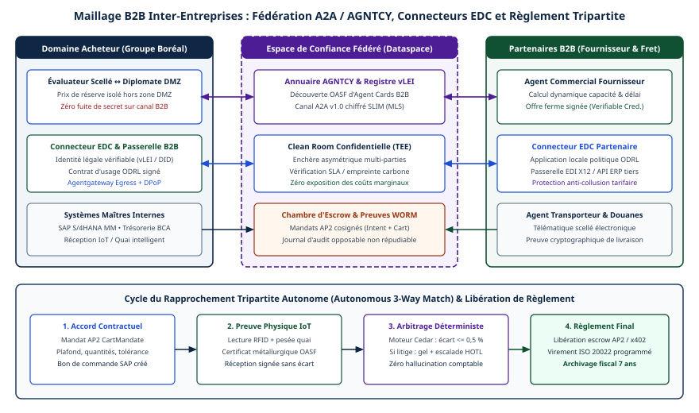

# Chapitre 45 — Réseaux B2B fédérés et négociation entre agents

*Question directrice : comment des agents de plusieurs entreprises négocient-ils et partagent-ils des données sans fuite de secrets, sans collusion et sans fraude au règlement ?*

> **État de référence :** faits arrêtés au 11 novembre 2026; ODRL Information Model 2.2 (recommandation du W3C du 15 février 2018), Dataspace Protocol 2025-1, vLEI Ecosystem Governance Framework 4.0. Les sources [1] à [14] sont des pages primaires lues pour ce chapitre; les deux documents de [15] ont été repérés sans être lus. Les constructions sans source identifiée sont présentées comme des cibles de conception à valider.

Entre deux entreprises, un agent ne rencontre plus un outil qu'il maîtrise, mais un autre agent, qui sert un intérêt contraire. Chacun détient ce que l'autre voudrait connaître : un prix plancher, une marge, un carnet de commandes. Chacun lit des messages que l'autre a rédigés. Et l'échange se termine par un paiement.

La thèse : aucune des trois protections demandées ne peut reposer sur le modèle de langage. Le modèle formule et propose; des composants déterministes, attestés ou contractuels décident. Les couches basses de cet assemblage sont normalisées; la négociation et la collusion relèvent encore de la recherche.

---

## 45.1 Du couple client-fournisseur au réseau fédéré

L'intégration interentreprises classique est bilatérale. Chaque paire de partenaires convient d'un canal, d'un format, d'une identité et d'un contrat, et rien de ce qui est convenu avec l'un ne sert avec le suivant.

Un réseau fédéré déplace l'accord du couple vers le réseau. Les participants adoptent un protocole, un vocabulaire de politiques et un mécanisme d'identité communs; chacun garde ses systèmes et ses données. Le Dataspace Protocol nomme cette fédération un *dataspace* : des entités y publient des données, négocient des accords et y accèdent sous contrôle d'usage [3].

L'arrivée d'agents y introduit des risques qui se traitent chacun à une couche différente. Plus on s'approche du comportement de l'agent, moins il existe de norme.

| Risque | Mécanisme | Maturité |
|---|---|---|
| Usage non convenu des données | ODRL, DSP, connecteur EDC | Recommandation du W3C; protocole stable |
| Contrepartie sans existence légale vérifiable | vLEI | Cadre publié; extension aux agents proposée |
| Fuite d'un secret de négociation | Séparation de la négociation et de l'évaluation | Cible de conception, sans source |
| Fuite lors d'un calcul conjoint | Environnement d'exécution de confiance | Produits offerts |
| Collusion | Revue des consignes, journalisation | Recherche; aucune défense éprouvée |
| Paiement indu | Rapprochement à trois voies | Pratique établie; raccord aux agents non spécifié |

---

## 45.2 Connecteurs et contrats d'usage : Eclipse Dataspace Components et ODRL

### ODRL : exprimer une politique

ODRL Information Model 2.2 est une recommandation du W3C datée du 15 février 2018 [1]. Une politique (`Policy`) regroupe des règles. Une règle est une permission, une interdiction ou un devoir, et porte sur une action exercée sur un actif par une partie. Une contrainte précise une action ou conditionne une règle.

Deux sous-classes structurent la négociation. Une offre (`Offer`) exige un cédant (`assigner`) et n'accorde rien. Un accord (`Agreement`) exige un cédant et un cessionnaire (`assignee`), et accorde les règles entre les parties [1].

Deux propriétés pèsent sur un usage par des agents. La propriété `conflict` vaut `perm`, `prohibit` ou `invalid`, cette dernière par défaut : une politique où une permission et une interdiction se contredisent est alors nulle en entier [1]. Une politique rédigée ou fusionnée par un modèle doit donc passer une validation déterministe avant d'être offerte. Ensuite, ODRL exprime et n'applique rien : la recommandation définit un évaluateur de règles, sans prescrire de mécanisme d'application [1].

### DSP : négocier un accord

Le Dataspace Protocol 2025-1, déclaré stable, est publié sous licence Apache 2.0 et gouverné par l'Eclipse Dataspace Working Group, après l'IDSA [3].

Sa négociation de contrat est une machine à états [4]. Sept états sont définis : `REQUESTED`, `OFFERED`, `ACCEPTED`, `AGREED`, `VERIFIED`, `FINALIZED` et `TERMINATED`, le seul que la source lue qualifie de terminal. Le consommateur l'ouvre par une demande, ou le fournisseur par une offre. Chaque partie peut y mettre fin à tout moment. Avant la finalisation, le consommateur envoie un message de vérification de l'accord. Un accord désigne exactement un jeu de données, avec un horodatage, un cédant et un cessionnaire.

### EDC : mettre en œuvre

Eclipse Dataspace Components fournit le connecteur. Son plan de contrôle assemble les catalogues, crée les accords, gère les transferts et surveille le respect des politiques; les plans de contrôle des deux parties se parlent en DSP, et le transfert revient à un plan de données distinct [2]. Quatre traits comptent ici [2].

- **L'actif décrit, il ne contient pas.** La documentation déconseille de placer des secrets dans ses métadonnées.
- **Deux politiques par définition de contrat.** Une politique d'accès, cachée au consommateur, décide de ce qu'il voit; une politique de contrat figure dans l'offre. Le catalogue est produit à l'exécution, selon les justificatifs présentés.
- **La négociation est asynchrone.** Un fournisseur peut la retenir pour approbation manuelle : un point d'insertion pour l'humain dans la boucle (chapitre 22).
- **Un accord se retire.** Le retrait bloque les nouveaux transferts et fait terminer ceux qui sont en cours.

### Ce que cela donne à un agent, et ce qui manque

La négociation porte sur des politiques structurées et des transitions d'état, non sur du texte libre. Un agent ne « convainc » pas un connecteur; le modèle intervient en amont, dans le choix d'une offre et la formulation d'une demande. Le résultat expérimental du chapitre 37 va dans ce sens. L'API de gestion du connecteur ne doit jamais être exposée à un réseau non fiable [2] : un agent y accède par un outil étroit, derrière une passerelle (chapitre 24).

Trois limites restent. Une fois les données transférées, retirer un accord n'efface pas une copie : le respect de l'accord dépend du consommateur et du contrat. Les pages lues ne décrivent aucune négociation de prix; la sémantique commerciale reste à définir (chapitre 10). Enfin, le protocole désigne les parties par des identifiants propres à l'espace [4], sans dire qui elles sont.

---

## 45.3 Identité légale des organisations et des rôles

Le chapitre 29 conclut qu'entre organisations, les mécanismes d'identité transportent une assertion et que la confiance initiale reste contractuelle. Le vLEI (verifiable Legal Entity Identifier) vise ce maillon : rattacher une signature à une personne morale enregistrée.

### Ce que le cadre définit

La GLEIF tient le vLEI Ecosystem Governance Framework, dont la page lue indique la version 4.0 et un document principal daté du 25 mars 2026 [5]. La GLEIF détient un identifiant racine et qualifie des émetteurs, les Qualified vLEI Issuers (QVI), sur une infrastructure KERI. Le cadre décrit cinq justificatifs, dont trois comptent ici.

| Justificatif | Émetteur | Titulaire |
|---|---|---|
| Legal Entity vLEI Credential | QVI | Personne morale |
| Official Organizational Role (OOR) | QVI | Représentant officiel de la personne morale |
| Engagement Context Role (ECR) | Personne morale, ou QVI pour elle | Personne agissant dans un rôle autre qu'officiel |

### Le rôle OOR ne désigne pas un agent

Le justificatif OOR atteste qu'une personne occupe une fonction officielle dans une personne morale [5]. Rien, dans la page lue, ne prévoit son émission à un agent logiciel.

La GLEIF traite le sujet comme un chantier. Dans un billet daté du 1er septembre 2026, son chef de la direction soutient que le droit attribue déjà la responsabilité des actes d'un agent, et que ce qui manque est la preuve [6]. Il propose que chaque agent porte une preuve, lisible par machine, de l'identité légale de l'organisation qu'il sert, de l'autorité déléguée et de ses limites, par une chaîne cryptographique qui remonte à une personne vérifiée. Il préfère une autorité partitionnée (quel agent fait quoi, sous quel mandat) à une identité propre à chaque agent. Le billet décrit une orientation, sans émission en production à des agents.

### Lecture pour l'entreprise

La répartition suivante est une déduction, non un profil publié. Le justificatif d'entité établit qui est la contrepartie. Le justificatif OOR établit quel dirigeant peut l'engager. L'agent porte une délégation distincte, bornée et révocable, qui renvoie aux deux premiers; le justificatif ECR, que la personne morale émet et révoque elle-même, en est le support le plus proche. Aucune page lue n'en fixe le format; un brouillon de l'IETF et le document de réflexion de la GLEIF cité par le billet ont été repérés sans être lus [15]. Cette chaîne recoupe le Delegated Agent Participant ID que propose l'IDSA, vérifié par le connecteur avant toute transaction (chapitre 37). L'acceptation du vLEI par un espace de données donné n'a pas été vérifiée.

---

## 45.4 Négocier sans se dévoiler : séparer la négociation de l'évaluation

Un agent négociateur réunit par construction les trois conditions de la trifecta létale (chapitre 31) : une donnée privée, le prix de réserve; un contenu non fiable, les messages de la contrepartie; un canal sortant, ses réponses. Une injection dans un message adverse peut lui faire écrire ce qu'il sait.

### Une cible de conception, non un patron établi

La scission « Diplomate / Évaluateur interne » n'a été retrouvée sous ce nom dans aucune source : c'est une cible de conception, adossée à un principe publié. CaMeL sépare le flux de contrôle, tiré de la requête de confiance, du flux de données, de sorte qu'une donnée non fiable ne puisse jamais modifier le déroulement du programme; des capacités empêchent une donnée privée de sortir par un flux non autorisé. La garantie ne couvre pas les attaques qui n'altèrent ni ce déroulement ni ces données, ni les canaux auxiliaires; sur AgentDojo, 77 % des tâches sont résolues avec garanties prouvables, contre 84 % sans défense [7]. Les auteurs rapportent 77 % de tâches résolues avec sécurité prouvable sur AgentDojo, contre 84 % sans défense : la séparation a un coût.

Appliqué à la négociation, le principe donne deux composants.

| | Diplomate | Évaluateur interne |
|---|---|---|
| Lit | Les messages de la contrepartie | Des offres structurées, à champs typés |
| Détient | Aucun secret | Seuils, coûts, règles d'approbation |
| Produit | Texte et offres structurées | Une décision bornée : accepter, refuser, contre-proposer |

Le Diplomate est un modèle de langage; l'Évaluateur, autant que possible, des règles et un calcul dans le système d'enregistrement. Le Diplomate ne peut pas divulguer ce qu'il ignore. L'Évaluateur ne peut pas être détourné par un texte qu'il ne lit pas. Entre les deux, la frontière est un schéma validé, non une consigne.

### Ce que la scission ne règle pas

Les décisions elles-mêmes renseignent l'adversaire. Une prépublication de juillet 2026, acceptée à l'atelier AI4TCI d'ARES 2026, formalise cette fuite comportementale : un observateur infère le prix de réserve à partir des trajectoires de concession, du rythme et des schémas de convergence, sans qu'aucune valeur soit divulguée [8]. Selon le résumé, les techniques cryptographiques protègent les valeurs explicites et laissent passer cette fuite. Le texte propose une politique de négociation aléatoire et rapporte, sur 3 000 négociations bilatérales synthétiques, une précision d'inférence adverse réduite de 43 à 50 %, le taux de succès et l'utilité restant supérieurs à 90 %. Fondé sur des simulations, le résultat indique une direction, pas un réglage.

Trois mesures en découlent, à titre d'hypothèses de travail : plafonner le nombre de tours, ne pas motiver un refus, répondre par paliers plutôt qu'en valeurs exactes.

---

## 45.5 Calcul partagé confidentiel : salles blanches et environnements d'exécution de confiance

Certaines collaborations exigent de calculer sur les données des deux parties : rapprocher une prévision de demande d'une capacité, vérifier qu'une zone d'accord existe. Aucune ne veut livrer ses données à l'autre, ni à un tiers.

Une salle blanche de données (*data clean room*) y répond : les données de chacun entrent dans un environnement où ne s'exécute qu'un code approuvé par tous, et seul un résultat convenu en sort. Un environnement d'exécution de confiance (TEE) y ajoute une garantie matérielle contre les logiciels et les administrateurs de l'exploitant, non contre qui tient physiquement le serveur (chapitre 46).

### Un exemple documenté

La documentation de Confidential Space, chez Google Cloud, décrit ce modèle sans employer le terme de salle blanche [9]. Trois rôles y sont séparés et supposés se méfier les uns des autres. Les collaborateurs de données fixent les conditions d'accès à leurs données; ils ne voient pas celles des autres et ne modifient pas le code. L'auteur de la charge de travail écrit le code, sans accès aux données ni aux résultats. L'exploitant la lance, sans accès aux données ni prise sur le code.

Le mécanisme central est l'attestation. Un service vérifie des assertions sur l'image du système, le conteneur et la machine virtuelle, puis émet un jeton. Chaque collaborateur conditionne l'accès à ses clés aux attributs de ce jeton : la donnée ne se déchiffre que pour la charge de travail convenue. Le matériel pris en charge comprend AMD SEV, Intel TDX et Intel TDX avec NVIDIA Confidential Computing [9].

### Les limites à retenir

La page en signale deux [9]. Les collaborateurs peuvent accéder aux résultats, selon ce que produit la charge de travail : le TEE protège le calcul, pas la sortie. Et tous les rôles doivent coopérer pour qu'un résultat existe.

La confidentialité dépend donc du code approuvé autant que du matériel. Un code qui renvoie une ligne par client divulgue tout, enclave ou non. La revue du code et la forme de la sortie (agrégat, seuil minimal, réponse binaire) sont l'objet réel de l'accord.

---

## 45.6 Collusion algorithmique

Le mot recouvre deux risques : des agents de tarification concurrents qui s'alignent au détriment des clients, et des agents qui se coordonnent en secret au détriment de leurs mandants.

### L'alignement des prix

Le résultat fondateur est évalué par les pairs : Calvano et ses coauteurs montrent en 2020 que des algorithmes de tarification par apprentissage Q, en concurrence répétée, apprennent de façon constante à pratiquer des prix supraconcurrentiels, sans communiquer entre eux [10].

Fish, Gonczarowski et Shorrer étendent le constat aux modèles de langage [11]; leur expérience principale porte sur un seul modèle (GPT-4, version 0613, avec GPT-5.2 en test de robustesse), dans un oligopole de Bertrand simple à horizon fixe. Dans leurs expériences en oligopole, des agents de tarification fondés sur un LLM atteignent rapidement et de façon autonome des prix supraconcurrentiels. Des variations de formulation en apparence anodines dans les consignes modifient fortement l'écart, et les résultats s'étendent aux enchères. Le texte, révisé le 31 août 2026, indique une acceptation à la conférence EC 2026.

La consigne d'un agent de tarification est donc un objet de conformité : elle se versionne et se fait revoir par le contentieux, comme une politique de prix.

### La coordination secrète

Une prépublication de Motwani et de ses coauteurs, révisée en juillet 2025, formalise la collusion secrète entre agents génératifs, où une coordination non voulue passe par des canaux stéganographiques difficiles à détecter [12]. Le résumé juge les capacités stéganographiques des modèles testés encore limitées, avec un saut pour GPT-4, et recommande une surveillance continue des modèles de pointe.

### L'état du droit et des défenses

Au Canada, le Bureau de la concurrence a publié le 22 janvier 2026 un compte rendu de sa consultation sur la tarification algorithmique, qui a recueilli plus de cent mémoires. L'un des quatre thèmes récurrents est que cette tarification peut mener à des comportements anticoncurrentiels [13]. Le document rapporte des avis et ne fixe aucune règle. L'argument de l'autonomie ne protège pas l'entreprise (chapitre 36).

Le chapitre 31 constate que les menaces multi-agents n'ont aucune défense éprouvée; rien de ce qui a été lu ici ne le contredit. Les mesures suivantes sont des précautions, non des parades :

- journaliser, côté entreprise, tous les échanges entre agents;
- préférer des messages structurés au texte libre, ce qui restreint, par déduction, l'espace d'un canal caché;
- faire examiner toute salle blanche partagée avec un concurrent, dont le résultat peut être un signal de prix.

---

## 45.7 Du contrat au règlement : rapprochement à trois voies

### Un contrôle comptable établi

Le rapprochement à trois voies (*three-way matching*) est une pratique des comptes fournisseurs. La documentation d'un progiciel de gestion la définit ainsi : rapprocher le prix de la facture du prix du bon de commande, et la quantité facturée de la quantité des réceptions [14]. Le rapprochement à deux voies s'arrête au prix.

Les écarts se comparent à des tolérances, fixées par entité, par fournisseur ou par article. Dans l'exemple de la documentation, une facture à 1,10 pour un article commandé à 1,00, sous une tolérance de 5 %, est retenue jusqu'à résolution de l'écart [14].

### Pourquoi il compte davantage avec des agents

Les protocoles de paiement agentiques prouvent autre chose. Un mandat AP2 établit qu'un paiement est autorisé pour un panier; x402 place le paiement dans l'échange HTTP (chapitre 10). Ni l'un ni l'autre ne prouve que la chose commandée a été livrée, et les litiges restent hors du champ des spécifications. Une facture injectée, un prix modifié après l'accord ou une livraison partielle passent sans contrôle si l'agent qui négocie est aussi celui qui paie.

### Une cible de conception

L'exigence d'un rapprochement à trois voies avant un règlement AP2 ou x402 n'a été trouvée dans aucune spécification ni documentation lue. Elle est proposée ici comme cible de conception.

| Voie | Achat de biens | Échange de données fédéré |
|---|---|---|
| Ce qui a été convenu | Bon de commande | Accord finalisé en DSP [4] |
| Ce qui a été reçu | Réception enregistrée | État du transfert au connecteur [2] |
| Ce qui est réclamé | Facture | Demande de paiement présentée à l'agent |

Quatre règles la rendent effective.

1. **Trois sources indépendantes.** Une réception déclarée par le fournisseur n'en est pas une.
2. **Un code déterministe.** Le rapprochement est un calcul, pas un jugement de modèle (chapitre 17); les tolérances vivent dans le système d'enregistrement.
3. **Une séparation des tâches.** L'agent qui négocie ne déclenche pas le paiement; le mandat ne s'émet qu'après un rapprochement réussi.
4. **Un écart suspend.** Hors tolérance, le dossier passe à un humain (chapitre 22).

Un cas échappe au schéma : le micropaiement x402, où le service est rendu dans la réponse qui suit le paiement. L'option du chapitre 10 s'applique : un portefeuille dédié et plafonné, complété ici par un rapprochement a posteriori. Un paiement indu se traite par compensation (chapitre 18).

---

## Grille de décision

| Décision | Option par défaut | Quand s'en écarter |
|---|---|---|
| Droits d'usage | ODRL 2.2, validé par code avant toute offre [N] | Partenaire unique sous contrat classique |
| Accès aux données | DSP par un connecteur; l'agent passe par un outil étroit [N] | Aucun espace commun : entente bilatérale (chapitre 29) |
| Identité et délégation | Justificatif d'entité vérifiable (vLEI si le réseau l'accepte); délégation distincte, bornée, révocable [S] | Réseau fermé à adhésion contractuelle |
| Secrets de négociation | Hors du contexte du modèle exposé à la contrepartie [S] | Paramètres publics |
| Calcul sur données conjointes | TEE avec attestation, code revu, sortie agrégée [É] | Données non sensibles : transfert sous accord |
| Consignes de tarification | Versionnées et revues par le contentieux [S] | — |
| Règlement | Rapprochement à trois voies avant tout mandat ou signature [S] | Micropaiement : plafond et rapprochement a posteriori |

---

## Points à retenir

- Le modèle de langage propose; les protections tiennent à des composants déterministes, attestés ou contractuels.
- ODRL exprime une politique et DSP en fait un accord par une machine à sept états. Ni l'un ni l'autre n'applique l'accord une fois les données copiées.
- Le connecteur EDC offre trois points de contrôle : politique d'accès cachée, approbation manuelle, retrait d'un accord.
- Le justificatif OOR du vLEI désigne un représentant officiel humain. Son extension aux agents est une orientation de la GLEIF, sans format publié dans les pages lues.
- La scission « Diplomate / Évaluateur interne », sans source, applique un principe publié : une donnée non fiable ne doit pas atteindre ce qui détient un secret. Elle ne suffit pas, car les concessions révèlent le prix de réserve.
- Un TEE protège le calcul contre les logiciels et les administrateurs de l'exploitant, pas la sortie contre les participants.
- Des agents de tarification fondés sur des LLM atteignent en expérience, de façon autonome, des prix supraconcurrentiels; la formulation des consignes pèse sur le résultat.
- Un mandat de paiement prouve une autorisation, non une livraison. Le rapprochement à trois voies comble l'écart; son raccord aux protocoles d'agents reste à spécifier.

---

## Sources

Pages primaires lues le 12 novembre 2026 :

1. [ODRL Information Model 2.2](https://www.w3.org/TR/odrl-model/)
2. [Eclipse Dataspace Components — plan de contrôle](https://eclipse-edc.github.io/documentation/for-adopters/control-plane/)
3. [Dataspace Protocol 2025-1](https://eclipse-dataspace-protocol-base.github.io/DataspaceProtocol/2025-1/) — présentation et statut seulement.
4. [Dataspace Protocol — Contract Negotiation Protocol](https://raw.githubusercontent.com/eclipse-dataspace-protocol-base/DataspaceProtocol/main/specifications/negotiation/contract.negotiation.protocol.md) — source du dépôt.
5. [GLEIF — vLEI Ecosystem Governance Framework](https://www.gleif.org/en/vlei/introducing-the-verifiable-lei-vlei)
6. [GLEIF — When AI agents transact, who stands behind them?](https://www.gleif.org/en/newsroom/blog/when-ai-agents-transact-who-stands-behind-them-why-verifiable-organizational-identity-is-critical-to-agentic-payments) — billet d'organisme.
7. [Defeating Prompt Injections by Design (arXiv 2503.18813)](https://arxiv.org/abs/2503.18813) — résumé puis extraits relus le 14 novembre 2026.
8. [Behavioral Privacy Leakage in Agentic Negotiation (arXiv 2607.06815)](https://arxiv.org/abs/2607.06815) — résumé puis extraits relus le 14 novembre 2026.
9. [Google Cloud — Confidential Space](https://docs.cloud.google.com/confidential-computing/confidential-space/docs/confidential-space-overview) — documentation d'éditeur.
10. [Calvano et coll., AER 110(10), 2020](https://www.aeaweb.org/articles?id=10.1257/aer.20190623) — résumé.
11. [Algorithmic Collusion by Large Language Models (arXiv 2404.00806)](https://arxiv.org/abs/2404.00806) — résumé puis extraits relus le 14 novembre 2026.
12. [Secret Collusion among AI Agents (arXiv 2402.07510)](https://arxiv.org/abs/2402.07510) — résumé puis extraits relus le 14 novembre 2026.
13. [Bureau de la concurrence — communiqué du 22 janvier 2026](https://www.canada.ca/en/competition-bureau/news/2026/01/competition-bureau-report-highlights-public-feedback-on-algorithmic-pricing-and-competition.html)
14. [Microsoft Learn — Accounts payable invoice matching](https://learn.microsoft.com/en-us/dynamics365/finance/accounts-payable/accounts-payable-invoice-matching) — documentation d'éditeur.

Repérés, non lus :

15. [draft-hood-agtp-lei-01 (30 octobre 2026, succédant à la version 00)](https://datatracker.ietf.org/doc/draft-hood-agtp-lei/); [GLEIF, Agentic AI in Payments (document de travail de septembre 2026)](https://www.gleif.org/organizational-identity/research-publications/2026-08-13_agentic_ai_in_payments_v1.0-1.pdf).

## Limites de ce chapitre

- Les sources [7], [8], [11] et [12], d'abord connues par leur seul résumé, ont été relues au-delà du résumé le 14 novembre 2026, par un outil qui en rend des extraits; les écarts relevés sont corrigés dans le texte.
- **Éléments sans source.** « Diplomate / Évaluateur interne » et le rapprochement à trois voies avant un règlement AP2 ou x402 figurent comme cibles de conception. « Clean Rooms sur TEE » repose sur une seule documentation d'éditeur, qui n'emploie pas le terme; la définition d'une salle blanche et la description de l'intégration bilatérale viennent de la connaissance générale.
- **vLEI.** La page du cadre n'explique ni la vérification des rôles ni le lien avec ISO 5009. La répartition entité / OOR / délégation est une déduction. Le Delegated Agent Participant ID est repris du chapitre 37, sans relecture de sa source.
- **DSP, EDC, ODRL.** La machine à états a été lue dans la branche principale du dépôt; la page 2025-1, relue à l'audit, n'en affiche pas le texte. DCP, le moteur de politiques d'EDC, la fin de la recommandation ODRL et son vocabulaire n'ont pas été lus.
- **Articles.** [10] reste connu par son résumé; [7], [8], [11] et [12], d'abord lus par leur résumé, ont été recoupés par extraits le 14 novembre 2026.
- **Mesures proposées.** L'effet des messages structurés sur les canaux cachés et les mesures de la section 45.4 n'ont aucune mise en œuvre lue.
- **Concurrence et accès restreints (14 novembre 2026).** Seul le communiqué du Bureau [13] a été lu; aucune autre autorité n'a été vérifiée. Lors de la vérification du 14 novembre 2026, le W3C ([1], `w3.org/TR/odrl-model/` et `odrl.jsonld`) retourne HTTP 403 (protection Cloudflare) et le communiqué sur `www.canada.ca` [13] expire en délai d'attente aux requêtes automatisées; leur contenu est confirmé par recherche web et par les extraits antérieurs.
- **AP2 et x402.** Leur description reprend le chapitre 10. Les renvois aux autres chapitres ont été vérifiés à l'audit, sans relecture de leurs sources.

## Mise en œuvre — Maillages B2B inter-entreprises, espaces de données et négociation multi-parties {.volet}

:::: {.encadre .executive}
::: {.encadre-titre}
**Synthèse exécutive**
:::

- **Enjeu stratégique.** Les gains internes de la fabrique agentique butent sur la frontière juridique de l'organisation : relances de fournisseurs par courriel, messages EDI X12 rigides, litiges de facturation de soixante jours, appels d'offres manuels. Exposer un agent d'achat ou de souscription à des agents externes, sans architecture de confiance mutuelle, expose l'entreprise à l'extraction de ses marges, à l'usurpation d'un mandataire social et à des engagements contractuels non autorisés.
- **Décisions architecturales structurantes.**
  1. *Irréversible à moyen terme* : fédérer les relations B2B en couplant la découverte et la délégation AGNTCY / A2A v1.0 à un connecteur EDC / DSP, à des politiques d'usage W3C ODRL 2.2, qui expriment l'usage sans l'appliquer (section 45.2), et à des identifiants d'entités juridiques vLEI (GLEIF).
  2. *Non négociable en sécurité économique* : isoler physiquement le graphe privé de valorisation interne (coûts de revient, prix de réserve, pénalités de rupture) de l'agent diplomate exposé au tiers, et déporter les enchères multi-attributs sensibles dans des salles blanches confidentielles sur TEE attesté.
  3. *Structurante pour la finance opérationnelle* : remplacer le contrôle a posteriori des factures par un rapprochement à trois voies autonome, qui subordonne la libération d'un séquestre AP2 à la concordance déterministe (Cedar) entre le mandat contractuel, la preuve physique IoT de réception et la facture; le micropaiement x402 passe par un portefeuille dédié et plafonné, avec rapprochement a posteriori (section 45.7).
- **Indicateurs de gouvernance.** Partenaires B2B actifs authentifiés par vLEI et sous contrat ODRL signé (100 %), taux de fuite de paramètres de réserve lors des campagnes Red Team B2B (0 %), délai médian de rapprochement commande-réception-règlement ($< 8\text{ min}$ hors litige physique) et taux d'écarts interceptés sans perte financière.
::::

---

## 45.8 Traverser les frontières de confiance zéro : couplage A2A / AGNTCY, connecteurs Dataspace (EDC) et identité légale vLEI

À l'intérieur d'une entreprise (chapitres 6 et 30), les agents partagent une racine de confiance : l'autorité de certification SPIFFE/SPIRE du groupe, son annuaire Entra ID et l'arbitrage hiérarchique d'une direction générale unique. Au-delà de la frontière légale, face à un donneur d'ordre industriel, un aciériste tiers, un transporteur transfrontalier ou un assureur maritime, cette racine disparaît. Chaque participant opère en confiance nulle mutuelle. Le partenaire est à la fois le fournisseur d'un concurrent direct, une cible possible de compromission de la chaîne d'approvisionnement (OWASP ASI04) et une contrepartie juridiquement autonome, dont les intérêts divergent sur le partage de la marge.

### Les limites de l'EDI patrimonial

L'EDI (ANSI X12 en Amérique du Nord, UN/EDIFACT en Europe) transporte de façon fiable des transactions canoniques : bon de commande (X12 850), avis préalable d'expédition (856), facture (810). Il reste muet devant une exception. Quand une tempête verglaçante ferme un corridor ferroviaire, ou qu'une coulée d'acier présente un écart métallurgique mineur, acceptable sous décote, sa grammaire ne permet ni de négocier un compromis multi-contraintes (délai contre remise, fractionnement de lot, itinéraire alternatif), ni de vérifier une empreinte carbone unitaire. Les portails fournisseurs font ressaisir les mêmes statuts par des opérateurs humains dans douze extranets clients incompatibles.

Remplacer un flux EDI par un canal A2A v1.0 libre serait une régression en sécurité juridique et en souveraineté des données. A2A normalise le cycle de vie d'une tâche déléguée et AGNTCY (OASF, SLIM) fournit l'annuaire et la messagerie chiffrée. Ni l'un ni l'autre ne définit le droit de réutiliser une donnée industrielle partagée, ni la capacité juridique du signataire. Les sections 45.2 et 45.3 décrivent les mécanismes qui comblent ces deux manques.

### Les quatre strates du maillage

Le maillage B2B de référence, pensé dans le sillage de Catena-X, de Manufacturing-X et de la fondation Eclipse, superpose quatre strates à chaque frontière d’entreprise. C’est une cible pour 2027, non un état de l’art vérifié : la négociation entre agents et la prévention de la collusion relèvent encore de la recherche (section 45.1).

1. **Identité vérifiable.** Un identifiant SPIFFE interne (`spiffe://boreal.ca/...`) n'a aucune valeur probante pour une banque ou un fournisseur externe. Chaque passerelle B2B présente donc un justificatif vLEI, émis par un émetteur qualifié accrédité par la GLEIF, sur infrastructure KERI / ACDC ou W3C Verifiable Credentials. Le justificatif d'entité établit qui est la contrepartie et le justificatif OOR, quel dirigeant peut l'engager; l'agent `boreal-bel-procurement` agit au nom de Groupe Boréal Inc. (division Boréal Équipements & Logistique, BEL) sous une délégation opposable du vice-président aux approvisionnements, distincte, bornée et révocable, qui renvoie à ces deux justificatifs. Le justificatif OOR désigne une personne qui occupe une fonction officielle : rien ne prévoit son émission à un agent logiciel, et l'acceptation du vLEI par un espace de données n'a pas été vérifiée (section 45.3).
2. **Souveraineté d'usage des données.** Avant qu'un agent fournisseur transmette une nomenclature technique, un passeport numérique de produit (DPP) ou une courbe de capacité d'usine, les deux connecteurs EDC négocient automatiquement en DSP une offre, puis un accord immuable `ContractAgreement` exprimé en ODRL 2.2. Après la signature bilatérale, le plan de contrôle émet un jeton éphémère `EndpointDataReference` (EDR) qui ouvre le transfert sur le plan de données. La politique ODRL exprime l'interdiction de l'ingestion des données du partenaire dans l'entraînement de modèles (`aiTrainingProhibited`), de la rétention au-delà de la clôture de l'appel d'offres et de toute retransmission à des sous-agents tiers non listés. ODRL n'applique rien : retirer un accord n'efface pas une copie, et le respect de l'accord dépend du consommateur et du contrat (section 45.2).
3. **Négociation structurée sur A2A v1.0 / SLIM.** Une fois le tunnel EDC établi et chiffré par SLIM (au moyen de MLS, *Messaging Layer Security*), les agents échangent des artefacts A2A typés par schémas JSON (`RFQProposal`, `CounterOffer`, `CapacityAttestation`) plutôt que de la prose, qui peut transporter une injection entre entreprises (OWASP ASI01 / ASI07).
4. **Coexistence avec l'EDI.** Pour les partenaires de rang 2 ou 3 qui n'ont pas encore d'agents A2A natifs fin 2026–2027, un adaptateur B2B bidirectionnel traduit les accords conclus en transactions X12 850/855/856 normalisées et préserve l'investissement ERP existant.



| Dimension B2B | EDI X12 / EDIFACT patrimonial | API / A2A direct point-à-point | Maillage fédéré A2A + EDC (ODRL) + vLEI |
|:------------------|:--------------------------|:-------------------------|:-----------------------------|
| Preuve d'entité légale | Pré-câblage VAN bilatéral lent (4–12 sem.) | Certificat mTLS technique sans mandat social | vLEI et rôle OOR vérifiables instantanément |
| Gouvernance des données | Implicite dans le contrat-cadre papier | Aucune garantie technique après la transmission | Contrat ODRL 2.2 négocié et surveillé par le connecteur EDC; le respect dépend du consommateur et du contrat |
| Gestion des exceptions | Nulle (rejet syntaxique, puis courriel humain) | Souple, mais vulnérable à la manipulation | Négociation bornée sur schémas typés et salle blanche |
| Risque d'injection ASI01 | Très faible (grammaire positionnelle stricte) | Élevé si des champs de texte libre sont ingérés par un modèle de langage | Maîtrisé (désérialisation stricte et isolation du Diplomate) |
| Règlement financier | Facture 810 et rapprochement manuel de 30–60 j | Webhook de paiement sans preuve physique | Rapprochement à trois voies déterministe : IoT, Cedar, AP2/x402 |

---

## 45.9 Négociation asymétrique, isolation des consignes et salles blanches confidentielles

La négociation entre un agent acheteur et un agent vendeur repose sur une asymétrie d'information privée. Pour arbitrer entre trois aciéristes sur un lot critique de tôles magnétiques, la fonction d'utilité de l'entreprise acheteuse dépend de paramètres confidentiels : son prix maximal tolérable (prix de réserve $P_{\max}$), le coût horaire réel d'arrêt de sa ligne d'assemblage si la livraison glisse de quarante-huit heures et le niveau exact de son stock de sécurité. Le risque est décrit à la section 45.4.

### Le contre-exemple de l'agent négociateur monolithique

Injecter `prix_max_autorise = 142 000 CAD` et `urgence_rupture_stock = CRITIQUE_J+3` dans la consigne système de l'agent qui dialogue en A2A avec l'agent commercial externe expose le surplus économique de l'entreprise. Même sans attaque directe, un agent vendeur entraîné par apprentissage par renforcement sur des milliers de négociations sonde l'élasticité de son interlocuteur en délai et en prix. Il peut aussi glisser dans les métadonnées d'un certificat produit une directive adverse qui pousse l'agent acheteur à concéder le haut de sa fourchette.

### Le Diplomate et l'Évaluateur interne

La scission de la section 45.4 prend la forme de deux composants séparés par une frontière déterministe.

1. **L'agent Diplomate externe (zone DMZ B2B).** Seul autorisé à communiquer sur le canal A2A / EDC, il ne connaît ni le prix de réserve, ni les marges internes, ni l'état des stocks. Il reçoit pour chaque tour une enveloppe de mandat tactique étroite, générée pour ce tour (par exemple : *« Demander une cotation ferme pour 40 tonnes grade M270 livrées à Drummondville avant le 18 mai, objectif cible 126 500 \$ CAD, variante autorisée sur incoterm DAP »*). Un analyseur syntaxique strict convertit chaque réponse entrante du fournisseur en structure numérique avant qu'elle franchisse la DMZ : aucun champ de commentaire libre externe n'atteint le système interne.
2. **L'Évaluateur interne (zone interne à haute sécurité).** Isolé du réseau externe, ce service hybride (optimiseur mathématique déterministe secondé par un SLM interne d'analyse contractuelle) évalue les offres structurées reçues selon une fonction de score multi-attributs pondérée :

$$U(\mathbf{x}) = w_p \cdot \frac{P_{\max} - p}{P_{\max} - P_{\text{cible}}} + w_d \cdot \exp\bigl(-\lambda \max(0, d - d_{\text{req}})\bigr) + w_q \cdot S_{\text{qual}}(q) - w_c \cdot \frac{E_{\text{CO}_2}}{E_{\text{plafond}}}$$

Tant que $p \le P_{\max}$ et que les contraintes dures de conformité sont satisfaites, le moteur calcule la contre-proposition optimale du tour $t+1$, avec un plafond dur de $T_{\max} = 4$ tours qui interdit le sondage statistique prolongé par un tiers, ou émet un jeton d'acceptation vers le sas de signature AP2.

### Vérifications sans divulgation en salle blanche

Quand la coopération exige de croiser des données mutuellement secrètes, les parties recourent à une salle blanche exécutée dans un TEE (Intel TDX, AMD SEV-SNP ou NVIDIA H100/B200 Confidential Computing). Deux cas : vérifier qu'un sous-traitant dispose de la capacité machine libre promise sur les six prochaines semaines, sans qu'il révèle son carnet de commandes clients; calculer une tarification d'assurance flotte sur la sinistralité fine, sans transférer les données brutes.

Chaque entreprise vérifie à distance l'empreinte cryptographique (PCR) du binaire d'évaluation neutre avant de lui libérer ses entrées chiffrées. L'attestation et la répartition des rôles sont décrites à la section 45.5. Le TEE exécute le calcul conjoint (optimisation linéaire, score de compatibilité ou audit d'empreinte carbone Scope 3), détruit la mémoire vive éphémère et ne renvoie aux agents A2A des deux rives qu'un résultat booléen ou agrégé signé (*« Capacité disponible confirmée à 99,4 %; prix d'équilibre mutuellement gagnant : 131 400 \$ CAD »*).

### Accords de niveau de service B2B, pénalités programmables et réputation vérifiable

Dans un écosystème ouvert, des dizaines d'agents fournisseurs publient des Agent Cards qui promettent des délais ambitieux. L'architecture fédérée complète l'évaluation ponctuelle du prix par un registre vérifiable de performance d'exécution. Chaque clôture de rapprochement à trois voies génère un reçu cryptographique cosigné, qui atteste le respect du créneau horaire, la conformité qualité et l'absence de litige. Lors des consultations A2A suivantes, le moteur d'utilité pondère l'offre nominale d'un fournisseur par sa fiabilité observée sur les douze derniers mois. Il pénalise ainsi les promesses non tenues, sans publier d'information nominative chez les concurrents.

Toute passerelle B2B applique aussi un pare-feu protocolaire asymétrique sur les délais et les volumes d'appels : un partenaire externe ne peut soumettre plus de trois requêtes d'appel d'offres par minute, ni maintenir une tâche A2A ouverte sans mise à jour au-delà du TTL négocié dans le contrat ODRL. Cette limite prévient les attaques par déni de service économique (chapitre 40), où un tiers malveillant épuiserait les budgets d'inférence internes sous un flot de fausses demandes de cotation complexes.

#### Extrait 45.1 — Politique Cedar interdisant l’accès du Diplomate B2B aux secrets internes (b2b-dmz-isolation.cedar)

Appliquée sur agentgateway, cette règle interdit à tout agent exposé au réseau EDC / A2A externe d'interroger un outil MCP interne qui expose des marges ou des prix de réserve :

``` cedar
// Tout agent en zone DMZ B2B est bloqué sur les données de marge
forbid (
  principal is Boreal::Agent,
  action == Boreal::Mcp::"InvokeTool",
  resource is Boreal::McpServer
)
when {
  principal.networkZone == "DMZ_EXTERNAL_B2B" &&
  [
    "RESERVE_PRICING",
    "INTERNAL_BILL_OF_MATERIALS_COST",
    "PLANT_OUTAGE_PENALTY_CURVE"
  ].contains(resource.dataSensitivity)
};
```

#### Extrait 45.2 — Contrat d’usage W3C ODRL 2.2 et enveloppe de négociation B2B scindée (b2b-dataspace-offer.json)

Le champ `roleCredential` y montre un justificatif OOR attribué à un délégué; l'exposé indique plutôt qu'un justificatif OOR désigne un représentant officiel et que l'agent porte une délégation distincte, bornée et révocable (section 45.3). Ce descripteur lie l'identité légale vLEI, l'interdiction d'exploitation secondaire des données sous EDC et l'offre structurée, sans aucun contexte privé interne :

``` json
{
  "@context": [
    "http://www.w3.org/ns/odrl.jsonld",
    "https://w3id.org/tractusx/v2.0/context.jsonld"
  ],
  "@type": "odrl:Offer",
  "uid": "urn:uuid:8f41c2d0-91b3-4e6a-8a11-7c3092b41e09",
  "assigner": {
    "vlei": "549300BOREALBELQC882",
    "roleCredential": "OOR:VP_SUPPLY_CHAIN_DELEGATE",
    "edcConnector": "https://edc.bel.boreal.ca/api/v2/dsp"
  },
  "target": "urn:artifact:rfq-steel-m270-2027-05",
  "permission": [{
    "action": "odrl:use",
    "constraint": [
      {
        "leftOperand": "cx-policy:UsagePurpose",
        "operator": "odrl:eq",
        "rightOperand": "b2b.spot.quotation.evaluation"
      },
      {
        "leftOperand": "odrl:elapsedTime",
        "operator": "odrl:lteq",
        "rightOperand": "PT12H"
      }
    ]
  }],
  "prohibition": [{
    "action": [
      "cx-policy:ModelTraining",
      "odrl:distribute",
      "cx-policy:CompetitorBenchmarking"
    ]
  }],
  "rfqPayload": {
    "materialSpec": "ASTM-A677-M270-35A",
    "quantityMetricTons": 40.0,
    "deliveryIncoterms": "DAP_DRUMMONDVILLE_QC",
    "latestArrivalUtc": "2027-05-18T16:00:00Z",
    "targetPriceCad": 126500,
    "maxNegotiationRounds": 4
  }
}
```

:::: {.encadre .sectoriel}
::: {.encadre-titre}
**Droit de la concurrence et chaînes d'approvisionnement : prévenir la collusion tacite algorithmique dans les espaces de données**
:::

Connecter plusieurs fournisseurs d'un même secteur à un espace de données agentique appelle l'attention des autorités de la concurrence (Bureau de la concurrence du Canada, DG COMP européenne, DOJ américain). Deux règles s'ajoutent aux précautions de la section 45.6.

1. **Étanchéité en étoile.** Lors d'un appel d'offres multi-fournisseurs, les sessions A2A / EDC sont bilatérales et isolées. Aucun signal de prix ou de capacité soumis par le fournisseur A ne transite vers le fournisseur B, même sous forme de moyenne agrégée en temps réel.
2. **Aucune clause d'alignement automatique en temps réel.** Les moteurs d'utilité proscrivent les règles du type *« égaler automatiquement le prix concurrent détecté plus 0,5 % »*, assimilables à un cartel algorithmique tacite.
::::

---

## 45.10 Du flux EDI statique au rapprochement à trois voies autonome et au séquestre AP2 / x402

Une négociation conclue en quelques secondes perd son intérêt si le cycle aval de réception, de vérification de facture et de décaissement retombe dans trente jours de rapprochements manuels. Elle expose aussi l'entreprise si un agent financier décaisse des fonds irréversibles sur la foi d'une facture envoyée par un agent tiers compromis. Le contrôle est décrit à la section 45.7. L’orchestration durable (Temporal), les capteurs IoT d’entrepôt, le moteur de politique Cedar et les protocoles AP2 / x402 doivent permettre de l’exécuter de façon instantanée, déterministe et opposable cryptographiquement.

### Les quatre temps de la saga de règlement

1. **Verrouillage contractuel initial.** À l'issue de la négociation A2A, l'évaluateur interne émet un mandat contractuel vérifiable `CartMandate`, cosigné par le connecteur du fournisseur. Il fige l'identifiant d'article Apache Ossie, la quantité exacte, le prix unitaire convenu, la fourchette de tolérance industrielle (par exemple $\pm 0{,}5\,\%$ sur pesée vrac) et les pénalités de retard. Ce séquestre logique crée le bon de commande dans SAP S/4HANA et réserve l'enveloppe budgétaire, sans émettre de mandat de paiement AP2 ni déclencher de transfert bancaire : le mandat de paiement ne s'émet qu'après un rapprochement à trois voies réussi (section 45.7).
2. **Attestation physique de réception (IoT, OASF).** À l'arrivée du camion au quai, le pont-bascule étalonné, le portique RFID et le lecteur optique du certificat d'analyse métallurgique génèrent un justificatif signé de réception. L'opérateur de quai n'intervient en HOTL que si l'inspection visuelle signale un dommage d'emballage.
3. **Arbitrage comptable hors modèle de langage, par politique Cedar.** Lorsque la demande de règlement du fournisseur arrive (`InvoiceArtifact` A2A), aucun modèle de langage ne décide de la conformité comptable. Une activité déterministe évalue la règle de rapprochement à trois voies dans les tolérances du contrat; l’arbitre de l’Extrait 45.3 en donne la logique : 0,02 \$ sur le montant, ratio convenu sur la quantité. Le micropaiement x402 (en-tête) pour les services logistiques ou numériques à l'acte, où le service est rendu dans la réponse qui suit le paiement, échappe à ce rapprochement préalable : on le traite par un portefeuille dédié et plafonné (le jeton de règlement x402 sur compte pré-provisionné) et un rapprochement a posteriori (section 45.7).
4. **Libération du paiement ou quarantaine du litige.** Si l'écart sur les trois pièces est inférieur aux seuils contractuels, le mandat de paiement AP2 est alors émis (section 45.7), puis le connecteur de trésorerie libère l'ordre de paiement ISO 20022 et scelle le dossier fiscal en stockage WORM septennal. Pour les commandes fractionnées en plusieurs camions, le moteur Temporal décrémente de façon atomique le solde ouvert du `CartMandate` à chaque bordereau de réception unique (`lot_receipt_id`), ce qui empêche de rejouer une même pesée IoT sur deux factures partielles. Au moindre dépassement de tolérance, la somme litigieuse est gelée, la portion conforme peut faire l'objet d'un règlement partiel prévu au contrat, et un dossier contradictoire pré-instruit est transmis à l'arbitrage humain.

#### Extrait 45.3 — Arbitre déterministe de rapprochement tripartite B2B avant libération AP2 (three_way_match.py)

Exécuté comme activité durable dans Temporal, ce garde-fou bloque toute hallucination ou tentative de surfacturation externe avant l'appel à l'API de trésorerie :

``` python
from dataclasses import dataclass
from decimal import Decimal

@dataclass(frozen=True)
class MandateTerms:
    po_id: str
    supplier_vlei: str
    sku_code: str
    ordered_qty: Decimal
    unit_price_cad: Decimal
    qty_tolerance_ratio: Decimal  # ex. Decimal("0.005") = 0.5 %

@dataclass(frozen=True)
class PhysicalReceipt:
    po_id: str
    sku_code: str
    measured_qty: Decimal
    quality_passed: bool
    iot_gate_signature_valid: bool

@dataclass(frozen=True)
class SupplierInvoice:
    invoice_id: str
    po_id: str
    supplier_vlei: str
    billed_qty: Decimal
    billed_total_cad: Decimal

def evaluate_three_way_match(
    mandate: MandateTerms,
    receipt: PhysicalReceipt,
    invoice: SupplierInvoice,
) -> tuple[str, Decimal, str]:
    zero = Decimal("0.00")
    if invoice.supplier_vlei != mandate.supplier_vlei:
        return ("QUARANTINE_SECURITY", zero, "VLEI_MISMATCH")
    iot_ok = (
        receipt.iot_gate_signature_valid
        and receipt.quality_passed
    )
    if not iot_ok:
        return ("HOLD_QUALITY_HOTL", zero, "RECEIPT_UNVERIFIED")
    po_match = (
        receipt.po_id == mandate.po_id
        and invoice.po_id == mandate.po_id
        and receipt.sku_code == mandate.sku_code
    )
    if not po_match:
        return ("REJECT_CORRELATION", zero, "PO_OR_SKU_MISMATCH")

    qty_gap = abs(receipt.measured_qty - mandate.ordered_qty)
    max_gap = mandate.ordered_qty * mandate.qty_tolerance_ratio
    over_billed = invoice.billed_qty > receipt.measured_qty
    if qty_gap > max_gap or over_billed:
        return ("ESCALATE_AP_DISPUTE", zero, "QTY_OUT_OF_BOUNDS")

    raw_total = invoice.billed_qty * mandate.unit_price_cad
    expected_total = raw_total.quantize(Decimal("0.01"))
    diff = abs(invoice.billed_total_cad - expected_total)
    if diff > Decimal("0.02"):
        return ("ESCALATE_PRICE_DIFF", zero, "PRICE_DEVIATION")

    return (
        "RELEASE_AP2_SETTLEMENT",
        expected_total,
        "MATCH_VERIFIED",
    )
```

---

## 45.11 Application au fil rouge : le réseau fournisseurs et transporteurs fédéré du Groupe Boréal

Au second semestre 2027, Groupe Boréal Inc. projette sa fabrique interne (parties I à VIII) vers son écosystème d'approvisionnement et de co-assurance en Amérique du Nord et en Europe.

:::: {.encadre .filrouge}
::: {.encadre-titre}
**Fil rouge — Groupe Boréal : maillage B2B de 320 fournisseurs et transporteurs chez BEL et BCA**
:::

**Problème opérationnel initial.** Bien que la division Boréal Équipements & Logistique (BEL) ait automatisé ses sagas internes (chapitre 19), 38 % des retards d'assemblage de ses usines de Drummondville et de Mannheim provenaient d'aléas externes sur les aciers spéciaux, les roulements de précision et le transport routier transfrontalier. Les achats spot urgents mobilisaient onze acheteurs seniors par courriel et téléphone pendant 72 heures, et le service des comptes fournisseurs traitait manuellement 4 900 écarts de facturation EDI 810 par trimestre. De son côté, Boréal Capital & Assurances (BCA) mettait neuf jours ouvrables à placer en co-assurance externe les risques industriels qui dépassent sa rétention nette de 10 M\$ CAD.

**Architecture déployée.**

1. **Passerelle fédérée EDC + AGNTCY et identité vLEI.** Boréal a équipé sa DMZ de Montréal et de Francfort de connecteurs EDC adossés à agentgateway et authentifiés par les vLEI de BEL et de BCA. Les 85 fournisseurs stratégiques de rang 1 ont raccordé leurs agents commerciaux en A2A v1.0 sous contrat ODRL 2.2. Les 235 transporteurs et fournisseurs de rang 2 ont été intégrés par le traducteur bidirectionnel A2A ↔︎ EDI X12.
2. **Séparation du Diplomate et de l'Évaluateur interne, et salle blanche de co-assurance.** Chez BEL, les courbes de coûts de rupture d'atelier restent confinées sur le cluster interne. L'agent diplomate négocie en quatre tours maximum les réallocations de lots en cas de perturbation logistique. Chez BCA, le placement de tranches de co-assurance avec trois réassureurs canadiens et européens se fait dans une salle blanche confidentielle Azure/OVHcloud SEV-SNP, qui calcule la prime technique sans exposer le portefeuille nominatif des assurés (Loi 25 et BSIF E-23 tiers).
3. **Rapprochement à trois voies : IoT, SAP et AP2.** Aux quais des neuf centres logistiques BEL, la pesée connectée et le contrôle RFID déclenchent l'arbitre déterministe (Extrait 45.3).

**Résultats mesurés après six mois.**

- Le délai d'approvisionnement spot sur incident passe de 72 heures à 34 minutes, ce qui réduit de 61 % les arrêts de ligne liés aux ruptures fournisseurs.
- Le taux de règlement sans intervention humaine passe de 54 % à 93,8 %, avec zéro décaissement erroné et une économie d'escompte pour paiement rapide validé de 2,1 M\$ CAD/an.
- **Audit Red Team B2B.** Les 400 tentatives adversariales d'extraction du prix de réserve menées contre l'agent diplomate ont toutes échoué (0 % de fuite : la valeur secrète est physiquement absente de son contexte mémoire).
::::

---

## 45.12 Décision d’architecture normative et points de contrôle

La décision ADR-026 codifie les règles d'ouverture du maillage agentique aux partenaires commerciaux externes. La décision (a) va au-delà de ce que retient l'exposé, qui recommande un justificatif d'entité vérifiable (le vLEI si le réseau l'accepte, ce qui n'a pas été vérifié) et une délégation distincte, bornée et révocable (section 45.3). La décision (c) et l'option retenue valent hors micropaiement x402, que l'exposé traite par un portefeuille dédié et plafonné et un rapprochement a posteriori (section 45.7).

:::: {.encadre .adr}
::: {.encadre-titre}
**ADR-026 — Maillage B2B fédéré sous connecteurs Dataspace (EDC/ODRL), isolation du diplomate et règlement tripartite déterministe**
:::

- **Statut** : Acceptée \| Périmètre : Relations B2B, Achats, Logistique & Co-assurance \| Révision : Semestrielle
- **Contexte** : L'automatisation inter-entreprises par A2A v1.0 apporte des gains d'agilité sur l'EDI classique, mais expose l'entreprise au vol de secrets économiques, au réemploi non consenti de ses données industrielles, à l'injection adverse entre organisations et à la fraude au paiement si le modèle contrôle directement la trésorerie.
- **Options évaluées** :
  1. *Maintien exclusif de l'EDI X12/EDIFACT et de portails web manuels* : Rejetée — incapacité à gérer dynamiquement les pénuries, retards et négociations multi-attributs.
  2. *Exposition directe d'agents internes complets sur Internet via A2A et mTLS* : Rejetée — fuite des prix de réserve sous sondage adverse et absence de gouvernance d'usage des données partagées.
  3. *Architecture B2B à connecteur EDC (ODRL + vLEI), séparation du Diplomate et de l'Évaluateur interne, salles blanches matérielles pour les calculs conjoints et libération AP2/x402 conditionnée à un rapprochement à trois voies déterministe* : Retenue.
- **Décision** : (a) exiger une identité légale vLEI et un contrat W3C ODRL 2.2 sur tout canal B2B mutatif; (b) interdire la présence des marges internes, des stocks critiques et des prix de réserve dans le contexte de tout agent qui dialogue avec l'extérieur; (c) imposer la validation déterministe, hors modèle de langage, du triptyque commande, réception physique et facture avant tout décaissement.
- **Conséquences** : Protection du secret d'affaires contre la divulgation directe (les concessions révèlent encore le prix de réserve, section 45.4), opposabilité juridique entre entreprises et réduction du risque de paiement indu, que le rapprochement ne supprime pas : un paiement indu se traite par compensation (section 45.7), au prix de l'exploitation d'une passerelle EDC en DMZ et de la normalisation stricte des schémas d'offres.
::::

### Liste de contrôle de mise en production

1. **Identité vLEI.** Chaque partenaire B2B connecté au maillage présente-t-il un justificatif d'entité vLEI, le justificatif OOR de son représentant officiel et la délégation distincte, bornée et révocable de son agent, vérifiés cryptographiquement à l'ouverture de session ?
2. **Contrat d'usage ODRL 2.2.** Tout échange de données techniques, tarifaires ou de capacité est-il gouverné par une politique ODRL qui interdit l'entraînement de modèles tiers et la redistribution ?
3. **Scission Diplomate / Évaluateur.** La revue d'architecture prouve-t-elle que l'agent exposé au réseau externe n'a aucun accès en lecture aux prix de réserve, aux coûts marginaux et aux niveaux de stocks critiques ?
4. **Désérialisation stricte en DMZ.** Les offres et contre-propositions entrantes sont-elles converties en structures numériques typées, avec rejet ou isolement de tout texte libre qui pourrait porter une injection ASI01 ?
5. **Plafond de tours et anti-collusion.** Le protocole de négociation borne-t-il le nombre de tours ($\le 4$) et garantit-il l'étanchéité totale de l'information entre soumissionnaires concurrents ?
6. **Salles blanches.** Les calculs conjoints sur des données confidentielles mutuelles s'exécutent-ils dans un TEE dont chaque partie vérifie l'attestation matérielle avant le déchiffrement ?
7. **Rapprochement à trois voies hors modèle de langage.** La libération d'un règlement AP2 est-elle subordonnée à un contrôle déterministe exact entre le mandat signé, la preuve IoT et qualité de réception, et la facture, et le micropaiement x402 passe-t-il par un portefeuille dédié et plafonné, avec rapprochement a posteriori ?
8. **Passerelle de repli EDI.** Un adaptateur A2A ↔︎ EDI X12/EDIFACT permet-il d'intégrer sans rupture les fournisseurs et transporteurs patrimoniaux non agentiques ?
