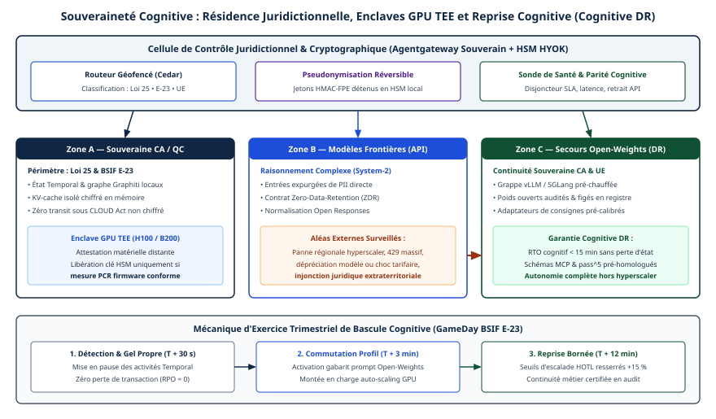
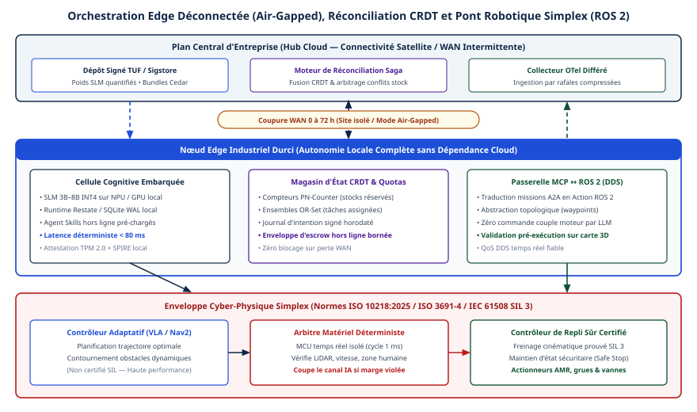

# Chapitre 46 — Inférence confidentielle, résilience et IA physique

*Question directrice : comment protéger les actifs cognitifs, survivre à la perte d'un fournisseur de modèles ou d'une liaison, et piloter des machines mobiles en sécurité ?*

> **État de référence :** faits arrêtés au 11 novembre 2026; documentation d'Intel, de Google Cloud, de NVIDIA et d'AWS, spécification TUF 1.0.37 (8 octobre 2026), ISO 10218-1:2025 et IEC 61508-1:2010 par leur seule page de présentation. Les numéros entre crochets renvoient aux sources en fin de chapitre; [1] à [14] sont des pages primaires lues pour ce chapitre, [15] n'est connue que par [11]. Les seuils restés sans source sont présentés comme des cibles de conception à valider.

Trois dépendances échappent à l'entreprise agentique : l'exploitant infonuagique qui exécute le modèle, le fournisseur qui le publie, la liaison qui relie un site au reste. Une quatrième s'ajoute quand l'agent pilote une machine : un contrôleur appris, dont personne ne sait prouver le comportement.

La thèse de ce chapitre est que ces quatre cas se traitent de la même façon. La garantie ne vient pas du composant complexe, mais d'un mécanisme plus simple placé autour de lui : une attestation matérielle et une clé détenue, un modèle de secours qualifié d'avance, un quota de droits alloué avant la panne, un contrôleur vérifié. Chacun de ces mécanismes a une limite documentée, que le chapitre nomme.

---

## 46.1 Les états d'un agent et leur localisation

Le chapitre 37 établit que résidence et contrôle juridictionnel sont deux questions, et que l'analyse se fait par composant. Il faut descendre d'un cran : un agent ne garde pas un état, il en garde plusieurs, chez des exploitants différents.

| État | Où il vit d'ordinaire | Protection applicable |
|---|---|---|
| Modèle et configuration : poids, prompts système, catalogue d'outils | Fournisseur de modèles ou site | Signature des artefacts (46.8), attestation (46.2) |
| Contexte en cours d'inférence : prompt, résultats d'outils, caches | Mémoire du serveur d'inférence | Environnement d'exécution de confiance (46.2) |
| Mémoire persistante (chapitre 14) | Fichiers, base vectorielle, graphe; parfois chez le fournisseur de modèles | Chiffrement au repos, clés détenues (46.3) |
| État d'exécution durable (chapitre 18) | Moteur d'exécution | Idem |
| Traces et journaux d'audit (chapitre 33) | Plateforme d'observabilité | Idem |
| Secrets : jetons, clés | Coffre, module matériel de sécurité | Libération sous attestation (46.2, 46.3) |

Cette grille est une proposition, sans source. Le découpage importe moins que la règle qu'il sert : chaque état reçoit un exploitant, une région et un détenteur de clé.

Le géorepérage, soit l'épinglage de chaque état à une région, répond à la résidence. Il ne répond pas au CLOUD Act, dont le critère est le contrôle exercé par le fournisseur et non le lieu du serveur (chapitre 37). Deux leviers techniques réduisent ce qu'un exploitant peut remettre : des clés hors de sa portée et une exécution qu'il ne peut pas lire. Aucun n'est une réponse juridique.

---

## 46.2 Inférence confidentielle : environnements d'exécution de confiance sur processeur et sur GPU

Le chiffrement au repos et en transit laisse la donnée en clair pendant le calcul. Un environnement d'exécution de confiance (TEE) vise cet intervalle.

### Sur processeur

Intel TDX crée des domaines de confiance, des machines virtuelles isolées par le matériel. La mémoire est chiffrée et, selon Intel, opaque pour le fournisseur infonuagique et ses opérateurs; l'attestation confirme que la configuration matérielle et logicielle est celle attendue [1].

AMD SEV chiffre la mémoire d'une machine virtuelle. SEV-SNP y ajoute une protection contre un hyperviseur malveillant, notamment le rejeu de données et le remappage de mémoire, et un rapport d'attestation peut être demandé à tout moment [2].

Dans les deux cas, l'unité protégée est la machine virtuelle entière : l'application n'est pas réécrite, mais tout le système invité entre dans la base de confiance.

### Sur GPU

NVIDIA Confidential Computing étend la frontière au GPU, en s'appuyant sur SEV ou TDX : les données des charges accélérées sont chiffrées en cours d'usage et isolées de l'hyperviseur [2]. NVIDIA décrit trois modalités, soit machine nue, machine virtuelle et conteneur, et précise que leurs garanties ne sont pas interchangeables [3].

### Une preuve, pas une politique

NVIDIA le formule nettement : l'attestation fournit une preuve pour une décision de confiance, elle ne remplace pas la politique qui gouverne la libération des secrets [3]. Un service courtier de clés ne remet les secrets qu'après évaluation de la preuve. Il revient à l'entreprise d'écrire cette politique : quelles mesures, quelles versions de micrologiciel, quel vérificateur.

La même page ajoute que ces frontières ne protègent pas d'elles-mêmes les données de l'utilisateur final contre le propriétaire du modèle [3]. Un TEE écarte l'exploitant de l'infrastructure; celui qui fournit le code exécuté à l'intérieur reste de confiance.

### Limites documentées

NVIDIA écrit que ses frontières n'éliminent ni les risques du matériel partagé ou de l'interconnexion, ni les risques physiques, ni les canaux auxiliaires [3]. Google ne prête à TDX qu'une défense contre des formes limitées d'attaques par accès physique à la mémoire [2].

L'attaque TEE.fail en donne la mesure. Un interposeur placé sur le bus mémoire DDR5 exploite le caractère déterministe du chiffrement. Ses auteurs disent avoir extrait la clé qui permet de forger des attestations TDX acceptées par la bibliothèque de vérification d'Intel, et les clés privées ECDSA d'OpenSSL exécuté dans une machine virtuelle SEV-SNP. Les rapports d'attestation du GPU, ajoutent-ils, ne sont pas liés à la machine virtuelle et peuvent être relayés depuis un autre matériel. Le montage coûterait moins de 1 000 $. Intel et AMD tiennent ces attaques pour hors de leur modèle de menace, et AMD ne prévoit pas de mise à jour de son micrologiciel; seule la sécurité physique du serveur y répond [4].

Un TEE déplace donc la confiance : des logiciels et des administrateurs de l'exploitant vers le fabricant de la puce et la garde physique des serveurs. Or, cette garde appartient à l'exploitant. Contre un exploitant contraint par la loi, un TEE élève le coût de l'accès sans le rendre impossible. Le calcul confidentiel entre plusieurs parties relève du chapitre 45.

---

## 46.3 Maîtrise des clés

La documentation d'AWS sur les magasins de clés externes décrit le modèle Hold Your Own Key (HYOK) [5]. Le matériel de clé reste dans un gestionnaire externe que le client possède : module matériel de sécurité (HSM) physique ou virtuel, ou gestionnaire logiciel. AWS KMS ne lui parle jamais directement; un mandataire fourni par le client relaie chaque requête. Les données sont chiffrées deux fois, par AWS puis par la clé externe.

| Propriété | Conséquence |
|---|---|
| Le client coupe l'accès | Le chiffré devient indéchiffrable; coupure définitive, il est irrécupérable |
| Double chiffrement | AWS ne déchiffre pas sans la clé externe; le client ne déchiffre pas hors d'AWS, même avec sa clé |
| Responsabilité | Disponibilité, durabilité et latence des opérations de clé passent au client |
| Exception | Les clés de données mises en cache par un service fonctionnent jusqu'à l'expiration du cache |

AWS avertit que, pour la plupart des charges, le risque accru pour la disponibilité et la performance dépasse le bénéfice de sécurité perçu. L'éditeur conseille, si possible, un aller-retour réseau de 35 millisecondes ou moins entre sa région et le gestionnaire externe [5].

**HYOK est un levier de révocation, pas une barrière pendant le traitement.** Dans le flux décrit, la clé de données en clair est remise au service qui chiffre l'objet [5]. Le service voit donc la donnée, comme le relève le chapitre 37. D'où l'intérêt de combiner clés détenues et TEE : la clé n'est libérée qu'à une charge attestée.

**HYOK n'est pas la portabilité.** Le chiffré ne se relit pas ailleurs.

**HYOK crée une dépendance de liaison.** Un agent dont la mémoire dépend d'un gestionnaire de clés injoignable s'arrête avec lui (46.5).

---

## 46.4 Continuité cognitive : perte du fournisseur de modèles

Trois pertes se distinguent.

| Perte | Préavis | Ce que montre la source lue |
|---|---|---|
| Retrait planifié d'un modèle | Annoncé | Anthropic s'engage à un préavis d'au moins 60 jours pour un modèle publié; passé la date, les requêtes échouent [6] |
| Changement de la surface d'API | Annoncé, par version | La version d'API `2026-10-21` supprime `temperature`, `top_p` et `top_k` : erreur 400. Les versions antérieures les refusent déjà sur Claude 4.7 et suivants, hors valeur par défaut [6] |
| Panne ou rupture : incident, litige, sanction | Aucun | Pas de source lue; hypothèse de planification |

La même page précise que les plateformes exploitées par des partenaires, Amazon Bedrock et l'offre gérée par Google Cloud, fixent leur propre calendrier de retrait [6]. Un même modèle n'a donc pas le même cycle de vie selon le canal d'achat. Comme un nouveau modèle peut refuser un paramètre, le secours se qualifie avec les appels réels.

### Deux horloges

Le NIST définit l'objectif de délai de reprise (RTO) comme la durée totale pendant laquelle les composants d'un système peuvent rester en phase de reprise avant que la mission de l'organisation en souffre [7]. « Reprise cognitive » n'est pas un terme normalisé : c'est l'application de ce délai à la fonction que remplit le modèle.

Rétablir un point d'accès ne rétablit pas un comportement. Un modèle de remplacement répond autrement aux mêmes prompts et aux mêmes outils. Changer de modèle, c'est changer le code d'exécutions en cours (chapitre 18), et le modèle est une unité de changement soumise à une barrière de rejeu (chapitre 34). La reprise a donc deux horloges : le temps de rerouter, à la passerelle (chapitres 24 et 44), et le temps de requalifier, par une suite d'évaluation (chapitre 33). La seconde n'est courte que si le travail est fait d'avance.

### Mesures proposées

- **Un modèle de secours qualifié d'avance**, par classe de tâche, chez un autre exploitant, et autohébergé pour les classes critiques. La qualification se refait à chaque changement de l'un des deux modèles.
- **L'état hors du fournisseur** : mémoire, journal d'exécution et traces. Une bascule ne perd alors que les caches (chapitre 13).
- **Un mode dégradé écrit** : autonomie réduite (chapitre 22), actions irréversibles suspendues, travail mis en file.
- **Un exercice de bascule périodique**, seul moyen de connaître le délai réel.

Le seuil « RTO inférieur à 15 minutes » n'a pas de source. Il n'est plausible que pour le reroutage vers un modèle déjà qualifié. C'est une cible de conception, à fixer par classe de tâche et à valider par exercice. Le volet contractuel de la sortie relève du chapitre 27.

---

## 46.5 Fonctionner déconnecté : périphérie et données répliquées sans conflit

Une usine, un navire, un véhicule ou un magasin perd sa liaison. Le site doit se dégrader, non s'arrêter. Quatre dépendances sont à couper d'avance :

- **le modèle**, par un modèle local plus petit, au besoin distillé (chapitres 28, 44 et 47);
- **les clés**, puisqu'un gestionnaire externe injoignable bloque le déchiffrement, hors clés en cache [5];
- **l'identité**, puisque les jetons expirent (chapitre 29);
- **les garde-fous et l'arrêt d'urgence**, qui doivent s'appliquer sur place : l'arrêt à la passerelle ou par révocation des jetons (chapitre 34) ne joint plus le site.

Le seuil de « 72 heures » d'autonomie n'a pas de source. La durée de survie n'est pas une constante : elle se déduit du plus court de plusieurs délais, soit la validité des jetons et des certificats, la capacité du journal local et l'épuisement des quotas décrits ci-dessous. Elle se calcule par site et se vérifie par essai.

### Des invariants sans coordination

Pendant la coupure, le site et le centre modifient les mêmes données. Les types de données répliqués sans conflit (CRDT) font converger des modifications concurrentes sans coordination. Leur limite est connue : la cohérence à terme ne suffit pas à faire respecter un invariant numérique sur l'ensemble des répliques [8].

Le Bounded Counter de Balegas et de ses coauteurs lève cette limite [8]. L'écart entre la valeur d'un compteur et sa borne est traité comme un ensemble de droits d'exécution, répartis entre les répliques. Une opération consomme les droits locaux. S'ils manquent, elle échoue, ou la réplique en obtient d'une autre. Pendant une partition, les droits s'utilisent des deux côtés; seul leur transfert est impossible. Les auteurs rapportent, sur Riak, une latence nettement inférieure à celle d'une cohérence forte.

### Transposition proposée

Toute ressource bornée qu'un agent déconnecté peut consommer se répartit en droits avant la coupure : stock, budget de dépense, nombre d'actions d'une classe. Le site agit sans demander, dans sa part. Sa part épuisée, l'opération échoue sur place au lieu de violer l'invariant. En contrepartie, le centre ne récupère pas les droits d'un site silencieux.

L'autonomie déconnectée reçoit ainsi une borne indépendante du modèle : une limite écrite seulement dans un prompt n'est pas une limite (chapitre 22). À la reconnexion, le journal local se synchronise; les conflits qu'aucun type répliqué ne couvre se règlent par compensation (chapitre 18).

---

## 46.6 Robotique : ROS 2 et DDS

ROS 2 retient DDS et son protocole RTPS comme standards de communication [9]. L'article de conception de 2014 en donne les raisons : une découverte distribuée, sans le nœud maître de ROS 1; un modèle publication-abonnement; des réglages de qualité de service; une aptitude au temps réel embarqué. DDS y est un détail de mise en œuvre, masqué par l'API de ROS [9].

### La sécurité n'est pas activée par défaut

Aucune fonction de sécurité de DDS n'est active par défaut dans ROS 2 [10]. Une fois la sécurité activée par `ROS_SECURITY_ENABLE`, ROS 2 emploie trois modules de DDS-Security : l'authentification, par une paire de clés et un certificat X.509 signé par une autorité; le contrôle d'accès, par deux fichiers XML signés, l'un pour la gouvernance du domaine, l'autre pour les permissions du participant; le chiffrement authentifié AES-GCM. Une enclave regroupe ces fichiers.

La variable `ROS_SECURITY_STRATEGY` doit valoir `Enforce` pour qu'un processus refuse de démarrer sans ses fichiers. Toute autre valeur donne le mode permissif, qui démarre sans sécurité s'ils manquent [10].

### Conséquences pour un agent

Ce qui suit est une proposition, prolongée du chapitre 28.

- **L'adaptateur est un participant DDS.** Il reçoit sa propre enclave, limitée aux sujets nécessaires : lire la télémétrie, publier des objectifs, jamais des commandes d'actionneur.
- **Le mode `Enforce` est obligatoire** sur un robot joignable par un agent. Le mode par défaut échoue ouvert.
- **Deux sauts, deux sécurités.** L'autorisation de MCP (chapitre 5) ne protège pas le domaine DDS, ni l'inverse.
- **L'agent reste hors de la boucle de commande.** Il dépose un objectif; planification et commande restent dans des nœuds ROS 2.

---

## 46.7 Sûreté fonctionnelle : un contrôleur vérifié autour du contrôleur appris

### L'architecture Simplex

Lui Sha part d'un constat : certains composants, dont l'exactitude est impossible ou impraticable à vérifier, sont inévitables. Son principe, « employer la simplicité pour maîtriser la complexité » [15], garantit les propriétés critiques par un logiciel simple et une architecture appropriée [11].

Simplex applique ce principe à la commande. Un sous-système de haute performance, complexe et susceptible d'erreurs résiduelles, propose les commandes. Un sous-système de haute assurance, simple, garantit la sûreté. Une logique de décision examine la marge de stabilité qui résulterait de chaque commande : celle qui pourrait mener à l'instabilité est toujours rejetée, les autres reçoivent le bénéfice du doute. Il suffit donc de savoir si l'état résultant reste dans l'enveloppe, non si la commande est correcte [11].

Sha cite la commande de vol du Boeing 777 : le contrôleur normal doit rester dans l'enveloppe de stabilité d'un contrôleur secondaire fondé sur les lois de commande du Boeing 747 [11].

L'architecture ne vaut que si trois propriétés sont vérifiées [11] :

- **protection** : les fautes du composant complexe ne peuvent pas corrompre le composant simple ni la logique de décision;
- **ponctualité** : le composant simple s'exécute dans ses contraintes de temps;
- **tolérance aux fautes** : il fonctionne malgré toutes les fautes du modèle retenu.

### Trois étages

Transposée, l'architecture donne trois étages. L'agent fixe des objectifs. Le contrôleur appris, par exemple une politique neuronale de mouvement, tient la place du sous-système de haute performance. Le contrôleur vérifié et la logique de décision bornent ce qu'il peut faire. Ni l'agent ni le contrôleur appris ne peuvent modifier l'enveloppe. Le chapitre 28 concluait que la sûreté reste hors de portée de tout agent : Simplex indique où tracer cette frontière quand un composant appris entre dans la commande. Une logique de décision exécutée dans le même processus que la politique apprise manque à l'exigence de protection.

### Les normes

L'ISO 10218-1:2025, troisième édition, publiée en février 2025, remplace celle de 2011. Elle fixe les exigences de sécurité du robot industriel, traité comme une quasi-machine; l'intégration relève de l'ISO 10218-2 [12]. L'IEC 61508-1:2010, deuxième édition, couvre les systèmes électriques, électroniques et électroniques programmables qui exécutent des fonctions de sécurité. Elle sert à élaborer les normes sectorielles et s'applique en leur absence [13].

Rien n'établit ici que Simplex confère la conformité à l'un ou à l'autre : c'est un patron d'architecture, non une voie de certification.

---

## 46.8 Chaîne de mise à jour

Un robot ou un site en périphérie reçoit des poids, des adaptateurs (chapitre 47), des prompts, des catalogues d'outils, des politiques et du micrologiciel. Ce sont les unités de changement du chapitre 34, livrées à distance.

The Update Framework (TUF), en version 1.0.37, sécurise un système de mise à jour sans définir de format de paquet ni effectuer l'installation [14]. Quatre rôles se partagent la confiance.

| Rôle | Ce qu'il signe | Clé |
|---|---|---|
| `root` | Les clés des autres rôles | Hors ligne, très protégée |
| `targets` | Les métadonnées des fichiers cibles; peut déléguer | Hors ligne |
| `snapshot` | La liste des versions courantes des métadonnées | Hors ligne |
| `timestamp` | L'empreinte du `snapshot`, pour détecter le rejeu | En ligne; sa compromission pose un risque minimal |

Chaque rôle exige un seuil de signatures; compromettre moins de clés que le seuil ne doit pas compromettre les clients. La spécification énumère les attaques visées, dont le retour à une version antérieure, le gel indéfini, l'assemblage de métadonnées qui n'ont jamais coexisté et l'installation arbitraire. Une attaque parée doit échouer, même si le client reste incapable de se mettre à jour [14].

**Des délégations par nature d'artefact.** Celui qui signe un prompt n'est pas celui qui signe l'enveloppe de sûreté d'un robot. Délégations et seuils expriment cette séparation.

**Un retour arrière publié comme une nouvelle version.** Le client refuse toute métadonnée dont le numéro de version est inférieur à celui qu'il tient pour fiable [14]. Le retour arrière de version (chapitre 34) se livre donc comme une version neuve au contenu ancien.

**Une règle pour le site déconnecté.** Coupé du dépôt, un site ne distingue pas un gel d'une panne. Il poursuit sur la version vérifiée et n'installe rien. Des métadonnées expirées bloquent la mise à jour, non l'exécution [14] : elles ne bornent pas la durée de survie (46.5).

TUF vérifie ce qui est distribué; l'attestation vérifie ce qui s'exécute (46.2). Aucun des deux ne dit que le modèle se comporte bien (chapitre 33).

---

## Grille de décision

| Décision | Option par défaut | Quand s'en écarter |
|---|---|---|
| Inventaire des états | Un exploitant, une région et un détenteur de clé par état | Aucun cas |
| Inférence sur données réglementées | Modèle autohébergé ou fournisseur sous contrôle local (chapitre 37) | TEE avec GPU attesté si l'accès physique de l'exploitant est un risque accepté |
| Libération des clés | Sous attestation, selon une politique écrite par l'entreprise | Charge sans donnée sensible |
| Clés HYOK | Réservées aux classes de données qui l'exigent | Charges tolérantes à une perte de disponibilité |
| Modèle de secours | Qualifié d'avance, délai mesuré par exercice | Tâches différables : mise en file |
| Site déconnecté | Modèle, garde-fous et arrêt d'urgence locaux; durée de survie calculée | Site sans action physique ni transaction : arrêt acceptable |
| Ressources bornées hors ligne | Droits préalloués | Ressource non critique : réconciliation après coup |
| Accès d'un agent à ROS 2 | Enclave propre, mode `Enforce`, objectifs seulement | Simulation |
| Contrôleur appris | Enveloppe vérifiée, isolée, hors de portée de l'agent | Aucun cas en présence de personnes |
| Mises à jour | Métadonnées signées par rôles, clé racine hors ligne | Prototype isolé |

---

## Points à retenir

- Un agent garde plusieurs états chez plusieurs exploitants. Le géorepérage règle la résidence, pas le contrôle.
- Un TEE retire de la base de confiance les logiciels et les administrateurs de l'exploitant. Il n'en retire ni le fabricant de la puce ni celui qui tient physiquement le serveur.
- L'attestation est une preuve. La politique de libération des secrets reste à écrire, et elle revient à l'entreprise.
- HYOK donne la révocation, au prix de la disponibilité. Il ne protège pas la donnée pendant le traitement et ne rend pas le chiffré portable.
- La perte d'un modèle se prépare par un modèle de secours qualifié d'avance. Rerouter peut tenir en minutes; requalifier, non.
- Hors ligne, l'autonomie se borne par des droits alloués avant la coupure, non par un prompt.
- ROS 2 n'active aucune sécurité par défaut, et son mode permissif échoue ouvert.
- Simplex place la sûreté dans un composant simple et vérifié, isolé du composant appris. Ce n'est pas une certification.
- Les seuils de 15 minutes et de 72 heures n'ont pas de source : ce sont des cibles à mesurer.

---

## Sources

Pages primaires lues le 12 novembre 2026 :

1. [Intel — Trust Domain Extensions (TDX), vue d'ensemble](https://www.intel.com/content/www/us/en/developer/tools/trust-domain-extensions/overview.html)
2. [Google Cloud — Confidential VM overview](https://docs.cloud.google.com/confidential-computing/confidential-vm/docs/confidential-vm-overview)
3. [NVIDIA — Confidential Computing Overview](https://docs.nvidia.com/confidential-computing/overview)
4. [TEE.fail — page des auteurs de l'attaque](https://tee.fail/)
5. [AWS KMS — External key stores](https://docs.aws.amazon.com/kms/latest/developerguide/keystore-external.html)
6. [Anthropic — Model deprecations](https://platform.claude.com/docs/en/about-claude/model-deprecations)
7. [NIST — glossaire, Recovery Time Objective](https://csrc.nist.gov/glossary/term/recovery_time_objective)
8. [Balegas et coll. — Extending Eventually Consistent Cloud Databases for Enforcing Numeric Invariants, arXiv 1503.09052](https://arxiv.org/abs/1503.09052)
9. [ROS 2 Design — ROS on DDS (W. Woodall, 2014, modifié en 2019)](https://design.ros2.org/articles/ros_on_dds.html)
10. [ROS 2 Design — ROS 2 DDS-Security integration (K. Fazzari, 2019, modifié en 2020)](https://design.ros2.org/articles/ros2_dds_security.html)
11. [Lui Sha — Integrate Mixed-Criticality Components with Formalized Architectural Patterns, 2008](https://www2.ee.washington.edu/research/nsl/aar-cps/LuiSha-20081015223039.pdf)
12. [ISO 10218-1:2025 — page de présentation](https://www.iso.org/standard/73933.html)
13. [IEC 61508-1:2010 — page de présentation](https://webstore.iec.ch/en/publication/5515)
14. [The Update Framework — spécification 1.0.37](https://theupdateframework.github.io/specification/latest/)

Source secondaire, non lue :

15. L. Sha, « Using Simplicity to Control Complexity », *IEEE Software*, juillet-août 2001 — citée d'après [11], sans lien vérifié.

## Limites de ce chapitre

- **Éléments sans source.** « Six substrats d'état », « RTO < 15 min » et « 72 h » n'ont été retrouvés nulle part : la grille de 46.1 et les deux seuils sont des propositions.
- **CLOUD Act.** Le texte n'a pas été relu; le chapitre s'en remet au chapitre 37. Aucune source lue ne dit ce qu'un tribunal peut exiger d'un exploitant de TEE.
- **AMD et HYOK.** La documentation d'AMD n'a pas pu être chargée : SEV-SNP est décrit d'après Google Cloud [2] et TEE.fail [4]. Les équivalents HYOK d'Azure et de Google n'ont pas été lus.
- **NVIDIA et TEE.fail.** Seule la vue d'ensemble de NVIDIA a été lue : ni matrice de compatibilité, ni mécanique du lien entre processeur et GPU, ni mesure de surcoût. TEE.fail est décrite d'après la page de ses auteurs; l'article et les avis d'Intel et d'AMD n'ont pas été lus.
- **Relecture d'audit.** L'audit a relu [2] à [6] et [14], par un outil qui en restitue le contenu : chiffres, versions et citations confirmés. [12] a refusé l'accès; édition et date sont confirmées par des résultats de recherche.
- **ROS 2.** La documentation courante était inaccessible. [9] et [10] sont des articles de conception de 2014 et de 2019; l'état des distributions actuelles n'est pas vérifié.
- **Normes.** ISO 10218 et IEC 61508, payantes, ne sont connues que par leur page de présentation. Niveaux d'intégrité, exigences logicielles et apprentissage automatique ne sont pas abordés.
- **Connaissance générale** : la définition des CRDT, l'inclusion du système invité dans la base de confiance, l'écart de comportement entre deux modèles.
- **Propositions de ce chapitre**, non éprouvées : les mesures de 46.4, le calcul de la durée de survie et la transposition du Bounded Counter, les conséquences de 46.6, les trois étages de 46.7, les applications de TUF.
- **Pannes de fournisseurs.** Aucun rapport d'incident n'a été lu, seulement la politique de retrait d'un fournisseur [6].
- **Renvois** vérifiés à l'audit. L'arrêt d'urgence local (46.5) est une proposition qui prolonge le chapitre 34.

## Mise en œuvre — Souveraineté cognitive, portabilité multi-cloud et reprise après sinistre cognitif {.volet}

:::: {.encadre .executive}
::: {.encadre-titre}
**Synthèse exécutive**
:::

- **Enjeu stratégique** : Ancrer des processus vitaux dans un fournisseur unique de modèles frontières infonuagiques concentre deux risques que les plans de continuité TI classiques ignorent. Le premier est juridictionnel et extraterritorial : le CLOUD Act américain, la Loi 25 québécoise, BSIF E-23 et les régimes européens de souveraineté entrent en conflit sur les états d’agents et les KV-caches. Le second est l’arrêt cognitif : panne régionale d’un hyperscaler, hausse tarifaire ou retrait unilatéral d’une version de modèle, qui rompt la fidélité d’exécution des outils MCP.
- **Décisions architecturales structurantes** :
  1.  *Irréversible sur le plan légal* : Appliquer le géorepérage à tout l’état de l’agent, soit les journaux durables Temporal, les graphes bi-temporels Graphiti, les index vectoriels, les traces OpenTelemetry et les KV-caches GPU, par zone juridictionnelle souveraine. Imposer une pseudonymisation réversible à clé détenue localement (HYOK) avant tout appel à une API frontière externe.
  2.  *Structurante pour les charges sensibles* : Déployer l’inférence confidentielle sur des enclaves GPU attestées (NVIDIA H100/B200 TEE avec AMD SEV-SNP ou Intel TDX), de sorte que les logiciels et les administrateurs de l’exploitant infonuagique ne peuvent inspecter ni les consignes, ni les poids affinés, ni les tenseurs en cours de calcul. Un TEE élève le coût de l’accès sans le rendre impossible : le fabricant de la puce et la garde physique du serveur restent dans la base de confiance (section 46.2).
  3.  *Cible de conception en résilience prudentielle (BSIF E-23)* : Instituer un plan de reprise après sinistre cognitif, testé chaque trimestre, qui vise une bascule en moins de quinze minutes (`RTO < 15 min`, `RPO = 0`) d’un modèle propriétaire défaillant vers une grappe souveraine à poids ouverts, calibrée d’avance sur les mêmes contrats Open Responses et MCP. Ce seuil de quinze minutes n’a pas de source : c’est une cible de conception, à fixer par classe de tâche et à valider par exercice (section 46.4).
- **Indicateurs de gouvernance** : Couverture d’état résidant dans sa juridiction légale cible (100 %), RTO cognitif mesuré en exercice réel ($< 15\text{ min}$), maintien du score $\text{pass}^5$ en mode de secours ($\ge 94\,\%$ du nominal) et zéro clé maîtresse de déchiffrement exposée hors HSM d’entreprise.
::::

## 46.9 Résidence juridictionnelle de l’état complet et conflits de lois

La section 46.1 inventorie les états d’un agent; sa grille, une proposition sans source, en compte six, composés autrement que les couches ci-dessous. Dans une entreprise agentique de niveau L3 ou L4, une requête métier se dissémine entre divers substrats de persistance, dont plusieurs échappent aux inventaires des équipes de gouvernance des données. Les six couches qui suivent sont un inventaire proposé, non un décompte établi : « six substrats d’état » ne se retrouve dans aucune source.

### Les six couches d’état d’une saga agentique

Pour démontrer à un régulateur (Commission d’accès à l’information du Québec sous Loi 25, BSIF sous ligne directrice E-23, ou autorités européennes sous RGPD / EU Data Act) qu’un renseignement personnel ou un secret industriel réglementé n’a pas quitté indûment sa juridiction, l’architecte gouverne simultanément :

1.  **Le journal d’événements du moteur d’exécution durable (Temporal / Restate)** : Chaque argument d’outil et chaque réponse intermédiaire sérialisés dans l’historique de reprise contiennent les données métiers en clair, sauf chiffrement de charge utile côté client (Payload Codec).
2.  **La mémoire épisodique et sémantique (Graphiti / Letta / index vectoriels)** : Les plongements ne constituent pas une anonymisation opposable. Les attaques par inversion de vecteurs documentées de 2024 à 2026 reconstruisent jusqu’à 70 % des entités textuelles d’origine à partir d’un vecteur dense non chiffré.
3.  **Le cache clé-valeur d’attention (KV-cache GPU / mémoire désagrégée)** : Quand une passerelle d’inférence garde en VRAM ou sur NVMe, pendant trente minutes, les tenseurs d’attention précalculés pour réduire le TTFT (chapitre 44), ces tenseurs matérialisent le contenu exact du dossier client sur le serveur GPU hôte.
4.  **Les files de transit événementiel (Kafka / Solace) et les tampons A2A** : Les artefacts échangés entre agents spécialistes persistent sur disque selon la politique de rétention du courtier.
5.  **Le plan d’observabilité (OpenTelemetry `gen_ai.*`)** : Un collecteur SaaS hébergé dans une autre juridiction devient un vecteur d’exportation illicite si les attributs d’invite ne sont pas caviardés à la source (chapitre 33).
6.  **Les journaux d’abus et de télémétrie du fournisseur de modèle** : Sans contrat Zero-Data-Retention (ZDR) explicite, qui désactive toute mise en file d’inspection humaine chez l’éditeur, un simple appel HTTPS suffirait à conserver le contenu trente jours à l’étranger.

### Loi 25, BSIF E-23, EU Sovereign Cloud et CLOUD Act

En 2027, une organisation active au Québec, au Canada fédéral et dans l’Union européenne fait face à des exigences juridiques asymétriques. Même lorsqu’un hyperscaler américain héberge ses grappes GPU à Montréal, Toronto ou Francfort, le `U.S. CLOUD Act` (18 U.S.C. § 2713) maintient une compétence d’injonction judiciaire sur toute société mère de droit américain qui détient techniquement la capacité de déchiffrer les données. Le géorepérage n’y répond donc pas (section 46.1). L’article 17 de la Loi 25 exige une évaluation des facteurs relatifs à la vie privée (ÉFVP) démontrant une protection adéquate avant toute communication hors Québec. La ligne directrice BSIF E-23 (en vigueur le 1er mai 2027) et la ligne directrice BSIF B-10 (impartition et risque de concentration infonuagique) obligent les institutions financières fédérales à prouver leur maîtrise opérationnelle et leur stratégie de sortie face aux fournisseurs critiques de modèles.

La réponse d’ingénierie est une partition souveraine à trois zones, pilotée par agentgateway. Elle ne s’interdit pas les meilleurs modèles mondiaux et ne néglige pas le risque légal.



| Classe de sensibilité métier | Résidence de l’état (Temporal, mémoire, OTel) | Régime d’inférence autorisé | Protection cryptographique exigée |
|:--------------------------|:------------------------|:-------------------------|:------------------------|
| C1 — Public / industriel non sensible | Infonuagique régional standard | API frontières mondiales ou SLM | TLS 1.3, contrat ZDR standard |
| C2 — Confidentiel affaires / PII réglementée (Loi 25) | Résidence stricte juridictionnelle (QC/CA ou UE) | API frontières régionales sous pseudonymisation ou GPU TEE | Tokenisation HMAC-FPE locale (HYOK) + Payload Codec Temporal |
| C3 — Secret stratégique / prudentiel critique (E-23 élevé, défense, santé) | Infrastructure souveraine dédiée (opérateur national ou sur site) | Exclusivement modèles internes à poids ouverts ou enclave TEE souveraine | Enclave matérielle CPU+GPU attestée, zéro transit hors juridiction |

------------------------------------------------------------------------

## 46.10 Inférence confidentielle sur GPU et pseudonymisation réversible déterministe sous clé HYOK

Les environnements d’exécution de confiance et la maîtrise des clés sont décrits aux sections 46.2 et 46.3.

### 1. Pseudonymisation réversible déterministe à conservation de structure (HYOK)

Lorsqu’une tâche de classe C2 exige la puissance de raisonnement d’un modèle frontière externe, par exemple l’analyse contradictoire d’une clause d’exclusion complexe dans un contrat d’assurance commerciale, le modèle a besoin de la structure logique et relationnelle du cas, non de la raison sociale de l’assuré, de son numéro de compte bancaire ni de l’adresse de son usine.

Avant que la requête ne franchisse la frontière du réseau interne, un filtre déterministe couplé à un SLM local de reconnaissance d’entités remplace chaque identifiant direct par un pseudonyme syntaxiquement réaliste et cohérent sur toute la session (`Assuré_7F3A`, `Usine_QC_04`, montants mis à l’échelle par un facteur secret si requis). Ce pseudonyme est dérivé par chiffrement à préservation de format (FF1/FF3-1 ou HMAC salé par saga), dont la clé maîtresse réside exclusivement dans le module matériel de sécurité (HSM) de l’entreprise (HYOK). Pour parer à la ré-identification indirecte par recoupement (Loi 25), le sas généralise aussi les quasi-identifiants structurels rares (capacité industrielle singulière, municipalité à faible densité, date exacte de sinistre) en plages catégorielles avant l’envoi. À la réception de la sortie structurée du modèle externe, la passerelle réhydrate localement les identifiants réels avant l’appel d’outil MCP interne : l’opérateur infonuagique externe n’a jamais vu la donnée nominative.

### 2. Enclaves matérielles GPU attestées

Lorsque la tâche porte sur des données non pseudonymisables (imagerie médicale, plans CAO industriels propriétaires, code source critique, grands corpus financiers) et s’exécute sur une infrastructure infonuagique louée, l’architecture s’appuie sur le calcul confidentiel GPU, arrivé à maturité sur les générations NVIDIA Hopper (H100) et Blackwell (B200), couplées à des processeurs hôtes AMD SEV-SNP ou Intel TDX.

L’amorçage, selon un modèle zéro confiance, suit trois étapes :

1.  La machine virtuelle confidentielle (CVM) et le pilote GPU établissent un canal PCIe chiffré de bout en bout (SPDM / CMA). La mémoire VRAM du GPU est isolée de l’hyperviseur de l’hébergeur par le matériel.
2.  Le matériel produit un rapport d’attestation signé par sa racine silicium. Il contient les mesures cryptographiques (PCR, *Platform Configuration Registers*) du microcode, du noyau, du moteur d’inférence (vLLM / SGLang) et de l’empreinte exacte des poids du modèle.
3.  Le rapport est soumis au service d’attestation souverain de l’entreprise cliente. Seulement si les mesures correspondent au manifeste signé approuvé, le HSM interne libère vers l’enclave la clé éphémère qui déchiffre les poids affinés et ouvre le tunnel mTLS depuis agentgateway. Cette étape applique la politique de libération des secrets de la section 46.2.

#### Extrait 46.1 — Politique d’attestation matérielle et de routage souverain HYOK (sovereign-gateway.yaml)

Cette configuration d’agentgateway applique le géorepérage juridictionnel, la pseudonymisation HYOK et la vérification d’attestation TEE avant le routage :

``` yaml
apiVersion: gateway.aaif.linuxfoundation.org/v1
kind: SovereignRoutingPolicy
metadata:
  name: boreal-jurisdictional-cognitive-fence
spec:
  keyManagement:
    mode: "HYOK_EXTERNAL_HSM"
    hsmEndpoint: "pkcs11://hsm-mtl-01.internal.boreal.ca:5696"
    sessionTokenTtlSeconds: 300
  jurisdictionRules:
    - matchClassification: "C2_QUEBEC_LAW25_PII"
      allowedStateRegions: ["ca-central-montreal"]
      primaryInferenceTarget:
        provider: "frontier-cloud-ca-east"
        requireZeroDataRetention: true
        preInferenceFilter: "HMAC_FPE_PSEUDONYMIZER_V2"
      fallbackInferenceTarget: "boreal-sovereign-tee-mtl"
    - matchClassification: "C3_OSFI_E23_HIGH_MATERIALITY"
      allowedStateRegions:
        - "ca-central-montreal"
        - "ca-east-toronto"
      forbidPublicApiEndpoints: true
      primaryInferenceTarget:
        clusterId: "boreal-sovereign-tee-mtl"
        confidentialComputing:
          requireCpuTee: "AMD_SEV_SNP"
          requireGpuTee: "NVIDIA_CC_ON"
          attestationUrl: "https://attest.sec.boreal.ca/verify"
          runtimeSha256:
            "23bee86edf807c3dc40afc55e3c56076e409f8405b0cd850413e338ae081918b"
```

### 3. Chiffrement de charge utile dans l’orchestrateur et étanchéité des KV-caches

Sécuriser l’appel GPU ne suffit pas si le serveur d’orchestration durable garde en clair les arguments et résultats d’activités dans sa base relationnelle ou Cassandra. Sur Temporal comme sur Restate, l’architecture impose un encodeur cryptographique côté travailleur (Payload Codec). Avant qu’un état ne quitte le processus travailleur déployé dans le sous-réseau souverain, chaque charge utile est chiffrée en AES-256-GCM avec une clé d’enveloppe (DEK) dérivée par sujet et scellée par le HSM local (KEK en régime HYOK). Ce découplage permet aussi l’effacement crypto-sélectif, conforme au droit à l’oubli : révoquer la sous-clé d’un client rend ses historiques d’orchestration indéchiffrables sans altérer l’intégrité séquentielle du journal d’audit. Le plan de contrôle ne manipule que des blocs binaires opaques et des métadonnées de routage non sensibles (`saga_id`, `jurisdiction_zone`, `step_status`) : ce que son hébergeur peut remettre à une réquisition se limite à ces blocs. Les clés détenues réduisent ce qu’un exploitant peut remettre; elles ne constituent pas une réponse juridique (section 46.1).

Les grappes d’inférence mutualisées demandent un soin identique pour la mémoire vive. Quand vLLM ou SGLang met en œuvre le partage de préfixe (Prefix Caching, RadixAttention; chapitre 44), l’espace de hachage des blocs de KV-cache doit préfixer chaque clé de bloc par le couple `(tenant_id, jurisdiction_zone)`. Sans ce salage par locataire et par juridiction, une attaque par canal auxiliaire temporel sur le TTFT permettrait à un locataire malveillant de la même grappe de deviner si un préfixe réglementaire ou contractuel précis vient d’être traité par un autre département, ou provoquerait un recyclage involontaire de tenseurs entre zones juridiques distinctes. À l’extinction d’une session de classe C3, les pages VRAM et les tampons NVMe de débordement sont remis à zéro avant réallocation.

Dans le tableau suivant, la visibilité nulle sur les PII vient de la pseudonymisation en amont : HYOK seul est un levier de révocation, pas une barrière pendant le traitement, et, selon AWS, le risque accru pour la disponibilité et la performance dépasse, pour la plupart des charges, le bénéfice de sécurité perçu (section 46.3). La grille de décision réserve HYOK aux classes de données qui l’exigent, ce qui reste compatible avec l’exigence de l’ADR-027 pour les classes C2 et C3.

| Modèle de maîtrise cryptographique | Détenteur de la racine (KEK) | Visibilité de l’hébergeur sur le clair | Résistance à une injonction extraterritoriale | Cas d’usage cible |
|:------------------|:-------------------|:--------------------|:----------------------|:-------------------|
| Cloud KMS natif | Hyperscaler | Totale en mémoire; accès clé possible | Faible (l’hébergeur peut déchiffrer) | Classe C1 uniquement (données publiques) |
| BYOK (*Bring Your Own Key*) | Client (importée dans KMS Cloud) | Totale en mémoire GPU/CPU | Partielle (clé révocable, mais présente en Cloud) | Classe C1+ / charges internes non PII |
| HYOK + pseudonymisation amont | HSM physique exclusif du client | Nulle sur les PII (jetons opaques seuls) | Forte (la table de correspondance reste locale) | Classe C2 (Loi 25, contrats clients) |
| HYOK + enclave CPU/GPU TEE | HSM client après attestation silicium | Nulle pour les logiciels et les administrateurs de l’hébergeur (VRAM et bus PCIe chiffrés) | La plus élevée du tableau, non absolue : un TEE élève le coût de l’accès sans le rendre impossible (section 46.2) | Classe C3 (BSIF E-23 critique, R&D) |

#### Extrait 46.2 — Encodeur Payload Codec AES-256-GCM sous clé HYOK pour moteur durable (hyok_payload_codec.py)

Le codec s’exécute uniquement dans les travailleurs internes de la zone souveraine : le serveur d’orchestration ne persiste jamais une donnée métier qu’un tiers pourrait déchiffrer :

``` python
import os
from cryptography.hazmat.primitives.ciphers.aead import AESGCM

class SovereignHyokPayloadCodec:
    def __init__(self, jurisdiction: str, hsm_client: object):
        self.jurisdiction = jurisdiction
        self._hsm = hsm_client

    def encode_state(
        self, raw_bytes: bytes, key_id: str
    ) -> dict:
        dek = self._hsm.derive_ephemeral_dek(
            key_id=key_id, zone=self.jurisdiction
        )
        nonce = os.urandom(12)
        aad = f"zone:{self.jurisdiction}|kid:{key_id}".encode()
        ciphertext = AESGCM(dek).encrypt(nonce, raw_bytes, aad)
        return {
            "encoding": "binary/aes256gcm-hyok-v1",
            "zone": self.jurisdiction,
            "key_id": key_id,
            "nonce_hex": nonce.hex(),
            "payload_hex": ciphertext.hex(),
        }

    def decode_state(self, envelope: dict) -> bytes:
        if envelope.get("zone") != self.jurisdiction:
            err = "CROSS_JURISDICTION_STATE_DENIED"
            raise PermissionError(err)
        key_id = envelope["key_id"]
        dek = self._hsm.derive_ephemeral_dek(
            key_id=key_id, zone=self.jurisdiction
        )
        nonce = bytes.fromhex(envelope["nonce_hex"])
        data = bytes.fromhex(envelope["payload_hex"])
        aad = f"zone:{self.jurisdiction}|kid:{key_id}".encode()
        return AESGCM(dek).decrypt(nonce, data, aad)
```

### 4. Plongements propres à l’entreprise pour garder le RAG opérationnel en reprise

Un piège fréquent ruine des plans de reprise cognitive bien conçus. L’entreprise prépare un modèle génératif de secours à poids ouverts, mais ses cinquante millions de fragments documentaires et sa mémoire sémantique (Graphiti) ont été indexés avec le modèle de plongements propriétaire du fournisseur primaire en panne. Dès que l’API externe tombe, aucune requête ne peut plus être vectorisée dans le même espace latent, et toute la mémoire de l’entreprise devient inutilisable.

La règle est formelle : ne dépendre d’aucune API propriétaire fermée pour la vectorisation ni pour le reclassement des référentiels maîtres. Les pipelines d’indexation utilisent dès le premier jour un modèle de plongements multilingue compact à poids ouverts, figé et exécuté en interne (0,5B à 1,5B paramètres, latence `< 8 ms`), complété par la recherche lexicale déterministe BM25. Lors d’une bascule, 100 % des index vectoriels et des graphes restent interrogeables sans réindexation d’urgence. Cette règle prolonge la mesure « l’état hors du fournisseur » de la section 46.4.

------------------------------------------------------------------------

## 46.11 Reprise après sinistre cognitif : panne ou retrait d’un modèle frontière

La section 46.4 établit que rétablir un accès ne rétablit pas un comportement. Remplacer dans l’urgence un modèle propriétaire victime d’une panne mondiale par un modèle à poids ouverts d’une autre famille, sans préparation, provoque fréquemment une cascade d’échecs : arguments JSON de MCP structurés autrement, verbosité modifiée qui fait déborder un budget de jetons, propension accrue aux faux positifs d’escalade. Une architecture soumise à des exigences de haute disponibilité ou à la supervision prudentielle (BSIF E-23, DORA en finance européenne) conçoit donc la reprise après sinistre cognitif comme une discipline propre. Le secours retenu ici est toujours une grappe souveraine à poids ouverts : cela va au-delà de la section 46.4, qui retient un modèle de secours par classe de tâche, chez un autre exploitant, et autohébergé pour les classes critiques.

### Les quatre piliers d’une bascule sans rupture (`RTO < 15 min`, `RPO = 0`)

1.  **Contrats normalisés et purge des états opaques** : Aucun code applicatif n’appelle le SDK propriétaire d’un fournisseur de modèles. Toute requête d’inférence emprunte l’enveloppe normalisée Open Responses (gouvernée par l’AAIF), et toute invocation d’outil respecte les schémas JSON canoniques de MCP, validés par un décodage contraint (grammaires CFG sur la grappe de secours vLLM). À mi-parcours d’une saga multi-tours, l’adaptateur Open Responses écarte les blocs de délibération chiffrés propres au fournisseur défaillant et reconstruit le contexte du modèle de secours à partir du seul journal canonique des faits et des sorties d’outils validés. Même un modèle de secours plus sobre ne peut alors émettre un appel d’outil syntaxiquement invalide.
2.  **Double profil de consignes précompilé** : Chaque agent critique L3 est homologué en CI/CD (chapitre 34) sous deux profils jumeaux, versionnés ensemble : un profil nominal, optimisé pour le modèle primaire, et un profil de secours, compilé pour un modèle à poids ouverts souverain, audité et figé dans le registre interne d’artefacts de l’entreprise (par exemple avec DSPy, chapitre 47). L’homologation exige $\text{pass}^5_{\text{DR}} \ge 0{,}94 \cdot \text{pass}^5_{\text{nominal}}$ sur la suite $\tau$-bench du domaine. Ce profil réalise la qualification d’avance de la section 46.4.
3.  **Grappe de secours à montée en charge élastique** : Maintenir 100 % de la capacité GPU de pointe allumée à vide doublerait la facture FinOps. Un noyau minimal reste allumé et héberge déjà les SLM quotidiens, qui couvrent immédiatement les flux vitaux P0. Des réservations capacitaires prioritaires d’instances GPU souveraines chargent les poids, préchargés dans le cache NVMe local, en moins de 180 secondes.
4.  **Resserrement prudentiel automatique des seuils HOTL** : Tant que la fabrique opère sur le modèle de secours, le moteur de politique abaisse de 15 à 25 % les plafonds financiers d’engagement autonome L3. Les cas limites les plus subtils passent temporairement aux superviseurs humains HOTL, sans interrompre le flux courant (`RPO = 0` grâce à la mise en file durable Temporal). Cette mesure donne une forme chiffrée au mode dégradé de la section 46.4.

Le seuil de quinze minutes de la formule n’a pas de source : c’est une cible de conception, à fixer par classe de tâche et à valider par exercice. Il n’est plausible que pour le reroutage vers un modèle déjà qualifié; la requalification forme une seconde horloge, courte seulement si le travail est fait d’avance (section 46.4).

Le temps de reprise cognitif effectif $\text{RTO}_{\text{cog}}$ se modélise et se vérifie lors des exercices trimestriels selon :

$$\text{RTO}_{\text{cog}} = t_{\text{détection}} + t_{\text{quiescence}} + \max\bigl(t_{\text{warmup}}^{\text{GPU}},\, t_{\text{switch}}^{\text{gateway}}\bigr) + t_{\text{canary}}^{\text{santé}} \le 15\text{ min}$$

#### Extrait 46.3 — Orchestrateur de bascule Cognitive DR sans perte de transaction (cognitive_dr_switch.py)

Ce contrôleur coordonne la suspension des activités Temporal en vol, la commutation vers le profil homologué à poids ouverts et l’ajustement des seuils Cedar. L’extrait ne montre que la décision de bascule :

``` python
from dataclasses import dataclass

@dataclass(frozen=True)
class ModelHealthMetrics:
    error_rate_5m: float
    p95_ttft_ms: int
    consecutive_429_or_5xx: int
    provider_deprecation_flag: bool

@dataclass(frozen=True)
class DrFailoverPlan:
    activate_dr: bool
    target_profile_id: str
    hotl_threshold_multiplier: float
    reason: str

def evaluate_cognitive_dr_trigger(
    metrics: ModelHealthMetrics,
    dr_pass5_score: float,
) -> DrFailoverPlan:
    unhealthy = (
        metrics.provider_deprecation_flag
        or metrics.error_rate_5m >= 0.08
        or metrics.p95_ttft_ms >= 12000
        or metrics.consecutive_429_or_5xx >= 25
    )
    if not unhealthy:
        return DrFailoverPlan(
            activate_dr=False,
            target_profile_id="PRIMARY_FRONTIER_V2027",
            hotl_threshold_multiplier=1.0,
            reason="NOMINAL_HEALTH",
        )

    if dr_pass5_score < 0.90:
        return DrFailoverPlan(
            activate_dr=True,
            target_profile_id="SAFE_HOLD_L2_HUMAN_QUEUE",
            hotl_threshold_multiplier=0.0,
            reason="DR_MODEL_BELOW_SAFETY_FLOOR",
        )

    return DrFailoverPlan(
        activate_dr=True,
        target_profile_id="SOVEREIGN_OPEN_WEIGHTS_70B_INT8",
        hotl_threshold_multiplier=0.80,
        reason="AUTOMATIC_COGNITIVE_DR_FAILOVER",
    )
```

:::: {.encadre .sectoriel}
::: {.encadre-titre}
**Institutions financières (BSIF E-23 et B-10, DORA UE) — tester le risque de concentration cognitive**
:::

À compter de mai 2027 au Canada (BSIF E-23 conjuguée à B-10) et sous le règlement DORA en Europe, dépendre d’une seule API de modèle externe pour l’octroi de crédit, la gestion des sinistres ou la surveillance anti-fraude constitue un risque de concentration de tiers critique. Les inspecteurs exigent la preuve documentée d’au moins un exercice annuel de débranchement réel du fournisseur principal de LLM. L’exercice doit montrer que la coupure franche ne provoque ni corruption comptable, ni violation d’un délai réglementaire de déclaration, ni fuite de données vers une région de repli hors juridiction.
::::

------------------------------------------------------------------------

## 46.12 Application au fil rouge : architecture souveraine Québec–Canada–UE et exercice de bascule chez Groupe Boréal

Groupe Boréal Inc. a mis à l’épreuve sa souveraineté cognitive et sa reprise après sinistre juste avant l’audit prudentiel du printemps 2027.

:::: {.encadre .filrouge}
::: {.encadre-titre}
**Fil rouge — Groupe Boréal : cloisons souveraines Loi 25 / UE et bascule vers le modèle de secours en 11 minutes**
:::

**Défi réglementaire et opérationnel** : Chez Boréal Capital & Assurances (BCA), les sagas d’indemnisation manipulent des états financiers non publics et des dossiers personnels québécois (Loi 25 classe C2/C3). Les filiales allemande et française de BSN sont contractuellement liées à quatre grands industriels européens, qui interdisent tout traitement hors d’un *EU Sovereign Cloud* détenu et opéré sous droit européen. Lors d’un incident réel fin janvier 2027, une panne d’authentification de 3 h 40 chez un fournisseur américain de modèle frontière avait gelé les files d’analyse contractuelle de niveau 3.

**Architecture déployée** :

1.  **Trois cellules d’état souveraines et Payload Codec Temporal** : Boréal a cloisonné l’état en trois cellules : Montréal (QC/CA), Francfort (UE souverain) et Chicago (US). Tous les journaux Temporal et les graphes Graphiti sont chiffrés avec des clés conservées dans deux HSM physiques que Boréal détient à Montréal et à Francfort (HYOK).
2.  **Inférence TEE et pseudonymisation HMAC-FPE** : Pour les dossiers C3 de souscription BSIF E-23, l’inférence tourne exclusivement sur une grappe d’enclaves NVIDIA H100 Confidential Computing hébergée au Québec, avec attestation distante vérifiée à chaque démarrage. Pour les cas C2, le filtre HMAC-FPE d’agentgateway pseudonymise 100 % des entités nominatives avant tout appel externe.
3.  **Reprise cognitive bimodèle** : Chaque saga critique dispose d’un profil jumeau homologué en CI/CD sur un modèle à poids ouverts de 70 milliards de paramètres, servi par SGLang avec décodage grammatical contraint MCP.

**Exercice de bascule audité (avril 2027)** : Un mardi ouvrable à 10 h 30, l’équipe SRE a coupé au pare-feu l’accès sortant vers le fournisseur de modèle primaire :

- Détection par agentgateway en 28 secondes; quiescence sans perte (`RPO = 0`) des 142 sagas en cours sur Temporal.
- Montée en charge des nœuds GPU souverains à Montréal et Francfort et commutation des profils en 11 minutes et 14 secondes (`RTO < 15 min` respecté).
- Maintien de 96,4 % de réussite bout en bout (`pass^5`), avec resserrement automatique de 20 % des seuils d’escalade vers les souscripteurs HOTL pendant les quatre heures de l’exercice, validant sans réserve le volet continuité du dossier BSIF E-23.
::::

------------------------------------------------------------------------

## 46.13 Décision d’architecture normative et points de contrôle

La décision ADR-027 fixe l’indépendance juridictionnelle et l’indépendance à l’égard du fournisseur de la fabrique agentique.

:::: {.encadre .adr}
::: {.encadre-titre}
**ADR-027 — Géorepérage de l'état complet, inférence confidentielle HYOK/TEE et reprise après sinistre cognitif bimodèle**
:::

- **Statut** : Acceptée \| Périmètre : Infonuagique, sécurité, données et continuité d’activité \| Révision : semestrielle
- **Contexte** : Dépendre d’un seul fournisseur infonuagique de modèles frontières expose l’organisation aux conflits extraterritoriaux (CLOUD Act contre Loi 25 / RGPD), à la persistance involontaire de données dans les KV-caches et les journaux d’orchestration, ainsi qu’à l’arrêt complet des processus métiers lors d’une panne ou de la dépréciation d’une API.
- **Options évaluées** :
  1.  *Dépendance mono-fournisseur avec clauses contractuelles standards* : Rejetée — insuffisante techniquement face aux pannes régionales et au risque de concentration BSIF E-23 / B-10.
  2.  *Interdiction totale des modèles infonuagiques au profit exclusif de petits modèles sur site* : Rejetée — pénalise la qualité de raisonnement sur les cas complexes non sensibles ou correctement pseudonymisés.
  3.  *Cloisonnement juridictionnel des 6 couches d’état inventoriées à la section 46.9, sous clé HYOK, enclaves GPU TEE pour la classe C3, et homologation CI/CD obligatoire d’un profil de secours souverain à poids ouverts (cible de conception `RTO < 15 min`, section 46.4)*. Retenue.
- **Décision** : (a) Interdire tout transfert hors juridiction des journaux durables, mémoires vectorielles/graphes et KV-caches des classes C2/C3; (b) exiger HYOK (pseudonymisation HMAC-FPE ou enclave TEE attestée); (c) bloquer en CI/CD toute saga critique L3/L4 dépourvue d’un profil de secours à poids ouverts atteignant $\ge 94\,\%$ du $\text{pass}^5$ nominal et testé trimestriellement.
- **Conséquences** : Réduction de ce que l’exploitant peut remettre à une réquisition, sans valoir réponse juridique (section 46.1), et résilience aux pannes ou aux hausses tarifaires d’hyperscalers, au prix d’une capacité GPU souveraine maintenue en attente et d’une double validation CI/CD.
::::

### Liste de contrôle de mise en production

1.  **Cartographie des 6 substrats d’état proposés (section 46.9)** : Les journaux Temporal/Restate, graphes mémoire, index vectoriels, KV-caches, courtiers d’événements et traces OTel résident-ils tous physiquement dans la juridiction légale requise ?
2.  **Chiffrement HYOK et Payload Codec** : Les charges utiles d’orchestration et les index vectoriels sont-ils chiffrés avec des clés détenues dans un HSM sous contrôle exclusif de l’entreprise ?
3.  **Pseudonymisation déterministe amont** : Les requêtes de classe C2 routées vers une API externe subissent-elles une tokenisation réversible locale et bénéficient-elles d’un engagement contractuel Zero-Data-Retention ?
4.  **Attestation matérielle GPU TEE** : Pour les charges critiques C3 en infonuagique, le HSM vérifie-t-il automatiquement le rapport d’attestation silicium CPU+GPU avant de libérer les clés de session ?
5.  **Abstraction Open Responses et décodage contraint** : Le code métier est-il exempt d’appels SDK propriétaires et la grappe de secours impose-t-elle le respect grammatical strict des schémas MCP ?
6.  **Double homologation CI/CD** : Chaque agent critique possède-t-il un profil de consignes secondaire validé sur un modèle souverain à poids ouverts avec un score $\text{pass}^5$ supérieur au seuil minimal ?
7.  **Ajustement prudentiel en mode dégradé** : La bascule resserre-t-elle automatiquement les plafonds d’autonomie L3 au profit d’une supervision HOTL accrue ?
8.  **Exercice de bascule trimestriel** : La déconnexion réelle du fournisseur primaire a-t-elle été testée, avec mesure du délai réel face à la cible de `RTO < 15 min` et preuve d’un `RPO = 0` ?

## Mise en œuvre — Orchestration en périphérie, opérations déconnectées et passerelles vers l'IA physique {.volet}

:::: {.encadre .executive}
::: {.encadre-titre}
**Synthèse exécutive**
:::

- **Enjeu stratégique** : Dans l’extraction minière, la production hydroélectrique, le transport maritime, la défense, l’agroalimentaire et les entrepôts très robotisés, la liaison vers le nuage central est soit inexistante par cloisonnement de sûreté (isolement physique), soit sujette à des coupures de plusieurs heures ou de plusieurs jours (météo extrême, perte de faisceau satellite, sectionnement de fibre). Un système agentique dont le moteur d’état, les politiques d’autorisation ou le modèle de raisonnement exigent un aller-retour infonuagique immobilise l’outil industriel au moment où l’autonomie locale est la plus nécessaire.
- **Décisions architecturales structurantes** :
  1.  *Irréversible pour les sites distants* : Concevoir chaque site industriel comme une cellule autonome à survie locale, avec ses propres petits modèles de langage (SLM) quantifiés (3B–8B en INT4/FP8), son moteur d’exécution durable léger, son point de décision Cedar local et son serveur SPIRE adossé à une puce matérielle TPM 2.0.
  2.  *Structurante pour l’intégrité des données* : Remplacer les verrous synchrones distants par des types de données répliqués sans conflit (CRDT) assortis de quotas de droits préalloués, pour réconcilier les sagas au retour de la liaison sans double dépense.
  3.  *Exigée en sûreté physique (ISO 10218 / IEC 61508)* : Interdire tout pilotage direct d’actionneurs robotiques par un modèle neuronal; raccorder l’orchestration d’entreprise à ROS 2 (DDS) à travers une architecture Simplex matérielle, où un contrôleur temps réel déterministe vérifié coupe la consigne adaptative dès l’approche de l’enveloppe cinématique de sécurité. Simplex est un patron d’architecture, non une voie de certification : rien n’établit qu’il confère la conformité à l’ISO 10218 ni à l’IEC 61508 (section 46.7).
- **Indicateurs de gouvernance** : Durée de survie sans liaison WAN, calculée par site et vérifiée par essai (cible de conception : $\ge 72\text{ h}$, sans source; section 46.5), taux de conflits non résolus automatiquement à la reconnexion (\< 0,2 %), latence locale de décision d’enveloppe de sécurité ($\le 1\text{ ms}$ sur microcontrôleur dédié) et 100 % des lots déployés en périphérie vérifiés par signature TUF / Sigstore.
::::

## 46.14 Autonomie locale et réconciliation après la coupure

Le chapitre 28 traite l’usine reliée au système d’information central à travers les zones de sécurité du modèle Purdue. Cette section traite deux autres cas : une liaison coupée pendant quarante-huit heures en plein hiver boréal, et un site que la réglementation sectorielle isole physiquement de façon quasi permanente (diode unidirectionnelle). Les dépendances à couper et le principe des droits préalloués sont posés à la section 46.5.

### Trois blocages d’un agent conçu pour le nuage

Un agent conçu pour l’infonuagique et placé sur un site industriel distant se bloque de trois façons dès la première perte de liaison satellite ou cellulaire privée :

1.  **Identité et politique** : Si le renouvellement des certificats NHI (SVID de 15 minutes) ou la récupération des politiques OPA/Cedar dépend d’un serveur central distant, tous les agents locaux passent en refus d’accès au bout d’un quart d’heure. Les opérations s’arrêtent alors que le matériel local est intact.
2.  **Divergence de l’état partagé** : Pendant la coupure, l’agent local du site minier consomme trois roulements de rechange du magasin local et réaffecte deux techniciens. Au siège social, le planificateur central réserve ces mêmes pièces pour une maintenance programmée la semaine suivante. Au retour du réseau, une synchronisation par écrasement (la dernière écriture l’emporte) corrompt l’inventaire ERP et fausse la comptabilité matière.
3.  **Saturation du lien de retour** : Quand la liaison satellite à bande passante limitée revient, trente agents locaux qui poussent ensemble quarante-huit heures de journaux OpenTelemetry et d’historiques d’inférence saturent le lien. Les ordres prioritaires de sécurité et de réapprovisionnement ne passent plus.

### Cellule embarquée, CRDT et quotas de droits

Le nœud en périphérie est le système maître de sa réalité physique immédiate. Le nuage central agrège de façon asynchrone, assure la curation des modèles et réconcilie les sites entre eux. La figure retient une coupure de 72 h, cible de conception : l’exposé précise que ce seuil n’a pas de source (section 46.5).



Sur une passerelle industrielle durcie (typiquement biprocesseur redondant sans ventilateur, dotée d’accélérateurs basse consommation NVIDIA Jetson Thor / IGX ou d’un NPU serveur de 35 à 150 W), la pile autonome compte quatre briques :

- **Inférence et durabilité embarquées** : Deux modèles spécialisés quantifiés tournent localement, un SLM 4B d’extraction et de routage et un SLM 8B de diagnostic technique, en INT4 AWQ, avec une latence déterministe inférieure à 80 ms. Une instance locale légère d’un moteur d’exécution durable les pilote : Restate (binaire unique en Rust) ou un travailleur Temporal sur un magasin transactionnel SQLite WAL ou RocksDB, répliqué en paire haute disponibilité locale.
- **Racine de confiance matérielle locale (TPM 2.0 et SPIRE imbriqué)** : Une autorité SPIRE intermédiaire locale, scellée dans la puce TPM 2.0 du châssis, détient un certificat intermédiaire valide 30 jours. Elle émet et renouvelle toutes les dix minutes les jetons courts des agents locaux, même en coupure totale de la liaison.
- **État partagé sans conflit** : Les ressources partagées entre le nuage et les sites se modélisent par des CRDT associés à des baux de capacité préalloués, non par un solde entier qu’une écriture peut écraser :
  - Un compteur PN-Counter additionne séparément les incréments et les décréments signés par chaque nœud $i$. La fusion, par maximum composante par composante, est commutative, associative et idempotente ($S_A \sqcup S_B = S_B \sqcup S_A$).
  - Chaque nœud détient un quota local préréservé $Q_i^{\text{local}}$ tel que $\sum_{i=1}^{N} Q_i^{\text{local}} \le Q_{\text{global}} - M_{\text{sécurité}}$.
  - Le bail d’un quota est indexé par un numéro d’époque monotone, ce qui évite la double dépense qu’une dérive d’horloge provoquerait pendant une partition asymétrique. Le nuage ne peut pas le reprendre unilatéralement sur simple délai mural (TTL) : il lui faut un message signé de restitution (`LeaseEpochSurrender`). En attendant le retour du nœud muet, les autres sites puisent uniquement dans la réserve centrale $M_{\text{sécurité}}$.
- **Reprise du réseau par file de priorité** : À la reconnexion, un ordonnanceur écoule d’abord les alertes critiques et les deltas CRDT (quelques kilo-octets en Protobuf), puis les résumés de sagas clôturées, et enfin, aux heures creuses seulement, les lots compressés de télémétrie OpenTelemetry.

#### Extrait 46.4 — Magasin d’escrow hors ligne à convergence CRDT sans double dépense (edge_crdt_escrow.py)

Le composant autorise localement, hors ligne, des sorties de pièces ou des dépenses d’urgence, sans pouvoir violer le plafond global d’entreprise à la reconnexion :

``` python
from dataclasses import dataclass, field

@dataclass
class BoundedPnCounterEscrow:
    node_id: str
    granted_quota: dict[str, int] = field(default_factory=dict)
    consumed: dict[str, int] = field(default_factory=dict)
    released: dict[str, int] = field(default_factory=dict)

    def remaining_local_budget(self, node: str) -> int:
        granted = self.granted_quota.get(node, 0)
        net = self.consumed.get(node, 0) - self.released.get(node, 0)
        return granted - net

    def try_commit_offline(self, units: int) -> tuple[bool, str]:
        if units <= 0:
            return (False, "INVALID_NON_POSITIVE_UNITS")
        avail = self.remaining_local_budget(self.node_id)
        if units > avail:
            msg = f"OFFLINE_ESCROW_EXCEEDED:avail={avail}"
            return (False, msg)
        self.consumed[self.node_id] = (
            self.consumed.get(self.node_id, 0) + units
        )
        return (True, f"COMMITTED_LOCAL:rem={avail - units}")

    def release_offline(self, units: int) -> tuple[bool, str]:
        net = (
            self.consumed.get(self.node_id, 0)
            - self.released.get(self.node_id, 0)
        )
        if units <= 0 or units > net:
            return (False, "INVALID_RELEASE_AMOUNT")
        self.released[self.node_id] = (
            self.released.get(self.node_id, 0) + units
        )
        return (True, "RELEASED_TO_LOCAL_ESCROW")

    def merge_peer_state(
        self, peer: "BoundedPnCounterEscrow"
    ) -> "BoundedPnCounterEscrow":
        def _lmax(a: dict[str, int], b: dict[str, int]) -> dict[str, int]:
            out = dict(a)
            for k, v in b.items():
                out[k] = max(out.get(k, 0), v)
            return out

        return BoundedPnCounterEscrow(
            node_id=self.node_id,
            granted_quota=_lmax(self.granted_quota, peer.granted_quota),
            consumed=_lmax(self.consumed, peer.consumed),
            released=_lmax(self.released, peer.released),
        )
```

### Réconciliation en deux phases après la coupure

Quand la liaison revient après quarante-huit heures d’isolement, les nœuds ne rouvrent pas aussitôt les vannes aux commandes centrales. Une phase transitoire de synchronisation d’horizon (`ANTI_ENTROPY_SYNC`) fusionne d’abord les compteurs CRDT, recalcule dans l’ERP central les réapprovisionnements déclenchés par la consommation des quotas locaux, renouvelle les baux $Q_i^{\text{local}}$ pour le cycle suivant et vérifie la révocation éventuelle d’identités dans la liste centrale. Le site repasse ensuite en mode fédéré nominal.

### Dimensionnement matériel et quantification

Contrairement à une salle informatique climatisée, qui dispose de baies de 40 kW, une sous-station électrique, un quai minier ou un navire impose des contraintes sévères : refroidissement passif sans ventilateur, étanchéité IP65 contre les poussières métalliques conductrices, plage thermique de $-25\,^\circ\text{C}$ à $+60\,^\circ\text{C}$, alimentation secourue par batteries 24 V DC et enveloppe électrique souvent plafonnée sous 75 à 180 watts. Deux choix d’ingénierie permettent de faire tenir une cellule multi-agents dans ce budget :

1.  **Quantification sensible à l’activation (AWQ / FP8), validée sur les appels d’outils** : Une quantification uniforme de tous les poids d’un SLM en INT4 dégrade souvent la précision syntaxique des arguments JSON de MCP et des identifiants alphanumériques de pièces. L’approche retenue garde en FP16/FP8 le 1 % de canaux saillants ainsi que les têtes de sortie grammaticale. Un modèle 8B complet et un contexte de 16 384 jetons tiennent alors dans moins de 6,8 Go de mémoire unifiée, sans perte mesurable sur la suite $\tau$-bench locale.
2.  **Exécution à l’événement, accélérateur en veille** : Un agent en périphérie ne doit pas scruter les capteurs en boucle continue par inférence neuronale. Un préfiltre déterministe léger (seuils spectraux FFT en Rust, moins de 2 W sur CPU) surveille en permanence les flux OPC UA et MQTT à 1 kHz. Il ne réveille l’accélérateur du SLM que lorsqu’une anomalie franchit l’enveloppe statistique nominale. Le facteur de marche énergétique moyen reste sous 8 % et le bridage thermique est évité.

Les autonomies de la dernière colonne sont des cibles de conception à mesurer, non des garanties : l’exposé établit que la durée de survie se calcule par site, comme le plus court de plusieurs délais (section 46.5).

| Profil de nœud en périphérie | Enveloppe électrique et thermique | Capacité cognitive locale type | Autonomie sans liaison et usage cible |
|:-----------------------|:----------------------|:------------------------|:------------------------------|
| Passerelle sur rail DIN sans ventilateur (IP65) | 35–65 W (`-25 °C` à +60 °C) | SLM 3B–4B INT4 + Cedar + SQLite | 72 h+ — Sous-station électrique, tête de puits, écluse |
| Serveur durci d’atelier ou de mine | 150–300 W (redondance N+1 locale) | Paire de SLM 8B AWQ + Restate + ROS 2 | 7 à 14 jours — Mine nordique, usine isolée, navire |
| Calculateur embarqué sur robot AMR | 25–45 W sur batterie LiFePO4 | Politique Nav2/VLA locale + MCU SIL 3 | Quart complet de 10 h — Chariot autonome sans Wi-Fi continu |

---

## 46.15 Passerelle vers l’IA physique : MCP, A2A, ROS 2 et arbitre Simplex

L’orchestration d’entreprise parle A2A v1.0 et MCP, en JSON-RPC sur HTTP. La flotte, faite de robots mobiles autonomes (AMR), de chariots élévateurs automatisés et de cellules robotisées, tourne sous ROS 2 (distributions Jazzy et Kilted) et communique en temps réel sur DDS (section 46.6) ou sur Eclipse Zenoh.

### Missions sémantiques et boucles d’asservissement

Un modèle de langage ne doit pas émettre de consignes continues de bas niveau (vitesses linéaires `cmd_vel`, angles articulaires, couples moteurs) sur un topique DDS. Même embarqué, il présente une gigue de plusieurs dizaines de millisecondes et reste sujet à des hallucinations spatiales, incompatibles avec l’inertie d’un chariot de deux tonnes qui croise un cariste humain. L’agent reste hors de la boucle de commande (section 46.6). Le pont entre MCP / A2A et ROS 2 découple trois couches :

1.  **Couche entreprise (A2A v1.0 vers le gestionnaire de flotte Open-RMF)** : La saga délègue un objectif métier de haut niveau (*« Transférer la palette PAL-8841 de la travée B-14 vers le quai d’expédition Q-03 avant 14 h 20, priorité haute, colis fragile »*).
2.  **Passerelle sémantique MCP–ROS 2 (validation géométrique et traduction en ROS 2 Actions)** : Elle n’expose que des primitives discrètes de haut niveau (`NavigateToNamedWaypoint`, `InspectGaugeAtPose`, `DockAtStation`). Avant d’instancier un objectif typé ROS 2 Action (Goal → Feedback périodique → Result) avec un profil de qualité de service DDS déterministe (RELIABLE, `DEADLINE = 50 ms`), elle vérifie l’existence du point de passage dans le graphe topologique homologué du bâtiment, l’absence de consignation de sécurité (*Lockout/Tagout*, LOTO) dans le registre Cedar et l’état de la batterie du robot.
3.  **Arbitre Simplex matériel (ISO 10218-1:2025, ISO 3691-4 et IEC 61508)** : Dans le robot mobile (ISO 3691-4) ou la cellule articulée (ISO 10218-1:2025; l’intégration relève de l’ISO 10218-2, section 46.7), les contrôleurs adaptatifs, soit les planificateurs Nav2 et les politiques locales Vision-Langage-Action VLA de manipulation, saisissent ou déplacent des charges irrégulières. Leurs commandes passent par un arbitre déterministe, logé sur un microcontrôleur temps réel séparé (MCU Safety PLC, boucle à $1\text{ ms}$). C’est la forme matérielle des trois étages décrits à la section 46.7.

L’arbitre évalue en continu l’invariant de distance d’arrêt en fonction de la vitesse instantanée $v(t)$, de la vitesse maximale d’approche humaine $v_h$, du temps de réaction matériel $t_r$ et de la décélération minimale garantie $a_{\min}(m)$, abaissée selon la masse embarquée $m$ que mesurent les jauges d’essieu :

$$d_{\text{sécurité}}(t) = \left(v(t) + v_h\right) t_r + \frac{v(t)^2}{2\,a_{\min}(m)} + d_{\text{marge}} \le d_{\text{LiDAR}}(t)$$

Dès que $d_{\text{LiDAR}}(t)$ s’approche de $d_{\text{sécurité}}(t)$ ou qu’une commande viole les butées articulaires, l’arbitre coupe physiquement le multiplexeur du contrôleur IA et bascule en moins d’une milliseconde sur le contrôleur de repli vérifié (niveau visé : SIL 3 / PL e), jusqu’à l’arrêt sûr complet. Simplex est un patron d’architecture, non une voie de certification : rien n’établit qu’il confère la conformité à l’ISO 10218 ni à l’IEC 61508, dont les niveaux d’intégrité ne sont pas abordés par l’exposé (section 46.7 et « Limites de ce chapitre »).

| Couche du pont cyber-physique | Protocole et cadence | Nature du composant | Niveau de sûreté et responsabilité |
|:--------------------|:-----------------------------|:------------------------|:--------------------------|
| Saga métier et flotte | A2A v1.0 / MCP ($0{,}5\text{–}5\text{ s}$) | Moteur d’exécution durable + SLM local | Cohérence métier, priorités, quotas |
| Passerelle MCP ↔︎ ROS 2 | DDS / Zenoh Actions ($20\text{–}50\text{ ms}$) | Traducteur déterministe Rust/C++ | Validation des points de passage, consignations LOTO |
| Planification locale / VLA | Bus interne du robot ($10\text{–}30\text{ ms}$) | Nav2 / politique neuronale locale | Efficacité de la trajectoire et de la préhension (non-SIL) |
| Arbitre Simplex et arrêt sûr | Bus de terrain PROFIsafe / FSoE ($\le 1\text{ ms}$) | Microcontrôleur de sécurité matériel isolé | Vie humaine et intégrité de la machine (IEC 61508) |

#### Extrait 46.5 — Garde-fou déterministe de passerelle MCP ↔︎ ROS 2 vérifiant consignation LOTO et enveloppe Simplex (mcp_ros2_guard.py)

Avant de traduire l’appel d’outil d’un agent logistique en objectif ROS 2 Action sur le bus DDS, la passerelle vérifie de façon synchrone l’absence de cadenassage humain (LOTO), la validité du point de passage et le battement de cœur matériel du moniteur Simplex :

``` python
from dataclasses import dataclass

@dataclass(frozen=True)
class PlantSafetyState:
    approved_waypoints: frozenset[str]
    active_loto_zones: frozenset[str]
    simplex_heartbeat_age_ms: int
    battery_soc_pct: float

def validate_ros2_mission_goal(
    waypoint_id: str,
    zone_id: str,
    state: PlantSafetyState,
) -> tuple[bool, str]:
    if state.simplex_heartbeat_age_ms > 5:
        return (False, "ABORT_SIMPLEX_HEARTBEAT_STALE")
    if zone_id in state.active_loto_zones:
        return (False, f"DENY_ZONE_UNDER_HUMAN_LOTO:{zone_id}")
    if waypoint_id not in state.approved_waypoints:
        return (False, f"DENY_UNKNOWN_WAYPOINT:{waypoint_id}")
    if state.battery_soc_pct < 18.0:
        return (False, "REDIRECT_MANDATORY_CHARGER_DOCK")
    return (True, f"DISPATCH_DDS_ACTION:{waypoint_id}")
```

### Gradation de l’autonomie selon la durée de la coupure

Même avec des SLM locaux et des compteurs CRDT, l’incertitude sur l’environnement global croît avec la durée de la coupure : tarifs douaniers périmés, certificats CRL non rafraîchis, quotas épuisés. L’orchestrateur local applique donc une atténuation progressive de l’autonomie. Les paliers ci-dessous sont des cibles de conception à valider par essai : l’exposé établit que le seuil de 72 h n’a pas de source et que la durée de survie se calcule par site, comme le plus court de plusieurs délais (jetons, certificats, journal local, quotas; section 46.5). De 0 à 24 h, l’autonomie nominale L3 est pleine sur le périmètre local. De 24 à 72 h, les engagements externes différés sont gelés et l’effort se recentre sur le maintien en condition opérationnelle et sur la sécurité. Au-delà de 72 h, le site bascule de façon ordonnée en mode consultatif assisté L1/L2 : le chef de quart cosigne localement les sorties majeures de magasin jusqu’au rétablissement des communications.

---

## 46.16 Déploiement signé hors ligne des poids, politiques et Agent Skills

Une flotte de cinquante ou de cinq cents nœuds en périphérie, répartis dans des usines, des mines ou des sous-stations électriques, expose la chaîne d’approvisionnement logicielle (OWASP ASI04). Un attaquant qui altère une mise à jour d’un paquet Agent Skills, d’un ensemble de règles Cedar ou d’un adaptateur de poids LoRA, sur une clé USB de maintenance (sites isolés) ou pendant un transfert intermittent, prend le contrôle simultané d’agents qui opèrent au contact direct d’équipements physiques.

La distribution vers la périphérie combine TUF (section 46.8) et les signatures sans clé (à clés éphémères) de Sigstore / `cosign` :

- **Lot atomique multi-artefacts** : Un nœud ne met jamais à jour un prompt isolément : il le reçoit avec le binaire d’outil MCP et le jeu de politiques Cedar avec lesquels il a été homologué en CI/CD. L’ensemble forme une archive immuable adressée par contenu (OCI Artifact), signée hors ligne par au moins deux rôles distincts (ingénierie de plateforme et sécurité OT), avec une date d’expiration anti-rejeu (protection contre l’attaque par gel).
- **Transport indifférent** : La confiance repose sur la chaîne cryptographique TUF, vérifiée contre les clés racines scellées dans le TPM 2.0 de la passerelle, et non sur le canal de transport. Le même lot peut donc être téléchargé pendant une fenêtre satellite nocturne de vingt minutes ou importé par une diode optique sur un site isolé classifié.
- **Activation A/B avec retour arrière automatique** : Le lot s’installe sur la partition passive B. Au redémarrage des travailleurs locaux, une sonde exécute dix scénarios synthétiques de santé en trente secondes. Au moindre échec d’inférence ou de connexion DDS, le chien de garde matériel rebascule sur la partition A saine précédente.

#### Extrait 46.6 — Manifeste de déploiement Edge signé TUF et garde-fou MCP-ROS2 (edge-fleet-bundle.yaml)

Ce descripteur scelle ensemble le SLM quantifié, l’espace des points de passage autorisés pour la passerelle ROS 2 et la politique de repli hors ligne. La valeur de 72 heures du repli en L1 est une cible de conception, non un seuil sourcé : la durée de survie se calcule par site (section 46.5) :

``` yaml
apiVersion: edge.aaif.linuxfoundation.org/v1
kind: SignedEdgeAutonomousBundle
metadata:
  bundleId: "boreal-edge-nordqc-2027.09.2"
  expiresUtc: "2027-12-31T23:59:59Z"
  tufThresholdSignatures: 2
spec:
  artifacts:
    slmWeights:
      modelId: "boreal-diag-slm-8b-awq-int4"
      ociDigest:
       "sha256:94c2cdf798d694ee5b8861d42c48a44b36ebce4731e02acb8aa2366ae58adaca"
    cedarPolicyBundle:
      version: "2027.09.2"
      ociDigest:
       "sha256:2415d45f7874f386982d0f2f883a90484d9d1bd39ea0a3c2c58cb3635ec56129"
    offlineSkillsPack:
      skills: ["compressor-vib-triage", "inventory-crdt-reserve"]
      ociDigest:
       "sha256:ca7ae6bf98cc8ce389b6017566459a3573abedc6dcc799bb1003090b1174faf1"
  ros2BridgeConstraints:
    ddsDomainId: 42
    allowedActionTypes: ["NavigateToWaypoint", "DockCharger"]
    waypointsMapSha256:
      "92329976c7ae4edf085237d1fc34a6ecdec98cebda198a59b3ad77837d0a598b"
    forbidRawVelocityTopics: true
    requireHardwareSimplexHeartbeatMs: 5
  offlineAutonomyPolicy:
    maxDisconnectedHoursBeforeL1Downgrade: 72
    localEmergencySpendCapCad: 5000
```

:::: {.encadre .sectoriel}
::: {.encadre-titre}
**Mines, énergie et infrastructures isolées — continuité sous norme NERC CIP et sites nordiques**
:::

Dans les postes de transport électrique soumis aux normes NERC CIP en Amérique du Nord ou sur les sites miniers souterrains du Bouclier canadien, aucune connexion entrante initiée depuis l’infonuagique n’est permise vers le réseau d’exploitation. L’architecture décrite ici respecte cette exigence : les agents diagnostiquent et coordonnent localement la maintenance en circuit fermé pendant des semaines, et n’exportent vers l’entreprise que des résumés signés, par une passerelle d’extraction contrôlée, pendant les fenêtres autorisées. Une panne infonuagique ne perturbe pas le site physique.
::::

---

## 46.17 Application au fil rouge : autonomie de 72 heures dans le Nord-du-Québec et entrepôt robotisé de Montréal-Est

Groupe Boréal Inc. déploie cette architecture chez BSN (sites miniers isolés) et chez BEL (entrepôt central robotisé).

:::: {.encadre .filrouge}
::: {.encadre-titre}
**Fil rouge — Groupe Boréal : sites miniers déconnectés au Nunavik et flotte AMR sous ROS 2 à Montréal-Est**
:::

**Deux terrains critiques** :

1.  **Sites miniers clients de BSN dans le nord du Québec (Nunavik / Côte-Nord)** : Quatorze complexes miniers exploitent des concasseurs et des compresseurs lourds Boréal, sous contrat de disponibilité garantie à 99,5 %. En février 2027, un blizzard majeur combiné à une coupure de fibre régionale a isolé un site pendant 51 heures. L’ancien agent de diagnostic infonuagique étant injoignable, une dérive thermique non arbitrée a entraîné la casse d’un réducteur principal (380 000 \$ CAD de pénalité et de remplacement).
2.  **Centre de distribution robotisé BEL de Montréal-Est** : 38 robots mobiles autonomes (AMR sous ROS 2 Jazzy) préparent les commandes de pièces urgentes 24/7 aux côtés de 60 techniciens logistiques humains.

**Architecture déployée** :

- **Boîtiers durcis sur les sites miniers** : BSN a déployé sur chaque site client nordique un serveur industriel biprocesseur redondant. Il exécute un SLM 8B INT4 distillé sur l’historique vibratoire Boréal, un magasin d’inventaire consigné en CRDT (extrait 46.4, plus haut) avec un quota local pour les pièces critiques en dépôt sur place, et un serveur SPIRE sur TPM 2.0.
- **Passerelle MCP–ROS 2 et enveloppe Simplex à Montréal-Est** : Les sagas de préparation Temporal délèguent les missions de transport à Open-RMF par la passerelle déterministe, qui interdit tout accès aux topiques moteurs bruts. Les scrutateurs LiDAR de sécurité coupent matériellement le canal de navigation hors du contrôleur SIL 3 dès qu’un opérateur franchit le rayon dynamique $d_{\text{sécurité}}(t)$.

**Résultats vérifiés en production** :

- Lors d’une coupure satellite réelle de 64 heures à l’automne 2027 sur un site minier, la cellule locale a détecté une cavitation de pompe hydraulique, réservé hors ligne la garniture mécanique en stock consigné (CRDT), généré en 42 secondes le bon de travail illustré pour le mécanicien sur place, puis resynchronisé l’inventaire SAP en 1,8 seconde au retour du lien, sans conflit.
- À Montréal-Est, les sagas agentiques ont orchestré 410 000 missions AMR sur neuf mois, sans incident de sécurité physique, avec un débit logistique accru de 31 % et 100 % des mises à jour déployées par lots signés TUF, sans interruption de quart.
::::

---

## 46.18 Décision d’architecture normative et points de contrôle

La décision ADR-028 encadre tout déploiement d’agents en périphérie industrielle ou au contact de systèmes robotisés.

:::: {.encadre .adr}
::: {.encadre-titre}
**ADR-028 — Architecture Edge Local-First à synchronisation CRDT et pont robotique ROS 2 sous enveloppe matérielle Simplex**
:::

- **Statut** : Acceptée \| Périmètre : sites industriels, logistique robotisée et périphérie \| Révision : annuelle
- **Contexte** : Déployer des agents sur des sites industriels à connectivité précaire ou au contact de flottes robotiques expose l’entreprise à la paralysie opérationnelle sur perte de liaison, à des corruptions de stocks lors de la reconnexion et à des risques graves pour la sécurité physique si l’IA pilote directement des actionneurs.
- **Options évaluées** :
  1.  *Inférence et orchestration centralisées dans le nuage avec simple cache local* : Rejetée — inopérante au-delà de quelques minutes de coupure réseau et incompatible avec les sites isolés physiquement.
  2.  *Synchronisation de bases locales par écrasement (la dernière écriture l’emporte) et pilotage direct des topiques moteurs ROS 2 par un modèle embarqué* : Rejetée — perte de transactions financières ou de stocks et absence d’une enveloppe vérifiée, isolée du composant appris (section 46.7).
  3.  *Cellule autonome (SLM local, SPIRE/TPM, état CRDT à quotas de droits), distribution signée TUF/Sigstore et passerelle discrète MCP–ROS 2 doublée d’un arbitre matériel Simplex*. Retenue.
- **Décision** : (a) Exiger une survie autonome minimale de 72 heures sans liaison WAN pour tout site critique, avec repli automatique en L1 au-delà (cette exigence va au-delà de la section 46.5, qui ne retient aucun seuil sourcé : la durée de survie se calcule par site et se vérifie par essai); (b) modéliser tout état mutatif déconnecté par un CRDT borné par un quota de droits préalloué (escrow); (c) interdire tout accès d’un modèle probabiliste aux commandes cinématiques continues, hors d’une passerelle de missions homologuées et d’un moniteur matériel Simplex vérifié.
- **Conséquences** : Continuité industrielle hors réseau et sûreté des personnes confiée, en atelier robotisé, à un contrôleur vérifié et isolé du contrôleur appris, sans que Simplex vaille certification (section 46.7), en contrepartie de la gestion matérielle d’un parc de nœuds en périphérie et de la quantification des modèles embarqués.
::::

### Liste de contrôle de mise en production

1.  **Essai de déconnexion prolongée (cible de 72 h)** : La cellule maintient-elle l’inférence SLM, la rotation locale des identités SPIRE (TPM 2.0) et l’évaluation Cedar pendant la durée de survie calculée pour le site, avec 72 heures comme cible de conception sans source (section 46.5), câble WAN débranché ?
2.  **Convergence CRDT et quotas de droits** : Les stocks et les budgets manipulables hors ligne sont-ils protégés par des structures CRDT et par des plafonds locaux qui empêchent toute sur-allocation globale ?
3.  **Ordonnanceur de reconnexion** : Le mécanisme de retransmission donne-t-il la priorité aux deltas transactionnels et aux alertes critiques, devant l’évacuation différée des journaux OpenTelemetry ?
4.  **Frontière sémantique MCP–ROS 2** : A-t-on vérifié que la passerelle n’expose que des actions discrètes sur des points de passage homologués et bloque tout accès aux topiques d’asservissement moteur ?
5.  **Arbitre matériel Simplex (IEC 61508)** : Un contrôleur de sécurité temps réel indépendant surveille-t-il à la milliseconde la distance d’arrêt et coupe-t-il physiquement le canal adaptatif en cas de risque ?
6.  **Intégrité des consignations (LOTO)** : La passerelle interroge-t-elle l’état de verrouillage matériel de maintenance avant d’émettre un ordre de mouvement vers un équipement ?
7.  **Lots atomiques signés TUF / Sigstore** : Les poids des SLM, les politiques Cedar et les Agent Skills sont-ils distribués en archives signées à double clé, avec date d’expiration et bascule A/B automatique ?
8.  **Rétrogradation de sécurité après l’échéance** : Si l’isolement dépasse le plafond homologué (par exemple 72 h), le nœud rétrograde-t-il ses actions mutatives en mode consultatif L1 pour l’opérateur sur site ?
