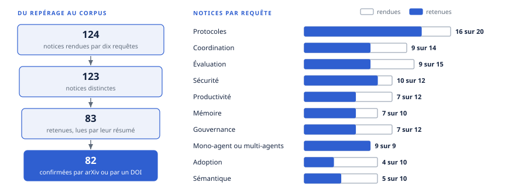

# Chapitre 48 — Revue de littérature

*Question directrice : que sait la recherche, et avec quel degré de preuve, sur l'interopérabilité et l'orchestration d'agents ?*

> **État de référence :** recherche menée le 13 novembre 2026 dans l'index Consensus (notices de Semantic Scholar, d'OpenAlex et de PubMed) : dix requêtes, 124 notices rendues, 123 distinctes, 83 retenues, toutes lues par leur résumé seulement; titre, auteurs et lieu de publication de 82 d'entre elles confirmés le même jour auprès d'arXiv ou de Crossref; profil des 709 sources des chapitres 1 à 47, établi le même jour par un script sur le manuscrit; quinze travaux relevés hors protocole le 14 novembre 2026 (section 48.11), date à laquelle le corpus de l'ouvrage est passé à 775 sources. Les numéros entre crochets renvoient aux sources en fin de chapitre, classées selon que la notice indique ou non une revue ou une conférence.

Les quarante-sept chapitres qui précèdent s'appuient d'abord sur la documentation des projets et des éditeurs : c'est elle qui dit ce qu'un protocole spécifie et ce qu'un produit annonce. La recherche y tient une place plus mince, et presque toujours sous forme de prépublication. Ce chapitre prend la question par l'autre bout. Il part d'une recherche indépendante dans la littérature scientifique, la confronte au corpus de l'ouvrage et classe ce qui en sort en trois piles : ce qui est mesuré, ce qui est débattu, ce qui manque.

Trois constats en ressortent. Le champ est jeune : plus de neuf notices retenues sur dix datent de 2025 ou de 2026, et plus de six sur dix sont des prépublications. Il mesure surtout des agents isolés sur des bancs d'essai dont la validité est elle-même contestée. Et il ne contient, à la date de la recherche, aucune étude évaluée par les pairs d'un déploiement de MCP ou d'A2A en production : la thèse de l'ouvrage (section 1.5) reste un argument que la mesure n'a ni confirmé ni infirmé.

---

## 48.1 Méthode : une revue de cadrage rapide

### La question et les deux corpus

La question de revue est celle de l'ouvrage, posée à la recherche : que sait-on, par la mesure, de l'interopérabilité entre agents, outils et organisations, de la coordination de plusieurs agents, et des conditions de confiance et de valeur qui en décident l'usage ?

Deux corpus y répondent.

**Le corpus de l'ouvrage.** Les exposés des chapitres 1 à 47 listent 709 sources numérotées (annexe E). Un script les a classées d'après le nom de domaine de leur adresse. La méthode est grossière, et la section 48.2 en donne les limites.

**La recherche indépendante.** Dix requêtes en anglais ont été soumises à Consensus, un moteur de recherche sémantique qui indexe les notices de Semantic Scholar, d'OpenAlex et de PubMed, prépublications comprises. Aucun filtre de date, de discipline ni de type d'étude n'a été appliqué. Chaque requête a rendu les neuf à vingt notices jugées les plus pertinentes par le moteur.

| Thème | Requête | Notices rendues | Retenues |
|---|---|---|---|
| Protocoles | LLM agent interoperability protocols Model Context Protocol Agent2Agent survey | 20 | 16 |
| Coordination | failure modes of LLM-based multi-agent systems coordination reliability | 14 | 9 |
| Évaluation | evaluation of LLM agents benchmarks validity reliability real-world tasks | 15 | 9 |
| Sécurité | prompt injection defenses for tool-using LLM agents security architecture | 12 | 10 |
| Productivité | generative AI agents productivity field experiment firms workers | 12 | 7 |
| Mémoire | memory mechanisms for LLM-based agents long-term memory survey | 10 | 7 |
| Gouvernance | governance accountability of agentic AI systems autonomous agents liability oversight | 12 | 7 |
| Mono-agent ou multi-agents | single-agent versus multi-agent LLM systems scaling when do multi-agent architectures help | 9 | 9 |
| Adoption | organizational adoption of agentic AI in enterprises empirical study barriers value | 10 | 4 |
| Sémantique | knowledge graphs ontologies semantic layer grounding LLM agents enterprise data | 10 | 5 |
| **Total** | | **124** (123 distinctes) | **83** |

### Le tri et la lecture

Une notice a été retenue à trois conditions : elle porte sur des agents fondés sur de grands modèles de langage; elle rapporte une mesure, une taxonomie tirée de données ou une synthèse d'autres travaux; son résumé suffit à dire ce qui a été fait. Quarante notices ont été écartées : exposés descriptifs sans donnée, cadres théoriques sans appui empirique, résumés tronqués, travaux hors du sujet.

Chaque notice retenue est qualifiée par deux marques. La première reprend l'échelle de l'annexe E : article évalué par les pairs ou prépublication, d'après le lieu de publication qu'indique la notice. La seconde décrit le devis : essai randomisé, expérience contrôlée, banc d'essai, étude qualitative, revue, proposition.

### La confirmation des références

Un moteur de recherche peut se tromper sur un titre, un auteur ou une revue. Chaque notice retenue a donc été recherchée par son titre exact dans deux registres indépendants : l'interface de programmation d'arXiv et celle de Crossref, qui recense les identifiants DOI. Quatre-vingt-deux des 83 notices y ont été retrouvées, sous le même titre et le même premier auteur : 52 sur arXiv, 30 par un DOI d'éditeur. Les liens de la liste des sources mènent à ces adresses. Un article que sa notice plaçait sur arXiv figure, d'après Crossref, dans les actes de la conférence NeurIPS; il est compté parmi les publications évaluées [1]. Une seule notice n'a pas été retrouvée [32].

Cette confirmation porte sur l'existence et l'identité des travaux, non sur leur contenu.

### Ce que cette méthode ne permet pas

Ce n'est pas une revue systématique. Une seule base a été interrogée, par dix requêtes, sans double tri ni protocole enregistré. Le classement par pertinence est celui du moteur : il favorise les articles déjà cités et laisse de côté ce qu'une autre formulation aurait trouvé. Les notices n'ont été lues que par leur résumé : un résultat rapporté ici est celui que les auteurs ont choisi de mettre en avant, sans vérification de la méthode ni des tableaux. Le terme exact est celui d'une revue de cadrage rapide : elle dessine la carte d'un champ et signale où regarder, sans établir la taille d'un effet.

---

## 48.2 Portrait de deux corpus

### Ce que lit l'ouvrage

| Nature de la source, d'après son adresse | Sources | Part |
|---|---|---|
| Prépublication (arXiv pour l'essentiel) | 165 | 21,3 % |
| Projet ouvert : spécification, dépôt, fondation | 146 | 18,8 % |
| Organisme de normalisation ou de référence | 89 | 11,5 % |
| Texte officiel ou organisme public | 53 | 6,8 % |
| Analyste ou presse | 24 | 3,1 % |
| Éditeur scientifique (article évalué par les pairs) | 3 | 0,4 % |
| Documentation d'éditeur, de fournisseur, et autres | 295 | 38,1 % |
| **Total** | **775** | **100 %** |

Près de quatre sources sur dix viennent d'un projet ouvert, d'un organisme de normalisation ou d'un texte officiel; quatre autres sur dix, de la documentation d'éditeurs et de fournisseurs, où le script range aussi ce qu'il n'a pas su classer. C'est cohérent avec l'objet de l'ouvrage : un protocole se lit dans sa spécification, non dans un article qui la commente.

La recherche pèse un cinquième, et elle arrive par arXiv. Dans le corpus du 13 novembre, on comptait 140 citations pour 105 prépublications distinctes, dont 34 de 2026, 36 de 2025, 20 de 2024 et 11 de 2023. Seize sont citées par plus d'un chapitre; les deux plus citées sont l'étude MAP, dans huit chapitres, et la taxonomie MAST, dans sept.

Le tableau sous-estime la part des travaux évalués. Un article publié en conférence et cité par son adresse arXiv y compte comme prépublication : c'est le cas de MAST, que la notice de Consensus situe à la conférence NeurIPS de 2025 [2]. Le classement par nom de domaine ne distingue pas non plus un billet d'ingénierie d'une page de documentation.

### Ce que publie la recherche

| Année de la notice | Revue ou conférence indiquée | Prépublication | Total |
|---|---|---|---|
| 2023 | 1 | 1 | 2 |
| 2024 | 0 | 4 | 4 |
| 2025 | 11 | 15 | 26 |
| 2026 | 19 | 32 | 51 |
| **Total** | **31** | **52** | **83** |

Soixante-dix-sept des 83 notices retenues datent de 2025 ou de 2026. Trente et une ont paru dans une revue ou une conférence, soit 37 %; les autres sont des prépublications ou des documents de travail. La proportion varie selon le thème : la sécurité et la productivité passent davantage par des lieux établis (IEEE SaTML, NDSS, ACL, *Science*, *Management Science*, *Organization Science*), alors que la comparaison entre agent unique et multi-agents ne compte que des prépublications.

**Les deux corpus se recoupent peu.** L'ouvrage cite déjà au moins neuf des travaux retrouvés, dont la taxonomie MAST, les deux revues de protocoles les plus citées [33][34], la défense CaMeL [3], le banc τ-bench [35] et l'architecture SagaLLM [4]. Il ne cite ni les essais randomisés sur la productivité, ni les audits de bancs d'essai, ni les analyses de sécurité des protocoles parues en 2026. Les sections qui suivent s'attachent d'abord à ces apports.

Le tableau porte sur les 775 sources des chapitres 1 à 47 au 14 novembre 2026. Les 709 du 13 novembre y sont classées par leur adresse. Les 66 ajoutées depuis, soit les 65 compléments et le communiqué de la FIDO Alliance cité au chapitre 10, sont classées à la main : 21 prépublications, 2 articles de revue, 11 textes officiels ou d'organismes publics, 5 publications d'organismes de référence, 3 pages de projets ouverts, 14 documentations ou billets d'éditeurs et 10 analyses de cabinets, d'analystes ou de presse. Le classement mêle donc deux méthodes.

---

## 48.3 Protocoles : beaucoup de taxonomies, peu de mesures

### Des synthèses convergentes

La requête sur les protocoles est celle qui rend le plus de synthèses. Les deux plus citées datent de 2025. L'une compare MCP, ACP, A2A et ANP et propose de les adopter par étapes, de l'accès aux outils jusqu'aux places de marché décentralisées [33]. L'autre classe les protocoles selon deux axes : orientés contexte ou inter-agents, généraux ou propres à un domaine [34]. Une revue plus large recense une soixantaine de bancs d'essai, les cadriciels de 2023 à 2025 et les mêmes protocoles [5]; une autre compare sept cadriciels et quatre protocoles [36].

Ces synthèses s'accordent sur trois points, que l'ouvrage retient aussi (chapitres 3 et 11).

**La pile sera stratifiée.** Une taxonomie technique de neuf protocoles ouverts conclut qu'aucun ne maximisera à la fois polyvalence, efficacité et portabilité, et que le champ évoluera vers une pile fédérée, en couches [37].

**La sémantique manque au niveau du protocole.** Une analyse de dix-huit protocoles en trois couches (communication, syntaxe, sémantique) constate un déséquilibre : le transport, les schémas et le cycle de vie mûrissent, mais presque rien n'existe pour clarifier une demande, aligner un contexte ou vérifier un résultat. Ces responsabilités sont repoussées dans les invites et le code applicatif, où elles forment une dette cachée [38]. C'est le constat du chapitre 12, établi par une autre voie.

**La gouvernance manque aussi.** L'ouvrage le tient d'une analyse de cinq protocoles [84] (chapitres 11 et 43). La taxonomie de neuf protocoles désigne de son côté la confidentialité et l'application des politiques comme des lacunes ouvertes [37].

### Des lacunes que les protocoles actuels ne couvrent pas

Deux propositions décrivent ce que MCP et A2A laissent de côté. Selon la première, les deux protocoles supposent un mandant unique, personne ou organisation, qui possède tous les agents. Quand les agents de plusieurs mandants doivent agir sur un état partagé, la coordination retombe sur l'échange libre et la fusion manuelle [39]. C'est le cas des réseaux entre entreprises du chapitre 45. Selon la seconde, les protocoles n'exposent pas les propriétés du modèle qui exécute la tâche, alors qu'elles commandent une délégation efficace. Son évaluation livre un résultat contre-intuitif : une métadonnée de provenance bruitée dégrade la synthèse en deçà de l'absence de provenance [40]. Une attestation non vérifiée nuit plus qu'elle n'aide.

Une troisième voie vient de la normalisation classique : le protocole NLIP, normalisé par Ecma International, définit une enveloppe sémantique légère au-dessus de HTTP, de WebSocket et d'AMQP [6]. L'ouvrage ne le traite pas; son adoption n'est pas documentée par la notice.

### Des comparaisons empiriques rares et étroites

Deux travaux seulement comparent des protocoles par l'expérience. Le premier réalise la même tâche de génie logiciel avec MCP, puis avec A2A. MCP y suffit à coordonner des agents dans un système contraint, à condition d'écrire soi-même la gestion de l'état conversationnel et du cycle de vie des tâches; A2A les fournit, au prix d'une complexité nettement plus grande. Les auteurs présentent leur travail comme un compte rendu d'expérience, non comme un jugement général [41]. Le second exécute 450 fois trente requêtes sur trois architectures. L'intégration d'outils est plus rapide sur les requêtes simples; la délégation entre agents l'emporte sur les comparaisons complexes, parce que les fenêtres de contexte réparties consomment moins de jetons [7].

Les deux résultats vont dans le sens de la répartition des rôles que décrit la partie II. Ils portent chacun sur une tâche, un modèle et un montage de laboratoire.

### La sécurité des protocoles, mieux étudiée que leur usage

L'analyse de sécurité est la partie la plus solide de cette littérature. Une étude parue dans une revue de génie logiciel décrit le cycle de vie d'un serveur MCP en quatre phases et seize activités, et en tire seize scénarios de menace répartis entre quatre types d'attaquants [8]. Une autre modélise les menaces de quatre protocoles et retient douze risques au niveau du protocole, avec une mesure sur MCP : l'exécution de l'outil d'un mauvais fournisseur lorsque plusieurs serveurs sont composés [9]. Une revue fondée sur 1 899 serveurs MCP relève des schémas incohérents, des risques d'empoisonnement d'outils et des problèmes de maintenabilité [10].

Deux résultats de 2025 et de 2026 méritent d'être portés au dossier des chapitres 6 et 31.

**A2A a des faiblesses de spécification.** Une analyse tire de la spécification un automate de 37 états et de 76 transitions, puis y cherche des failles. Elle en trouve onze qu'un adversaire peut exploiter en respectant la spécification, sans défaut d'implémentation : injection de contexte entre clients, perte d'identité dans les chaînes de délégation à plusieurs sauts, exfiltration par des agents qui annoncent des capacités non attestées [42]. Le résultat est une prépublication; la version de la spécification analysée n'est pas donnée dans le résumé.

**Un modèle plus capable n'est pas plus sûr.** Un banc de 2 000 instances d'attaque, sur 405 outils et dix domaines, conclut que les modèles les plus performants sont aussi les plus vulnérables aux attaques propres à MCP, parce qu'ils suivent mieux les instructions et appellent mieux les outils [43].

---

## 48.4 Coordination : le débat sur l'utilité même du multi-agents

### Pourquoi les systèmes échouent

La taxonomie MAST, déjà au cœur du chapitre 21, a paru à la conférence NeurIPS de 2025. Sa notice décrit plus de 1 600 traces annotées sur sept cadriciels, une taxonomie de quatorze modes tirée de 150 traces avec un accord entre annotateurs de 0,88, et trois catégories : conception du système, désalignement entre agents, vérification de la tâche [2]. Une synthèse de 27 articles et de 19 bancs d'essai élargit le constat aux agents en général : les échecs se composent de façon non linéaire avec la longueur de la tâche, une bonne performance sur les sous-tâches ne garantit pas la réussite de bout en bout, et un échafaudage supplémentaire n'améliore pas la fiabilité de façon constante [44].

Les travaux qui suivent passent de la description à l'expérience, par injection de fautes.

| Travail | Devis | Résultat rapporté par le résumé |
|---|---|---|
| MAS-FIRE [45] | Quinze types de fautes injectées dans trois architectures | Les modèles plus forts n'améliorent pas uniformément la robustesse; les architectures itératives en boucle fermée neutralisent plus de 40 % des fautes qui font s'effondrer les workflows linéaires |
| Cascades d'erreurs [46] | Modèle de propagation sur six cadriciels | Une seule erreur injectée peut mener à un échec étendu; une couche de gouvernance au niveau des messages empêche l'infection finale dans au moins 89 % des exécutions |
| Agents fautifs [47] | Erreurs introduites dans six systèmes, quatre tâches | La structure hiérarchique perd 5,5 % de performance, contre 10,5 % et 23,7 % pour les deux autres; deux mécanismes de contestation et d'inspection récupèrent jusqu'à 96,4 % des erreurs |
| Coopération à coût nul [48] | Huit modèles dans un environnement où aider ne coûte rien | La capacité ne prédit pas la coopération : un modèle fort atteint 17 % de l'optimum collectif, un modèle plus faible 50 %; des protocoles explicites doublent à peu près la performance des modèles limités par la compétence |

Ces résultats convergent vers l'hypothèse H3 du chapitre 4 : le verrou tient à la conception du système. Ils en précisent le contenu. Ce qui protège, c'est une topologie (hiérarchie, boucle fermée), un point de vérification et des règles d'échange explicites, c'est-à-dire ce que les chapitres 16 et 21 prescrivent.

Deux travaux relient la coordination aux garanties transactionnelles du chapitre 18. SagaLLM, paru dans les actes de VLDB, combine le patron Saga, une mémoire persistante, des compensations automatiques et des agents de validation indépendants; ses essais montrent que des modèles laissés seuls violent des contraintes interdépendantes ou ne se rétablissent pas après une perturbation [4]. Un cadre d'assurance instrumente les exécutions en traces de messages et d'actions, assorties de contrats vérifiables par machine, de rejeu déterministe et d'une gouvernance appliquée à l'exécution [11].

Un rapport consacré aux systèmes gouvernés résume l'enjeu en une phrase : un ensemble d'agents sûrs ne fait pas un ensemble sûr d'agents. Il nomme six modes d'échec propres au collectif, dont les défaillances en cascade, l'effondrement par monoculture et le biais de conformité [49].

### Plus d'agents, est-ce mieux ?

C'est la controverse la plus nette du corpus, et toutes ses pièces sont des prépublications.

En 2024, deux travaux très cités soutenaient que la performance croît avec le nombre d'agents : par simple échantillonnage et vote pour l'un [50], selon une courbe logistique observée jusqu'à plus de mille agents pour l'autre [51].

Les travaux de 2025 et de 2026 reprennent la question en égalisant le calcul dépensé, et leurs conclusions sont plus réservées.

- **À budget égal, l'avantage s'efface.** Sur des tâches de raisonnement à plusieurs sauts, un agent unique égale ou dépasse les systèmes multi-agents quand le nombre de jetons de raisonnement est tenu constant; plusieurs avantages rapportés s'expliquent par du calcul non comptabilisé [52].
- **L'avantage diminue quand les modèles progressent.** Une comparaison sur plusieurs applications conclut que le bénéfice du multi-agents sur l'agent unique s'amenuise à mesure que les capacités des modèles augmentent, et propose de router les requêtes entre les deux [53].
- **Le nombre plafonne, la diversité non.** La performance est bornée par l'incertitude propre à la tâche, non par le nombre d'agents : deux agents différents égalent ou dépassent seize agents identiques [54]. Une loi d'échelle ajustée sur 44 configurations conclut que trente agents en débat dense ne produisent pas plus de diversité de réponses qu'un seul, et que le gain attribué au débat vient d'une réévaluation, non du contenu apporté par les pairs [55].
- **Ce qui compte est l'orchestrateur.** De petits systèmes multi-agents peuvent battre un modèle bien plus gros, et leur performance dépend de la capacité de l'orchestrateur plus que de celle des sous-agents [56].
- **La compression décide.** Un système multi-agents relie des contextes locaux par des messages bornés. Il aide quand ces relais transmettent presque tout ce qui compte, surtout avec des modèles faibles; il nuit quand ils perdent de l'information, surtout avec des modèles forts [57].

L'étude de Kim et coll., sur laquelle s'appuie le chapitre 16, donnait déjà un écart moyen à peu près nul entre multi-agents et agent unique [85]. La littérature de 2026 dit pourquoi : le multi-agents n'ajoute pas d'intelligence, il redistribue du contexte et du calcul. Une architecture de référence qui gagne à cette redistribution reste valide; celle qui multiplie des agents identiques paie sans gagner. Une étude d'échelle ajoute une condition : les gains n'apparaissent qu'au-dessus d'un seuil de capacité du modèle, et la performance culmine à une complexité intermédiaire [58].

Une conséquence touche l'ouvrage. Si le bénéfice de la coordination recule quand les modèles progressent, une partie de ce que l'orchestration apporte aujourd'hui sera absorbée par les modèles. Ce qui ne peut pas l'être tient à l'organisation plus qu'au raisonnement : frontières d'accès, séparation des responsabilités, vérification indépendante, reprise après échec (chapitres 17, 18 et 30).

---

## 48.5 Évaluation : des bancs d'essai dont la validité est contestée

### Ce que mesurent les bancs

Deux bancs d'essai structurent la mesure des agents en situation de travail. τ-bench simule un échange entre un utilisateur et un agent doté d'outils et de règles de domaine, et introduit la métrique pass^k, la probabilité de réussir k essais de suite. À sa publication, en 2024, les meilleurs agents réussissaient moins de la moitié des tâches et moins du quart sur huit essais consécutifs dans le commerce de détail [35]. TheAgentCompany reconstitue une petite société de logiciel; l'agent le plus compétitif y accomplit 30 % des tâches de façon autonome, et les tâches longues restent hors de portée [12].

Ces deux chiffres sont souvent cités comme l'état des agents. Ils décrivent des modèles de 2024 et de 2025, et la frontière a bougé depuis (chapitre 49). Ils fixent en revanche une méthode que l'ouvrage reprend : juger un agent sur la constance, non sur la moyenne (chapitres 33 et 34).

### Ce que valent les bancs

Une série de travaux de 2025 et de 2026 soumet les bancs eux-mêmes à l'examen.

| Travail | Ce qui a été examiné | Constat rapporté par le résumé |
|---|---|---|
| Liste de contrôle ABC [1] | Montage des tâches et calcul des scores de bancs en usage | Des défauts mènent à sous-estimer ou à surestimer la performance jusqu'à 100 % en valeur relative; SWE-bench Verified a des cas de test insuffisants, τ-bench compte des réponses vides comme réussies |
| Audit automatisé [59] | 168 bancs dans neuf domaines | Des problèmes critiques dans plus de 25,7 % des tâches; les retirer déplace le classement des modèles et relève la performance moyenne de 9,9 % sur SWE-bench Verified et de 9,6 % sur Terminal-Bench 2 |
| Revue de cartographie [13] | 259 études, dont dix-sept bancs en vue vérifiés à la main | Contamination, non-déterminisme et coût d'exécution forment un trilemme : aucun des dix-sept ne montre les trois maîtrisés ensemble, aucun ne publie un relevé de coût complet |
| Infrastructure HAL [60] | 21 730 exécutions, neuf modèles, neuf bancs, environ 40 000 $ US | Un effort de raisonnement plus élevé réduit l'exactitude dans la majorité des exécutions; l'inspection des journaux révèle des comportements non signalés, dont la recherche du banc d'essai en ligne plutôt que la résolution de la tâche |
| Double confusion [61] | Rôle de l'échafaudage et du correcteur | Des décisions critiques sont prises par l'échafaudage à la place du modèle, et le correcteur juge sur des critères qui ne reflètent pas la justesse |

Le constat est sévère : un score publié mêle la capacité du modèle, la qualité de l'échafaudage, les défauts du correcteur et parfois la fuite des réponses. Un écart de quelques points entre deux modèles ou deux plateformes n'est donc pas une preuve.

### Ce que les bancs ne mesurent pas

La revue de référence, parue à la conférence KDD, relève que les difficultés propres à l'entreprise sont souvent ignorées : accès aux données selon le rôle, garanties de fiabilité, interactions longues et changeantes, conformité [14]. Un banc de 2026 répond à une partie de la critique en mesurant la fiabilité sous contrainte : constance sur des essais répétés, robustesse à des reformulations équivalentes, tolérance à des pannes d'outils injectées. Les reformulations seules font passer le taux de réussite de 96,9 % à 88,1 %, et la limitation de débit est la panne la plus dommageable [62].

Aucune notice retenue ne décrit un banc d'essai de l'interopérabilité entre plateformes ni de la coordination entre agents de plusieurs organisations. L'évaluation de la partie II et du chapitre 27 repose donc sur des essais que l'entreprise doit monter elle-même (annexe C).

---

## 48.6 Sécurité : deux familles de défenses, un seul banc

Les dix travaux retenus sur l'injection d'invites se répartissent en deux familles, que le chapitre 32 distingue aussi.

**L'isolation par construction.** La défense CaMeL extrait de la requête de l'utilisateur, tenue pour fiable, le flux de contrôle et le flux de données; une donnée non fiable ne peut alors plus modifier le déroulement du programme. Elle résout 77 % des tâches du banc AgentDojo avec des garanties de sécurité, contre 84 % pour un système sans défense [3]. D'autres travaux suivent le même principe : patrons de conception à résistance démontrable [63], graphe de dépendance d'outils planifié avant tout contact avec des données externes [15], contrôle des flux d'information [64], règles appliquées de façon déterministe à chaque frontière d'appel d'outil [65].

**Le filtrage et la vérification à l'exécution.** Un modèle auxiliaire détecte et retire les instructions injectées, avec des taux de faux positifs et de faux négatifs annoncés sous 1 % [66]; un mécanisme vérifie que chaque appel d'outil sert l'objectif de l'utilisateur [16]; un validateur dynamique surveille les écarts au plan initial [17].

La première famille paie sa garantie en utilité, sept points sur AgentDojo dans le cas de CaMeL. La seconde préserve l'utilité et reste probabiliste.

Trois réserves limitent la portée de ces résultats.

**Presque tout est mesuré sur le même banc.** Sept des dix travaux rapportent leurs résultats sur AgentDojo. Une défense réglée sur un banc n'est pas éprouvée contre un attaquant qui s'adapte.

**La réplication tempère les annonces.** Une étude de réplication évalue quatre défenses sur trois modèles récents. Sans défense, le taux de succès des attaques est déjà de 0 sur 288 pour un modèle, de 1 sur 288 pour un autre et de 11 sur 288 pour le troisième. Aucune des comparaisons appariées n'atteint le seuil de signification après correction, et les auteurs demandent que toute évaluation rapporte la faisabilité des buts d'attaque, l'utilité et la variation d'une exécution à l'autre [18].

**La surface d'attaque se déplace.** Une attaque publiée à la conférence NDSS ne vise plus le contenu traité mais le choix de l'outil : un document d'outil malveillant, placé dans la bibliothèque, amène l'agent à le choisir systématiquement. Les défenses de prévention et de détection essayées sont jugées insuffisantes [19]. C'est la menace de la chaîne d'approvisionnement des serveurs MCP (chapitre 31).

---

## 48.7 Mémoire, contexte et sémantique

### La mémoire : un champ fragmenté

Cinq synthèses de la mémoire des agents ont été retenues, toutes de 2025 ou de 2026. Après une première revue d'ensemble de la conception et de l'évaluation [20], chacune propose son découpage : par stades d'évolution, du stockage à l'expérience [21], par boucle d'écriture, de gestion et de lecture [32], par formes, fonctions et dynamiques [67]. Les auteurs le reconnaissent : le champ est fragmenté, sa terminologie est floue, et des centaines d'articles ont paru sur le sujet dans la seule année 2025 [67][68].

Deux constats servent le chapitre 14. Les méthodes n'avaient pas été comparées dans les mêmes conditions avant 2026 [69]; les bancs d'essai passent du rappel statique à des tests sur plusieurs sessions, qui exposent des lacunes tenaces [32]. Le résultat chiffré le plus cité, une latence au 95e centile inférieure de 91 % et un coût en jetons réduit de plus de 90 % par rapport au contexte complet, vient d'un article dont les auteurs éditent le produit évalué [22].

Aucune notice retenue ne traite la mémoire partagée entre agents d'organisations distinctes, ni l'oubli exigé par le droit (sections 14.3 et 14.6). Les revues citent la confidentialité et l'oubli appris parmi les questions ouvertes [32].

### La sémantique : des résultats favorables, peu répliqués

Les travaux sur l'ancrage sémantique vont dans le sens du chapitre 12, avec une preuve fragile.

Sur un banc de maintenance industrielle, placer un graphe de connaissances typé derrière les outils fait passer le même modèle de 65 % à 82 ou 83 % de réussite; les questions auxquelles le graphe peut répondre seul atteignent 99 % sans modèle de langage. Les auteurs en concluent que, dans un domaine opérationnel structuré, la couche de données est le premier levier, avant l'orchestration [70]. Une expérience de 1 800 exécutions dans cinq secteurs trouve que des agents couplés à une ontologie surpassent les agents non ancrés, et que le gain est le plus fort là où le modèle connaît le moins le domaine [71]. Une étude sur onze systèmes manufacturiers simulés mesure que le rappel tombe de 1,00 à 0,31 quand les outils qui croisent plusieurs systèmes sont retirés [72].

Ces trois résultats viennent de prépublications, sur des données simulées, un banc propre aux auteurs ou la plateforme qu'ils éditent. La construction automatique d'ontologies reste elle-même imparfaite : un pipeline évalué en conférence atteint un score F1 de 0,724 dans son meilleur domaine et bute sur la définition de la portée et sur le raisonnement hiérarchique [23]. Une proposition expose l'ontologie aux agents sous forme de serveur MCP qui s'affine à l'usage [73], ce qui rejoint la section 12.5.

---

## 48.8 Effets économiques et adoption

### La preuve expérimentale porte sur les assistants

Les résultats les plus solides du corpus sont ici, et ils ne portent pas sur des agents.

| Étude | Devis | Effet rapporté par le résumé |
|---|---|---|
| Soutien à la clientèle [74] | Déploiement échelonné, 5 172 agents de soutien | 15 % de problèmes résolus de plus par heure en moyenne; gain concentré chez les novices, minime chez les plus expérimentés |
| Rédaction professionnelle [24] | Expérience préenregistrée, 453 professionnels | Temps réduit de 40 %, qualité en hausse de 18 % |
| Développement logiciel [25] | Trois essais randomisés, 4 867 développeurs | 26,08 % de tâches terminées de plus (erreur type : 10,3 %) |
| Conseil en gestion [26] | Expérience préenregistrée, 758 consultants | Dans la frontière de capacité : 12,2 % de tâches de plus, 25,1 % plus vite; hors de la frontière : 19 % de chances en moins de produire une solution correcte |
| Suite bureautique [75] | Essai randomisé, plus de 6 000 travailleurs, 56 entreprises | Une demi-heure de moins par semaine à lire des courriels; documents terminés 12 % plus vite |
| Travail du savoir en industrie [76] | Expérience de terrain, 128 travailleurs | Efficacité en hausse partout; qualité en baisse pour l'acquisition de connaissances |

Trois régularités se dégagent. Le gain est réel et mesurable à l'échelle de la tâche. Il est inégal : il profite surtout aux moins expérimentés, et il s'inverse quand la tâche sort de ce que le modèle sait faire, ce que les auteurs appellent une frontière en dents de scie [26]. Et il est mesuré sur des assistants que l'humain consulte, soit le niveau L1 de l'échelle de l'ouverture.

Une seule étude retenue porte sur des agents qui collaborent. Elle affecte au hasard 2 234 participants à des équipes de deux humains ou d'un humain et d'un agent. Les équipes avec agent produisent 50 % d'annonces de plus par travailleur, avec un texte meilleur et des images moins bonnes, et leurs productions se ressemblent davantage [77]. C'est un document de travail.

**Ce qui manque est précisément ce que l'ouvrage décrit.** Aucune notice ne mesure l'effet d'un système d'agents autonomes, ni d'un système multi-agents, sur les résultats d'une entreprise. Le constat du chapitre 4, des gains individuels déclarés qui ne se rendent pas au résultat d'exploitation, n'est donc ni expliqué ni contredit par la recherche. Les essais sur assistants ne se transposent pas : un agent qui agit sans relecture déplace le risque de l'erreur visible vers l'erreur silencieuse (ouverture, section 0.2).

### L'adoption : des études qualitatives qui convergent

Les travaux sur l'adoption sont des études par entrevues, à petits échantillons.

Seize praticiens de douze sociétés de génie logiciel décrivent des pratiques de production qui correspondent aux trois premiers niveaux d'une échelle de maturité qui en compte six. Quatre obstacles reviennent : la gestion du contexte, la performance sur du contenu propriétaire, le non-déterminisme et la qualification, la confidentialité des données [78]. Plus de trente entrevues en ingénierie et en fabrication aboutissent à une conclusion voisine : l'adoption est freinée moins par la capacité des modèles que par des données fragmentées, des exigences de sécurité et de réglementation, et des chaînes d'outils patrimoniales peu accessibles par API [79]. Une revue de 47 articles et de 12 rapports d'industrie, doublée d'un sondage de 136 professionnels, relève un écart persistant entre les résultats annoncés par les fournisseurs et ceux qui sont vérifiés de façon indépendante; 73 % de ses répondants tiennent la préparation de l'organisation, non la technique, pour le premier obstacle [27]. Une étude menée en Indonésie ajoute un facteur économique : un faible coût de la main-d'œuvre réduit l'incitation à investir [28].

Ces études rejoignent l'étude MAP [86] et appuient l'hypothèse H2 : les agents en production restent bornés. Elles partagent ses limites. Les échantillons sont petits et recrutés de proche en proche, aucun panel n'est suivi dans le temps, et aucune ne mesure un effet.

---

## 48.9 Gouvernance et responsabilité : une littérature surtout conceptuelle

Les travaux retenus sur la gouvernance proposent des cadres plus qu'ils ne mesurent.

Trois idées en ressortent, utiles aux chapitres 22, 36 et 39.

**La supervision se règle par action, et la composition la contourne.** Un cadre classe chaque action d'un agent en quatre paliers d'intervention humaine, selon l'enjeu et la réversibilité. Il nomme un contournement : des actions de palier bas qui, composées, produisent un résultat de palier élevé. Appliqué à 177 incidents d'une base publique, il en classe 23 % dans le palier interdit; sur 41 préjudices tangibles, 26 impliquaient une autonomie moyenne ou élevée [29]. L'accord entre annotateurs y est modéré à substantiel, et l'étude est un pilote.

**L'autorisation ne suffit pas à gouverner.** Un jeton délégué dit qu'une action est permise, non qu'elle doit s'exécuter dans le contexte présent. Une proposition compose trois autorités avant l'exécution et produit des reçus vérifiables par cryptographie [80]; une autre étend OAuth 2.0 et OpenID Connect par des justificatifs propres aux agents [81], travail que cite déjà le chapitre 30.

**Le droit regarde vers l'orchestration.** Une analyse de l'AI Act et du droit européen des contrats soutient que la supervision doit se déplacer vers la couche d'orchestration, que les agents doivent être régulés comme des systèmes d'IA, et propose une autorisation échelonnée des tâches ainsi qu'une liste légale d'actes qui ne peuvent pas être délégués [82]. Deux travaux décrivent la dilution de la responsabilité entre acteurs, sous l'angle de la relation entre mandant et mandataire [30] et sous celui des marchés où acheteurs et vendeurs déploient chacun des agents [83]. Une revue consacrée à l'administration publique nomme sept mécanismes de risque, dont la dérive des autorisations, la fragmentation de l'imputabilité et l'écart entre la vitesse d'action et la réversibilité; son architecture reste une proposition à valider [31].

La qualité de ce pan du corpus est inégale. Les lieux de publication sont dispersés, plusieurs revues sont peu connues, et aucun cadre n'a été éprouvé dans une organisation. Les sources normatives des chapitres 35 à 39 restent plus sûres que cette littérature.

---

## 48.10 Synthèse : ce qui est établi, débattu, absent

### Tableau de synthèse

| Thème | Établi par la mesure | Débattu | Absent |
|---|---|---|---|
| Protocoles | Faiblesses de sécurité de MCP et d'A2A, au niveau de la spécification et de l'écosystème | Protocole unique ou pile en couches; place de la sémantique | Mesure d'un déploiement en production; coordination entre mandants |
| Coordination | Modes d'échec; effet protecteur de la hiérarchie, de la boucle fermée et de la vérification | Utilité du multi-agents à calcul égal, quand les modèles progressent | Coordination entre organisations |
| Évaluation | Défauts de montage et de correction des bancs en usage | Ce qu'un score mesure vraiment | Bancs d'interopérabilité; conditions d'entreprise; coûts publiés |
| Sécurité | Efficacité de l'isolation par construction sur un banc | Tenue face à un attaquant adaptatif | Évaluation hors d'AgentDojo; attaques composées |
| Mémoire et sémantique | Gain d'un ancrage structuré sur des bancs propres aux auteurs | Découpage même du champ | Réplication indépendante; mémoire partagée gouvernée |
| Effets économiques | Gains de productivité des assistants, à l'échelle de la tâche | Transposition aux agents autonomes | Effet des agents sur les résultats de l'entreprise |
| Gouvernance | Presque rien dans les 83 notices; hors protocole, le biais d'automatisation des aides à la décision (48.11) | Régime de responsabilité; palier de supervision | Validation empirique des cadres |

### Ce que la revue dit des hypothèses de l'ouvrage

| Hypothèse du chapitre 4 | Ce qu'en dit la littérature retenue | Statut |
|---|---|---|
| H2. Les agents en production restent bornés et supervisés | Pratiques de production aux trois premiers niveaux de maturité sur six [78]; tâches longues hors de portée sur les bancs de 2024 et de 2025 [12][35] | Appuyée, sur des données de 2024 et de 2025 |
| H3. Le verrou est la conception du système, non le modèle | Robustesse non garantie par un modèle plus fort [45]; capacité sans coopération [48]; adoption freinée par les données et la vérification [79] | Appuyée, avec une réserve : le bénéfice du multi-agents recule quand les modèles progressent [53] |
| H4. MCP et A2A forment le socle; l'identité n'est pas stabilisée | Les deux protocoles sont traités comme le socle [39]; leurs faiblesses de sécurité sont documentées [9][42]; l'identité d'agent en est au stade de la proposition [81] | Appuyée |
| H1, H5 et H6. Concentration dans les grandes organisations, pluralité des plans de contrôle, tri des projets | Aucune notice ne les traite | Hors du champ de la recherche; voir le chapitre 50 |

### Dix questions de recherche ouvertes

Ces questions sont celles auxquelles une réponse ferait bouger une décision de l'ouvrage.

1. Que mesure-t-on d'un déploiement de MCP ou d'A2A en production : débit, pannes, incidents, coût d'intégration évité ? Aucune étude ne le dit; c'est le signal le plus attendu de la section 43.4.
2. Un mécanisme de clarification et de vérification du sens peut-il être porté par le protocole, ou restera-t-il dans l'application ?
3. Comment coordonner les agents de plusieurs mandants sur un état partagé, avec arbitrage et preuve ?
4. À calcul égal, quelles classes de tâches gagnent à la décomposition entre agents, et ce gain survit-il à la génération de modèles suivante ?
5. Quel banc d'essai mesure la fiabilité dans les conditions de l'entreprise : accès par rôle, pannes d'outils, exécutions longues, coût publié ?
6. Les défenses contre l'injection tiennent-elles hors d'AgentDojo, face à un attaquant qui les connaît ?
7. Comment gouverner une mémoire partagée : droits d'écriture, provenance, oubli vérifiable ?
8. L'ancrage sémantique garde-t-il son avantage sur des données réelles, mesuré par un tiers ?
9. Quel est l'effet d'agents autonomes sur la productivité d'une entreprise, et non d'un travailleur, sur plusieurs années ?
10. Quel cadre de gouvernance réduit les incidents, comparé à l'absence de cadre ?

Les questions 1, 5 et 9 sont celles dont l'entreprise peut produire elle-même une partie de la réponse, en instrumentant ses propres déploiements (chapitres 33 et 40).

---

## 48.11 Travaux relevés après la clôture du corpus

Le 14 novembre 2026, des recherches ciblées menées pour compléter vingt chapitres ont fait remonter des travaux que les dix requêtes n'avaient pas rendus. Ils sont hors protocole : ils ne comptent pas parmi les 83 notices, n'ont pas passé le même tri, et plusieurs ne sont connus que par leur résumé. Ils figurent ici parce qu'ils déplacent des cases du tableau de synthèse.

| Thème | Travaux | Ce qu'ils mesurent | Effet sur la synthèse | Section |
|---|---|---|---|---|
| Protocoles | Recensements des registres et des places de marché de MCP [87][88][89] | 51,1 % des serveurs à plusieurs versions modifiés d'une version à l'autre; 516 cas de détournement possible, somme de 304 serveurs et de 212 comptes (section 8.8); la moitié des entrées sans valeur | Précise « faiblesses de l'écosystème » : le défaut est dans les registres autant que dans les serveurs | 8.8 |
| Protocoles | Fiabilité des scanners de sécurité [90]; filtre évalué par ses auteurs [91] | Moins de la moitié des alertes vérifiées sont fondées | Affaiblit l'outillage de vérification, non la spécification | 8.8, 24.5 |
| Coordination | Fautes signalées dans 40 dépôts [92]; défauts de cinq cadriciels [93][94] | Fautes surtout ordinaires; 16 bogues sur 35 transposables d'un cadriciel à l'autre | Complète « modes d'échec » par le logiciel qui porte les agents | 21.1, 20.7 |
| Évaluation | Coût de l'évaluation récurrente d'un agent en production [95]; agent de tri d'alarmes en production [96] | 38,5 % du banc suffit pour 1,03 point d'erreur; temps de réponse médian réduit de 42 % | Première mesure sous « coûts publiés », sans chiffre en dollars | 33.6, 42.4 |
| Effets économiques | Adoption de l'IA et productivité des entreprises canadiennes [97] | Prime de 16,8 %, ramenée à 5,1 %, non significative, une fois la productivité de départ et les autres capacités prises en compte; données de 2019 et de 2021 | Appuie la case « absent » : l'effet sur l'entreprise n'est pas établi | 40.5 |
| Gouvernance | Biais d'automatisation [98]; supervision par des développeurs [99]; supervision prescrite [100]; article de position [101] | Un conseil faux accroît de 26 % le risque de décision incorrecte | Remplace « presque rien » par un acquis sur les aides à la décision, non sur les agents | 22.5 |

Deux hypothèses du chapitre 4 en sont touchées. H1, la concentration dans les grandes organisations, reste hors du champ de ces travaux. Les statistiques officielles que cite la section 4.1, hors de cette revue, montrent que l'usage de l'IA en général croît avec la taille de l'entreprise, au Canada comme aux États-Unis; aucune ne compte les agents. H2, des agents bornés et supervisés, reçoit l'appui d'un cas de production connu par son résumé [96] (section 42.4).

Aucun de ces travaux ne répond aux questions 1, 3 ou 9 de la section 48.10. La question 10 reste entière : la littérature sur la supervision mesure un biais, non l'effet d'un cadre de gouvernance.

---

## Grille de décision

| Décision | Option par défaut | Quand s'en écarter |
|---|---|---|
| Lire un score de banc d'essai | Le tenir pour une borne, sur une tâche et une version de modèle; demander la constance (pass^k) et le coût | Banc audité, refait sur ses propres tâches |
| Citer une prépublication | La marquer comme telle; chercher la version publiée | Aucun cas |
| Choisir une architecture multi-agents | Partir de l'agent unique; décomposer quand le contexte d'un seul agent sature ou que la tâche se sépare proprement | Vérification indépendante exigée : un second agent, d'un autre modèle |
| Dimensionner un système multi-agents | Peu d'agents, différents; un orchestrateur capable | Tâche parallélisable sans dépendance entre lots |
| Se défendre de l'injection d'invites | Isolation par construction pour les actions à effet; filtrage en complément | Agent en lecture seule sur des données fiables |
| Justifier un gain de productivité | Ne pas transposer les essais sur assistants; mesurer sur place, contre une base non agentique (chapitre 40) | Tâche identique à celle d'un essai publié |
| Retenir un cadre de gouvernance | S'appuyer sur les textes normatifs (chapitres 35 à 39); lire la recherche pour ses idées | Cadre validé par des données d'incidents |
| Suivre la littérature | Refaire les dix requêtes chaque trimestre (chapitre 49) | Sujet à échéance réglementaire : veille mensuelle |

---

## Points à retenir

- La recherche retenue est récente et peu consolidée : 77 notices sur 83 datent de 2025 ou de 2026, et 52 sont des prépublications ou des documents de travail.
- L'ouvrage s'appuie d'abord sur les spécifications, les textes normatifs et la documentation d'éditeur; la recherche fournit un cinquième de ses sources, par arXiv.
- Aucune notice ne mesure un déploiement de MCP ou d'A2A en production. La sécurité des deux protocoles est mieux étudiée que leur usage; une analyse relève onze failles d'A2A exploitables sans défaut d'implémentation.
- À calcul égal, l'avantage du multi-agents sur l'agent unique s'efface ou s'inverse pour les modèles forts. Ce qui aide est la diversité des agents, la capacité de l'orchestrateur et une compression du contexte qui ne perd rien d'utile.
- Les bancs d'essai en usage ont des défauts mesurés : plus du quart des tâches d'un échantillon de 168 bancs posent un problème critique. Un écart de quelques points entre deux systèmes n'est pas une preuve.
- Les défenses contre l'injection d'invites sont presque toutes évaluées sur un seul banc. L'isolation par construction offre une garantie et coûte de l'utilité.
- Les gains de productivité établis par des essais randomisés concernent des assistants, à l'échelle de la tâche. L'effet d'agents autonomes sur les résultats d'une entreprise n'est pas mesuré.
- Les études d'adoption convergent : le frein est l'organisation, les données et la vérification, non le modèle. Elles reposent sur de petits échantillons.
- La littérature de gouvernance propose des cadres et n'en valide aucun.
- Quinze travaux relevés hors protocole le 14 novembre 2026 précisent cinq thèmes de la synthèse, surtout trois cases : l'écosystème des registres de MCP, les défauts du logiciel qui porte les agents et le biais d'automatisation; ils apportent aussi une première mesure du coût d'évaluation et un appui à l'absence d'effet établi sur l'entreprise. Aucun ne mesure un déploiement de MCP ou d'A2A en production.

---

## Sources

Notices repérées dans Consensus le 13 novembre 2026 et lues par leur résumé — publications parues dans une revue ou une conférence; le lien mène à l'éditeur :

1. [Zhu et coll. — Establishing Best Practices for Building Rigorous Agentic Benchmarks (NeurIPS, 2025)](https://doi.org/10.52202/085713-5547) — la notice l'indique sur arXiv; Crossref la situe dans les actes de NeurIPS.
2. [Cemri et coll. — Why Do Multi-Agent LLM Systems Fail? (NeurIPS, 2025)](https://doi.org/10.52202/085713-4082) — version publiée de la taxonomie MAST, que l'ouvrage cite par arXiv.
3. [Debenedetti et coll. — Defeating Prompt Injections by Design (IEEE SaTML, 2026)](https://doi.org/10.1109/satml68715.2026.00040) — CaMeL.
4. [Chang et coll. — SagaLLM: Context Management, Validation, and Transaction Guarantees for Multi-Agent LLM Planning (Proceedings of the VLDB Endowment, 2025)](https://doi.org/10.14778/3750601.3750611)
5. [Ferrag et coll. — From LLM Reasoning to Autonomous AI Agents: A Comprehensive Review (IEEE Access, 2026)](https://doi.org/10.1109/access.2026.3698694)
6. [Xing et coll. — The Natural Language Interaction Protocol and Standard for AI Agents (Proceedings of the ACM AI Leadership Summit, 2026)](https://doi.org/10.1145/3806096.3844848)
7. [Dobrovolskyi — Empirical Comparison of Agent Communication Protocols for Task Orchestration (Radio Electronics, Computer Science, Control, 2026)](https://doi.org/10.15588/1607-3274-2026-3-9)
8. [Hou et coll. — Model Context Protocol (MCP): Landscape, Security Threats, and Future Research Directions (ACM Transactions on Software Engineering and Methodology, 2026)](https://doi.org/10.1145/3796519)
9. [Anbiaee et coll. — Security threat modeling for emerging AI-agent protocols: MCP, A2A, Agora, and ANP (Journal of Information Security and Applications, 2026)](https://doi.org/10.1016/j.jisa.2026.104645)
10. [Ahmad et coll. — Model Context Protocol Servers: A Systematic Review of Designs, Use Cases and Future Directions (International Journal of Advanced Networking and Applications, 2026)](https://doi.org/10.35444/ijana.2026.17605)
11. [Păduraru et coll. — A Trace-Based Assurance Framework for Agentic AI Orchestration: Contracts, Testing, and Governance (ENASE, 2026)](https://doi.org/10.5220/0014840300004015)
12. [Xu et coll. — TheAgentCompany: Benchmarking LLM Agents on Consequential Real World Tasks (NeurIPS, 2025)](https://doi.org/10.52202/085713-0315)
13. [Nageshwaran et coll. — Large Language Model Agent Evaluation and Benchmarking: A Systematic Survey, Meta-Taxonomy, and Critical Research Roadmap (Artificial Intelligence Review, 2026)](https://doi.org/10.1007/s10462-026-11678-4)
14. [Mohammadi et coll. — Evaluation and Benchmarking of LLM Agents: A Survey (KDD, 2025)](https://doi.org/10.1145/3711896.3736570)
15. [An et coll. — IPIGuard: A Novel Tool Dependency Graph-Based Defense Against Indirect Prompt Injection in LLM Agents (EMNLP, 2025)](https://doi.org/10.18653/v1/2025.emnlp-main.53)
16. [Jia et coll. — The Task Shield: Enforcing Task Alignment to Defend Against Indirect Prompt Injection in LLM Agents (ACL, 2025)](https://doi.org/10.18653/v1/2025.acl-long.1435)
17. [Li et coll. — DRIFT: Dynamic Rule-Based Defense with Injection Isolation for Securing LLM Agents (NeurIPS, 2025)](https://doi.org/10.52202/085713-2791)
18. [Khan et coll. — Evaluating Indirect Prompt Injection Defenses in Tool-Using LLM Agents: Security, Utility, and Replication (Computers, 2026)](https://doi.org/10.3390/computers15090570)
19. [Shi et coll. — Prompt Injection Attack to Tool Selection in LLM Agents (NDSS, 2026)](https://doi.org/10.14722/ndss.2026.230675)
20. [Zhang et coll. — A Survey on the Memory Mechanism of Large Language Model-based Agents (ACM Transactions on Information Systems, 2025)](https://doi.org/10.1145/3748302)
21. [Luo et coll. — From Storage to Experience: A Survey on the Evolution of LLM Agent Memory Mechanisms (Findings of ACL, 2026)](https://doi.org/10.18653/v1/2026.findings-acl.2069)
22. [Chhikara et coll. — Mem0: Building Production-Ready AI Agents with Scalable Long-Term Memory (Frontiers in Artificial Intelligence and Applications, 2025)](https://doi.org/10.3233/faia251160) — les auteurs éditent le produit évalué.
23. [Oyewale et coll. — LLM-Driven Ontology Construction for Enterprise Knowledge Graphs (IEEE ICSC, 2026)](https://doi.org/10.1109/icsc67292.2026.00044)
24. [Noy et Zhang — Experimental evidence on the productivity effects of generative artificial intelligence (Science, 2023)](https://doi.org/10.1126/science.adh2586)
25. [Cui et coll. — The Effects of Generative AI on High-Skilled Work: Evidence from Three Field Experiments with Software Developers (Management Science, 2026)](https://doi.org/10.1287/mnsc.2025.00535)
26. [Dell'Acqua et coll. — Navigating the Jagged Technological Frontier (Organization Science, 2026)](https://doi.org/10.1287/orsc.2025.21838)
27. [Agentic AI in Enterprise Business Processes: A Systematic Review and Practitioner Survey on Adoption Readiness (International Conference on Artificial Intelligence Management and Trends, 2026)](https://doi.org/10.63962/nxpa6137) — la notice ne nomme pas les auteurs.
28. [Tanudjaja et coll. — The Agentic AI Adoption Paradox: Barriers to Enterprise Deployment in the Software Industry (Data: Journal of Information Systems and Management, 2026)](https://doi.org/10.61978/data.v4i3.1643)
29. [Bahidika — Agentic Accountability: “The Buck Stops Where?” (International Journal of Advanced Computer Science and Applications, 2026)](https://doi.org/10.14569/ijacsa.2026.0170502)
30. [Gabison et Xian — Inherent and emergent liability issues in LLM-based agentic systems: a principal-agent perspective (atelier REALM, 2025)](https://arxiv.org/abs/2504.03255)
31. [Alibašić — Governing Agentic AI in the Administrative State (Future Internet, 2026)](https://doi.org/10.3390/fi18100528)

Notices repérées dans Consensus le 13 novembre 2026 et lues par leur résumé — prépublications et documents de travail; le lien mène à arXiv ou au dépôt :

32. [Du — Memory for Autonomous LLM Agents: Mechanisms, Evaluation, and Emerging Frontiers (arXiv, 2026)](https://consensus.app/papers/details/w:d2c9bfd2-6e57-4342-87e2-eca95d208b83/) — identifiant non confirmé, lien vers la notice de Consensus.
33. [Ehtesham et coll. — A survey of agent interoperability protocols: MCP, ACP, A2A, and ANP (arXiv, 2025)](https://arxiv.org/abs/2505.02279)
34. [Yang et coll. — A Survey of AI Agent Protocols (arXiv, 2025)](https://arxiv.org/abs/2504.16736)
35. [Yao et coll. — τ-bench: A Benchmark for Tool-Agent-User Interaction in Real-World Domains (arXiv, 2024)](https://arxiv.org/abs/2406.12045)
36. [Derouiche et coll. — Agentic AI Frameworks: Architectures, Protocols, and Design Challenges (arXiv, 2025)](https://arxiv.org/abs/2508.10146)
37. [Sander et coll. — A Technical Taxonomy of LLM Agent Communication Protocols (Research Square, 2026)](https://arxiv.org/abs/2606.19135)
38. [Yuan et coll. — Beyond Message Passing: A Semantic View of Agent Communication Protocols (arXiv, 2026)](https://arxiv.org/abs/2604.02369)
39. [Qian et coll. — MPAC: A Multi-Principal Agent Coordination Protocol for Interoperable Multi-Agent Collaboration (arXiv, 2026)](https://arxiv.org/abs/2604.09744)
40. [Prakash — LDP: An Identity-Aware Protocol for Multi-Agent LLM Systems (arXiv, 2026)](https://arxiv.org/abs/2603.08852)
41. [Predoaia et coll. — A Comparative Study of MCP and A2A for Inter-Agent Coordination in LLM-Based Systems (arXiv, 2026)](https://arxiv.org/abs/2607.23884)
42. [Lotfi et coll. — A2ABreak: Systematic Security Analysis of the A2A Protocol (arXiv, 2026)](https://arxiv.org/abs/2609.10871)
43. [Zhang et coll. — MCP Security Bench (MSB): Benchmarking Attacks Against Model Context Protocol in LLM Agents (arXiv, 2025)](https://arxiv.org/abs/2510.15994)
44. [Albayaydh et coll. — Beyond the Leaderboard: A Synthesis of Tool-Use, Planning, and Reasoning Failures in Large Language Model Agents (arXiv, 2026)](https://arxiv.org/abs/2607.05775)
45. [Jia et coll. — MAS-FIRE: Fault Injection and Reliability Evaluation for LLM-Based Multi-Agent Systems (arXiv, 2026)](https://arxiv.org/abs/2602.19843)
46. [Xie et coll. — From Spark to Fire: Modeling and Mitigating Error Cascades in LLM-Based Multi-Agent Collaboration (arXiv, 2026)](https://arxiv.org/abs/2603.04474)
47. [Huang et coll. — On the Resilience of LLM-Based Multi-Agent Collaboration with Faulty Agents (arXiv, 2024)](https://arxiv.org/abs/2408.00989)
48. [Yadav et coll. — More Capable, Less Cooperative? When LLMs Fail At Zero-Cost Collaboration (arXiv, 2026)](https://arxiv.org/abs/2604.07821)
49. [Reid et coll. — Risk Analysis Techniques for Governed LLM-based Multi-Agent Systems (arXiv, 2025)](https://arxiv.org/abs/2508.05687) — rapport.
50. [Li et coll. — More Agents Is All You Need (arXiv, 2024)](https://arxiv.org/abs/2402.05120)
51. [Qian et coll. — Scaling Large Language Model-based Multi-Agent Collaboration (arXiv, 2024)](https://arxiv.org/abs/2406.07155)
52. [Tran et coll. — Single-Agent LLMs Outperform Multi-Agent Systems on Multi-Hop Reasoning Under Equal Thinking Token Budgets (arXiv, 2026)](https://arxiv.org/abs/2604.02460)
53. [Gao et coll. — Single-agent or Multi-agent Systems? Why Not Both? (arXiv, 2025)](https://arxiv.org/abs/2505.18286)
54. [Yang et coll. — Understanding Agent Scaling in LLM-Based Multi-Agent Systems via Diversity (arXiv, 2026)](https://arxiv.org/abs/2602.03794)
55. [Bertalanič et coll. — The Ringelmann Effect in Multi-Agent LLM Systems: A Scaling Law for Effective Team Size (arXiv, 2026)](https://arxiv.org/abs/2606.02646)
56. [Żywot et coll. — Can Small Agents Collaborate to Beat a Single Large Language Model? (arXiv, 2026)](https://arxiv.org/abs/2601.11327)
57. [Yu et coll. — When Do Multi-Agent Systems Help? An Information Bottleneck Perspective (arXiv, 2026)](https://arxiv.org/abs/2607.16133)
58. [Sander et coll. — Scaling LLM-Driven Multi-Agent Systems: Design Principles and Architectural Scalability Analysis (arXiv, 2026)](https://arxiv.org/abs/2607.27942)
59. [Wang et coll. — Automated Benchmark Auditing for AI Agents and Large Language Models (arXiv, 2026)](https://arxiv.org/abs/2605.26079)
60. [Kapoor et coll. — Holistic Agent Leaderboard: The Missing Infrastructure for AI Agent Evaluation (arXiv, 2025)](https://arxiv.org/abs/2510.11977)
61. [Zhang et coll. — The Double Measurement Confound in Agent Benchmarks (arXiv, 2026)](https://arxiv.org/abs/2609.09218)
62. [Gupta — ReliabilityBench: Evaluating LLM Agent Reliability Under Production-Like Stress Conditions (arXiv, 2026)](https://arxiv.org/abs/2601.06112)
63. [Beurer-Kellner et coll. — Design Patterns for Securing LLM Agents against Prompt Injections (arXiv, 2025)](https://arxiv.org/abs/2506.08837)
64. [Zhong et coll. — RTBAS: Defending LLM Agents Against Prompt Injection and Privacy Leakage (arXiv, 2025)](https://arxiv.org/abs/2502.08966)
65. [Zhao et coll. — ClawGuard: A Runtime Security Framework for Tool-Augmented LLM Agents Against Indirect Prompt Injection (arXiv, 2026)](https://arxiv.org/abs/2604.11790)
66. [Shi et coll. — PromptArmor: Simple yet Effective Prompt Injection Defenses (arXiv, 2025)](https://arxiv.org/abs/2507.15219)
67. [Hu et coll. — Memory in the Age of AI Agents (arXiv, 2025)](https://arxiv.org/abs/2512.13564)
68. [Huang et coll. — A Survey of Agent Memory in the Second Half: Towards Self-Evolving and Long-Horizon Agents (arXiv, 2026)](https://arxiv.org/abs/2602.06052)
69. [Wu et coll. — Memory in the LLM Era: Modular Architectures and Strategies in a Unified Framework (arXiv, 2026)](https://arxiv.org/abs/2604.01707)
70. [Mandarapu et coll. — Knowledge Graphs as the Missing Data Layer for LLM-Based Industrial Asset Operations (arXiv, 2026)](https://arxiv.org/abs/2605.26874)
71. [Tuan et coll. — Ontology-Constrained Neural Reasoning in Enterprise Agentic Systems (arXiv, 2026)](https://arxiv.org/abs/2604.00555) — les auteurs éditent la plateforme évaluée.
72. [Chethan — Semantic Graph Unification for Industrial Digital Threads (arXiv, 2026)](https://arxiv.org/abs/2608.24918)
73. [Chong et coll. — EvoOntology: A Self-Evolving Ontology Layer for Data Agents (arXiv, 2026)](https://arxiv.org/abs/2609.15779)
74. [Brynjolfsson et coll. — Generative AI at Work (National Bureau of Economic Research, 2023)](https://arxiv.org/abs/2304.11771) — document de travail; version en ligne relue le 14 novembre 2026.
75. [Dillon et coll. — Early Impacts of M365 Copilot (SSRN, 2025)](https://arxiv.org/abs/2504.11443)
76. [Bottesch et coll. — Faster, Higher, Stronger? The Impact of GenAI on Knowledge Work Productivity: Evidence from the Field (arXiv, 2026)](https://arxiv.org/abs/2607.25922)
77. [Ju et Aral — Collaborating with AI Agents: Field Experiments on Teamwork, Productivity, and Performance (SSRN, 2025)](https://arxiv.org/abs/2503.18238)
78. [Alvanakis Apostolou et coll. — Agentic AI in Industry: Adoption Level and Deployment Barriers (arXiv, 2026)](https://arxiv.org/abs/2605.14675)
79. [Edwards et coll. — Agentic AI in Engineering and Manufacturing: Industry Perspectives on Utility, Adoption, Challenges, and Opportunities (arXiv, 2026)](https://arxiv.org/abs/2604.09633)
80. [Kaul et coll. — Behavioral Governance for Autonomous AI Agents: The AgentBound Framework (arXiv, 2026)](https://arxiv.org/abs/2606.30970)
81. [South et coll. — Authenticated Delegation and Authorized AI Agents (arXiv, 2025)](https://arxiv.org/abs/2501.09674)
82. [Hacker et coll. — A pragmatic approach to regulating AI agents (arXiv, 2026)](https://arxiv.org/abs/2604.22819)
83. [Mukherjee et Chang — Agentic AI: Autonomy, Accountability, and the Algorithmic Society (SSRN, 2025)](https://arxiv.org/abs/2502.00289)

Sources déjà citées par l'ouvrage, reprises sans relecture :

84. [Kang et Diponegoro — Governance Gaps in Agent Interoperability Protocols (arXiv 2606.31498)](https://arxiv.org/abs/2606.31498) — chapitres 11 et 43.
85. [Kim et coll. — Towards a Science of Scaling Agent Systems (arXiv 2512.08296)](https://arxiv.org/html/2512.08296v3) — chapitres 16 et 21.
86. [Pan et coll. — Measuring Agents in Production (arXiv 2512.04123)](https://arxiv.org/abs/2512.04123) — chapitre 4.

Travaux relevés hors protocole le 14 novembre 2026 (section 48.11) :

87. [Kraishan — Same Name, Different Server: A Security Census of Silent Drift in the Model Context Protocol Ecosystem (arXiv 2609.14119)](https://arxiv.org/abs/2609.14119) — résumé; chapitre 8.
88. [Li et Gao — Toward Understanding Security Issues in the Model Context Protocol Ecosystem (arXiv 2510.16558)](https://arxiv.org/html/2510.16558v1) — chapitre 8.
89. [Guo et coll. — A Measurement Study of Model Context Protocol (arXiv 2509.25292)](https://arxiv.org/html/2509.25292v1) — chapitre 8.
90. [Chen et coll. — Rethinking MCP Security: A Large-Scale Study of Runtime MCP Servers and Security Scanner Reliability (arXiv 2607.11086)](https://arxiv.org/abs/2607.11086) — résumé; chapitres 8 et 24.
91. [MCP-Guard: A Multi-Stage Defense-in-Depth Framework for Securing Model Context Protocol in Agentic AI (arXiv 2508.10991)](https://arxiv.org/html/2508.10991v4) — chapitre 24.
92. [Shah et coll. — Characterizing Faults in Agentic AI: A Taxonomy of Types, Symptoms, and Root Causes (arXiv 2603.06847)](https://arxiv.org/html/2603.06847v2) — chapitre 21.
93. [Zhang, Zhang et Tan — Dissecting Bug Triggers and Failure Modes in Modern Agentic Frameworks (arXiv 2604.08906)](https://arxiv.org/html/2604.08906v1) — chapitre 20.
94. [Zhu et coll. — Where Agent Frameworks Fall Short (arXiv 2602.21806)](https://arxiv.org/abs/2602.21806) — résumé; chapitre 20.
95. [She et coll. — Efficient Benchmarking in Production: A Study of an Evolving LLM Agent (arXiv 2609.21267)](https://arxiv.org/abs/2609.21267) — résumé; chapitre 33.
96. [Kujanpää et coll. — Tool-Making and Self-Evolving LLM Agents in Low-Latency Systems (arXiv 2607.08010)](https://arxiv.org/abs/2607.08010) — résumé; chapitre 42.
97. [Statistique Canada — Li et Liu, Artificial intelligence adoption and productivity in Canadian firms (22 avril 2026)](https://www150.statcan.gc.ca/n1/pub/36-28-0001/2026004/article/00002-eng.htm) — chapitre 40.
98. [Goddard et coll. — Automation bias: a systematic review of frequency, effect mediators, and mitigators (Journal of the American Medical Informatics Association)](https://pmc.ncbi.nlm.nih.gov/articles/PMC3240751/) — chapitre 22.
99. [Dhanorkar, Passi et Vorvoreanu — Human oversight of agentic systems in practice (arXiv 2606.05391)](https://arxiv.org/html/2606.05391) — chapitre 22.
100. [Green — The Flaws of Policies Requiring Human Oversight of Government Algorithms (arXiv 2109.05067)](https://arxiv.org/abs/2109.05067) — résumé; chapitre 22.
101. [Mitchell, Ghosh et Passi — AI Agents Push Humans Out of the Loop (arXiv 2608.23642)](https://arxiv.org/html/2608.23642) — chapitre 22.

## Limites de ce chapitre

- Revue de cadrage rapide, non systématique : une base, dix requêtes, un seul passage de tri, aucun protocole enregistré. Une autre formulation des requêtes aurait rendu d'autres notices.
- Toutes les notices ont été lues par leur résumé, tel que Consensus le rend. Aucun texte intégral n'a été ouvert : les chiffres cités sont ceux que les auteurs mettent en avant, et les méthodes n'ont pas été vérifiées.
- La confirmation auprès d'arXiv et de Crossref établit qu'un travail existe sous ce titre et ce premier auteur; elle ne dit rien de la qualité du lieu de publication. Un article marqué arXiv a pu paraître depuis en revue ou en conférence sans que Crossref l'ait rattaché au même titre. L'atelier indiqué pour la source [30] n'est connu que par la notice.
- Le nombre de citations affiché par le moteur a servi au repérage, non au jugement; il n'est pas rapporté.
- Le profil du corpus de l'ouvrage classe les 709 sources d'après le nom de domaine de leur adresse. Il confond les genres au sein d'un même site et compte comme prépublication un article publié mais cité par arXiv.
- Les sources [86], [85] et [84] sont reprises des chapitres 4, 16, 11 et 43, sans relecture.
- Les rapprochements avec les hypothèses du chapitre 4, la lecture de la controverse sur le multi-agents en 48.4 et les dix questions de 48.10 sont des interprétations, non des résultats.
- La section 48.11 est hors protocole : ses quinze travaux viennent des recherches ciblées des chapitres, non des dix requêtes. Six ne sont connus que par leur résumé, et leur rattachement aux cases de la synthèse est une lecture de ce chapitre. Le profil du corpus de la section 48.2 n'a pas été recalculé sur les 774 sources.
- La recherche sur l'orchestration événementielle, l'exécution durable, l'identité des charges de travail et l'IA en périphérie n'a pas fait l'objet de requêtes; ces thèmes relèvent surtout de la documentation d'éditeur (chapitres 18, 19, 28 et 29).
