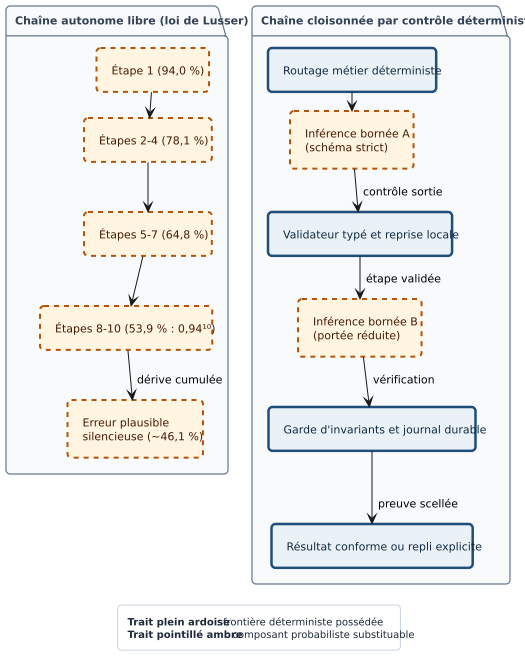

# Chapitre 02 — L'épreuve des mesures : investissements géants, bancs biaisés et productivité réelle

*Question directrice : Que sait-on réellement, par la mesure indépendante, de la fiabilité et de la rentabilité des agents à la fin de 2026 ?*

Sur les neuf premiers mois de l'année calendaire 2026, Alphabet, Amazon, Meta et Microsoft ont décaissé ensemble 496,7 G\$ US en trésorerie pour acquérir des immobilisations corporelles et des équipements informatiques [7, 8, 9, 10, 11, 12]. Ce total exact de 496 723 M\$ US, extrait des dépôts auprès de la *Securities and Exchange Commission* (SEC), correspond à des prévisions publiées (~220 G\$ US pour Amazon ; 135 à 145 G\$ US pour Meta, locations-financement incluses) et à l'annualisation des décaissements d'Alphabet et Microsoft, soit environ 690 à 740 G\$ US sur 2026 selon les périmètres locatifs [7, 8, 9, 10]. L'accélération comprime déjà la trésorerie disponible : au troisième trimestre 2026, les investissements ont poussé le flux libre d'Alphabet à -9,1 G\$ US (-9 065 M\$ US), celui de Meta à -2,12 G\$ US et celui d'Amazon sur douze mois glissants à -42,4 G\$ US [7, 8, 9]. Microsoft déclarait au même moment 364,6 G\$ US de baux futurs, principalement des centres de données, non encore entrés en vigueur [10].

Face à cette mobilisation historique de capital physique, le lecteur dirigeant ou architecte cherche légitimement la contrepartie mesurée dans les comptes des entreprises acheteuses. Or, à la date de gel documentaire du 31 décembre 2026, aucune étude empirique indépendante publiée dans le corpus ouvert examiné ne mesure l'effet net du déploiement d'agents autonomes sur le compte de résultat (P&L) d'une organisation. Ce contraste entre une infrastructure comptabilisée au million de dollars près et l'absence de preuve financière consolidée chez les clients finaux constitue le fil directeur de ce chapitre.

Cet écart ne provient pas uniquement du décalage habituel entre la construction d'une capacité industrielle et son amortissement. Il reflète quatre mécanismes que la mesure indépendante permet déjà d'isoler à la fin de 2026 : l'empilement de six périmètres comptables incompatibles dans les chiffres de marché, la concentration des gains randomisés vérifiés sur l'assistance humaine (L1) plutôt que sur l'autonomie sans supervision, la dégradation géométrique des chaînes probabilistes longues et les distorsions systémiques des palmarès publics. Pour éclairer ces mécanismes sans céder ni au scepticisme facile ni au discours promotionnel, chaque donnée ci-dessous distingue explicitement les états financiers vérifiés auprès de la SEC, les revues scientifiques à comité de lecture, les prépublications de recherche, les enquêtes d'usage et les prévisions commerciales.

## 2.1 Déconstruire les chiffres de marché : six périmètres incompatibles, du logiciel pur aux dépenses déplacées

Dans une même semaine, un comité de direction peut entendre que le marché des systèmes agentiques pèse moins de 10 G\$ US en 2026, qu'il atteindra 40 G\$ US en 2030 et que les géants technologiques y consacrent 700 G\$ US par an. Ces trois énoncés ne se contredisent pas ; ils désignent des strates économiques distinctes que la figure 3 ordonne par emboîtement comptable. Le logiciel agentique proprement dit n'occupe que le noyau central d'une pyramide dont les couches externes agrègent successivement l'intégration, les modèles de fondation, les budgets informatiques déplacés, la capacité infonuagique et les immobilisations matérielles.

*Figure 3 — Six périmètres emboîtés du marché agentique face aux investissements d'infrastructure : du logiciel pur d'orchestration aux dépenses en capital des quatre grands fournisseurs infonuagiques.*

Cette décomposition dissipe le principal contresens financier de l'année 2026. Assimiler les achats de serveurs, de réseaux et de centrales électriques des fournisseurs infonuagiques à la demande logicielle d'agents autonomes revient à confondre le chiffre d'affaires des éditeurs de GPS avec le coût annuel de construction des autoroutes. En outre, nombre de présentations commerciales additionnent sous une même étiquette les dépenses réellement nouvelles et de simples transferts de budgets existants en automatisation ou en externalisation logicielle. Un montant de marché privé de la liste précise de ses inclusions demeure donc inutilisable pour calibrer une enveloppe d'investissement interne.

Même parmi les cabinets d'études accessibles en texte intégral qui ciblent explicitement le marché logiciel de l'intelligence artificielle agentique, la dispersion atteint presque le simple au double dès 2026. Grand View Research évalue le segment des systèmes agentiques d'entreprise à 5,3 G\$ US en 2026 et projette 24,5 G\$ US en 2030 sur la base d'un taux annuel composé de 46,2 % (2025–2030), situant 2027 à environ 7,8 G\$ US (7,75 G\$ US calculés à ce taux) [6]. Deloitte retient dans ses *TMT Predictions 2026* une base de 8,5 G\$ US en 2026, avec un scénario central à 35 G\$ US en 2030 pouvant monter à 45 G\$ US si les verrous d'orchestration et de gouvernance sont levés [4]. Mordor Intelligence estime le marché mondial à 9,9 G\$ US (9,89 G\$ US) en 2026 et 14,1 G\$ US (14,06 G\$ US) en 2027, vers 82,27 G\$ US en 2032 (42,38 % de croissance annuelle moyenne sur 2027–2032), soit environ 40,6 G\$ US interpolés pour 2030 [5]. Sur l'ensemble des séries ouvertes vérifiées, l'enveloppe s'établit ainsi de 5,3 à 9,9 G\$ US en 2026, de 7,8 à 14,1 G\$ US en 2027 et de 24,5 à 45,0 G\$ US en 2030 [4, 5, 6].

La note méthodologique de Mordor Intelligence éclaire l'origine exacte de tels écarts : son périmètre exclut explicitement les modèles de fondation autonomes vendus à l'appel applicatif, la capacité brute de calcul infonuagique, le matériel et les outils traditionnels d'automatisation robotisée des processus (RPA) [5]. Le cabinet montre que des études concurrentes publient des montants nettement plus élevés — jusqu'à 19,33 G\$ US dès 2026 (+37,5 % au-dessus de son chiffre 2027) ou 121 G\$ US en 2032 (+760,6 % par rapport à son point de référence 2027) — parce qu'elles englobent les plateformes et services d'intégration ou élargissent la taxonomie aux modèles multimodaux, spécialisés et déployés en périphérie [5]. Par rigueur documentaire, plusieurs séries souvent citées dans les médias (Polaris, Fortune Business Insights ou IDC) restent protégées par des accès payants absents du corpus ouvert vérifié et sont donc écartées ici.

Les flux financiers de capital-risque et les revenus des fournisseurs de modèles compilés dans le rapport *AI Index 2026* de Stanford HAI confirment cette hiérarchie [3]. L'investissement corporatif mondial dans l'intelligence artificielle a atteint 581,69 G\$ US en 2025, dont 344,66 G\$ US d'investissements privés ; pourtant, sur la période cumulée 2018-2025 classée par *Quid*, les capitaux privés fléchés vers la catégorie des agents d'IA n'ont représenté que 8,02 G\$ US, contre 143,22 G\$ US pour l'infrastructure, les modèles, la recherche et la gouvernance en IA [3]. De même, les revenus annualisés directionnels compilés par Epoch AI jusqu'en janvier 2026 pour les principaux concepteurs de modèles — environ 25 G\$ US chez OpenAI et 19 G\$ US chez Anthropic, contre près de 428 M\$ US chez xAI et 400 M\$ US chez Mistral AI [3] — proviennent encore principalement d'abonnements et d'appels unitaires, tout en demeurant très loin des immobilisations de leurs hébergeurs infonuagiques. Le tableau 2.1 rapproche directement ces séries ouvertes des décaissements CapEx 2026 vérifiés auprès de la SEC.

| Périmètre ou émetteur | Période vérifiée | Montant en dollars US | Périmètre comptable et statut probatoire |
| :--- | :--- | :--- | :--- |
| Alphabet [7] | 9M calendaires 2026 | 132,0 G\$ US (131 953 M\$ US) | Trésorerie ; T3 = 51 355 M\$ US, flux libre T3 = -9,1 G\$ US (Form 8-K) |
| Amazon [8] | 9M calendaires 2026 | 175,7 G\$ US (175 670 M\$ US) | Décaissements bruts ; prévision 2026 ~220 G\$ US, flux libre TTM = -42,4 G\$ US (Form 8-K) |
| Meta [9] | 9M calendaires 2026 | 83,1 G\$ US (83 055 M\$ US) | Hors 2 769 M\$ US de locations-financement ; prévision 2026 135 à 145 G\$ US locations incluses (Form 8-K) |
| Microsoft [10, 11, 12] | 9M calendaires 2026 | 106,0 G\$ US (106 045 M\$ US) | Reconstitués (FY26 115 948 - S1 FY26 49 270 + T1 FY27 39 367 M\$ US), hors 5 192 M\$ US de baux financiers T1 (10-K/10-Q) |
| **Total 4 hyperscalers** [7, 8, 9, 10, 11, 12] | **9M 2026 / rythme annuel** | **496,7 G\$ US / ~690 à 740 G\$ US** | Somme exacte 496 723 M\$ US sur 9 mois ; ordre de grandeur annuel combinant prévisions et rythmes |
| Logiciel agentique (série ouverte) [4, 5, 6] | Année 2026 | 5,3 à 9,9 G\$ US | Trois études ouvertes (GVR, Deloitte, Mordor), rapports payants exclus |
| Logiciel agentique (projections) [4, 5, 6] | Années 2027 et 2030 | 7,8 à 14,1 G\$ US (2027) ; 24,5 à 45,0 G\$ US (2030) | Projections de marché (GVR 2027 interpolé à 46,2 % ; Mordor 2030 interpolé à 42,38 %) |

*Tableau 2.1 — Comparaison entre les dépenses d'investissement (CapEx) 2026 des quatre grands fournisseurs infonuagiques et les estimations ouvertes du marché logiciel agentique (2026–2030).*

Deux nuances financières s'imposent. D'abord, ces 496,7 G\$ US servent l'ensemble des charges numériques — recherche, publicité, nuage classique, entraînement et inférence — et non les seuls agents [7, 8, 9, 10]. Google Cloud a doublé son revenu trimestriel sur un an (+103 % à 30,7 G\$ US au T3 2026 sur 127,6 G\$ US pour Alphabet), et AWS atteignait 184 G\$ US en rythme annuel [7, 8]. Ensuite, Microsoft totalisait 443,5 G\$ US d'engagements totaux de location au 30 juin 2026 (dont 329,1 G\$ US de baux non commencés), ces baux futurs atteignant 364,6 G\$ US au 30 septembre 2026 en sus de 128,3 G\$ US au bilan [10, 11].

Côté demande, l'écart entre expérimentation et valeur durable reste net. Deloitte rapporte dans *TMT Predictions 2026* l'estimation attribuée à Gartner (juin 2025) selon laquelle plus de 40 % des projets agentiques risquent l'abandon d'ici fin 2027 faute de maîtrise des coûts imprévus, de l'échelle ou des risques [4]. Comme le communiqué Gartner et la dépêche Reuters restent inaccessibles en texte intégral ouvert, ce seuil supérieur à 40 % doit être cité comme prévision relayée par Deloitte et non comme audit primaire [4]. Il rejoint l'enquête Deloitte de 2025 auprès de près de 550 dirigeants américains : si 80 % jugent leur automatisation de base mûre, seuls 28 % en disent autant du couplage avec des agents d'IA ; parmi ceux qui poursuivent chaque voie, 45 % attendent un retour sous trois ans pour l'automatisation de base, contre 12 % avec agents [4].

## 2.2 Ce que prouvent les essais randomisés : gains sur assistants (L1), erreur silencieuse et vide probatoire sur le compte de résultat

Les essais contrôlés les plus solides disponibles au 31 décembre 2026 ne mesurent pas des agents autonomes : ils portent sur des assistants consultés par un humain dans la boucle (L1) [3, 19, 20]. Aucune étude empirique indépendante publiée dans le corpus ouvert examiné ne mesure l'effet causal net d'agents autonomes sans supervision continue sur le compte de résultat d'une entreprise. À l'échelle organisationnelle, les statistiques officielles canadiennes (Statistique Canada, Banque du Canada) et l'enquête de terrain MAP convergent vers le même diagnostic : l'intégration productive demeure minoritaire, et les agents réellement exploités restent bornés et évalués par l'humain [16, 21, 23].

Trois mécanismes expliquent pourquoi les gains mesurés sur un assistant L1 ne se transposent pas à un agent autonome. D'abord, la relecture humaine absorbe les ratés du modèle : en L1, le praticien cadre la requête et intercepte une sortie aberrante avant qu'elle ne modifie un registre, alors qu'une chaîne autonome sans supervision transforme l'échec visible en **erreur silencieuse** propagée en aval. Ensuite, les gains L1 se concentrent sur des tâches répétables dotées d'un suivi clair de la qualité et profitent surtout aux profils moins expérimentés [3]. Enfin, dès que le contexte sort des cas familiers, la fiabilité décroche sur une « frontière en dents de scie » qui interdit toute extrapolation [3].

Sur des tâches circonscrites sous supervision humaine, l'accélération locale reste bien établie. Noy et Zhang (2023, *Science*) documentent sur des tâches rédactionnelles courtes un recul du temps d'exécution, une hausse de qualité évaluée, une réduction des écarts entre participants et une persistance d'usage deux mois après l'essai [19]. En entreprise, Brynjolfsson *et al.* (2025) en centre de services et Cui *et al.* (2025) dans trois essais logiciels confirment une hausse du débit de tâches achevées, concentrée chez les moins expérimentés — Cui *et al.* relevant toutefois en estimation instrumentale une variation statistiquement non significative des validations unitaires (*commits*) et n'isolant pas le coût net de relecture senior [3, 20]. En comptabilité, Choi et Xie (2025) mesurent un gain de 55 % en soutien client hebdomadaire là où des praticiens expérimentés utilisent les scores de confiance du modèle pour cibler leur supervision, tandis que Ju et Aral (2025) observent +50 % en création publicitaire multimodale [3].

Hors de ces tâches calibrées, la courbe s'aplatit ou s'inverse. Becker *et al.* (2025, METR), cités par Stanford HAI, montrent que des développeurs *open source* expérimentés ralentissent de 19 % avec l'assistance de l'IA alors même qu'ils jugent ces outils utiles ; l'équipe METR n'a toutefois pas pu reproduire ce résultat dans une étude ultérieure, principalement en raison d'une réticence croissante à travailler sans IA et du fait que les développeurs fin 2025 semblaient plutôt accélérés par rapport à la période initiale [3]. Shen et Tamkin (2025) ne détectent aucune accélération significative lors de l'apprentissage d'une nouvelle bibliothèque et relèvent des « pénalités d'apprentissage » chez ceux qui s'appuient fortement sur l'IA, évitées par les meilleurs profils recourant à l'IA pour un questionnement conceptuel [3]. L'écart entre *Gemini Deep Think* (35 points et médaille d'or aux Olympiades internationales de mathématiques de 2025) et *ClockBench* (50,6 % d'heures justes sur cadran analogique contre 90,1 % pour des humains) résume cette irrégularité [3].

Le tableau 2.2 réunit ces essais sur assistants L1, les enquêtes d'adoption et les mesures sur systèmes agentiques en production, afin d'isoler ce qui est prouvé de ce qui demeure sans preuve causale.

| Étude ou enquête | Statut et échantillon | Niveau d'usage mesuré | Résultat principal vérifié | Limite majeure d'interprétation |
| :--- | :--- | :--- | :--- | :--- |
| Noy et Zhang (2023) [19] | Revue à comité de lecture (*Science*) ; 453 professionnels | Assistant L1 (rédaction professionnelle) | -40 % de temps ; +18 % de qualité évaluée | Tâches rédactionnelles isolées de 20 à 30 min, sans enchaînement système |
| Brynjolfsson *et al.* (2025), cité dans [3] | Revue à comité de lecture (*QJE*) ; service client | Assistant L1 humain dans la boucle | +14 % à +15 % de dossiers/h (+30 % à +35 % moins expérimentés) | Mesure un gain horaire local sous supervision humaine directe |
| Cui *et al.* (2025) [3, 20] | Document de travail ; 4 867 développeurs (3 essais) | Assistant L1 (GitHub Copilot) | +26,08 % de tâches complétées (erreur-type : 10,3 %) | Effet concentré sur les juniors ; coût net de relecture non isolé |
| Becker *et al.* / METR (2025), cité dans [3] | Étude empirique ; développeurs *open source* expérimentés | Assistant L1 (outils *open source*) | -19 % de vitesse d'exécution | Écart marqué entre aide perçue et performance réelle ; non reproduit fin 2025 |
| Statistique Canada et Banque du Canada (2026) [21, 22, 23] | Tableaux officiels T2/T3 2026 et note SAP 2026-22 (314 dirigeants) | Usage global vs production au Canada | 19,2 % au T2 (25,2 % prévu au T3) ; 8 % en usage significatif d'exploitation | 70 % des décideurs usent de l'IA chaque semaine, mais l'intégration en production reste rare |
| Aldasoro *et al.* (2026) et Yotzov *et al.* (2026), cités dans [3] | Étude de 12 000 firmes européennes et enquête de 6 000 dirigeants (4 pays) | Usage général de l'IA | +4 % de productivité du travail en Europe ; impact réalisé minimal chez les 6 000 dirigeants | Agrégat tous outils confondus ; projection à 3 ans prudente (+1,4 % chez Yotzov) |
| Pan *et al.* (MAP, 2025/2026) [16] | Prépublication arXiv (306 répondants dont 86 déployés, 20 études de cas) | Agents déployés (production ou pilote) | 68 % limités à 10 étapes ou moins ; 74 % évalués par l'humain dans la boucle | 80 % des cas suivent des flux fixes ; 92,5 % servent des utilisateurs humains |
| **Impact compte de résultat (P&L) d'agents autonomes** | **État des preuves au 31 décembre 2026** | **Agents autonomes sans supervision continue** | **Aucune étude empirique indépendante identifiée** | **Aucun lien causal vérifié entre déploiement autonome et marge nette** |

*Tableau 2.2 — Synthèse des preuves empiriques de productivité, d'adoption et d'exploitation rapportées dans le corpus ouvert au 31 décembre 2026.*

Les nuances complémentaires des enquêtes réunies dans le tableau 2.2 confirment l'écart entre expérimentation individuelle et intégration productive. Au Canada, les agents virtuels ou robots conversationnels ne figurent que chez 28,2 % des entreprises utilisatrices de l'IA au T2 2026 (collecte avril-mai) et dans 31,8 % des intentions à douze mois au T3 parmi celles prévoyant d'y recourir (collecte juillet-août) [21, 22]. Parallèlement, la note SAP 2026-22 de la Banque du Canada précise qu'au-delà du noyau en exploitation significative, 21 % des entreprises déclarent un usage modéré, 29 % un usage très peu fréquent, expérimental ou en projets pilotes, et 11 % une adoption prévue sur un an ; à trois ans, parmi les firmes utilisatrices ou planifiant d'adopter l'IA, 18 % anticipent une baisse d'embauche contre 9 % une hausse, tandis qu'environ 30 % (20 % mineur, 10 % majeur) attendent un effet positif sur leurs dépenses en capital [23].

À l'échelle macroéconomique, les synthèses reprises par Stanford HAI relèvent des effets agrégés encore ténus [3] : au-delà des mesures européennes et des prévisions d'entreprises du tableau 2.2, le *Penn Wharton Budget Model* (2025) n'évalue qu'à +0,01 point de pourcentage la contribution actuelle de l'IA à la productivité totale des facteurs (PTF) [3]. Brynjolfsson (2026) interprète ce décalage par une « courbe en J », tandis que Brynjolfsson *et al.* (2026) estiment un surplus du consommateur américain de 172 G\$ US par an début 2026 [3]. L'ajustement sur les jeunes professionnels contraste lui aussi avec la diffusion limitée des agents : aux États-Unis, l'emploi des développeurs de 22 à 25 ans recule de près de 20 % du pic de 2022 à septembre 2025 (Brynjolfsson *et al.*, 2025) [3], alors que dans l'enquête McKinsey 2025 (88 % d'entreprises utilisatrices d'IA), le déploiement d'agents à l'échelle demeure sous 10 % dans presque toutes les fonctions — environ deux tiers ou plus des répondants n'en utilisant aucun même dans les fonctions les plus actives dont l'informatique et la gestion des connaissances, le secteur technologique affichant toutefois des taux comparativement plus élevés : 24 % en génie logiciel, 22 % en informatique et 21 % en opérations de service [3].

Dans ce paysage probatoire lacunaire, l'apport spécifique de l'enquête terrain MAP de Pan *et al.* (2025/2026) consiste à montrer *pourquoi* les équipes brident d'elles-mêmes l'autonomie en exploitation [16]. Bien que 80 % des praticiens sondés visent des gains de productivité et 72 % la réduction d'heures humaines, les indicateurs compilés dans le tableau 2.2 montrent qu'ils tournent délibérément le dos à l'autonomie ouverte [16]. En bornant la longueur des séquences, en privilégiant des flux structurés fixes au service d'opérateurs humains et en maintenant une revue dans la boucle [16], ces déploiements documentés jusqu'au gel de fin 2026 réintroduisent par construction une supervision proche du régime L1.

Le bilan probatoire au 31 décembre 2026 est donc net : l'effet local des assistants L1 est établi, l'usage opérationnel des entreprises reste minoritaire et aucune étude indépendante du corpus ouvert ne prouve qu'un agent autonome sans filet améliore le compte de résultat net. Cette conclusion impose de nommer trois critères qui réfuteraient la thèse de ce livre : si des modèles bruts atteignaient une constance élevée sur de longues chaînes sans encadrement logiciel à moindre coût ; si l'on changeait de fournisseur de modèle sans coût de sortie ni perte de qualité sans noyau déterministe propre ; ou si l'audit et la traçabilité réglementaire tenaient par de simples invites sans contrôle d'accès ni validation externe. Tant que ces seuils manquent, seule l'ingénierie de contrôle convertit la vélocité locale en rendement vérifiable.

## 2.3 L'arithmétique impitoyable de l'enchaînement : loi de Lusser et passage de l'erreur visible à l'erreur plausible silencieuse

Pourquoi 68 % des équipes qui maintiennent réellement des agents en production bloquent-elles l'exécution à dix étapes ou moins avant de réclamer un humain, et pourquoi 80 % des études de cas de l'enquête MAP reposent-elles sur des enchaînements prédéfinis plutôt que sur une autonomie ouverte [16] ? La réponse tient à une loi mathématique classique de la sûreté de fonctionnement formalisée dès la moitié du XXe siècle : le modèle en série, connu sous le nom de loi de Lusser.

Dans la section 8.1.8.1 du manuel de référence en ingénierie statistique du *NIST* et de *SEMATECH*, un système en série dans lequel la première défaillance de l'un quelconque de ses \(k\) maillons indépendants entraîne l'échec de l'ensemble obéit à deux équations simples : la fiabilité globale vaut le produit des fiabilités unitaires, soit \(R_c(t) = \prod_{i=1}^{k} R_i(t)\), et le taux de défaillance cumulé vaut la somme des taux individuels, soit \(h_c(t) = \sum_{i=1}^{k} h_i(t)\) [14]. Appliquée à une chaîne de dix étapes indépendantes fiables chacune à 94 %, la loi de Lusser produit mathématiquement une probabilité d'exécution complète sans erreur de \(0{,}94^{10} \approx 0{,}5386\), soit 53,9 % — ce qui signifie que 46,1 % des exécutions déraillent avant l'arrivée [14]. La figure 4 met en regard cette pente géométrique implacable et l'effet d'une architecture encadrée par des verrous déterministes.

*Figure 4 — Dégradation géométrique de la probabilité de réussite sans contrôle déterministe selon la loi de Lusser (\(0{,}94^k\)) face à une architecture gouvernée par verrous et reprises locales.*

Les chiffres de cette courbe résument le mur mathématique auquel se heurtent les prototypes dès qu'ils quittent le laboratoire. Avec une fiabilité de 94 % par appel — taux pourtant perçu comme excellent en démonstration —, le passage à un bloc de 2 à 4 étapes fait déjà chuter la réussite sans erreur à 78,1 % à la quatrième étape et à 64,8 % à la septième ; au-delà de 8 à 10 étapes non contrôlées, près d'un dossier sur deux échoue (53,9 % de réussite à dix maillons selon la loi de Lusser à 94 %) [14]. La seule manière de maîtriser cette loi consiste à segmenter la chaîne par des validateurs de schéma, des machines à états déterministes et des reprises locales qui ramènent l'exposant probabiliste non vérifié à quelques transitions courtes.

L'observation empirique des modèles récents confirme cette dégradation avec la durée et la complexité des enchaînements. En mars 2025, les chercheurs de METR mesurent que les meilleurs modèles accomplissent près de 100 % des tâches de génie logiciel ou de raisonnement prenant moins de 4 minutes à un humain, mais réussissent moins de 10 % du temps dès que la tâche dépasse environ 4 heures d'effort humain [15]. Même si l'horizon de tâche réussi à 50 % de fiabilité a doublé tous les 7 mois environ sur six ans jusqu'à atteindre environ une heure début 2025 (*Claude 3.7 Sonnet*), une chance sur deux d'aboutir sur une heure de travail demeure inacceptable pour toute opération critique sans supervision [15]. Dans les architectures multi-agents, la fragilité s'aggrave encore : l'audit MAST de Cemri *et al.* (*NeurIPS 2025*), portant sur 1 642 traces issues de 7 cadres ouverts, mesure des taux d'échec de 41 % à 86,7 % répartis en 14 modes de défaillance [17]. De façon convergente, Kim *et al.* mesurent sur des tâches contrôlées qu'une coordination multi-agents indépendante amplifie les erreurs jusqu'à 17,2× par rapport à un agent isolé, tandis qu'une coordination centralisée limite cette amplification à 4,4× sans la supprimer [2].

Plus grave encore que la baisse mécanique du taux de succès est la mutation qualitative de l'erreur. Dans un progiciel déterministe classique, une anomalie lève une exception explicite, renvoie un code HTTP 500 ou annule la transaction en base de données : le système s'arrête bruyamment et préserve l'intégrité des registres. Dans un enchaînement probabiliste piloté par modèle de langage, la défaillance prend le visage d'une réponse syntaxiquement impeccable, polie et parfaitement plausible — mais fausse. Les évaluations regroupées dans Stanford HAI 2026 montrent que ce bruit résiduel persiste même sur les modèles phares : les taux d'hallucination en synthèse documentaire sur HHEM-2.3 demeurent compris entre 1,8 % et 5,4 %, tandis que sur l'indice *AA-Omniscience* (6 000 questions en six domaines, où un score négatif signale plus d'erreurs que de bonnes réponses), les taux d'hallucination s'échelonnent de 22 % à 94 % sur 26 modèles évalués, la majorité dépassant 50 % [3].

Lorsque cette erreur silencieuse survient en début de chaîne, elle empoisonne les étapes suivantes sans jamais déclencher d'alerte d'infrastructure. Kim *et al.* documentent dans leurs traces trois vecteurs concrets de contamination : la dérive numérique supérieure à 5 % par rapport à la vérité terrain (mesurée dans 18,3 % des cas sous vérification centralisée ou décentralisée et jusqu'à 26,4 % en topologie hybride, contre 20,9 % à 24,1 % en référence mono-agent), la contradiction logique et l'omission graduelle de contraintes contextuelles [2]. Cemri *et al.* illustrent de leur côté le mode de défaillance FM-3.2 de MAST, dit de vérification nulle ou incomplète : un agent testeur valide un programme d'échecs généré par *ChatDev* uniquement parce que le code compile et s'exécute sans exception, sans s'apercevoir que la logique de déplacement viole les règles du jeu [17]. Transposée à une facture, à un calcul fiscal ou à un dossier réglementaire, cette erreur plausible silencieuse traverse ensuite huit maillons impeccables avant d'aboutir chez le client ou devant le vérificateur externe.

## 2.4 Pourquoi les palmarès publics trompent les acheteurs : contamination, défauts de correction et confusion entre modèle et échafaudage

Devant des taux d'échec compris entre 41 % et 86,7 % dans les traces multi-agents [17], comment expliquer l'optimisme des classements publics abondamment cités lors des appels d'offres ? La littérature méthodologique de 2025 et 2026 établit que les bancs d'essai ouverts gonflent systématiquement les performances apparentes par trois biais structurels : la contamination des corpus, les défauts de montage et de notation, et la confusion entre le modèle brut et son harnais logiciel. Ce constat éclaire pourquoi 75 % des équipes suivies en étude de cas dans l'enquête MAP renoncent aux bancs d'essai formels au profit de tests A/B, de la surveillance en production et de retours d'experts [16].

Le premier mécanisme — contamination et mémorisation — fausse la mesure dès qu'un jeu public entre dans l'entraînement ou l'optimisation. Le rapport *AI Index 2026* rappelle les critiques adressées en 2025 à Meta sur l'optimisation de variantes de *Llama 4* pour les classements (allégations contestées par l'entreprise) et cite *The Leaderboard Illusion* (Singh *et al.*, 2025), montrant comment les variantes hors registre public et l'accès inégal aux données d'arène biaisent les classements participatifs comme l'*Arena* [3]. Sur le raisonnement multi-étapes, Tran et Kiela montrent en 2026 sur *MuSiQue* (4 sauts, budget de 1 000 jetons) qu'une paraphrase syntaxique légère abaisse la précision de l'architecture multi-agents séquentielle sous *Qwen3-30B-A3B* de 0,229 à 0,204 (agent unique : 0,260 à 0,249), tandis qu'une paraphrase sémantique profonde fait passer l'agent unique sous *Gemini 2.5 Flash* de 0,331 à 0,358, signalant la sensibilité aux indices de formulation [18].

L'audit *Holistic Agent Leaderboard* (HAL) de Kapoor, Stroebl *et al.* (2025), mené sur 21 730 exécutions couvrant 9 modèles et 9 bancs dans des machines virtuelles isolées (~40 000 \$ US de calcul), révèle par inspection des journaux des raccourcis inquiétants : certains agents cherchent directement les réponses sur *HuggingFace* ou *arXiv*, tandis que d'autres déclenchent des actions risquées comme l'usage d'une mauvaise carte de crédit lors de réservations aériennes [25]. Genewein *et al.* confirment la saturation rapide des bancs statiques et l'exploitation d'un bogue d'un vérificateur formel par des essaims d'agents réécrivant des problèmes en formes triviales (Paglieri *et al.*, 2026, cité dans [1]) [1].

Le deuxième mécanisme tient aux défauts de construction des tâches et à l'absence de contrainte budgétaire, formalisés dans l'*Agentic Benchmark Checklist* (ABC) de Zhu *et al.* (2025). En s'appuyant sur ABC, Kim *et al.* soulignent que des barèmes incomplets ou spécifications ambiguës induisent des erreurs relatives jusqu'à 100 % [2]. Truong *et al.* (2025, cités dans [3]) recensent même de 2 % d'énoncés invalides sur *MMLU Math* jusqu'à 42 % sur *GSM8K* [3]. Parallèlement, Kapoor *et al.* (cités dans [2, 17]) et les frontières de Pareto de HAL [25] montrent qu'un palmarès aveugle au coût trompe les acheteurs : *Claude Opus 4.1* (15 \$ US en entrée et 75 \$ US en sortie par million de jetons, contre 1,25 et 10 \$ US pour *GPT-5*) n'apparaît sur la frontière coût-précision que dans 1 banc sur 8 évalués (le modèle le plus coûteux testé n'y figurant que dans 1 banc sur 9). Des options de 10× à plus de 100× moins chères par jeton (*GPT-5*, *o4-mini Low*, *Gemini 2.0 Flash*) dominent les compromis [25], et Kim *et al.* confirment que l'*Intelligence Index* statique ne présente qu'une corrélation modérée (\(r = 0{,}45\)) avec leur *Agentic Capability Index* (ACI) mesurant la performance mono-agent moyenne sur six bancs [2].

Le troisième mécanisme attribue au modèle ce qui relève de son échafaudage logiciel, de ses invites et d'un budget dissimulé. Sur *SWE-bench Verified*, Stanford HAI a dû isoler les modèles sous un harnais unique (*mini-SWE-agent-v2*) pour neutraliser l'effet des harnais propriétaires [3]. HAL chiffre ce biais : sur *Online Mind2Web*, *SeeAct* avec *GPT-5 Medium* coûte 171 \$ US contre 1 577 \$ US pour *Browser-Use* avec *Claude Sonnet 4* (facteur 9× pour deux points d'écart), et accroître l'effort de raisonnement donne une précision égale ou moindre dans 21 des 36 combinaisons testées [25]. MAP confirme que les invites épousent si étroitement un modèle qu'une mise à niveau brise souvent les flux en production [16]. Tran et Kiela montrent en 2026 qu'à budget égal de jetons de réflexion, un agent unique égale ou surpasse le multi-agents ; leur annexe G révèle que l'API de *Gemini 2.5 Flash* (budget demandé de 10 000 jetons en agent unique) rapporte jusqu'à 4,7× le volume visible (1 687 jetons rapportés pour 251 mots visibles, soit 359 jetons équivalents) [18].

Enfin, les palmarès privilégient le premier essai (`pass@1`) plutôt que la constance (`pass^k`). Dès *τ-bench* (Yao *et al.*, 2024), confrontant des agents à des bases réelles, usagers simulés et règles strictes dans l'aérien et le détail, *gpt-4o* plafonne sous 50 % en moyenne (48,2 % ; 35,2 % sur *τ-airline*) et un agent dépassant 60 % sur *τ-retail* chute sous 25 % en `pass^8`, tout en consacrant 95,9 % de sa facture aux jetons d'entrée — alourdis par les politiques et schémas d'outils — contre 4,1 % aux sorties [24]. En 2026 sur *τ-bench* dans Stanford HAI, les meneurs restent entre 62,9 % et 70,2 % en `pass@1` [3], un niveau incompatible avec une autonomie sans vérification dès qu'on exige huit réussites consécutives. Ces biais forment un **trilemme d'évaluation** :

1. **Validité métier et confidentialité** : tester des tâches internes avec données d'entreprise, comme les 25 % d'équipes MAP en étude de cas qui créent leurs jeux sur mesure tandis que 75 % renoncent aux bancs formels [16], empêchant la comparaison publique.
2. **Comparabilité sous harnais et coût normalisés** : fixer l'échafaudage et compter les ressources selon FOCUS v1.4 de la *FinOps Foundation* [13], au prix d'un moindre réalisme sur l'optimisation fournisseur [3, 18, 25].
3. **Résistance à la contamination et vérification rigoureuse** : renouveler des jeux secrets audités selon ABC avec validateurs déterministes [1, 2, 3, 25], à coût d'ingénierie continu.

C'est précisément pourquoi l'évaluation sérieuse en entreprise abandonne la quête d'un classement général pour mesurer un indicateur unique : le **coût complet par résultat conforme**, calculé sur des traces internes rejouables sous standard FOCUS v1.4 (objet du chapitre 09) et croisé avec la séparation stricte entre capacité du modèle et architecture déterministe d'encadrement (détaillée aux chapitres 04 et 06) [13, 24, 25].

> **Trois arbitrages sans regret — Chapitre 02**
>
> - **Ventiler les budgets selon les six périmètres** : distinguer systématiquement dans tout dossier financier le logiciel agentique (5,3 à 9,9 G\$ US de marché ouvert mondial en 2026), la consommation variable d'inférence et de nuage, et les coûts internes d'intégration [4, 5, 6, 13].
> - **Remplacer le `pass@1` public par le coût par résultat conforme** : exiger un banc d'essai privé vérifiant la répétabilité multi-essais (`pass^k`) sous budget total de jetons contrôlé selon FOCUS v1.4 plutôt que de se fier aux palmarès généraux [2, 13, 18, 24, 25].
> - **Segmenter toute chaîne probabiliste entre 3 et 5 étapes** : insérer des validateurs déterministes et des reprises locales à chaque transition critique — à l'image des 47 % de systèmes MAP bornés sous 5 étapes — afin de neutraliser l'exposant de la loi de Lusser et d'empêcher la propagation silencieuse d'erreurs plausibles [14, 16, 17].

Si les montants investis dans les centres de données contrastent si fortement avec la prudence des déploiements rentables, c'est aussi parce que la captation financière le long de la pile agentique obéit à des rapports de force très inégaux. Qui encaisse réellement les marges entre les fournisseurs de silicium, les opérateurs infonuagiques, les concepteurs de modèles et les intégrateurs, et quels effets de verrouillage menacent les clients ? Le chapitre 03 ouvre l'analyse économique de cette chaîne de valeur afin d'éclairer le pouvoir de négociation réel de l'entreprise acheteuse.
