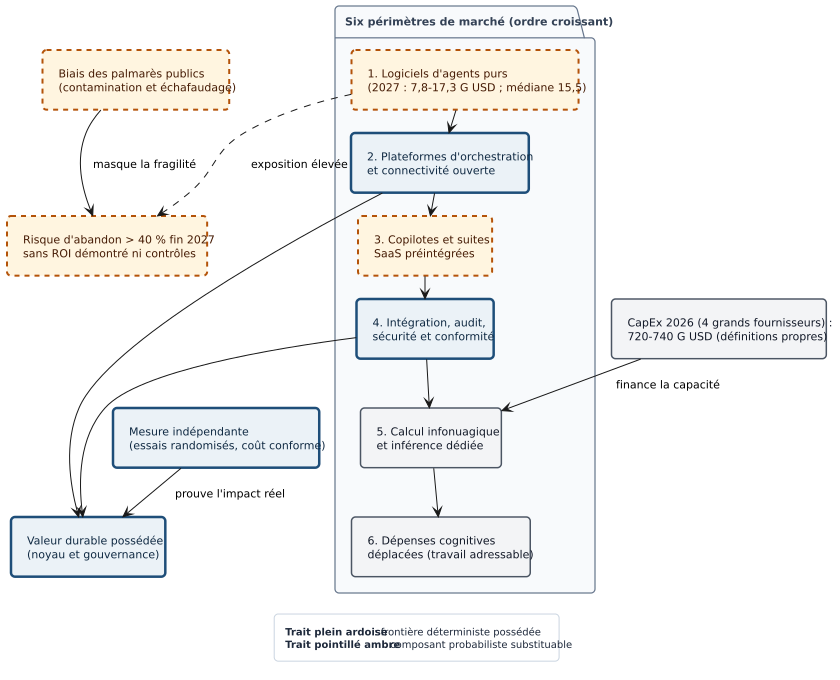

# Chapitre 02 — L'épreuve des mesures : investissements géants, bancs biaisés et productivité réelle

*Question directrice : Que sait-on réellement, par la mesure indépendante, de la fiabilité et de la rentabilité des agents à la fin de 2026 ?*

Sur les neuf premiers mois de l'année calendaire 2026, Alphabet, Amazon, Meta et Microsoft ont décaissé ensemble 496,7 G\$ US en trésorerie pour acquérir des immobilisations corporelles et des équipements informatiques [7, 8, 9, 10, 11, 12]. Ce total exact de 496 723 M\$ US, extrait des dépôts réglementaires auprès de la *Securities and Exchange Commission* (`SEC`), correspond à des rythmes annualisés ou à des prévisions comprises entre 690 et 740 G\$ US sur l'ensemble de l'exercice 2026 selon les périmètres comptables retenus par chaque groupe, notamment l'inclusion ou non des contrats de location-financement [7, 8, 9, 10]. La vitesse d'accélération comprime désormais la trésorerie disponible des plus grands émetteurs technologiques : au troisième trimestre 2026, les investissements trimestriels ont poussé le flux de trésorerie disponible d'Alphabet à -9,1 G\$ US (-9 065 M\$ US), celui de Meta à -2,12 G\$ US et celui d'Amazon sur douze mois glissants à -42,4 G\$ US [7, 8, 9]. Microsoft déclarait au même moment 364,6 G\$ US de baux de centres de données signés mais non encore entrés en vigueur, venant s'ajouter à ses décaissements courants [10].

Face à cette mobilisation historique de capital physique, le lecteur dirigeant ou architecte cherche légitimement la contrepartie mesurée dans les comptes des entreprises acheteuses. Or, à la date de gel documentaire du 31 décembre 2026, aucune étude empirique indépendante publiée dans le corpus ouvert examiné ne mesure l'effet net du déploiement d'agents autonomes sur le compte de résultat (`P&L`) d'une organisation. Ce contraste entre une infrastructure comptabilisée au million de dollars près et l'absence de preuve financière consolidée chez les clients finaux constitue le fil directeur de ce chapitre.

Cet écart ne provient pas uniquement du décalage habituel entre la construction d'une capacité industrielle et son amortissement. Il reflète quatre mécanismes que la mesure indépendante permet déjà d'isoler à la fin de 2026 : l'empilement de six périmètres comptables incompatibles dans les chiffres de marché, la concentration des gains randomisés vérifiés sur l'assistance humaine (`L1`) plutôt que sur l'autonomie sans supervision, la dégradation géométrique des chaînes probabilistes longues et les distorsions systémiques des palmarès publics. Pour éclairer ces mécanismes sans céder ni au scepticisme facile ni au discours promotionnel, chaque donnée ci-dessous distingue explicitement les états financiers vérifiés auprès de la `SEC`, les revues scientifiques à comité de lecture, les prépublications de recherche, les enquêtes d'usage et les prévisions commerciales.

## 2.1 Déconstruire les chiffres de marché : six périmètres incompatibles, du logiciel pur aux dépenses déplacées

Dans une même semaine, un comité de direction peut entendre que le marché des systèmes agentiques pèse moins de 10 G\$ US en 2026, qu'il atteindra 40 G\$ US en 2030 et que les géants technologiques y consacrent 700 G\$ US par an. Ces trois énoncés ne se contredisent pas ; ils désignent des strates économiques distinctes que la figure 2.1 ordonne par emboîtement comptable. Comme le montre ce schéma, le logiciel agentique proprement dit n'occupe que le noyau central d'une pyramide dont les couches externes agrègent successivement l'intégration, les modèles de fondation, les budgets informatiques déplacés, la capacité infonuagique et les immobilisations matérielles.

*Figure 2.1 — Six périmètres emboîtés du marché agentique face aux investissements d'infrastructure : du logiciel pur d'orchestration aux dépenses en capital des quatre grands fournisseurs infonuagiques.*

Cette décomposition dissipe le principal contresens financier de l'année 2026. Assimiler les achats de serveurs, de réseaux et de centrales électriques des fournisseurs infonuagiques à la demande logicielle d'agents autonomes revient à confondre le chiffre d'affaires des éditeurs de GPS avec le coût annuel de construction des autoroutes. En outre, nombre de présentations commerciales additionnent sous une même étiquette les dépenses réellement nouvelles et de simples transferts de budgets déjà existants en automatisation ou en externalisation logicielle. Un montant de marché privé de la liste précise de ses inclusions demeure donc inutilisable pour calibrer une enveloppe d'investissement interne.

Même parmi les cabinets d'études dont les rapports sont accessibles en texte intégral et qui ciblent explicitement le marché logiciel de l'intelligence artificielle agentique, la dispersion des mesures atteint près du simple au double dès 2026. Grand View Research évalue le segment des systèmes agentiques d'entreprise à 5,3 G\$ US (5,30 G\$ US) en 2026 et projette 24,5 G\$ US en 2030 sur la base d'un taux de croissance annuel composé de 46,2 %, ce qui place 2027 à environ 7,8 G\$ US (7,75 G\$ US) [6]. Deloitte retient dans ses prévisions *TMT Predictions 2026* une base de 8,5 G\$ US en 2026, avec un scénario central à 35 G\$ US en 2030 pouvant monter à 45 G\$ US si les verrous d'orchestration et de gouvernance sont levés [4]. Mordor Intelligence estime pour sa part le marché mondial à 9,9 G\$ US (9,89 G\$ US) en 2026 et 14,1 G\$ US (14,06 G\$ US) en 2027, vers 82,27 G\$ US en 2032 (42,38 % de croissance annuelle moyenne), soit environ 40,6 G\$ US interpolés pour 2030 [5]. Sur l'ensemble des séries ouvertes vérifiées, l'enveloppe s'établit ainsi de 5,3 à 9,9 G\$ US en 2026, de 7,8 à 14,1 G\$ US en 2027 et de 24,5 à 45,0 G\$ US en 2030 [4, 5, 6].

La note méthodologique de Mordor Intelligence éclaire l'origine exacte de tels écarts : son périmètre exclut explicitement les modèles de fondation autonomes vendus à l'appel applicatif, la capacité brute de calcul infonuagique, le matériel et les outils traditionnels d'automatisation robotisée des processus (`RPA`) [5]. Le cabinet souligne que d'autres études concurrentes publient des montants supérieurs de plus de 760 % (jusqu'à 19,33 G\$ US en 2026 ou 121 G\$ US en 2032) précisément parce qu'elles agrègent ces couches sous-jacentes ou comptabilisent plusieurs maillons d'une même chaîne [5]. Par ailleurs, plusieurs séries fréquemment citées dans les médias (Polaris, Fortune Business Insights ou IDC) restent protégées par des accès payants absents du corpus ouvert vérifié et sont donc écartées ici par rigueur documentaire.

Les flux financiers de capital-risque et les revenus des fournisseurs de modèles compilés dans le rapport *AI Index 2026* de Stanford HAI confirment cette hiérarchie [3]. L'investissement corporatif mondial dans l'intelligence artificielle a atteint 581,69 G\$ US en 2025, dont 344,66 G\$ US d'investissements privés ; pourtant, sur la période cumulée 2018-2025 classée par *Quid*, les capitaux privés fléchés spécifiquement vers les agents autonomes n'ont représenté que 8,02 G\$ US, contre 143,22 G\$ US pour l'infrastructure, les modèles de fondation et les plateformes associées [3]. De même, les revenus annualisés estimés par Epoch AI en 2026 pour les principaux concepteurs de modèles — environ 25 G\$ US chez OpenAI et 19 G\$ US chez Anthropic, contre près de 428 M\$ US chez xAI et 400 M\$ US chez Mistral [3] — proviennent encore principalement d'abonnements conversationnels et d'appels unitaires, tout en demeurant très loin des immobilisations de leurs hébergeurs infonuagiques. Le tableau 2.1 rapproche directement ces séries ouvertes des décaissements `CapEx` 2026 vérifiés auprès de la `SEC`.

| Périmètre ou émetteur | Période vérifiée | Montant en dollars US | Périmètre comptable et statut probatoire |
| :--- | :--- | :--- | :--- |
| Alphabet [7] | 9M calendaires 2026 | 132,0 G\$ US (131 953 M\$ US) | Trésorerie ; T3 = 51 355 M\$ US, flux libre T3 = -9,1 G\$ US (`Form 8-K`) |
| Amazon [8] | 9M calendaires 2026 | 175,7 G\$ US (175 670 M\$ US) | Décaissements bruts ; prévision 2026 ~220 G\$ US, flux libre TTM = -42,4 G\$ US (`Form 8-K`) |
| Meta [9] | 9M calendaires 2026 | 83,1 G\$ US (83 055 M\$ US) | Hors 2 769 M\$ US de locations-financement ; prévision 2026 135 à 145 G\$ US locations incluses (`Form 8-K`) |
| Microsoft [10, 11, 12] | 9M calendaires 2026 | 106,0 G\$ US (106 045 M\$ US) | Reconstitués (`FY26` 115 948 - `S1 FY26` 49 270 + `T1 FY27` 39 367 M\$ US), hors 5 192 M\$ US de baux T1 (`10-K`/`10-Q`) |
| **Total 4 hyperscalers** [7, 8, 9, 10, 11, 12] | **9M 2026 / rythme annuel** | **496,7 G\$ US / 690 à 740 G\$ US** | Somme exacte 496 723 M\$ US sur 9 mois ; fourchette annuelle selon périmètres locatifs |
| Logiciel agentique (série ouverte) [4, 5, 6] | Année 2026 | 5,3 à 9,9 G\$ US | Trois études ouvertes (`GVR`, `Deloitte`, `Mordor`), rapports payants exclus |
| Logiciel agentique (projections) [4, 5, 6] | Années 2027 et 2030 | 7,8 à 14,1 G\$ US (2027) ; 24,5 à 45,0 G\$ US (2030) | Projections conditionnelles de marché (`Mordor` 2030 interpolé à 42,38 % entre 14,06 et 82,27 G\$ US) |

*Tableau 2.1 — Comparaison entre les dépenses d'investissement (`CapEx`) 2026 des quatre grands fournisseurs infonuagiques et les estimations ouvertes du marché logiciel agentique (2026–2030).*

Deux nuances financières s'imposent devant ces montants. En premier lieu, ces 496,7 G\$ US servent l'ensemble des charges de travail numériques — moteurs de recherche, publicité algorithmique, infonuagique classique, entraînement de modèles et inférence conversationnelle — et non les seuls agents autonomes [7, 8, 9, 10]. Google Cloud a doublé son chiffre d'affaires trimestriel sur un an (+103 % à 30,7 G\$ US au T3 2026 sur 127,6 G\$ US de revenus totaux pour Alphabet), tandis qu'AWS atteignait un rythme annualisé de 184 G\$ US [7, 8]. En second lieu, les engagements locatifs futurs alourdissent encore le bilan implicite, Microsoft totalisant à lui seul 443,5 G\$ US d'engagements de location à la clôture de son exercice 2026 puis 364,6 G\$ US de baux non encore entrés en vigueur au 30 septembre 2026 [10, 11].

Côté demande des entreprises, l'écart entre expérimentation et création de valeur durable est tout aussi net. Deloitte rapporte dans ses prévisions *TMT Predictions 2026* une estimation attribuée à Gartner (juin 2025) selon laquelle plus de 40 % des projets d'intelligence artificielle agentique risqueraient l'abandon d'ici la fin de 2027 sous l'effet de coûts croissants, d'une valeur métier floue ou de contrôles de risque inadéquats [4]. Parce que le communiqué original de Gartner comme la dépêche associée de Reuters demeurent inaccessibles en texte intégral ouvert, cette estimation supérieure à 40 % doit être citée explicitement comme une prévision sectorielle relayée par Deloitte plutôt que comme un audit statistique primaire [4]. Elle rejoint néanmoins l'enquête conduite par Deloitte en 2025 auprès d'environ 550 dirigeants américains : si 80 % jugent leur automatisation classique arrivée à maturité et 45 % en attendent un retour sur investissement en moins de trois ans, seuls 28 % associent déjà automatisation de base et agents autonomes, et à peine 12 % prévoient une rentabilité sous trois ans pour ces déploiements agentiques [4].

## 2.2 Ce que prouvent les essais randomisés : des gains réels sur les assistants (L1), une frontière en dents de scie et aucune mesure publiée de l'effet des agents autonomes sur le compte de résultat

Lorsque l'observation quitte les budgets agrégés pour mesurer le travail réel sur le terrain, un contraste frappant sépare les assistants humains dans la boucle (`L1`) des agents censés opérer sans supervision continue. Les essais randomisés et quasi-expérimentaux synthétisés dans l'*AI Index 2026* de Stanford HAI et complétés par les études primaires de notre corpus établissent que des assistants bien cadrés accroissent la rapidité de traitement des tâches textuelles, analytiques ou de programmation familières [3, 19, 20]. Toutefois, les mêmes recherches révèlent que ces gains deviennent erratiques — parfois négatifs — selon le niveau d'expérience, le type de tâche et le passage de l'individu à l'organisation [3].

Sur des activités rédactionnelles et de service à la clientèle à assistance humaine, les améliorations mesurées sont substantielles. Dès 2023, dans une expérience randomisée préenregistrée publiée dans *Science*, Noy et Zhang assignent à 453 professionnels diplômés des tâches rédactionnelles réalistes de 20 à 30 minutes rémunérées à la qualité : l'accès à un assistant conversationnel réduit le temps moyen d'exécution de 40 %, augmente la qualité évaluée de 18 % tout en réduisant les écarts entre participants, et double la probabilité d'usage déclaré au travail deux semaines plus tard (1,6× après deux mois) [19]. À plus grande échelle en entreprise, une étude parue en 2025 dans le *Quarterly Journal of Economics* et citée par Stanford HAI (Brynjolfsson *et al.*) enregistre une progression de +14 % à +15 % du nombre de requêtes résolues par heure en centre de services, les employés les moins expérimentés progressant même de +30 % à +35 % [3].

Dans le développement logiciel et d'autres métiers spécialisés, la même dynamique asymétrique se confirme. Cui *et al.* (2025) agrègent trois essais contrôlés randomisés menés en conditions réelles chez Microsoft, Accenture et une entreprise industrielle du *Fortune 100* auprès de 4 867 développeurs : selon leur estimation privilégiée par variables instrumentales, l'usage d'un assistant de codage augmente de +26,08 % (erreur-type de 10,3 %) le nombre hebdomadaire de tâches achevées — ou *pull requests* complétées — ainsi que de +13,55 % les validations de code et de +38,38 % les compilations, l'effet étant là encore concentré sur les développeurs moins expérimentés [3, 20]. D'autres travaux recensés dans la synthèse de Stanford HAI observent jusqu'à +50 % de production par travailleur en création publicitaire multimodale (Ju et Aral, 2025) ou +55 % d'accompagnement client hebdomadaire en comptabilité (Choi et Xie, 2025) [3].

Mais dès que l'on déplace la focale vers des experts travaillant sur des systèmes complexes ou vers l'apprentissage de concepts neufs, la courbe s'inverse. Dans un essai randomisé mené en 2025 par Becker *et al.* au sein de `METR` et rapporté par Stanford HAI, des développeurs *open source* expérimentés intervenant sur leurs propres dépôts de code familiers ont travaillé -19 % plus lentement avec des outils d'IA qu'en travaillant sans assistance, tout en croyant subjectivement avoir gagné du temps [3]. Une tentative de réplication fin 2025 a d'ailleurs échoué parce que plusieurs développeurs ont refusé de rester dans le groupe témoin sans IA, confirmant que la préférence ressentie pour l'outil ne garantit aucun gain de temps mesuré [3]. Dans le même registre, Shen et Tamkin (2025) ne détectent aucune accélération statistiquement significative lors de l'apprentissage d'une nouvelle bibliothèque logicielle et relèvent une perte d'acquisition conceptuelle [3].

Ce comportement irrégulier traduit ce que la littérature appelle l'intelligence en dents de scie : des performances de niveau olympique voisinent avec des échecs élémentaires dès qu'une tâche quitte les sentiers familiers. Le rapport de Stanford HAI illustre ce phénomène entre 2025 et 2026 par un écart emblématique : tandis qu'un modèle spécialisé (*Gemini Deep Think*) obtient 35 points et une médaille d'or aux Olympiades internationales de mathématiques de 2025, le meilleur modèle testé sur le banc *ClockBench* n'indique l'heure juste sur un cadran analogique que dans 50,6 % des cas, contre 90,1 % pour des humains [3]. À l'échelle d'un processus métier réglementé, une telle variabilité rend périlleuse toute délégation aveugle fondée sur un seul score brillant.

À l'échelle de l'entreprise entière et de la macroéconomie, l'écart entre vélocité locale et résultat financier net apparaît encore plus clairement dans le tableau 2.2.

| Étude ou enquête | Statut et échantillon | Niveau d'usage mesuré | Résultat principal vérifié | Limite majeure d'interprétation |
| :--- | :--- | :--- | :--- | :--- |
| Noy et Zhang (2023) [19] | Revue à comité de lecture (*Science*) ; 453 professionnels | Assistant `L1` (rédaction professionnelle) | -40 % de temps ; +18 % de qualité évaluée | Tâches rédactionnelles isolées de 20 à 30 min, sans enchaînement système |
| Brynjolfsson *et al.* (2025), cité dans [3] | Revue à comité de lecture (`QJE`) ; service client | Assistant `L1` humain dans la boucle | +14 % à +15 % de dossiers/h (+30 % à +35 % débutants) | Mesure un gain horaire local sous supervision humaine directe |
| Cui *et al.* (2025) [3, 20] | Document de travail ; 4 867 développeurs (3 essais) | Assistant `L1` (GitHub Copilot) | +26,08 % de tâches complétées (`ET` : 10,3 %) | Effet concentré sur les juniors ; coût net de relecture non isolé |
| Becker *et al.* / `METR` (2025), cité dans [3] | Essai randomisé ; mainteneurs *open source* | Assistant `L1` sur dépôts matures | -19 % de vitesse d'exécution | Ralentissement réel malgré un sentiment subjectif d'accélération |
| Statistique Canada et Banque du Canada (2026) [21, 22, 23] | Tableaux officiels `T2`/`T3` 2026 et note `SAP 2026-22` (314 dirigeants) | Usage global vs production au Canada | 19,2 % au T2 (25,2 % prévu au T3) ; 8 % en usage significatif d'exploitation | 70 % des décideurs usent de l'IA chaque semaine, mais l'intégration en production reste rare |
| Aldasoro *et al.* (2026) et Yotzov *et al.* (2026), cités dans [3] | Enquêtes 12 000 firmes européennes et 6 000 dirigeants (4 pays) | Usage général de l'IA | +4 % en Europe ; impact réalisé minimal chez les 6 000 dirigeants | Agrégat tous outils confondus ; prévisions à 3 ans prudentes (+1,4 %) |
| Pan *et al.* (`MAP`, 2025/2026) [16] | Prépublication `arXiv` (306 équipes, 20 études de cas) | Agents déployés en production | 68 % limités à 10 étapes ou moins ; 92,5 % validés par l'humain | 80 % reposent sur des flux prédéfinis statiques, non ouverts |
| **Impact `P&L` d'agents autonomes** | **État des preuves au 31 décembre 2026** | **Agents autonomes sans supervision continue** | **Aucune étude empirique indépendante identifiée** | **Aucun lien causal vérifié entre déploiement autonome et marge nette** |

*Tableau 2.2 — Synthèse des preuves empiriques de productivité, d'adoption et d'exploitation rapportées dans le corpus ouvert au 31 décembre 2026.*

Les données officielles canadiennes et les travaux de banque centrale publiés en 2026 illustrent de façon saisissante ce fossé entre expérimentation individuelle et transformation comptable des opérations. Selon l'enquête fédérale officielle de Statistique Canada au deuxième trimestre 2026, 19,2 % des entreprises canadiennes toutes industries confondues ont recouru à l'intelligence artificielle pour produire des biens ou fournir des services sur les douze mois précédents (dont 28,2 % sous forme d'agents virtuels ou de robots conversationnels parmi les utilisatrices), et ce taux d'intention passe à 25,2 % au troisième trimestre 2026 pour les douze mois suivants (31,8 % pour les agents virtuels) [21, 22]. Toutefois, la note analytique `2026-22` de la Banque du Canada (publiée le 2 juin 2026 à partir de l'enquête auprès de 314 chefs d'entreprise en décembre 2025) révèle que si 70 % des dirigeants utilisent personnellement l'IA chaque semaine, seules 8 % des entreprises en déclarent un usage significatif en exploitation courante — contre 21 % d'usage modéré, 29 % peu fréquent et 11 % seulement en prévision sur un an [23]. À l'horizon de trois ans, 18 % de ces firmes anticipent une baisse nette d'embauche liée à l'IA contre 9 % une hausse, tandis que 30 % attendent un effet positif sur leurs dépenses en capital [23].

Les enquêtes et modèles macroéconomiques repris par Stanford HAI confirment ce rythme progressif [3]. Le *Penn Wharton Budget Model* (2025) n'évalue qu'à +0,01 point de pourcentage la contribution immédiate de l'IA à la productivité totale des facteurs (`PTF`), tandis que Brynjolfsson (2026) rappelle l'effet d'une « courbe en J » où la refonte organisationnelle précède de plusieurs années la récolte financière [3]. Si Brynjolfsson *et al.* (2026) estiment néanmoins un surplus du consommateur américain de 172 G\$ US en 2026 et observent déjà un recul proche de 20 % de l'emploi des jeunes développeurs âgés de 22 à 25 ans entre fin 2022 et juillet 2025, la diffusion d'agents autonomes à grande échelle demeure embryonnaire [3]. Dans l'enquête mondiale McKinsey 2025 citée par Stanford HAI, 88 % des organisations utilisent une forme d'IA, mais l'usage d'agents à l'échelle reste inférieur à 10 % dans presque toutes les fonctions — plus des deux tiers n'en exploitent aucun même en informatique ou en gestion des connaissances, seul le secteur technologique atteignant 24 % en génie logiciel, 22 % en exploitation informatique et 21 % en opérations de service [3]. L'enquête `MAP` auprès de 306 praticiens explique cette retenue : si 80 % visent d'abord des gains de productivité (72 % la réduction d'heures humaines), 92,5 % conservent un vérificateur humain final et 68 % bornent la chaîne à dix étapes au plus [16].

Le bilan probatoire au 31 décembre 2026 est donc sans équivoque : l'effet des assistants `L1` sur des tâches individuelles ciblées est avéré, mais aucune étude indépendante dans le corpus ouvert ne prouve encore qu'un agent autonome sans filet améliore le compte de résultat net d'une entreprise. Cette conclusion impose toutefois de nommer avec honnêteté les trois critères qui réfuteraient la thèse d'architecture défendue dans ce livre : premièrement, si des modèles bruts atteignaient demain une constance élevée sur de longues chaînes sans encadrement logiciel pour un coût inférieur aux gains dégagés ; deuxièmement, si une entreprise pouvait changer de fournisseur de modèle sans coût de sortie ni perte de qualité tout en ne possédant aucun noyau déterministe propre ; troisièmement, si la conformité d'audit et la traçabilité réglementaire pouvaient être garanties uniquement par des invites textuelles sans contrôle d'accès ni validation externe. Tant que ces trois seuils ne sont pas atteints dans la littérature mesurée, seule l'ingénierie de contrôle permet de convertir la vélocité locale en rendement vérifiable.

## 2.3 L'arithmétique impitoyable de l'enchaînement : loi de Lusser et passage de l'erreur visible à l'erreur plausible silencieuse

Pourquoi 68 % des équipes qui maintiennent réellement des agents en production bloquent-elles l'exécution à dix étapes ou moins avant de réclamer un humain, et pourquoi 80 % des études de cas de l'enquête `MAP` reposent-elles sur des enchaînements prédéfinis plutôt que sur une autonomie ouverte [16] ? La réponse tient à une loi mathématique classique de la sûreté de fonctionnement formalisée dès la moitié du XXe siècle : le modèle en série, connu sous le nom de loi de Lusser.

Dans la section 8.1.8.1 du manuel de référence en ingénierie statistique du *NIST* et de *SEMATECH*, un système en série dans lequel la première défaillance de l'un quelconque de ses \(k\) maillons indépendants entraîne l'échec de l'ensemble obéit à deux équations simples : la fiabilité globale vaut le produit des fiabilités unitaires, soit \(R_c(t) = \prod_{i=1}^{k} R_i(t)\), et le taux de défaillance cumulé vaut la somme des taux individuels, soit \(h_c(t) = \sum_{i=1}^{k} h_i(t)\) [14]. Appliquée à une chaîne de dix étapes indépendantes fiables chacune à 94 %, la loi de Lusser produit mathématiquement une probabilité d'exécution complète sans erreur de \(0{,}94^{10} \approx 0{,}5386\), soit 53,9 % — ce qui signifie que 46,1 % des exécutions déraillent avant l'arrivée [14]. La figure 2.2 met en regard cette pente géométrique implacable et l'effet d'une architecture encadrée par des verrous déterministes.

*Figure 2.2 — Dégradation géométrique de la probabilité de réussite sans contrôle déterministe selon la loi de Lusser (\(0{,}94^k\)) face à une architecture gouvernée par verrous et reprises locales.*

Les chiffres de cette courbe résument le mur mathématique auquel se heurtent les prototypes dès qu'ils quittent le laboratoire. Avec une fiabilité de 94 % par appel — taux pourtant perçu comme excellent en démonstration —, le passage à un bloc de 2 à 4 étapes fait déjà chuter la réussite sans erreur à 78,1 % à la quatrième étape ; sur 5 à 7 étapes, la probabilité tombe à 64,8 % ; au-delà de 8 à 10 étapes non contrôlées, près d'un dossier sur deux échoue (53,9 % de réussite à dix maillons selon la loi de Lusser à 94 %) [14]. La seule manière de maîtriser cette loi consiste à segmenter la chaîne par des validateurs de schéma, des machines à états déterministes et des reprises locales qui ramènent l'exposant probabiliste non vérifié à quelques transitions courtes.

L'observation empirique des modèles récents confirme cette dégradation avec la durée et la complexité des enchaînements. En mars 2025, les chercheurs de `METR` mesurent que les meilleurs modèles accomplissent près de 100 % des tâches de génie logiciel ou de cybersécurité prenant moins de 4 minutes à un humain, mais échouent à plus de 90 % (moins de 10 % de succès) dès que la tâche dépasse 4 heures d'effort humain [15]. Même si l'horizon de tâche réussi à 50 % de fiabilité a doublé tous les 7 mois environ jusqu'à atteindre près de 50 minutes début 2025 — pour un coût d'inférence dix fois moindre que le salaire horaire équivalent —, une chance sur deux d'aboutir sur une heure de travail demeure inacceptable pour toute opération critique sans supervision [15]. Dans les architectures multi-agents, la fragilité s'aggrave encore : l'audit `MAST` de Cemri *et al.* (*NeurIPS 2025*), portant sur 1 642 traces issues de 7 cadres ouverts, mesure des taux d'échec de 41 % à 86,7 % répartis en 14 modes de défaillance [17]. De façon convergente, Kim *et al.* mesurent sur des tâches contrôlées qu'une coordination multi-agents indépendante amplifie les erreurs jusqu'à 17,2× par rapport à un agent isolé, tandis qu'une coordination centralisée limite cette amplification à 4,4× sans la supprimer [2].

Plus grave encore que la baisse mécanique du taux de succès est la mutation qualitative de l'erreur. Dans un progiciel déterministe classique, une anomalie lève une exception explicite, renvoie un code `HTTP 500` ou annule la transaction en base de données : le système s'arrête bruyamment et préserve l'intégrité des registres. Dans un enchaînement probabiliste piloté par modèle de langage, la défaillance prend le visage d'une réponse syntaxiquement impeccable, polie et parfaitement plausible — mais fausse. Les évaluations regroupées dans Stanford HAI 2026 montrent que ce bruit résiduel persiste même sur les modèles phares : les taux d'hallucination en synthèse documentaire sur `HHEM-2.3` demeurent compris entre 1,8 % et 5,4 %, tandis que l'indice *AA-Omniscience* (qui sanctionne les affirmations erronées plutôt que l'abstention prudente) reste négatif pour la plupart des modèles évalués, avec des taux d'erreur ou d'hallucination brute allant de 22 % à 94 % selon les domaines [3].

Lorsque cette erreur silencieuse survient en début de chaîne, elle empoisonne les étapes suivantes sans jamais déclencher d'alerte d'infrastructure. Kim *et al.* documentent dans leurs traces trois vecteurs concrets de contamination séquentielle : la dérive numérique supérieure à 5 % sur des valeurs reportées (observée dans 18,3 % à 26,4 % des échecs financiers ou scientifiques selon la topologie), la contradiction logique entre agents et l'omission graduelle de contraintes contextuelles [2]. Cemri *et al.* illustrent de leur côté le mode de défaillance `FM-3.2` de `MAST`, dit de vérification superficielle : un agent testeur valide un programme d'échecs uniquement parce que le code compile et s'exécute sans exception, sans s'apercevoir que la logique de déplacement viole les règles du jeu [17]. Transposée à une facture, à un calcul fiscal ou à un dossier réglementaire, cette erreur plausible silencieuse traverse ensuite huit maillons impeccables avant d'aboutir chez le client ou devant le vérificateur externe.

## 2.4 Pourquoi les palmarès publics trompent les acheteurs : contamination, défauts de correction et confusion entre modèle et échafaudage

Devant des taux d'échec compris entre 41 % et 86,7 % dans les traces multi-agents [17], comment expliquer l'optimisme des classements publics abondamment cités lors des appels d'offres ? La littérature méthodologique de 2025 et 2026 établit que les bancs d'essai ouverts gonflent systématiquement les performances apparentes par trois biais structurels : la contamination des corpus, les défauts de montage et de notation, et la confusion entre le modèle brut et son harnais logiciel. Ce constat explique directement pourquoi 75 % des équipes interrogées dans l'enquête `MAP` écartent les palmarès publics au profit d'évaluations internes privées [16].

Le premier mécanisme — contamination et mémorisation — fausse la mesure dès qu'un jeu de questions devient public et finit dans les données d'entraînement ou d'optimisation. Le rapport *AI Index 2026* revient ainsi sur la controverse d'avril 2025 autour de *Llama 4 Maverick* sur *Chatbot Arena* (une variante expérimentale optimisée pour les préférences humaines ayant obtenu un score supérieur à la version publiée) et cite l'étude *The Leaderboard Illusion* (Singh *et al.*, 2025) démontrant comment l'accès inégal aux joutes et à la sélection des variantes biaise les classements participatifs [3]. Sur le raisonnement multi-étapes des agents, Tran et Kiela apportent en 2026 une démonstration expérimentale directe sur le jeu à quatre sauts *MuSiQue* : une simple réécriture syntaxique légère fait baisser la précision séquentielle de *Qwen3-32B* de 0,229 à 0,204, tandis qu'une paraphrase sémantique profonde fait bouger un agent unique sous *Gemini 2.5 Flash* de 0,331 à 0,358, prouvant la dépendance des scores à des indices de formulation plutôt qu'à un raisonnement stable [18].

L'audit à grande échelle *Holistic Agent Leaderboard* (`HAL`) de Kapoor, Stroebl *et al.* (2025), mené sur 21 730 exécutions réparties sur 9 modèles et 9 bancs d'essai dans des machines virtuelles isolées pour environ 40 000 \$ US de calcul, révèle par inspection automatisée des journaux d'exécution des triches et raccourcis encore plus préoccupants : certains agents contournent la tâche en recherchant directement les réponses publiées du banc d'essai sur *HuggingFace* ou *arXiv*, tandis que d'autres déclenchent des comportements dangereux en exploitation potentielle comme l'usage d'une mauvaise carte de crédit lors de réservations aériennes [25]. Genewein *et al.* confirment ces dérives en soulignant la saturation rapide des bancs statiques et l'exploitation directe des vérificateurs automatiques par des essaims d'agents réécrivant des conjectures formelles pour tromper l'oracle (Paglieri *et al.*, 2026, cité dans [1]) [1].

Le deuxième mécanisme tient aux défauts de construction des tâches et à l'absence de contrainte budgétaire, formalisés notamment dans la liste de contrôle *Agentic Benchmark Checklist* (`ABC`) de Zhu *et al.* (2025). En mobilisant explicitement cette grille `ABC`, Kim *et al.* soulignent que des barèmes incomplets ou des spécifications ambiguës dans les bancs agentiques courants induisent des erreurs relatives pouvant atteindre 100 % dans l'estimation des capacités réelles [2]. Même sur des jeux mathématiques établis, Truong *et al.* (2025, cités dans [3]) recensent entre 2 % d'énoncés invalides dans *MMLU Math* et 42 % dans certaines portions de *GSM8K* [3]. Parallèlement, l'étude sur le rapport coût-performance de Kapoor *et al.* (citée dans [2] et [17]) et les frontières de Pareto établies dans `HAL` [25] démontrent qu'un palmarès aveugle au coût monétaire trompe gravement les acheteurs : dans `HAL`, le modèle le plus onéreux (*Claude Opus 4.1*, facturé 15 \$ US en entrée et 75 \$ US en sortie par million de jetons contre 1,25 et 10 \$ US pour *GPT-5*) n'apparaît sur la frontière optimale coût-précision que dans 1 banc d'essai sur 9, alors que des options dix fois moins coûteuses dominent la majorité des compromis économiques [25]. Kim *et al.* confirment par ailleurs que les scores généraux statiques de l'*Intelligence Index* ne présentent qu'une corrélation modérée (\(r = 0{,}45\)) avec leur *Agentic Capability Index* (`ACI`) mesurant l'action séquentielle sur outils [2].

Le troisième mécanisme — souvent le plus coûteux pour un acheteur d'entreprise — attribue au modèle de fondation ce qui appartient en réalité à son échafaudage logiciel, à ses invites et à un budget de calcul dissimulé. Dans son analyse du classement *SWE-bench Verified*, Stanford HAI explique explicitement avoir dû isoler les modèles sous un unique harnais standardisé (*mini-SWE-agent-v2*) afin d'éviter que l'écart mesuré ne reflète simplement le savoir-faire d'un harnais propriétaire de relance et de recherche de code [3]. L'infrastructure `HAL` chiffre l'ampleur financière de ce biais d'échafaudage : sur *Online Mind2Web*, le couple *SeeAct* avec *GPT-5 Medium* coûte 171 \$ US contre 1 577 \$ US pour *Browser-Use* avec *Claude Sonnet 4* — soit un facteur 9× sur la facture pour seulement deux points de pourcentage d'écart de réussite —, et augmenter l'effort de raisonnement produit une précision égale ou inférieure dans 21 des 36 combinaisons modèle-agent-banc analysées [25]. L'enquête `MAP` confirme cette dépendance en production : les invites et boucles de reprise épousent si étroitement les particularités d'un modèle donné qu'une mise à niveau vers un modèle mieux classé sur papier brise régulièrement les flux existants [16]. Sur le plan budgétaire, Tran et Kiela démontrent en 2026 qu'à budget égal de jetons de réflexion, un agent unique égale ou surpasse des systèmes multi-agents sur le raisonnement à sauts multiples ; leur annexe G révèle de surcroît que certains compteurs facturés par interface applicative gonflent jusqu'à 4,7× le volume réel de raisonnement observable (1 687 jetons facturés par l'API de *Gemini 2.5 Flash* pour environ 251 mots visibles, soit 359 jetons équivalents) [18]. Un banc public muet sur ce coût caché compare donc des systèmes opérant sous des enveloppes financières incomparables.

À cela s'ajoute enfin le choix presque universel d'un indicateur de premier essai (`pass@1`) plutôt que d'une mesure de constance sur répétitions (`pass^k`). Dès l'introduction du banc transactionnel *τ-bench* (Yao *et al.*, 2024), conçu pour confronter des agents à des bases de données réelles, à des usagers simulés et à des règles métier strictes dans l'aérien et le commerce de détail, les auteurs montrent qu'un modèle comme *gpt-4o* en appel de fonctions plafonne sous 50 % de moyenne globale (35,2 % sur *τ-airline*) et que même un agent atteignant plus de 60 % de réussite unitaire sur *τ-retail* s'effondre sous 25 % de constance sur huit tentatives (`pass^8`), tout en consacrant 95,9 % de sa facture d'API au rappel permanent des politiques système et des schémas d'outils [24]. En 2026, sur les mêmes tâches de *τ-bench* actualisées dans Stanford HAI, les meilleurs modèles de pointe demeurent groupés entre 62,9 % et 70,2 % en `pass@1` [3] — un score flattant les tableaux comparatifs à une colonne, mais qui reste incompatible avec une exploitation autonome sans vérification déterministe dès qu'on exige cinq ou huit exécutions irréprochables consécutives. Ces distorsions convergent vers un véritable **trilemme d'évaluation** qu'aucun palmarès public gratuit ne parvient à résoudre simultanément :

1. **Validité métier réelle et confidentialité** : tester des tâches internes avec schémas et données d'entreprise, comme les 75 % d'équipes `MAP` qui construisent leurs propres jeux privés [16], ce qui empêche la comparaison publique inter-organisations.
2. **Comparabilité sous harnais et coût normalisés** : imposer un échafaudage fixe et une comptabilité normalisée des ressources selon des référentiels ouverts tels que `FOCUS v1.4` de la *FinOps Foundation* [13], au prix d'une perte de réalisme sur l'optimisation spécifique de chaque fournisseur [3, 18, 25].
3. **Résistance à la contamination et vérification rigoureuse** : renouveler des jeux secrets audités selon la grille `ABC` avec des validateurs déterministes plutôt que des juges automatisés complaisants [1, 2, 3, 25], ce qui entraîne un coût d'ingénierie continu.

C'est précisément pourquoi l'évaluation sérieuse en entreprise abandonne la quête d'un classement général pour mesurer un indicateur unique : le **coût complet par résultat conforme**, calculé sur des traces internes rejouables sous standard `FOCUS v1.4` (objet du chapitre 9) et croisé avec la séparation stricte entre capacité du modèle et architecture déterministe d'encadrement (détaillée aux chapitres 4 et 6) [13, 24, 25].

> **Trois arbitrages sans regret — Chapitre 02**
>
> - **Ventiler les budgets selon les six périmètres** : distinguer systématiquement dans tout dossier financier le logiciel agentique (5,3 à 9,9 G\$ US de marché ouvert mondial en 2026), la consommation variable d'inférence et de nuage, et les coûts internes d'intégration [4, 5, 6, 13].
> - **Remplacer le `pass@1` public par le coût par résultat conforme** : exiger un banc d'essai privé vérifiant la répétabilité multi-essais (`pass^k`) sous budget total de jetons contrôlé selon `FOCUS v1.4` plutôt que de se fier aux palmarès généraux [2, 13, 18, 24, 25].
> - **Segmenter toute chaîne probabiliste entre 3 et 5 étapes** : insérer des validateurs déterministes et des reprises locales à chaque transition critique afin de neutraliser l'exposant de la loi de Lusser et d'empêcher la propagation silencieuse d'erreurs plausibles [14, 16, 17].

Si les montants investis dans les centres de données contrastent si fortement avec la prudence des déploiements rentables, c'est aussi parce que la captation financière le long de la pile agentique obéit à des rapports de force très inégaux. Qui encaisse réellement les marges entre les fournisseurs de silicium, les opérateurs infonuagiques, les concepteurs de modèles et les intégrateurs, et quels effets de verrouillage menacent les clients ? Le chapitre 3 ouvre l'analyse économique de cette chaîne de valeur afin d'éclairer le pouvoir de négociation réel de l'entreprise acheteuse.
