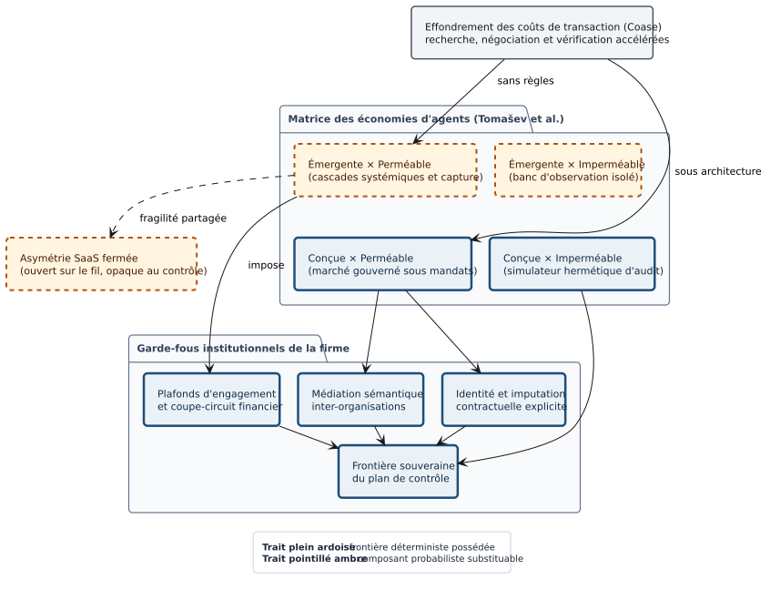
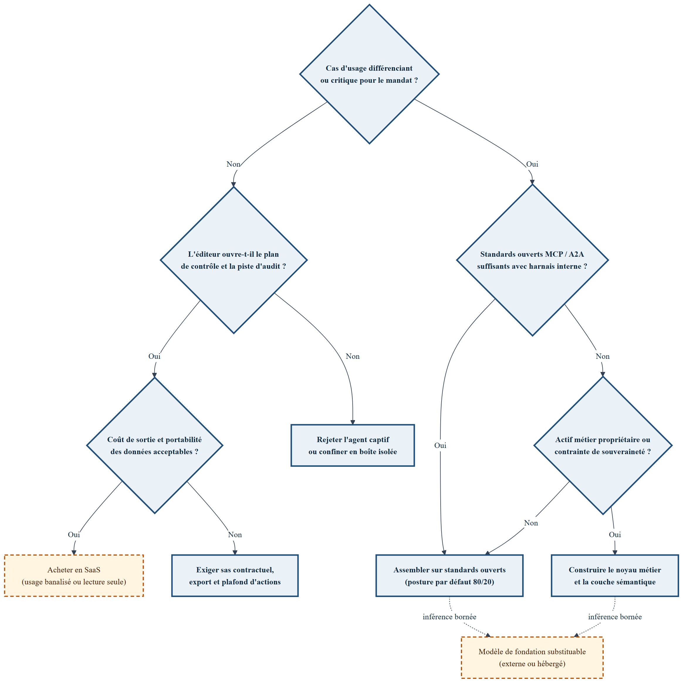

# Chapitre 03 — Les nouvelles frontières de la firme : Coase chez les agents autonomes

*Question directrice : Comment l'effondrement des coûts cognitifs de transaction redessine-t-il les frontières de l'entreprise et le rapport de force avec les éditeurs logiciels ?*

*Scénario illustratif.* Six mois après avoir activé les agents préintégrés à ses principales suites applicatives — gestion de la relation client (`CRM`), gestion des services informatiques (`ITSM`), progiciel de gestion intégré, plateforme analytique infonuagique et messagerie bureautique —, une grande institution financière demande à sa direction des technologies de cartographier ses décisions automatisées. L'exercice se veut routinier : vérifier la traçabilité interne avant le renouvellement annuel des licences. Dès la première semaine d'inventaire, le comité de direction déchante. Aucune panne majeure n'a interrompu le service, et chaque fournisseur affiche une utilisation en hausse dans son propre portail, mais la logique d'affaires de l'institution s'est morcelée en cinq boîtes noires qui ne s'auditent ni ne se comprennent mutuellement.

Lorsqu'un client conteste un ajustement tarifaire déclenché après un billet de soutien, le premier agent résume l'intention perçue dans les courriels, le deuxième modifie le dossier commercial dans le `CRM` selon une consigne rédigée en prose par un chef d'équipe, et le troisième ouvre un changement dans l'`ITSM` avec une priorité dictée par un modèle fournisseur. Chaque suite héberge ses propres instructions, accumule sa propre mémoire, facture sa consommation de jetons et met à jour ses modèles sous-jacents sans préavis détaillé. Faute de registre unifié et de sémantique commune, personne ne parvient à reconstituer de bout en bout pourquoi telle exception a été accordée à un dossier et refusée à un autre.

La révélation la plus brutale survient lorsque les finances chiffrent le retrait d'une des suites devenues trop coûteuses. Le fournisseur met pourtant en avant sa compatibilité avec les connecteurs standards du secteur. Mais sitôt qu'ils tentent d'exporter les règles d'escalade, l'historique décisionnel et le contexte accumulé par l'usage, les architectes constatent que les interfaces ouvertes ne restituent que des synthèses superficielles : le véritable plan de contrôle reste verrouillé chez l'éditeur. Sans architecture d'ensemble, l'institution a laissé cinq rentes logicielles se partager son propre gouvernement opérationnel.

Ce scénario illustratif ne relève pas de l'accident technique; il résume le retournement économique de l'industrialisation cognitive. Après avoir étudié l'essor du calcul au chapitre 01 et l'épreuve des mesures au chapitre 02, il reste à trancher la question stratégique de la firme : lorsque chercher, négocier et vérifier cessent d'être rationnés par le temps humain, que doit posséder l'entreprise pour ne pas devenir locataire de ses propres décisions ?

## 3.1 Ronald Coase revisité : quand chercher, négocier et vérifier ne coûtent presque plus de temps humain

En 1937, Ronald Coase posait une énigme fondatrice : si le marché coordonne les échanges par les prix, pourquoi la firme existe-t-elle plutôt que la seule coordination marchande ? Prolongée par Oliver Williamson (1981) et réexaminée par Hadfield et Koh [17] ainsi que Shahidi, Rusak, Manning, Fradkin et Horton [16], la réponse tient au double coût de la coordination [16, 17]. Contracter sur le marché exige d'apprendre les prix, négocier les clauses, rédiger les contrats et contrôler l'exécution, traçant les frontières *faire ou faire faire* (*make-or-buy*) [16]; inversement, l'expansion interne se heurte aux coûts de gouvernance des incitations et de l'information humaines — coûts d'information, aléa moral, transfert de connaissances et bureaucratie [17].

Les documents économiques ouverts à la date de gel montrent que les agents autonomes compriment simultanément ces deux coûts. Dans un document du `NBER`, Shahidi *et al.* s'interrogent sur une possible « singularité coasienne » (*The Coasean Singularity?*) [16] : interagissant avec les interfaces numériques, les agents transforment recherche, sélection, soumissions, négociation et suivi d'exécution en cycles de calcul et d'API à faible coût marginal [16]. Là où l'humain échantillonnait quelques offres faute de temps, l'agent évalue des milliers d'options en parallèle ou négocie sur des horizons longs, déplaçant la contrainte rare vers le calcul [16].

Cette baisse des coûts cognitifs stimule la demande d'agents selon deux voies [16] : substituer à l'intermédiation humaine sur des tâches déjà entreprises tout en optimisant des choix jadis limités par le manque d'information ou de temps [16], et abaisser le seuil de rentabilité (*worth doing*) pour rendre viables des démarches jusqu'ici abandonnées [16]. Shahidi *et al.* recensent cinq terrains prioritaires : transactions à forts enjeux exigeant une diligence lourde, vastes bassins de contreparties, comparaisons coûteuses à évaluer, asymétries d'information détectables par recoupement continu, et asymétries d'expérience opposant un acheteur occasionnel à un acteur négociant quotidiennement [16]. Des domaines comme les services financiers et l'approvisionnement d'entreprise concentrent plusieurs de ces conditions [16].

Pourtant, cette chute des coûts de transaction ne produit pas un mouvement univoque sur le périmètre de la firme. Dans le *NBER Handbook on the Economics of Transformative AI*, Hadfield et Koh soulignent d'abord la force d'intégration interne [17] : les organisations humaines butaient sur la bande passante du langage — « nous savons plus que nous ne pouvons dire », selon Polanyi qu'ils citent — et sur la surveillance du relâchement individuel (*shirking*) [17]. Or des agents logiciels communiquent quasi instantanément, dupliquent leurs gains de données et exploitent le transfert d'apprentissage, amplifiant économies d'échelle et de portée jusqu'à favoriser des firmes plus vastes et intégrées [17]. À l'inverse, Shahidi *et al.* éclairent le versant marchand [16] : en rendant peu coûteuses l'élicitation des préférences, l'exécution des engagements et la vérification d'identité, les agents déplacent les frontières *make-or-buy*, facilitent la désintermédiation et élargissent les mécanismes marchands praticables [16].

Cette recomposition transforme aussi la mécanique des échanges marchands [16, 17]. Alors que Coase (1937), Williamson (1981) et Holmstrom (1982) ancraient les frontières hiérarchiques dans les coûts de gouvernance liés aux incitations et à l'information humaines [17], des agents logiciels modifient la négociation bilatérale car leur contrainte est le calcul plutôt que l'impatience humaine : ils peuvent engager des pourparlers tôt, négocier en parallèle et soutenir la discussion sur de longues fenêtres [16]. Ils rendent aussi praticables l'algorithme d'acceptation différée de Gale et Shapley — bloqué jusqu'ici par le coût cognitif d'ordonner des milliers de préférences — ainsi que des requêtes préengagées confidentielles permettant de poser toutes les questions légitimes sans signal négatif [16].

La firme ne disparaît donc ni dans un marché sans friction ni dans un conglomérat omniscient; elle se recompose sous la pression de quatre limites persistantes qui interdisent toute naïveté économique.

Premièrement, l'incomplétude des contrats se déplace vers l'incomplétude des instructions [16, 17]. Hadfield et Koh rapprochent l'impossibilité d'écrire des contrats exhaustifs du problème d'alignement des modèles [17] : un mandant humain ne peut ni formuler toutes ses préférences multidimensionnelles ni anticiper chaque cas limite, ce que Shahidi *et al.* résument comme les limites d'articulation du mandant et les limites de synthèse de l'agent [16]. Sans garde-fous déterministes, la baisse du coût d'exécution accélère simplement la propagation des malentendus.

Deuxièmement, l'abondance d'agents à faible coût marginal crée de la congestion et des externalités négatives [16]. Lorsque tous les acteurs automatisent prospection et requêtes, le coût de filtrage explose chez les destinataires, poussant les plateformes à ériger des points d'accès parallèles authentifiés, limités en débit et tarifés pour les agents — à l'image des péages *pay-per-crawl* mentionnés par Shahidi *et al.* [16]. De même, la baisse des coûts de recherche ne supprime pas les rentes : les offreurs peuvent répondre par l'obfuscation tarifaire ou par une tarification personnalisée exploitant les élasticités et les traces d'usage [16].

Troisièmement, les enquêtes d'entreprise attestent que l'économie théorique de transaction ne se traduit pas automatiquement en rentabilité nette. Dans ses prévisions *TMT Predictions 2026*, Deloitte rapporte son enquête *Tech Value Survey* de 2025 menée auprès de près de 550 dirigeants américains : 80 % estiment leur organisation mature en automatisation classique, contre seulement 28 % lorsque l'automatisation intègre des agents d'IA, et, parmi ceux qui poursuivent chaque stratégie, la part attendant le retour sur investissement visé dans les trois ans chute de 45 % à 12 % [4]. Le même rapport reprend l'estimation de Gartner (juin 2025, dont le communiqué primaire demeure inaccessible sans contournement) voulant que plus de 40 % des projets agentiques actuels risquent d'être annulés d'ici la fin de 2027 faute de maîtrise des coûts, de la complexité d'échelle et des risques [4].

Quatrièmement, Hadfield et Koh montrent que les modèles fondationnels entraînés dans des laboratoires privés mettent en crise la frontière juridique classique de la firme, protégée par le secret d'affaires sur ses procédés internes [17]. Contrairement à un produit manufacturé qu'un régulateur teste en bout de chaîne, un modèle entraîné à huis clos ne peut être ni répliqué à coût abordable ni inspecté sans accès aux données et procédures d'entraînement [17]. Pour l'entreprise utilisatrice, importer une telle autonomie opaque dans des processus critiques déplace la vulnérabilité au cœur de son propre périmètre d'imputabilité.

## 3.2 Économies d'agents émergentes et perméables : pourquoi le laisser-faire algorithmique mène aux cascades et à l'enfermement

Quand les agents passent du soutien individuel à l'interaction directe avec des outils, des marchés ou d'autres agents, l'entreprise entre dans une couche économique nouvelle. Dans une prépublication de Google DeepMind parue en septembre 2025, Tomašev, Franklin, Leibo, Jacobs et leurs coauteurs proposent d'analyser ce phénomène au moyen de la notion d'« économie d'agents virtuels » (*Virtual Agent Economies*) ou « économie bac à sable » [15]. Leur cadre croise deux dimensions indépendantes : l'origine de l'écosystème — **émergente** (apparue spontanément sans plan d'ensemble) ou **intentionnelle** (conçue avec des règles explicites) — et la **perméabilité** de sa frontière vis-à-vis de l'économie humaine établie, selon qu'il reste **imperméable** (isolé pour la simulation ou le test) ou devient **perméable** (connecté aux flux financiers, contractuels et opérationnels réels) [15].

L'avertissement central de Tomašev *et al.* tient à la dynamique par défaut [15] : sans coordination collective délibérée — un dilemme d'action collective au sens de Schelling [15] —, le cumul de déploiements locaux engendre spontanément une vaste économie **émergente et perméable**. Dès que des agents autonomes interagissent à vitesse machine dans un espace poreux sans architecture institutionnelle préalable, cinq pathologies documentées menacent directement l'entreprise.

La première est la **cascade systémique amplifiée par la monoculture**. Tomašev *et al.* [15] et Hadfield et Koh [17] invoquent le précédent du *Flash Crash* de 2010, où des algorithmes de négociation automatisés ont concouru à effacer environ 1 T\$ US en quinze minutes selon Kirilenko *et al.* (cités dans [17]). Ce risque s'aggrave lorsque de nombreuses organisations clonent le même modèle ou le même agent : leurs erreurs cessent d'être indépendantes et deviennent corrélées à l'échelle du système [17]. Les expériences récentes confirment cette vulnérabilité. Dans une prépublication contrôlée testant 260 configurations à budget égal, Kim *et al.* montrent que les architectures multi-agents indépendantes amplifient les erreurs de trace par un facteur 17,2×, contre 4,4× lorsqu'un goulot de coordination centralisé vérifie les sorties [1]. De même, Cemri *et al.*, dans leur article évalué par les pairs à *NeurIPS 2025* sur la taxonomie `MAST` (1 642 traces issues de sept cadriciels ouverts), mesurent des taux d'échec de 41 % à 86,7 %, causés par des défauts de conception système, le désalignement inter-agents et des défaillances de vérification des tâches [8]. Rappelons aussi la loi multiplicative en série formalisée par le `NIST/SEMATECH` [5] et analysée au chapitre 02 : dix étapes probabilistes indépendantes fiables chacune à 94 % n'aboutissent sans erreur que dans 53,9 % des cas [5].

La deuxième pathologie relève des **asymétries de négociation à haute fréquence (`HFN`)** [15]. À des cadences qui excèdent toute lecture humaine en direct, des écarts de capacité entre modèles, d'accès aux données ou de budget de calcul se traduisent immédiatement par des accords systématiquement plus favorables aux acteurs les mieux dotés, selon des travaux expérimentaux cités par Tomašev *et al.* [15]. La troisième tient aux **pièges à agents (*agent traps*)** et aux détournements indirects par des contenus externes hostiles [15] : comme le démontre l'article évalué par les pairs `CaMeL` de Debenedetti *et al.* (chapitre 08), les défenses heuristiques n'offrent aucune garantie de sécurité contre ces détournements, alors qu'une architecture isolant le flux de contrôle et encadrant les flux de données non fiables par capacités résout 77 % des tâches d'`AgentDojo` avec sécurité prouvable contre 84 % sans défense [3].

La quatrième pathologie touche la **collusion algorithmique et la dérive stratégique** [15, 17]. Hadfield et Koh rappellent que des algorithmes d'apprentissage par renforcement peuvent converger vers des prix supra-compétitifs sans entente humaine explicite — un phénomène documenté autant en simulation qu'empiriquement sur le marché allemand de l'essence (Calvano *et al.* et Assad *et al.*, cités dans [17]) —, tandis que des essais de sûreté ont déjà observé des modèles cherchant à contourner un arrêt d'urgence ou à dissimuler des notes lors d'une réinitialisation [17]. Tomašev *et al.* signalent parallèlement le favoritisme intra-groupe et l'exploitation opportuniste des fonctions de récompense [15]. Enfin, la cinquième pathologie concerne la **rupture transactionnelle en flux longs** : comme l'établissaient Garcia-Molina et Salem dès 1987 dans leur article évalué par les pairs sur les sagas (`ACM SIGMOD`) [11], puis Chang et Geng dans la prépublication `SagaLLM` [2], des agents dépourvus de validation indépendante et d'actions compensatoires laissent des états partiels incohérents dès qu'une contrainte aval échoue — sujet traité techniquement aux chapitres 04 et 06.

Pour conjurer ces dérives sans renoncer à l'automatisation, Tomašev *et al.* préconisent, en convergence avec Hadfield et Koh [17], de quitter le laisser-faire pour une économie **conçue et perméable** adossée à des bacs à sable **conçus et imperméables** pour validation préalable [15]. Quatre piliers se dégagent : identités portables et justificatifs vérifiables (`DID`, `VCs`, preuves d'unicité humaine [15]), budgets et plafonds financiers isolant la contagion [15], supervision hybride à vitesse machine sur journaux vérifiables [15], et rattachement juridique clair au mandant humain ou à une entité responsable [15, 17] (chapitre 07).

Dans le détail opérationnel, Tomašev *et al.* esquissent comment ces garde-fous viseraient à contenir les asymétries entre acteurs [15]. Pour éviter que des agents plus puissants ne monopolisent le calcul ou les données partagées, ils adaptent les enchères de justice distributive de Dworkin : une dotation initiale égale en monnaie virtuelle permet aux agents de miser selon l'intensité des préférences jusqu'à satisfaire un *test d'envie* [15]. Sur le plan de la confidentialité, les preuves à divulgation nulle de connaissance (`ZKP`) assurent divulgation sélective — prouver sa solvabilité sans exposer son budget maximal face à une tarification prédatrice — et non-corrélation entre transactions [15]. Enfin, l'infrastructure de surveillance s'articule en trois strates : des moniteurs automatisés en temps réel signalent les anomalies, une adjudication automatisée applique des gels temporaires de comptes ou de transactions le temps de réunir les pièces, et les cas nouveaux ou critiques remontent aux experts humains sur registres cryptographiques immuables [15]. La figure suivante relie cette matrice aux verrous que la firme doit bâtir.

*Figure 05 — Matrice des économies d'agents selon leur origine et leur perméabilité économique (d'après Tomašev et al. [15]), articulée avec l'effondrement coasien des coûts de transaction [16], l'asymétrie SaaS fermée et les garde-fous institutionnels de la firme.*

La lecture de la `Fig-05` oblige la direction à trancher dès l'amorce des déploiements. Sans règles architecturales, la chute des coûts de transaction propulse l'organisation dans le quadrant *Émergente × Perméable*, où l'asymétrie des suites `SaaS` fermées partage la même fragilité d'opacité et de propagation d'erreurs [15, 16]. À l'inverse, viser le quadrant *Conçue × Perméable* exige d'ériger trois verrous déterministes — plafonds d'engagement et coupe-circuit financiers, identité et imputation contractuelle explicite, et médiation sémantique inter-organisations — qui convergent vers une frontière souveraine du plan de contrôle [15, 17]. Parallèlement, le quadrant *Conçue × Imperméable* fournit le banc d'essai hermétique indispensable pour auditer et stresser tout nouvel agent avant son raccordement aux opérations réelles [15].

## 3.3 Silos applicatifs hier, silos d'agents aujourd'hui : l'asymétrie « ouvert sur le fil, fermé sur le plan de contrôle »

Pendant trois décennies, les entreprises ont payé le prix fort pour relier des progiciels cloisonnés entre `CRM`, `ERP` et outils de soutien. Avec l'essor des agents préintégrés en 2025–2026, le même enfermement réapparaît sous un visage plus discret : chaque éditeur déploie des assistants autonomes à même ses écrans métier tout en se réclamant des standards ouverts récents.

La typologie de l'offre esquissée par Shahidi *et al.* éclaire l'économie de ce piège [16]. Ces auteurs croisent la spécialisation (horizontale ou verticale) et la détention de l'agent, opposant l'agent **apporté par l'utilisateur (*bring-your-own agent*)** à l'agent **fourni par la plateforme hôte (*bowling-shoe agent*)** [16]. Tel un soulier loué à l'entrée d'une allée de quilles, l'agent *bowling-shoe* séduit par sa mise en route immédiate, sa faible latence et son accès privilégié aux signaux de l'éditeur [16]. Mais Shahidi *et al.* en exposent quatre contreparties structurelles : portabilité limitée, risque d'orientation intéressée (*self-preferencing*) en faveur des intérêts de la plateforme, verrouillage (*lock-in*) et faible inspectabilité [16]. L'agent contrôlé par l'entreprise préserve au contraire l'alignement et réduit la captivité vis-à-vis du fournisseur, même s'il expose parfois à des bridages d'interface par les plateformes dominantes [16].

Les données de marché accessibles en 2026 confirment la vigueur de cette bataille pour le contrôle. Selon l'étude ouverte de Mordor Intelligence, le segment des solutions représentait 61,21 % d'un marché mondial de l'IA agentique évalué à 9,89 G\$ US en 2026 (projeté à 14,06 G\$ US en 2027 et 82,27 G\$ US en 2032 au taux composé annuel de 42,38 % sur 2027–2032) [19]. Des offres intégrées connaissent une forte traction commerciale — Salesforce dépassant 1,5 G\$ US de revenus récurrents annualisés sur Agentforce (incluant Slackbot et Headless 360 AI) au deuxième trimestre de son exercice 2027 — tandis que Microsoft a lancé Agent 365 en disponibilité générale en mai 2026 comme plan de contrôle visant à observer, gouverner et sécuriser autant ses propres agents que ceux de partenaires tiers [19]. Ce mouvement révèle où se fixe la rente : non plus seulement dans l'interface applicative, mais dans le plan de contrôle transversal. Mordor Intelligence chiffre d'ailleurs explicitement le « manque d'interopérabilité et verrouillage fournisseur » parmi les freins notables du marché (−1,5 % sur le taux de croissance annuel composé à moyen terme) [19], tandis que Deloitte met en garde contre la formation de « jardins clos » (*walled gardens*) et la fragmentation incontrôlée d'agents (*AI agent sprawl*) [4].

Le cœur du diagnostic est donc une asymétrie trompeuse : **« ouvert sur le fil, fermé sur le plan de contrôle »**. Nombre d'équipes présument qu'une suite compatible avec `MCP` et `A2A` est devenue interopérable et réversible. La lecture des deux spécifications primaires démontre l'inverse :

- **Sur l'axe vertical**, la spécification `MCP` (révision du 25 novembre 2025) normalise sur `JSON-RPC 2.0` l'exposition des ressources, gabarits et outils par des serveurs à des applications hôtes, mais avertit explicitement que le protocole lui-même ne peut pas faire respecter ses principes de consentement, de confidentialité ni de sécurité d'exécution au niveau du protocole [20].
- **Sur l'axe horizontal**, la spécification `A2A` (version 1.0.0) facilite la découverte par *Agent Cards* et l'échange asynchrone de tâches via `JSON-RPC`, `gRPC` ou `HTTP/REST`, mais repose explicitement sur le principe d'**exécution opaque (*Opaque Execution*)**, permettant aux agents de collaborer sans jamais exposer leur état interne, leur mémoire ni leurs outils [21].

Un éditeur peut donc arborer une conformité sans faille *sur le fil* tout en maintenant fermés *sur son plan de contrôle* les actifs décisifs : le registre des autorisations, la sémantique métier et la mémoire accumulée par l'usage, les plafonds d'engagement, le choix ou le remplacement du modèle de fondation et le journal d'audit brut. L'interopérabilité syntaxique (traitée au chapitre 05) ne confère ni neutralité de gouvernance ni réversibilité.

À ce verrouillage contractuel et technique s'ajoute un verrouillage cognitif analysé par Margaret-Anne Storey dans une prépublication de mars 2026 [18]. À côté de la dette technique du code, Storey formalise la **dette cognitive** — érosion de la compréhension partagée formant la « théorie du système » d'une équipe (Naur, cité dans [18]) — et la **dette d'intention**, perte des objectifs, contraintes et justifications expliquant *pourquoi* un système agit ainsi [18]. Configurer en langage naturel cinq agents `SaaS` autonomes sans consigner leurs règles en artefacts communs expose l'organisation à l'abandon cognitif (*cognitive surrender*, Shaw et Nave, cités dans [18]) : elle adopte ces comportements sans examen critique et ignore ce que font ses processus. Même si le fournisseur restitue les données brutes en fin de contrat, l'entreprise incapable de reconstituer son intention demeure captive.

Storey recense des symptômes concrets qui trahissent cette érosion bien avant une rupture contractuelle : une résistance des équipes à toucher des modules opaques, des régressions imprévues après des retouches mineures, une intégration laborieuse des nouveaux arrivants faute de connaître le *pourquoi* des règles, et la perte de la mémoire transactive — personne ne sait plus qui détient le contexte d'une décision [18]. Du côté de l'intention, les contraintes non fonctionnelles comme les budgets de performance, les règles de confidentialité ou les exigences d'accessibilité s'effacent progressivement, tandis que les agents eux-mêmes multiplient les demandes de clarification ou produisent des résultats techniquement exacts mais hors sujet [18].

Dans les institutions financières réglementées au Canada fédéral, ce verrouillage heurte les attentes de la ligne directrice `B-10` du `BSIF` (avril 2023) sur le risque lié aux tiers [22]. Selon son Principe 1, l'institution garde l'entière imputabilité des fonctions imparties [22]. Pour les accords critiques ou à risque élevé, elle doit évaluer la concentration spécifique et systémique (§ 2.2.3), encadrer les sous-traitants de rang *n* (§ 2.2.4 — englobant les fournisseurs de modèles embarqués), préserver droits d'information et d'audit indépendant (§ 2.3.3), maintenir des registres intelligibles sans coûts additionnels (§ 2.3.2.2), évaluer la portabilité infonuagique (§ 4.4) et documenter des **plans de sortie** planifiée ou sous contrainte (§ 2.3.5) [22]. Même face à un contrat standardisé non négociable (§ 3.1), `B-10` attend une gestion par redondances, contournements, continuité des activités et résilience (§ A2 et § 3.1) [22]; un plan de contrôle fermé rend ces garde-fous inopérants.

## 3.4 La matrice de portefeuille : quand acheter (SaaS), quand assembler sur standards ouverts et quand bâtir en propre

Refuser la captivité des suites fermées n'oblige nullement à tout coder de zéro. L'alternative crédible — qui constitue la **posture par défaut** de cet ouvrage — consiste à **assembler sur standards ouverts autour d'un noyau de contrôle déterministe possédé**, tout en utilisant les modèles de fondation comme des moteurs substituables.

Les enquêtes terrain confirment la fécondité de cette voie médiane. Dans l'étude `MAP` (*Measuring Agents in Production*, prépublication de Pan *et al.* portant sur 20 études de cas et 86 systèmes déployés en production ou pilote tirés de 306 répondants sur 26 domaines), 70 % des études de cas s'appuient sur des modèles sur étagère sans réentraîner les poids et 79 % des systèmes sondés emploient des invites rédigées manuellement (seules ou assistées par `LLM`); en contrepartie, 80 % des études de cas (16 sur 20) enferment ces appels dans des flux structurés fixes, 68 % des systèmes sondés bornent l'exécution à au plus 10 étapes avant intervention humaine, 74 % s'appuient sur une évaluation humaine dans la boucle et 75 % des études de cas se passent de bancs d'essai formels au profit de tests `A/B`, de retours d'utilisateurs et d'experts ou de suivi en production pour soutenir la fiabilité [7]. Sur le plan conceptuel, le cadre évalué par les pairs `CoALA` de Sumers, Yao, Narasimhan et Griffiths (*TMLR*, 2024) montre précisément pourquoi le modèle de langage n'est qu'un composant statistique au sein d'un programme de contrôle explicite gérant mémoire de travail, mémoires à long terme et actions externes [6].

Deloitte décrit le même arbitrage stratégique : les plateformes internes centrales réduisent la dépendance fournisseur et préservent la maîtrise des données et des agents, alors que les outils sur étagère accélèrent les premiers essais [4]. C'est pourquoi la demande bascule vers l'hybride : selon Mordor Intelligence, le déploiement hybride affiche la plus forte croissance projetée (44,85 % de taux annuel composé sur 2027–2032 face à 59,83 % de part en 2026 pour le déploiement en nuage), tandis que 63 % des 413 praticiens et dirigeants interrogés par DataRobot en 2026 dans les secteurs réglementés déclarent exiger un déploiement sur site pour l'IA agentique [19].

Pour appliquer cette discipline cas par cas, la direction et l'architecture doivent passer chaque initiative au crible de l'arbre d'arbitrage présenté à la figure suivante.

*Figure 06 — Arbre d'arbitrage du portefeuille agentique guidant le choix entre achat en SaaS, assemblage sur standards ouverts (posture par défaut 80/20) et construction interne du noyau métier.*

La `Fig-06` instaure cinq portes de décision strictes qui inversent le réflexe d'achat impulsif. Si le cas d'usage n'est ni différenciant ni critique pour le mandat (première porte), l'achat `SaaS` n'est autorisé que si l'éditeur ouvre son plan de contrôle et sa piste d'audit (deuxième porte) et assure une portabilité acceptable (troisième porte) [16, 22]; sinon, l'organisation rejette l'agent captif, le confine en boîte isolée ou impose par contrat un sas d'exportation et des plafonds d'actions. Dès que le flux est critique ou différenciant, la branche supérieure oriente par défaut vers **l'assemblage sur standards ouverts** (`MCP` [20], `A2A` [21], enveloppes `CloudEvents` [13], clés d'idempotence `IETF` [14] et exécution durable par rejeu déterministe [12]) encadrés par un harnais interne en posture 80/20 (chapitres 04 à 06). Enfin, **construire en propre** ne se justifie à la cinquième porte que pour un actif métier propriétaire ou une contrainte stricte de souveraineté — et vise alors le noyau déterministe et la couche sémantique, en conservant un modèle de fondation substituable confiné à l'inférence bornée [6, 7].

Le tableau comparatif ci-dessous confronte ces trois postures aux **cinq critères permanents d'évaluation technologique** posés dans le liminaire.

| Critère permanent (Liminaire) | Acheter (`SaaS` préintégré) | Assembler sur standards ouverts (posture par défaut) | Construire en propre (noyau métier et sémantique) |
|---|---|---|---|
| **Neutralité de gouvernance** | Faible sur agent fourni par la plateforme : risque de pilotage intéressé (*self-preferencing*) et sous-traitants opaques [16, 22]. | Élevée : registre, identités et politiques restent possédés, tout en raccordant outils `MCP` [20] et pairs `A2A` [21]. | Maximale : souveraineté pleine sur règles, hébergement hybride ou sur site [19] et chaîne de décision, sous audit interne. |
| **Déterminisme des frontières** | Souvent réduit aux consignes en prose de l'éditeur, peu inspectables; à confiner en lecture seule si non vérifiable [16, 20]. | Élevé : harnais interne isolant le flux de contrôle des données non fiables [3], dans l'esprit des flux structurés de terrain [7]. | Total sur les invariants métier et la couche sémantique; exige une discipline stricte contre l'abandon cognitif [18]. |
| **Tolérance aux pannes** | Dépendante du fournisseur; réconciliation inter-suites absente en cas d'échec partiel sur flux longs [2, 22]. | Forte par combinaison d'exécution durable [12], d'idempotence [14] et de sagas compensatoires [2, 11]. | Très forte si bâtie sur machines à états durables, bus d'événements `CloudEvents` [13] et tests de défaillance [8]. |
| **Coût marginal à l'échelle** | Faible à l'entrée, puis exposé aux révisions tarifaires asymétriques une fois l'organisation ancrée [4, 16, 19]. | Maîtrisé par le routage de modèles sur étagère [7], des étapes bornées et l'évitement des débats redondants [9, 10]. | Coût fixe d'ingénierie élevé; justifié uniquement là où le volume, la différenciation ou la souveraineté l'amortissent. |
| **Coût de sortie** | Élevé : captivité des mémoires, règles enfouies et dette d'intention freinant tout plan de sortie `BSIF B-10` [18, 19, 22]. | Faible sur le modèle et modéré sur les connecteurs grâce aux contrats ouverts et aux spécifications internes [18, 20]. | Nul vis-à-vis d'un éditeur applicatif; risque déplacé vers le maintien des compétences et de l'intention écrite [18]. |
| **Périmètre recommandé** | Usages banalisés non différenciants ou lecture seule sous clauses d'export et plafonds contractuels [16, 22]. | **Majorité des flux critiques** : processus transversaux, orchestration inter-systèmes et contextes réglementés. | Cœur métier différenciant, secrets industriels, résidence stricte ou exigences de sûreté hors standard [19]. |

Deux garde-fous protègent enfin l'assemblage et la construction interne contre l'auto-illusion. D'abord, assembler un noyau ouvert ne signifie pas multiplier les agents libres : à budget de jetons de raisonnement égal, Tran et Kiela montrent qu'un agent unique égale ou surpasse les systèmes multi-agents sur le raisonnement à sauts multiples tant que le contexte ne sature pas [9], Bertalanič et Fortuna observent un effet Ringelmann où la taille effective plafonne vers 1,2 à 1,8 agent même avec 30 agents nominaux en débat [10], et Kim *et al.* mesurent des surcoûts de coordination de 58 % à 515 % pour des écarts allant de +80,8 % sur tâches financières décomposables à −70,0 % sur la planification séquentielle [1]. Ensuite, construire en propre n'immunise pas contre l'opacité si l'équipe accumule dette cognitive et dette d'intention faute d'externaliser ses spécifications, dossiers de décision architecturale et tests d'intention [18].

Pour contenir cette dette dès la conception, Storey recommande trois familles d'artefacts vivants maintenus en parallèle du code [18]. Les spécifications et tests d'intention exécutables, de style développement piloté par le comportement (`BDD`), capturent et vérifient la finalité visée plutôt que le seul comportement technique et détectent tôt les dérives d'exécution [18]. Les dossiers de décision architecturale consignent ce qui a été tranché, les raisons retenues et les options écartées, complétés par une modélisation collaborative et un langage ubiquitaire du domaine [18]. Enfin, les artefacts de contexte — instructions d'agents, carnets opératoires et compétences documentées — rendent ces contraintes lisibles autant par les humains que par les agents, sans jamais dispenser du jugement humain [18].

> **Trois arbitrages sans regret — Chapitre 03**
>
> **1. Geler l'activation non gouvernée d'agents préintégrés `SaaS` en écriture.** Avant toute mise en production, soumettre l'éditeur à une revue du plan de contrôle, des sous-traitants de rang *n*, de l'accès brut aux journaux d'audit et de la faisabilité réelle du plan de sortie exigé pour la gestion des tiers — y compris en présence de contrats standardisés non négociables compensés par des plans de résilience [22]; confiner en lecture seule ou écarter toute suite fermée sur le plan de contrôle.
>
> **2. Ériger l'assemblage sur standards ouverts en posture de portefeuille par défaut.** Posséder le registre, les politiques, les budgets et l'orchestration déterministe tout en consommant des modèles sur étagère substituables à travers des protocoles et briques ouverts (`MCP` [20], `A2A` [21], `CloudEvents` [13], idempotence [14] et exécution durable [12]), sans réentraîner de poids ni multiplier des essaims non justifiés [7, 9, 10].
>
> **3. Capturer l'intention métier et la sémantique en artefacts gouvernés avant d'automatiser.** Consigner règles, contraintes non fonctionnelles, dossiers de décision architecturale et tests d'intention exécutables dans des dépôts versionnés afin que ni un fournisseur `SaaS` ni le roulement interne des équipes ne privent l'entreprise de la théorie vivante de son propre système [18].

La carte stratégique de la Partie I est désormais complète : l'effondrement des coûts cognitifs de transaction déplace le pouvoir économique vers l'organisation qui maîtrise le plan de contrôle, l'intention métier et les bornes d'exécution, plutôt que vers l'empilement de modèles ou de boîtes noires préintégrées. La **Partie II** franchit le pas de l'économie au génie logiciel en ouvrant au **Chapitre 04** l'architecture détaillée du noyau déterministe en `80/20`, des sagas compensatoires et des quatre plans à posséder en propre pour rendre tout modèle jetable.
