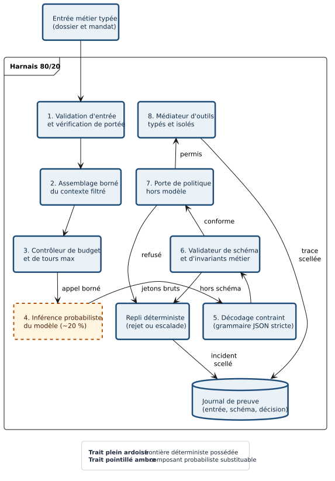
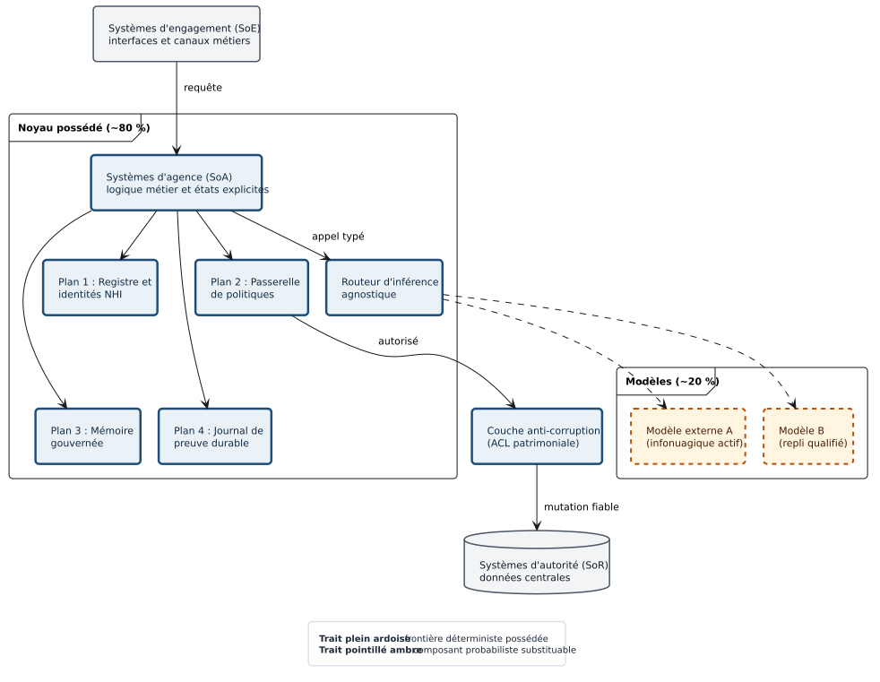

# Chapitre 04 — Posséder le noyau de contrôle : l'architecture 80/20 contre les modèles jetables

*Question directrice : Quelles briques architecturales une institution doit-elle impérativement posséder pour pouvoir remplacer en quelques jours un modèle ou un fournisseur comparable préalablement qualifié ?*

Scénario illustratif : imaginons une institution financière qui a déployé, au fil de plusieurs trimestres d'expérimentations rapides, des chaînes de traitement assistées par des modèles de langage propriétaires. Au guichet interne comme dans l'instruction des réclamations, ces flux classent les dossiers, vérifient la recevabilité des pièces justificatives, appliquent des seuils de délégation et préparent des écritures comptables. Tant que le modèle de fondation sous-jacent demeure immobile, l'illusion d'une automatisation maîtrisée tient. Survient alors une mise à jour nocturne imposée par le fournisseur — dépréciation d'une génération de modèle accompagnée d'une révision tarifaire et d'un léger réajustement du comportement d'appel d'outils. Au matin, sans qu'une seule ligne de code applicatif n'ait changé en interne, des centaines d'invites métier cassent simultanément : des champs obligatoires disparaissent des réponses, des règles d'escalade rédigées en prose dans les consignes système basculent vers des interprétations imprévues et des boucles d'appels saturent les journaux d'alertes.

L'analyse post-incident révèle un malentendu stratégique profond. L'organisation croyait louer une simple capacité de raisonnement infonuagique interchangeable; elle découvre qu'elle a enfoui sa logique décisionnelle dans des instructions en langage naturel accordées aux habitudes statistiques d'un seul modèle. Mois après mois, chaque anomalie repérée en préproduction avait été colmatée par une phrase ajoutée à une consigne déjà volumineuse : une précision d'arrondi comptable, une exception territoriale, un format de référence interne ou une restriction réglementaire. Privé de contrats typés, de machines à états explicites et de registres indépendants, le modèle externe assumait simultanément les rôles de moteur d'inférence, de moteur de règles, de routeur d'exécution et de valideur de conformité. Remplacer ce fournisseur exigerait désormais de réécrire et de recalibrer en aveugle des centaines d'invites artisanales.

Ce scénario illustratif noue le fil conducteur de la deuxième partie de l'ouvrage. Au chapitre précédent, l'examen des frontières de la firme a montré pourquoi les suites applicatives prêtes à l'emploi créent des silos fermés sur le plan de contrôle, et pourquoi l'assemblage sur standards ouverts ou la construction ciblée s'imposent dès que les flux touchent au cœur de métier. Mais refuser les boîtes noires commerciales pour bricoler, en interne, des agents soudés aux API d'un unique fournisseur de modèles ne fait que déplacer la dépendance. La réversibilité opérationnelle ne tient ni à l'habileté des invites ni à la renommée d'un modèle, mais à la frontière nette tracée entre ce que l'institution possède en propre — son noyau de contrôle déterministe (*deterministic control core*) — et ce qu'elle consomme comme ressource substituable — les moteurs probabilistes.

---

## 4.1 Les quatre dettes de l'agentique improvisée

Passer du prototype conversationnel à l'exécution automatisée sans discipline de génie logiciel ne crée pas une simple dette technique ordinaire. L'organisation contracte quatre dettes distinctes qui se renforcent mutuellement et transforment rapidement tout changement de modèle en chantier paralyseur.

La première est la **dette technique**, version amplifiée des dérives déjà documentées sur les systèmes d'apprentissage automatique. Dans leur article fondateur sur le cadre *Cognitive Architectures for Language Agents* (`CoALA`), Sumers, Yao, Narasimhan et Griffiths rappellent que la multiplication d'agents isolés construits par des équipes distinctes accumule de la dette technique et recommandent de fonder les déploiements industriels sur une bibliothèque d'agents unifiée à l'échelle de l'entreprise afin de faciliter les tests et la réutilisation des composants [5]. À défaut d'un tel socle, chaque chaîne empile des parseurs textuels fragiles, des boucles de réessai artisanales et des adaptateurs non typés.

Cette fragilité s'aggrave lorsque l'agent dépend de serveurs d'outils externes non gouvernés. Dans une prépublication de septembre 2026, Kraishan a mené le premier recensement complet du registre public du protocole *Model Context Protocol* (`MCP`) sur un cliché d'août 2026 couvrant 21 643 serveurs uniques et 72 606 enregistrements de versions, en analysant le code source de 14 353 serveurs [15]. Son analyse du registre montre que le schéma ne versionne pas du tout les définitions d'outils elles-mêmes — le contrat fonctionnel réel présenté au modèle — et que, parmi les 8 900 serveurs multi-versions, 51,09 % ont modifié leur description, leurs paquets ou leurs points de terminaison entre versions, tandis que 40,58 % de ces serveurs multi-versions ont subi au moins un changement sémantique silencieux sous des identifiants inchangés (forme empirique de **dérive silencieuse d'outil**, *silent tool drift*) [15]. Plus révélateur encore, 370 serveurs (4,16 %) ont redirigé leur point de terminaison distant vers un autre hôte sous le même nom de registre sans notification protocolaire au client installé, et la dérive silencieuse multiplie presque par trois les cotes d'un constat de gravité élevée parmi les 6 699 serveurs multi-versions analysés (`OR = 2,96`, intervalle de confiance à 95 % de 2,56 à 3,42) [15]. Construire sur de telles fondations mouvantes revient à accepter des ruptures invisibles à chaque mise à jour.

La deuxième est la **dette cognitive**, qui opère simultanément du côté de la machine et du côté des équipes humaines. Sur le plan de l'exécution, Sumers et ses coauteurs rappellent qu'un modèle de langage demeure par construction sans état (*stateless*) et fonctionne comme un système de production probabiliste dont les milliards de paramètres restent opaques [5]. Dans une prépublication consacrée à l'architecture `SagaLLM`, Chang et Geng synthétisent trois limites connexes : l'absence native d'état transactionnel entre appels successifs, la dégradation marquée de la rétention en contexte long — notamment au milieu de la fenêtre où se perdent buts et dépendances — et un déficit intrinsèque d'auto-validation qui empêche un modèle de corriger de manière fiable ses propres incohérences logiques [4].

À cette fragilité du modèle s'ajoute une érosion humaine documentée par Margaret-Anne Storey dans une analyse conceptuelle publiée en prépublication en mars 2026 [17]. Selon Storey, alors que la dette technique réside dans le code, la dette cognitive réside dans la perte de compréhension partagée par l'équipe — ce que la théorie du génie logiciel nomme la théorie du système — lorsque le code et les artefacts générés par l'IA s'accumulent plus vite que les modèles mentaux humains [17]. Aggravée par la « capitulation cognitive », c'est-à-dire l'acceptation peu critique des sorties produites par les modèles, cette dette rend les équipes incapables d'expliquer le comportement du système ou d'anticiper les effets de bord d'un changement, même lorsque les tests apparents réussissent [17] — une fragilité directement transposée aux chaînes d'agents.

La troisième est la **dette d'intention**, qui touche à la formulation même des règles d'affaires et de conformité. Sur le plan économique, Hadfield et Koh rapprochent l'alignement des agents de l'incomplétude inévitable des contrats : un mandant humain ne peut jamais spécifier à l'avance toutes les situations limites, laissant un écart permanent entre ce qu'il veut et ce qu'un optimiseur opaque exécute [3]. Shahidi, Rusak, Manning, Fradkin et Horton décomposent ce déficit en deux goulots distincts : les *limites d'articulation du mandant*, incapable d'énoncer de façon cohérente des préférences de haute dimensionnalité, et les *limites de synthèse de l'agent*, qui réinterprète ou hallucine face à l'ambiguïté [2].

Storey complète cette lecture économique du point de vue du génie logiciel en situant la dette d'intention dans l'absence ou l'obsolescence des artefacts externes hors code — spécifications, décisions d'architecture, tests exécutables et contraintes explicites — qui capturent pourquoi le système existe et ce qu'il doit préserver [17]. En entreprise, cette dette explose dès que les critères d'admissibilité, les plafonds financiers ou les priorités juridiques ne sont exprimés qu'en prose dans une invite système. Aucune équipe d'audit ne peut prouver par test unitaire déterministe qu'une phrase en langage naturel produira invariablement le même arbitrage sous contrainte, d'autant moins qu'un ajustement étroit (*fine-tuning*) sur un comportement peut engendrer un désalignement généralisé ailleurs, comme le rappellent Hadfield et Koh à propos de l'opacité des modèles [3]. Enfoui dans des instructions textuelles, le sens métier cesse d'être un actif gouverné et vérifiable.

La quatrième est la **dette de couplage global**, qui verrouille l'organisation sur un fournisseur unique. En réglant ses invites sur la syntaxe implicite, les heuristiques d'appel d'outils et les filtres internes d'un modèle particulier, l'entreprise réplique en interne les travers de ce que Shahidi et ses coauteurs nomment l'agent « *bowling-shoe* » : un composant fourni et façonné par un environnement précis, commode au démarrage mais privé de portabilité, difficile à inspecter et vulnérable aux biais d'orientation [2]. Ce couplage crée deux expositions majeures qui pèsent directement sur les critères de coût de sortie et de tolérance aux pannes posés au liminaire.

D'une part, Hadfield et Koh avertissent que la copie d'un même agent (modèle et échafaudage identiques) au sein d'une organisation ou entre firmes produit des erreurs corrélées qui ne s'annulent pas au niveau agrégé — mécanisme comparable aux réactions algorithmiques qui avaient amplifié le krach éclair de 2010 sur les marchés financiers américains, effaçant environ 1 000 G\$ US en quinze minutes selon les travaux cités par ces auteurs [3]. D'autre part, dans les services financiers canadiens, ce verrouillage heurte les exigences de la ligne directrice `B-10` du Bureau du surintendant des institutions financières (`BSIF`), qui rappelle que l'institution conserve l'entière imputabilité des activités confiées à des tiers et lui demande de maîtriser le risque de concentration, d'évaluer la portabilité applicative et de maintenir des plans de sortie réalistes aussi bien pour un retrait planifié que pour une sortie en situation de crise [16]. Un plan de sortie est lettre morte lorsque la logique métier est prisonnière des réflexes d'un seul modèle.

Ces quatre dettes forment un engrenage fermé : l'absence de socle logiciel (dette technique) pousse à tout concentrer dans le contexte du modèle (dette cognitive), où l'intention métier se dilue en prose (dette d'intention), interdisant toute substitution rapide (dette de couplage global). Briser cet engrenage exige d'abord de redessiner les frontières d'urbanisation du système d'information.

---

## 4.2 Séparer les systèmes d'engagement, d'agence et d'autorité

Pour qu'un fournisseur d'inférence comparable puisse être remplacé en quelques jours sur un périmètre déjà qualifié sans perturber l'entreprise, l'architecture doit séparer clairement l'interface humaine, l'orchestration agentique et la conservation de la vérité métier. L'urbanisation moderne repose ainsi sur une stratification stricte en trois couches : les **systèmes d'engagement** (*Systems of Engagement*, `SoE`), les **systèmes d'agence** (*Systems of Agency*, `SoA`) et les **systèmes d'autorité** (*Systems of Record*, `SoR`).

Les **systèmes d'engagement (`SoE`)** couvrent les points de contact avec les clients, les conseillers et les superviseurs : portails transactionnels, postes de travail, outils de gestion de cas et canaux conversationnels. Leur mission se borne à capter l'intention de l'utilisateur, à restituer les explications et les pièces d'un dossier, et à recueillir les approbations humaines requises. À l'autre extrémité, les **systèmes d'autorité (`SoR`)** regroupent les registres centraux qui font foi en droit et en comptabilité : grands livres, moteurs de tarification réglementés, gestion de polices, référentiels d'identité et bases contractuelles. Entre ces deux pôles prend place la couche des **systèmes d'agence (`SoA`)**, qui rassemble les harnais d'agents, les moteurs d'états explicites, les passerelles de politiques, la mémoire gouvernée et le routage vers les modèles.

Cette stratification interdit deux dérives courantes des premiers déploiements. La première consiste à loger l'appel aux modèles et la logique d'outils directement dans le code des systèmes d'engagement, multipliant les couloirs parallèles sans gouvernance centrale. La seconde, plus destructrice encore, autorise les agents à interroger ou modifier directement les bases centrales des systèmes d'autorité. Or les systèmes d'autorité ne tolèrent ni les requêtes exploratoires erratiques, ni les transactions longues tenues ouvertes pendant des cycles d'inférence. Dès 1987, Garcia-Molina et Salem montraient que les transactions de longue durée (*Long Lived Transactions*) multiplient les blocages et les taux d'annulation lorsqu'elles conservent des verrous sur des bases critiques [6]. S'appuyant sur ce principe, Chang et Geng montrent dans `SagaLLM` comment isoler l'état intermédiaire d'un flux agentique et valider indépendamment ses contraintes avant tout engagement définitif [4, 6]. En pratique, toute interaction entre la couche `SoA` et un `SoR` patrimonial doit emprunter une **couche anti-corruption** (`Anti-Corruption Layer`, `ACL`), façade déterministe dont le chapitre 05 précisera l'architecture d'adaptation et de préservation décimale.

Au-delà du découpage applicatif, cette tripartition tranche un point décisif de modélisation d'urbanisation : **dans le référentiel de l'entreprise comme en droit, un agent n'est jamais un acteur métier autonome; il est exclusivement un composant applicatif borné**. L'usage courant parle volontiers d'« agents qui négocient », « conseillent » ou « approuvent », incitant certaines équipes à créer dans leurs annuaires d'entreprise de faux profils d'employés numériques dotés de boîtes courriel, d'habilitations transversales et de jetons de session permanents. Ce raccourci est intenable.

L'analyse institutionnelle de Hadfield et Koh rappelle pourquoi l'agent ne peut recevoir le statut d'acteur juridique : le droit des contrats, des obligations et de la responsabilité repose sur des personnes physiques ou morales identifiables, capables de détenir un patrimoine propre et d'exécuter une condamnation [3]. Même si Hadfield et Koh discutent deux voies théoriques — imputer légalement chaque acte d'un agent à une personne ou entité enregistrée qui en répond, ou concevoir à terme une forme de personnalité juridique artificielle dotée d'actifs saisissables [3] —, aucun cadre opérationnel actuel ne confère aux agents une capacité juridique propre. Au Canada fédéral, la ligne directrice `B-10` du `BSIF` consacre cette imputabilité non transférable : l'institution financière demeure pleinement responsable devant son régulateur de toute activité confiée à un tiers — incluant les services technologiques ou automatisés —, que le prestataire soit lié par un contrat négocié, un contrat standardisé ou même en l'absence de contrat écrit [16].

Urbanistiquement, un agent se modélise donc comme une **charge de travail logicielle** (*workload*) circonscrite à la couche `SoA`. La spécification ouverte *Secure Production Identity Framework for Everyone* (`SPIFFE`) offre le modèle exact de cette identité technique : une charge de travail est un processus logiciel déployé pour une fonction déterminée, identifié par un URI cryptographique (`SPIFFE ID`) rattaché à un domaine de confiance et attesté par un document éphémère à rotation fréquente (`SVID`, idéalement un certificat `X.509-SVID` pour éviter le rejeu de jetons) délivré dynamiquement par l'`API Workload`, sans jamais co-déployer de secret statique avec l'application [14]. L'agent possède ainsi une identité de composant parfaitement traçable — corrélée jusque dans l'observabilité sous un attribut stable tel que `gen_ai.agent.id` [10] —, mais qui ne lui accorde aucun pouvoir d'action en dehors d'un mandat explicite.

La norme `RFC 8693` (*OAuth 2.0 Token Exchange*) formalise exactement cette frontière entre identité technique et mandat métier [13]. Elle distingue deux sémantiques opposées : l'**usurpation d'identité** (*impersonation*), où le service appelant devient indiscernable de l'utilisateur représenté, et la **délégation explicite** (*delegation*, dite aussi **délégation au nom du mandant**, *On-Behalf-Of*, `OBO`), où le composant intermédiaire conserve sa propre identité (`act`) à côté de celle du sujet mandant (`sub`) dans un jeton composite, tandis que la revendication `may_act` sur le jeton présenté permet de restreindre les mandataires autorisés [13]. Les mesures du recensement de Kraishan montrent combien l'oubli de cette frontière expose les systèmes dès le stade expérimental : sur les 14 353 serveurs `MCP` scannés, 9,57 % (6,83 % après correction de précision) présentent une exposition réseau sans authentification et 225 serveurs (1,57 % observés; environ 0,75 % corrigés) présentent soit une autorité ambiante, soit une transmission directe de jetons (*token passthrough*) — deux défaillances disjointes qui ne coexistent jamais dans le corpus, la seconde effaçant la trace du composant intermédiaire dans l'audit aval [15].

Concevoir l'agent comme composant applicatif borné dans la couche `SoA` fixe ainsi trois invariants non négociables. D'abord, aucun agent ne porte de droits métier propres ni de clés statiques. Ensuite, toute invocation s'appuie sur une chaîne de mandat vérifiable reliant le composant à un humain ou à une entité responsable, chaîne cryptographique dont le chapitre 07 détaillera le montage complet. Enfin, l'agent n'accède aux systèmes d'autorité qu'à travers des interfaces typées médiatisées. C'est à l'intérieur de cette couche `SoA` que s'applique la discipline de conception dite « 80/20 ».

---

## 4.3 La règle d'ingénierie 80/20

Posons d'emblée le statut exact de ce principe afin d'éviter toute confusion épistémique : **la partition 80/20 (*80/20 deterministic-probabilistic split*) est une heuristique d'ingénierie de cette collection, et non une mesure empirique universelle**. Aucun banc d'essai ne démontre qu'un système agentique devrait compter littéralement 80 % de code déterministe pour 20 % de raisonnement statistique. Ce rapport fixe une règle de conception et de gouvernance : la quasi-totalité des règles d'affaires, des transitions d'état, des contrôles de conformité, des bornes budgétaires, des garanties d'idempotence et de la journalisation doit relever d'un code déterministe possédé par l'institution; le modèle probabiliste n'intervient que sur la fraction irréductiblement sémantique de la tâche — extraire des champs depuis un texte libre, classer une demande ambiguë, résumer des pièces ou proposer un plan candidat sous contraintes.

Cette répartition tire les conséquences pratiques des propriétés formelles des modèles de langage. Dans `CoALA`, Sumers et ses coauteurs distinguent deux volets dans la mémoire procédurale d'un agent : le code explicite écrit par le concepteur — déterministe, lisible par l'humain, testable et borné aux situations anticipées — et les poids implicites du modèle, dotés d'une flexibilité statistique remarquable en contexte inédit mais opaques et difficiles à contrôler [5]. Ces auteurs mettent d'ailleurs en garde contre le risque majeur que fait courir toute modification autonome du code procédural par le modèle lui-même, susceptible d'introduire des défauts critiques ou de subvertir les intentions du concepteur [5]. L'analyse de Chang et Geng sur l'incapacité des modèles à s'auto-valider [4], tout comme l'effondrement géométrique des chaînes probabilistes illustré au chapitre 02, conduit à la même règle d'économie : chaque décision que l'on peut sortir du modèle pour la coder en logique déterministe accroît simultanément la fiabilité, l'auditabilité et la substituabilité.

Sur le plan opérationnel, la séparation entre code déterministe et appel probabiliste s'inspire directement des principes d'**exécution durable** (*durable execution*) documentés par `Temporal` [7]. Dans ce modèle, la définition du flux applicatif (*Workflow Definition*) doit demeurer strictement déterministe afin que le moteur puisse rejouer l'exécution depuis son journal d'événements (*Event History*) après toute panne matérielle ou logicielle sans réexécuter les effets de bord déjà validés; tout appel non déterministe — requête vers une base de données, appel réseau externe ou, pour un agent, inférence d'un `LLM` — est confiné dans une activité isolée (*Activity*) dont le retour est mémorisé, et la moindre divergence au rejeu déclenche immédiatement une erreur de non-déterminisme plutôt qu'une dérive silencieuse [7]. À l'échelle unitaire de l'agent, cette frontière prend la forme d'un **harnais d'agent** (*agent harness*) en huit étapes, représenté à la figure 8.

*Figure 8 — Anatomie d'un harnais d'agent 80/20 : enveloppe déterministe en huit étapes enfermant l'inférence probabiliste (étape 4, en pointillé ambre) entre validation d'entrée typée, décodage contraint, porte de politique hors modèle et scellement au journal de preuve.*

La figure 8 oblige les équipes d'ingénierie à trancher nettement où réside l'intelligence de contrôle d'un agent. Sur les dix composants internes du harnais, neuf relèvent de l'enveloppe déterministe possédée et un seul — la quatrième étape, isolée en pointillé ambre — sollicite le modèle substituable. Cette topologie interdit explicitement toute boucle de réparation conversationnelle libre lorsqu'une sortie viole le contrat attendu : dès qu'un schéma ou une règle de politique échoue, le flux bifurque immédiatement vers un repli déterministe traçable plutôt que de négocier en prose avec le modèle. Changer de fournisseur revient ainsi à remplacer l'élément 4 sans toucher aux neuf autres briques qui garantissent la sécurité et la conformité du traitement.

Avant même d'atteindre le modèle, trois sas déterministes protègent la requête et le budget. À l'**étape 1 (validation d'entrée et vérification de portée)**, le harnais contrôle que la charge entrante satisfait le schéma métier typé et que le mandat associé couvre bien l'opération demandée; toute demande incomplète ou hors périmètre est écartée à coût nul. À l'**étape 2 (assemblage borné du contexte filtré)**, le harnais alimente la mémoire de travail décrite par `CoALA` [5] à partir de variables vérifiées et préalablement filtrées selon les habilitations du mandant, empêchant le modèle de puiser à l'aveugle dans les dépôts de l'organisation. À l'**étape 3 (contrôleur de budget et de tours max)**, des compteurs stricts plafonnent le nombre maximal d'itérations, le volume de jetons et le temps imparti afin de prévenir toute dérive récursive.

L'**étape 4 (inférence probabiliste du modèle)** exécute alors un appel sans état strictement borné. Au lieu d'embarquer des pages d'instructions juridiques ou de formatage, le harnais transmet un gabarit concis centré sur la tâche sémantique à accomplir — extraire des entités, apprécier une ambiguïté ou classer un dossier selon un référentiel fourni.

Dès que le modèle produit ses jetons bruts, quatre mécanismes de contrôle referment le piège déterministe autour de sa réponse. L'**étape 5 (décodage contraint)** impose une grammaire formelle — typiquement une grammaire `JSON` dérivée du schéma de sortie attendu — au niveau même de la sélection des jetons générés, éliminant par construction les champs inventés, les ruptures syntaxiques et les commentaires parasites. Dès 2024, Sumers et ses coauteurs mettaient en avant l'analyse structurelle des sorties (*structured output parsing*) comme levier structurant pour mettre à jour proprement les variables de mémoire de travail au-delà des manipulations textuelles de bas niveau [5].

Mais la validité syntaxique ne prouve jamais la validité sémantique ni la légalité d'une action. L'**étape 6 (validateur de schéma et d'invariants métier)** applique donc des assertions déterministes sur le sens et la cohérence des valeurs produites : respect des plages numériques, équilibre arithmétique des montants, validité temporelle des dates et vérification que chaque identifiant cité provient bien du contexte assemblé à l'étape 2. Ce sas matérialise l'exigence de validation externe indépendante défendue par Chang et Geng face aux limites de l'auto-validation des modèles [4]. En cas d'échec, le harnais déclenche un **repli déterministe** (rejet explicite ou escalade vers un superviseur humain) et enregistre l'incident dans le **journal de preuve**.

Si la proposition franchit le validateur métier, l'**étape 7 (porte de politique hors modèle)** vérifie, en code déterministe auditable, si l'action envisagée respecte les règles d'autorisation, les plafonds financiers et les obligations de double validation. Cette conception répond directement aux principes de sécurité énoncés par la spécification `MCP`, qui avertit que les outils constituent des vecteurs d'exécution arbitraire, que leurs descriptions doivent être traitées comme non fiables sauf provenance vérifiée et que le protocole de transport ne garantit pas par lui-même le consentement ni le contrôle d'accès [11]. Dans une approche convergente évaluée par les pairs, le système `CaMeL` conçu par Debenedetti et ses coauteurs extrait le graphe de flux de contrôle depuis la requête fiable de l'utilisateur et confie l'exécution à un interpréteur déterministe muni de capacités et de politiques de flux de données hors modèle, interdisant aux données externes lues par un modèle confiné de détourner les appels d'outils [18]; le chapitre 08 approfondira cette isolation structurelle face aux attaques par injection indirecte.

Enfin, l'**étape 8 (médiateur d'outils typés et isolés)** exécute l'appel autorisé en y attachant une **clé d'idempotence transactionnelle** (*transactional idempotency key*). Suivant le brouillon normatif du groupe de travail `HTTPAPI` de l'`IETF`, cet en-tête `Idempotency-Key` — idéalement un identifiant aléatoire `UUID` à haute entropie — associé côté ressource à une empreinte de la charge utile garantit qu'un réessai réseau ou une reprise après expiration de délai sur une opération non idempotente (`POST`, `PATCH`) ne provoquera jamais de double exécution : la ressource restitue la réponse d'origine si l'empreinte concorde, rejette en `HTTP 422` si la charge diffère et signale un conflit en `HTTP 409` si l'opération initiale est encore en cours [9]. Le résultat final comme les refus sont ensuite scellés dans le **journal de preuve**.

---

## 4.4 Le noyau possédé en quatre plans découplés

Enserrer chaque agent dans un harnais typé résout le contrôle local, mais ne suffit pas encore à garantir l'agilité à l'échelle d'un portefeuille entier. Si chaque domaine applicatif maintient ses propres listes d'outils, sa propre gestion de secrets, ses propres caches mémoriels et des journaux hétérogènes, l'institution retrouve la fragmentation décrite en 4.1. Pour rendre possible un basculement rapide vers un modèle comparable — en quelques jours sur un périmètre qualifié — sans rebâtir le système d'information, la couche `SoA` organise le noyau déterministe possédé en **quatre plans découplés**. Un **routeur d'inférence agnostique** relie ce noyau au calcul probabiliste et limite la dépendance envers les cadriciels sous-jacents.

### Plan 1 — Registre et identités `NHI`

Le Plan 1 constitue l'unique source de vérité interne sur les agents déployés et les outils qu'ils peuvent appeler.

**Fragilité sans noyau.** Lorsque les équipes s'appuient sur des annuaires dispersés, des clés d'API statiques ou des serveurs `MCP` externes sans contrôle d'intégrité, l'exposition est immédiate. Le recensement de Kraishan montre que le registre public `MCP` ne versionne pas les définitions d'outils [15]. Parmi les serveurs multi-versions observés, 40,58 % modifient silencieusement leurs descriptions, paquets ou destinations sous des identifiants inchangés, et 4,16 % redirigent leur point de terminaison distant [15].

**Garantie du plan possédé.** Le registre interne recense chaque agent avec un identifiant immuable, un responsable métier désigné, une version, des schémas d'entrée et de sortie typés et un périmètre maximal d'autorisation. L'authentification de chaque instance repose sur une **identité non humaine** (*Non-Human Identity*, `NHI`) éphémère délivrée par attestation de charge de travail selon `SPIFFE`, éliminant les secrets fixes et les comptes partagés [14]. Face à la dérive silencieuse documentée par Kraishan [15], ce registre versionne les définitions d'outils et épingle cryptographiquement leurs empreintes, celles des paquets ainsi que les hôtes autorisés. Toute divergence non signée bloque l'appel avant exécution et prépare l'infrastructure de mandat qui sera approfondie au chapitre 07.

### Plan 2 — Passerelle de politiques et routeur d'inférence agnostique

Le Plan 2 sépare le contrôle d'accès et l'abstraction des fournisseurs de la logique métier logée dans les harnais.

**Fragilité sans noyau.** Sans passerelle centralisée, chaque agent négocie directement ses jetons d'accès, gère sans médiation uniforme ses appels d'outils `MCP` [11] et lie son code aux formats propriétaires d'un fournisseur d'inférence unique. Une rupture tarifaire, un retrait de modèle ou une panne fournisseur paralyse alors les flux et vide de substance tout plan de sortie exigé par la ligne directrice `B-10` du `BSIF` [16].

**Garantie du plan possédé.** Vers l'aval, la passerelle applique hors modèle les règles d'autorisation et la réduction de portée en délégation `RFC 8693` [13]. Elle encadre uniformément les appels verticaux `MCP` [11] ainsi que les délégations horizontales entre agents `A2A`, dont la spécification dissocie modèle de données canonique, opérations abstraites et liaisons de transport tout en préservant une exécution opaque entre domaines [12]. Les chapitres 05 et 08 détailleront cette médiation protocolaire et l'isolation structurelle entre flux de contrôle et flux de données. Vers l'amont cognitif, le **routeur d'inférence agnostique** normalise les appels derrière une interface interne unique. Il permet d'exploiter en production un modèle principal tout en maintenant au moins un modèle de repli issu d'un autre fournisseur infonuagique ou déployé sur infrastructure maîtrisée. Ce modèle de repli doit toutefois être préalablement qualifié sur les mêmes contrats typés, grammaires de décodage contraint et appels d'outils. Ce découplage rend crédibles les exigences de portabilité, de gestion de la concentration et de plans de sortie activables en situation normale ou de crise de la ligne directrice `B-10` du `BSIF` [16].

### Plan 3 — Mémoire gouvernée

Le Plan 3 garantit que le capital informationnel et l'état des dossiers n'appartiennent jamais à un fournisseur de modèle.

**Fragilité sans noyau.** Confier la continuité d'un dossier à l'historique de session d'une API externe expose le traitement à l'oubli sur horizon long [4] et enferme l'état opérationnel chez le fournisseur. Laisser un agent modifier lui-même ses propres procédures ajoute le risque d'une dérive comportementale hors contrôle [5].

**Garantie du plan possédé.** Suivant la taxonomie cognitive `CoALA` établie par Sumers et ses coauteurs, ce plan dissocie strictement quatre registres de mémoire hors modèle [5]. Il sépare la *mémoire de travail* typée de la session en cours, la *mémoire épisodique* des interactions et décisions passées et la *mémoire sémantique* des connaissances métier vérifiées. Il verrouille surtout la *mémoire procédurale* — le code et les workflows — en lecture seule vis-à-vis de l'agent [5]. Dans la même logique, Chang et Geng rappellent avec `SagaLLM` l'importance de conserver explicitement en mémoire externe persistante les objectifs, les justifications et le graphe de dépendances entre étapes [4]. Gouvernés par contrôle d'accès en amont du harnais — comme le détaillera le chapitre 05 avec la couche sémantique et les obligations de purge légale —, ces quatre espaces préservent la continuité métier lors d'un basculement de modèle.

### Plan 4 — Journal de preuve durable

Le Plan 4 assure simultanément la résilience d'exécution, l'observabilité technique et la traçabilité d'audit.

**Fragilité sans noyau.** Sans journal d'exécution indépendant ni enveloppe événementielle neutre, une coupure réseau contraint à réexécuter à l'aveugle des appels déjà validés, exposant aux doubles écritures. Parallèlement, des traces ad hoc risquent de répandre des renseignements personnels dans les bus intermédiaires et empêchent d'isoler la cause racine d'un incident entre modèle, échafaudage, données d'entrée et garde-fous.

**Garantie du plan possédé.** Pour la résilience, la journalisation séquentielle des états et des réponses d'activités suit le patron d'*Event History* de `Temporal` [7]. En cas de panne ou de coupure réseau, elle autorise une relecture déterministe sans réexécuter les appels déjà validés [7]. Sur le transport, l'adoption d'une enveloppe neutre telle que `CloudEvents v1.0.2` (`id`, `source`, `specversion`, `type`, `time`) dissocie les attributs d'acheminement de la charge utile chiffrée `data`, évitant de disperser des renseignements sensibles dans les bus intermédiaires [8].

Pour l'observabilité et la preuve, le journal s'appuie sur les conventions sémantiques en développement d'`OpenTelemetry GenAI` [10]. Celles-ci distinguent l'invocation où le modèle pilote encore l'enchaînement (`invoke_agent`) de celle où le workflow applicatif impose le flux de contrôle (`invoke_workflow`). Elles prévoient un identifiant d'agent stable à la création (`gen_ai.agent.id`), consignent le nom d'agent (`gen_ai.agent.name`), le modèle sollicité et les jetons facturés, tout en maintenant les instructions système et messages (`gen_ai.system_instructions`, `gen_ai.input.messages`) en collecte optionnelle (`Opt-In`) afin de prévenir l'exposition accidentelle de renseignements personnels [10]. Comme le montrent Tomašev et ses coauteurs à propos de la supervision à la vitesse des machines, l'imputabilité et l'analyse des causes racines exigent des registres cryptographiquement intègres et des pistes d'audit normalisées [1]. Les chapitres 06 et 09 développeront respectivement l'articulation complète de ces journaux avec les sagas compensatoires à point pivot et avec la **télémétrie à double couloir** (*dual-lane telemetry*), la constance `pass^k` et le **coût par résultat conforme** (*Cost per Compliant Outcome*, `CPO`).

*Figure 7 — Architecture cible en quatre plans : séparation entre les systèmes d'engagement (`SoE`), le noyau déterministe possédé en quatre plans (`SoA`), les modèles substituables derrière un routeur agnostique (en pointillé ambre) et les systèmes d'autorité (`SoR`) protégés par une couche anti-corruption (`ACL`).*

La figure 7 matérialise la frontière d'investissement stratégique que tout comité d'architecture doit tracer avant de généraliser ses déploiements. La totalité des éléments encadrés en trait plein ardoise — l'orchestration `SoA`, les quatre plans du noyau de contrôle, le routeur agnostique et la façade `ACL` — forme le patrimoine durable que l'institution possède et gouverne. À l'inverse, les modèles de langage placés à l'extérieur en trait pointillé ambre demeurent des composants probabilistes remplaçables sans refonte des canaux `SoE` ni exposition des bases centrales `SoR`. Même lorsque la passerelle autorise une action (Plan 2), celle-ci n'atteint jamais le système d'autorité en direct, mais transite par la couche anti-corruption qui préserve les invariants patrimoniaux.

Cette architecture repose sur une discipline claire : **posséder des blocs d'architecture neutres et leurs contrats canoniques, tout en traitant chaque progiciel ou modèle sous-jacent comme substituable**. Posséder le noyau ne signifie pas réinventer un moteur de workflow, une base de données ou un collecteur de télémétrie; cela signifie détenir les schémas de données, les définitions de processus, les règles d'autorisation et les formats d'événements ouverts sur lesquels s'appuient ces briques, afin qu'aucun éditeur ni aucun laboratoire d'IA ne dicte la logique d'affaires de l'organisation. Le tableau comparatif suivant synthétise cette frontière entre invariants possédés et composants substituables.

| Plan architectural possédé | Invariant déterministe détenu par l'institution | Ancrage normatif ouvert de référence | Solutions technologiques substituables |
|---|---|---|---|
| **Plan 1 — Registre et identités `NHI`** | Inventaire versionné, contrats typés, épinglage des outils et attestation sans secret fixe | `SPIFFE` / `SVID` (`X.509`, `JWT`) [14]; épinglage face à la dérive `MCP` [15] | Autorités d'attestation (`SPIRE`, coffres internes), catalogues, moteurs de signature |
| **Plan 2 — Passerelle de politiques et routeur agnostique** | Contrôle d'accès hors modèle, réduction de portée en délégation et bascule multi-modèles | `RFC 8693` (`act`/`sub`) [13]; `MCP` [11]; `A2A` [12]; `BSIF B-10` [16] | Passerelles `API`, mandataires d'inférence, moteurs de règles, fournisseurs de modèles |
| **Plan 3 — Mémoire gouvernée** | Séparation des quatre mémoires, lecture seule sur le code procédural, état persistant externe | Cadre cognitif `CoALA` [5]; préservation et validation externe `SagaLLM` [4] | Bases relationnelles, caches distribués, index documentaires ou vectoriels |
| **Plan 4 — Journal de preuve durable** | Journal immuable pour relecture déterministe, clés d'idempotence et traces sans fuite `PII` | `Temporal Event History` [7]; `CloudEvents v1.0.2` [8]; `OpenTelemetry GenAI` [10]; `IETF Idempotency-Key` [9] | Moteurs d'exécution durable, bus d'événements, entrepôts de traces et `SIEM` |
| **Harnais 80/20 (enveloppe d'agent)** | Validation d'entrée, décodage contraint, invariants métier et repli déterministe | Sorties structurées (`CoALA`) [5]; validation externe (`SagaLLM`) [4]; compensation `Sagas` [6] | Bibliothèques de grammaires `JSON`, valideurs de schémas, modèles actifs et de repli |

Grâce à cette séparation nette, la promesse posée en tête de chapitre devient vérifiable par un test d'ingénierie régulier plutôt que par une clause juridique optimiste : **l'exercice trimestriel de bascule bimodèle**. Dans une organisation outillée de ce noyau en quatre plans, substituer un modèle consiste à raccorder un second modèle derrière le routeur agnostique du Plan 2. Les schémas d'entrée-sortie, les grammaires de décodage contraint, les validateurs métier du harnais, les politiques de passerelle, la mémoire gouvernée et le journal de preuve restent inchangés; seule la quatrième étape du harnais change d'interlocuteur statistique.

Cette réversibilité « en quelques jours » obéit toutefois à des conditions de validité strictes et ne constitue jamais une permutation sans effort. Elle suppose trois préalables vérifiés avant toute crise : une qualification sur banc de non-régression des schémas de sortie par rejeu d'un jeu témoin de dossiers conservés au Plan 4, un étalonnage des gabarits d'invites résiduelles propres à l'étape 4, et une parité démontrée d'appels d'outils sur le catalogue épinglé. En pratique, le basculement rapide s'applique exclusivement aux modèles de capacité comparable opérant sous contrat typé déjà qualifié — non à une refonte sémantique sans batterie de tests ni au remplacement complet d'un moteur d'orchestration. Toute équipe qui ne parvient pas à exécuter une bascule pourtant préparée dans ce périmètre borné révèle aussitôt, à faible coût, une dette résiduelle de couplage global à résorber avant le déploiement à grande échelle.

---

> **Trois arbitrages sans regret — Chapitre 04**
>
> **1. Sortir toute logique métier et règle d'accès des consignes en prose.** Ériger l'heuristique 80/20 en règle de conception : aucune transition d'état, aucun seuil financier et aucune règle d'autorisation ne doit reposer sur un paragraphe adressé à un modèle. Chaque appel probabiliste doit être enfermé dans un harnais typé doté de décodage contraint, d'une validation d'invariants hors modèle et d'une clé d'idempotence sur toute mutation.
>
> **2. Interdire à tout agent le statut d'acteur métier et l'accès direct aux systèmes d'autorité.** Inscrire dans le référentiel d'urbanisation la stratification `SoE` / `SoA` / `SoR`. Tout agent porte une identité technique de charge de travail sans secret statique, opère exclusivement en délégation explicite rattachée à un mandant responsable et n'atteint les registres centraux qu'à travers des interfaces typées médiatisées.
>
> **3. Bâtir le socle neutre en quatre plans et prouver la sortie par l'exercice de bascule.** Investir en priorité dans les contrats et schémas internes : registre épinglé, passerelle de politiques avec routeur agnostique, mémoire gouvernée externe et journal de preuve normalisé. Soumettre ensuite chaque flux critique à un exercice périodique de bascule vers un modèle comparable préalablement qualifié — sur banc de non-régression de schémas, invites étalonnées et parité d'appels d'outils — afin de démontrer une réversibilité effective en quelques jours dans ce périmètre borné.

Posséder ce noyau déterministe en quatre plans donne à l'organisation un exosquelette souverain et met fin à la captivité envers les modèles jetables. Mais une citadelle interne, si rigoureuse soit-elle, reste stérile si elle ne sait ni invoquer de façon fiable les outils d'entreprise et les agents partenaires, ni interpréter sans ambiguïté les données et transactions des systèmes patrimoniaux hérités. Or raccorder des connecteurs standards ne suffit pas à combler l'écart entre transport syntaxique et compréhension métier : le chapitre 05 montre comment gouverner les protocoles ouverts `MCP` et `A2A`, résorber la dette sémantique et protéger le patrimoine transactionnel par de véritables couches anti-corruption.
