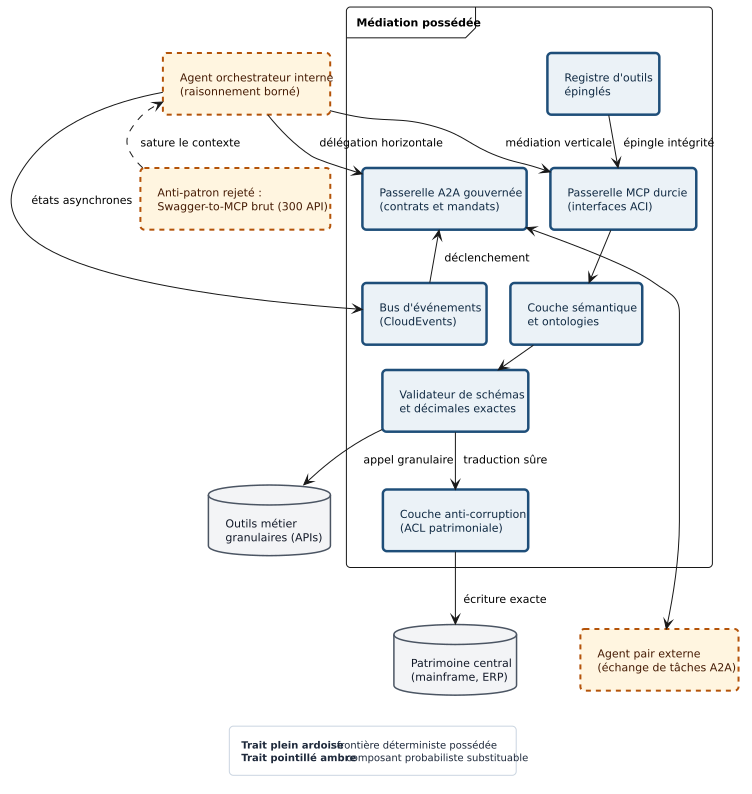
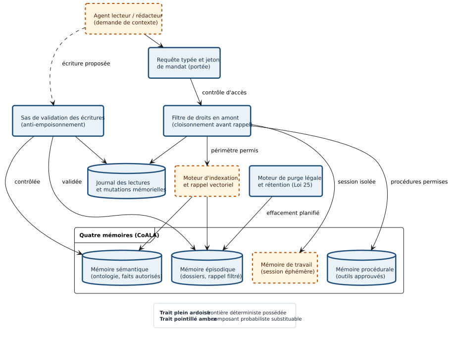

# Chapitre 05 — Connecter sans s'enfermer : protocoles ouverts, dette sémantique et patrimoine

*Question directrice : Comment raccorder outils, agents pairs et systèmes patrimoniaux centraux sans confondre connectivité syntaxique et compréhension métier ?*

*Scénario illustratif.* Imaginons une institution financière qui vient d'achever la mise en place de son noyau de contrôle interne et souhaite raccorder son premier agent d'instruction de dossiers à son système d'information. Pour accélérer le déploiement, l'équipe d'intégration choisit le raccourci le plus séduisant sur le papier : un générateur automatique convertit en une après-midi les définitions `OpenAPI` des applications internes et des passerelles transactionnelles en serveurs compatibles avec le protocole `MCP`. En quelques heures, l'agent se voit exposer près de trois cents outils distincts : recherche de fiche client par identifiant interne, lecture de soldes bruts, mise à jour partielle de coordonnées, création d'écriture comptable, consultation d'historique d'incidents, annulation d'ordre et déclenchement de lots de fin de journée.

Dès les premiers essais sur des dossiers réalistes, la mécanique se grippe. L'agent consacre une part substantielle de sa fenêtre de contexte rien qu'à ingérer les descriptions, paramètres et schémas de ces centaines de fonctions avant même d'examiner la demande du conseiller. Confronté à des noms techniques voisins hérités d'équipes distinctes — parfois deux variantes historiques d'une même requête bancaire —, il confond deux opérations de lecture aux intitulés proches, invoque une mise à jour partielle sans avoir d'abord vérifié les conditions d'admissibilité, ou interprète un indicateur d'état codé sur deux caractères à l'opposé de son sens comptable. Le raccordement syntaxique fonctionne sans accroc — les messages `JSON-RPC` circulent proprement —, mais l'organisation vient de brancher un raisonneur probabiliste directement sur la tuyauterie brute de son passé applicatif, sans filtre de sens ni garde-fou d'interface.

Lorsque cette même institution entreprend ensuite de relier cet agent à celui d'un partenaire externe d'assurance ou à un service interne d'analyse documentaire, un second mur se dresse. Chaque fournisseur impose ses conventions de champs, son modèle de session et ses hypothèses d'autorisation, recréant sous un vernis standardisé les silos fermés examinés au Chapitre 03. Quant au système central (*mainframe*), il encaisse mal les rafales de requêtes exploratoires et les réessais aveugles déclenchés après une expiration réseau ou une réponse ambiguë.

Ce scénario met en lumière la confusion cardinale de la deuxième vague de projets agentiques : assimiler l'interopérabilité à la simple ouverture de connecteurs. Raccorder des agents sans s'enfermer exige de dissocier quatre plans : la médiation verticale vers les outils, la délégation horizontale et événementielle entre domaines opaques, la gouvernance sémantique du sens métier et la protection des mémoires comme du patrimoine transactionnel.

## 5.1 Connectivité verticale aux outils (`MCP`) : conception d'interfaces orientées agent, épinglage d'intégrité et passerelle de médiation

Le *Model Context Protocol* (`MCP`), dont la révision du 25 novembre 2025 sert ici de référence, répond à un problème concret d'économie d'intégration [7]. Avant son émergence, raccorder un grand modèle de langage à des sources documentaires ou à des interfaces applicatives exigeait des intégrations particulières. Inspiré du *Language Server Protocol* (`LSP`), qui avait normalisé le dialogue entre éditeurs de code et analyseurs de langages, `MCP` repose sur `JSON-RPC 2.0` et des sessions avec maintien d'état [7]. Il relie trois rôles — l'hôte qui orchestre l'agent, le client connecteur logé dans l'hôte et le serveur — afin d'exposer ressources contextuelles (`Resources`), gabarits d'invites (`Prompts`) et fonctions exécutables (`Tools`), tout en permettant au serveur de solliciter le client pour des complétions ou des clarifications [7].

Cette convergence verticale réduit le coût de raccordement initial, mais la jeunesse du protocole commande la prudence. À la date de gel du 31 décembre 2026, `MCP` reste une spécification récente dont le registre public ne remonte qu'à septembre 2025 [13] : le corpus ouvert retenu dans cet ouvrage ne renferme aucune étude empirique évaluée par les pairs mesurant la fiabilité ou les coûts d'exploitation de `MCP` en production bancaire ou industrielle. La spécification énonce d'ailleurs elle-même ses limites de gouvernance [7] : les outils représentent une capacité d'exécution arbitraire, leurs descriptions et annotations doivent être considérées comme non fiables (*untrusted*) lorsqu'elles n'émanent pas d'un serveur de confiance, l'hôte doit recueillir le consentement explicite de l'utilisateur avant toute invocation, et le protocole lui-même ne peut pas imposer le respect de ces garanties de sécurité [7]. Prendre `MCP` pour un pare-feu ou un contrat métier revient donc à lui prêter un rôle qu'il décline explicitement.

Le premier écueil naît dès le dessin de la surface d'outils. Par commodité, le raccourci mécanique dit *Swagger-to-MCP* consiste à projeter un pour un chaque point de terminaison `REST` ou procédure distante en un outil `MCP`. Cette transposition confond deux destinataires incompatibles. Une API `REST` est conçue pour un développeur humain qui lit la documentation hors ligne, écrit un appel déterministe une fois pour toutes et ne paye aucun coût d'attention à posséder trois cents points d'accès dans son dépôt. Un agent, à l'inverse, charge les signatures et descriptions dans son contexte de travail et choisit ses actions à l'exécution.

Aucune étude contrôlée publiée avant fin 2026 ne compare directement un convertisseur *Swagger-to-MCP* à une façade dédiée; le risque tient plutôt au cumul de trois lacunes d'interface distinctes : la surcharge de l'espace d'actions, la sous-documentation des schémas de retour et la tolérance aux requêtes ambiguës favorisant la substitution silencieuse de portée.

Sur la surcharge de l'espace d'actions, le cadre `CoALA` publié dans *Transactions on Machine Learning Research* établit qu'un répertoire d'actions trop étendu complique le choix de l'agent et recommande le plus petit espace d'actions nécessaire à la tâche [4]. Sur la sous-documentation des schémas de retour, Debenedetti et ses coauteurs montrent sur `AgentDojo` que l'absence de structure de sortie documentée fait échouer `CaMeL` sur 13 des 20 tâches bénignes de la suite voyage avec `Claude 3.5 Sonnet`, faute de pouvoir rédiger l'analyse avant exécution [3]. Peters-Gill et ses coauteurs confirment ce prérequis : ils doivent d'abord doter tous les outils de schémas de retour complets avant d'évaluer `multi-CaMeL` [12]. Sur la tolérance aux requêtes ambiguës ou sans correspondance exacte, ces mêmes chercheurs documentent sur `AssetOpsBench` une substitution silencieuse de portée (*unchecked scope substitution*) : faute de donnée pour l'actif ou la plage temporelle visée, un sous-agent renvoie un périmètre voisin sans que l'agent parent pré-planifié détecte la violation [12].

Remplacer le *Swagger-to-MCP* par une interface orientée agent (*Agent-Computer Interface*, `ACI`) repose dès lors sur cinq disciplines d'ingénierie, alignées sur la partition 80/20 du Chapitre 04 :

- **Regrouper par intention métier plutôt que par table technique.** Au lieu d'exposer dix appels atomiques de lecture et de jointure, l'`ACI` expose une opération univoque (par exemple consulter la synthèse d'admissibilité d'un dossier) dont les assemblages internes restent en code déterministe.
- **Imposer des schémas complets et bornés en entrée comme en sortie.** Conformément aux leçons de `CaMeL` et de `multi-CaMeL` [3, 12], chaque outil déclare un schéma de sortie complet et documenté; l'`ACI` proscrit en outre les paramètres libres et pagine côté serveur les retours volumineux.
- **Refuser la substitution silencieuse de portée.** En cas d'absence de correspondance exacte ou de paramètre ambigu, l'outil retourne une erreur structurée explicite plutôt qu'un substitut approximatif [12].
- **Séparer physiquement consultation, simulation et mutation.** Aucun outil d'écriture ou d'envoi externe ne cohabite sur le même serveur logique ni avec les mêmes privilèges qu'un outil de lecture, préparant l'isolation structurelle examinée au Chapitre 08.
- **Minimiser l'espace d'actions actif.** Suivant Sumers *et al.* [4], chaque agent ne reçoit que la poignée d'outils requis par son rôle courant.

Au-delà de l'interface, l'usage de serveurs `MCP` expose à un risque aigu de chaîne d'approvisionnement. Obada Kraishan a réalisé en août 2026 — et diffusé en prépublication en septembre 2026 — le premier recensement exhaustif du registre public `MCP`, couvrant 21 643 serveurs et 72 606 versions publiées depuis septembre 2025, avec analyse du code source de 14 353 serveurs (13 051 dépôts, 248 817 fichiers) et étalonnage de précision sur 414 cas annotés manuellement (294 alertes signalées et 120 fichiers non signalés) [13]. Parmi ces serveurs scannés, 15,2 % (2 183 sur 14 353) présentent au moins une alerte et 11,1 % une alerte de sévérité élevée (~7,6 % après correction statistique de précision) [13]. Le vecteur dominant n'est ni rare ni sophistiqué : 9,57 % des serveurs analysés (6,83 % corrigé) souffrent d'exposition réseau sans authentification (écoute sur toutes les interfaces, politique `CORS` ouverte ou authentification désactivée), devant les dépendances non épinglées (2,96 % observé, 2,75 % corrigé), les requêtes sortantes non validées de type `SSRF` (1,33 % observé, 0,95 % corrigé) et, parmi les signaux à forte précision, le transfert aveugle de jetons appelants (0,68 % observé, 0,54 % corrigé à 0,79 de précision) [13]. Par ailleurs, les serveurs utilisant l'ancien transport `SSE` déprécié affichent 44,2 % d'alertes graves contre 12,3 % en HTTP diffusion (*streamable HTTP*) [13].

Plus préoccupante encore est l'instabilité silencieuse mesurée sur les 8 900 serveurs multi-versions (37 160 transitions) [13]. La moitié (51,1 %) ont modifié ce qu'ils annoncent entre deux publications, 40,6 % ont opéré un changement sémantique silencieux sans changer d'identifiant, et 370 serveurs (4,2 %) ont redirigé leur point d'accès distant vers un autre hôte tout en conservant le même nom de registre — la trace observable d'un retrait hostile (*rug pull*), quand bien même nombre de cas relèveraient de migrations ordinaires [13]. Le délai médian avant la première modification est de 0 jour (1 jour entre versions modifiées), et les serveurs affectés par une dérive silencieuse affichent un rapport de cotes de 2,96 (IC 95 % : 2,56 à 3,42) de contenir une alerte de sévérité élevée [13]. Surtout, le registre ne versionne aucune des 69 027 définitions d'outils extraites du code : une altération de la description d'un outil injectée dans le contexte du modèle échappe totalement au modèle de données du registre [13]. Quant aux étoiles GitHub, elles offrent une protection faible (OR = 0,78 par unité logarithmique), annulée par la taille du code (OR = 1,94) et l'ancienneté du dépôt (OR = 1,38) [13].

En entreprise, aucun serveur `MCP` ne doit donc être raccordé directement au moteur d'exécution de l'agent. Toute connexion verticale doit traverser une **passerelle de médiation `MCP` possédée** couplée à un registre interne épinglé. Sur la base des constats de ce recensement [13], cette passerelle assure quatre verrous déterministes que le protocole ne fournit pas : l'épinglage cryptographique d'intégrité des paquets, des points de terminaison et du texte même des définitions d'outils (en bloquant toute mise à jour ou dérive silencieuse avant revue humaine); le filtrage et la validation stricte des schémas `ACI` en entrée comme en sortie; le rejet du transfert passif de jetons appelants au profit d'une délégation cryptographique contrôlée examinée au Chapitre 07; et l'enregistrement unifié de chaque appel vers le double couloir de preuve et de pilotage des coûts décrit au Chapitre 09. C'est à ce prix que l'organisation bénéficie de la portabilité du protocole `MCP` sans importer l'instabilité de son écosystème public.

## 5.2 Délégation horizontale entre domaines opaques (`A2A`) et bus d'événements : ce que couvrent les standards et la gouvernance qui leur manque

Une passerelle `MCP` rigoureuse ne suffit pas lorsque l'agent doit collaborer avec un domaine autonome — interne ou partenaire — qui refuse d'exposer ses tables, ses invites ou ses outils internes. Un service de souscription, une entité de conformité ou un fournisseur d'expertise souhaite offrir une capacité métier sans ouvrir son mécanisme interne. C'est ce palier horizontal que couvre la spécification *Agent2Agent* (`A2A`), hébergée par la *Linux Foundation* [8].

Son annexe comparative trace une frontière nette avec `MCP` [8] : `MCP` normalise la manière dont un agent invoque un outil ou lit une ressource (le « comment faire » vertical), alors qu'`A2A` normalise la manière dont des agents pairs et opaques se découvrent, négocient leurs modalités et coopèrent sur une tâche partagée (le « comment déléguer » horizontal). Un agent serveur `A2A` peut ainsi recevoir une demande d'un pair externe tout en utilisant `MCP` en coulisse pour exécuter ses propres outils internes sans les dévoiler [8].

Dans sa version `1.0.0`, `A2A` s'organise en trois couches [8] : un modèle de données canonique défini normativement par des messages `Protocol Buffers` (tâche `Task`, message `Message`, carte d'agent `AgentCard`, unité de contenu `Part`, artefact `Artifact` et extensions), des opérations abstraites (`SendMessage`, `SendStreamingMessage`, `GetTask`, `ListTasks`, `CancelTask`, `SubscribeToTask`, gestion des notifications push par *webhook*), et trois liaisons équivalentes (`JSON-RPC 2.0`, `gRPC` et `HTTP+JSON/REST`). Trois mécanismes structurent son usage en entreprise. Premièrement, la découverte passe par une fiche JSON (`AgentCard`, publiée par défaut sur `/.well-known/agent-card.json` ou dans un catalogue curé, avec variante étendue réservée aux clients authentifiés) signable au format `JWS` (`RFC 7515`) après canonisation JSON déterministe selon `RFC 8785` (`JCS`), ce qui garantit au pair appelant que les compétences, URL et schémas de sécurité annoncés n'ont pas été altérés [8]. Deuxièmement, le protocole est conçu pour des tâches longues asynchrones (avec mode bloquant par défaut ou retour immédiat via `returnImmediately`), selon un cycle d'états explicites intégrant l'interruption pour demande d'autorisation (`TASK_STATE_AUTH_REQUIRED`), la diffusion continue par flux *Server-Sent Events* ou les *webhooks* durcis contre les attaques `SSRF` par rejet des adresses IP privées [8]. Troisièmement, le protocole porte un identifiant de routage multi-locataires (`tenant`) recopié dans les requêtes lorsqu'il est déclaré sur l'interface et exige le chiffrement `TLS` (`1.3+` recommandé) en production [8].

Toutefois, la coordination horizontale ne saurait se limiter aux dialogues point-à-point `A2A` dès qu'un changement d'état concerne plusieurs systèmes abonnés — par exemple la révocation d'un consentement, une alerte de fraude ou le règlement définitif d'un sinistre. Le bus d'événements d'entreprise complète alors `A2A` au moyen d'enveloppes normalisées par la spécification ouverte `CloudEvents v1.0.2` de la *Cloud Native Computing Foundation* (`CNCF`) [15]. Cette spécification dissocie les **attributs de contexte** obligatoires (`id`, `source`, `specversion`, `type` — recommandé avec préfixe DNS inversé) et optionnels (`datacontenttype`, `dataschema`, `subject`, `time`) de la **charge utile** métier (`data`), afin que des routeurs, files et moteurs de traçage hétérogènes acheminent les événements en mode structuré `JSON` ou en mode binaire sur `HTTP`, `AMQP`, `MQTT` ou `Kafka` sans désérialiser le contenu applicatif [15]. `CloudEvents` fixe un seuil minimal de transfert garanti à `64 Ko` par les intermédiaires et recommande de ne pas embarquer de documents volumineux dans `data`, mais d'y placer plutôt un lien résolu sur demande : cette pratique allège le bus tout en préservant un contrôle d'accès différencié et une divulgation sélective lors de la lecture de la cible [15]. Ainsi répartis, `MCP` gouverne l'outillage vertical court, `A2A` orchestre la délégation entre domaines pairs opaques, et `CloudEvents` assure la diffusion asynchrone découplée des faits d'état.

La Figure 09 rassemble ces trois voies — médiation verticale `MCP`, délégation horizontale `A2A` et bus d'événements `CloudEvents` — au sein d'une topologie possédée qui protège le patrimoine central.

*Figure 09 — Topologie d'interopérabilité : médiation verticale MCP, délégation horizontale A2A et couche anti-corruption.*

Cette topologie impose une règle de passage unique : l'agent orchestrateur (en pointillé ambre) ne touche ni les API granulaires, ni les systèmes centraux patrimoniaux, ni les pairs externes sans traverser l'enveloppe déterministe en trait plein ardoise. Le schéma rejette explicitement l'anti-patron *Swagger-to-MCP*, dont l'injection brute de trois cents points d'accès sature le contexte avant toute décision utile. Chaque invocation verticale franchit d'abord le registre d'outils épinglés et la passerelle `MCP` à interfaces `ACI`, puis traverse la couche sémantique, le validateur de schémas et décimales exactes et la couche anti-corruption avant d'atteindre le patrimoine. Sur l'axe horizontal, le bus `CloudEvents` et la passerelle `A2A` gouvernée encapsulent les tâches asynchrones vers les agents pairs externes sous contrats et mandats vérifiables.

Tout comme `MCP`, `A2A` reste jeune et sans mesure publiée de tenue en production à la date de gel du 31 décembre 2026; surtout, ni `A2A` ni `CloudEvents` ne couvrent seuls quatre exigences critiques de gouvernance :

1. **Portée et révocation d'autorisation absentes du protocole.** À la section `7.6.4`, `A2A` stipule explicitement qu'il ne définit ni la portée, ni la représentation, ni la durée de validité, ni la révocation des autorisations associées à `TASK_STATE_AUTH_REQUIRED`, laissant chaque implémentation ou extension combler ce vide [8]. En finance, il faut donc greffer des autorisations structurées telles que `OAuth 2.0 Rich Authorization Requests` (`RFC 9396`, champ JSON `authorization_details` bornant actions, comptes et montants) [10] et la chaîne cryptographique d'identité traitée au Chapitre 07.
2. **Idempotence facultative et absence de compensation multi-domaines.** Dans `A2A` (§ 3.3.1), la déduplication des messages soumis par `SendMessage` via `messageId` reste optionnelle (`MAY`) [8], et le protocole n'offre aucune sémantique de saga compensatoire transversale lorsque l'échec d'un agent pair impose d'annuler l'effet déjà validé par un autre pair. De même, `CloudEvents` fournit une clé d'unicité logique `(source, id)` [15], sans orchestrer l'idempotence d'exécution ni prévenir les boucles d'écho entre consommateurs. La passerelle doit donc imposer les garanties `Idempotency-Key` à empreinte vérifiée (`HTTP 422` en cas de divergence) [6] et s'adosser aux sagas durables du Chapitre 06 [5, 2].
3. **Visibilité en clair des métadonnées événementielles.** La section *Privacy and Security* de `CloudEvents v1.0.2` avertit que les attributs de contexte voyagent en clair pour permettre le routage et peuvent être inspectés et journalisés par tout intermédiaire : aucune donnée personnelle ou sensible ne doit donc y figurer, et le chiffrement de `data` reste à la charge des parties [15].
4. **Non-compositionnalité de la sécurité aux frontières inter-agents.** Dans une prépublication d'octobre 2026 (`Can CaMeLs Talk?`), James Peters-Gill, Avi Semler, Henning Bartsch, Ilia Shumailov et Christian Schroeder de Witt démontrent que sécuriser chaque agent séparément avec `CaMeL` ne protège pas le collectif dès qu'un agent délègue à un autre [12]. Par « blanchiment de frontière » (*boundary laundering*), une injection contenue dans les données d'un agent amont est réécrite dans l'énoncé en langage naturel confié à un agent aval, qui la traite alors comme une instruction fiable [12]. Les chercheurs mesurent ce défaut sur le banc hiérarchique `MultiAgentDojo` en étendant l'évaluation à `949` instances d'attaque par modèle [12]. Sans défense structurelle, le taux moyen de succès d'attaque s'élève à `12,9 %`; il recule à `0,2 %` avec isolation individuelle par agent (`0,5 %` sur `GPT-4.1` et `0,4 %` sur `Gemini 2.5 Pro`), mais ne tombe à `0,0 %` qu'avec `multi-CaMeL`, qui sépare physiquement le canal des instructions fiables d'un canal distinct de variables opaques conservant leur provenance [12]. Bien qu'`A2A` distingue dans ses unités `Part` les champs `text` et `data` (anciennement `TextPart` et `DataPart`) [8], imposer cette séparation de provenance à la passerelle incombe entièrement à l'architecte.

Le tableau ci-dessous fixe la répartition contractuelle de ces quatre couches et les mécanismes que l'organisation doit bâtir au-dessus des standards ouverts.

| Couche d'interopérabilité | Direction et couplage | Ce que couvre le standard ou mécanisme | Manque de gouvernance constaté | Garde-fou d'entreprise possédé |
|---|---|---|---|---|
| **Médiation verticale (`MCP`)** | Agent vers outil ou donnée; appel synchrone court | `JSON-RPC 2.0`, négociation de capacités, `Tools`, `Resources`, `Prompts` [7] | Aucune imposition sécuritaire protocolaire [7]; outils non versionnés au registre, `40,6 %` de dérive silencieuse [13] | Passerelle `MCP`, interfaces `ACI` à schémas stricts, épinglage cryptographique |
| **Délégation horizontale (`A2A`)** | Agent vers agent pair opaque; tâche asynchrone longue | `AgentCard` signable `JWS`/`JCS`, cycle `Task`, SSE et push anti-SSRF, `tenant` [8] | Portée et révocation d'autorisation hors périmètre (§ 7.6.4) [8]; idempotence optionnelle [8]; vulnérable au blanchiment de frontière [12] | Passerelle `A2A` séparant canal instruction / données, mandat typé, idempotence imposée |
| **Bus d'événements (`CloudEvents`)** | Diffusion découplée un-à-plusieurs; transitions asynchrones | Enveloppe neutre v1.0.2 séparant attributs de contexte et `data`, seuil `64 Ko` [15] | Attributs de contexte en clair, chiffrement de `data` hors périmètre [15]; pas de prévention des boucles ni de saga | Zéro donnée sensible en en-tête, résolution par lien autorisé, coupe-circuits et sagas (Ch. 06) |
| **Couche sémantique et `ACL` patrimoniale** | Transversale à toute lecture métier et écriture centrale | Vocabulaire métier univoque, contrats typés, adaptation des formats patrimoniaux | Absente des protocoles de transport [7, 8, 15]; aucune mesure économétrique ouverte fin 2026 | Ontologie gouvernée, validation décimale exacte, transactions compensables |

## 5.3 La dette sémantique cachée : pourquoi les ontologies, contrats de données et couches métriques priment sur l'orchestration

Une fois les passerelles `MCP`, `A2A` et `CloudEvents` en service, la tentation naturelle consiste à concentrer les efforts sur les graphes d'orchestration. C'est là que se creuse une dette moins visible que le câblage : la dette sémantique. Comme le pose l'axiome directeur du Liminaire, on n'orchestre durablement que ce qui est interopérable et sémantiquement aligné. Transférer des charges `JSON` valides entre services n'assure en rien qu'un modèle comprenne si un « compte actif » inclut les comptes gelés pour vérification de conformité, si un « montant net » s'entend avant ou après retenue fiscale, ou quelle date fait foi entre date comptable et date de valeur.

En mars 2026, Margaret-Anne Storey formalise ce glissement à travers un modèle de **triple dette** en génie logiciel [9]. Aux côtés de la dette technique logée dans le code — la plus visible et la mieux outillée —, elle identifie la **dette cognitive**, c'est-à-dire l'érosion progressive de la compréhension partagée du système au sein des équipes humaines (ce que Peter Naur nommait la « théorie du système »), et la **dette d'intention**, qui résulte de l'absence ou du vieillissement des artefacts externes capturant les objectifs, les contraintes non fonctionnelles et la justification des arbitrages passés [9]. Alors que l'IA générative peut parfois réduire la dette technique apparente par des refontes rapides, elle accélère silencieusement l'accumulation de ces deux autres passifs [9]. Storey rattache directement à cette dette d'intention ce que les praticiens nomment déjà la « dette de contexte » (*context debt*) : lorsque les registres de décisions d'architecture, la modélisation par domaine (*Domain-Driven Design*, `DDD`) et son langage ubiquitaire, ainsi que les spécifications exécutables (`BDD`) restent implicites ou périmés, tant les développeurs que les agents perdent le fil de ce que le système doit accomplir [9]. Les agents produisent alors des sorties syntaxiquement irréprochables qui ratent l'intention métier, optimisent de mauvais critères ou consomment des cycles à réclamer des clarifications [9].

L'analyse économique de Peyman Shahidi, Gili Rusak, Benjamin S. Manning, Andrey Fradkin et John J. Horton, publiée en document de travail du *National Bureau of Economic Research* (`NBER`) en novembre 2025, éclaire le versant économique de cette ambiguïté [1]. Modélisant les agents sur les marchés numériques, les auteurs soulignent le jeu conjoint des limites d'articulation du mandant humain (*principal's articulation limits*) — incapable d'expliciter de façon exhaustive et cohérente ses préférences dans des contextes à haute dimensionnalité — et des limites de synthèse de l'agent (*agent's synthesis limits*) [1]. Plus les critères métier sont nombreux et interdépendants, plus de minuscules imprécisions sémantiques dans l'énoncé initial se propagent et altèrent la décision finale [1]. On saisit alors pourquoi un agent *bowling-shoe* fourni par une plateforme propriétaire paraît d'abord plus fluide qu'un agent *bring-your-own* branché sur des API publiques : le premier exploite directement les signaux privilégiés et les intégrations internes de la plateforme, mais au prix d'un enfermement et d'un risque d'orientation commerciale vers ses intérêts [1], dilemme examiné au Chapitre 03. Pour conserver sa liberté d'arbitrage sans perdre la précision métier, l'entreprise doit donc posséder elle-même sa couche sémantique.

Trois constats empiriques ou normatifs de notre corpus confirment le poids des contrats sémantiques sur la fiabilité opérationnelle. D'abord, dans l'évaluation originale de `CaMeL` sur `AgentDojo`, l'absence de schémas de retour documentés provoque `13` échecs sur les `20` tâches bénignes de la suite voyage avec `Claude 3.5 Sonnet`, obligeant même les générations ultérieures de modèles à compenser en déléguant l'analyse des retours au modèle confiné `Q-LLM` [3]. Ensuite, dans `multi-CaMeL`, Peters-Gill et ses coauteurs documentent sur `AssetOpsBench` (`112` tâches retenues après retrait de `29` tâches irréalisables sur `141`) les échecs par substitution non contrôlée de portée : lorsqu'une donnée manque pour l'actif ou la plage de dates demandée, un sous-agent retourne des données voisines et l'orchestrateur pré-planifié poursuit son raisonnement sur un faux périmètre sans détecter la violation [12]. Enfin, sur le terrain de la sécurité financière, la norme `RFC 9396` de l'IETF montre pourquoi de simples chaînes de portée (*scope*) ne suffisent plus dès qu'il faut autoriser un virement précis : il faut des objets JSON fortement typés (`authorization_details`), validables contre des schémas lisibles par machine (`JSON Schema`) et adossés à des espaces de noms par URI résistants aux collisions [10].

La rigueur éditoriale impose toutefois ici un **bilan honnête de la littérature ouverte** à la date de gel du 31 décembre 2026 : bien que l'ingénierie des données recommande largement les couches sémantiques d'entreprise (`enterprise semantic layer`), les ontologies métier et les couches métriques unifiées, **aucune étude empirique contrôlée ni expérience randomisée dans le corpus ouvert intégral consulté ne chiffre encore l'écart de fiabilité ou de retour sur investissement entre une orchestration d'agents sur API brutes et la même orchestration adossée à une couche sémantique gouvernée**. Affirmer la primauté de la sémantique sur l'orchestration constitue donc une **déduction architecturale étayée** par la convergence de trois constats vérifiés — l'accumulation de dette d'intention [9], la fragilité mesurée aux schémas sous-spécifiés [3, 12] et l'exigence de schémas non ambigus pour l'autorisation financière [10] —, et non une mesure économétrique déjà publiée.

En pratique, posséder cette couche sémantique avant de multiplier les flux agentiques exige quatre actifs déterministes :

- **Une ontologie métier et un langage ubiquitaire gouvernés.** Chaque entité centrale (client, contrat, sinistre, compte, mandat) reçoit une définition unique et des relations explicites, éliminant les homonymies entre `CRM`, `ERP` et grands livres comptables [9].
- **Une couche métrique unifiée.** Les ratios et agrégats réglementaires ou financiers sont calculés une seule fois dans des définitions versionnées et exposés comme grandeurs déjà vérifiées via les interfaces `ACI`, sans jamais laisser un modèle recalculer des formules sur des écritures brutes.
- **Des contrats de données complets en entrée et en sortie.** Chaque contrat fixe unités, devises, fuseaux horaires, cardinalités et règles de refus strict en cas de donnée absente, fermant la porte aux substitutions silencieuses de portée [12] et fiabilisant la génération de plans [3].
- **Des artefacts d'intention versionnés.** Règles d'affaires, exceptions et limites sont maintenues à jour sous forme de spécifications et dossiers de décisions lisibles par les auditeurs humains comme par les harnais d'agents, afin qu'un changement de modèle ne dissolve pas l'intention du système [9].

## 5.4 Gouverner les quatre mémoires de l'agent et protéger le patrimoine transactionnel par couches anti-corruption

Une fois les outils encadrés par des interfaces `ACI`, les pairs cloisonnés par `A2A` et `CloudEvents`, et le sens stabilisé par une couche sémantique, deux vulnérabilités majeures subsistent : ce que l'agent mémorise d'un dossier à l'autre, et la façon dont ses appels atteignent les systèmes centraux qui détiennent la vérité comptable de l'organisation.

### Cloisonner les quatre mémoires (`CoALA`), filtrer en amont et purger sous la `Loi 25`

Un modèle de langage pris seul demeure sans état (*stateless*) : il ne conserve rien entre deux invocations hors de son invite d'entrée [4]. Pour doter l'agent d'une continuité opérationnelle, les architectures improvisées empilent souvent historiques de conversations, politiques internes et extraits documentaires dans un unique entrepôt vectoriel partagé. Le cadre *Cognitive Architectures for Language Agents* (`CoALA`) de Sumers, Yao, Narasimhan et Griffiths propose une taxonomie rigoureuse, héritée des sciences cognitives et des architectures symboliques (dont `Soar`, ainsi que la tradition d'Anderson et Lebiere / `ACT-R`), qui distingue quatre mémoires gouvernées séparément [4] :

1. **La mémoire de travail (*working memory*)** porte les variables actives du cycle de décision courant : entrées perceptuelles, objectifs actifs, résultats intermédiaires et extraits rappelés pour la session en cours [4].
2. **La mémoire épisodique (*episodic memory*)** conserve l'historique des interactions passées et des séquences de dossiers traités [4], concentrant donc renseignements personnels, traces clients et contextes datés.
3. **La mémoire sémantique (*semantic memory*)** rassemble les connaissances générales et métier stables — corpus documentaire, politiques approuvées et ontologie de référence [4].
4. **La mémoire procédurale (*procedural memory*)** recouvre à la fois les connaissances implicites logées dans les poids du modèle et le **code explicite déterministe** des procédures, outils et boucles de contrôle de l'agent [4].

Cette quadripartition fonde directement la gouvernance des privilèges. Dans l'exemple même développé par Sumers *et al.*, l'agent dispose d'un accès en lecture et écriture à la mémoire épisodique pour consigner ses interactions, mais reste cantonné à une **lecture seule** sur la mémoire sémantique et sur la mémoire procédurale afin qu'il ne puisse altérer ni le référentiel métier ni son propre code [4]. Les auteurs soulignent explicitement qu'écrire dans la mémoire procédurale comporte un danger élevé d'introduction d'erreurs ou de détournement des intentions du concepteur [4]. De plus, pour tracer la frontière entre mémoire interne fiable et environnement externe, `CoALA` pose un critère simple : la contrôlabilité [4]. Toute base modifiable par des tiers hors de contrôle de l'organisation appartient à l'environnement externe non fiable et ne doit jamais être assimilée à une mémoire sémantique gouvernée [4].

Deux exigences de sécurité et de conformité verrouillent cette architecture mémorielle. Sur le plan technique, la taxonomie officielle `NIST AI 100-2e2025` de mars 2025 documente l'empoisonnement des bases de génération augmentée par récupération (`RAG`) — au moyen de méthodes telles que *PoisonedRAG* (réponses manipulées sur des requêtes ciblées) ou *Phantom* (un seul document empoisonné induisant divers objectifs adverses) — ainsi que les déclencheurs d'exécution (*Neural Exec*) qui survivent au découpage en blocs (*chunking*) et au filtrage contextuel [11]. Le NIST rappelle qu'aucun filtre ou détecteur actuel ne garantit l'immunité contre les injections indirectes dès lors qu'un modèle ingère des sources non fiables, et recommande de cloisonner les privilèges entre modèles et de passer par des interfaces bien définies [11]. En parallèle, la spécification `A2A` (§ 13.1) prescrit que les contrôles d'autorisation s'exécutent *avant* toute requête en base susceptible de révéler même l'existence de ressources hors de la portée de l'appelant [8]. En entreprise, la recherche vectorielle ne doit donc jamais filtrer les résultats *après* rappel : un **filtre de droits déterministe en amont** doit restreindre le périmètre interrogeable à la portée exacte du jeton de mandat avant d'injecter quoi que ce soit dans la mémoire de travail, tandis qu'un **sas de validation des écritures** contrôle provenance et schéma avant toute inscription durable.

Sur le plan réglementaire, Sumers *et al.* notent que la suppression sélective de souvenirs (« désapprentissage ») demeure très peu étudiée chez les agents de langage [4]. De leur côté, tant le `NIST` [11] que `Shahidi et al.` [1] rappellent la difficulté technique et les limites du désapprentissage dans les poids paramétriques d'un modèle, le `NIST` relevant même l'existence d'attaques par inversion capables d'extraire des données supposément effacées par des méthodes de désapprentissage [11]. Or, au Québec, la `Loi 25` (`LQ 2021, c. 25`) est en vigueur dès 2026 pour ses obligations relatives aux traitements automatisés [14]. Sans anticiper l'analyse juridique complète menée au Chapitre 10, trois articles dictent directement l'architecture mémorielle : l'article 12.1 oblige toute entreprise qui prend une décision reposant entièrement sur un traitement automatisé de renseignements personnels à en aviser l'individu visé au plus tard lors de la communication de cette décision, à lui divulguer sur requête les renseignements exploités, les raisons ainsi que les principaux facteurs et paramètres déterminants, et à lui permettre de demander la rectification des données exploitées ainsi que de soumettre ses observations à un employé habilité à réviser la décision [14]; l'article 11 impose de conserver pendant au moins un an suivant la décision les renseignements utilisés pour la prendre [14]; et l'article 23 exige de détruire ces renseignements — ou de les anonymiser de façon irréversible pour des fins sérieuses et légitimes — dès que les finalités de collecte ou d'utilisation sont accomplies, sous réserve des délais légaux de conservation [14]. Les manquements exposent l'entreprise à des sanctions administratives pécuniaires jusqu'à 10 M\$ CA ou 2 % du chiffre d'affaires mondial (art. 90.12) et à des amendes pénales pouvant atteindre 25 M\$ CA ou 4 % du chiffre d'affaires mondial (art. 91) [14]. Il est donc proscrit de graver des renseignements personnels dans les poids d'un modèle ou de les mêler dans un index vectoriel indifférencié : la mémoire épisodique doit rester externe, cloisonnée, étiquetée par finalité et gouvernée par un moteur déterministe assurant à la fois la conservation minimale probatoire et la purge irréversible à terme.

*Figure 10 — Cloisonnement des quatre mémoires d'entreprise et filtrage d'accès en amont.*

Cette figure oblige à rompre avec les bases vectorielles monolithiques en imposant deux sas déterministes (trait plein ardoise) autour des quatre compartiments `CoALA`. À la lecture, l'agent formule une requête typée accompagnée de son jeton de mandat; le filtre de droits en amont isole sa session de mémoire de travail, borne les procédures visibles et restreint le moteur de rappel vectoriel aux seuls dossiers épisodiques et faits sémantiques autorisés. À l'écriture, aucune observation issue d'une session probabiliste n'entre directement en mémoire durable sans franchir le sas anti-empoisonnement. Enfin, le moteur de purge planifiée agit de façon autonome sur la mémoire épisodique pour respecter les échéances de rétention et d'effacement de la `Loi 25`, chaque lecture comme chaque mutation alimentant un journal d'audit dédié.

### Protéger le patrimoine transactionnel par couches anti-corruption (`ACL`)

Le patrimoine transactionnel central — *mainframes*, progiciels de gestion intégrés `ERP` et moteurs comptables ou assurantiels — obéit aux mêmes exigences d'isolation. Brancher un agent directement sur ces systèmes d'autorité déclenche trois risques incompatibles avec l'exploitation critique : le blocage transactionnel, l'imprécision numérique et la fragilité des automatisations visuelles.

Premièrement, sur le plan transactionnel, Hector Garcia-Molina et Kenneth Salem ont établi en 1987 pourquoi les transactions de longue durée ne peuvent maintenir des verrous exclusifs sur des bases partagées sans dégrader la disponibilité et multiplier les interblocages [5]. Or les chaînes agentiques, qui enchaînent appels externes et validations humaines sur des durées variables, souffrent en outre de perte de contexte et de réécriture rétroactive de l'historique lors d'imprévus, comme le montrent Chang et Geng dans `SagaLLM` face à des perturbations temporelles sur plusieurs modèles de pointe (`Claude 3.7`, `DeepSeek R1`, `GPT-4o`) [2]. Une **couche anti-corruption (`ACL`)** déterministe placée devant chaque système central traduit donc les requêtes `ACI` en transactions locales brèves \(T_1, \dots, T_n\), chacune dotée d'une opération compensatoire inverse \(C_1, \dots, C_{n-1}\) [5, 2]. Pour prévenir les doubles paiements ou écritures dupliquées lors des reprises réseau, cette façade impose l'usage d'une clé d'idempotence selon les spécifications en normalisation à l'IETF (`Idempotency-Key` en `UUID` aléatoire, couplée côté serveur à l'identité du client et à une empreinte de charge utile afin de rejeter toute réutilisation divergente par `HTTP 422` et toute requête concurrente par `HTTP 409`) [6]. L'architecture complète d'exécution durable et de sagas à point pivot fait l'objet du Chapitre 06.

Deuxièmement, la couche anti-corruption garantit l'exactitude arithmétique des échanges financiers. Les systèmes centraux patrimoniaux (`COBOL` et cœurs bancaires à décimale condensée fixe) traitent les montants en arithmétique décimale exacte, alors que la conversion vers des flottants binaires IEEE 754 (`float`) dans des charges `JSON` ou des scripts générés introduit des écarts d'arrondi inacceptables en comptabilité. Suivant l'exemple explicite d'initiation de paiement de la norme `OAuth 2.0 Rich Authorization Requests` (`RFC 9396`), qui encode les montants en chaînes décimales accompagnées de leur devise (`"amount": "123.50"`, `"currency": "EUR"`) plutôt qu'en nombres flottants [10], l'`ACL` valide et transporte exclusivement des types décimaux exacts et confie tout calcul au code déterministe patrimonial.

Troisièmement, la couche anti-corruption offre la **sortie technique** indispensable hors de l'automatisation par capture d'écran (*screen scraping*). Lorsque des systèmes centraux anciens ou des portails tiers n'offrent pas d'API moderne, il peut paraître tentant de laisser un agent multimodal piloter l'interface graphique par lecture d'écran et simulation de clics. Tandis que l'interdiction juridique de cette pratique en banque ouverte est analysée au Chapitre 10, son abandon s'impose sur le seul terrain technique pour quatre raisons : fragilité extrême face au moindre changement visuel ou de libellé; absence de schéma de retour structuré, cause documentée d'échecs majeurs même sur des API textuelles dans `CaMeL` [3]; impossibilité d'appliquer des clés d'idempotence `HTTP` [6] ou de distinguer un ralentissement d'affichage d'une écriture validée; et exposition directe aux injections indirectes dans le contenu affiché [11] ainsi qu'aux mesures de blocage juridique, contractuel ou technique (contentieux, règles `robots.txt`, conditions d'utilisation restrictives, limitation de débit) déployées par les plateformes face à l'accès des agents externes, relevées par Shahidi *et al.* [1]. La trajectoire technique saine consiste à encapsuler progressivement l'émulation de terminal ou d'écran derrière un adaptateur déterministe isolé — exposé à l'agent via une interface `ACI` typée et idempotente — avant de remplacer chaque transaction critique par un connecteur natif.

> **Trois arbitrages sans regret — Chapitre 05**
>
> 1. **Proscrire la conversion brute *Swagger-to-MCP* au profit d'interfaces `ACI` derrière passerelle épinglée.** Chaque outil `MCP` exposé doit traduire une intention métier bornée à l'espace d'actions minimal requis, publier des schémas complets d'entrée et de sortie refusant toute substitution silencieuse de portée et transiter par une passerelle interne épinglant les empreintes d'outils, de paquets et de points de terminaison.
> 2. **Faire primer couche sémantique, décimales exactes et couche anti-corruption sur le câblage d'orchestration.** Avant de multiplier les délégations `A2A` ou les flux `CloudEvents`, l'entreprise doit posséder son ontologie métier, sa couche métrique unifiée et une façade `ACL` imposant clés d'idempotence vérifiées par empreinte, types décimaux exacts et sortie technique du pilotage par capture d'écran.
> 3. **Cloisonner les quatre mémoires `CoALA` hors des poids du modèle.** Les rappels doivent être filtrés sur mandat *en amont* de toute recherche vectorielle, les mémoires sémantique et procédurale maintenues en lecture seule pour l'agent, les écritures épisodiques assainies par un sas anti-empoisonnement, et les durées de rétention comme les purges irréversibles automatisées conformément à la `Loi 25`.

À ce stade, l'entreprise dispose d'interfaces verticales propres, de délégations horizontales gouvernées, d'un vocabulaire métier unifié, de mémoires cloisonnées et d'une façade protectrice devant ses systèmes centraux. Pourtant, l'architecture la mieux raccordée peut encore s'effondrer sous son propre poids si l'équipe cède au réflexe de multiplier les agents autonomes là où un flux déterministe ou un agent unique suffit. Quand l'orchestration multi-agents améliore-t-elle réellement la performance à budget de calcul constant, et comment rendre ses exécutions durables et compensables jusqu'au point pivot ? Le Chapitre 06 soumet ces choix à l'épreuve des lois d'échelle et de l'exécution durable.
