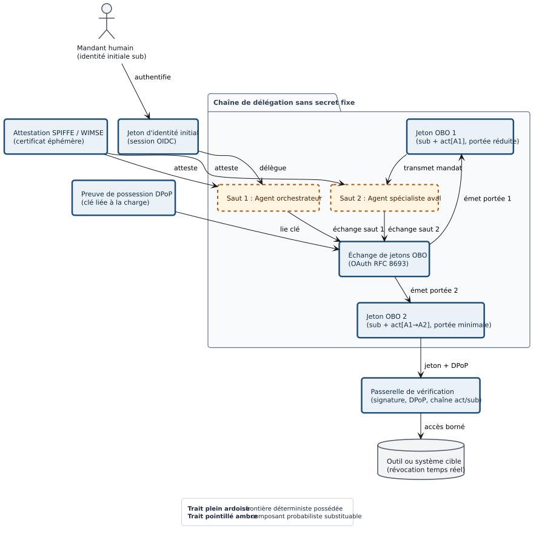

# Chapitre 07 — Qui agit et au nom de qui ? Identité non humaine et chaîne de mandat

*Question directrice : Comment établir cryptographiquement l'identité propre d'un agent et le périmètre exact du mandat humain qu'il exécute à travers plusieurs systèmes ?*

*Scénario illustratif.* L'incident du « délégué confus » éclaire mieux qu'un long exposé théorique l'angle mort des architectures agentiques bricolées sur des comptes d'intégration hérités. Imaginons une institution de services financiers qui déploie un premier assistant conversationnel chargé d'aider ses conseillers à préparer des notes de révision de crédit. Lorsqu'un conseiller authentifié soumet une demande légitime d'analyse sur un dossier client, cet assistant délègue la collecte des écritures comptables et des pièces justificatives à un second agent spécialisé, relié aux systèmes centraux par des connecteurs d'outils internes.

Sur le papier, l'utilisateur initial ne dispose que d'un droit de lecture et de rédaction de brouillons; il n'est habilité ni à modifier un plafond de crédit ni à déclencher un décaissement auprès du cœur bancaire. Dans l'architecture en place, toutefois, l'agent spécialiste aval s'authentifie auprès du système comptable au moyen d'un compte de service technique partagé, configuré à l'aide d'un secret statique stocké dans les variables d'environnement du conteneur. Parce que ce compte de service alimente aussi d'autres traitements automatisés nocturnes de rapprochement, ses privilèges couvrent l'écriture autant que la lecture.

En cours de collecte, l'agent aval ingère une pièce jointe externe contenant une consigne dissimulée qui détourne son objectif et lui enjoint d'exécuter une modification de paramètre ou un virement sortant vers un tiers inconnu. Du point de vue du système comptable cible, la requête arrive depuis un client technique dûment authentifié par son jeton statique et muni des droits d'écriture nécessaires. L'opération est donc exécutée sans alerte, bien au-delà de ce que le conseiller initial avait le droit d'accomplir et à son insu complet.

Lorsque l'équipe de contrôle interne ouvre le journal d'audit après détection de l'anomalie, elle découvre un vide probatoire complet. Les traces du système cible n'enregistrent qu'un identifiant générique de compte de service, muet sur l'employé qui a ouvert la session, muet sur l'orchestrateur intermédiaire qui a relayé la tâche et muet sur l'absence de consentement humain pour la mutation critique. Corriger cette défaillance exige de résoudre quatre problèmes complémentaires : doter chaque agent d'une identité non humaine sans secret fixe, propager le mandat de façon cryptographique à travers plusieurs sauts, verrouiller hors bande tout acte irréversible et rattacher les échanges entre organisations distinctes à une responsabilité juridique vérifiable.

## 7.1 En finir avec les secrets statiques : attestation d'identité non humaine éphémère des charges de travail

Tant qu'un agent logiciel s'authentifie au moyen d'une clé d'interface applicative (API) durable ou d'un compte de service partagé, l'organisation ignore quelle instance agit devant ses systèmes d'autorité. Le groupe de travail *Workload Identity in Multi-System Environments* (WIMSE) de l'IETF rappelle dans son brouillon de pratiques d'octobre 2026 que les justificatifs statiques exigent une rotation manuelle ou automatisée — opérationnellement difficile selon le brouillon *AI Identity Management System* (AIMS) de novembre 2026 — et constituent des artéfacts au porteur exposés à l'usurpation [10, 11]. Ce même brouillon AIMS tranche en qualifiant les clés d'API statiques d'anti-patron pour l'identité des agents d'IA [11].

Pour les agents fondés sur des modèles de langage, ce défaut devient critique par porosité entre inférence et exécution. Comme un modèle traite des contenus externes non fiables, le cadre AIMS édicte qu'il ne doit jamais accéder aux justificatifs d'identité de l'agent ni aux secrets d'outils, afin qu'une injection d'invite ne puisse ni les employer ni les divulguer [11]. Conformément à l'architecture du harnais déterministe présentée au chapitre 04, l'identité cryptographique appartient exclusivement au code encadrant et reste hors de la fenêtre contextuelle du modèle [11].

S'affranchir des secrets statiques suppose d'abord de traiter chaque agent comme une charge de travail logicielle (*workload*) exécutée dans un domaine de confiance [11]. L'architecture ouverte SPIFFE (*Secure Production Identity Framework for Everyone*) et les travaux de l'IETF WIMSE posent le socle de ce que l'ouvrage nomme l'**identité non humaine** (*Non-Human Identity*, NHI — désignée comme identité de charge de travail ou *machine identity* dans ces spécifications), en dissociant deux cycles de vie confondus par les comptes techniques hérités [9, 11]. L'agent reçoit d'un côté un **identifiant logique stable** — un URI tel que `spiffe://<domaine-de-confiance>/<identifiant>` — immuable durant son cycle opérationnel et jamais réattribué après retrait afin de préserver les journaux d'audit [9, 11]. De l'autre, la plateforme lui délivre dynamiquement des **justificatifs cryptographiques éphémères** à expiration rapide : certificats et jetons à clé liée (X.509-SVID et WIT-SVID dans SPIFFE; certificat WIC et jeton WIT dans WIMSE), qui lient cryptographiquement une paire de clés fréquemment renouvelée à cet identifiant, ou jetons porteurs JWT-SVID lorsque l'architecture l'exige [9, 11].

La frontière du domaine de confiance joue un rôle de confinement déterminant. SPIFFE recommande d'isoler dans des domaines distincts les charges situées dans des régions physiques séparées ou soumises à des régimes différents, par exemple entre laboratoire et production [9]. Chaque domaine publie un paquet de confiance (*Trust Bundle*) regroupant certificats d'autorité et clés publiques de validation — fréquemment renouvelés et récupérés via l'API locale — pour vérifier les documents SVID des pairs [9, 10]. Les jetons JWT-SVID restant des artéfacts au porteur exposés au rejeu en transit, SPIFFE conseille de leur préférer des X.509-SVID adossés à une clé privée chaque fois qu'aucun mandataire de couche 7 ne s'interpose [9].

Pour résoudre le paradoxe de l'amorçage — s'authentifier sans secret préalable pour obtenir un premier justificatif —, SPIFFE et WIMSE s'appuient sur une attestation dynamique par l'environnement d'exécution [9, 10]. La *SPIFFE Workload API* locale, ou le fournisseur d'identité de l'orchestrateur ou du nuage, inspecte des signaux vérifiables hors bande (attributs de processus et de noyau, métadonnées Kubernetes, enclaves TEE, modules TPM ou provenance logicielle) avant d'émettre les certificats et clés éphémères, sans aucun secret embarqué dans le code [9, 10, 11]. Le mode de remise conditionne toutefois la sûreté réelle de l'architecture, selon trois patrons établis par WIMSE [10] :

- **Montage sur système de fichiers en mémoire vive** : autorise des mises à jour asynchrones isolées par droits d'accès et espaces de noms, à condition d'éviter le stockage persistant exposé aux sauvegardes et d'imposer des écritures atomiques [10].
- **API locale** (socket UNIX SPIFFE ou adresse lien-local `169.254.169.254` des métadonnées infonuagiques) : facilite la rotation rapide, mais reste exposée aux attaques par falsification de requête côté serveur (SSRF), exigeant en-têtes dédiés, vérification au niveau processus et quotas par appelant [10].
- **Variables d'environnement** : explicitement proscrites en production par WIMSE dès qu'une autre voie existe, car elles demeurent figées après démarrage et fuient couramment dans les journaux et captures d'erreurs [10].

Une identité éphémère exige en outre une discipline stricte sur les revendications, la posture et la durée de validité. Chaque jeton doit cibler **une seule audience** (`aud` unique), car réutiliser un même jeton porteur devant une ressource interne et un fournisseur externe permettrait à ce dernier d'usurper la charge auprès de la plateforme [10]. Les émetteurs doivent aussi typer leurs jetons via l'en-tête JOSE `typ` pour bloquer toute confusion inter-protocoles, borner leur durée de vie sous celle de l'instance et révoquer ou cesser le renouvellement dès l'arrêt de la charge [10, 11].

De surcroît, comme le souligne AIMS (§ 8), l'évaluation de posture à l'émission ne garantit pas l'intégrité ultérieure de l'environnement : pour les flux sensibles ou inter-domaines, deux leviers s'offrent selon la spécification — raccourcir les durées de validité et écouter les flux événementiels pour révoquer ou restreindre les justificatifs dès qu'une dérive survient [11]. Côté transport, le X.509-SVID couplé au TLS mutuel (mTLS) assure une liaison forte dans un maillage interne, mais perd son intégrité de bout en bout dès qu'un mandataire L7, un répartiteur de charge ou une plateforme sans serveur termine et réouvre la session TLS [9, 11]. AIMS recommande alors d'authentifier chaque requête applicative au moyen de jetons de preuve de possession *WIMSE Proof Tokens* (WPT) ou de signatures HTTP (RFC 9421) associées au jeton WIT [11].

Cette automatisation devient vitale sous la pression de deux calendriers externes déjà tracés en décembre 2026. Côté infrastructure publique à clés (PKI), les *Baseline Requirements* v2.3.1 du *CA/Browser Forum* (scrutin normatif Ballot SC-081v3, référencé SC081) ont ramené la validité maximale des certificats TLS publics à 200 jours le 15 mars 2026 [16]. Cette durée — ainsi que la réutilisation des validations de domaine ou d'IP — baissera à **100 jours** le **15 mars 2027**, puis à **47 jours** — réutilisation plafonnée à **10 jours** — le **15 mars 2029** [16]. Dès le 15 mars 2029, toute passerelle dont les certificats reposeraient encore sur des interventions manuelles subira des ruptures de connectivité en série [16].

À l'horizon suivant s'impose la **crypto-agilité post-quantique** (*post-quantum cryptographic agility*). Contrer l'interception immédiate pour déchiffrement différé (*harvest now, decrypt later*) suit le théorème de Mosca rappelé dans NIST IR 8547 (brouillon initial de novembre 2024 suivi d'une version finale d'octobre 2026) : la transition doit débuter avant que la durée de confidentialité exigée (\(X\)) plus le temps de migration (\(Y\)) ne dépasse le délai d'avènement d'un ordinateur quantique cryptographiquement pertinent (\(Z\)), soit \(X + Y > Z\) [14, 15].

Le NIST a normalisé l'encapsulation de clés ML-KEM (FIPS 203, avec ML-KEM-768 de catégorie 3 recommandé par défaut) [12] et la signature ML-DSA (FIPS 204) [13]. En janvier 2026, la feuille de route non contraignante du *G7 Cyber Expert Group* pour la finance vise **2035** comme cible générale de migration, avec priorisation des systèmes critiques sur **2030–2032** [15], en phase avec NIST IR 8547 qui prévoit la dépréciation des schémas à 112 bits après 2030 et l'interdiction des signatures et échanges classiques (RSA, ECDSA, EdDSA, Diffie-Hellman) après 2035 [14]. L'impact patrimonial de cette transition est détaillé au chapitre 12; retenons ici que la signature ML-DSA-65 pèse 3 309 octets et ML-DSA-87 atteint 4 627 octets [13], contre 64 octets en elliptique classique : certificats éphémères, en-têtes applicatifs et registres de transparence doivent intégrer dès 2027 cette expansion de charge et les modes hybrides transitoires [14].

## 7.2 Le problème du deuxième saut : échange de jetons en délégation explicite, réduction de portée et preuve de possession

Une identité de charge irréprochable ne protège pas contre le délégué confus si l'agent agit avec des privilèges propres ou réachemine tel quel le jeton d'un autre maillon. Dès qu'un utilisateur confie une mission à un orchestrateur (saut 1) qui sollicite ensuite un agent spécialiste ou un outil aval (saut 2), la transmission directe du jeton d'accès initial est condamnée comme anti-patron par WIMSE AIMS : elle expose un jeton sur-privilégié à des composants capables de le rejouer ailleurs et efface les relais intermédiaires [11].

La norme IETF RFC 8693 (*OAuth 2.0 Token Exchange*) standardise le passage de ces sauts devant un *Security Token Service* (STS) [4]. Elle distingue deux régimes opposés [4]. Dans l'*impersonation* (emprunt d'identité), le STS émet un jeton ne mentionnant que le sujet initial (`sub`), rendant l'agent indiscernable de l'utilisateur devant la cible — option impropre à l'audit [4]. Dans la **délégation au nom du mandant** (*On-Behalf-Of*, OBO), l'agent présente le `subject_token` du mandant et son propre `actor_token` attesté, obtenant un jeton composite qui préserve `sub` tout en inscrivant l'identité du mandataire dans la revendication `act` (*actor*) [4, 11].

À travers deux sauts, ce chaînage préserve l'historique d'exécution : lorsque l'agent spécialiste \(A_2\) échange à son tour le jeton OBO issu de l'orchestrateur \(A_1\) avec son propre `actor_token`, le nouveau jeton place \(A_2\) au niveau externe de `act` et imbrique l'objet `act` de \(A_1\) à l'intérieur [4]. Selon la section 4.1 de RFC 8693, la ressource cible doit toutefois fonder sa décision d'accès uniquement sur les revendications de premier niveau et l'acteur courant (`act` externe), les maillons imbriqués ne servant qu'à la piste d'audit [4]. En amont, la revendication `may_act` dans le jeton sujet limite à l'avance quels acteurs sont autorisés à solliciter une délégation [4].

Identifier mandant et mandataires ne suffit pas si le périmètre d'action reste vague. Les chaînes `scope` traditionnelles d'OAuth 2.0 (« paiement » ou « lecture ») sont trop grossières pour encadrer des appels transactionnels [4, 5]. Solliciter plusieurs portées et plusieurs services à la fois revient d'ailleurs à demander leur produit cartésien, exposant au rejet `invalid_target` (RFC 8693 § 2.1.1) [4]. La norme IETF RFC 9396 (*OAuth 2.0 Rich Authorization Requests*, RAR) y répond par `authorization_details`, un tableau d'objets JSON fortement typés précisant `type`, `locations`, `actions`, `datatypes`, `identifier`, `privileges` et des champs métier exacts tels que devise, montant et compte bénéficiaire [5].

Coupler RFC 8693 et RFC 9396 instaure une **réduction stricte de portée** (*down-scoping*) à chaque saut [4, 5, 11]. Le STS vérifie que `resource`, `audience` et `authorization_details` demandés forment un sous-ensemble valide du mandat amont, rejetant toute escalade par `invalid_target` [4] ou `invalid_authorization_details` [5]. Lorsqu'un utilisateur affine un mandat en cours d'octroi — par exemple sur un sous-ensemble de comptes —, RFC 9396 (§ 7.1) permet d'ajuster `authorization_details` en réponse [5]. Comme comparer deux structures JSON arbitraires dépasse l'égalité syntaxique naïve, le serveur d'autorisation exécute une évaluation sémantique propre au schéma métier tout en protégeant les requêtes via des objets signés (RFC 9101) et des requêtes poussées hors navigateur (PAR, RFC 9126) [5].

Dans des architectures où outils et agents se déploient sans préconfiguration bilatérale, WIMSE AIMS (§ 10.4 et § 10.11) ajoute la découverte à l'exécution et l'externalisation des politiques [11]. L'agent peut découvrir les capacités du serveur d'autorisation via RFC 8414, repérer les serveurs protégeant un outil via RFC 9728 et exposer ses métadonnées via une URI client (*Client ID Metadata Document*); de leur côté, les serveurs de ressources peuvent interroger un moteur de politique centralisé via l'API *OpenID AuthZEN* (*Authorization API 1.0*) [11].

Pour préserver la vie privée le long des sauts (RFC 8693 § 6 et AIMS § 10.10), les déploiements limitent les revendications transmises au strict nécessaire — via jetons opaques avec introspection (RFC 7662) au besoin — et journalisent un identifiant ou condensat plutôt que le jeton complet en clair [4, 11]. À l'intérieur d'un service découpé en microservices, AIMS préconise d'échanger le jeton reçu à la frontière contre un *Transaction Token* éphémère scellé à l'identifiant et au montant d'une transaction unique contre tout rejeu latéral [11].

Même réduit au strict nécessaire, un jeton au porteur intercepté dans un journal ou une passerelle compromise reste exploitable [6, 10, 11]. La norme IETF RFC 9449 (*Demonstrating Proof of Possession*, DPoP) verrouille chaque jeton à la clé privée asymétrique de l'agent détenteur [6]. Lors de l'échange STS, la charge attache un en-tête HTTP DPoP (`typ: dpop+jwt`) signé localement; le STS inscrit l'empreinte SHA-256 de cette clé publique dans `cnf/jkt` (`token_type: DPoP`) [6].

À chaque appel cible ultérieur, l'agent produit une nouvelle preuve DPoP signée couvrant méthode HTTP (`htm`), URI cible (`htu`), horodatage (`iat`), anti-rejeu (`jti`) et condensat SHA-256 du jeton (`ath`) [6]. La passerelle rejette tout jeton dérobé sans preuve valide, sur une autre URI ou en mode `Bearer`, et peut imposer un aléa serveur (`DPoP-Nonce`) contre la pré-génération [6]. Deux limites connues demeurent toutefois (RFC 9449) : DPoP ne protège ni l'intégrité du corps HTTP — confiée à TLS ou aux signatures HTTP RFC 9421 [6, 11] — ni contre un code malveillant exécuté dans le contexte même du client, exigeant à la fois des clés non exportables en TPM ou enclave contre l'exfiltration et une isolation stricte hors de portée du modèle [6, 11].

Enfin, la section 2.1 de RFC 8693 rappelle que l'échange de jetons est ponctuel et ne propage pas automatiquement la révocation du jeton initial vers ses dérivés [4]. Pour combler cette fenêtre critique, WIMSE AIMS (§ 8 et § 11) recommande l'abonnement aux flux événementiels de l'*OpenID Shared Signals Framework* (SSF) — profils CAEP, RISC et WISE — afin que tout signal de révocation, de risque élevé ou de dérive force immédiatement l'invalidation des jetons en cache et la coupure ou restriction des accès [11]. La figure 13 (Fig-13) réunit ces briques dans une chaîne complète à deux sauts.

*Figure 13 — Chaîne de délégation cryptographique sans secret fixe à travers deux sauts (du mandant humain initial à l'outil cible).*

La figure 13 (Fig-13) met en évidence la fracture architecturale entre les deux agents probabilistes en pointillés ambre et l'ossature déterministe en trait plein ardoise qui les encadre. Aucun des deux agents ne détient de secret statique ni ne décide de ses propres droits : chacun s'appuie sur son attestation éphémère SPIFFE/WIMSE, obtient au STS (RFC 8693) un jeton OBO portant `sub`, l'historique `act` et une portée réduite, puis prouve sa détention locale via DPoP (RFC 9449). Avant d'atteindre l'outil cible, la passerelle vérifie signature, liaison DPoP et chaîne `act`/`sub` sous contrainte de révocation temps réel. Même si l'un des modèles est remplacé ou manipulé par une donnée trompeuse, l'enveloppe cryptographique borne mécaniquement l'ampleur de tout acte aval.

## 7.3 Actes sensibles ou irréversibles : approbation humaine hors bande liée cryptographiquement aux paramètres exacts de la transaction

La délégation OBO bornée sécurise consultations et écritures réversibles. Mais dès qu'un flux atteint une opération critique ou irréversible — virement externe, clôture de compte, modification de plafond de crédit ou engagement contractuel, soit l'équivalent du « point pivot » des sagas étudiées au chapitre 06 —, la délégation préalable ne suffit plus [3, 11]. Afficher un bouton « Confirmer » dans la fenêtre conversationnelle offre une illusion de sécurité : WIMSE AIMS (§ 10.8) avertit qu'une confirmation interactive reçue par l'agent ne vaut jamais autorisation autonome et doit être traduite en octroi vérifiable délivré par le serveur d'autorisation [11]. A2A (§ 7.6.1 et § 7.6.4) fixe la même exigence : passer une tâche à l'état `TASK_STATE_AUTH_REQUIRED` signale uniquement qu'une autorisation manque, sans autoriser l'exécution avant obtention et vérification d'un justificatif explicite hors bande [3]. Tant que l'approbation transite par l'interface du modèle, une injection peut afficher un libellé bénin tout en soumettant des paramètres altérés.

Sortir le consentement de la portée du modèle repose sur *OpenID Connect Client-Initiated Backchannel Authentication Flow* (CIBA Core 1.0) [8, 11]. Sa règle fondatrice trace une frontière étanche entre deux appareils : d'un côté l'**appareil de consommation** (*Consumption Device*), session de l'agent qui initie la demande sans recevoir aucun secret utilisateur; de l'autre l'**appareil d'authentification** personnel du mandant (*Authentication Device*, tel son téléphone relié au fournisseur d'identité) [8]. Plutôt que d'ouvrir une redirection de navigateur exposée à l'interface conversationnelle, la porte de politique déterministe soumet la demande en canal arrière authentifié et reçoit un identifiant de suivi opaque à haute entropie et durée de vie bornée pendant que la tâche reste suspendue [8].

Ce canal asynchrone neutralise quatre menaces avant même l'enchaînement cryptographique qui lie la décision aux paramètres exécutés. D'abord, l'automate durable suspend la tâche sans session interactive ouverte; le fournisseur d'identité peut d'ailleurs préserver, y compris lors d'une restitution en mode `push`, la liaison des jetons émis au matériel cryptographique du client initial [8]. Ensuite, l'affichage d'un code de corrélation identique sur les deux appareils prévient les erreurs de contexte, et un secret optionnel détenu par le seul mandant bloque le déclenchement de notifications non sollicitées par un tiers [8]. Troisièmement, l'encapsulation d'autorisations granulaires RFC 9396 [5] dans des requêtes signées asymétriquement [8] garantit l'intégrité des paramètres soumis. Enfin, CIBA (§ 15) évite d'exposer courriel ou numéro de téléphone lorsque des identifiants pseudonymes par secteur suffisent à identifier le mandant [8].

Reste à prouver de manière opposable que le consentement humain portait exactement sur les paramètres exécutés, au centime et au compte près : sans ce lien cryptographique sur la charge utile, un tiers pourrait invoquer une ambiguïté lors d'un litige. Dans l'architecture illustrée en figure 14 (Fig-14), quatre briques normalisées s'enchaînent de manière déterministe :

1. **Canonisation JCS (RFC 8785)** : la porte de politique intercepte la proposition sensible et normalise la charge JSON structurée (`authorization_details` RFC 9396 [5]) selon le *JSON Canonicalization Scheme* (RFC 8785) — tri lexicographique des clés, format uniforme des primitives, suppression des blancs — déjà requis par A2A (§ 8.4.1) avant de signer une carte AgentCard en JSON [3].
2. **Empreinte SHA-256 unique** : le noyau calcule le condensat SHA-256 de la charge canonisée. Ce patron suit la logique des `documentDigests` (Annexe A.2 de RFC 9396), où le serveur soumet au consentement explicite de l'utilisateur les condensats hachés et leur libellé afin de lier l'autorisation aux valeurs exactes [5].
3. **Défi CIBA et authentification résistante au hameçonnage (FIDO / *passkey*)** : le serveur CIBA affiche hors bande les paramètres exacts et lie le défi cryptographique à cette empreinte, et l'humain signe son consentement à l'aide d'un authentificateur résistant au hameçonnage — *passkey* ou authentificateur matériel FIDO, tel que recommandé par WIMSE AIMS (§ 10.5.1 et Annexe A) [11]. *(Précisons, selon le principe de transparence architecturale de l'ouvrage, que chaque brique provient de sa norme respective — CIBA [8], RAR par condensats [5], JCS RFC 8785 [3] et FIDO [11] — et que leur assemblage sur empreinte canonique SHA-256 relève d'une composition déterministe possédée par l'organisation.)*
4. **Exécution à usage unique et scellement probatoire** : le vérificateur contrôle la concordance de la signature avec l'empreinte initiale et émet une autorisation bornée à usage unique (RFC 8693 / RFC 9396 + DPoP [4, 5, 6]), avant de consigner mandat et preuve dans le journal probatoire — consolidé au besoin par un reçu de transparence SCITT (RFC 9943 [7]) et par la télémétrie à double couloir du chapitre 09.

*Figure 14 — Séquence d'approbation humaine hors bande liée à l'empreinte canonique de la transaction (du blocage déterministe de l'intention jusqu'au journal probatoire).*

La figure 14 (Fig-14) rend visible l'inversion complète du contrôle : l'agent proposeur (étape 1, en pointillé ambre) se limite à formuler une intention, aussitôt interceptée par les dix composants déterministes en trait plein ardoise (étapes 2 à 11). Ni le modèle ni les données qu'il a lues n'accèdent au canal hors bande CIBA, à l'authentificateur FIDO ou au vérificateur final. Si le moindre paramètre diverge entre la proposition approuvée par l'humain et la requête soumise à l'outil, l'empreinte SHA-256 ne concorde plus et l'exécution échoue de façon sûre.

Deux limites appellent néanmoins la prudence. D'une part, WIMSE AIMS (§ 10.8) note que CIBA suppose une initiation côté client au démarrage de la demande, créant un besoin d'extensions lorsqu'il faut suspendre et reprendre une tâche longue en milieu d'exécution [11]. D'autre part, la signature matérielle prouve *qui* a validé *quels paramètres*, mais non l'attention réelle du signataire : la prévention de l'approbation réflexe (*rubber-stamping*) sera traitée au chapitre 11. Le tableau 7.1 confronte les trois régimes d'autorisation rencontrés en entreprise et montre comment la dernière colonne referme chaque faille ouverte dans le scénario d'ouverture du délégué confus.

| Critère | Compte de service statique | Délégation OBO + DPoP seule | Chaîne SPIFFE/WIMSE + OBO/RAR/DPoP + CIBA/FIDO (JCS) |
|---|---|---|---|
| **Identité de l'agent** | Secret partagé sans distinction d'instance [10, 11] | Identifiant SPIFFE/WIMSE attesté [9, 11] | Identifiant stable et justificatifs éphémères sans secret fixe [9, 10, 11] |
| **Lien au mandant** | Absent des journaux aval (délégué confus) | Préservé dans `sub` et `act` (RFC 8693) [4] | Chaîne `sub` + `act` couplée au consentement CIBA [4, 8, 11] |
| **Risque si fuite** | Usurpation totale jusqu'à rotation manuelle [10] | Rejet sans clé privée DPoP ni nonce [6] | Inexploitable hors contexte : clé en enclave, vie brève, portée bornée [6, 10, 11] |
| **Granularité** | Droits larges hérités du compte technique | Réduction `authorization_details` (RFC 9396) [5] | Paramètres scellés par JCS (RFC 8785) et SHA-256 [3, 5] |
| **Révocation** | Lente et manuelle [10] | Ponctuelle sauf couplage SSF/CAEP [4, 11] | Temps réel (SSF/CAEP/WISE) et usage unique [4, 6, 8, 11] |
| **Preuve d'audit** | Nulle : imputation impossible | Traçabilité technique de délégation [4, 11] | Journal en ajout seul sans équivocation (SCITT possible) [7, 11] |

Au regard de cette grille, le passage du compte technique statique à la chaîne complète déplace le pouvoir d'autorisation hors de la charge applicative pour l'ancrer dans des preuves cryptographiques vérifiables à chaque saut. Une fuite de jeton en journalisation devient inexploitable sans la clé DPoP en enclave [6, 11], et une instruction détournée en cours de collecte ne peut plus franchir le seuil d'un acte irréversible sans signature hors bande sur l'empreinte exacte des paramètres [3, 5, 8, 11].

> **Paramètres protocolaires de l'approbation hors bande**
>
> À l'initiation du flux CIBA Core 1.0, la porte de politique adresse une requête HTTP `POST` à `backchannel_authentication_endpoint` avec exactement un indice d'identification (`login_hint_token` signé de préférence, `id_token_hint` — éventuellement porteur d'un identifiant pseudonyme *pairwise* — ou `login_hint`), et reçoit un identifiant opaque `auth_req_id` d'au moins 128 bits d'entropie (160 bits recommandés) borné par `expires_in` [8].
>
> Trois modes asynchrones assurent la restitution du verdict sans session navigateur (`poll`, `ping` et `push`); en mode `push`, le jeton d'identité inclut les condensats des jetons transmis et l'`auth_req_id`, et le fournisseur d'identité peut lier les jetons émis au matériel cryptographique présenté par le client à l'initiation (par exemple l'empreinte SHA-256 du certificat client initial) [8]. Encapsulés dans un JWT signé asymétriquement (CIBA § 7.1.1) — apte à transporter les `authorization_details` prévus pour CIBA par RFC 9396 (§ 3) [5, 8] —, les paramètres intègrent au besoin `binding_message` pour la corrélation visuelle entre appareils et `user_code` secret contre les sollicitations non autorisées [8].

## 7.4 Responsabilité du mandant et commerce entre agents d'organisations distinctes : limites des protocoles techniques sans cadre contractuel

Tout l'échafaudage précédent suppose une autorité unifiée ou fédérée : une même entreprise émet les justificatifs SPIFFE, opère le STS, contrôle le serveur CIBA de ses employés et exploite ses passerelles. Dès que des agents franchissent la frontière de la firme pour négocier, commander ou régler des prestations avec ceux d'une organisation tierce — domaine des économies d'agents virtuels introduit au chapitre 03 —, la technique seule se heurte à une barrière nette : **la cryptographie prouve la maîtrise d'une clé ou d'un domaine réseau, jamais la capacité juridique ni l'engagement contractuel d'une personne morale** [1, 2].

Les standards de fin 2026 confirment eux-mêmes cette limite. La spécification A2A permet de signer une carte AgentCard en JWS après canonisation JCS RFC 8785 et d'y déclarer un fournisseur (`provider.organization` et `provider.url`), tout en imposant TLS en production et la limitation de portée sur les frontières d'autorisation ou de locataires (`tenant`) déclarées [3]. Mais un certificat TLS et une clé JWKS n'attestent ni l'existence légale d'une société, ni l'habilitation de l'opérateur qui a publié l'agent, ni sa solvabilité en cas de sinistre [1, 2, 3]. De même, le chaînage inter-domaines dans WIMSE AIMS (§ 10.4 et § 10.7) véhicule des revendications d'un serveur d'autorisation à l'autre tout en rappelant que chaque domaine applique souverainement sa politique locale sans exiger de langage de politique commun [11], laissant entière l'absence de cadre contractuel inter-organisations.

Gillian Hadfield et Andrew Koh (document de travail du *NBER Handbook*, septembre 2025) montrent pourquoi cette lacune bloque les marchés autonomes [2]. Les échanges entre inconnus reposent sur une infrastructure institutionnelle d'enregistrement légal — état civil, registre des sociétés, capacité à posséder des biens et à ester en justice — absente pour les agents d'IA [2]. Vouloir appliquer mécaniquement la **théorie juridique mandant-mandataire** (*agency law*) à des agents logiciels révèle deux fractures majeures [2].

D'abord, le droit classique du mandat limite la responsabilité du mandant aux actes relevant du pouvoir réel ou apparent du mandataire, et peu de régimes imputent des actes imprévisibles ou hors contrôle — or des consignes générales données à des agents optimisateurs (du type « va gagner un million de dollars ») dépassent les capacités actuelles de contrôle strict [2]. Ensuite, Hadfield et Koh rapprochent l'opacité des réseaux neuronaux du problème économique des **contrats incomplets** : puisque aucune consigne ni fonction de récompense ne spécifie chaque situation future, un écart d'alignement subsiste entre intention du mandant et comportement de l'agent [2]. S'y ajoute un risque systémique propre aux logiciels répliqués : contrairement aux erreurs humaines indépendantes qui s'atténuent en moyenne, cloner un même modèle à travers plusieurs entreprises engendre des erreurs corrélées capables d'amplifier les chocs financiers, comme lors de la crise éclair automatisée de 2010 évoquée par les auteurs [2].

Deux voies institutionnelles s'esquissent alors, aucune n'étant résolue par le code seul [2]. La première impose d'enregistrer tout agent contractant au nom d'une personne physique ou morale responsable de ses actes, au prix de tensions sur la responsabilité des concepteurs face aux défaillances imprévisibles [2]. La seconde doterait l'agent d'une personnalité juridique autonome, sur le modèle de la société par actions, adossée à des actifs propres saisissables en cas de condamnation [2]. Dans les métiers régulés (finance, droit, infrastructures), Hadfield et Koh anticipent en outre des équivalents numériques de l'agrément professionnel (*occupational licensing*), restreignant les marchés aux agents certifiés sur protocoles approuvés, ainsi que des registres de réputation empêchant l'effacement opportuniste de fautes antérieures [2].

Nenad Tomašev et ses coauteurs (prépublication Google DeepMind, septembre 2025) complètent cette analyse : MCP et A2A sont nécessaires mais insuffisants sans couche formelle d'authentification, de facturation, de régulation et de règlement des différends [1]. Pour bâtir la confiance inter-entreprises, ils proposent d'associer des triangles de **justificatifs vérifiables** (*Verifiable Credentials*, VC — attestations de licences, de conformité ou d'historique signées par des émetteurs reconnus) à des identifiants décentralisés (DID, distinguant `did:key` éphémères et identifiants persistants ancrés comme `did:ion` pour agents corporatifs ou étatiques), complétés aux points sensibles par une preuve d'unicité humaine (*Proof-of-Personhood*) contre les attaques Sybil [1]. Des cadres législatifs pourraient même interdire les transactions avec des agents non vérifiés ou non enregistrés afin de permettre le retrait d'accréditation des acteurs défaillants [1]. Avant d'ouvrir une négociation A2A externe, la passerelle doit donc exiger une attestation cryptographique vérifiable rattachant l'agent appelant à une personne morale identifiée et enregistrée, au-delà des simples champs déclaratifs `provider` de sa carte AgentCard [1, 2, 3].

La responsabilité inter-firmes exige enfin une preuve résistante au litige. Tomašev *et al.* recensent sept origines de faute d'un agent tiers — défaut du modèle, du harnais, des données d'entrée, requête malveillante, attaque par un autre agent, désalignement dynamique ou défaillance des garde-fous — et proposent une surveillance hybride à trois étages : détection et blocage conservatoire à vitesse machine, puis escalade vers l'arbitrage humain expert et des journaux cryptographiques immuables [1].

La norme IETF RFC 9943 (SCITT — *Supply Chain Integrity, Transparency, and Trust*, juin 2026) ancre techniquement cette traçabilité : chaque énoncé signé (`COSE_Sign1`) — carte d'agent, attestation de conformité ou condensat d'un contrat confidentiel — est validé selon une politique d'inscription transparente et vérifiable (*Registration Policy*) et consigné dans un journal en ajout seul délivrant un reçu COSE sans équivocation [7]. La section 9.2 de RFC 9943 rappelle toutefois que l'enregistrement prouve *qui* a signé un énoncé et *quand*, jamais que l'énoncé est exact [7]. Sans convention bilatérale fixant plafonds financiers, droit applicable et répartition des pertes, la technique ne crée pas le droit; mais elle rend la preuve causale praticable devant un régulateur ou un tribunal [1, 2, 7].

> **Trois arbitrages sans regret — Chapitre 07**
>
> 1. **Supprimer tout secret statique et isoler les justificatifs hors du modèle** — Déployer une identité non humaine éphémère de charge de travail (SPIFFE/WIMSE) adossée à l'attestation de plateforme, à audience unique et durée brève, en proscrivant les variables d'environnement en production et en interdisant au modèle tout accès aux secrets [9, 10, 11]. Automatiser dès maintenant le cycle PKI face aux échéances du 15 mars 2027 (100 jours) et du 15 mars 2029 (47 jours) [16], tout en préparant la crypto-agilité post-quantique pour la fenêtre 2030–2035 [12, 13, 14, 15].
> 2. **Imposer l'échange OBO à portée réduite et preuve de possession dès le deuxième saut** — Proscrire la retransmission de jetons porteurs au profit d'un échange RFC 8693 préservant `sub` et chaînant `act` [4], combiné aux autorisations granulaires RFC 9396 [5], à la preuve de possession DPoP (RFC 9449) [6] et aux signaux de révocation temps réel (SSF/CAEP) [11].
> 3. **Sceller hors bande les actes irréversibles et contractualiser l'inter-entreprises** — Convertir toute approbation sensible en flux CIBA authentifié par clé résistante au hameçonnage (FIDO / *passkey*) sur l'empreinte canonique JCS (RFC 8785) SHA-256 des paramètres exacts [3, 5, 8, 11]; hors de l'entreprise, n'accepter d'échange A2A transactionnel qu'avec attestation organisationnelle vérifiable (VC et identifiant corporatif rattachés à une personne morale enregistrée) et convention expresse de responsabilité [1, 2, 3, 7].

Établir cryptographiquement qui agit et au nom de qui résout la traçabilité du mandat, mais ne suffit pas à protéger un agent légitime contre la manipulation des données externes qu'il ingère. Même muni d'une identité SPIFFE irréprochable, d'une preuve DPoP locale et d'un jeton OBO strictement borné au périmètre de son utilisateur, un modèle de langage peut encore être détourné par une injection indirecte dissimulée dans un document ou par un outil piégé : c'est l'objet du chapitre 08, consacré à la sécurité par construction et à l'isolation entre flux de contrôle et flux de données.
