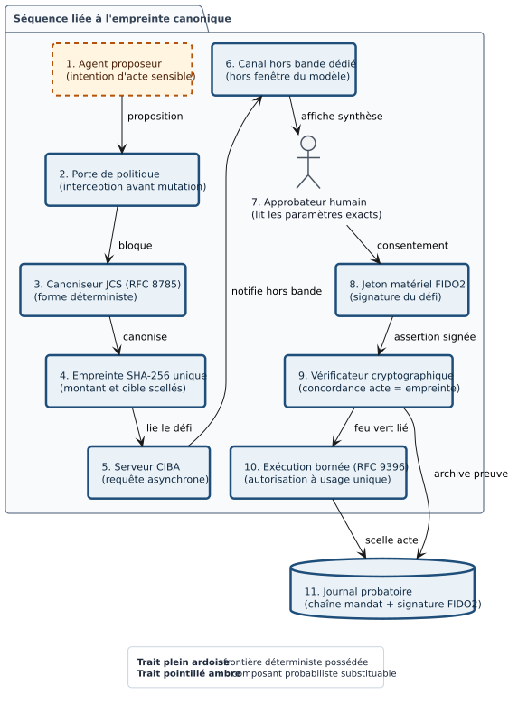

# Chapitre 07 — Qui agit et au nom de qui ? Identité non humaine et chaîne de mandat

*Question directrice : Comment établir cryptographiquement l'identité propre d'un agent et le périmètre exact du mandat humain qu'il exécute à travers plusieurs systèmes ?*

Scénario illustratif : l'incident du « délégué confus » éclaire mieux qu'un long exposé théorique l'angle mort des architectures agentiques bricolées sur des comptes d'intégration hérités. Imaginons une institution de services financiers qui déploie un premier assistant conversationnel chargé d'aider ses conseillers à préparer des notes de révision de crédit. Lorsqu'un conseiller authentifié soumet une demande légitime d'analyse sur un dossier client, cet assistant délègue la collecte des écritures comptables et des pièces justificatives à un second agent spécialisé, relié aux systèmes centraux par des connecteurs d'outils internes.

Sur le papier, l'utilisateur initial ne dispose que d'un droit de lecture et de rédaction de brouillons; il n'est habilité ni à modifier un plafond de crédit ni à déclencher un décaissement auprès du cœur bancaire. Dans l'architecture en place, toutefois, l'agent spécialiste aval s'authentifie auprès du système comptable au moyen d'un compte de service technique partagé, configuré à l'aide d'un secret statique stocké dans les variables d'environnement du conteneur. Parce que ce compte de service alimente aussi d'autres traitements automatisés nocturnes de rapprochement, ses privilèges couvrent l'écriture autant que la lecture.

En cours de collecte, l'agent aval ingère une pièce jointe externe contenant une consigne dissimulée qui détourne son objectif et lui enjoint d'exécuter une modification de paramètre ou un virement sortant vers un tiers inconnu. Du point de vue du système comptable cible, la requête arrive depuis un client technique dûment authentifié par son jeton statique et muni des droits d'écriture nécessaires. L'opération est donc exécutée sans alerte, bien au-delà de ce que le conseiller initial avait le droit d'accomplir et à son insu complet.

Lorsque l'équipe de contrôle interne ouvre le journal d'audit après détection de l'anomalie, elle découvre un vide probatoire complet. Les traces du système cible n'enregistrent qu'un identifiant générique de compte de service, muet sur l'employé qui a ouvert la session, muet sur l'orchestrateur intermédiaire qui a relayé la tâche et muet sur l'absence de consentement humain pour la mutation critique. Corriger cette défaillance exige de résoudre quatre problèmes complémentaires : doter chaque agent d'une identité non humaine sans secret fixe, propager le mandat de façon cryptographique à travers plusieurs sauts, verrouiller hors bande tout acte irréversible et rattacher les échanges entre organisations distinctes à une responsabilité juridique vérifiable.

## 7.1 En finir avec les secrets statiques : attestation d'identité non humaine éphémère des charges de travail

Tant qu'un agent logiciel s'authentifie au moyen d'une clé d'interface applicative (`API`) durable ou d'un compte de service partagé, l'organisation ignore quelle instance agit devant ses systèmes d'autorité. Le groupe de travail *Workload Identity in Multi-System Environments* (`WIMSE`) de l'`IETF` rappelle dans son brouillon de pratiques d'octobre 2026 que les justificatifs statiques exigent un effort manuel périodique ou une automatisation dédiée pour leur rotation — opérationnellement difficile selon le brouillon *AI Identity Management System* (`AIMS`) de novembre 2026 — et constituent des artéfacts au porteur sans liaison cryptographique permettant à quiconque les dérobe d'usurper l'identité de la charge [10, 11]. Ce même brouillon `AIMS` tranche explicitement en qualifiant les clés d'`API` statiques d'anti-patron pour l'identité des agents d'IA [11].

Pour les agents fondés sur des modèles de langage, ce défaut devient critique en raison de la porosité entre inférence et exécution. Parce qu'un modèle traite des contenus externes non fiables, le cadre `AIMS` édicte que le grand modèle de langage ne doit jamais avoir accès aux justificatifs d'identité de l'agent ni aux secrets d'accès aux outils, afin qu'une injection d'invite ne puisse ni les employer ni les divulguer [11]. En conformité avec l'architecture du harnais déterministe présentée au chapitre 04, l'identité cryptographique appartient exclusivement au code d'exécution encadrant et reste strictement hors de la fenêtre contextuelle du modèle [11].

S'affranchir des secrets statiques suppose d'abord de traiter chaque agent comme une charge de travail logicielle (*workload*) exécutée dans un domaine de confiance [11]. L'architecture ouverte `SPIFFE` (*Secure Production Identity Framework for Everyone*) et les travaux de l'`IETF WIMSE` posent le socle de ce que l'ouvrage nomme l'**identité non humaine** (*Non-Human Identity*, `NHI` — désignée comme identité de charge de travail ou *machine identity* dans ces spécifications), en dissociant nettement deux cycles de vie confondus par les comptes techniques hérités [9, 11]. D'un côté, l'agent reçoit un **identifiant logique stable** — un `URI` tel que `spiffe://<domaine-de-confiance>/<identifiant>` — qui demeure immuable pendant sa vie opérationnelle et ne doit jamais être réattribué après retrait, préservant l'interprétabilité des journaux d'audit à long terme [9, 11]. De l'autre, la plateforme lui délivre dynamiquement des **justificatifs cryptographiques éphémères** à expiration rapide : certificats et jetons à clé liée (`X.509-SVID` et `WIT-SVID` dans `SPIFFE`; certificat `WIC` et jeton `WIT` dans `WIMSE`), qui lient cryptographiquement une paire de clés renouvelée fréquemment à cet identifiant, ou jetons porteurs `JWT-SVID` lorsque l'architecture l'exige [9, 11].

La frontière même du domaine de confiance joue un rôle de confinement déterminant. `SPIFFE` recommande d'isoler dans des domaines de confiance distincts les charges situées dans des régions physiques séparées ou soumises à des régimes de sécurité différents, par exemple entre laboratoire et production [9]. Chaque domaine publie un paquet de confiance (`Trust Bundle`) regroupant les certificats d'autorité ou clés publiques de validation — fréquemment renouvelés et récupérés auprès de l'`API` locale — pour vérifier les documents `SVID` présentés par les pairs [9, 10]. Encore faut-il distinguer les deux formats usuels : les jetons `JWT-SVID` demeurent des artéfacts au porteur exposés au rejeu s'ils sont interceptés en transit, de sorte que `SPIFFE` conseille de leur préférer des `X.509-SVID` adossés à une preuve par clé privée chaque fois que l'architecture réseau n'interpose pas de mandataire de couche 7 [9].

Pour résoudre le paradoxe de l'amorçage — comment s'authentifier sans secret préalable pour obtenir son premier justificatif —, `SPIFFE` et les pratiques `WIMSE` s'appuient sur une attestation dynamique par l'environnement d'exécution [9, 10]. La `SPIFFE Workload API` locale, ou le fournisseur d'identité de l'orchestrateur ou du nuage, inspecte des signaux vérifiables hors bande (attributs de processus et de noyau, métadonnées Kubernetes, enclaves `TEE`, modules `TPM` ou provenance logicielle) avant d'émettre les certificats et clés éphémères, sans aucun secret embarqué dans le code [9, 10, 11]. Le mode de remise de ces justificatifs conditionne toutefois la sûreté réelle de l'architecture, comme l'établit le brouillon `WIMSE` sur trois patrons industriels [10] :

- **Montage sur système de fichiers en mémoire vive** : permet des mises à jour asynchrones isolées par droits d'accès et espaces de noms, à condition d'éviter le stockage persistant exposé aux sauvegardes et d'imposer des écritures atomiques [10].
- **`API` locale** (socket UNIX de `SPIFFE` ou adresse lien-local `169.254.169.254` des métadonnées infonuagiques) : facilite la rotation rapide, mais reste exposée aux attaques par falsification de requête côté serveur (`SSRF`), exigeant en-têtes dédiés, vérification au niveau processus et quotas par appelant [10].
- **Variables d'environnement** : explicitement proscrites en production par `WIMSE` dès qu'un autre mécanisme existe, car elles restent figées après démarrage et fuient couramment dans les journaux applicatifs et captures d'erreurs [10].

Une identité éphémère exige en outre une discipline stricte sur les revendications, la posture et la durée de validité. Chaque jeton doit cibler **une seule audience** (`aud` unique), car réutiliser le même jeton porteur devant une ressource interne et un fournisseur d'identité externe permettrait à ce dernier d'usurper la charge de travail auprès de la plateforme interne [10]. Les émetteurs doivent également typer explicitement leurs jetons via l'en-tête JOSE `typ` pour bloquer toute confusion inter-protocoles, borner la durée de vie en deçà de celle de l'instance et révoquer ou cesser le renouvellement dès que l'instance s'arrête [10, 11].

De surcroît, comme le souligne `AIMS` (§ 8), l'évaluation de posture effectuée à l'émission ne prouve pas que l'environnement de l'agent reste sain au moment d'une requête ultérieure : pour les flux sensibles ou inter-domaines, l'architecture s'appuie sur les deux leviers prévus par la spécification — raccourcir les durées de validité et écouter les flux événementiels pour révoquer ou restreindre les justificatifs dès qu'une dérive survient [11]. Côté transport, le certificat `X.509-SVID` couplé au `TLS` mutuel (`mTLS`) assure une liaison forte dans un maillage interne, mais perd son intégrité de bout en bout dès qu'un mandataire L7, un répartiteur de charge ou une plateforme sans serveur termine et réouvre la session `TLS` [9, 11]. `AIMS` recommande alors d'authentifier chaque requête au niveau applicatif au moyen de jetons de preuve de possession `WIMSE Proof Tokens` (`WPT`) ou de signatures HTTP (`RFC 9421`) associées au jeton `WIT` [11].

Cette automatisation devient une obligation opérationnelle sous la pression de deux calendriers externes déjà engagés ou tracés à la date de gel de décembre 2026. Sur le plan de l'infrastructure publique à clés (`PKI`), les *Baseline Requirements* v2.3.1 du *CA/Browser Forum* (intégrant le scrutin normatif `Ballot SC-081v3`, référencé `SC081`) ont ramené la durée maximale des certificats `TLS` publics à 200 jours le 15 mars 2026 [16]. Cette validité maximale — ainsi que la durée de réutilisation des validations de domaine ou d'adresse IP — sera abaissée à **100 jours** le **15 mars 2027**, puis chutera à **47 jours** — avec réutilisation des validations plafonnée à **10 jours** — le **15 mars 2029** [16]. À partir du 15 mars 2029, toute passerelle d'agent dont les certificats dépendraient d'interventions humaines s'exposera à des ruptures de connectivité en série [16].

À l'horizon suivant s'impose la **crypto-agilité post-quantique** (*post-quantum cryptographic agility*). Contrer la menace d'interception immédiate pour déchiffrement différé (*harvest now, decrypt later*) obéit au théorème de Mosca rappelé dans le rapport *NIST IR 8547* (brouillon initial de novembre 2024 suivi d'une version finale d'octobre 2026) : la transition doit débuter avant que la durée de confidentialité exigée des données (\(X\)) additionnée au temps de migration (\(Y\)) ne dépasse le délai d'avènement d'un ordinateur quantique cryptographiquement pertinent (\(Z\)), soit \(X + Y > Z\) [14, 15].

Le *NIST* a normalisé l'encapsulation de clés `ML-KEM` (`FIPS 203`, avec `ML-KEM-768` de catégorie 3 recommandé par défaut) [12] et la signature sur réseaux euclidiens `ML-DSA` (`FIPS 204`) [13]. En janvier 2026, la feuille de route coordonnée non contraignante du *G7 Cyber Expert Group* pour le secteur financier fixe l'horizon cible général de migration post-quantique à **2035**, avec priorisation des systèmes critiques sur la fenêtre **2030–2032** [15], en phase avec *NIST IR 8547* qui prévoit la dépréciation des schémas à 112 bits après 2030 et l'interdiction des signatures et échanges classiques (`RSA`, `ECDSA`, `EdDSA`, Diffie-Hellman) après 2035 [14]. Sans empiéter sur l'analyse complète de collision patrimoniale menée au chapitre 12, rappelons que la signature normalisée `ML-DSA-65` pèse 3 309 octets et que `ML-DSA-87` atteint 4 627 octets [13], contre 64 octets pour une signature elliptique classique : le dimensionnement des certificats éphémères, des en-têtes applicatifs et des registres de transparence doit donc intégrer dès 2027 cette expansion de charge et les modes hybrides transitoires [14].

## 7.2 Le problème du deuxième saut : échange de jetons en délégation explicite, réduction de portée et preuve de possession

Une identité de charge de travail irréprochable ne protège pas contre le délégué confus si l'agent agit avec des privilèges techniques propres ou réachemine sans contrôle le jeton reçu d'un autre maillon. Dès qu'un utilisateur confie une mission à un agent orchestrateur (saut 1) qui sollicite ensuite un agent spécialiste ou un serveur d'outils aval (saut 2), la transmission directe du jeton d'accès initial est explicitement condamnée comme anti-patron par `WIMSE AIMS` : elle expose un jeton sur-privilégié à des composants tiers capables de le rejouer ailleurs et efface l'identité des relais intermédiaires [11].

La norme `IETF RFC 8693` (*OAuth 2.0 Token Exchange*) fournit le mécanisme protocolaire standardisé pour franchir proprement ces sauts devant un *Security Token Service* (`STS`) [4]. Le texte distingue deux régimes opposés [4]. Dans l'*impersonation* (emprunt d'identité), le `STS` émet un nouveau jeton ne mentionnant que le sujet initial (`sub`), rendant l'agent indiscernable de l'utilisateur devant le système cible — option impropre à la traçabilité d'audit [4]. Dans la **délégation au nom du mandant** (*On-Behalf-Of*, `OBO`), l'agent présente au `STS` le `subject_token` du mandant et son propre `actor_token` attesté, obtenant un jeton composite qui préserve `sub` tout en inscrivant l'identité du mandataire courant dans la revendication structurée `act` (*actor*) [4, 11].

À travers deux sauts, ce chaînage conserve toute l'histoire d'exécution : lorsque l'agent spécialiste \(A_2\) reçoit le jeton `OBO` issu de l'orchestrateur \(A_1\) et l'échange à son tour auprès du `STS` avec son propre `actor_token`, le nouveau jeton place \(A_2\) au niveau externe de la revendication `act` et imbrique l'objet `act` de \(A_1\) à l'intérieur [4]. La section 4.1 de `RFC 8693` fixe toutefois une règle impérative souvent méconnue : pour prendre une décision de contrôle d'accès, la ressource cible doit évaluer uniquement les revendications de premier niveau et l'acteur courant (`act` externe), les maillons antérieurs imbriqués ne servant qu'à la piste historique [4]. En amont, la revendication `may_act` insérée dans le jeton sujet permet de restreindre à l'avance quels acteurs sont autorisés à solliciter une délégation au nom du mandant [4].

Identifier le mandant et les mandataires ne suffit pourtant pas si le périmètre d'action transmis reste vague. Les chaînes `scope` traditionnelles d'OAuth 2.0 (« paiement » ou « lecture ») sont trop grossières pour encadrer des agents autonomes appelant des interfaces transactionnelles [4, 5]. De plus, comme le souligne `RFC 8693` (§ 2.1.1), solliciter simultanément plusieurs portées et plusieurs services cibles revient à demander le produit cartésien de toutes ces autorisations, exposant au rejet `invalid_target` [4]. La norme `IETF RFC 9396` (*OAuth 2.0 Rich Authorization Requests*, `RAR`) résout cette insuffisance en introduisant le paramètre `authorization_details`, un tableau d'objets `JSON` fortement typés précisant `type`, `locations`, `actions`, `datatypes`, `identifier`, `privileges` et des champs métier exacts tels que la devise, le montant et le compte bénéficiaire [5].

Coupler `RFC 8693` et `RFC 9396` instaure une **réduction stricte de portée** (*down-scoping*) à chaque saut [4, 5, 11]. Le `STS` vérifie que les paramètres `resource`, `audience` et `authorization_details` demandés par l'agent aval forment un sous-ensemble valide du mandat amont, rejetant toute tentative d'escalade par `invalid_target` [4] ou `invalid_authorization_details` [5]. Lorsqu'un utilisateur ou une politique affine un mandat en cours d'octroi — par exemple en ne sélectionnant qu'un sous-ensemble de comptes —, `RFC 9396` (§ 7.1) permet d'enrichir l'objet `authorization_details` dans la réponse de jeton [5]. Parce que comparer deux structures `JSON` arbitraires ne se réduit pas à une égalité syntaxique naïve, le serveur d'autorisation doit exécuter une évaluation sémantique déterministe propre au schéma métier, tout en protégeant la longueur et l'intégrité des requêtes `authorization_details` grâce aux objets signés (`RFC 9101`) et aux requêtes poussées directement hors navigateur (`PAR`, `RFC 9126`) [5].

Dans des architectures dynamiques où les outils et agents se déploient sans préconfiguration bilatérale, `WIMSE AIMS` (§ 10.4 et § 10.11) complète ce chaînage par une découverte vérifiable à l'exécution et une externalisation des décisions de politique [11]. L'agent découvre les capacités et clés du serveur d'autorisation via `RFC 8414`, repère les serveurs d'autorisation protégeant un outil via les métadonnées de ressource protégée (`RFC 9728`) et peut exposer ses propres métadonnées via une `URI` de client (`Client ID Metadata Document`), tandis que les serveurs de ressources peuvent interroger un moteur de politique centralisé au travers de l'`API` *OpenID AuthZEN* (*Authorization API 1.0*) [11].

Pour préserver la vie privée le long des sauts (`RFC 8693` § 6 et `AIMS` § 10.10), les déploiements doivent limiter les revendications transmises au strict besoin d'autorisation — en recourant au besoin à des jetons opaques avec introspection (`RFC 7662`) — et ne jamais journaliser les jetons complets en clair, leur substituant un identifiant ou un condensat [4, 11]. À l'intérieur d'un service composé de multiples microservices, `AIMS` préconise enfin d'échanger le jeton reçu à la frontière contre un *Transaction Token* à vie brève, scellé à l'identifiant et au montant d'une transaction unique afin d'empêcher tout rejeu latéral interne [11].

Même réduit au strict nécessaire, un jeton au porteur intercepté dans un fichier journal ou une passerelle compromise reste exploitable par quiconque le détient [6, 10, 11]. La norme `IETF RFC 9449` (*Demonstrating Proof of Possession*, `DPoP`) verrouille chaque jeton à la clé privée asymétrique de l'agent qui l'a obtenu [6]. Au moment de l'échange `STS`, la charge de travail attache un en-tête HTTP `DPoP` (`typ: dpop+jwt`) signé avec sa clé locale; le `STS` inscrit alors l'empreinte `SHA-256` de cette clé publique dans la revendication `cnf/jkt` du jeton émis (`token_type: DPoP`) [6].

Lors de chaque appel ultérieur au système cible, l'agent produit une nouvelle preuve `DPoP` signée couvrant la méthode HTTP (`htm`), l'URI cible (`htu`), l'horodatage (`iat`), un identifiant anti-rejeu (`jti`) et le condensat `SHA-256` du jeton d'accès (`ath`) [6]. La passerelle cible rejette tout jeton dérobé présenté sans sa preuve correspondante, sur une autre `URI` ou en mode `Bearer`, et peut imposer un aléa serveur (`DPoP-Nonce`) pour interdire la pré-génération de preuves futures [6]. Notons deux limites explicitement signalées par `RFC 9449` : `DPoP` ne protège ni l'intégrité du corps de requête HTTP — confiée à `TLS` ou aux signatures HTTP `RFC 9421` [6, 11] — ni contre un code malveillant exécuté dans le contexte même du client détenteur de la clé — d'où la double exigence de clés non exportables en `TPM` ou enclave (pour bloquer l'exfiltration de la clé) et d'isolation stricte du code d'exécution hors de portée du modèle [6, 11].

Enfin, la section 2.1 de `RFC 8693` rappelle une limite temporelle décisive : l'échange de jetons est une opération ponctuelle qui ne propage pas automatiquement la révocation du jeton initial vers les jetons dérivés [4]. Un jeton aval resterait donc valide jusqu'à son expiration même après fermeture de la session humaine ou détection d'anomalie [4]. Pour combler cet intervalle critique, `WIMSE AIMS` (§ 8 et § 11) préconise l'abonnement aux flux d'événements de l'*OpenID Shared Signals Framework* (`SSF`) — via les profils `CAEP` (*Continuous Access Evaluation Profile*), `RISC` (*Risk Incident Sharing and Coordination*) et `WISE` (*Workload Identity Security Events*) — afin que tout signal de session révoquée, de risque élevé ou de dérive de posture force immédiatement les agents et passerelles à invalider les jetons en cache et à couper ou restreindre les accès en cours [11]. La figure 13 (Fig-13) réunit ces briques dans une chaîne complète à deux sauts.

*Fig-13 — Chaîne de délégation cryptographique sans secret fixe à travers deux sauts (du mandant humain initial à l'outil cible).*

Le schéma Fig-13 met en évidence la ligne de fracture architecturale entre les deux agents probabilistes en pointillés ambre et l'ossature déterministe en trait plein ardoise qui les encadre. Aucun des deux agents ne détient de secret statique ni ne décide de ses propres droits : chacun s'appuie sur son attestation éphémère `SPIFFE` / `WIMSE`, obtient au service `STS` (`RFC 8693`) un jeton `OBO` portant `sub`, l'historique `act` et une portée réduite, et prouve sa détention locale via `DPoP` (`RFC 9449`). Avant d'atteindre l'outil cible, la passerelle de vérification contrôle la signature, la liaison `DPoP` et la chaîne `act`/`sub` sous contrainte de révocation temps réel. Même si l'un des modèles sous-jacents est remplacé ou sollicité par une donnée trompeuse, l'enveloppe cryptographique borne mécaniquement l'ampleur de tout acte aval.

## 7.3 Actes sensibles ou irréversibles : approbation humaine hors bande liée cryptographiquement aux paramètres exacts de la transaction

La délégation `OBO` bornée sécurise les consultations et écritures réversibles. Mais dès qu'un flux agentique atteint une opération critique ou irréversible — virement externe, clôture de compte, modification de plafond de crédit ou engagement contractuel, soit l'équivalent du « point pivot » des sagas étudiées au chapitre 06 —, la délégation préalable ne suffit plus [3, 11]. Afficher un bouton « Confirmer » dans la fenêtre de discussion de l'agent constitue un faux sentiment de sécurité. Le brouillon `WIMSE AIMS` (§ 10.8) avertit qu'une confirmation interactive obtenue par l'agent au cours d'une tâche ne constitue jamais une autorisation autonome et doit être traduite en un octroi vérifiable délivré par le serveur d'autorisation [11]. La spécification `A2A` (§ 7.6.1 et § 7.6.4) fixe la même exigence : faire passer une tâche à l'état `TASK_STATE_AUTH_REQUIRED` signale uniquement qu'une autorisation manque, sans autoriser l'opération avant obtention et vérification d'un justificatif explicite hors bande [3]. Tant que l'approbation transite par l'interface du modèle, une dérive ou une instruction injectée peut afficher à l'écran un libellé bénin tout en soumettant à l'outil des paramètres altérés.

Sortir le consentement de la portée du modèle repose sur la spécification *OpenID Connect Client-Initiated Backchannel Authentication Flow* (`CIBA` Core 1.0) [8, 11]. Sa règle fondatrice trace une frontière de confiance étanche entre deux appareils : d'un côté l'**appareil de consommation** (*Consumption Device*), session de l'agent qui initie la demande sans recevoir aucun secret utilisateur; de l'autre l'**appareil d'authentification** personnel du mandant (*Authentication Device*, tel son téléphone intelligent relié directement au fournisseur d'identité) [8]. Plutôt que d'ouvrir une redirection de navigateur exposée à l'interface conversationnelle, la porte de politique déterministe soumet la demande en canal arrière authentifié et obtient un identifiant de suivi opaque à haute entropie et durée de vie bornée pendant que la tâche reste suspendue [8].

Ce canal asynchrone neutralise quatre menaces distinctes avant même l'enchaînement cryptographique qui lie la décision aux paramètres exécutés. D'abord, l'automate durable suspend la tâche sans maintenir de session interactive ouverte, tandis que le fournisseur d'identité peut préserver, y compris lors d'une restitution par rappel poussé, la liaison des jetons émis au matériel cryptographique du client initial [8]. Ensuite, l'affichage d'un code de corrélation identique sur les deux appareils prévient les erreurs de contexte, tandis qu'un secret optionnel détenu par le seul mandant bloque le déclenchement de notifications non sollicitées par un tiers [8]. Troisièmement, l'encapsulation d'autorisations granulaires `RFC 9396` [5] au sein de requêtes signées asymétriquement [8] garantit la précision et l'intégrité des paramètres soumis au fournisseur d'identité et au mandant. Enfin, `CIBA` (§ 15) évite d'exposer courriel ou numéro de téléphone lorsque des identifiants pseudonymes par secteur suffisent à identifier le mandant [8].

Reste à prouver de manière opposable que le consentement humain portait exactement sur les paramètres exécutés, au centime et au compte près : sans ce lien cryptographique sur la charge utile exacte, un intervenant tiers pourrait encore invoquer une ambiguïté de formulation lors d'un litige ultérieur. Dans l'architecture de confiance illustrée en figure 14 (Fig-14), quatre briques normalisées issues du corpus ouvert s'enchaînent de manière déterministe :

1. **Canonisation `JCS` (`RFC 8785`)** : la porte de politique intercepte la proposition d'acte sensible et normalise la charge `JSON` structurée (`authorization_details` `RFC 9396` [5]) selon le schéma *JSON Canonicalization Scheme* (`RFC 8785`) — tri lexicographique des clés, format uniforme des primitives, suppression des blancs — déjà requis par `A2A` (§ 8.4.1) avant la signature d'une carte `AgentCard` en `JSON` [3].
2. **Empreinte `SHA-256` unique** : le noyau calcule le condensat `SHA-256` de la charge canonisée. Ce patron suit la logique des `documentDigests` décrite à l'Annexe A.2 de `RFC 9396`, où le serveur présente au consentement explicite de l'utilisateur les condensats hachés et leur libellé afin de lier l'autorisation émise aux valeurs exactes [5].
3. **Défi `CIBA` et authentification résistante au hameçonnage (`FIDO` / *passkey*)** : le serveur `CIBA` affiche hors bande les paramètres exacts et lie le défi cryptographique à cette empreinte, tandis que l'humain signe son consentement à l'aide d'un authentificateur résistant au hameçonnage — *passkey* ou authentificateur matériel `FIDO`, tel que recommandé par `WIMSE AIMS` (§ 10.5.1 et Annexe A) [11]. *(Précisons, selon le principe de transparence architecturale de l'ouvrage, que chaque brique provient de sa norme respective — `CIBA` [8], `RAR` par condensats [5], `JCS` `RFC 8785` [3] et `FIDO` [11] — et que leur assemblage sur empreinte canonique `SHA-256` relève d'une architecture de composition déterministe possédée par l'organisation.)*
4. **Exécution à usage unique et scellement probatoire** : le vérificateur contrôle que la signature correspond à l'empreinte initiale et émet une autorisation bornée à usage unique (`RFC 8693` / `RFC 9396` + `DPoP` [4, 5, 6]), avant de consigner mandat et preuve dans le journal probatoire — éventuellement consolidé par un reçu de transparence non équivoque `SCITT` (`RFC 9943` [7]) et par la télémétrie à double couloir du chapitre 09.

*Fig-14 — Séquence d'approbation humaine hors bande liée à l'empreinte canonique de la transaction (du blocage déterministe de l'intention jusqu'au journal probatoire).*

La figure 14 (Fig-14) rend visible l'inversion complète du contrôle : l'agent proposeur (étape 1, en pointillé ambre) se limite à formuler une intention, immédiatement interceptée et bloquée par les dix composants déterministes en trait plein ardoise (étapes 2 à 11). Ni le modèle de langage ni les données qu'il a lues n'accèdent au canal hors bande `CIBA`, à l'authentificateur `FIDO` ou au vérificateur final. Si le moindre paramètre diverge entre la proposition approuvée par l'humain et la requête présentée à l'outil, l'empreinte `SHA-256` ne concorde plus et l'exécution échoue de façon sûre.

Deux limites appellent néanmoins la prudence. D'une part, `WIMSE AIMS` (§ 10.8) souligne que `CIBA` suppose une initiation côté client au démarrage de la demande, laissant un besoin d'extensions lorsque l'approbation doit suspendre et reprendre une tâche longue en milieu d'exécution [11]. D'autre part, la signature matérielle prouve *qui* a validé *quels paramètres*, mais non l'attention réelle du signataire : la prévention de l'approbation réflexe (*rubber-stamping*) sera traitée au chapitre 11. Le tableau comparatif ci-dessous confronte les trois régimes d'autorisation rencontrés en entreprise et montre comment la dernière colonne referme chaque faille ouverte dans le scénario d'ouverture du délégué confus.

| Critère | Compte de service statique | Délégation `OBO` + `DPoP` seule | Chaîne `SPIFFE/WIMSE` + `OBO`/`RAR`/`DPoP` + `CIBA`/`FIDO` (`JCS`) |
|---|---|---|---|
| **Identité de l'agent** | Secret partagé sans distinction d'instance [10, 11] | Identifiant `SPIFFE`/`WIMSE` attesté [9, 11] | Identifiant stable et justificatifs éphémères sans secret fixe [9, 10, 11] |
| **Lien au mandant** | Absent des journaux aval (délégué confus) | Préservé dans `sub` et `act` (`RFC 8693`) [4] | Chaîne `sub` + `act` couplée au consentement `CIBA` [4, 8, 11] |
| **Risque si fuite** | Usurpation totale jusqu'à rotation manuelle [10] | Rejet sans clé privée `DPoP` ni nonce [6] | Inexploitable hors contexte : clé en enclave, vie brève, portée bornée [6, 10, 11] |
| **Granularité** | Droits larges hérités du compte technique | Réduction `authorization_details` (`RFC 9396`) [5] | Paramètres scellés par `JCS` (`RFC 8785`) et `SHA-256` [3, 5] |
| **Révocation** | Lente et manuelle [10] | Ponctuelle sauf couplage `SSF`/`CAEP` [4, 11] | Temps réel (`SSF`/`CAEP`/`WISE`) et usage unique [4, 6, 8, 11] |
| **Preuve d'audit** | Nulle : imputation impossible | Traçabilité technique de délégation [4, 11] | Journal en ajout seul sans équivocation (`SCITT` possible) [7, 11] |

Au regard de cette grille, le passage du compte technique statique à la chaîne complète ne constitue pas un simple durcissement incrémental : il déplace le pouvoir d'autorisation hors de la charge applicative pour l'ancrer dans des preuves cryptographiques vérifiables à chaque saut. Ainsi, une fuite de jeton en journalisation devient inexploitable sans la clé `DPoP` en enclave [6, 11], tandis qu'une instruction détournée en cours de collecte ne peut plus franchir le seuil d'un acte irréversible sans signature hors bande sur l'empreinte exacte des paramètres [3, 5, 8, 11].

> **Paramètres protocolaires de l'approbation hors bande**
>
> À l'initiation du flux `CIBA` Core 1.0, la porte de politique adresse une requête `HTTP POST` au point de terminaison `backchannel_authentication_endpoint` avec exactement un indice d'identification (`login_hint_token` signé de préférence, `id_token_hint` — éventuellement porteur d'un identifiant pseudonyme `pairwise` — ou `login_hint`), et reçoit un identifiant opaque `auth_req_id` d'au moins 128 bits d'entropie (160 bits recommandés) borné par `expires_in` [8].
>
> Trois modes asynchrones permettent la restitution du verdict sans session navigateur (`poll`, `ping` et `push`); en mode `push`, le jeton d'identité inclut les condensats des jetons transmis ainsi que l'`auth_req_id`, tandis que le fournisseur d'identité peut lier les jetons émis au matériel cryptographique présenté par le client à l'initiation (par exemple l'empreinte `SHA-256` du certificat client initial) [8]. Lorsqu'ils sont encapsulés dans un `JWT` signé asymétriquement (`CIBA` § 7.1.1) — apte à transporter les autorisations granulaires `authorization_details` prévues pour `CIBA` par `RFC 9396` (§ 3) [5, 8] —, les paramètres de la demande intègrent au besoin les champs optionnels `binding_message` pour la corrélation visuelle entre les deux appareils et `user_code` secret pour bloquer les sollicitations non autorisées [8].

## 7.4 Responsabilité du mandant et commerce entre agents d'organisations distinctes : limites des protocoles techniques sans cadre contractuel

Tout l'échafaudage cryptographique des sections précédentes suppose une autorité unifiée ou fédérée : une même entreprise émet les justificatifs `SPIFFE`, opère le service `STS`, contrôle le serveur `CIBA` de ses employés et exploite ses passerelles. Dès que des agents franchissent la frontière de la firme pour négocier, commander ou régler des prestations avec les agents d'une organisation tierce — domaine des économies d'agents virtuels introduit au chapitre 03 —, la technique seule se heurte à une barrière nette : **la cryptographie prouve la maîtrise d'une clé ou d'un domaine réseau, jamais la capacité juridique ni l'engagement contractuel d'une personne morale** [1, 2].

Les standards d'interopérabilité de fin 2026 confirment eux-mêmes cette limite. La spécification `A2A` permet bien de signer une carte `AgentCard` au format `JWS` après canonisation `JCS` `RFC 8785` et d'y déclarer un fournisseur (`provider.organization` et `provider.url`), tout en imposant `TLS` en production et la limitation de portée sur les frontières d'autorisation ou de locataires (`tenant`) déclarées [3]. Mais un certificat `TLS` et une clé `JWKS` n'attestent ni l'existence légale actuelle d'une société, ni l'habilitation de l'opérateur qui a publié l'agent, ni sa solvabilité en cas de sinistre [1, 2, 3]. De façon similaire, le chaînage inter-domaines décrit dans `WIMSE AIMS` (§ 10.4 et § 10.7) véhicule des revendications d'un serveur d'autorisation à un autre, tout en rappelant que chaque domaine continue d'appliquer souverainement sa politique locale sans cadre contractuel commun [11].

Gillian Hadfield et Andrew Koh (document de travail du *NBER Handbook*, septembre 2025) montrent pourquoi cette lacune bloque les marchés autonomes [2]. Les échanges humains entre inconnus reposent sur une infrastructure institutionnelle d'enregistrement légal — état civil, registre des sociétés, capacité à posséder des biens et à ester en justice — qui demeure absente pour les agents d'IA [2]. Vouloir appliquer mécaniquement la **théorie juridique mandant-mandataire** (*agency law*) à des agents logiciels révèle deux fractures majeures [2].

En premier lieu, le droit classique du mandat limite la responsabilité du mandant aux actes relevant du pouvoir réel ou apparent du mandataire, et peu de régimes juridiques imputent la responsabilité d'actes imprévisibles ou hors du contrôle de l'acteur — or les consignes générales données aux agents optimisateurs (du type « va gagner un million de dollars » cité par les auteurs) dépassent les capacités actuelles de contrôle strict [2]. En second lieu, Hadfield et Koh rapprochent l'opacité des réseaux neuronaux du problème économique des **contrats incomplets** : puisque aucune fonction de récompense ni consigne ne spécifie chaque situation future, un écart d'alignement subsiste entre l'intention du mandant et le comportement de l'agent [2]. À cela s'ajoute un risque systémique propre aux logiciels répliqués : contrairement aux erreurs humaines indépendantes qui s'atténuent en moyenne, le clonage d'un même modèle ou agent à travers plusieurs entreprises engendre des erreurs corrélées capables d'amplifier les chocs financiers, à l'image de la crise éclair automatisée de 2010 évoquée par les auteurs [2].

Deux voies institutionnelles s'esquissent alors, aucune n'étant résolue par le code seul [2]. La première impose d'enregistrer tout agent contractant au nom d'une personne physique ou morale identifiée et responsable de ses actes, au prix de tensions sur la responsabilité des concepteurs face à des défaillances imprévisibles [2]. La seconde calquerait l'invention de la société par actions en dotant l'agent d'une personnalité juridique autonome adossée à des actifs propres saisissables en cas de condamnation [2]. Dans les métiers régulés (finance, droit, infrastructures), Hadfield et Koh anticipent en outre des équivalents numériques de l'agrément professionnel (*occupational licensing*), restreignant l'accès aux marchés aux agents certifiés sur protocoles approuvés, ainsi que la conception de registres de réputation rendant impossible l'effacement opportuniste de fautes antérieures [2].

Nenad Tomašev et ses coauteurs (prépublication Google DeepMind, septembre 2025) complètent cette analyse en soulignant que `MCP` et `A2A` sont nécessaires mais insuffisants sans couche formelle d'authentification, de facturation, de régulation et de résolution des différends [1]. Pour bâtir la confiance entre agents d'organisations distinctes, ils proposent d'associer des triangles de confiance de **justificatifs vérifiables** (*Verifiable Credentials*, `VCs` — attestations cryptographiques de licences, de conformité ou d'historique signées par des émetteurs reconnus) à des identifiants décentralisés (`DIDs`, distinguant les `did:key` éphémères des identifiants persistants ancrés comme `did:ion` pour des agents corporatifs ou étatiques), complétés aux points de perméabilité critiques par une preuve d'unicité humaine (*Proof-of-Personhood*) contre les attaques Sybil [1]. Des cadres législatifs pourraient même interdire les transactions avec des agents non vérifiés ou non enregistrés afin de permettre le retrait d'accréditation des acteurs défaillants [1].

L'exigence d'attestation organisationnelle s'ancre ainsi directement sur les justificatifs vérifiables (`VCs`) et les identifiants décentralisés persistants de niveau corporatif (`did:ion`) analysés par Tomašev et al. [1], combinés à l'enregistrement légal d'une personne morale responsable démontré par Hadfield et Koh [2]. Avant d'ouvrir une négociation `A2A` externe, la passerelle doit exiger une attestation cryptographique vérifiable rattachant l'agent appelant à une entité morale identifiée et enregistrée, au-delà des simples champs déclaratifs `provider` de sa carte `AgentCard` [1, 2, 3].

La responsabilité inter-firmes exige enfin que la preuve résiste au litige après coup. Tomašev et al. recensent sept origines possibles de faute d'un agent tiers — défaut du modèle, du harnais, des données d'entrée, requête humaine malveillante, attaque par un autre agent, désalignement dynamique ou défaillance des garde-fous — et proposent une surveillance hybride à trois étages opérant à vitesse machine pour la détection et le blocage conservatoire, puis escaladant vers l'arbitrage humain expert et des journaux cryptographiques immuables [1].

La norme `IETF RFC 9943` (*SCITT — Supply Chain Integrity, Transparency, and Trust*, juin 2026) offre une assise standardisée à cette traçabilité : chaque énoncé signé (`COSE_Sign1`) — carte d'agent, attestation de conformité, ou simple condensat d'un contrat confidentiel — est validé selon une politique d'inscription transparente et vérifiable (`Registration Policy`) et consigné auprès d'un service de transparence en ajout seul délivrant un reçu `COSE` vérifiable sans équivocation [7]. La section 9.2 de `RFC 9943` rappelle toutefois avec lucidité que l'enregistrement prouve *qui* a signé un énoncé et *à quel moment*, mais jamais que l'énoncé est exact [7]. Sans convention bilatérale précisant les plafonds financiers, le droit applicable et la répartition des pertes, la technique ne crée pas le droit; mais elle rend la preuve causale techniquement et juridiquement praticable devant un régulateur ou un tribunal [1, 2, 7].

> **Trois arbitrages sans regret — Chapitre 07**
>
> 1. **Supprimer tout secret statique et isoler les justificatifs hors du modèle** — Déployer une identité non humaine éphémère de charge de travail (`SPIFFE` / `WIMSE`) adossée à l'attestation de plateforme, à audience unique et durée brève, en proscrivant les variables d'environnement en production et en interdisant au modèle tout accès aux secrets [9, 10, 11]. Automatiser dès maintenant le cycle `PKI` face aux échéances du 15 mars 2027 (100 jours) et du 15 mars 2029 (47 jours) [16], tout en préparant la crypto-agilité post-quantique pour la fenêtre 2030–2035 [12, 13, 14, 15].
> 2. **Imposer l'échange `OBO` à portée réduite et preuve de possession dès le deuxième saut** — Proscrire la retransmission de jetons porteurs au profit d'un échange `RFC 8693` préservant `sub` et chaînant `act` [4], combiné aux autorisations granulaires `RFC 9396` [5], à la preuve de possession `DPoP` (`RFC 9449`) [6] et aux signaux de révocation temps réel (`SSF`/`CAEP`) [11].
> 3. **Sceller hors bande les actes irréversibles et contractualiser l'inter-entreprises** — Convertir toute approbation sensible en flux `CIBA` authentifié par clé résistante au hameçonnage (`FIDO` / *passkey*) sur l'empreinte canonique `JCS` (`RFC 8785`) `SHA-256` des paramètres exacts [3, 5, 8, 11]; hors de l'entreprise, n'accepter d'échange `A2A` transactionnel qu'avec attestation organisationnelle vérifiable (`VC` et identifiant corporatif rattachés à une personne morale enregistrée) et convention expresse de responsabilité [1, 2, 3, 7].

Établir cryptographiquement qui agit et au nom de qui résout la traçabilité du mandat, mais ne suffit pas à protéger un agent légitime contre la manipulation des données externes qu'il ingère. Même muni d'une identité `SPIFFE` irréprochable, d'une preuve `DPoP` locale et d'un jeton `OBO` strictement borné au périmètre de son utilisateur, un modèle de langage peut encore être détourné par une injection indirecte dissimulée dans un document ou par un outil piégé : c'est l'objet du chapitre 08, consacré à la sécurité par construction et à l'isolation entre flux de contrôle et flux de données.
