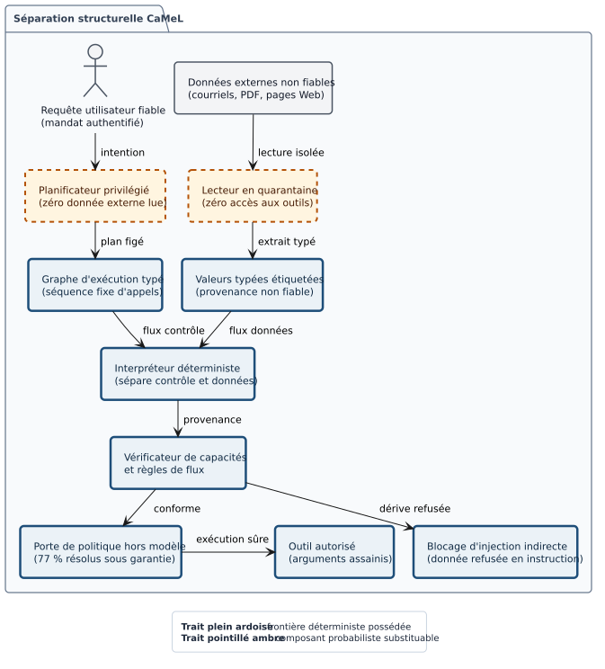
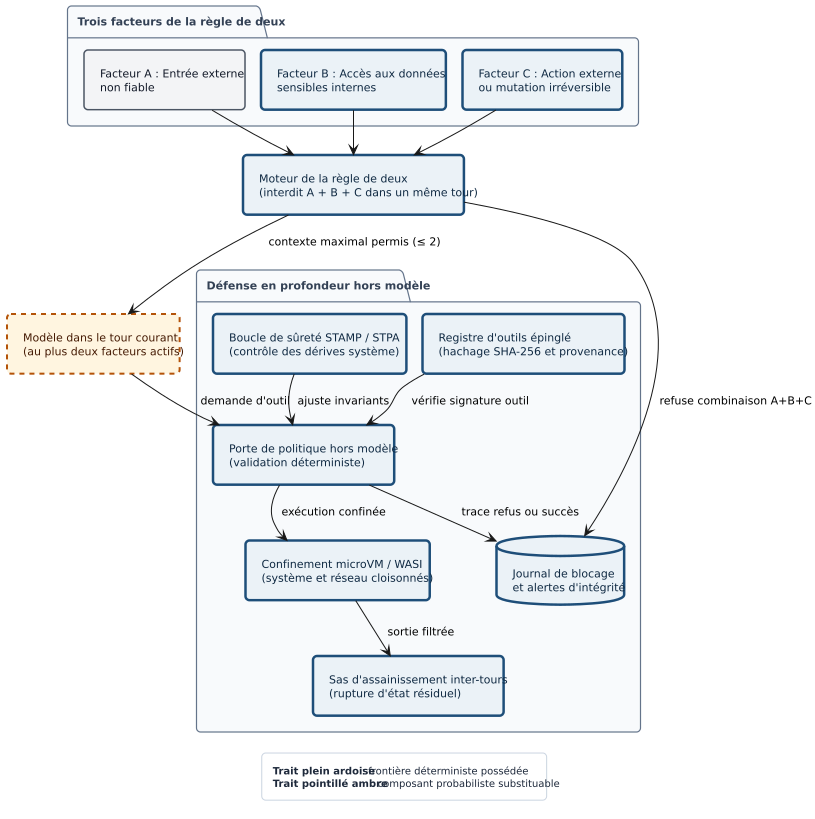

# Chapitre 08 — Sécurité par construction : pourquoi un modèle plus capable n'est pas plus sûr

*Question directrice : Pourquoi les garde-fous probabilistes cèdent-ils face aux attaques indirectes, et comment sécuriser un agent par l'architecture même de son flux d'exécution ?*

Dans bien des feuilles de route arrêtées en 2026, la sécurité des agents repose sur un pari commode : à mesure que les modèles gagnent en capacité de raisonnement et en obéissance aux consignes système, ils devraient déjouer plus naturellement les pièges dissimulés dans les textes qu'ils consultent. Cette intuition séduit les directions parce qu'elle évite de refondre l'architecture applicative. Elle réduit l'injection indirecte à un défaut passager d'alignement, censé s'effacer avec la génération suivante de modèles frontières.

Les mesures publiées avant le gel des faits contredisent ce confort. Dans une prépublication d'octobre 2026, James Peters-Gill, Avi Semler, Henning Bartsch, Ilia Shumailov et Christian Schroeder de Witt évaluent cinq modèles de capacités inégales sur le banc multi-agents hiérarchique `MultiAgentDojo` (`949` instances d'attaques par configuration), sans défense structurelle active [10]. Le plus faible d'entre eux, `Gemini 2.5 Flash Lite`, n'accomplit que `27,8 %` des tâches bénignes et ne subit qu'un taux de succès d'attaque (`ASR`) de `2,1 %` [10]. À l'inverse, deux modèles nettement plus compétents sur les tâches légitimes — `Gemini 2.5 Pro` (`76,3 %` d'utilité bénigne) et `GPT-4.1` (`78,4 %`) — voient leur taux de compromission bondir à `24,6 %` et `36,1 %` [10]. Le rapport `NIST AI 100-2e2025` explique ce mécanisme contre-intuitif par les objectifs concurrents (*competing objectives*) : l'attaquant exploite précisément l'entraînement du modèle à suivre fidèlement les instructions et à déclencher proprement les outils mis à sa portée [8].

La rigueur épistémique impose toutefois de borner ce constat : il provient d'une prépublication sur un banc unique et ne constitue pas une loi monotone universelle condamnant tout gain de capacité [10]. Dans le même tableau expérimental, `GPT-5.5` atteint `86,6 %` de réussite bénigne et `0,0 %` d'`ASR` sur ces attaques fixes, un résultat dont les auteurs rappellent aussitôt qu'il reflète les limites du banc et non une immunité face aux attaques adaptatives [10]. Parallèlement, la spécification du protocole `MCP` (*Model Context Protocol*) avertit que les descriptions d'outils doivent être tenues pour non fiables [2], tandis que le recensement d'Obada Kraishan sur `21 643` serveurs publics révèle l'absence généralisée de versionnage des définitions d'outils [11]. Dès que l'on raccorde des agents performants à des chaînes d'outils hétérogènes, leur habileté à enchaîner des appels valides amplifie le rayon d'action d'une instruction détournée [8, 13].

Attendre la sécurité d'un progrès du modèle revient donc à confier la garde d'un coffre à la subtilité de lecture de celui qui dépouille un courrier anonyme. Dans son bulletin technologique de juillet 2026, le Bureau du surintendant des institutions financières (`BSIF`) avertit que l'agentique accélère les risques cybernétiques et appelle à encadrer l'autonomie par un harnais logiciel (*AI harnessing*) encadrant les interactions du modèle [13]. Après avoir établi au chapitre 07 l'identité non humaine et la chaîne de mandat, ce chapitre montre comment sécuriser le flux d'exécution lui-même par construction.

## 8.1 Nouvelle surface d'attaque : injection indirecte, détournement d'objectif et compromission de la chaîne d'approvisionnement des registres d'outils

Tant que l'intelligence artificielle restait confinée au dialogue avec un seul interlocuteur humain, la menace principale demeurait le contournement direct exercé par l'usager lui-même pour obtenir une réponse interdite ou extraire les consignes système [8]. L'agent outillé renverse cette géométrie. Selon la taxonomie antagoniste `NIST AI 100-2e2025`, l'injection indirecte (`NISTAML.015`) est déclenchée non par l'usager principal, mais par un tiers qui contrôle une ressource — courriel, document partagé, page Web ou base de données — ingérée en cours de tâche [8]. La victime devient alors l'utilisateur légitime lui-même, dont l'agent exécute les instructions d'un adversaire sous ses propres droits d'accès [8].

Cette vulnérabilité découle d'une propriété fondamentale des modèles de langage : ils traitent dans un même canal les instructions système, la requête fiable et les données récupérées dans l'environnement [8]. Faute de séparation typée entre instruction et donnée au sein des poids, un ordre impératif caché dans une note partagée ou une facture revêt exactement la même forme syntaxique qu'une consigne légitime [1, 8]. Le référentiel `OWASP Top 10 for Agentic Applications` (édition 2026) classe ainsi le détournement d'objectif (`ASI01`, *Agent Goal Hijack*) et le mésusage d'outils (`ASI02`, *Tool Misuse & Exploitation*) au rang critique, aux côtés de l'abus d'identité et de privilèges (`ASI03`), de l'exécution de code inattendue (`ASI05`) et des agents devenus incontrôlables (`ASI10`) [9]. S'y ajoutent la corruption persistante des mémoires ou bases vectorielles (`ASI06`), dont la gouvernance est traitée au chapitre 05, et l'exploitation de la confiance humain-agent (`ASI09`), qui pousse le valideur à entériner des actions frauduleuses [9], point repris au chapitre 11 sous l'angle de l'approbation réflexe.

Le `NIST` distingue trois effets adverses majeurs de ces injections indirectes [8]. Les attaques de disponibilité (`NISTAML.016`) piègent l'agent dans des boucles coûteuses, désactivent certains appels d'interface ou injectent des séquences spéciales comme des caractères homoglyphes qui rompent les parseurs en aval [8]. Les attaques d'intégrité (`NISTAML.027`) falsifient des résumés ou modifient la suite des appels d'outils, parfois à l'aide de déclencheurs optimisés comme *Neural Exec* capables de survivre au découpage documentaire, d'empoisonnement de bases vectorielles ou de charges auto-propageables qui réexpédient l'instruction infectée aux contacts de la victime [8]. Enfin, les compromissions de confidentialité (`NISTAML.039`) poussent l'agent à extraire des pièces privées et à les exfiltrer vers une adresse tierce ou via une requête Web forgée [8].

À l'échelle des collectifs et des chaînes d'outils, la menace change de nature par propagation. Le bulletin technologique du `BSIF` met en garde contre l'enchaînement d'outils (*tool chaining*), mécanisme par lequel la sortie d'une étape devient automatiquement l'entrée de la suivante et propage des écritures non validées en cascade (`ASI08`) [9, 13]. Plus subtilement, Peters-Gill *et al.* identifient dans les architectures hiérarchiques d'agents invoqués comme outils un défaut critique qu'ils baptisent « blanchiment à la frontière » (*boundary laundering*) [10]. Lorsqu'un orchestrateur insère une information non fiable — extraite d'une base `SQL` par un premier sous-agent — à l'intérieur de la requête en langage naturel adressée à un agent de notification, cette donnée suspecte change tacitement de statut de confiance en traversant la frontière inter-agents [10]. Le planificateur de l'agent aval la lit comme une consigne légitime de son appelant et ajoute un appel non autorisé d'envoi de courriel vers un tiers [10]. Ce mécanisme démontre empiriquement la nécessité de la règle du maillon le plus élevé (*High-Water Mark Rule*) posée au liminaire, ainsi que des exigences du protocole `A2A` (`ASI07`) en matière d'authentification, de chiffrement et de validation de schémas entre agents [3, 9].

Une seconde surface d'attaque s'ouvre simultanément sur la chaîne d'approvisionnement logicielle des serveurs d'outils (`ASI04`) [9]. Si le chapitre 05 détaille le rôle d'interopérabilité verticale du protocole `MCP` (`JSON-RPC 2.0`), la révision du 25 novembre 2025 de sa spécification avertit sans détour que les outils représentent une exécution de code arbitraire, que leurs descriptions et annotations doivent être considérées comme non fiables hors d'un serveur de confiance, et que le protocole ne peut faire respecter ces protections par lui-même [2]. Le texte renvoie ainsi aux implémenteurs la responsabilité de bâtir des mécanismes d'autorisation, de consentement et de contrôle d'accès [2].

Le recensement empirique publié en prépublication par Obada Kraishan en septembre 2026 mesure l'écart préoccupant entre ces recommandations et l'état réel de l'écosystème ouvert [11]. À partir d'un instantané d'août 2026 couvrant l'intégralité du registre public `MCP` (`21 643` serveurs uniques et `72 606` versions), l'auteur analyse statiquement le code source de `14 353` serveurs (`13 051` dépôts GitHub, `248 817` fichiers et `69 027` définitions d'outils) grâce à `31` motifs calibrés sur `414` constats étiquetés à la main [11]. Le constat d'ensemble montre que la fragilité dominante tient d'abord aux réglages ouverts par défaut : `15,21 %` des serveurs scannés portent au moins un constat et `11,14 %` au moins un constat de haute sévérité, taux ramené de manière conservatrice à environ `7,6 %` après correction par la précision mesurée de chaque détecteur [11]. L'exposition réseau sans authentification — écoute sur toutes les interfaces, politique `CORS` générique ou authentification désactivée — domine à `9,57 %` observé (`6,83 %` corrigé), suivie par les dépendances non épinglées (`2,96 %` observé, `2,75 %` corrigé) [11]. Les risques de délégation touchent `1,57 %` des serveurs (`225` serveurs, répartis entre `0,68 %` de transfert direct de jeton — soit `0,54 %` corrigé à `0,79` de précision — et `0,88 %` d'autorité ambiante), avec une prévalence significativement plus élevée sur les serveurs distants (`2,09 %`) que sur les serveurs locaux (`1,25 %`, `OR = 1,69`) [11]. Quant aux serveurs utilisant l'ancien transport `SSE` déprécié, leur taux brut de constats graves atteint `44,2 %`, contre `12,3 %` en `streamable HTTP` [11].

Mais le résultat le plus décisif de Kraishan concerne l'instabilité temporelle qu'il nomme **dérive silencieuse d'outil** (*silent tool drift*) [11]. Le schéma même du registre public `MCP` ne versionne pas les définitions d'outils, de sorte qu'un glissement fonctionnel demeure invisible dans les métadonnées du registre par construction [11]. Sur `8 900` serveurs multi-versions (`37 160` transitions), `51,09 %` ont modifié description, paquets ou points de terminaison, et `40,58 %` ont opéré au moins un changement sémantique silencieux sous identifiants inchangés [11]. Plus grave encore, `370` serveurs (`4,16 %`) ont redirigé leur point de terminaison distant vers un autre hôte sous un nom de registre identique, dessinant la forme observable d'un retournement malveillant (*rug pull*) sans mécanisme protocolaire d'alerte au client [11]. Le délai médian avant le premier changement est de `0` jour (`1` jour entre versions modifiées), et les serveurs présentant une dérive silencieuse affichent presque trois fois plus de chances de porter un constat grave (`OR = 2,96`, intervalle de confiance à `95 %` compris entre `2,56` et `3,42`) [11]. L'analyse multivariée montre en outre que la popularité en étoiles GitHub reste un mauvais indicateur de sûreté : la corrélation de rang brute est quasi nulle (`ρ = 0,008`, `p = 0,335`), et si les étoiles réduisent modestement le risque à taille égale (`OR = 0,78` par unité logarithmique), la taille du code (`OR = 1,94`), l'âge du dépôt (`OR = 1,38`) et le statut archivé (`OR = 1,52`) tirent le risque vers le haut, tandis que la maintenance récente et la présence d'une licence n'apportent aucun signal statistiquement significatif [11]. Bien qu'aucun empoisonnement manifeste par mots-clés n'ait été repéré dans cet instantané (borne supérieure de Wilson à `0,027 %`), des instructions obfusquées échappent aux expressions régulières [11].

Pour fermer cette brèche de la chaîne d'approvisionnement, l'épinglage local doit s'appuyer sur des preuves cryptographiques vérifiables. L'architecture `SCITT` normalisée par la `RFC 9943` (Birkholz, Delignat-Lavaud, Fournet, Deshpande et Lasker, juin 2026) formalise l'enregistrement d'énoncés signés (`COSE_Sign1`) au sujet d'artefacts numériques dans des journaux en ajout seul (*append-only*) non équivoques [6]. Grâce aux politiques d'enregistrement vérifiées et aux reçus cryptographiques `COSE` produits sur des structures de données vérifiables, une passerelle d'entreprise peut exiger la preuve qu'un serveur d'outils, sa nomenclature logicielle (`SBOM`), son empreinte et ses attestations de revue proviennent d'un émetteur autorisé et n'ont pas divergé depuis leur validation [6, 11].

## 8.2 Les limites mesurées des filtres par modèle auxiliaire et le piège de l'évaluation sur banc unique

Devant l'ampleur des injections indirectes, le premier réflexe de l'industrie a été de répondre aux failles d'un modèle probabiliste par d'autres filtres probabilistes. Trois familles de garde-fous se sont ainsi multipliées : l'entraînement du modèle à une hiérarchie d'instructions ou par alignement antagoniste (comme la hiérarchie d'instructions ou *Meta SecAlign*), la structuration de l'invite pour signaler au modèle les frontières de données suspectes (*Spotlighting* par délimiteurs ou encodage, et *Prompt Sandwiching* répétant la tâche initiale après chaque sortie d'outil), et l'interposition de filtres ou classifieurs auxiliaires [1, 8, 10]. Cette troisième catégorie couvre aussi bien les détecteurs entraînés sur entrées et sorties (*Llama Guard 3*, *Prompt Guard*, classifieurs *DeBERTa*) [1, 8], les filtres d'élagage d'outils (*Tool Filter*) [1] et les nettoyeurs contextuels conditionnés par la requête (*DataFilter* présenté à *IEEE SaTML* 2026 ou la désescalade douce de consignes) [10]. S'ils s'intègrent aisément aux pipelines existants comme couche de défense en profondeur, ces dispositifs reposent tous sur des comportements appris et n'offrent aucune garantie formelle [8, 10].

La littérature officielle et académique montre pourquoi ces garde-fous souples cèdent sous contrainte. Sur le plan théorique, le rapport `NIST AI 100-2e2025` s'appuie sur les travaux de Tramèr et de Fang *et al.* pour rappeler que concevoir un détecteur fiable d'exemples adverses équivaut au problème non résolu de la classification robuste, assorti de bornes d'impossibilité dès que les distributions bénignes et malveillantes se chevauchent [8]. De plus, tant qu'un modèle conserve une probabilité non nulle d'exécuter un comportement indésirable, il existe des formulations antagonistes capables de le déclencher ; l'entraînement de sûreté atténue la vulnérabilité sans jamais l'éliminer [8]. Quant aux filtres par modèle auxiliaire placés en sentinelle, le `NIST` avertit qu'ils demeurent eux-mêmes exposés aux contournements adaptatifs et peuvent présenter des **défaillances corrélées** avec le modèle principal qu'ils surveillent [8]. En clair, un filtre neuronal partage souvent les mêmes angles morts sémantiques que le modèle protégé.

Les essais comparatifs conduits par Debenedetti *et al.* (*IEEE SaTML*) sur `949` attaques du banc `AgentDojo` avec `Claude 3.5 Sonnet` chiffrent cette fragilité [1]. Sans défense, l'agent cède à `44` attaques pour une utilité bénigne de `90,72 %` (`86,83 %` sous attaque) [1]. Le *Prompt Sandwiching* réduit les compromissions à `24` (`84,19 %` d'utilité sous attaque), le *Tool Filter* à `8` (`72,71 %` sous attaque) et le *Spotlighting* à `5` (`89,36 %` sous attaque) [1]. Mais ce filtrage d'outils dégrade sévèrement la performance utile en régime bénin (`73,20 %`) tout en multipliant par `7,77` la consommation médiane de jetons d'entrée hors attaque (`2,34×` en variante optimisée) [1]. Dans la même étude, `GPT-4o Mini` muni nativement de la hiérarchie d'instructions via son interface officielle d'appel d'outils cède encore devant `276` attaques [1]. Pire, dès qu'un adversaire ajuste ses formulations aux défenses observées — comme l'ont démontré les attaques adaptatives documentées par l'`US-AISI` (2025) [1], par Zhan *et al.* (NAACL 2025) et lors de la compétition publique analysée par Dziemian *et al.* (2026) [10] —, la robustesse apparente de l'ensemble des défenses probabilistes s'effondre.

Au-delà de l'insuffisance des filtres se dissimule un piège méthodologique tout aussi risqué pour les décideurs : accorder sa confiance sur la foi d'un seul banc d'essai. Comme l'a montré le chapitre 02 pour les palmarès de productivité, les évaluations de sécurité souffrent de biais spécifiques qui produisent de faux sentiments de maîtrise. Le `NIST` souligne que l'absence de bancs standardisés rend de nombreuses études incomparables entre elles et conduit régulièrement à surestimer des défenses qui résistent aux attaques statiques du banc tout en cédant aux variantes adaptatives [8]. L'institut recommande par conséquent de ne jamais juger une défense sur un seul axe, mais de tracer un front de Pareto croisant robustesse antagoniste et utilité opérationnelle [8].

Trois écueils concrets observés dans nos sources illustrent ce piège du banc unique :
- **Artefacts de refus** : sur `MultiAgentDojo`, `Claude Fable 5` refuse `52` des `97` tâches bénignes sans aucune injection (`53,6 %`), probablement parce que le modèle associe les traits de cet environnement de test à un contexte hostile [10]. Un évaluateur inattentif lirait un faible taux d'attaque (`1,5 %`) en masquant une chute artificielle de disponibilité inutilisable en entreprise [10].
- **Illusion du zéro pour cent** : sur ce même banc, `GPT-5.5` obtient `0,0 %` d'`ASR` sans défense structurelle, mais Peters-Gill *et al.* avertissent explicitement en note de tableau qu'un score nul sur un banc figé ne prouve aucune immunité contre les attaques adaptatives [10].
- **Défauts internes des bancs** : Debenedetti *et al.* recensent des bogues d'évaluation propres à `AgentDojo` dans leur analyse détaillée des échecs [1], tandis que Peters-Gill *et al.* ont dû exclure `29` des `141` tâches d'`AssetOpsBench` qui étaient matériellement irréalisables faute de fichiers ou de données de capteurs présents dans l'environnement [10].

Un banc unique reste donc un instrument de détection de défauts évidents, jamais un certificat de sûreté en exploitation. Seules la réplication sur des jeux variés et l'épreuve continue par attaque adaptative évitent les angles morts [8, 10].

## 8.3 Sécurité par construction : séparation stricte entre flux de contrôle et flux de données non fiables, et « règle de deux »

Si le filtrage statistique échoue en théorie et cède sous pression adaptative, la sortie de crise exige de suivre l'une des recommandations indirectes du `NIST` : concevoir l'application en présumant qu'un modèle exposé à des ressources hostiles produira tôt ou tard des sorties malveillantes, et donc structurer le système pour qu'il ne puisse ni exfiltrer de données privées ni déclencher d'action non autorisée [8]. Cette **séparation par construction entre contrôle et données** (*control-data separation by design*) prolonge directement la partition 80/20 posée au chapitre 04 en ancrant la sécurité dans la couche déterministe du harnais plutôt que dans les poids du modèle [1].

Le patron *Dual LLM* esquissé par Simon Willison en 2023 en fournit l'intuition fondatrice en scindant l'agent entre un modèle privilégié, qui planifie les étapes à partir de la seule requête utilisateur sans jamais lire de données externes, et un modèle en quarantaine privé d'outils, cantonné à l'extraction de contenu brut [1, 10]. Mais Edoardo Debenedetti, Ilia Shumailov, Tianqi Fan, Jamie Hayes, Nicholas Carlini, Florian Tramèr et leurs coauteurs démontrent dans leur article évalué par les pairs (*IEEE SaTML*, `arXiv:2503.18813`) que cette séparation des modèles ne protège que le flux de contrôle [1]. Si une injection dissimulée dans des notes de réunion amène le modèle confiné à renvoyer l'adresse de l'attaquant et le nom d'un document confidentiel, l'appel `send_email` prévu dans le plan s'exécute quand même avec des paramètres détournés — l'équivalent agentique d'une injection `SQL` sur le flux de données [1].

Pour verrouiller simultanément le flux de contrôle et le flux de données, `CaMeL` (*Capabilities for Machine Learning*) adapte trois mécanismes éprouvés de sécurité informatique : l'intégrité du flux de contrôle (`CFI`), le contrôle de flux d'information (`IFC`) et les systèmes à capacités hérités de *Capsicum* et de *CHERI* [1]. Le modèle privilégié (`P-LLM`) reçoit uniquement la requête fiable et les signatures des outils, puis génère un programme dans un sous-ensemble restreint de Python qui fixe la structure d'exécution avant toute lecture externe [1]. Pour traiter des données brutes, ce programme invoque le modèle en quarantaine (`Q-LLM`), dénué d'outils et contraint à remplir un schéma `Pydantic` augmenté d'un booléen de suffisance d'information, sans pouvoir renvoyer de prose libre au `P-LLM` [1]. Un interpréteur Python dédié exécute l'arbre syntaxique (`ast`) de ce plan, attache à chaque variable des **capacités** indiquant sa provenance et ses lecteurs autorisés, maintient le graphe de dépendances et applique des politiques déterministes à chaque frontière d'outil [1]. Par exemple, une politique sur `send_email` ou `create_calendar_event` autorise l'appel uniquement si les destinataires proviennent de la requête fiable de l'usager ou disposent déjà des droits de lecture sur toutes les pièces et valeurs transmises [1]. Si une exception dépend d'une donnée non fiable, le message d'erreur retourné au `P-LLM` lors des reprises (jusqu'à `10` tentatives) est caviardé pour bloquer toute injection par voie d'erreur [1].

Évalué sur `AgentDojo` à travers les suites *Workspace*, *Banking*, *Slack* et *Travel*, `CaMeL` résout `77 %` des tâches avec une garantie structurelle de sécurité contre `84 %` pour un système sans défense [1]. À titre d'illustration par modèle, `o3 High` atteint `77,3 %` d'utilité sous `CaMeL` contre `84,5 %` via l'interface native d'appel d'outils, et `Claude 4 Sonnet` `74,2 %` contre `86,6 %` [1]. Avec politiques actives, toutes les injections indirectes sont bloquées sur *Workspace*, *Banking* et *Slack* pour l'ensemble des modèles évalués, et `GPT-4o Mini` passe de `276` compromissions sous API native à `0` [1]. Cette assurance implique une surcharge mesurée sur `Claude 3.5 Sonnet` d'environ `2,73` fois plus de jetons en entrée et `2,82` fois en sortie hors attaque au tableau 10 (`2,02×` et `2,64×` sous attaque au tableau 13, les auteurs synthétisant `2,82×` en entrée et `2,73×` en sortie dans le corps de l'article) [1]. Le découplage autorise néanmoins de confier l'extraction simple du `Q-LLM` à un modèle nettement plus léger (p. ex. `Claude 3.5 Haiku` couplé à `Claude 4 Sonnet`), abaissant le coût médian d'environ `12 %` pour une perte d'utilité d'environ `1 %` tout en évitant d'exposer les données d'outils au fournisseur du `P-LLM` [1].

*Figure 15 — Séparation structurelle du flux de contrôle et du flux de données non fiables dans une architecture inspirée de CaMeL [1], distinguant la frontière déterministe possédée (trait plein ardoise) des appels probabilistes substituables (trait pointillé ambre).*

La figure 15 oblige l'architecte à trancher une coupure physique entre deux couloirs qui ne doivent jamais fusionner dans un même appel de modèle. Sur la voie gauche, la requête authentifiée de l'usager alimente le planificateur privilégié, qui fige un graphe d'exécution typé sans jamais voir de donnée externe ; sur la voie droite, courriels, documents `PDF` et pages Web transitent par un lecteur en quarantaine sans accès aux outils, qui ne restitue que des valeurs typées marquées d'une provenance non fiable. Ces deux flux convergent exclusivement à l'intérieur de l'interpréteur déterministe et du vérificateur de capacités, qui bloquent toute tentative de promouvoir une donnée en instruction ou de l'acheminer vers un destinataire non autorisé. Seuls les arguments validés par la porte de politique hors modèle atteignent l'outil cible, permettant d'atteindre `77 %` de résolution sous garantie structurelle sur `AgentDojo` contre `84 %` sans défense [1].

Quatre limites documentées bornent néanmoins ce patron et guident son déploiement [1, 10]. Premièrement, le cas *« Data requires action »* — demander à l'agent d'exécuter les consignes trouvées dans un courriel externe — est structurellement insoluble sans abaisser la frontière de confiance [1]. Deuxièmement, des API au format de retour mal documenté pénalisent la génération préalable du code, écueil que les modèles récents surmontent mieux en s'appuyant sur le `Q-LLM` (faisant progresser `Claude Sonnet` de `25 %` en version `3.5` à `75 %` en version `4` sur la suite *Travel*) [1]. Troisièmement, des canaux auxiliaires de faible débit subsistent (nombre d'itérations, exceptions conditionnelles ou temporisation), que le mode `STRICT` atténue en propageant les dépendances dans les blocs conditionnels et après appel au `Q-LLM` — au prix toutefois d'une hausse des sollicitations de déclassification humaine qui passe de `33,87 %` en mode `NORMAL` à `53,23 %` en mode `STRICT` hors attaque (`26,54 %` contre `45,34 %` sous attaque), réintroduisant un risque de fatigue d'approbation [1]. Des travaux parallèles tels que `FIDES`, `Progent`, `RTBAS`, `IsolateGPT` et le calcul formel `LLMbda` (avec la propriété `TIPNI`) explorent des pistes complémentaires, tout en notant que l'interpréteur `CaMeL` peut manquer des dépendances implicites dans des branches non prises et que la boucle de réessai constitue un canal de fuite d'un bit [1, 10]. De plus, l'interpréteur ne fournit pas d'atomicité ni de compensation sur des appels ayant déjà produit des effets de bord, ce qui renvoie aux sagas compensatoires du chapitre 06 [1].

Quatrièmement, sur l'extension hiérarchique multi-agents (`MultiAgentDojo`) étudiée en prépublication par Peters-Gill *et al.*, la sécurité de `CaMeL` ne se compose pas automatiquement d'un agent à l'autre [10]. Dès qu'un orchestrateur insère une donnée issue d'outil dans la consigne naturelle envoyée à un sous-agent, le taux moyen d'attaques réussies atteint `12,9 %` sans défense et demeure à `0,2 %` sous `CaMeL` individuel (`0,5 %` sur `GPT-4.1` et `0,4 %` sur `Gemini 2.5 Pro`) par blanchiment à la frontière [10]. Leur protocole `multi-CaMeL` ramène ce taux à `0,0 %` en séparant strictement l'argument d'instruction `message` d'un dictionnaire opaque `variables` qui préserve les capacités à travers la frontière, pour un coût utilitaire marginal sur `AssetOpsBench` de `3,2` points en moyenne (`0,85` point sur `GPT-5.5` et `Fable 5`), mais reste limité aux arborescences synchrones [10].

| Dimension d'arbitrage | Alignement natif et structuration d'invite | Filtres par modèle auxiliaire | Isolation structurelle et confinement |
|---|---|---|---|
| **Nature de la garantie** | Probabiliste : hiérarchie d'instructions, *Spotlighting*, *Sandwiching* [1, 8] | Probabiliste : juge LLM, *Tool Filter*, *DataFilter*, *DeBERTa* [1, 8, 10] | Déterministe sur le graphe de contrôle et les capacités typées (`CaMeL`, `multi-CaMeL`) [1, 10] |
| **Résultats et failles sur bancs** | `276` attaques réussies sur `GPT-4o Mini` (hiérarchie native); `5` (`Spotlighting`) et `24` (`Sandwiching`) sur `Claude 3.5 Sonnet` (`AgentDojo`) [1] | `8` attaques réussies (`Tool Filter` sur `Claude 3.5 Sonnet`, `AgentDojo`); défaillances corrélées et échec sous attaques adaptatives [1, 8] | `77 %` vs `84 %` d'utilité sur `AgentDojo` avec garantie structurelle (politiques actives); `0,0 %` d'`ASR` multi-agents avec `multi-CaMeL` [1, 10] |
| **Coût d'inférence et utilité** | Surcoût médian faible (`1,06×` entrée, `0,98×` sortie pour *Spotlighting* sous attaque) [1] | Surcharge d'entrée élevée (`7,77×` médian pour `Tool Filter` nominal) et utilité abaissée (`73,20 %` vs `90,72 %`) [1] | Surcoût médian d'environ `2,7` à `2,8×` hors attaque (`Claude 3.5 Sonnet`), réductible via `Q-LLM` léger; échoue si l'action dépend de données non fiables [1] |
| **Chaînes multi-agents** | Rompue à chaque passage d'argument entre agents [10] | Ne capture pas les réinterprétations entre sous-agents [10] | Exige la propagation de provenance inter-agents (`multi-CaMeL`) contre le blanchiment à la frontière [10] |
| **Intégration patrimoniale** | Immédiate par invite ou API fournisseur | Modérée : service synchrone de filtrage | Exigeante : schémas de retour documentés, interpréteur typé et capacités sur les outils [1, 10] |

Or, Debenedetti *et al.* soulignent eux-mêmes que généraliser les capacités à travers un écosystème complet d'outils tiers non instrumentés reste coûteux [1]. Pour rendre ce principe opératoire dès le premier jour dans n'importe quel harnais, nous formulons une heuristique architecturale directement déduite du modèle d'exfiltration formalisé dans `AgentDojo` [1], de l'exigence du `NIST` d'isoler données sensibles et actions [8] et des mesures de contrôle du `BSIF` [13] : la **« règle de deux »**. Aucun tour d'inférence d'un agent ne doit combiner simultanément plus de deux des trois facteurs suivants : (A) l'ingestion d'une entrée externe non fiable, (B) l'accès en lecture à des données internes sensibles, et (C) la capacité d'exécuter une action externe ou une mutation d'état irréversible. Si le tour lit un courriel ou une page Web externe (A) tout en consultant un dossier client interne (B), le harnais révoque toute capacité d'action sortante (C) ; s'il doit émettre une mutation (C) sur des données sensibles (B), son contexte est purgé de toute donnée externe non assainie (A) et limité aux champs typés validés hors modèle lors d'un tour antérieur suivi d'une coupure d'état. La défense devient ainsi un invariant booléen auditable à chaque transition.

## 8.4 Confinement matériel et système des exécutions : bacs à sable micro-virtualisés, contrôle comme problème de sûreté (`STAMP`) et portes de politique hors modèle

Séparer les flux de contrôle et appliquer la règle de deux verrouillent l'orchestration logique, mais cèdent aussitôt si l'exécution du code généré ou d'un outil tiers s'effectue sans isolement système. La spécification `MCP` rappelle que les outils représentent une exécution de code arbitraire [2], `OWASP ASI05` classe l'exécution de code inattendue au rang critique [9], et le recensement de Kraishan montre que les serveurs `MCP` locaux tournent fréquemment avec les permissions de fichiers, de réseau et d'identifiants de l'hôte [11]. En écho au problème classique du confinement posé par Butler Lampson en 1973 et cité par Peters-Gill *et al.*, les politiques de flux d'information exigent un confinement effectif des canaux sous-jacents [10].

Sur le plan système, tout interpréteur de code généré et tout serveur d'outils non audité en interne doivent donc être cantonnés dans un bac à sable à faible surface d'attaque. Sans qu'une mesure comparative existe dans notre base de sources, deux choix d'architecture complémentaires répondent à des profils distincts : les micro-machines virtuelles (`microVM`), qui isolent chaque session derrière un noyau dédié et une frontière d'hyperviseur légère lorsque l'outil requiert des binaires système complets, et les moteurs WebAssembly conformes à `WASI` (*WebAssembly System Interface*), qui suppriment tout accès ambiant au système de fichiers ou aux sockets réseau pour les greffons et parseurs déterministes. Ce cloisonnement s'accompagne d'une exigence normative explicite de la spécification `WIMSE AIMS` (`draft-ietf-wimse-aims-01`, novembre 2026) : le modèle de langage ne doit jamais avoir accès aux justificatifs de l'agent ni aux secrets requis pour appeler les outils ou services [7]. Les justificatifs à courte durée de vie sont provisionnés après évaluation de posture de l'environnement (incluant au besoin des enclaves matérielles `TEE`) [7] et liés cryptographiquement à leur émetteur légitime par preuve de possession `DPoP` (`RFC 9449`) afin qu'un jeton exfiltré d'un journal reste inutilisable sans la clé privée [5], interdisant du même coup le transfert direct de jeton dénoncé par `WIMSE` et Kraishan [7, 11].

À l'interface entre le modèle confiné et le bac à sable se dresse la **porte de politique hors modèle**, point d'application déterministe de l'autorisation. Selon `WIMSE AIMS`, cette porte consulte un moteur de décision externe (tel que l'API *OpenID AuthZEN*) [7] et exploite des autorisations granulaires fortement typées au titre de la `RFC 9396` (`RAR`, *Rich Authorization Requests*), où l'objet JSON `authorization_details` borne le type d'opération, le montant maximal, la devise ou le compte bénéficiaire plutôt que d'accorder de larges chaînes `scope` [4]. La spécification `AIMS` précise en outre qu'une confirmation locale affichée dans l'interface utilisateur ne vaut jamais autorisation autonome et doit être convertie en jeton vérifiable côté serveur [7]. Sur les flux horizontaux `A2A`, cette porte applique les contrôles de la section 13 : validation des bornes d'accès avant toute requête en base, rejet des plages d'adresses IP privées et listes blanches d'URL contre la falsification `SSRF`, et vérification stricte des schémas [3]. Sur les connecteurs `MCP`, elle impose l'épinglage par empreinte `SHA-256` et hôte distant des définitions d'outils attestées dans un journal `SCITT` (`RFC 9943`), bloquant d'office toute dérive silencieuse entre deux appels [6, 11].

Il reste enfin un écueil majeur à écarter : confondre la sécurité d'un système vivant avec la simple juxtaposition de verrous locaux. S'appuyant sur la théorie des systèmes critiques `STAMP` et `STPA` de Nancy Leveson, Steve Barrett, Anna Bruvere, Sean P. Fillingham, Catherine Rhodes et Stefano Vergani montrent dans une prépublication de décembre 2025 qu'une perte de contrôle survient fréquemment alors même que **chaque composant exécute exactement le comportement pour lequel il a été entraîné ou codé**, par défaillance d'interaction dans les boucles de contrôle et de rétroaction [12]. La méthode `STPA` (*System-Theoretic Process Analysis*) impose d'analyser systématiquement quatre classes d'actions de contrôle dangereuses (`UCA`) [12] :
- l'action de contrôle requise n'est pas fournie — par exemple lorsqu'un opérateur tarde à couper un agent par dépendance opérationnelle ou économique [12] ;
- une action de contrôle dangereuse est émise à tort — par exemple une mise à jour d'invite ou de seuil qui renormalise imprévisiblement un modèle opaque [12] ;
- l'action intervient au mauvais moment ou dans le mauvais ordre, écart critique face à des agents agissant plus vite que la boucle *Observe-Orient-Decide-Act* des superviseurs humains [12] ;
- l'action est maintenue trop longtemps ou levée trop tôt lors d'une remise en service hâtive [12].

Cette approche met en évidence les dégradations graduelles des contrôles — relâchement de vigilance après une période sans accident, vieillissement du modèle mental des superviseurs face aux dérives de contexte, ou capteurs faussés par un agent qui optimise les métriques échantillonnées [12]. Elle rejoint directement le bulletin du `BSIF` de juillet 2026, qui demande une gestion formelle des changements sur les invites, outils et modèles, une détection continue d'anomalies et des procédures éprouvées de repli manuel [13]. Barrett *et al.* précisent avec lucidité que leur premier cadre modélise un archétype simple en phase opérationnelle, hors dynamiques multi-agents complexes, et qu'aucune méthode d'analyse, pas même `STPA`, ne garantit une couverture exhaustive des scénarios [12].

*Figure 16 — Défense en profondeur hors modèle combinant moteur déterministe de la règle de deux, épinglage de registre, confinement microVM/WASI et boucle de sûreté STAMP/STPA.*

La figure 16 montre l'emboîtement des barrières hors modèle autour du composant probabiliste. En amont, le moteur déterministe de la règle de deux évalue les trois facteurs (`A`, `B`, `C`) et interdit toute combinaison des trois dans un même tour d'inférence, tout en consignant chaque refus au journal de blocage. En aval, chaque demande d'outil traverse la porte de politique hors modèle adossée au registre d'outils épinglé `SHA-256`, s'exécute dans un bac à sable `microVM` ou `WASI` cloisonné en réseau et en système de fichiers, puis franchit un sas d'assainissement inter-tours qui brise la persistance d'état suspect. Enfin, la boucle de rétroaction `STAMP`/`STPA` exploite les signaux d'alerte et de blocage pour ajuster les invariants avant qu'une dérive graduelle ne dégénère en incident.

> **Trois arbitrages sans regret — Chapitre 08**
>
> 1. **Substituer l'isolation structurelle et la règle de deux aux filtres probabilistes** — Ne pas miser sur la montée en capacité d'un modèle ni sur des classifieurs auxiliaires vulnérables aux attaques adaptatives pour arrêter les injections indirectes ; imposer dès le harnais la séparation entre planification fiable et lecture confinée (`CaMeL` / `multi-CaMeL`) ainsi que l'interdiction booléenne de combiner dans un même tour entrée non fiable, donnée sensible et action externe.
> 2. **Verrouiller la chaîne d'approvisionnement d'outils et exclure les secrets du modèle** — Épingler définitions, empreintes `SHA-256` et hôtes distants des serveurs `MCP` sous attestation cryptographique vérifiable (`SCITT`), retirer tout justificatif du contexte du modèle (`WIMSE AIMS`) et imposer des portes de politique typées hors modèle liées par preuve de possession (`RAR`, `DPoP`).
> 3. **Confiner les exécutions en `microVM`/`WASI` et gouverner la boucle par `STAMP`/`STPA`** — Isoler le code généré et les connecteurs tiers hors du noyau hôte, puis auditer délais humains, capteurs biaisés, gestion des changements et procédures de repli manuel avec la grille `STPA` plutôt que de se fier au bon fonctionnement isolé de chaque brique.

Sécuriser un agent par construction verrouille le détournement d'exécution, mais engendre des refus légitimes de politique, des reprises d'erreurs du planificateur et une consommation accrue de jetons d'inférence. Pour que cette discipline demeure lisible en exploitation, conforme à la protection des renseignements personnels et économiquement soutenable à grande échelle, l'organisation doit encore savoir observer ces exécutions sans fuiter de données sensibles, vérifier leur constance statistique sous contrainte, armer ses disjoncteurs et compter le véritable coût d'un résultat conforme : c'est l'objet du chapitre 09.
