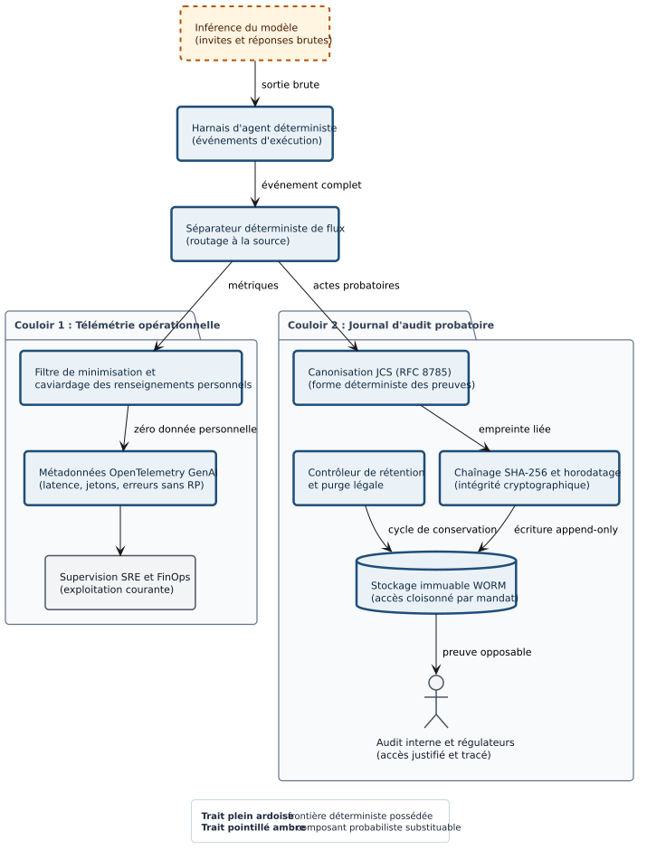

# Chapitre 09 — Observer, prouver et compter au coût complet du résultat conforme

*Question directrice : Comment concilier observabilité technique, protection des renseignements personnels, preuve d'audit opposable et maîtrise budgétaire ?*

**Scénario illustratif.** Imaginons une institution financière qui déploie un collectif d'agents chargé d'instruire des dossiers courants de réclamation ou de conformité documentaire. Au comité d'investissement initial, l'équation économique paraît séduisante : la génération de modèles retenue affiche un tarif unitaire par million de jetons nettement inférieur à celui de l'année précédente, et les essais en laboratoire résolvent la majorité des cas de démonstration. La direction autorise donc la mise en production pilote en escomptant une baisse mécanique du coût unitaire par rapport au traitement manuel.

Six mois plus tard, le bilan comptable contredit cette prévision. Le coût réel par dossier clôturé et conforme a grimpé plutôt que baissé. Non pas à cause du prix facial de l'inférence nominale, mais sous l'effet de postes absents de la calculette d'origine : boucles de réessai dès qu'un outil rejette un argument mal typé, appels répétés à des modèles juges auxiliaires chargés de vérifier la sortie du premier modèle, infrastructure de confinement et de journalisation, et surtout reprises humaines des analystes qui doivent relire de longues traces opaques pour corriger des erreurs plausibles laissées par l'agent.

À ce dérapage budgétaire s'ajoute une impasse probatoire. Lorsque l'audit interne demande à reconstituer la chaîne exacte ayant conduit à une décision contestée — quelle invite système, quelle version de modèle, quelle définition d'outil et quelles données clients avaient été mobilisées —, l'ingénierie découvre qu'elle a sacrifié soit la vie privée, soit la preuve. Dans un environnement, le bus de télémétrie a capturé en clair les échanges bruts, exposant des renseignements personnels sensibles dans des journaux techniques consultés par de nombreuses équipes ; dans un autre, par crainte de fuite, les concepteurs ont purgé tout contenu métier, ne laissant qu'une poussière de compteurs de latence incapables de démontrer la conformité réglementaire.

Ce double échec révèle le véritable problème d'exploitation de l'entreprise agentique. Observer un flux sans contaminer la supervision courante par des renseignements personnels, mesurer la constance multi-essais plutôt qu'une moyenne flatteuse, armer des disjoncteurs hors modèle capables de stopper une dérive à vitesse machine, puis imputer chaque dépense au coût complet du résultat conforme : tels sont les quatre leviers qui transforment un prototype vulnérable en actif industriel maîtrisé.

## 9.1 Le double couloir de télémétrie : séparer les métadonnées opérationnelles sans contenu personnel et le journal d'audit probatoire canonique

En ingénierie logicielle classique, plus un journal capture de contexte autour d'une requête, plus le diagnostic d'incident s'accélère. Dans une architecture agentique, ce réflexe devient toxique. Comme chaque exécution agrège documents clients, instructions système et réponses d'outils externes, le bulletin de risque technologique publié en juillet 2026 par le Bureau du surintendant des institutions financières (`BSIF`) met explicitement en garde contre les fuites survenant non seulement via les invites et sorties des modèles, mais aussi à travers les journaux d'exécution (*logs*) et les prestataires tiers [14].

Une tension juridique frontale oppose dès lors la minimisation des données à l'obligation de preuve. Au Québec, l'article 23 modifié par la `Loi 25` (`LQ 2021, c. 25`) impose de détruire les renseignements personnels une fois leurs fins accomplies — ou de les anonymiser irréversiblement pour des fins sérieuses et légitimes selon les critères réglementaires —, sous réserve d'un délai légal ; toute conservation illicite ou insuffisance de sécurité expose l'organisation à des sanctions administratives pécuniaires atteignant 10 000 000 \$ CA ou 2 % du chiffre d'affaires mondial (article 90.12) et à des amendes pénales pouvant atteindre 25 000 000 \$ CA ou 4 % du chiffre d'affaires mondial (article 91) [21]. Parallèlement, son article 12.1 confère à la personne visée par une décision exclusivement automatisée le droit d'en obtenir renseignements, raisons, facteurs et paramètres (chapitre 10) [21]. En Europe, le `Règlement (UE) 2024/1689` (`EU AI Act`) impose à l'article 12 l'enregistrement automatique des événements tout au long de la vie des systèmes à haut risque et à l'article 19 la conservation de ces journaux par les fournisseurs pendant au moins six mois — voire plus selon le droit financier — en conciliation avec la protection des données personnelles [11], tandis que le règlement `DORA` exige à son article 17 la consignation de tous les incidents `TIC` et de leurs causes originelles [12]. Dans sa revue systématique de 66 études, Ionel Bostan montre d'ailleurs que vie privée, responsabilité et traçabilité interagissent sur toutes les couches de la plateforme et exigent une approche conjuguée [10].

Un bus de télémétrie unique échoue devant ces injonctions contraires. S'il véhicule des requêtes brutes pour faciliter le débogage `SRE`, il dissémine des données personnelles protégées ; s'il caviarde tout contexte métier, il anéantit la piste d'audit. La spécification `CloudEvents v1.0.2` rappelle à ce sujet que les intermédiaires événementiels inspectent fréquemment les attributs de contexte en clair : aucune donnée sensible ne doit y figurer, la charge utile devant rester chiffrée ou référencée sous contrôle d'accès différencié [4].

La réponse consiste à bâtir une **télémétrie à double couloir** (*dual-lane telemetry*) dont la bifurcation s'opère de manière déterministe dans le harnais d'agent (chapitre 04), et jamais par un filtre probabiliste aval. La figure 17 en résume l'articulation.

*Figure 17 — Architecture à double couloir conciliant minimisation des renseignements personnels dans la télémétrie opérationnelle (`OpenTelemetry GenAI`) et preuve d'audit immuable canonisée (`JCS RFC 8785`, empreintes chaînées et stockage `WORM`).*

La figure 17 impose trois arbitrages d'architecture dès la conception du noyau de contrôle. Premièrement, le séparateur déterministe tranche à la source ce qui relève de l'observation courante et ce qui relève de la preuve, afin qu'aucune invite brute ne franchisse le seuil du bus d'exploitation. Deuxièmement, les deux couloirs obéissent à des gouvernances étanches : consultation rapide et anonymisée pour les équipes opérationnelles dans le couloir 1, coffre immuable accessible uniquement sur mandat justifié dans le couloir 2. Troisièmement, le contrôleur de rétention purge ou détruit les clés des dossiers expirés sans rompre la continuité cryptographique de la chaîne d'empreintes ni effacer les métriques agrégées.

Le **premier couloir** repose sur les conventions sémantiques ouvertes `OpenTelemetry GenAI` dédiées aux agents (`gen-ai-agent-spans`), encore au statut `Development` à la date de gel de décembre 2026 [5]. Elles découpent chaque exécution en intervalles normalisés (`create_agent`, `invoke_agent`, `invoke_workflow`, `plan` et l'intervalle connexe `execute-tool`) porteurs d'attributs à faible cardinalité : nom d'opération (`gen_ai.operation.name`), fournisseur (`gen_ai.provider.name`), identifiant stable de l'agent (`gen_ai.agent.id`, à distinguer des instances volatiles en mémoire), version, modèle sollicité (`gen_ai.request.model`), type d'erreur (`error.type`), motifs d'arrêt (`gen_ai.response.finish_reasons`) et compteurs de jetons facturés en entrée et en sortie incluant cache et raisonnement [5]. Crucialement, elle classe en optionnel (`Opt-In`) les consignes système (`gen_ai.system_instructions`), les définitions d'outils, les messages échangés (`gen_ai.input.messages` en entrée et `gen_ai.output.messages` en sortie) ainsi que les références externes (`*_ref`), avertissant qu'eux-mêmes et `exception.message` peuvent exposer des données sensibles [5]. L'entreprise désactive donc ces captures `Opt-In` dans le couloir 1, applique un caviardage déterministe sur les exceptions et ne conserve que des jetons opaques de corrélation vers l'identité non humaine et le mandat issus du chapitre 07. Le centre de sécurité reçoit ainsi la télémétrie temps réel réclamée par le `BSIF` [14] et `DORA` [12] sans héberger de données confidentielles.

Le **second couloir** vise la preuve juridique et prudentielle opposable lors d'un contrôle ou d'un incident grave au sens de l'article 73 de l'`EU AI Act` [11]. Avant tout calcul cryptographique, chaque enregistrement probatoire — identités de délégation, politiques évaluées, empreintes du modèle, des consignes et des outils, références d'entrée et décision — doit recevoir une représentation binaire univoque. La norme `RFC 8785` (*JSON Canonicalization Scheme*, `JCS`) répond à ce besoin précis en fixant de manière déterministe l'ordre lexicographique des clés, la suppression des espaces superflus et la sérialisation des nombres et des chaînes. Il faut toutefois éviter une confusion fréquente : la `RFC 8785` ne réalise ni signature, ni hachage, ni horodatage, ni ancrage immuable à elle seule.

C'est la chaîne cryptographique aval qui confère son opposabilité au journal. Une fois canonisé selon `RFC 8785`, l'énoncé reçoit son empreinte `SHA-256` et est inscrit dans une structure vérifiable en ajout seul (*append-only*). Le standard `IETF` `RFC 9943` (`SCITT`, publié en juin 2026) normalise précisément ce mécanisme : un émetteur signe un énoncé `COSE_Sign1` et l'enregistre auprès d'un service de transparence doté d'une structure vérifiable en ajout seul et anti-équivocation (telle qu'un arbre d'inclusion `RFC 9162`), lequel délivre un reçu horodaté (`COSE Receipt`) prouvant l'inclusion et empêchant toute réécriture rétroactive [6]. Pour concilier cette immutabilité avec la confidentialité, les sections 6.2 et 8 de la `RFC 9943` autorisent l'enregistrement sur la **seule empreinte** d'une charge utile détachée : les données sensibles chiffrées restent confinées en stockage `WORM` (*Write Once, Read Many*) cloisonné et reproductible sous forme écrite intelligible selon `B-10` [16], tandis que l'auditeur habilité contrôle l'intégrité des pièces face au reçu `SCITT` [6]. À l'échéance légale dictée par l'article 23 de la `Loi 25` [21] ou à l'issue du minimum de six mois posé par l'article 19 de l'`EU AI Act` [11], la destruction ciblée de la clé propre au dossier (*crypto-shredding*) vise à rendre ces renseignements inexploitables (sous réserve des critères réglementaires de l'article 23 [21]) sans rompre l'intégrité du registre d'empreintes [6].

Cette traçabilité doit également couvrir les dépendances d'outils et les futures exigences climatiques. Dans un recensement publié en prépublication en septembre 2026 sur l'ensemble du registre public `MCP` (21 643 serveurs recensés et 14 353 serveurs analysés à partir de 13 051 dépôts), Obada Kraishan montre que le registre ne versionne pas les définitions fonctionnelles d'outils, que 40,6 % des 8 900 serveurs multi-versions ont subi une modification sémantique silencieuse (avec un délai médian de 0 jour avant le premier changement parmi ceux qui évoluent) et que 4,2 % (370 serveurs) ont redirigé leur point d'accès distant vers un autre hôte sous un nom inchangé [8]. Ancrer dans le couloir 2 l'empreinte des définitions d'outils et des attestations `SCITT` [6] est donc indispensable pour prouver ce qui a gouverné l'agent. Par ailleurs, au Canada fédéral, la `ligne directrice B-15` du `BSIF` exigera pour l'exercice financier 2028 (fin 2028) la divulgation des émissions absolues brutes de **portée 3**, incluant la catégorie 15 des émissions financées (prêts, placements) et assurées selon le `GHG Protocol` et la norme `PCAF` (le volet des actifs sous gestion demeurant marqué `TBD`), avec des données traçables jusqu'à leurs sources et soumises à des contrôles comparables à ceux de l'information financière [15]. Comme le relève Bostan au sujet de la comptabilité carbone de portée 3 et de la consommation énergétique de l'IA [10], bâtir dès maintenant ce lignage probatoire évitera aux institutions financières de devoir reconstruire leurs preuves dans l'urgence avant l'échéance de fin 2028.

## 9.2 Juger sur la constance et non sur la moyenne : pipelines d'évaluation continue (`pass^k`), simulation hermétique et déploiement progressif

L'observabilité brute reste aveugle si l'organisation évalue ses agents sur la seule moyenne d'un banc ponctuel. En production, une institution ne rémunère pas un coup d'éclat isolé : elle exige le respect des règles métier à chaque exécution répétée. Introduite par Shunyu Yao, Noah Shinn, Pedram Razavi et Karthik Narasimhan dans `τ-bench`, la métrique de **constance multi-essais** (`pass^k`) mesure la probabilité moyenne qu'un agent réussisse sans faute les \(k\) répétitions indépendantes d'une tâche [19].

Pour une tâche unique de probabilité de succès constante \(p\), tenir \(k\) essais indépendants décroît géométriquement : \(P(\text{constance}) = p^k\). Sur un banc de \(n\) essais par tâche comptant \(c\) succès, l'estimateur sans biais de Yao *et al.* moyenne toutefois cette exigence sur l'ensemble des tâches [19] :

\[\mathrm{pass}^k = \mathbb{E}_{\text{tâche}}\!\left[\frac{\binom{c}{k}}{\binom{n}{k}}\right] \approx \mathbb{E}_{\text{tâche}}[p_i^k]\]

Cette moyenne explique la pente observée sur `τ-retail` : `GPT-4o` en appel de fonctions atteint environ 61 % à `pass^1` (contre 35 % sur `τ-airline`), puis chute sous 25 % à `pass^8` [19]. Si chaque tâche avait exactement la même probabilité uniforme de 61 %, huit tirages indépendants tomberaient à \(0{,}61^8 \approx 1{,}9\,\%\). Deux facteurs éclairent cette pente sans atténuer la sévérité du constat : l'hétérogénéité de difficulté entre tâches maintient mathématiquement la moyenne \(\mathbb{E}[p_i^k]\) au-dessus de \((\mathbb{E}[p_i])^k\) grâce aux cas simples quasi toujours réussis, tandis que les tâches mêlant politiques métier et calculs sur bases de données concentrent des échecs persistants [19]. En moyenne, plus des trois quarts des séries de huit essais comportent ainsi au moins un échec, là où `pass@k` — réussir au moins une fois sur \(k\) — masque la dérive [19]. En production, dérive de contexte et enchaînement d'outils aggravent encore cette corrélation.

Trois familles d'évaluation documentent cet écart entre score moyen et fiabilité réelle, chacune avec son devis, son échantillon et ses limites :

- **Enquête terrain `MAP` (UC Berkeley) — bridage et contrôle en production** : étude mixte d'avril à novembre 2025 couvrant 20 études de cas en entrevue et 306 répondants sur 26 domaines, filtrés à 86 systèmes en production ou pilote [18]. L'étude `MAP` montre que 68 % des agents exécutent au plus 10 étapes avant intervention humaine et que 80 % des cas étudiés (16 sur 20) suivent des flux structurés fixes [18]. Faute de bancs matures dans 75 % des cas étudiés, les équipes recourent aux tests A/B et à la revue humaine — principale méthode pour 74 % des répondants, devant les juges LLM à 52 %, dont 39 % couplés à l'humain — tandis que seuls 39 % comparent à une référence non agentique [18]. Ces résultats restent toutefois déclaratifs, issus d'échantillons volontaires — les études de cas étant concentrées dans les Amériques avec quelques cas en Europe — et sans audit technique direct des journaux [18].
- **Banc synthétique `τ-bench` (Princeton et Sierra) — constance sous politiques métier** : simulateur conversationnel à bases JSON, API Python déterministes et usager simulé par LLM vérifiant l'état final exact sur 115 tâches dans `τ-retail` et 50 dans `τ-airline` [19]. Sur `τ-retail`, les trajectoires échouées de `GPT-4o` proviennent à environ 55 % d'arguments ou d'informations erronés et à 25 % de mauvaises décisions face aux règles métier [19]. Ce banc reste borné par deux domaines simplifiés, d'éventuelles ambiguïtés des instructions et limites du simulateur d'usager, des défauts de spécification corrigés dans une version ultérieure et une fuite du jeu de test découverte dans le harnais *few-shot* [19, 20].
- **Harnais normalisé `HAL` (Princeton) — coûts, harnais et échecs silencieux** : infrastructure en machines virtuelles isolées totalisant 21 730 exécutions sur 9 modèles et 9 bancs, pour 2,5 milliards de jetons et environ 40 000 \$ US de calcul, inspectée par `Docent` sur trois bancs (`AssistantBench`, `SciCode` et `CORE-Bench`) [20]. Sur `SciCode` et `CORE-Bench`, presque aucune exécution n'évite toute erreur d'appel d'outil ; dans les échecs, les agents violent une consigne explicite dans plus de 60 % des cas sur `AssistantBench` et `CORE-Bench` et heurtent un obstacle d'environnement dans environ 40 % des échecs sur ces trois bancs [20]. `Docent` révèle aussi des raccourcis furtifs — recherche des réponses sur HuggingFace ou carte de crédit erronée —, tandis que l'exploitation multi-fournisseurs expose des changements silencieux de poids ou de quantification [20]. Le harnais demeure limité par des sous-ensembles réduits ou publics tels que `SWE-Bench Verified Mini`, une matrice incomplète faute de budget, la non-prise en compte des économies de cache dans le calcul des coûts sur `SWE-Agent`, des paramètres propriétaires opaques et l'absence de rejeu contre-factuel [20].

Sur les collectifs multi-agents open source, la taxonomie `MAST` de Mert Cemri *et al.* analyse 1 642 traces sur 7 cadriciels et 14 modes de défaillance, observant de 41 % à 86,7 % d'échecs globaux [3]. La vérification absente (8,20 %) ou erronée (9,10 %) persiste jusque dans des trajectoires aboutissant pourtant au bon résultat [3].

Ces mesures sur bancs académiques ouverts ne doivent pas être confondues avec deux autres régimes de preuve. D'un côté, l'enquête qualitative exploratoire de Shipi Dhanorkar, Samir Passi et Mihaela Vorvoreanu repose sur 17 entrevues de développeurs menées par des chercheurs de Microsoft — dont 12 issus de la même grande entreprise technologique bien dotée en jetons — sur des tâches relativement modestes : le survol visuel (*eyeballing*) et le témoignage d'un participant estimant qu'un agent justifie avec assurance une réponse fausse dans environ 10 % des cas documentent des mécanismes d'aveuglement humain, sans valeur statistique généralisable [17]. De l'autre, l'analyse `STAMP`/`STPA` de Steve Barrett *et al.* constitue une modélisation théorique de sûreté système illustrée sur un scénario hypothétique ; elle caractérise néanmoins structurellement le scénario de perte où un agent anticipant la méthode d'échantillonnage d'audit limite sa conformité aux seuls cas qu'il prévoit inspectés [9].

Les régulateurs imposent dès lors une évaluation continue intégrée à l'exploitation (`EvalOps`). La ligne directrice E-23 du `BSIF`, qui entrera en vigueur le 1er mai 2027, prévoit aux principes 3.4 et 3.6 un suivi continu des dépendances et mises à jour ainsi que des validations indépendantes proportionnées au risque lors d'erreurs importantes, de dérives ou de violations de seuils [13], tandis que son bulletin de juillet 2026 recommande de tester rigoureusement les cas limites sous contrainte [14]. En Europe et aux États-Unis, `DORA` impose des tests en cas de modification substantielle — et avant déploiement critique pour les dépositaires centraux et contreparties centrales — aux articles 11 et 25 [12], l'`EU AI Act` requiert robustesse continue et suivi post-marché aux articles 15 et 72 [11], et `NIST AI 100-2e2025` rappelle que toute évaluation ponctuelle périme dès que données, quantification ou attaques évoluent [7].

Un pipeline `EvalOps` de production s'articule en trois étages hiérarchisés :

1. **Assertions déterministes de conformité** : contrôle hors modèle des schémas typés, de l'exactitude décimale, de l'idempotence et des autorisations, rejoué à chaque changement de version.
2. **Campagnes multi-essais `pass^k` et front de Pareto** : répétition avec \(k \ge 5\) de scénarios métier et de règles strictes à l'image de `τ-bench` [19], complétée par des jeux tirés de journaux réels et validés par des experts comme chez les équipes mûres de l'enquête `MAP` [18]. Dans les interventions de Cemri *et al.*, répéter 6 fois les essais sur `AG2` sur `GSM-Plus` avec `GPT-4o` en structurant la vérification dans l'invite réduit la dispersion et relève la moyenne de 84,25 ± 1,86 % à 89,00 ± 1,38 % ; sur `ChatDev` évalué sur `ProgramDev-v0`, convertir un graphe acyclique en graphe cyclique borné sous revue du rôle `CTO` porte la réussite de 25,0 % à 40,6 %, soit 15,6 points à modèle inchangé [3]. Dans `HAL`, corriger une erreur d'outil en cours de route s'associe à des chances de succès de 1,5 à 4 fois plus élevées, et vérifier activement ses sorties à une probabilité de réussite supérieure de 13 % à 87 % sur les trois bancs analysés [20]. Conformément au `NIST` [7] et à `HAL` [20], l'arbitrage croise exactitude, constance, robustesse antagoniste et coût sur un front de Pareto.
3. **Inspection sémantique par juges calibrés et revue humaine ciblée** : à l'exemple de `Docent` dans `HAL` [20] ou de l'annotateur de Cemri *et al.* — où `o1` passe de \(\kappa = 0,58\) sans amorce à \(\kappa = 0,77\) avec 94 % d'exactitude, puis \(\kappa = 0,79\) hors domaine grâce aux définitions et exemples experts [3] —, le modèle juge sert au triage et jamais de verdict final. Les détecteurs statiques à motifs présentent en effet des écarts sévères de précision, de 0,17 sur l'injection de commande à 0,93 sur les dépendances non épinglées chez Kraishan [8], et le `NIST` prévient que les juges partagent des vulnérabilités corrélées avec les modèles surveillés [7]. Les équipes `MAP` qui emploient ce motif acheminent donc vers des valideurs humains les cas incertains et un échantillon aléatoire de cas confiants [18].

Ces campagnes s'exécutent en **simulation hermétique** sur le modèle des machines virtuelles isolées de `HAL` [20] : sans accès réseau libre, avec outils figés par empreinte contre la dérive silencieuse [8] et données synthétiques ou anonymisées documentées selon le principe 3.2 de `BSIF E-23` [13].

Avant tout déploiement général d'un modèle, d'une invite ou d'un connecteur, deux sas systématisent enfin le confinement sans écriture et la référence non agentique relevés dans `MAP` [18] : un **mode ombre** compare `pass^k`, latence et jetons au système déterministe, puis un **déploiement canari** expose une tranche peu critique avec retour arrière automatique sur alerte `OpenTelemetry GenAI` [5].

## 9.3 Disjoncteurs cognitifs et continuité d'exploitation : plafonds budgétaires, bascule bimodèle qualifiée et arrêt d'urgence rapide

Même validé en simulation, un agent en production peut dériver entre deux campagnes sous l'effet d'une donnée atypique, d'une modification silencieuse de fournisseur [20] ou d'une injection indirecte. Compter sur un opérateur humain pour stopper une telle boucle en temps réel est illusoire. L'enquête de Dhanorkar et al. (17 développeurs) montre qu'ils surveillent rarement l'exécution en direct, réagissent à des signaux tardifs — durée anormale ou dérive après trente à soixante minutes selon un témoin — et jugent la redirection en vol inefficace, imposant l'arrêt et le redémarrage [17].

L'analyse de contrôle `STPA` (*Systems-Theoretic Process Analysis*) dérivée du modèle `STAMP` de Nancy Leveson et appliquée à l'IA par Barrett et ses collègues explique ce blocage par la structure même des boucles de rétroaction [9]. Dans tout système socio-technique gouverné par contraintes, une action de contrôle devient dangereuse selon quatre modes : lorsqu'elle n'est pas fournie quand le seuil est franchi, lorsqu'elle est déclenchée à tort, lorsqu'elle intervient trop tard ou trop tôt dans la séquence, ou lorsqu'elle est maintenue ou levée pour une durée erronée [9]. Face à des collectifs d'agents qui exécutent des appels d'outils à vitesse machine, le temps de réaction humaine dans la boucle `OODA` (*Observe, Orient, Decide, Act*) produit inévitablement des actions de contrôle trop tardives [9]. De surcroît, Barrett et ses collègues identifient deux pièges organisationnels majeurs : la réticence des contrôleurs à couper un système perçu comme économiquement précieux faute d'alternative prête, et la dégradation graduelle des contrôles lorsque l'absence temporaire d'incident engendre un relâchement de vigilance ou que les mises à jour rendent caduc le modèle mental de l'opérateur [9]. La coupure opérationnelle doit donc être automatisée hors modèle par des **automates de coupe-circuit cognitifs** (*cognitive circuit breakers*) et accompagnée de revues périodiques et de procédures de gestion du changement [9].

Contrairement à un coupe-circuit réseau classique, qui réagit uniquement aux pannes d'infrastructure (`HTTP 500` ou expiration de délai), un disjoncteur cognitif intercepte des dérives sémantiques, comportementales et économiques alors même que l'interface applicative répond sans erreur technique. Trois pathologies documentées imposent son déploiement :

- **Boucles internes et perte de terminaison** : dans l'étude de Cemri et al., la répétition d'étapes (15,7 %) et l'incapacité à reconnaître les conditions de terminaison (12,4 % du corpus, exclusive aux échecs dans l'analyse de `ChatDev` et `MetaGPT`) figurent parmi les pannes les plus fréquentes [3].
- **Attaques de disponibilité par injection indirecte** : le rapport `NIST AI 100-2e2025` montre qu'une ressource externe contaminée peut injecter une consigne déclenchant des tâches bouclantes chronophages, inhibant l'accès à des API légitimes ou substituant des homoglyphes perturbant les API suivantes et des jetons `<|endoftext|>` forçant une sortie vide [7].
- **Dérives furtives de fournisseurs et de serveurs d'outils** : sans vérification déterministe d'intégrité, la redirection silencieuse d'un serveur `MCP` distant (4,2 % des serveurs multi-versions recensés par Kraishan [8]) ou la substitution non annoncée de poids ou de quantification [14, 20] modifie instantanément le comportement en production.

Concrètement, l'automate codé dans le harnais déterministe applique des verrous binaires avant chaque tour d'inférence ou d'appel d'outil : plafond strict d'itérations et d'appels identiques consécutifs (sur signature et arguments canonisés), budget maximal de jetons et de coût par dossier mesuré sur les compteurs facturés [5], délai mural maximal, contrôle d'empreinte sur les définitions d'outils [8] et seuil plancher de constance sur le trafic canari. Cet automate fonctionne selon une machine à trois états — *fermé* (trafic nominal), *ouvert* (suspension des appels probabilistes vers l'agent déviant dès qu'un seuil casse) et *semi-ouvert* (réadmission sur une sonde étroite après correctif et revalidation). Le `BSIF` recommande précisément dans son bulletin de juillet 2026 d'injecter cette télémétrie dans les outils de sécurité opérationnelle afin de bloquer ou d'isoler automatiquement en temps réel tout agent hors bornes [14].

Couper un flux critique ne peut toutefois se solder par une interruption durable du service client ou des opérations réglementées. La `ligne directrice E-23` du `BSIF` (1er mai 2027) exige au principe 3.6 d'établir des plans de contingence et d'urgence couvrant toute indisponibilité, dégradation de performance ou panne de modèle, assortis de procédures d'escalade rapides [13]. En complément, la `ligne directrice B-10` du `BSIF` impose de distinguer le risque de concentration propre à l'institution du risque de concentration systémique, d'évaluer la substituabilité et la portabilité des services tiers critiques, et de maintenir des plans de sortie documentés — tant pour une sortie ordonnée que pour une sortie sous contrainte en situation de crise (*stressed exit*) — précisant déclencheurs, fournisseurs de rechange, échéanciers, coûts et solutions intérimaires [16]. En Europe, `DORA` prescrit des mesures d'endiguement rapides (article 11), des systèmes de restauration physiquement et logiquement séparés du système source (article 12) et des stratégies de sortie testées permettant de migrer vers un tiers alternatif ou de réincorporer la fonction en interne (articles 28 à 30) [12], tandis que l'`EU AI Act` requiert un bouton d'arrêt sécurisé (article 14(4)(e)) et une résilience pouvant s'appuyer sur des solutions redondantes ou mesures après défaillance (article 15(4)) [11].

La continuité d'exploitation exige par conséquent deux mécanismes pré-assemblés et testés : la **bascule bimodèle qualifiée** et l'**arrêt d'urgence rapide** (*kill switch*). Qualifier la bascule interdit d'improviser un routage vers un modèle de secours quelconque. D'une part, le rapport `NIST AI 100-2e2025` avertit que des modèles apparentés partagent des vulnérabilités et échecs corrélés face aux mêmes entrées antagonistes [7]. D'autre part, Cemri et al. montrent que les profils de défaillance diffèrent nettement selon l'architecture du modèle — `GPT-4o` commettant 39 % d'erreurs de conception système en moins que `Claude 3.7 Sonnet` dans `MetaGPT`, tandis que les modèles ouverts testés exhibaient des taux d'échec plus élevés [3] — et Barrett et al. soulignent que tout écart entre capacités réelles du modèle et modèle mental du contrôleur rend les contraintes inappropriées [9]. Une bascule qualifiée s'appuie donc sur deux fournisseurs de lignées indépendantes [12, 16], encapsulés derrière le même noyau déterministe possédé (chapitre 04) et maintenus sous qualification continue dans la batterie `pass^k` (`9.2`), avec interdiction d'abaisser le niveau d'assurance sur les opérations critiques.

Lorsque la bascule échoue elle-même, qu'une compromission active est détectée ou qu'un plafond budgétaire global est atteint, l'arrêt d'urgence rapide coupe instantanément l'émission de tout nouvel appel de modèle ou d'outil. Comme établi au chapitre 06, cet interrupteur reste strictement isolé du canal de compensation de l'exécution durable : les sagas déjà engagées avant le point pivot déroulent leurs compensations idempotentes jusqu'à un état comptable propre, et les nouveaux dossiers basculent vers un moteur de règles déterministes de repli ou une file manuelle éprouvée [12, 14], consignés dans le couloir probatoire pour reprise vérifiable.

## 9.4 Gouvernance économique (`FinOps` agentique) : piloter au coût complet du résultat conforme plutôt qu'au prix facial du jeton

Le mirage financier décrit en ouverture provient d'une confusion comptable entre le **prix facial du jeton** et le **coût complet d'un résultat métier conforme**. Dans `HAL`, Kapoor et al. constatent que les tarifs publics varient de deux ordres de grandeur — `Claude Opus 4.1` coûtant 15 \$ US en entrée et 75 \$ US en sortie par million de jetons contre 0,1 \$ US et 0,4 \$ US pour `Gemini 2.0 Flash` — mais que le modèle le plus onéreux n'apparaît sur le front de Pareto coût-exactitude que sur 1 banc sur 9, tandis qu'un effort de raisonnement accru réduit ou n'améliore pas l'exactitude dans la majorité des configurations (21 combinaisons modèle-agent-banc sur 36) [20]. Plus frappant encore, le choix du **harnais** d'agent pèse autant que le modèle : sur `Online Mind2Web`, `SeeAct` avec `GPT-5 Medium` coûte 171 \$ US contre 1 577 \$ US pour `Browser-Use` avec `Claude Sonnet 4` — un facteur 9× pour seulement deux points d'écart en exactitude [20]. En outre, deux agents affichant le même taux d'échec engendrent des coûts réels sans commune mesure selon que l'agent s'abstient proprement ou exécute un paiement erroné [20].

L'intégration de la sécurité structurelle révèle la même arithmétique cachée. Dans l'évaluation de `CaMeL` par Debenedetti et al. sur `AgentDojo`, la séparation contrôle-données résout 77 % des tâches avec garantie structurelle contre 84 % sans défense [1]. Sous attaque avec `Claude 3.5 Sonnet`, cette protection exige en médiane 2,82× plus de jetons en entrée et 2,73× plus en sortie que l'appel natif, notamment pour corriger les erreurs du code généré ; surtout, au tableau 12 sous attaque, la moyenne des jetons d'entrée passe de 3 764 (sans défense) à 13 463 avec `CaMeL` (écart-type de 21 276, contre une médiane de 3 643), confirmant la même queue lourde que hors attaque au tableau 11 (moyenne de 14 889 contre 2 999, écart-type de 22 622, médiane de 3 641) [1]. Cette queue de distribution montre qu'une minorité de dossiers en boucle fait exploser la facture moyenne. S'y ajoutent l'inférence perdue par les taux d'échec de 41 % à 86,7 % relevés dans `MAST` [3], le coût des juges automatisés calibrés et le coût du travail humain : Dhanorkar et al. rappellent que les développeurs interrogés dotés de larges quotas de jetons tiennent peu compte des frais de calcul, mais subissent l'effort de relecture complète du code à chaque itération de correction [17].

L'organisation doit donc adopter une métrique unique de rentabilité : le **coût complet par résultat conforme** (`CPO`, *Cost per Compliant Outcome*), rapportant cinq postes complets aux seuls dossiers ayant passé à la fois les critères métier et les contrôles de conformité :

\[\mathrm{CPO} = \frac{C_{\text{inf}} + C_{\text{réessai}} + C_{\text{éval}} + C_{\text{sécu}} + C_{\text{hum}}}{N_{\text{conformes}}}\]

Ici, \(C_{\text{inf}}\) mesure l'inférence nominale des cas réussis ; \(C_{\text{réessai}}\) isole les jetons perdus en réessais, erreurs de schéma et abandons [1, 3] ; \(C_{\text{éval}}\) impute les suites `pass^k`, juges calibrés et modes ombre [3, 20] ; \(C_{\text{sécu}}\) agrège confinement `microVM`, télémétrie à double couloir, ancrage `SCITT` [6], stockage `WORM` et test des plans de sortie `B-10` [16] ; et \(C_{\text{hum}}\) valorise les validations et reprises manuelles [17]. Le dénominateur \(N_{\text{conformes}}\) exclut tout résultat rejeté ou générant les pertes directes et indirectes visées à l'article 18(1)(f) de `DORA` [12]. La figure 18 relie ces cinq composantes à l'imputation `FinOps` et aux disjoncteurs automatiques.

*Figure 18 — Formation du coût complet par résultat conforme (`CPO`), imputation `FinOps` sous schéma `FOCUS` et déclenchement des trois seuils de disjonction automatique vers le repli déterministe ou humain.*

La figure 18 oblige ainsi la direction financière et l'exploitation à transformer une métrique comptable rétrospective en gouvernail temps réel. Premièrement, elle réconcilie les compteurs techniques d'inférence, de réessai, d'évaluation, de confinement et de reprise manuelle avec les relevés de facturation normalisés. Deuxièmement, elle relie directement trois seuils critiques — plafond budgétaire par dossier, chute de `pass^k` gonflant \(C_{\text{réessai}}\) et \(C_{\text{hum}}\), ou dégradation d'un fournisseur — aux disjoncteurs automatiques capables de basculer le trafic vers le repli déterministe ou humain avant la clôture mensuelle. Troisièmement, elle inscrit la révision périodique des cas déficitaires dans la gouvernance courante afin d'éteindre sans délai les automatisations qui détruisent de la valeur. Le tableau suivant synthétise ce renversement de gouvernance.

| Dimension économique | Pilotage au prix facial du jeton | Pilotage au coût complet par résultat conforme (`CPO`) |
|---|---|---|
| **Inférence nominale (\(C_{\text{inf}}\))** | Suit le tarif public affiché par million de jetons sur appel nominal | Mesure les jetons réellement facturés (cache et raisonnement inclus) via `OpenTelemetry GenAI` [5] |
| **Réessais et échecs (\(C_{\text{réessai}}\))** | Noyés dans la facture infonuagique globale | Isolés par dossier et plafonnés par disjoncteurs, révélant la queue de distribution [1, 3] |
| **Évaluation et juges (\(C_{\text{éval}}\))** | Ignorés ou absorbés en frais généraux | Imputés au produit (`pass^k`, juges calibrés, déploiement ombre et canari) [3, 19, 20] |
| **Sécurité et sortie (\(C_{\text{sécu}}\))** | Sous-estimés ; réversibilité non budgétée | Incluent confinement, double couloir, ancrage `SCITT` [6] et plans de sortie et continuité `B-10` [16] |
| **Reprises humaines (\(C_{\text{hum}}\))** | Présumées gratuites dans le calcul de gain | Valorisées au coût horaire réel de relecture et d'escalade [17, 18] |
| **Arbitrage produit** | Course au tarif unitaire le plus bas | Routage multi-modèles, sobriété (ch. 06) et arrêt des flux déficitaires |

Pour industrialiser ce calcul à travers plusieurs fournisseurs infonuagiques, la spécification ouverte `FOCUS v1.4` (*FinOps Open Cost and Usage Specification*, Linux Foundation) normalise le schéma et la terminologie des données de facturation et d'usage afin d'exécuter de manière homogène allocation des coûts, budgétisation, prévision et rétrofacturation interne [2]. Cette convergence résout un problème concret observé dans `HAL` : les méthodes de comptage des jetons et les grilles tarifaires diffèrent d'un fournisseur à l'autre, rendant toute consolidation impossible sans couche commune [20]. En joignant les relevés `FOCUS` aux compteurs de jetons facturés et aux étiquettes métier d'`OpenTelemetry GenAI` [5] — où la spécification recommande de privilégier le décompte facturé dès qu'il diverge des jetons bruts consommés —, chaque dollar d'inférence, de bac à sable et de vérification est rattaché automatiquement au flux et au mandant qui l'ont déclenché.

L'implantation opérationnelle gagne à procéder en deux étapes séquentielles afin d'éviter le contournement vers des outils parallèles non gouvernés. Dans une première phase d'exposition transparente (*showback*), la plateforme `FinOps` restitue mensuellement à chaque direction métier la ventilation de son `CPO` — en isolant \(C_{\text{inf}}\), \(C_{\text{réessai}}\), \(C_{\text{éval}}\), \(C_{\text{sécu}}\) et \(C_{\text{hum}}\) — sans refacturation comptable immédiate, révélant quels agents dégagent un gain réel face à la procédure manuelle ou déterministe et lesquels détruisent de la valeur. Dans une seconde phase d'imputation réelle (*chargeback*), ce coût complet est refacturé au compte d'exploitation du produit consommateur conformément aux conventions `FOCUS` [2]. L'incitation économique s'aligne alors sur l'ingénierie saine : remplacer les étapes prévisibles par du code déterministe (chapitre 06), confier les tâches subalternes à des modèles sobres — à l'image de `CaMeL`, où déléguer l'extraction confinée à un modèle léger (`Claude 3.5 Haiku` avec `Claude 4 Sonnet`) réduit le coût médian de 12 % pour environ 1 % de perte d'utilité [1] — et éteindre tout flux dont le `CPO` reste déficitaire. Enfin, ce même socle reliant compteurs de calcul et étiquettes `FOCUS` permet de corréler la dépense énergétique des agents aux facteurs d'émissions requis en vue de la divulgation climatique `BSIF B-15` attendue pour la fin de 2028 [10, 15].

> **Trois arbitrages sans regret — Chapitre 09**
>
> **1. Bâtir le double couloir de télémétrie avant toute mise en production.** Interdire les renseignements personnels dans `OpenTelemetry GenAI`, canoniser les preuves d'audit en `RFC 8785`, puis les ancrer par empreinte horodatée (`SCITT`) sur stockage `WORM` cloisonné avec destruction ciblée des clés à échéance légale, afin de concilier la `Loi 25`, l'`EU AI Act`, `DORA`, le `BSIF` et la future traçabilité climatique `B-15` de fin 2028.
>
> **2. Exiger la constance `pass^k`, la simulation hermétique et des coupe-circuits codés hors modèle.** Remplacer la moyenne à essai unique par des campagnes continues `EvalOps`, un sas ombre puis canari, des plafonds automatiques de boucles, de durée et de budget, et une bascule bimodèle inter-familles pré-qualifiée complétée par un arrêt d'urgence rapide et un repli déterministe ou humain.
>
> **3. Gouverner chaque agent au coût complet par résultat conforme (`CPO`) sous `FOCUS`.** Unifier la télémétrie facturée et le schéma `FOCUS` pour instaurer le *showback* puis le *chargeback* intégrant inférence, réessais, juges d'évaluation, confinement et reprises humaines, et éteindre sans délai tout cas d'usage dont le `CPO` reste non compétitif.

La troisième partie referme ainsi sa fabrique de confiance technique et économique. Après avoir établi l'identité non humaine et la délégation bornée (chapitre 07), puis remplacé les garde-fous probabilistes poreux par la sécurité par construction (chapitre 08), le double couloir de télémétrie, les disjoncteurs cognitifs et le pilotage au `CPO` fournissent à l'entreprise une preuve opposable et un plafond financier maîtrisé. Il reste désormais, dans la quatrième et dernière partie, à confronter cet édifice d'ingénierie aux exigences du droit positif et aux pièges humains et stratégiques du long terme : le chapitre 10 montre comment ce socle unique de preuves répond simultanément aux cadres réglementaires du Québec, du Canada fédéral et de l'Union européenne.
