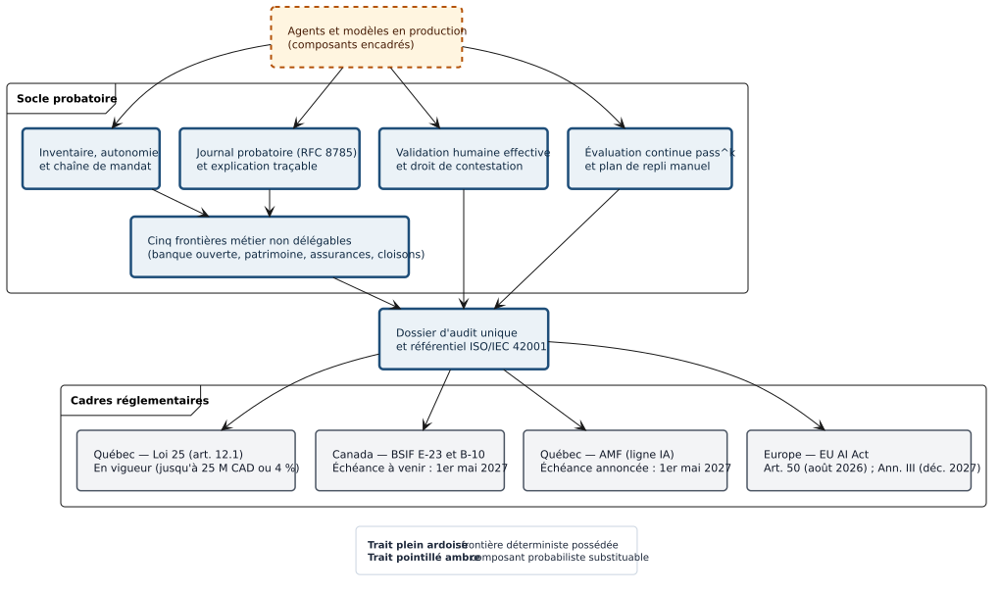

# Chapitre 10 — Le laboratoire réglementé : Québec, Canada et Europe face à l'exigence de preuve

*Question directrice : Quelles frontières infranchissables le droit positif trace-t-il autour de l'autonomie algorithmique, et comment y répondre par un socle unique de preuves ?*

Au Canada, le déploiement opérationnel des systèmes d'intelligence artificielle avance moins vite que l'usage individuel des dirigeants. Selon l'enquête *Business Leaders' Pulse* de la Banque du Canada (décembre 2025, `314` répondants, publiée en juin 2026) [2], `70 %` des répondants utilisent personnellement l'IA chaque semaine, mais seuls `8 %` des entreprises déclarent un usage opérationnel important, contre `21 %` d'usage modéré, `29 %` d'expérimentation peu fréquente ou en pilote et `11 %` d'adoption prévue sous douze mois. Les secteurs de la finance, des assurances et de l'immobilier se classent au deuxième rang opérationnel, le Québec et l'Ontario dominent l'adoption régionale, `30 %` des entreprises anticipent un effet positif sur leurs dépenses en capital sur trois ans, et `18 %` prévoient moins d'embauche contre `9 %` davantage [2]. Sur le terrain bancaire canadien, `AIBanks.ca` recense au `1er novembre 2026` `210` déploiements et annonces publics d'IA dans `27` des `35` institutions suivies [15].

Entre Québec, Ottawa et Bruxelles, ce décalage reflète une convergence réglementaire nette sur `2026–2028`. Aucun texte en vigueur ou annoncé n'impose aux institutions financières d'automatiser leurs décisions. Les cadres vérifiés exigent en revanche traçabilité documentaire (inventaire `E-23`, enregistrement européen à haut risque), transparence proportionnée et imputabilité humaine explicite, avec de lourdes sanctions pécuniaires dans les lois sur les données et l'IA [5, 8, 10, 14]. La littérature montre aussi que les risques se propagent le long des pipelines de données, fournisseurs et frontières juridiques : une revue systématique de `66` études (`2018–2025`) sur les chaînes numériques transfrontalières [4] recense le traitement des risques d'équité dans `24` travaux, de gouvernance des données dans `20`, de désinformation dans `15`, d'imputabilité juridique dans `12` et de durabilité environnementale dans `11`.

Une organisation financière ne peut donc plus traiter la conformité comme un vernis autour de prototypes fragiles. Hadfield et Koh [1] soutiennent que l'intégration d'agents autonomes en secteur régi comme la finance appelle une infrastructure institutionnelle analogue à l'agrément professionnel : registres résistants à la falsification, identités vérifiables, révision des règles de mandat et de personnalité morale, et visibilité réglementaire traversant les frontières du secret commercial. Bâtir quatre filières séparées pour le Québec, le régulateur fédéral, les autorités boursières et l'Union européenne condamnerait les équipes à une dérive coûteuse. Ce chapitre montre comment ces régimes convergent vers un seul socle probatoire déterministe, puis trace les cinq frontières métier non délégables à l'autonomie probabiliste.

## 10.1 Transparence, vie privée et contestation humaine : l'article 12.1 de la Loi 25 au Québec comme révélateur

Au Québec, l'automatisation décisionnelle produit déjà des effets juridiques sans attendre une future loi sur l'IA. Sanctionnée le 22 septembre 2021 pour moderniser l'encadrement public et privé des renseignements personnels, la *Loi 25* (LQ 2021, c. 25) a activé ses principales obligations du secteur privé en trois vagues (article 175) : le 22 septembre 2022 pour les incidents de confidentialité et le responsable de la protection des renseignements personnels (RPRP), le 22 septembre 2023 pour les règles structurantes — dont les politiques de gouvernance, l'article 12.1, la conservation minimale d'un an, les évaluations des facteurs relatifs à la vie privée (ÉFVP) de projet et de transfert, les mandataires, l'anonymisation irréversible ou la destruction et les sanctions — puis le 22 septembre 2024 pour la portabilité structurée [8]. Au gel du 31 décembre 2026 (la refonte *LégisQuébec* P-39.1 restant en statut F, l'analyse s'appuie sur le texte sanctionné [8] et les travaux de la Commission d'accès à l'information (CAI) [9]), les trois phases s'appliquent pleinement, le socle de septembre 2023 régissant déjà depuis plus de trois ans toute entreprise exploitée au Québec. Dès lors que des renseignements personnels alimentent une décision fondée exclusivement sur un traitement automatisé, l'article 12.1 oblige l'entreprise à en aviser la personne concernée au plus tard au moment où elle lui annonce cette décision [8], traçant pour l'architecte une frontière nette entre l'assistant préparatoire et le système autonome qui tranche seul octroi, refus ou tarification.

Ce seuil déclenche aussitôt des droits d'explication et de révision humaine effective. À sa demande, la personne concernée obtient communication des renseignements personnels utilisés, des motifs, principaux paramètres et facteurs expliquant cette décision, en plus de son droit de rectification [8]. Surtout, l'entreprise doit lui offrir la possibilité de présenter ses observations à un membre de son personnel en mesure de réviser la décision [8] : un robot conversationnel ou un préposé sans pouvoir de révision ne satisfait donc pas à l'article 12.1. La *Loi 25* n'imposant aucun protocole d'identité, notre architecture arrime ces validations à la délégation *On-Behalf-Of* (OBO) et à l'approbation asynchrone *Client-Initiated Backchannel Authentication* (CIBA) du Chapitre 7 — liant cryptographiquement la révision à un employé habilité — et aux garde-fous anti-complaisance du Chapitre 11, afin que le réviseur dispose du temps, des preuves et de l'autorité pour renverser le modèle plutôt que d'entériner mécaniquement.

Sur le cycle de vie des données décisionnelles, les obligations légales se distinguent nettement des patrons techniques retenus. La loi exige d'abord l'exactitude et la mise à jour des renseignements personnels utilisés pour décider (principe de l'article 11, alinéa 1, rappelé par la CAI [9] et appuyé par la rectification de l'article 12.1 [8]), en restreignant l'accès interne sans consentement au seul préposé ou agent qualifié pour qui ces données sont nécessaires à ses fonctions (article 20) [8]. L'article 11, alinéa 2, impose ensuite de conserver au moins un an suivant la décision les renseignements utilisés pour la prendre [8]. Si l'article 12 cantonne l'usage interne aux fins initiales (avec consentement exprès pour les données sensibles), son deuxième alinéa autorise l'usage sans consentement additionnel lorsqu'il est nécessaire pour prévenir ou détecter la fraude, ou évaluer et améliorer les mesures de protection et de sécurité (`par. 3°`), ou encore à des fins d'étude, de recherche ou de production de statistiques sur données dépersonnalisées (`par. 5°`) [8]. Enfin, une fois les fins accomplies et sous réserve des délais légaux, l'article 23 impose de détruire ces renseignements ou de les anonymiser de façon irréversible pour les utiliser à des fins sérieuses et légitimes, selon les meilleures pratiques et critères réglementaires [8]. Sans imposer de format de journalisation, ces règles justifient notre sas d'entrée validant les sources faisant autorité (exactitude et article 20) et notre télémétrie à double couloir canonisée selon `RFC 8785` (Chapitre 9) : le premier couloir soutient les tests de protection et sécurité nécessaires sous l'article 12 (`al. 2, par. 3°`) et les diagnostics sur données anonymisées sous l'article 23 [8] ; le second scelle intrants exacts, facteurs dominants et sorties d'outils pour assurer la rétention d'un an et la traçabilité avant destruction ou anonymisation à terme.

Le cadre québécois verrouille aussi l'amont des projets, les transferts hors Québec, la sous-traitance et les incidents. L'article 3.3 exige une ÉFVP — menée dès le début en consultant le RPRP, habilité à suggérer des mesures à toute étape (article 3.4) — pour tout projet d'acquisition, de développement ou de refonte de système d'information ou de prestation électronique de services traitant des renseignements personnels [8]. Sauf exception légale urgente, tout transfert hors du Québec requiert une ÉFVP démontrant une protection adéquate et une entente écrite (article 17), contrainte directe sur les modèles hébergés à l'étranger [8]. Communiquer sans consentement à un mandataire (article 18.3) requiert un écrit et — sauf si ce tiers est un organisme public ou membre d'un ordre professionnel — des clauses assurant confidentialité, usage limité au mandat ou contrat et non-conservation après expiration, doublées d'un avis sans délai au RPRP sur toute violation ou tentative de violation et du droit de vérification du RPRP [8]. Enfin, les articles 3.5 à 3.8 exigent un registre des incidents de confidentialité et leur notification diligente à la CAI et, sauf risque d'entrave à une enquête autorisée par la loi, aux personnes touchées en cas de risque de préjudice sérieux [8] : en architecture, l'ÉFVP devient porte bloquante, des passerelles `API` bornent la résidence des données et toute fuite alimente le registre.

La surveillance active et les plafonds financiers confirment l'enjeu architectural de ce socle. Dans son rapport quinquennal de mai 2026 [9], la CAI pointe les lacunes d'application et recommande plusieurs resserrements législatifs : joindre une analyse d'impact algorithmique à toute ÉFVP visant un système d'IA dédié à la prise de décision automatisée concernant les personnes (recommandation 45), désigner l'entité juridiquement détentrice comme ultimement responsable d'une ÉFVP multi-parties (recommandation 46), resserrer et lister par règlement les cas exigeant une ÉFVP (recommandations 50 et 51), sanctionner l'omission d'ÉFVP requise (recommandation 52), imposer un registre interne des ÉFVP (recommandation 54) et recentrer les sanctions administratives pécuniaires (SAP) sur les manquements objectifs — telles l'omission d'ÉFVP ou de registre des incidents de confidentialité (recommandation 74) [9]. À la section 2.1.4, elle rappelle aussi que le moissonnage automatisé de renseignements personnels heurte finalité, nécessité et encadrement de la collecte auprès de tiers (articles 4 à 6) [9], rendant l'alimentation brute d'agents en données personnelles par aspiration Web difficilement conciliable avec la *Loi 25*. Côté pénalités, les articles 90.1 et 90.12 permettent à une personne désignée par la CAI d'imposer à une entreprise des SAP atteignant 10 M\$ CA ou 2 % du chiffre d'affaires mondial de l'exercice financier précédent (le plus élevé), couvrant l'article 12.1 [8]. Par voie pénale, les articles 91, 92.1 et 92.2 portent les amendes hors personnes physiques de 15 000 \$ à 25 M\$ CA ou 4 % du même chiffre d'affaires mondial (le plus élevé) — doublées en récidive, avec poursuite prescrite après cinq ans — notamment pour traitement, conservation ou destruction illicites, carence sécuritaire ou tentative de réidentification de données anonymisées [8].

Quatre invariants d'ingénierie découlent de ce régime québécois déjà exécutoire. D'abord, la qualification du seuil décisionnel sépare dès le routage les assistants préparatoires des agents tranchant seuls sous l'article 12.1 [8]. Ensuite, la chaîne probatoire unit exactitude des sources, scellement `RFC 8785` sur double couloir pendant au moins douze mois et destruction ou anonymisation irréversible une fois les fins accomplies et les délais légaux expirés [8, 9]. En parallèle, le moindre privilège contextuel et le cloisonnement géographique concrétisent l'article 20, les ÉFVP transfrontalières de l'article 17 et le contrôle des mandataires de l'article 18.3 [8]. Enfin, la révision humaine authentifiée par OBO et CIBA et les garde-fous anti-complaisance (Chapitres 7 et 11) assurent un recours réel plutôt qu'une validation décorative [8, 9].

## 10.2 Gestion prudentielle du risque de modèle et d'impartition : l'échéance à venir du 1er mai 2027

À l'échelle fédérale, le Bureau du surintendant des institutions financières (`BSIF`) réorganise la gouvernance algorithmique autour du risque de modélisation et de l'impartition. Publiée dans sa version révisée le `11 septembre 2025`, la ligne directrice `E-23` sur la gestion du risque de modélisation entrera en vigueur le `1er mai 2027` pour toutes les institutions financières fédérales : banques, succursales étrangères (banques et assureurs), assureurs vie et sociétés de secours mutuels, assureurs multirisques et sociétés de fiducie et de prêt [10]. Loin de se limiter aux modèles statistiques de fonds propres, elle adopte la définition de l'IA de l'OCDE et couvre les systèmes présentant divers degrés d'autonomie et d'adaptabilité après déploiement [10].

Les trois résultats attendus et les principes `1.1` à `3.6` de `E-23` soumettent les modèles et agents à risque inhérent non négligeable à un cycle de vie gouverné [10]. Chaque institution tiendra un inventaire d'entreprise couvrant modèles internes, tiers et récemment mis hors service selon les champs de l'`Annexe 1` (description d'usage, responsable du modèle, date de mise en production, dépendances, sources de données, suivi et date de prochaine validation), avec une cote de risque de modélisation intégrant complexité, autonomie et contrôles des « approches boîte noire » [10]. Les principes `3.4` à `3.6` imposent validation indépendante, contrôle des déploiements et changements, surveillance des dérives et de tout « reparamétrage autonome », et plans de contingence et d'urgence [10].

Publié en juillet 2026, un bulletin sur le risque technologique consacré à l'IA générative et agentique aligne ses saines pratiques sur `B-13`, `E-21` et `B-10`, tout en renvoyant à `E-23` pour le risque de modélisation [11]. Le `BSIF` y définit l'encadrement applicatif (*AI harnessing*, `note 4`) comme l'ensemble des composants logiciels, contrôles, surveillance, garde-fous, connecteurs, politiques et mécanismes de gouvernance encadrant les interactions d'un modèle [11]. Il met en garde contre les enchaînements autonomes d'outils (*tool chaining*) menant à des actions non validées, et préconise de traiter les sorties comme de simples intrants sous supervision humaine documentée pour les décisions importantes ou à fort impact [11]. Architecturalement, ce bulletin recommande des identités `NHI` uniques éphémères à moindre privilège, des passerelles `API` à listes blanches d'outils, des replis manuels testés et la notification par les tiers de tout usage d'IA [11].

La ligne directrice `B-10` sur le risque lié aux tiers, publiée en avril 2023 (mise à jour en novembre 2026) [12], verrouille le volet contractuel et nuage. L'institution reste pleinement imputable (`principe 1`) et doit maîtriser concentration (`section 2.2.3`) et sous-traitants de ses tiers (`principe 5`) [12]. La section `2.3.2.2` rappelle l'obligation de conserver des copies complètes des dossiers électroniques au Canada ou, en cas d'exemption, de garantir un accès immédiat, direct, complet et continu au surintendant, complétée par des droits d'audit indépendant (`principe 8`) et des plans de sortie avec portabilité nuage (`sections 2.3.5` et `4.4`) [12].

Au Québec, le calendrier prudentiel converge sur le `1er mai 2027` avec la ligne directrice de l'Autorité des marchés financiers (`AMF`) sur l'intelligence artificielle. Au `31 décembre 2026`, le portail officiel de l'`AMF` demeure toutefois inaccessible en statut F (`HTTP 403 WAF`), interdisant d'en citer des clauses textuelles. En revanche, la prise d'effet au `1er mai 2027` pour les entités encadrées au Québec — notamment Desjardins — est corroborée au `1er novembre 2026` par `AIBanks.ca`, qui signale un texte de mars 2026 mis à jour le `24 avril 2026` [15].

Cette convergence temporelle du `1er mai 2027` dicte une stratégie pragmatique. Les groupes présents à la fois sous juridiction fédérale et québécoise éviteront de bâtir deux inventaires et deux chaînes de validation en alignant dès maintenant leur registre de modèles, leur télémétrie `RFC 8785` et leurs batteries d'évaluation continue `pass^k` (Chapitre 9) sur un socle commun qui répondra simultanément aux inspections à venir du `BSIF` et de l'`AMF` [10, 11, 15], tout en couvrant l'article `12.1` déjà actif au Québec [8].

## 10.3 L'articulation transatlantique avec l'EU AI Act (août 2026 – août 2028) et le référentiel de gouvernance ISO/IEC 42001

Pour les groupes canadiens dotés d'activités européennes ou de fournisseurs transatlantiques, le `Règlement (UE) 2024/1689` (*EU AI Act*) [5], ajusté par le `Règlement (UE) 2026/1744` du `8 juillet 2026` (train de mesures omnibus numérique sur l'IA) [6], étale ses obligations d'août 2026 à août 2028 entre règles déjà actives et échéances à venir.

Depuis le `2 août 2026`, l'article `50` est déjà en application [5, 6]. Les fournisseurs d'un système destiné à interagir directement avec des personnes physiques doivent le concevoir de sorte qu'elles soient informées qu'elles interagissent avec une IA lorsque cela ne ressort pas clairement (`art. 50, par. 1`), tandis que les fournisseurs de contenus synthétiques doivent intégrer un marquage détectable et lisible par machine (`art. 50, par. 2`) et que les déployeurs d'hypertrucages ou de textes publiés sur des questions d'intérêt public (sauf examen et responsabilité éditoriaux) doivent en mentionner l'origine IA (`art. 50, par. 4`) [5]. Par le paragraphe `4` inséré à l'article `111`, le `Règlement (UE) 2026/1744` a ménagé aux systèmes génératifs mis sur le marché avant le `2 août 2026` une période transitoire expirant le `2 décembre 2026` pour le marquage de l'article `50, par. 2`, même date que pour les ajustements de l'article `5` [6]. À fin décembre 2026, ces obligations de transparence et ce délai transitoire sont donc déjà atteints.

En revanche, l'essentiel des obligations visant les systèmes à haut risque relève d'échéances à venir fixées à l'article `113`, troisième alinéa, lettre c), tel que modifié en juillet 2026 [6]. Les exigences du chapitre III (sections `1` à `3`, hors `art. 6, par. 5`) s'appliqueront le `2 décembre 2027` aux systèmes de l'`Annexe III`, et le `2 août 2028` aux systèmes de l'`Annexe I` intégrés à des produits régis par la législation d'harmonisation de l'Union [6]. Pour guider cette transition, la Commission européenne devra publier des lignes directrices sur l'articulation avec la législation de l'`Annexe I, section A` au plus tard le `1er août 2027` (`art. 96, par. 1, lettre g)`) et des orientations sur le plan de surveillance après commercialisation au plus tard le `2 septembre 2027` (`art. 72, par. 3` et `considérant 41`) [6].

Dans le secteur financier, deux cas d'usage de l'`Annexe III` basculeront sous ce régime complet le `2 décembre 2027` : l'évaluation de la solvabilité ou l'établissement de la note de crédit des personnes physiques visés à la rubrique `5(b)`, de même que l'évaluation des risques et la tarification concernant les personnes physiques en matière d'assurance-vie et d'assurance maladie visées à la rubrique `5(c)` [5, 6]. La rubrique `5(b)` et le `considérant 58` excluent toutefois explicitement de cette qualification la détection de fraudes financières ainsi que, au `considérant 58`, le calcul prudentiel des besoins en fonds propres des établissements de crédit et assureurs [5]. Signe de l'évolution technologique prise en compte par Bruxelles, le texte de juillet 2026 précise aussi l'article `4` sur la maîtrise de l'IA sans obliger à garantir un niveau individuel spécifique, introduit l'article `4 bis` autorisant sous conditions le traitement de données sensibles pour détecter et corriger les biais, et ajoute l'`Annexe XIV` pour la désignation des organismes notifiés (`art. 30`), incluant la rubrique `AIH 0401` mentionnant expressément « notamment l'IA agentique » [6].

À compter du `2 décembre 2027`, ces systèmes financiers à haut risque devront démontrer une chaîne probatoire rigoureuse : gestion des risques (`art. 9`), gouvernance des données (`art. 10` et `4 bis`), documentation technique (`art. 11` et `Annexe IV`), exactitude, robustesse et cybersécurité (`art. 15`), système de gestion de la qualité (`art. 17`) et conservation documentaire de dix ans par les fournisseurs (`art. 18`) [5, 6]. La journalisation automatique conservée au moins six mois par les déployeurs et intégrée aux dossiers financiers (`art. 12` et `26, par. 6`), la supervision humaine anti-biais d'automatisation dotée d'un bouton d'arrêt (`art. 14`) et l'analyse d'impact sur les droits fondamentaux articulée avec l'analyse d'impact relative à la protection des données (`AIPD`, `art. 27`) complètent ce socle, les articles `9, par. 10`, `17, par. 3–4` et `26, par. 5` autorisant leur intégration aux gouvernances prudentielles financières existantes [5, 6].

Les sanctions de l'article `99` atteignent `35 M €` ou `7 %` du chiffre d'affaires mondial pour les pratiques interdites de l'article `5`, `15 M €` ou `3 %` pour les manquements aux obligations des opérateurs dont les articles `16`, `26` ou `50`, et `7,5 M €` ou `1 %` pour les informations inexactes, avec un plafond au plus bas pour les PME et étendu aux petites entreprises à moyenne capitalisation aux paragraphes `4` et `5` (`art. 99, par. 6` et `6 bis`) [5, 6]. En parallèle, le règlement `DORA` `(UE) 2022/2554` impose aux entités financières européennes un registre des accords de services TIC, la maîtrise du risque de concentration, des droits d'audit illimités et des plans de sortie éprouvés pour les fonctions critiques ou importantes (`art. 5–6`, `28–30`) [7].

Face à cette superposition normative, notre architecture adopte le référentiel `ISO/IEC 42001` comme cadre fédérateur du dossier d'audit unique. Précisons clairement qu'aucun texte de notre base fermée n'impose `ISO/IEC 42001` par son numéro ; toutefois, l'article `17` de l'*EU AI Act* requiert un système de gestion de la qualité intégrable [5] et la feuille de route du groupe d'experts cyber du `G7` de janvier 2026 recommande d'appuyer la gouvernance des dépendances tierces et de la résilience cryptographique sur des référentiels déjà audités tels qu'`ISO 27001` ou `ITIL` [3]. Structurer le dossier probatoire selon `ISO/IEC 42001` permet ainsi d'unifier les preuves destinées à Québec, Ottawa et Bruxelles.

| Exigence probatoire | Québec (`Loi 25`, `CAI`, `AMF`) | Canada fédéral (`BSIF E-23`, `B-10`, `ACVM`) | Europe (`EU AI Act`, `DORA`) | Composant technique |
| --- | --- | --- | --- | --- |
| Inventaire et risque | `EFVP` [8] et registre d'`EFVP` recommandé [9] | Inventaire `Annexe 1` `E-23` au `1er mai 2027` [10] | Haut risque `Annexe III` (`2 déc. 2027`) et `AIH 0401` (`art. 30`) [5, 6] | Catalogue centralisé des agents |
| Journalisation et durée | Renseignements utilisés conservés >= `1 an` (`art. 11 al. 2`) [8] | Dossiers canadiens (`B-10`) et suivi dérive [10, 12] | Journaux >= `6 mois` (`art. 26 par. 6`) et dossier `10 ans` (`art. 18`) [5] | Télémétrie et `RFC 8785` (Chap. 9) |
| Transparence et facteurs | Notification et facteurs (`art. 12.1`) [8] | Sorties IA traitées comme intrants [11] | Mention IA et marquage `art. 50` (août 2026) [5, 6] | Gabarit d'explication vérifiable |
| Contrôle humain et arrêt | Révision humaine habilitée (`art. 12.1`) [8] | Validation (`3.4`) et repli manuel [10, 11] | Supervision `art. 14` et bouton d'arrêt [5] | Verrous `CaMeL` et `CIBA` (Chap. 7 et 8) |
| Tiers et sortie | Contrat et vérification `RPRP` (`art. 17, 18.3`) [8] | Sous-traitants des tiers et sortie (`B-10`) [12] | Registre TIC et sortie (`DORA art. 28–30`) [7] | Contrats, `API` et portabilité |
| Sanctions / échéance | `10 M\$` / `2 %` et `25 M\$` / `4 %` [8] ; `AMF` `1er mai 2027` [15] | Prise d'effet `E-23` `1er mai 2027` [10] ; `NC 31-103` `1er oct. 2028` [13] | `35 M €` / `7 %` ou `15 M €` / `3 %` [5] ; `Annexe I` `2 août 2028` [6] | Dossier unique `ISO/IEC 42001` |

La figure suivante montre comment un seul socle probatoire déterministe relie les composants agentiques en production à ce dossier unifié et aux obligations des trois juridictions.

*Fig-19 — Architecture du socle probatoire déterministe unique reliant les agents en production au dossier d'audit `ISO/IEC 42001` et aux régimes du Québec, du Canada et de l'Union européenne.*

Ce schéma impose quatre décisions d'architecture dès la conception. D'abord, aucun agent probabiliste en production ne doit émettre d'acte juridique sans traverser les cinq gardes déterministes du socle : inventaire et chaîne de mandat, journalisation canonique `RFC 8785`, révision humaine effective, évaluation continue `pass^k` avec repli manuel et respect des cinq frontières métier non délégables. Ensuite, l'investissement probatoire se concentre dans un pipeline unique alimentant un dossier d'audit structuré selon `ISO/IEC 42001`, au lieu d'être dupliqué en silos par autorité de surveillance. Les obligations déjà actives du Québec, l'échéance du `1er mai 2027` au Canada et les jalons européens de `2026–2028` se réduisent dès lors à de simples vues d'extraction branchées sur les mêmes preuves immuables. Enfin, toute dérive détectée ou tout changement réglementaire déclenche une adaptation ciblée sans réécrire la plomberie probatoire sous-jacente.

## 10.4 Cinq frontières métier non délégables : banque ouverte, conseil en patrimoine, assurance de personnes, assurance de dommages et cloisons intra-groupe

Au-delà des exigences transversales d'inventaire, de journalisation et de gouvernance des tiers, le droit positif financier trace cinq frontières métier précises autour de l'autonomie algorithmique. Chacune sépare la préparation probabiliste d'un dossier, autorisée sous contrôle technique, de l'acte juridiquement réservé à une entité agréée ou à un décideur humain [5, 8, 12, 13, 14].

### Banque ouverte canadienne et fin du moissonnage d'écrans

Le cadre fédéral de banque ouverte vise à rendre caduc le prélèvement d'identifiants par capture d'écran (*screen scraping*). Selon `AIBanks.ca`, le *Consumer-Driven Banking Act* a reçu la sanction royale le `26 mars 2026` et des règlements ont été proposés le `27 juin 2026`, la majorité des dispositions n'étant toutefois pas en vigueur et aucune date de début du partage de données n'étant fixée au `1er novembre 2026` (règles finales ciblées pour fin 2026 ou début 2027) [15]. Absents de notre base ouverte vérifiée, cette loi et ces règlements ne peuvent être cités par article.

Les textes vérifiés convergent néanmoins sans ambiguïté. La section `2.2.1.2` de `B-10` rappelle que les banques doivent s'appuyer sur l'accréditation gouvernementale tout en maîtrisant les risques résiduels de cybersécurité et d'intégrité des données [12]. Parallèlement, le bulletin `BSIF` de juillet 2026 met en garde contre les justificatifs partagés au profit d'identités `NHI` uniques et de passerelles `API` [11], tandis que la section `2.1.4` du rapport `CAI` 2026 juge le moissonnage difficilement conciliable avec la nécessité sous la *Loi 25* [9]. Le Chapitre 5 détaille la sortie technique de cette pratique ; aucun agent ne doit simuler une session avec les secrets d'un client.

### Conseil en patrimoine, pertinence et rétrofacturations

En valeurs mobilières et gestion de patrimoine, l'article `415` de la *Loi sur les banques* (`L.C. 1991, ch. 46`) interdit aux banques d'exercer au Canada le commerce des valeurs mobilières dans la mesure prévue par règlement [14], renvoyant ces activités aux inscrits régis par la `Norme canadienne 31-103` [13]. Le `8 octobre 2026`, les `ACVM` et la `CVMO` ont publié les modifications à `NC 31-103` (`(2026), 49 OSCB 8511`) ajoutant l'article `11.11` [13]. Dès le `1er octobre 2028` — après vingt-quatre mois de transition, avec droits acquis pour les achats antérieurs, publication différée de l'avis anticipé en Colombie-Britannique après son élection provinciale (entrée en vigueur attendue au `1er octobre 2028`, et à la date de dépôt en Saskatchewan si postérieure) — il sera interdit à toute personne ou société inscrite, y compris via un membre du groupe, d'exiger le remboursement d'une rémunération initiale lors du rachat de titres d'un fonds d'investissement émetteur assujetti [13].

L'avis atteste l'harmonisation prévue de l'`OCRI` et précise que les prélèvements préautorisés annulés avant exécution ou les transferts sans rachat préalable demeurent régis par la gestion des conflits d'intérêts au mieux de l'intérêt du client sous les Réformes axées sur le client (tout rachat préalable restant interdit) [13]. Par rigueur documentaire, les portails `OCRI` et `ACVM` demeurent en statut F au `31 décembre 2026`. Sur le marché, le `30 juillet 2026`, *Questrade* a lancé `Flows` (déploiement non vérifié) et annoncé le pilote `Questrade MCP`, où la confirmation dans l'application *Questrade* reste requise avant transmission d'ordre [15].

### Assurance de personnes : tarification à haut risque et consentement médical

L'assurance vie, invalidité et maladie cumule les verrous les plus stricts. En Europe, l'`Annexe III`, point `5(c)`, soumettra dès le `2 décembre 2027` l'évaluation des risques et la tarification des personnes physiques en assurance-vie et maladie — hors antifraude et fonds propres prudentiels (`considérant 58`) — au haut risque et à l'analyse d'impact de l'article `27` [5, 6]. Au Québec, les données sensibles (médicales, biométriques) exigent un consentement exprès (`art. 12` à `14`), et toute décision exclusivement automatisée déclenche l'article `12.1` [8].

Au Canada fédéral, `E-23` vise les sociétés d'assurance vie et de secours mutuels dès le `1er mai 2027` [10] et la section `3.3.2` de `B-10` interdit sauf exception de confier à l'auditeur externe les travaux actuariels liés aux états financiers ou relevant normalement de l'actuaire désigné [12]. Sur le terrain, *BMO Assurance* a lancé *SmartDecision* le `9 juillet 2026` jusqu'à `5 M\$` pour les demandes admissibles, en maintenant le conseiller aux commandes [15]. Enfin, l'avis `ACVM` d'octobre 2026 relève via les commentaires reçus que l'approche proposée par le `CCIR` maintient les rétrofacturations sur fonds distincts sous encadrement prescriptif [13].

### Assurance de dommages et séparation bancaire

En assurance de dommages, le point `5(c)` de l'`Annexe III` européenne exclut l'habitation et l'automobile [5], mais les systèmes interactifs relèvent de l'article `50` [5] et les systèmes critiques de `DORA` [7]. Au Canada, les assureurs multirisques fédéraux relèveront de `E-23` le `1er mai 2027` [10] et de `B-10` [12], tandis que l'article `12.1` québécois s'applique déjà aux règlements de sinistres automatisés [8]. Surtout, l'article `416(1)–(2)` de la *Loi sur les banques* (sous réserve d'exceptions, dont `416(4)`) interdit aux banques d'exploiter le commerce de l'assurance, d'agir comme agent ou de louer des locaux en succursale à des assureurs [14] : un assistant bancaire ne peut conclure de police pour une filiale d'assurance.

### Cloisons intra-groupe et révision statutaire de 2033

La cinquième frontière interdit le partage brut de données et mandats entre entités sœurs. La `Partie XI` de la *Loi sur les banques* (`art. 485.1` à `506`) impose les conditions du marché (`art. 501(1)`), exige un contrat écrit pour l'achat de services ou le renvoi de clients (`art. 495(1)a),c)`), encadre le traitement de données (`art. 495(1)e)`), plafonne le risque financier envers un apparenté qui n'est pas une institution financière fédérale à `5 %` du capital réglementaire (`10 %` au total, `art. 495.2(1)`), requiert l'agrément du surintendant et du comité de révision dès `5 %` d'actif total sur douze mois (`art. 495.3(1)`), et permet d'ordonner le maintien de la gestion essentielle auprès d'employés (`art. 495(2)`) [14]. L'article `627.15` interdit de collaborer avec un intermédiaire ou une entité du groupe visée sans parité de protection des consommateurs, de plaintes et de signalement [14].

Parallèlement, `B-10` (`section A3`, incluant mères, affiliées et filiales) [12] et `DORA` (`considérant 31` ; l'exemption de l'`art. 31, par. 8, iii)` ne visant que la désignation comme prestataire critique) [7] excluent toute présomption de moindre risque intra-groupe, tandis que la `Loi 25` régit les échanges entre entités distinctes (`art. 13`, `14`, `18.3`) [8]. Architecturalement, une plateforme mutualisée cloisonne donc les locataires par identités `SPIFFE` (Chapitre 7) et verrous `CaMeL` ou règle de deux (Chapitre 8). En pratique bancaire, le flux agentique hypothécaire de `TD` (`21 mai 2026`) reste cantonné au pré-montage sous décision humaine des souscripteurs [15]. Enfin, la clause de temporisation des articles `21(1)` et `670(1)` fixe l'échéance du `30 juin 2033` pour les banques, banques étrangères autorisées et sociétés de portefeuille bancaires, sauf renouvellement, prorogation d'au plus six mois par décret ou dissolution du Parlement (`par. (2), (4)`) [14].

Le tableau ci-dessous synthétise ces cinq plafonds non délégables et les garanties architecturales correspondantes.

| Domaine métier | Plafond non délégable | Ancrage juridique vérifié et échéance | Garantie minimale |
| --- | --- | --- | --- |
| Banque ouverte canadienne | Capture d'identifiants et contournement d'accréditation | Sanction `26 mars 2026` (textes hors base) [15] ; `B-10 2.2.1.2` [12] ; `CAI 2.1.4` [9] ; `BSIF` juill. 2026 [11] | Passerelles `API`, `NHI` uniques, sortie du moissonnage (Chap. 5) |
| Conseil en patrimoine | Commerce bancaire restreint, ordre sans confirmation et rétrofacturations | `Loi sur les banques art. 415` [14] ; `NC 31-103 art. 11.11` (`1er oct. 2028`) [13] ; *Questrade* [15] | Confirmation humaine d'ordre et blocage des rétrofacturations |
| Assurance de personnes | Tarification opaque, transfert médical sans consentement et cumul audit/actuariat | `Annexe III 5(c)` et `art. 27` (`2 déc. 2027`) [5, 6] ; `Loi 25 art. 12–14, 12.1` [8] ; `E-23` `1er mai 2027` [10] ; `B-10 3.3.2` [12] | Décideur humain, consentement exprès et `AIPD` |
| Assurance de dommages | Sollicitation bancaire interdite et refus automatisé sans appel | `Loi sur les banques art. 416` [14] ; `Loi 25 art. 12.1` [8] ; `E-23` (`1er mai 2027`) [10] | Cloisonnement de distribution et révision humaine |
| Cloisons intra-groupe | Mutualisation brute de données, délégation de direction et dépassement de capital | `Loi sur les banques art. 495–495.3, 501, 627.15` et `art. 21(1), 670(1)` (`30 juin 2033`) [14] ; `B-10 A3` [12] ; `DORA` [7] | Ententes inter-entités, isolation et registre de sortie |

> **Trois arbitrages sans regret — Chapitre 10**
>
> 1. **Construire un socle probatoire déterministe unique avant le `1er mai 2027`.** Centralisez l'inventaire des modèles et agents, les captures canoniques `RFC 8785` conservées au moins un an et les explications lisibles des facteurs décisionnels dans un dossier structuré selon `ISO/IEC 42001`. Vous répondez simultanément à l'article `12.1` déjà en vigueur au Québec, aux échéances du `1er mai 2027` pour `BSIF E-23` et l'`AMF`, et à l'échéance européenne du `2 décembre 2027` [5, 6, 8, 10, 15].
> 2. **Placer des verrous non délégables devant chaque acte juridiquement réservé.** Cantonnez l'agent probabiliste à l'analyse préparatoire et exigez une validation humaine habilitée devant l'octroi de crédit, l'ordre boursier, la tarification d'assurance vie et toute révision contestée, appuyée sur des identités `NHI`, des listes blanches d'outils, des passerelles `API` et un bouton d'arrêt manuel testé en situation de panne [5, 8, 11, 13, 15].
> 3. **Blinder les contrats tiers et les cloisons intra-groupe avec des signaux adaptatifs.** Exigez de chaque fournisseur ou filiale TIC la notification de tout ajout d'IA, un droit d'audit complet et un plan de portabilité vérifié (`B-10`, `Loi 25 art. 18.3`, `DORA`) [7, 8, 12], puis pilotez les échéances à venir de `2027–2033` par seuils d'adaptation inspirés de la méthodologie `DAPP` [16] détaillée au Chapitre 12.

Ce socle juridique trace nettement ce que les agents ont le droit d'automatiser et ce qui reste réservé à l'autorité humaine. Or la meilleure piste d'audit et le verrou statutaire le plus ferme s'effondrent si les réviseurs finissent par entériner mécaniquement chaque recommandation algorithmique sans détecter la dérive. Le Chapitre 11 aborde ces sept pièges humains et organisationnels — biais d'automatisation, approbation machinale et atrophie des compétences — qui menacent la supervision effective.
