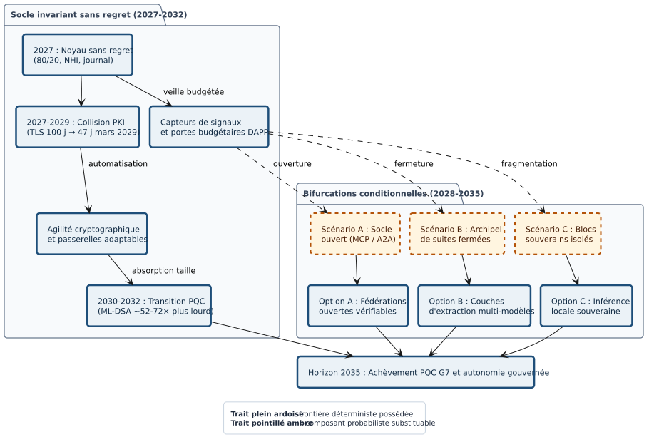
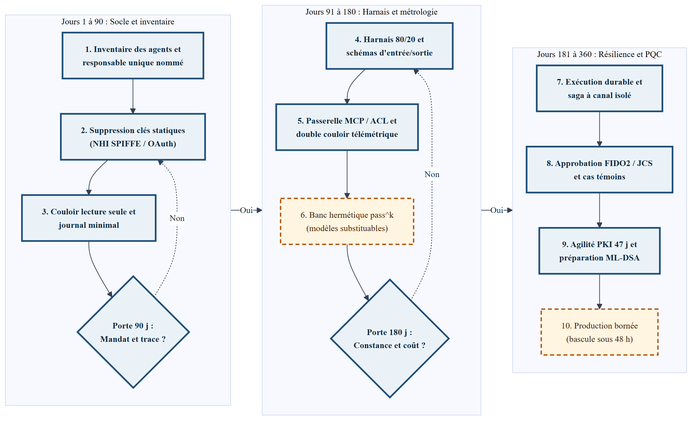

# Chapitre 12 — Décider sous incertitude profonde : des 90 premiers jours à l'ère post-quantique

*Question directrice : Comment séquencer les investissements entre l'urgence des 90 premiers jours et les mutations structurelles de 2028–2035 sans parier sur un scénario unique ?*

Une organisation qui déploie ses premiers agents en 2027 s'expose rarement à une crise isolée; elle affronte la collision programmée de trois horloges déjà inscrites dans la norme et dans le droit. La première gouverne les certificats web publics. Aux termes du *Ballot SC-081v3* (`SC081`) intégré aux *Baseline Requirements* v2.3.1 du *CA/Browser Forum* (4 octobre 2026, sections 4.2.1 et 6.3.2), après la réduction à 200 jours entrée en vigueur le 15 mars 2026, la durée maximale de validité et de réutilisation des preuves de domaine ou d'adresse `IP` des certificats `TLS` publics tombera à 100 jours le 15 mars 2027, puis à 47 jours — avec une réutilisation des validations ramenée à 10 jours — le 15 mars 2029 [8]. Toute passerelle d'agents dont le renouvellement repose encore sur une intervention manuelle ou un script fragile entre ainsi dans un compte à rebours d'interruption périodique.

La deuxième horloge est cryptographique. Dès août 2024, la norme `NIST FIPS 204` a formalisé l'algorithme de signature post-quantique sur réseaux euclidiens `ML-DSA` [5]. Selon son tableau officiel des tailles (table 2), une signature `ML-DSA-65` atteint 3 309 octets et `ML-DSA-87` atteint 4 627 octets — soit respectivement environ 52× et 72× une signature elliptique classique de 64 octets [5]. En janvier 2026, le *G7 Cyber Expert Group* (`CEG`) a publié une feuille de route coordonnée qui invite les institutions financières à viser 2035 pour achever leur transition post-quantique, tout en priorisant les systèmes critiques dans la fenêtre indicative 2030–2032 [7], en cohérence avec l'horizon fédéral documenté dans `NIST IR 8547` [6].

La troisième horloge tient aux obligations prudentielles et sectorielles qui s'enclencheront dès 2027 et 2028 au Canada et en Europe. Or, faute d'anticipation, des passerelles patrimoniales rigides, des chaînes de jetons `OAuth` sous-dimensionnées et des infrastructures à clés publiques artisanales ne pourront absorber ni la rotation tous les 47 jours ni l'expansion de cinquante à soixante-douze fois des signatures cryptographiques, au moment même où les audits de conformité exigeront une traçabilité sans faille. On ne résout pas cette collision en achetant le modèle de pointe du trimestre ni en gravant dans le marbre un plan quinquennal rigide jusqu'en 2035. L'enjeu de direction, pour l'exécutif comme pour l'architecture et la conformité, consiste à séparer ce qui doit être verrouillé dans les 90 premiers jours, ce qui forme un noyau d'investissements sans regret et ce qui doit demeurer conditionnel jusqu'en 2035.

## 12.1 Trois avenirs plausibles sans probabilité : socle ouvert étendu, archipel de plateformes fermées ou fragmentation en blocs souverains

La planification pluriannuelle classique échoue sur la période 2027–2035 parce qu'elle suppose un futur probabilisable. Personne ne connaît au 31 décembre 2026 la trajectoire exacte du coût marginal d'inférence, l'issue de la concurrence entre protocoles ouverts et suites fermées, ni la date d'apparition d'un ordinateur quantique cryptographiquement pertinent (*Cryptographically Relevant Quantum Computer*, `CRQC`) [6, 7]. Dans les situations d'incertitude profonde (*deep uncertainty*), où experts et décideurs ne s'accordent ni sur une distribution de probabilités ni sur un modèle unique du système, optimiser pour un scénario central fabrique des verrouillages précoces (*lock-ins*) et des actifs échoués (*stranded assets*) [18].

Pour éviter ce piège, Marjolijn Haasnoot, Andrew Warren et Jan H. Kwakkel (2019) exposent la méthode de **trajectoire adaptative sous seuils (`DAPP`, *Dynamic Adaptive Policy Pathways*)**, issue de travaux lancés dès 2013 sur la gestion de l'eau et les grandes infrastructures à longue durée de vie avant d'être étendue aux systèmes sociotechniques complexes [18]. Plutôt que de parier sur la date d'un scénario, `DAPP` identifie les conditions générales sous lesquelles une architecture ou une politique cesse de remplir ses objectifs — un **point de bascule d'adaptation** (*adaptation tipping point*, `ATP`) — ainsi que les **points d'opportunité** où une autre option devient praticable ou avantageuse [18]. Le décideur conçoit alors une stratégie dynamique combinant des actions initiales immédiates (fondations sans regret, actions correctives ou défensives et mesures habilitantes qui gardent les options ouvertes), des choix de long terme suspendus jusqu'à nécessité avérée, et des **signaux avancés** (*signposts*) déclenchant la transition avant l'échec [18]. Visualiser ces séquences sur une carte de trajectoires analogue à un plan de métro — complétée par des tableaux d'évaluation échelonnés dans le temps (*scorecards*) et des scénarios transitoires plutôt que de simples clichés statiques — met en lumière la **dépendance de sentier** (*path dependency*) : deux décisions qui résolvent le problème immédiat peuvent se révéler inégales si l'une autorise une bifurcation ultérieure et que l'autre la condamne [18].

Appliquée à l'entreprise agentique sur 2028–2035, cette discipline oblige à éprouver chaque choix structurant contre trois avenirs plausibles sans leur assigner de probabilité. Dans le premier — le **socle ouvert étendu** —, les standards verticaux de connexion aux outils, les protocoles horizontaux de délégation inter-agents et les mécanismes d'attestation vérifiable se consolident à l'échelle du marché. L'adoption en juin 2026 de la norme `IETF RFC 9943` définissant `SCITT` (*Supply Chain Integrity, Transparency, and Trust*) illustre cette dynamique : des énoncés signés sur l'origine de logiciels, de modèles ou de serveurs d'outils sont enregistrés dans des journaux transparents anti-équivocation produisant des reçus cryptographiques vérifiables sans devoir faire confiance à un intermédiaire unique [3]. Les organisations qui possèdent leur noyau de contrôle déterministe (chapitre 04) et leurs contrats sémantiques (chapitre 05) peuvent alors fédérer des agents internes et partenaires avec un faible coût de sortie.

Dans le deuxième avenir — l'**archipel de plateformes fermées** —, quelques éditeurs de suites bureautiques, de gestion de la relation client et d'infonuagique consolident la capture décrite au chapitre 03 : interopérabilité de façade en périphérie, mais plan de contrôle, mémoire métier, télémétrie et tarification verrouillés. Sans séparation stricte entre systèmes d'autorité et exécutants externes ni couches anti-corruption (chapitre 05), l'institution s'expose à des hausses de prix unilatérales, à une opacité sur les modifications de modèles et à des **coûts de transfert** (*transfer costs*) prohibitifs si elle tente de migrer tardivement [18]. À l'inverse, maintenir des couches d'extraction multi-modèles et une télémétrie indépendante préserve la faculté de substitution.

Dans le troisième avenir — la **fragmentation en blocs souverains** —, les divergences réglementaires, géopolitiques et cryptographiques compartimentent l'accès aux modèles frontières, la résidence des données et les profils d'algorithmes autorisés. L'écart déjà visible au gel du 31 décembre 2026 entre l'approche prudentielle canadienne [12, 13, 16] et l'`EU AI Act` modifié par le Règlement (UE) 2026/1744 [10, 11] montre la plausibilité d'un cloisonnement renforcé après 2028. Dans ce régime, seule une capacité éprouvée d'inférence locale souveraine et d'isolation stricte des mémoires garantit la continuité d'exploitation si un fournisseur transfrontalier devient non conforme ou inaccessible.

La Figure 21 synthétise ces trajectoires à la manière d'une carte `DAPP`, en séparant le socle invariant sans regret (2027–2032) des bifurcations conditionnelles activées sur signaux jusqu'en 2035.

*Figure 21 — Trajectoire adaptative 2027–2035 : noyau invariant sans regret, transition post-quantique et bifurcations sur signaux (inspirée de l'approche DAPP de Haasnoot, Warren et Kwakkel [18]).*

Ce schéma oblige la direction à trancher trois priorités. D'abord, le couloir supérieur — noyau déterministe 80/20, identités non humaines sans secret statique, journal de preuve, automatisation `PKI` face à l'échéance de 100 jours du 15 mars 2027 puis de 47 jours du 15 mars 2029 [8] et agilité post-quantique face au facteur ~52× à ~72× de `ML-DSA` [5] — forme un investissement robuste dans les trois futurs. Ensuite, aucune des trois bifurcations (fédérations ouvertes vérifiables, couches d'extraction multi-modèles, inférence locale souveraine) ne justifie un engagement massif de capital avant le franchissement d'un signal budgété. Enfin, l'ensemble converge vers la cible 2035 d'achèvement post-quantique du `G7 CEG` [7] et de `NIST IR 8547` [6], rappelant que la souveraineté opérationnelle future dépend tout autant de la cryptographie que des modèles d'intelligence artificielle.

| Scénario 2028–2035 (sans probabilité) | Dynamique dominante | Point de bascule d'une architecture figée | Socle sans regret requis dès 2027 | Option conditionnelle activée sur signal |
|---|---|---|---|---|
| **A — Socle ouvert étendu** | Interopérabilité inter-agents et attestations vérifiables (`SCITT` `RFC 9943` [3]) | Incapacité à authentifier des chaînes multi-sauts ou des manifestes signés | Noyau déterministe, contrats typés, `NHI` éphémères, agilité `PKI`/`PQC` | **Fédérations ouvertes vérifiables** à faible coût de transfert [18] |
| **B — Archipel de plateformes fermées** | Concentration dans quelques suites `SaaS` fermées sur le plan de contrôle | Perte des règles métier et dérive incontrôlée du coût par résultat conforme | Données d'autorité isolées, couches anti-corruption, télémétrie propre | **Couches d'extraction multi-modèles** confinant les suites tierces |
| **C — Fragmentation en blocs souverains** | Cloisonnement juridictionnel des modèles, données et normes d'audit | Rupture d'accès transfrontalier ou non-conformité réglementaire | Cloisonnement des mémoires, double couloir télémétrique, inventaire tiers | **Inférence locale souveraine** déployée en zone juridique maîtrisée |

Cette matrice dissipe l'illusion prédictive : la résilience vient de la propriété du socle commun dès 2027, tandis que les investissements spécifiques à chaque régime restent différés et prêts à être activés lorsque les coûts de transfert demeurent maîtrisés [18].

## 12.2 Les six priorités irréductibles des 90 premiers jours avant toute mise à l'échelle

Avant même de projeter des trajectoires jusqu'en 2035, l'architecture des 90 premiers jours est dictée par deux échéances horizontales qui sanctionnent l'improvisation. Au Canada fédéral, la ligne directrice `E-23` révisée du `BSIF` (Bureau du surintendant des institutions financières) sur la gestion du risque de modélisation entrera en vigueur le 1er mai 2027, date sur laquelle converge au Québec la ligne directrice sur l'intelligence artificielle de l'Autorité des marchés financiers (`AMF`) [12, 17]. Sept mois plus tard, en vertu de l'article 113 modifié de l'`EU AI Act` (Règlement (UE) 2024/1689, actualisé par le Règlement (UE) 2026/1744), les systèmes à haut risque de l'Annexe III entreront sous le coup des obligations européennes le 2 décembre 2027 [10, 11]. Ces deux régimes transforment la gouvernance initiale en contrainte d'ingénierie dès le jour 1 : `E-23` soumet les modèles d'intelligence artificielle et d'apprentissage automatique à risque inhérent non négligeable à un inventaire d'entreprise, à une cotation du risque, à un responsable désigné, à une validation indépendante et à un suivi continu jusqu'à la mise hors service [12], tandis que les articles 11 et 12 du règlement européen imposent une documentation technique tenue à jour avant la mise en service et l'enregistrement automatique des événements tout au long de la durée de vie du système [10]. Laisser des agents proliférer sans registre central ni journalisation unifiée condamne ainsi toute organisation à une mise en conformité rétroactive coûteuse et incertaine dès mai et décembre 2027.

À ce socle horizontal s'ajoutent en 2028 des échéances sectorielles dont la leçon architecturale touche au cœur même du découplage entre contrôle déterministe et modèles probabilistes. En valeurs mobilières, l'avis publié le 8 octobre 2026 par les Autorités canadiennes en valeurs mobilières (`ACVM` / `CVMO`) modifie la Norme canadienne 31-103 pour interdire les rétrofacturations de commissions dans la distribution de titres de fonds d'investissement émetteurs assujettis, avec entrée en vigueur prévue le 1er octobre 2028 (sous réserve des approbations ministérielles requises et hors titres acquis avant cette date) [15]. Sur le front prudentiel et climatique, l'annexe 2-2 de la ligne directrice `B-15` du `BSIF` attend pour la fin de l'exercice financier 2028 la divulgation des émissions absolues brutes de portée 3, incluant obligatoirement la catégorie 15 des prêts, investissements et portefeuilles d'assurance multirisque (hors assurance hypothécaire, le volet sur les actifs sous gestion demeurant à déterminer) avec référence au `GHG Protocol` et à la norme `PCAF` [14]. De telles obligations illustrent des règles comptables et des données externes mouvantes qu'il serait imprudent d'enfouir dans des invites : coder des barèmes de commissions, des dates de transition ou des facteurs d'attribution carbone dans des agents opaques fige des seuils voués à l'obsolescence dès la réforme ou la révision taxonomique suivante. Dès les 90 premiers jours, l'organisation doit donc isoler la logique réglementaire et les données externes sourcées hors des invites, dans des moteurs de règles déterministes versionnés et des contrats de données vérifiables.

*Note méthodologique : le domaine `lautorite.qc.ca` demeurant en statut bloqué (`HTTP 403 WAF`) à la date de gel, la prise d'effet au 1er mai 2027 de la ligne directrice sur l'intelligence artificielle de l'`AMF` est documentée par le registre secondaire ouvert `AIBanks.ca` (relevé du 1er novembre 2026) en complément des textes fédéraux vérifiés [17].*

Or, devant ces échéances rapprochées, la visibilité et l'encadrement observables sur le terrain demeurent inégaux. Ce même *Canadian Bank AI Index* (`AIBanks.ca`), qui compile 210 déploiements publics répartis dans 27 institutions actives sur 35 banques, coopératives et fintechs canadiennes, relève que seulement 21 % de ces déploiements touchent directement les clients et 13 % opèrent à l'arrière-plan sur leurs comptes, tandis que la majorité porte sur des outils internes ou la recherche [17]; plus frappant encore, seules 6 institutions sur 35 publient des principes d'intelligence artificielle responsable et 13 informent leurs clients du recours à l'intelligence artificielle ou aux décisions automatisées [17]. Dès juillet 2026, le bulletin du `BSIF` sur l'intelligence artificielle générative et agentique a rappelé que le raisonnement et l'exécution autonomes accroissent la vitesse et l'ampleur des défaillances au regard des lignes directrices `B-13`, `B-10` et `E-21`, et recommande l'encadrement technique (*AI harnessing*), la maîtrise stricte des identités et des plans de repli manuel [13]. Six priorités irréductibles doivent donc être exécutées dans les 90 premiers jours avant toute mise à l'échelle.

**1. Inventorier tous les agents et nommer un responsable unique.** Conformément aux principes 1.1 et 2.1 de `BSIF E-23`, chaque modèle présentant un risque inhérent non négligeable doit être consigné au registre sous la gouverne d'un responsable désigné sur tout son cycle de vie [12]. Dans le même esprit, le bulletin de juillet 2026 recommande de définir les responsabilités sur tout le cycle de vie, de cartographier les dépendances internes et externes, et de traiter modèles, données, outils et agents comme des actifs technologiques contrôlés, sujets à des changements imprévus lors de mises à jour d'invites, de modèles, de sources de données, d'outils ou de services tiers [13]. L'enregistrement d'énoncés signés sur le modèle `SCITT` (`RFC 9943`) permet de vérifier l'origine et la version de ces composants avant toute autorisation d'appel [3].

**2. Armer des coupe-circuits et des plafonds budgétaires hors modèle.** En appliquant la méthode d'ingénierie de sûreté `STAMP/STPA` à l'intelligence artificielle, Steve Barrett, Anna Bruvere, Sean P. Fillingham, Catherine Rhodes et Stefano Vergani (2025) rappellent que les pertes de contrôle proviennent souvent de boucles de régulation dégradées où une action de contrôle est omise, intempestive, tardive ou maintenue pendant une durée erronée [9]. À vitesse machine, l'opérateur humain intervient trop tard si le harnais d'exécution ne porte pas de disjoncteurs déterministes bornant coût, débit et récursion (chapitres 06 et 09) [9].

**3. Bannir les secrets statiques et imposer des identités non humaines éphémères.** Le bulletin `BSIF` de juillet 2026 cible explicitement les privilèges excessifs et les justificatifs partagés ou hérités dans l'enchaînement d'outils (*tool chaining*), recommandant des identités non humaines uniques, le moindre privilège, des permissions ciblées et des justificatifs à courte durée de vie en accès juste-à-temps [13] (mécanisme décrit au chapitre 07). Aucun agent ne doit entrer en production avec un jeton permanent partagé.

**4. Ouvrir un couloir borné en lecture seule sous schémas typés.** Le `BSIF` invite les institutions à traiter les sorties générées comme des éléments d'entrée soumis à vérification plutôt que comme des décisions définitives, et à subordonner toute action à fort impact à des points d'approbation humaine explicites [13]. Ce couloir rapide en lecture seule (chapitres 04 et 11) désamorce l'engorgement de la deuxième ligne qui alimente l'agentique fantôme tout en protégeant les systèmes d'autorité contre les mutations non contrôlées.

**5. Piloter au coût complet par résultat conforme et préserver les compétences humaines.** Dans une étude publiée en mars 2026, Margaret-Anne Storey (Université de Victoria) analyse comment la génération assistée par intelligence artificielle réduit parfois la dette technique visible tout en accélérant l'accumulation de **dette cognitive et d'intention** (*cognitive and intent debt*) : les équipes cèdent leur discernement par « reddition cognitive » et perdent à la fois la compréhension partagée du système et la mémoire des contraintes métier initiales [2]. Storey identifie des signes précoces concrets de la dette cognitive — résistance à modifier le système, résultats inattendus après retouche, intégration ralentie des recrues, perte de mémoire transactive et concentration du savoir critique sur une poignée d'experts (*low bus factor*) [2]. Ce passif interne croise une contraction mesurée de la relève : selon l'*AI Index Report 2026* de *Stanford HAI*, aux États-Unis, les effectifs des développeurs âgés de 22 à 25 ans ont chuté de près de 20 % depuis 2024, à rebours de la progression continue des développeurs plus chevronnés [1]. Dès les 90 premiers jours, la direction doit donc exiger la mesure du coût complet (incluant réessais et validations humaines, chapitre 09) et maintenir des parcours d'instruction sans assistance pour sauvegarder la capacité de repli manuel [2, 13].

**6. Unifier le socle de preuves d'audit avant le 1er mai 2027.** Plutôt que d'empiler des journaux incompatibles, l'organisation assemble d'emblée un journal probatoire unique couvrant simultanément l'inventaire et la validation `BSIF E-23` au 1er mai 2027 [12], les obligations documentaires de l'`EU AI Act` Annexe III au 2 décembre 2027 [11], la traçabilité des recommandations visée par `ACVM 31-103` au 1er octobre 2028 [15] et les données climatiques `BSIF B-15` attendues pour fin 2028 [14].

La Figure 22 inscrit ces six priorités dans une séquence opérationnelle sur 360 jours structurée par deux portes bloquantes.

*Figure 22 — Séquence opérationnelle des 90, 180 et 360 premiers jours : verrouillage du socle déterministe, portes de conformité et mise en production bornée.*

Cette séquence interdit le court-circuit habituel des projets pilotes. Aux jours 1 à 90, la première porte bloque toute extension si le mandat nommé, les identités sans secret fixe et le couloir en lecture seule journalisé font défaut. Aux jours 91 à 180, la deuxième porte valide le harnais 80/20, les passerelles `MCP` et couches anti-corruption, le double couloir télémétrique et la constance multi-essais sur banc hermétique au coût complet mesuré. Ce n'est qu'entre les jours 181 et 360 que s'ajoutent exécution durable et sagas isolées, approbation cryptographique hors bande, cas témoins humains et agilité `PKI`/`ML-DSA`, autorisant une production bornée capable de basculer de modèle sous 48 heures.

## 12.3 Investissements sans regret contre capacités conditionnelles : préparer dès maintenant l'agilité cryptographique et post-quantique

La discipline financière face à l'horizon 2035 consiste à tracer une frontière nette entre les **investissements sans regret** — rentables quel que soit le scénario de la section 12.1 — et les **capacités conditionnelles**, activées seulement au franchissement de seuils vérifiés. La convergence entre le raccourcissement des certificats `TLS` et la migration post-quantique (`PQC`) en offre la démonstration la plus concrète.

D'abord, le calendrier du *CA/Browser Forum* (`Ballot SC-081v3` / `SC081`, *Baseline Requirements* v2.3.1, sections 4.2.1 et 6.3.2) transforme l'automatisation `PKI` en urgence de premier plan [8]. Après la limite à 200 jours entrée en vigueur le 15 mars 2026, l'abaissement des certificats `TLS` publics à une validité de 100 jours dès le 15 mars 2027 — couplé au réemploi des validations limité à 100 jours et au traitement obligatoire des paramètres `CAA` liés à l'automatisation (`accounturi`, `validationmethods`, section 4.2.2.1.2) — puis la chute à 47 jours de validité maximale et 10 jours de réutilisation des validations à compter du 15 mars 2029 rendent le renouvellement manuel obsolète [8]. Automatiser de bout en bout l'émission et la rotation via le protocole `ACME` dès 2027 constitue un investissement purement sans regret : il élimine le risque de panne par expiration sur les passerelles d'agents tout en installant la machinerie même qui servira ensuite à renouveler rapidement les algorithmes cryptographiques [8].

Cette agilité devient vitale face à la menace quantique. Tant le rapport `NIST IR 8547` (version initiale publique de novembre 2024 complétée par la version finale d'octobre 2026 mentionnée dans sa notice documentaire) [6] que la feuille de route du `G7 Cyber Expert Group` de janvier 2026 [7] mettent en garde contre l'attaque « **capter maintenant, déchiffrer plus tard** » (*harvest now, decrypt later*). Des échanges chiffrés interceptés aujourd'hui peuvent être archivés jusqu'à l'avènement d'un `CRQC` [6, 7]. `NIST IR 8547` formalise cette contrainte via le théorème de Mosca : si \(X\) est la durée pendant laquelle une information doit demeurer secrète, \(Y\) le temps nécessaire pour mener la migration cryptographique (historiquement de 10 à 20 ans pour les infrastructures vastes) et \(Z\) l'horizon d'apparition d'un `CRQC`, toute organisation dont \(X + Y > Z\) accuse déjà un retard effectif [6].

Les normes publiées par le `NIST` en août 2024 donnent à cette migration des spécifications précises qui pèsent directement sur l'architecture agentique. Pour l'encapsulation de clés, `NIST FIPS 203` normalise `ML-KEM` (issu de `CRYSTALS-Kyber` sur *Module Learning with Errors*) en trois profils : `ML-KEM-512` (catégorie 1, clé d'encapsulation de 800 octets, texte chiffré de 768 octets), `ML-KEM-768` (profil par défaut recommandé par le `NIST`, catégorie 3, 1 184 octets et 1 088 octets) et `ML-KEM-1024` (catégorie 5, 1 568 octets chacun) [4]. Pour la signature numérique, `NIST FIPS 204` formalise `ML-DSA` en trois gabarits : `ML-DSA-44` (catégorie 2, clé publique de 1 312 octets, signature de 2 420 octets), `ML-DSA-65` (catégorie 3, clé publique de 1 952 octets, signature de 3 309 octets, soit ~52× une signature elliptique classique de 64 octets) et `ML-DSA-87` (catégorie 5, clé publique de 2 592 octets, signature de 4 627 octets, soit ~72× ces 64 octets) [5]. Comme alternative hors réseaux euclidiens, `NIST IR 8547` intègre aussi `SLH-DSA` (`FIPS 205`, fondé sur le hachage sans état, issu de `SPHINCS+`), et confirme que les primitives symétriques offrant au moins 128 bits de sécurité classique (`AES-128`, `AES-192`, `AES-256`, `SHA-256`) atteignent au moins la catégorie 1 sans nécessiter de migration post-quantique, tandis que les normes symétriques à 112 bits seront interdites en 2030 [6]. Le rapport souligne d'ailleurs que ces catégories de sécurité post-quantique (1 à 5) se calibrent sur la résistance des primitives symétriques de référence plutôt que sur un simple comptage de bits classiques, compte tenu des incertitudes sur le coût réel des futurs calculateurs quantiques [6].

Sur le calendrier de bascule, les deux documents directeurs s'accordent. `NIST IR 8547` — s'inscrivant notamment dans l'objectif fédéral américain 2035 issu de `NSM-10` — prévoit la dépréciation après 2030 des algorithmes asymétriques classiques de 112 bits (`ECDSA`, `RSA`, `DH`), puis l'interdiction après 2035 de tous les schémas asymétriques vulnérables (`ECDSA`, `EdDSA`, `RSA`, `DH`), y compris à 128 bits et plus [6]. Le `G7 CEG` relève pour sa part la convergence internationale vers 2035 comme cible générale et recommande une approche duale fondée sur les risques priorisant les systèmes financiers critiques dès 2030–2032 [7]. Il structure cette trajectoire en six volets itératifs — sensibilisation exécutive, découverte et inventaire incluant les dépendances tierces, planification par criticité, exécution progressive, tests sectoriels de résilience et validation continue — tout en rappelant à la note 6 combien les plus petites institutions dépendent des feuilles de route de leurs fournisseurs infonuagiques [7].

Dans une architecture d'agents multi-sauts, le choc vient de l'accumulation des signatures à chaque frontière : certificats `TLS` mutuels, jetons `OAuth` de délégation (chapitre 07), reçus `COSE_Sign1` de transparence logicielle `SCITT` [3] et scellement du journal d'audit (chapitre 09). Lorsqu'une signature passe de 64 octets à 3 309 octets (`ML-DSA-65`) ou 4 627 octets (`ML-DSA-87`) [5] — ou combine temporairement signatures classique et post-quantique en mode hybride transitoire (`NIST IR 8547` § 3.2 [6]) —, des en-têtes `HTTP` tronqués, des échanges `TLS` fragmentés, des modules matériels `HSM` saturés ou des journaux dimensionnés au plus juste provoquent des pannes silencieuses. L'architecture `SCITT` (`RFC 9943`) offre d'ailleurs un exemple précieux d'anticipation : en s'appuyant sur les enveloppes `COSE` (`STD96`), elle intègre dès sa spécification (§ 9.6) l'agilité cryptographique nécessaire pour changer de primitive — fondation directe d'une **crypto-agilité post-quantique** — sans briser le format des journaux [3].

Dès 2027, l'arbitrage sans regret contre conditionnel devient limpide. Relèvent du **sans regret immédiat** : l'inventaire cryptographique et la cartographie des dépendances envers les fournisseurs préconisés par le `G7 CEG` [7]; l'automatisation `ACME` avant le 15 mars 2027 (100 jours) et le 15 mars 2029 (47 jours) [8]; l'abstraction des enveloppes protocolaires et bibliothèques cryptographiques [3, 6]; le relèvement des plafonds de taille de jetons, d'en-têtes et de journaux pour encaisser 3 309 à 4 627 octets [5]; et le déploiement de l'encapsulation hybride intégrant `ML-KEM` [4, 6] sur les flux sensibles exposés au captage différé. Relèvent à l'inverse des **capacités conditionnelles** le remplacement anticipé de tous les `HSM` hors systèmes critiques ou le basculement généralisé vers des signatures hybrides ou purement post-quantiques en production tant que les fournisseurs tiers et les profils inter-domaines restent en consolidation — prudence expressément motivée par les coûts et risques de complexité des modes hybrides signalés dans `NIST IR 8547` (§ 3.2) [6], ainsi que par l'approche progressive fondée sur les risques et la disponibilité des feuilles de route des fournisseurs soulignée par le `G7 CEG` [7].

## 12.4 Gouverner par signaux et portes de révision : rompre avec la veille décorative et le biais des coûts irrécupérables

Une stratégie adaptative échoue dès qu'elle retombe dans la veille décorative — des infolettres trimestrielles sans effet sur les crédits — ou dans le biais des coûts irrécupérables, où une direction s'entête à financer une plateforme défaillante par refus d'amortir l'investissement initial. Ce blocage est amplifié par la **dette d'intention** analysée par Margaret-Anne Storey (2026) : lorsque personne n'a consigné par écrit les hypothèses et contraintes pour lesquelles un système avait été approuvé, aucune équipe ne dispose d'un critère objectif pour déclarer qu'il a dépassé son domaine de validité [2].

Les étapes 5 à 7 de la méthode `DAPP` de Haasnoot *et al.* (2019) résolvent ce défaut en reliant chaque trajectoire à un dispositif de surveillance actif gouverné par des **signaux avancés** (*signposts*) et des seuils de déclenchement (*trigger points*) [18], opérationnalisés ici en portes budgétaires. Les auteurs soulignent deux propriétés décisives : chaque signal doit être **précoce** (*timely*), en laissant un préavis supérieur au délai d'exécution requis pour préparer et activer l'option suivante avant le point de rupture; et **fiable** (*reliable*), en minimisant autant les fausses alertes que les signaux manqués [18]. Surtout, Haasnoot *et al.* rappellent que les indicateurs purement normatifs liés à des incidents extrêmes arrivent souvent trop tard pour éviter la maladaptation; il faut leur préférer des indicateurs intermédiaires peu bruités capables de révéler tôt la trajectoire émergente [18]. Ils insistent également sur la prise en compte des **coûts de transfert** (*transfer costs*) dans le calcul économique pour prévenir les actifs échoués et les verrouillages [18], ce qui impose en ingénierie de chiffrer le prix réel de sortie d'un connecteur ou d'un fournisseur.

Cette logique rejoint directement l'ingénierie de contrôle `STAMP/STPA` de Barrett *et al.* (2025), dont la section 7 décrit comment la dégradation graduelle des systèmes de contrôle — complaisance, modèles mentaux périmés et défauts d'audit ou de gestion des changements — précède la perte de contrôle manifeste [9]. Coupler `DAPP` et `STPA` permet de surveiller des indicateurs intermédiaires — taux d'approbation réflexe, latence humaine, coût par résultat conforme, maturité des profils `PQC` chez les tiers — bien avant qu'une infraction réglementaire ou une rupture cryptographique ne survienne. En s'appuyant sur la gouvernance de surveillance formalisée dans le cadre `DAPP` — définir explicitement qui surveille quel indicateur, selon quelle périodicité et au bénéfice de quel décideur [18] — ainsi que sur les exercices réguliers de panne et de repli manuel préconisés par le bulletin `BSIF` de juillet 2026 [13], chaque signal est rattaché à un responsable désigné, à un délai d'anticipation chiffré et à une règle de réallocation budgétaire pré-approuvée.

En contexte canadien, le calendrier législatif fournit lui-même une porte de révision majeure à mi-chemin de l'horizon 2035. Aux termes de l'article 21 de la *Loi sur les banques* (L.C. 1991, ch. 46, à jour en octobre 2026), les banques et banques étrangères autorisées ne peuvent exercer leurs activités au Canada après le 30 juin 2033 sans prorogation ou révision parlementaire [16]. Cette clause statutaire de temporisation inscrit une révision périodique des lois fédérales financières au 30 juin 2033 [16], précisément au cœur de la fenêtre post-quantique 2030–2035 [7]. Une institution avisée synchronise sur cette échéance une revue formelle de son positionnement entre socle ouvert, suites tierces et souveraineté locale. Le Tableau 2 rassemble les cinq familles de signaux à relier directement aux décisions budgétaires.

| Signal avancé surveillé | Seuil de bascule ou d'opportunité | Délai d'anticipation requis (*lead time*) | Porte de révision et décision budgétaire |
|---|---|---|---|
| **Maturité `PKI` et profils `PQC` tiers** | Disponibilité ou retard des profils `ML-KEM` [4] / `ML-DSA` [5] fournisseurs, ou dépréciation asymétrique / interdiction symétrique des 112 bits après 2030 [6] | 12 à 24 mois avant le 15 mars 2029 (47 jours) [8] et la fenêtre 2030–2032 [7] | Débloquer les crédits de bascule `ML-DSA`/`SLH-DSA` critiques et renégocier les contrats sans agilité [6, 7] |
| **Concentration et coût de sortie `SaaS`** | Hausse du coût par résultat conforme ou verrouillage des contrats d'exportation | 6 à 12 mois avant échéance de contrat | Activer l'option **B** (couches d'extraction) ou **A** (fédération `SCITT` [3]) via la réserve de coût de transfert [18] |
| **Convergence ou divergence normative** | Échéances 1er mai 2027 (`BSIF E-23` [12] / `AMF` [17]), 2 décembre 2027 (`EU AI Act` Annexe III [11]), 1er octobre 2028 (`ACVM 31-103` [15]), fin 2028 (`BSIF B-15` [14]) et révision des lois fédérales du 30 juin 2033 [16] | 9 à 18 mois avant chaque jalon | Geler toute extension hors socle de preuves ou activer l'option **C** (inférence locale souveraine) |
| **Dérive des boucles de contrôle (`STPA`)** | Hausse de l'approbation réflexe ou franchissement de seuils par les coupe-circuits [9] | 24 à 72 heures sur alerte télémétrique | Rétrograder l'agent en lecture seule ou assistance humaine jusqu'à correction de la boucle [9] |
| **Dette cognitive, d'intention et relève** | Ralentissement d'intégration, perte de mémoire transactive, faible *bus factor* [2] ou baisse du vivier junior [1] | Revue semestrielle des équipes | Réallouer du temps aux revues architecturales, quotas manuels et journaux d'intention [2] |

Relier ainsi la veille à des portes budgétaires pré-autorisées rompt définitivement avec l'improvisation : aucune décision n'est irréversible si les coûts de sortie sont provisionnés d'avance et si les signaux déclenchent la bifurcation avant le point de rupture [18].

> **Trois arbitrages sans regret — Chapitre 12**
>
> 1. **Exiger les six fondations des 90 premiers jours avant toute autonomie en écriture.** Aucun agent ne doit muter un système d'autorité sans inventaire et responsable unique nommé, coupe-circuits `STPA` [9], identités non humaines sans secret fixe [13], couloir typé en lecture seule, suivi au coût complet avec protection des compétences [1, 2], et socle probatoire unifié prêt avant le 1er mai 2027 [12, 17] et le 2 décembre 2027 [11].
> 2. **Automatiser la `PKI` et dimensionner dès maintenant l'agilité post-quantique.** Déployer `ACME` avant les seuils de 100 jours le 15 mars 2027 et de 47 jours le 15 mars 2029 [8], activer l'encapsulation `ML-KEM` hybride sur les données à confidentialité longue [4, 6] et calibrer passerelles, jetons et journaux pour absorber `ML-DSA-65` (3 309 octets, ~52×) et `ML-DSA-87` (4 627 octets, ~72×) [5] en vue de 2030–2032 et 2035 [7].
> 3. **Piloter par trajectoires `DAPP` et portes budgétaires plutôt que par pari unique.** Remplacer les plans rigides et la veille décorative par des signaux précoces et fiables intégrant les coûts de transfert [18], avec des seuils d'arrêt contre le biais des coûts irrécupérables et une révision calée sur la clause statutaire canadienne du 30 juin 2033 [16].

Au terme de ces douze chapitres, la thèse de l'ouvrage se ramène à un principe de gouvernance durable : les modèles de fondation se succéderont vite, mais le tissu conjonctif ouvert, le noyau déterministe 80/20, la chaîne de mandat vérifiable jusqu'au post-quantique et le jugement humain préservé appartiennent en propre à l'organisation qui les construit. Pour outiller l'exécution et l'audit, les trois annexes de référence prolongent ce livre : l'**Annexe A** fixe le glossaire raisonné français-anglais, l'**Annexe B** consolide la chronologie réglementaire et cryptographique de 2026 à 2035, et l'**Annexe C** présente la méthodologie bibliométrique, la bibliographie classée et le bilan complet d'assurance qualité.
