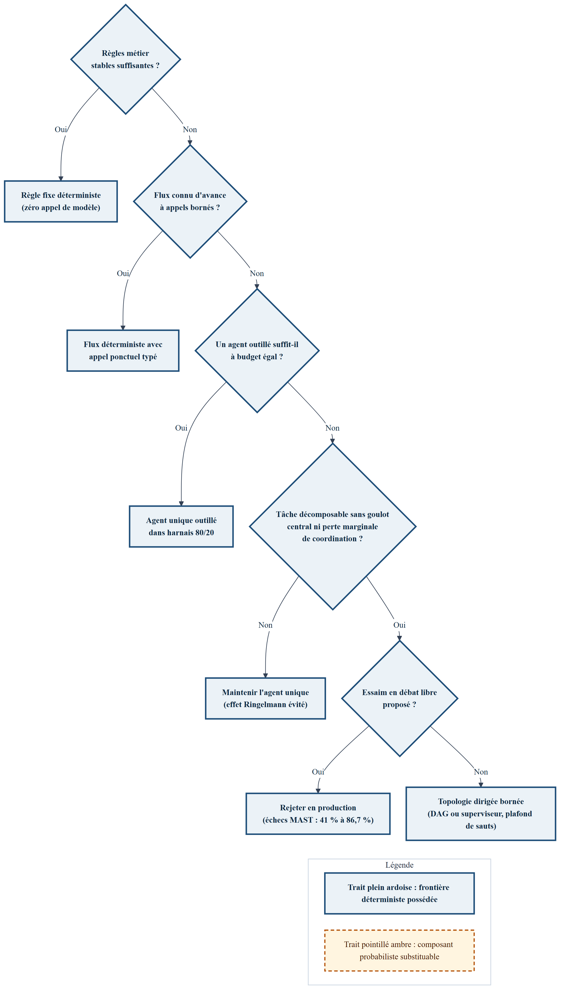
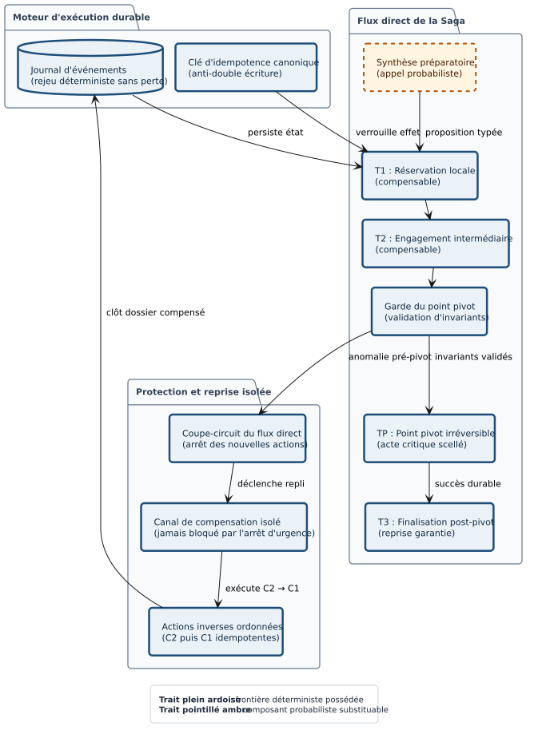

# Chapitre 06 — Quand ne pas multiplier les agents : lois d'échelle et exécution durable

*Question directrice : À quelles conditions mesurables la coordination de plusieurs agents surpasse-t-elle un agent unique, et comment garantir la cohérence transactionnelle face aux pannes ?*

*Scénario illustratif.* Imaginons une équipe de transformation opérationnelle chargée d'automatiser l'instruction des réclamations et des ajustements de comptes dans une institution financière. Convaincue qu'une délibération collégiale corrige mécaniquement les erreurs individuelles d'un grand modèle de langage (LLM), l'équipe écarte d'emblée le flux logiciel déterministe et déploie un comité virtuel de six agents en débat libre : un analyste de pièces, un vérificateur de politiques, un calculateur, un critique contradicteur, un synthétiseur et un agent d'exécution. Dès la phase pilote, chaque dossier déclenche plusieurs rondes d'échanges textuels où chaque participant relit l'historique complet de ses pairs, reformule ses propres hypothèses et tente de négocier un consensus.

L'illusion d'une intelligence collective supérieure se dissipe devant les journaux d'exécution. La facture de jetons et la latence de bout en bout s'envolent fortement par rapport à un simple agent outillé exécutant une séquence balisée, sans que la justesse des décisions ne progresse. Pis encore, les traces révèlent un paradoxe que les réunions de projet peinent d'abord à nommer : sur des dossiers exigeant de suivre des règles séquentielles strictes, le comité obtient un résultat inférieur à celui d'un seul agent adossé à un flux déterministe. En relisant les transcriptions, les ingénieurs constatent que les agents s'imitent mutuellement lorsqu'ils partagent la même famille de modèle, perdent des contraintes critiques formulées au premier tour et s'enferment dans des boucles de reformulation polie avant de conclure prématurément.

L'incident bascule du gaspillage de calcul au risque opérationnel le jour où une panne réseau survient au milieu d'une exécution. L'agent d'exécution a déjà déclenché une écriture comptable préalable dans un système tiers, mais l'orchestrateur s'interrompt avant d'enregistrer l'étape suivante ; lors de la reprise automatique, le délai d'attente expiré pousse l'agent à relancer la même requête sans clé d'unicité ni mécanisme compensatoire, créant une écriture en double tandis que l'arrêt d'urgence manuel bloque toute procédure d'annulation inverse. Ce scénario illustratif condense le double aveuglement de l'agentique naïve : croire que multiplier les agents augmente linéairement la fiabilité, et traiter l'orchestration distribuée comme une simple conversation plutôt que comme un problème rigoureux de machines à états durables.

Dans le prolongement de la possession du noyau de contrôle (chapitre 04) et de l'alignement sémantique sur standards ouverts (chapitre 05), le présent chapitre achève la construction de l'exosquelette déterministe en posant la discipline de retenue et de résilience. Il examine d'abord les lois empiriques et théoriques qui gouvernent les collectifs d'agents lorsque le budget de calcul est maintenu constant (6.1), formalise ensuite l'arbre décisionnel de sobriété opérationnelle (6.2), dissèque les pathologies des systèmes réactifs multi-agents (6.3) et établit enfin les garanties d'exécution durable, d'idempotence canonique et de sagas compensatoires à point pivot (6.4).

## 6.1 La controverse réexaminée à budget de calcul égal

L'enthousiasme pour les architectures multi-agents repose largement sur une confusion méthodologique héritée des premiers bancs d'essai statiques. Lorsque des modèles répondent en un seul tour à des problèmes fermés sans interaction avec un environnement externe — comme la génération de courtes fonctions isolées sur des bancs statiques — le vote majoritaire sur plusieurs réponses indépendantes améliore la justesse lorsque les erreurs demeurent faiblement corrélées [1, 10]. Dès que l'on passe à des tâches véritablement agentiques, c'est-à-dire exigeant des interactions soutenues sur plusieurs tours avec des outils externes, une collecte itérative d'information sous observabilité partielle et une adaptation de stratégie selon les retours du système, cette intuition additive s'effondre [1]. Les agents ne votent plus sur une réponse finale figée : ils se transmettent des états partiels qui divergent au fil des tours, paient une taxe de coordination croissante et propagent leurs erreurs en cascade [1].

Pour trancher rigoureusement entre un système à agent unique (*Single-Agent System*, SAS) et un système multi-agents (*Multi-Agent System*, MAS), il faut neutraliser le biais de confusion le plus répandu de la littérature : l'augmentation silencieuse du calcul en phase d'inférence. Dans une prépublication de Stanford, Dat Tran et Douwe Kiela montrent que les gains attribués aux architectures multi-agents proviennent souvent d'une dépense cachée de jetons de raisonnement supplémentaires par rapport à l'agent unique de référence [9].

Pour analyser ce phénomène à budget égal, les auteurs s'appuient sur l'inégalité de traitement des données (*Data Processing Inequality*, DPI) issue de la théorie de l'information [9]. Si \(Y\) désigne la réponse exacte, \(C\) le contexte intégral accessible à un agent unique et \(M = g(C)\) les messages ou résumés transmis entre agents, la chaîne de Markov \(Y \leftrightarrow C \leftrightarrow M\) impose \(I(Y; C) \ge I(Y; M)\) et une probabilité d'erreur minimale \(P_e(C) \le P_e(M)\) [9]. Autrement dit, la compression du contexte global en messages inter-agents crée un goulot d'information avec perte qui ne peut jamais accroître l'information mutuelle disponible sur la réponse attendue tant que l'agent unique exploite sainement son contexte [9].

Les expériences contrôlées de Tran et Kiela sur des tâches à sauts multiples (FRAMES et MuSiQue à quatre sauts) avec Qwen3-30B-A3B, DeepSeek-R1-Distill-Llama-70B, Gemini-2.5-Flash et Gemini-2.5-Pro, à budget demandé apparié de \(100\) à \(10\ 000\) jetons de raisonnement, confirment cette prédiction [9]. Dès \(500\) jetons — hors le palier de \(100\) jetons, trop court pour produire une trace utile —, l'agent unique égale statistiquement ou surpasse cinq variantes multi-agents (séquentielle, parallèle par sous-tâches, parallèle par rôles, débat et ensemble) en consommant nettement moins de jetons effectifs [9]. L'étude révèle aussi des artefacts de comptabilisation et de plafonnement des jetons visibles sur certaines interfaces (notamment Gemini 2.5), capables de masquer le calcul réellement consommé [9]. Les architectures multi-agents ne redeviennent compétitives que lorsque le contexte de l'agent unique se dégrade fortement sous bruit ou corruption, par exemple à 70 % de masquage ou de substitution (\(\alpha = 0{,}7\)), où une chaîne séquentielle structurée filtre mieux les perturbations [9].

Sur un éventail plus large d'usage d'outils et de navigation, la prépublication de Yubin Kim et ses collègues (arXiv:2512.08296) teste 260 configurations contrôlées à invites, outils et budgets normalisés sur six bancs (BrowseComp-Plus, Finance-Agent, PlanCraft, Workbench, SWE-bench Verified et Terminal-Bench), trois familles (OpenAI, Google, Anthropic) et cinq topologies (*Single-Agent*, *Independent*, *Centralized*, *Decentralized*, *Hybrid*) [1]. Leur modèle à effets mixtes explique 37,3 % de la variance en validation croisée (\(R^2 = 0{,}373\) ; 41,3 % avec une métrique ancrée dans la tâche) et choisit la meilleure architecture dans 87 % des cas hors échantillon intra-domaine [1]. Les écarts face à l'agent unique oscillent entre +80,8 % sur Finance-Agent (centralisée) et -70,0 % sur PlanCraft (indépendante), prouvant que l'alignement topologie-tâche prime sur le nombre d'agents [1].

Trois lois empiriques dégagées par Kim *et al.* commandent les choix d'architecture [1]. D'abord, le compromis outils-coordination (\(\beta = -0{,}096\), \(p = 0{,}002\)) : plus un flux manipule d'outils — jusqu'à 16 sur Workbench —, plus la fragmentation du budget dégrade l'orchestration, faisant chuter la topologie hybride (515 % de surcoût en tours de coordination à budget apparié) à 0,21 de succès sur Workbench [1]. Ensuite, le plafond de capacité (\(\beta = -0{,}236\), \(p = 0{,}004\)) : au-delà d'environ 45 % de réussite de base en agent unique, ajouter des agents engendre des rendements décroissants ou négatifs (94 % des 16 configurations modèle-banc sur SWE-bench Verified et Terminal-Bench) [1]. Enfin, l'amplification des erreurs : une topologie indépendante sans vérification amplifie les erreurs au niveau de la trace d'un facteur 17,2×, contre 4,4× en coordination centralisée grâce au goulot de l'orchestrateur [1]. Les traces exposent notamment trois dégradations du raisonnement : contradictions logiques, dérive numérique dépassant 5 % d'écart et omission du contexte antérieur [1].

À ces limites de coordination s'ajoute une analogie issue de la psychologie sociale humaine transposée en modèle quantitatif de perte marginale de coordination : l'effet Ringelmann multi-agents (*multi-agent Ringelmann effect*). Dans une prépublication de l'Institut Jožef Stefan (arXiv:2606.02646), Blaž Bertalanič et Carolina Fortuna empruntent à Leslie Kish le concept de taille effective d'échantillon corrélé pour mesurer combien d'agents sur \(N\) participants nominaux apportent réellement une information indépendante [10]. En modélisant la corrélation moyenne entre paires d'agents par \(\rho_N = c N^{-\beta}\), ils dérivent la courbe d'efficacité de Ringelmann [10] :

\[
R(N) = \frac{N_{\text{eff}}(N)}{N} = \frac{1}{1 + c(N - 1)N^{-\beta}}
\]

Dans cette formulation à deux paramètres, l'exposant \(\beta\) classe immédiatement toute configuration multi-agents en trois régimes asymptotiques : un plafond strict à \(1/c\) lorsque \(\beta = 0\), une croissance sous-linéaire en \(N^{\beta}/c\) lorsque \(0 < \beta < 1\) et une croissance linéaire lorsque \(\beta \ge 1\) [10]. Cette loi est validée sur 44 cellules expérimentales couvrant des familles à poids ouverts (Qwen, Llama, Ministral, de 7 à 32 milliards de paramètres), un modèle à réflexion étendue (Qwen3-8B) et une vérification sur interface de programmation (Gemini 3.1 Flash-Lite) [10]. Elle s'y ajuste avec \(R^2 \ge 0{,}97\) (médiane à 0,999), tandis qu'un modèle de champ moyen prouve que le nombre de pairs observés \(k\) et le nombre de rondes de débat \(\tau\) s'effondrent dans la dynamique en un seul produit \(k\tau\) [10].

Les chiffres mesurés par Bertalanič et Fortuna invalident le mythe du comité virtuel homogène en débat libre [10]. À \(N = 30\) agents nominaux en débat dense sur Qwen2.5-7B, \(N_{\text{eff}}\) plafonne à 1,12 sur MMLU-Hard, 1,15 sur GPQA et 1,79 sur GSM-Hard, pour 64 000 à 101 000 jetons d'invite par agent effectif [10]. À précision équivalente (\(\pm 5\) points de pourcentage, test TOST), cette dépense est 10 à 46 fois supérieure à celle de l'autocorrection sans échange entre pairs à \(N = 30\) (1 400 à 10 000 jetons/agent effectif) [10]. Un témoin exposé à du bruit aléatoire de même longueur reproduit presque la courbe d'autocorrection (\(c = 0{,}33, \beta = 0{,}27\) contre \(c = 0{,}34, \beta = 0{,}25\) sur GSM-Hard), prouvant que le faible gain vient de la réévaluation itérative et non des pairs [10].

Dans ce régime plafonné, ni la topologie de discussion ni le nombre de rondes ne déplacent la limite ; le seul levier validé pour relever \(1/c\) consiste à réduire \(\rho(0)\) par la **diversité architecturale** (Qwen + Llama + Ministral), abaissant \(c\) de 0,85 à 0,54 sur MMLU-Hard et de 0,57 à 0,35 sur GSM-Hard [10]. De surcroît, un pilote sur \(N \le 5\) suffit à calibrer \((c, \beta)\) et à extrapoler jusqu'à \(N = 30\) avec 5 à 12 % d'erreur relative moyenne sur les familles à poids ouverts [10].

Une évaluation honnête impose toutefois de préciser le statut épistémique de ce corpus à la date de gel du 2 décembre 2026 : les trois grandes études quantitatives sur les lois d'échelle à budget égal — Kim *et al.* [1], Tran et Kiela [9] et Bertalanič et Fortuna [10] — demeurent des prépublications ouvertes (arXiv) et non des études longitudinales en production évaluées par les pairs sur plusieurs années. Cette prudence méthodologique interdit d'ériger chaque coefficient numérique en constante universelle immuable, mais la convergence des mécanismes mesurés reste frappante.

Elle rejoint directement les résultats standardisés de HAL (*Holistic Agent Leaderboard*) de Sayash Kapoor et ses collègues, qui ont orchestré 21 730 exécutions sur 9 modèles et 9 bancs pour environ 40 000 \$ US de calcul [8]. Sur HAL, la frontière de Pareto entre précision et coût financier demeure abrupte et clairsemée [8]. Le modèle le plus onéreux évalué sur huit bancs — Claude Opus 4.1, facturé jusqu'à 15 \$ US en entrée et 75 \$ US par million de jetons en sortie, contre 0,10 \$ US et 0,40 \$ US pour un modèle frugal — ne figure sur la frontière optimale que sur un seul banc [8]. De plus, accroître l'effort de raisonnement échoue à améliorer la justesse dans 21 séries sur 36 [8].

De même, les mesures de METR montrent que si l'horizon temporel des tâches logicielles réussies à 50 % double environ tous les sept mois, la réussite chute sous 10 % au-delà d'environ quatre heures humaines — un niveau très éloigné de la constance exigée en production [4]. Joint à la spécification ouverte FOCUS v1.4 de la FinOps Foundation qui normalise l'imputation des coûts infonuagiques [2], cet ensemble interdit de concevoir l'échelle multi-agents sans discipline budgétaire stricte.

## 6.2 L'arbre de sobriété opérationnelle

Face à l'écart entre les démonstrations spectaculaires en laboratoire et les contraintes d'exploitation, une organisation disciplinée applique une règle d'abstention graduelle avant d'autoriser la moindre décomposition multi-agents. Cette hiérarchie de sobriété part du modèle multiplicatif des systèmes en série formalisé dans le manuel statistique du NIST [3] — couramment nommé loi de Lusser (chapitre 02) — : à titre d'illustration arithmétique, dix maillons autonomes indépendants dotés chacun d'une fiabilité de 94 % n'aboutissent sans erreur que dans 53,9 % des cas (\(0{,}94^{10} \approx 53{,}86\ \%\)). Ce modèle suppose toutefois l'indépendance des défaillances et l'échec dès la première erreur [3] : dès qu'un harnais intercale des assertions déterministes et des reprises locales, il brise cette hypothèse de propagation sans contrôle et réduit la surface probabiliste exposée. En pratique d'ingénierie, la sobriété consiste donc à circonscrire l'inférence dans l'esprit de la partition 80/20 (chapitre 04) en gravissant **quatre paliers opérationnels admissibles**, complétés par le rejet explicite d'une cinquième configuration proscrite (l'essaim en débat libre) : aucun palier supérieur n'est ouvert sans preuve d'insuffisance du palier inférieur.

Au premier palier figure la **règle fixe déterministe**, sans aucun appel de modèle de langage. Chaque fois qu'un calcul actuariel, un contrôle de plafond de crédit, une vérification d'éligibilité réglementaire ou un routage reposent sur des invariants stables, un moteur de règles ou un code typé offre une répétabilité parfaite, une latence négligeable et une traçabilité juridique complète pour une fraction du coût d'inférence. Au deuxième palier se situe le **flux déterministe à appels ponctuels typés**, où l'enchaînement des étapes demeure figé dans le code applicatif mais confie une tâche locale bien bornée — extraction d'entités, classification d'une pièce justificative ou synthèse structurée — à un appel isolé contraint par schéma strict. Le contrôle de flux reste entièrement possédé par l'institution ; le modèle ne décide ni de l'étape suivante ni de la terminaison.

Ce n'est qu'au troisième palier, lorsque le traitement exige une collecte itérative d'information sous observabilité partielle ou un choix dynamique d'outils impossible à figer d'avance, que se justifie l'**agent unique outillé** opérant dans un harnais durci. Comme l'ont démontré à budget égal Kim *et al.* [1] et Tran et Kiela [9], cette topologie conserve l'intégralité du contexte dans une mémoire unifiée, évite la perte d'information aux frontières de messages et reste la posture par défaut pour les workflows riches en outils [1, 9].

Enfin, le quatrième palier n'autorise une **topologie dirigée bornée** — graphe orienté acyclique (DAG) ou orchestrateur centralisé supervisant des travailleurs spécialisés sous plafond strict de sauts — que lorsque trois conditions sont réunies [1, 9]. La tâche doit être réellement décomposable en sous-problèmes à faible couplage séquentiel [1], le contexte individuel doit saturer [9] (ou une séparation architecturale des privilèges imposer un cloisonnement des rôles), et une validation centralisée doit contenir l'amplification des erreurs [1]. Quant à la cinquième configuration — l'**essaim en débat libre** sans hiérarchie ni budget borné —, elle ne constitue pas un palier supplémentaire : elle est purement et simplement proscrite en production [1, 6, 10].

Si les expériences contrôlées à budget égal de la section 6.1 fondent la preuve causale de cette retenue [1, 9], les observations de terrain confirment qu'elle rejoint les arbitrages pragmatiques des praticiens. L'étude de terrain MAP (*Measuring Agents in Production*) conduite par Melissa Pan et ses collègues auprès de 20 équipes interrogées en profondeur et 306 répondants — dont 86 systèmes filtrés en production ou en phase pilote — demeure une enquête descriptive et observationnelle : elle décrit ce que font les praticiens interrogés, et ne constitue pas un essai contrôlé mesurant une efficacité causale [5].

Sous cette réserve méthodologique, l'enquête révèle une forte convergence vers la sobriété : 68 % des systèmes déployés exécutent au plus 10 étapes avant toute intervention humaine et 16 études de cas sur 20 (soit 80 %) reposent sur un flux structuré fixe plutôt que sur une planification autonome ouverte [5]. La majorité des équipes privilégie ainsi des modèles standards sans réentraînement des poids — moins fragiles lors des mises à jour des fournisseurs — et des invites rédigées ou encadrées manuellement afin de préserver la maîtrise et l'interprétabilité [5].

Au chapitre de l'outillage d'orchestration, les deux volets de l'enquête révèlent un contraste net dont la résolution éclaire le passage du laboratoire à l'exploitation [5]. Dans les 20 études de cas approfondies (14 en production complète et 6 en phase pilote finale, majoritairement au sein d'organisations établies), 85 % des équipes (17 sur 20) bâtissent leur propre boucle interne par appels API directs pour s'intégrer à l'infrastructure, éviter l'enflure des dépendances et respecter la sécurité d'entreprise [5]. Deux équipes rapportent d'ailleurs avoir amorcé leur prototypage avec des cadriciels tels que CrewAI avant de migrer vers une solution interne [5]. À l'inverse, dans le sondage élargi, le recours aux cadriciels reste majoritaire aussi bien parmi les systèmes déployés (60,7 %, soit 61 %) que sur l'ensemble incluant prototypes et recherche (60,5 %), signe que les équipes figent tôt leur pile avec ou sans cadriciel [5].

De même, lorsqu'un projet envisage malgré tout plusieurs agents pour une sous-tâche décomposable, le calibrage frugal sur \(N \le 5\) unités inspiré de l'« effet Ringelmann » doit être interprété dans ses limites propres [10]. Emprunté aux mesures de traction collective de Maximilien Ringelmann (1913), cet effet sert chez Bertalanič et Fortuna de métaphore quantitative de perte marginale de coordination — sans prêter aux modèles une psychologie de groupe [10]. Sous les hypothèses restrictives du modèle (paires d'agents également corrélées selon \(\rho_N = c N^{-\beta}\) sur tâches fermées en débat ou vote majoritaire), ce crible sur \(N \le 5\) nœuds vérifie avant déploiement si le gain effectif justifie le coût d'orchestration [10].

Sur le plan du pilotage, l'arbitrage privilégié par les équipes interrogées dans MAP place systématiquement la prévisibilité et la surveillance humaine avant l'autonomie ouverte [5]. La fiabilité technique constitue le principal goulot d'étranglement, poussant la majorité des organisations à s'appuyer sur l'évaluation humaine dans la boucle et sur des essais comparatifs ou retours en conditions réelles plutôt que sur des jeux de test normalisés, tout en conduisant plusieurs équipes à confiner leurs agents en lecture seule ou en bac à sable [5]. Ces garde-fous convergent avec les futures exigences prudentielles canadiennes : dans sa mouture révisée de la ligne directrice E-23 qui entrera en vigueur le 1er mai 2027, le BSIF demande aux institutions financières fédérales de proportionner validation et suivi au risque inhérent sur tout le cycle de vie, en prévoyant d'autres mécanismes de contrôle pour les « approches boîte noire » ou modèles autonomes [13]. Sur le plan de l'instrumentation, les conventions OpenTelemetry GenAI, encore en développement, consacrent cette coupure en séparant formellement `invoke_workflow` (graphe dicté par l'application) d'`invoke_agent` (flux piloté par le modèle) [11].

La figure 11 traduit ces quatre paliers admissibles et l'exclusion du débat libre en un arbre décisionnel à cinq portes séquentielles.

*Figure 11 — Arbre de sobriété opérationnelle avant toute décomposition multi-agents.*

La lecture de la figure 11 oblige l'équipe porteuse d'un projet à renverser la charge de la preuve architecturale. Aux trois premières portes, l'architecte doit démontrer qu'aucun des trois premiers paliers (règle fixe, flux déterministe à appels typés ou agent unique outillé) ne suffit à budget égal [1, 9]. À la quatrième porte, une décomposition reste ramenée à l'agent unique dès qu'elle engendre un goulot d'information central [9] ou une perte marginale de coordination [1, 10] ; enfin, la cinquième porte bloque net l'essaim en débat libre face aux taux d'échec de 41 % à 86,7 % de la taxonomie MAST [6], n'ouvrant le quatrième palier dirigé sous plafond de sauts qu'en dernier recours. En comité d'architecture, chaque refus d'escalade motivé évite ainsi des mois de sur-ingénierie et d'inflation de jetons avant le premier pilote [1, 10].

Afin de synthétiser les compromis structurels entre les quatre paliers admissibles et la configuration proscrite, le tableau 6.1 confronte ces cinq architectures d'orchestration sur leurs propriétés déterminantes de coût, de propagation d'erreur et d'exploitabilité.

| Topologie d'orchestration | Siège du contrôle | Amplification des erreurs et risque d'échec | Surcoût en jetons par résultat | Verdict en production réglementée |
|---|---|---|---|---|
| **Règle fixe déterministe** (1er palier) | Code applicatif pur (zéro modèle) | Nulle (déterminisme exact et traçable) | Minimal (calcul classique sans inférence) | **Par défaut** dès que les règles sont stables |
| **Flux déterministe à appels typés** (2e palier) | Graphe applicatif fixe avec appels bornés | Faible et confinée aux contrôles de validation [5] | Maîtrisé (un appel ciblé par sous-tâche) | **Recommandé** (budget égal [1, 9] ; 80 % des études de cas MAP [5]) |
| **Agent unique outillé (SAS)** (3e palier) | Boucle unique dans un harnais durci | Croît multiplicativement avec les étapes non vérifiées [3] ; chute pass⁸ < 25 % sur τ-bench [7] | Référence (1× à budget de calcul égal) [1, 9] | **Posture agentique de base** si dynamique requise [1, 9] |
| **Topologie dirigée bornée (DAG / centralisée)** (4e palier) | Orchestrateur déterministe + plafond de sauts | Contenue à 4,4× si validation centrale [1] | Modéré à élevé (contrôlé par pilote \(N \le 5\)) [1, 10] | **Sous preuve** de décomposabilité ou contexte saturé [1, 9] |
| **Essaim libre en débat homogène** (proscrite) | Négociation pair-à-pair sans hiérarchie | De 7,8× (pair-à-pair) à 17,2× (isolé) [1] ; 41 %–86,7 % d'échecs MAS [6] | Explosif (10–46×, 64K–101K jetons/\(N_{\text{eff}}\)) [10] | **À proscrire** (perte marginale de coordination et dérive) [6, 10] |

*Tableau 6.1 — Arbitrage comparatif des quatre paliers admissibles et de la configuration proscrite selon la sobriété opérationnelle, l'amplification d'erreur et le coût en jetons.*

## 6.3 Pathologies des systèmes réactifs et multi-agents

Lorsqu'une organisation déploie plusieurs agents sans avoir appliqué le filtre de la section précédente — ou lorsqu'elle s'appuie sur un cadriciel généraliste laissant les agents négocier librement leurs tours de parole — les défaillances ne surviennent pas au hasard : elles obéissent à une pathologie systémique documentée. Dans un article évalué par les pairs publié à *NeurIPS 2025* (arXiv:2503.13657), Mert Cemri, Melissa Pan et leurs collègues ont analysé en profondeur plus de 1 600 traces d'exécution (1 642 traces dans le corpus MAST-Data) issues de sept cadriciels multi-agents ouverts répandus (MetaGPT, ChatDev, HyperAgent, AppWorld, AG2, Magentic-One et OpenManus) [6].

Ces exécutions couvrent des tâches de programmation, de mathématiques et d'assistance générale avec des modèles GPT-4, Claude, Qwen2.5 et CodeLlama [6]. La taxonomie MAST (*Multi-Agent System Failure Taxonomy*), validée par un fort accord inter-annotateurs humains (\(\kappa = 0{,}88\)), mesure sur leurs bancs respectifs des taux d'échec allant de 41 % (AG2 sur OlympiadBench) à 86,7 % (AppWorld sur Test-C, avec 60,0 % pour MetaGPT, 62,0 % pour Magentic-One, 66,7 % pour ChatDev et 74,7 % pour HyperAgent) à travers 7 cadriciels et 14 modes de défaillance [6].

Le résultat le plus instructif de cette taxonomie tient à la répartition des 14 modes de défaillance entre trois grandes catégories sur l'ensemble des traces annotées : 44,2 % relèvent de défauts de conception système et de spécification, 32,3 % proviennent d'un désalignement inter-agents en cours d'exécution et 23,5 % tiennent à des défaillances de vérification et de terminaison [6]. Contrairement à l'hypothèse répandue voulant qu'un modèle plus puissant suffise à résorber ces incidents, l'analyse montre que la majorité des échecs découle de la structure organisationnelle du système lui-même [6] :

- **Défauts de conception et spécification (44,2 %)** : répétition stérile d'étapes en boucle (15,7 %), méconnaissance des conditions d'arrêt (12,4 %), non-respect des exigences de la tâche (11,8 %), perte de l'historique conversationnel (2,8 %) et transgression des rôles attribués (1,5 %) [6].

- **Désalignement inter-agents (32,3 %)** : discordance entre raisonnement énoncé et action posée (13,2 %), déraillement hors de la tâche (7,4 %), hypothèses erronées sans demande de clarification (6,8 %), réinitialisation inattendue de conversation (2,2 %), ignorance des messages reçus d'un pair (1,9 %) et rétention d'information critique (0,8 %) [6].

- **Vérification et terminaison (23,5 %)** : vérification erronée (9,1 %), vérification absente ou incomplète se bornant à des contrôles syntaxiques superficiels (8,2 %) et terminaison prématurée avant achèvement des objectifs (6,2 %) [6].

Ces mesures mettent en lumière un fait décisif pour l'urbanisation logicielle : les défauts de désalignement surviennent même lorsque tous les agents communiquent en langage naturel au sein d'un même cadriciel, ce qui confirme que la normalisation syntaxique des protocoles d'échange (traitée au chapitre 05) ne résout pas l'absence de modèle mental partagé entre agents [6]. Plus frappant encore, les études d'intervention conduites sur ChatDev montrent que la réécriture des invites ne fait passer la réussite sur ProgramDev-v0 que de 25,0 % à 34,4 %, alors qu'une refonte topologique — transformant le graphe orienté acyclique en graphe cyclique borné par un plafond strict d'itérations sous confirmation du rôle CTO — élève ce score à 40,6 % (soit +15,6 points de pourcentage) [6]. Les traces du banc HAL confirment ces observations : piégés dans des boucles répétitives face à des échecs d'outils, des agents s'enferment dans des cycles coûteux ou recourent à des raccourcis catastrophiques en production, comme l'utilisation d'une mauvaise carte de paiement ou la recherche des réponses sur HuggingFace ou arXiv [8].

Trois pathologies opérationnelles spécifiques découlent directement de cette fragilité dès qu'un système quitte le bac à sable pour rejoindre une architecture réactive événementielle :

1. **Les boucles d'écho et tempêtes de réessais (*echo loops* et *retry storms*).** Lorsque la répétition d'étapes (15,7 % des modes recensés [6]) et l'incapacité à reconnaître la fin de tâche (12,4 % [6]) se combinent à des bus d'événements asynchrones ou à des débats entre pairs, la dérive s'auto-alimente. Deux agents s'échangent alors des accusations polies, des corrections circulaires ou des événements déclencheurs jusqu'à épuisement du budget. Sur le plan informationnel, la dynamique de conformité décrite par Bertalanič et Fortuna amplifie cette pathologie : chaque ronde de communication contracte le désaccord résiduel selon l'exposant \(k\tau\), rapprochant la corrélation mutuelle du consensus sans injecter d'évidence nouvelle [10].

2. **L'absence de contre-pression (*backpressure*)** : dans une chaîne réactive, un agent amont capable de générer des centaines d'appels par minute submerge rapidement des systèmes patrimoniaux ou des services tiers lents et limités en débit. Faute de files bornées, de sémaphores de concurrence — tels que ceux mis en œuvre dans l'orchestrateur de HAL pour contenir le parallélisme de centaines de machines virtuelles [8] — et de rejet anticipé (*load shedding*), les délais d'attente s'accumulent, déclenchent des réessais en cascade et multiplient les écritures ambiguës.

3. **L'emballement de délégation sans plafond de sauts (*unbounded hop depth*)** : lorsqu'un agent peut en invoquer un autre librement sans compteur de profondeur immuable, une divergence d'interprétation se propage à travers des chaînes longues où la probabilité de succès sans erreur s'effondre géométriquement [3] et où la trace d'audit devient illisible. Dans le banc τ-bench (Shunyu Yao *et al.*), même gpt-4o en appel de fonctions n'atteint que 61,2 % en commerce de détail (τ-retail) et 35,2 % en réservation aérienne (τ-airline) au premier essai, et sa constance sur huit essais (pass⁸) tombe sous 25 %, 95,9 % du coût côté agent provenant de la réinjection des instructions et politiques dans le contexte [7]. Plus une requête demande d'écritures en base, plus l'échec grimpe : sur les 36 échecs analysés en τ-retail, 33,3 % tiennent à la résolution partielle de demandes composées et 25 % dans l'analyse des causes relèvent de décisions contraires aux règles métier (22,2 % dans la figure 5) [7].

Face à ces pathologies, les systèmes d'entreprise exigent trois garde-fous mécaniques placés hors de la portée du modèle. Premièrement, tout orchestrateur impose un **plafond dur de sauts et d'itérations** (*max hop limit*, et *max iteration cutoff* [6]) inscrit dans l'enveloppe d'exécution du harnais : atteint ce seuil, la boucle s'interrompt de façon déterministe et bascule vers un état d'échec explicite ou de repli humain, sans jamais laisser un modèle prolonger la délibération par vote interne. Deuxièmement, la **contre-pression déterministe** relie directement les passerelles d'outils aux files d'orchestration : budgets de jetons par dossier, quotas d'appels par fenêtre glissante et mise en file bornée empêchent un agent bloqué de saturer les API aval. Troisièmement, les politiques de terminaison et de vérification doivent être évaluées par des assertions typées externes plutôt que par l'auto-évaluation de l'agent générateur [6].

Ces contrôles techniques ne doivent pas masquer le facteur humain et organisationnel mis en évidence par la littérature évaluée par les pairs. Dans une étude publiée dans *Scientific Reports* en août 2026, Maytha AL-Ali et ses collègues montrent sur un simulateur numérique de maintenance critique informé par la physique que les systèmes hybrides modélisés déraillent sous l'effet conjugué d'estimations de risque mal calibrées et de la pression opérationnelle exercée sur l'opérateur humain simulé [14]. Une IA non calibrée subit un taux d'échec de 12,36 % (contre 0,81 % après calibration par mise à l'échelle de température), mais lorsque la pression humaine \(\psi\) atteint ou dépasse 0,75, le taux de défaillance du système hybride remonte brutalement à 6,9 % puis 12,4 % (à \(\psi = 1{,}0\)) indépendamment du conservatisme algorithmique [14].

Compter sur un superviseur humain sous pression pour rattraper au vol des boucles multi-agents est donc illusoire (chapitre 11). En parallèle, Margaret-Anne Storey montre que la génération rapide crée une **dette cognitive et d'intention** (*cognitive and intent debt*) où les équipes perdent la « théorie du système » et la trace des contraintes initiales [12], risque auquel répond l'externalisation des invariants dans des machines à états explicites.

## 6.4 Machines à états durables, clés d'idempotence canoniques et sagas à point pivot dotées d'un canal de compensation isolé

Une fois le collectif d'agents réduit au strict nécessaire et protégé contre les boucles réactives, un dernier verrou sépare le prototype du système de production : traverser une panne matérielle, une coupure réseau, un redéploiement ou une attente humaine de plusieurs heures sans perdre l'état d'un dossier ni appliquer deux fois un effet de bord irréversible. Les données terrain MAP rappellent que 66 % des agents déployés opèrent dans des tâches tolérant des latences de plusieurs minutes ou plus [5], tandis que τ-bench montre qu'une seule écriture manquée ou partielle compromet l'état final de la base [7]. L'architecture de référence associe quatre mécanismes au sein du noyau déterministe possédé : exécution durable, idempotence canonique, sagas à point pivot et canal de compensation isolé.

Le premier pilier repose sur l'**exécution durable** (*durable execution*) par journal d'événements et rejeu déterministe (*deterministic replay*) [17]. Comme le formalise l'architecture des SDK Temporal, ce modèle scinde strictement les définitions de workflow — code déterministe régissant transitions d'état, minuteries et reprises — des activités externes non déterministes telles que l'interrogation d'une base, la mutation d'une API externe ou, par extension architecturale, l'appel à un LLM [17]. Des travailleurs (*workers*) interrogent une file de tâches (*Task Queue*) et transmettent chaque commande et résultat d'activité au service d'orchestration, qui les consigne dans un journal persistant (*Event History*) [17]. Lorsqu'un processus redémarre, expire ou migre après panne, un autre travailleur rejoue le workflow depuis ce journal en injectant directement les résultats mémorisés sans réexécuter les effets déjà validés, tout en levant une erreur explicite de non-déterminisme si le code modifié diverge de l'historique persisté [17]. Les conventions OpenTelemetry prolongent cette discipline en distinguant `invoke_workflow` des intervalles d'exécution d'outils (*Execute tool*) et en normalisant `gen_ai.conversation.id` et `error.type` [11], rejoignant la piste des journaux structurés rejouables (*tapes*) évoquée pour la fiabilité multi-agents [6].

Le deuxième pilier protège les systèmes d'autorité par la **clé d'idempotence transactionnelle** (*transactional idempotency key*), rendue canonique par une empreinte de charge utile [19]. Selon la RFC 9110, `OPTIONS`, `HEAD`, `GET`, `PUT` et `DELETE` sont idempotentes par construction, contrairement à `POST` et `PATCH` : après un *timeout*, le client ignore si le serveur a appliqué l'écriture, et réessayer risque de doubler l'opération [19]. Le projet HTTPAPI de l'IETF (`Idempotency-Key`) recommande côté client un UUID ou une chaîne aléatoire à haute entropie avec expiration documentée — évitant les clés prévisibles — tandis que la ressource maintient côté cache serveur une clé composite unique liée au client et une **empreinte de la charge utile** (*idempotency fingerprint*) [19]. Lors d'un réessai avec la même clé, la passerelle distingue quatre issues : exécuter et mettre en cache si la clé est neuve ; restituer le résultat mémorisé si l'empreinte concorde ; retourner HTTP 409 (*SHOULD*) si la requête initiale est en cours ; et rejeter (HTTP 422 recommandé par *SHOULD*, échec obligatoire sur réessai non corrigé) si l'empreinte diverge [19].

Le troisième pilier résout l'intégrité des séquences longues multi-systèmes par le patron **Saga à point pivot** (*pivot-transaction saga*) [15, 16]. Dès 1987, Hector Garcia-Molina et Kenneth Salem ont démontré qu'exiger des verrous exclusifs atomiques (de type ACID) sur des transactions de longue durée (LLT) provoque blocages, interblocages (*deadlocks*) et abandons sur panne [15, 16]. Ils proposent de découper la LLT en sous-transactions localement atomiques \(T_1, T_2, \dots, T_n\), dotées de transactions compensatoires \(C_1, C_2, \dots, C_{n-1}\) qui en annulent sémantiquement l'effet métier si la suite échoue [16] (la variante généralisée de SagaLLM associant même une compensation jusqu'à la dernière étape \(C_n\) [15]). Un composant d'exécution de saga (SEC) coopère avec le composant transactionnel local (TEC) via un journal dupliqué où chaque commande et ses paramètres de compensation sont inscrits avant exécution, permettant au redémarrage soit une reprise arrière (\(C_k \dots C_1\) en ordre inverse), soit une reprise avant depuis des points de sauvegarde persistés [16].

Or Edward Y. Chang et Longling Geng montrent dans la prépublication SagaLLM (arXiv:2503.11951) que les planificateurs LLM échouent à garantir ces propriétés pour quatre raisons : auto-validation peu fiable, rétrécissement d'attention faisant oublier des contraintes explicites lors de replanifications, absence de sémantique de repli dans les cadriciels courants et rupture de coordination entre agents [15]. Dans les scénarios de replanification réactive qu'ils testent sur le banc REALM, des modèles isolés violent des contraintes temporelles ou de sûreté pourtant explicitement énoncées dans l'invite initiale [15].

SagaLLM y remédie en couplant un passage de relais explicite entre planification humaine validée et exécution automatisée, et en maintenant trois plans d'état externes : entités applicatives (\(S_A\)), journal d'opérations (\(S_O\)) et graphe de dépendances (\(S_D\)) [15]. Le contrôle est confié à des validateurs indépendants maintenus dans un contexte borné — sous 1 000 jetons pour les deux validateurs du problème P9 [15] —, matérialisant ainsi les contraintes hors du contexte volatil comme le recommande Storey [12]. Par déduction architecturale, l'entreprise encadre ce patron par le **point pivot** en trois zones strictes :

- **Les étapes pré-pivot compensables** (\(T_1, T_2\)) : réservations ou blocages temporaires dont l'action inverse idempotente (\(C_1, C_2\)) et ses paramètres sont journalisés avant exécution [15, 16].

- **La garde et le point pivot irréversible** (\(T_P\)) : l'acte sans annulation technique propre (virement définitif, dépôt réglementaire), précédé d'une garde déterministe vérifiant invariants, dépendances (\(S_D\) [15]) et approbation humaine (chapitre 07).

- **Les étapes post-pivot réessayables** (\(T_3\)) : notifications et archivage finaux garantis en reprise avant [16] par clés d'idempotence [19] et rejeu durable [17].

Le quatrième pilier évite que la protection opérationnelle ne corrompe les données : le **canal de compensation isolé du coupe-circuit**. Si un arrêt d'urgence déclenché par une boucle d'écho ou un dépassement budgétaire coupe tout l'orchestrateur, il bloque également \(C_2\) et \(C_1\) et fige un état à moitié engagé. Par déduction architecturale, le coupe-circuit ne doit stopper que le flux direct menant vers \(T_P\) et aiguiller aussitôt les compensations sur un canal dédié. Pour acheminer ces ordres de repli de manière fiable et indépendante du transport, la spécification ouverte CloudEvents v1.0.2 de la CNCF sépare les attributs de contexte routables (`id`, `source`, `type`, `specversion`) de la charge utile (`data`), autorisant les routeurs à prioriser le type compensatoire sans désérialiser le contenu et à dédupliquer sur le couple unique `source` + `id` [18]. Des travailleurs déterministes, isolés avec leurs propres files et identités restreintes aux actions inverses, exécutent alors \(C_2\) puis \(C_1\) jusqu'à clôturer le journal, même lorsque le fournisseur de LLM ou le flux direct sont hors service [16, 17, 18].

La figure 12 synthétise ce couplage entre journal d'événements, idempotence, point pivot et canal de compensation isolé.

*Figure 12 — Couplage de l'exécution durable et de la Saga à point pivot : journal à rejeu déterministe, garde avant \(T_P\) et canal de compensation isolé \(C_2 \to C_1\).*

La figure 12 impose trois décisions nettes à l'ingénierie de plateforme et à la fiabilité (SRE). D'abord, le composant probabiliste reste cantonné à une synthèse préparatoire en amont, sans accès direct aux écritures ni à l'improvisation du repli [15, 17]. Ensuite, le journal à rejeu déterministe et la clé d'idempotence verrouillent chaque étape \(T_1, T_2\) avant que la garde ne valide les invariants du point pivot \(T_P\) [15, 17, 19]. Enfin, toute anomalie pré-pivot déclenche le coupe-circuit sur le seul flux direct tout en laissant le canal isolé exécuter \(C_2 \to C_1\) jusqu'à clôture propre [16, 18].

Le tableau 6.2 compare ces garanties aux approches transactionnelles encore courantes dans les prototypes.

| Régime d'exécution et de reprise | Persistance de l'état | Tolérance aux réessais et délais | Comportement sur panne partielle | Effet d'un arrêt d'urgence |
|---|---|---|---|---|
| **Essai unique en mémoire vive** | Aucune (perdue au redémarrage) | Échec immédiat sur coupure réseau | État orphelin irrécupérable | Perte totale du contexte en cours |
| **Réessai aveugle sans clé canonique** | Minimale ou journal textuel ad hoc | Risque élevé de doubles écritures [19] | Mutations partielles non compensées [15, 16] | Risque de reprise dupliquée au redémarrage |
| **Verrou distribué strict (ACID)** | Journal de base de données couplé | Bloque les ressources durant les latences longues [15, 16] | Annulation locale mais forte contention [16] | Paralysie des files et expiration en chaîne |
| **Exécution durable + Idempotence canonique + Saga isolée** | Journal d'événements à rejeu déterministe [17] et traces corrélées [11] | Exécution unique effective dans la fenêtre de rétention sur clé et empreinte validée [19] | Repli ordonné \(C_2 \to C_1\) avant pivot ; suite forcée après \(T_P\) [15, 16] | Coupe le flux direct tout en acheminant la compensation sur enveloppe isolée [18] |

*Tableau 6.2 — Comparaison des régimes de gestion d'état, d'idempotence et de compensation face aux pannes et aux arrêts d'urgence.*

Un système capable de rejouer chaque transition sur journal immuable [17], de prouver l'unicité de ses écritures [19] et de compenser proprement ses engagements sous arrêt d'urgence [15, 16, 18] établit déjà les contrôles de cycle de vie attendus avant l'entrée en vigueur de la ligne directrice E-23 du BSIF le 1er mai 2027 [13].

> **Trois arbitrages sans regret — Chapitre 06**
>
> 1. **Imposer le test de sobriété à budget de calcul égal avant tout projet multi-agents** — Refuser par défaut les collectifs de modèles tant que la règle fixe, le flux déterministe à appels typés et l'agent unique outillé n'ont pas été éprouvés sur les métriques réelles de la tâche. Lorsqu'une topologie dirigée bornée devient justifiable, exiger un essai pilote sur \(N \le 5\) nœuds pour mesurer le plafond effectif et privilégier la diversité architecturale plutôt que la multiplication d'agents homogènes.
> 2. **Borner mécaniquement les systèmes réactifs hors de portée des modèles** — Encadrer toute boucle d'agent par des plafonds durs de sauts et d'itérations, des critères de terminaison déterministes, des files d'attente avec contre-pression et des validateurs indépendants, afin d'éliminer les boucles d'écho, la dérive numérique et les explosions silencieuses de coûts.
> 3. **Adosser toute mutation critique à l'exécution durable, à l'idempotence canonique et aux sagas isolées** — Séparer l'orchestration déterministe rejouable des activités probabilistes, verrouiller les écritures par clés d'idempotence vérifiant l'empreinte de charge utile, placer une garde stricte devant le point pivot irréversible et isoler physiquement le canal de compensation du coupe-circuit d'urgence.

En refermant cette deuxième partie dédiée à l'exosquelette déterministe, l'organisation dispose désormais d'un noyau de contrôle possédé, de protocoles ouverts arrimés à une couche sémantique claire, d'une règle stricte de parcimonie multi-agents et d'une mécanique transactionnelle durable capable de résister aux pannes. Mais cette forteresse d'exécution laisse encore entière une question cardinale avant toute mise en production réglementée : lorsque la garde s'apprête à franchir un point pivot irréversible ou qu'un agent délègue une opération à travers deux sauts applicatifs, comment prouver cryptographiquement *qui* agit, *au nom de quel mandant humain* il le fait, et jusqu'où s'étend son mandat ? C'est l'objet de la troisième partie — consacrée à la fabrique de confiance et à l'économie de la preuve — qui s'ouvre au chapitre 07 sur l'identité non humaine et la chaîne de mandat.
