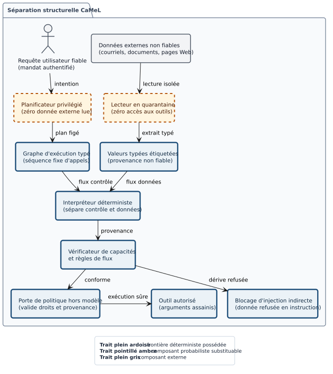
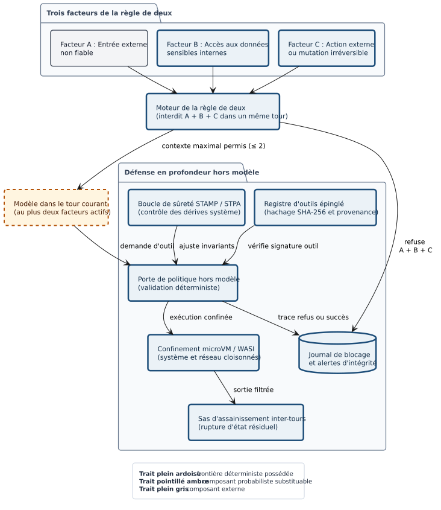

# Chapitre 08 — Sécurité par construction : pourquoi un modèle plus capable n'est pas plus sûr

*Question directrice : Pourquoi les garde-fous probabilistes cèdent-ils face aux attaques indirectes, et comment sécuriser un agent par l'architecture même de son flux d'exécution ?*

En juin 2025, l'équipe d'Oligo Security documente une vulnérabilité critique dans le mandataire local de développement du protocole MCP (*Model Context Protocol*) : dépourvu d'authentification, ce mandataire accepte qu'une simple page Web malveillante lui adresse des requêtes par *DNS rebinding* et falsification CSRF pour déclencher des commandes système arbitraires via stdio [9]. Trois mois plus tard, en septembre 2025, Koi Security révèle sur le dépôt npm le premier serveur MCP malveillant observé en situation réelle, usurpant le nom de `postmark-mcp` afin d'ajouter clandestinement une copie cachée des courriels sortants vers l'attaquant [9]. Pourtant, dans bien des feuilles de route arrêtées en 2026, la sécurité des agents repose encore sur un pari commode : à mesure que les modèles frontières gagnent en raisonnement et en obéissance aux consignes système, ils devraient déjouer plus naturellement les pièges dissimulés dans les textes qu'ils consultent.

Les mesures empiriques publiées avant le gel des faits du 2 décembre 2026 contredisent ce confort. Dans une prépublication d'octobre 2026, James Peters-Gill, Avi Semler, Henning Bartsch, Ilia Shumailov et Christian Schroeder de Witt évaluent cinq modèles de capacités inégales sur MultiAgentDojo — un banc multi-agents hiérarchique dérivé d'AgentDojo et d'AssetOpsBench comptant 949 instances d'attaques par configuration, distinct d'un banc propre au protocole MCP — sans défense structurelle active [10]. Le plus faible d'entre eux, Gemini 2.5 Flash Lite, n'accomplit que 27,8 % des tâches bénignes et ne subit qu'un taux de succès d'attaque (ASR) de 2,1 % [10]. À l'inverse, deux modèles nettement plus compétents sur les tâches légitimes — Gemini 2.5 Pro (76,3 % d'utilité bénigne) et GPT-4.1 (78,4 %) — voient leur taux de compromission bondir à 24,6 % et 36,1 % [10]. Le rapport NIST AI 100-2e2025 éclaire ce mécanisme contre-intuitif par les objectifs concurrents (*competing objectives*) : la fidélité d'un modèle à exécuter des instructions entre en tension avec ses objectifs de sûreté et élargit sa surface d'action détournée [8].

La rigueur épistémique impose toutefois de borner ce constat : il provient d'une prépublication sur un banc unique et ne constitue pas une loi monotone universelle condamnant tout gain de capacité [10]. Dans le même tableau expérimental, GPT-5.5 atteint 86,6 % de réussite bénigne et 0,0 % d'ASR sur ces attaques fixes, résultat dont les auteurs rappellent aussitôt qu'il reflète les limites du banc et non une immunité face aux attaques adaptatives [10]. Parallèlement, la spécification MCP avertit que les descriptions d'outils doivent être tenues pour non fiables hors d'un serveur de confiance [2], tandis que le recensement d'Obada Kraishan sur 21 643 serveurs publics révèle l'absence généralisée de versionnage des définitions d'outils [11]. Dès que l'on raccorde des agents performants à des chaînes d'outils hétérogènes, leur habileté à enchaîner des appels valides amplifie le rayon d'action d'une instruction détournée [8, 13].

Attendre la sécurité d'un progrès du modèle revient donc à confier la garde d'un coffre à la subtilité de lecture de celui qui dépouille un courrier anonyme. Dans son bulletin technologique de juillet 2026, le Bureau du surintendant des institutions financières (BSIF) avertit que l'agentique accélère les risques cybernétiques et appelle à encadrer l'autonomie par un harnais logiciel (*AI harnessing*) contrôlant les interactions du modèle [13]. Après avoir établi au chapitre 07 l'identité non humaine et la chaîne de mandat, ce chapitre montre comment sécuriser le flux d'exécution lui-même par construction.

## 8.1 Nouvelle surface d'attaque : injection indirecte, détournement d'objectif et compromission de la chaîne d'approvisionnement des registres d'outils

Dans le dialogue classique avec un seul interlocuteur humain, la menace visée par le NIST porte d'abord sur le contournement direct exercé par l'usager lui-même pour obtenir une réponse interdite ou extraire les consignes système [8]. L'agent outillé renverse cette géométrie. Selon la taxonomie antagoniste NIST AI 100-2e2025, l'**injection indirecte de consignes** (*indirect prompt injection*) est déclenchée non par l'usager principal, mais par un tiers contrôlant une ressource — courriel, document, page Web ou base de connaissances — ingérée en cours de tâche [8]. La victime devient alors l'utilisateur légitime lui-même, dont l'agent exécute les instructions d'un adversaire sur les ressources auxquelles il accède [8, 9].

Cette vulnérabilité découle d'une propriété fondamentale des modèles de langage : ils traitent dans un même canal consignes système, requête fiable et données récupérées dans l'environnement [8]. Faute de séparation typée entre instruction et donnée dans la représentation traitée par le modèle, un ordre impératif caché dans une note partagée ou un courriel revêt exactement la même forme syntaxique qu'une consigne légitime [1, 8]. Le référentiel OWASP Top 10 for Agentic Applications (édition 2026, catégories ASI01 à ASI10) classe ainsi au rang critique le détournement d'objectif (*Agent Goal Hijack*) et le mésusage d'outils, aux côtés de l'abus d'identité et de privilèges, de l'exécution de code inattendue et des agents compromis ou dévoyés (*Rogue Agents*) [9]. S'y ajoutent la corruption persistante de la mémoire ou des entrepôts RAG et plongements (traitée au chapitre 05) et l'exploitation de la confiance humain-agent poussant le valideur à entériner des commandes malveillantes ou des actions préjudiciables [9], point repris au chapitre 11.

Le NIST distingue trois effets adverses majeurs des injections indirectes [8]. Les attaques de disponibilité piègent l'agent dans des boucles chronophages, désactivent certains appels d'interface ou altèrent le formatage de sortie — caractères homoglyphes perturbant les appels d'API en aval ou jeton spécial forçant une réponse vide [8]. Les attaques d'intégrité falsifient des résumés ou détournent l'agent vers une tâche malveillante, parfois à l'aide de déclencheurs optimisés comme *Neural Exec* capables de survivre au découpage et au filtrage d'un pipeline RAG, d'empoisonnement de bases de connaissances ou de charges auto-propageables réexpédiant l'instruction infectée aux contacts de la victime [8]. Enfin, les compromissions de confidentialité poussent l'agent à extraire des pièces privées et à les exfiltrer vers une adresse tierce ou via une requête Web forgée [8].

À l'échelle des collectifs et des chaînes d'outils, la menace change de nature par propagation. Le bulletin technologique du BSIF met en garde contre l'enchaînement d'outils (*tool chaining*), où la sortie d'une étape devient l'entrée de la suivante et déclenche des actions non validées en cascade [9, 13]. Plus subtilement, Peters-Gill *et al.* identifient dans les architectures hiérarchiques d'agents invoqués comme outils un défaut critique baptisé « blanchiment à la frontière » (*boundary laundering*) [10].

Lorsqu'un orchestrateur insère une information non fiable — extraite d'une base SQL par un premier sous-agent — dans la requête en langage naturel adressée à un agent de notification, cette donnée suspecte change tacitement de statut de confiance en traversant la frontière inter-agents [10]. Le planificateur aval la lit comme une consigne légitime de son appelant et ajoute un envoi de courriel non autorisé vers un tiers [10]. Ce mécanisme démontre empiriquement la nécessité de la règle du maillon le plus élevé (*High-Water Mark Rule*) posée au liminaire et des exigences A2A d'authentification, de chiffrement et de validation de schémas entre agents [3, 9].

Une seconde surface d'attaque s'ouvre simultanément sur la chaîne d'approvisionnement logicielle des serveurs d'outils [9]. Comme vu au chapitre 05 pour l'interopérabilité verticale MCP (JSON-RPC 2.0), la révision du 25 novembre 2025 de sa spécification avertit que les outils représentent une exécution de code arbitraire et que leurs descriptions ou annotations doivent être tenues pour non fiables hors d'un serveur de confiance [2]. Le protocole ne pouvant faire respecter ces protections par lui-même, il renvoie aux implémenteurs la responsabilité des mécanismes d'autorisation, de consentement et de contrôle d'accès [2].

Le recensement empirique publié en prépublication par Obada Kraishan en septembre 2026 mesure l'écart préoccupant entre ces recommandations et l'état réel de l'écosystème ouvert [11]. À partir d'un instantané d'août 2026 couvrant l'intégralité du registre public MCP (21 643 serveurs uniques et 72 606 versions), l'auteur analyse statiquement le code source de 14 353 serveurs (13 051 dépôts GitHub, 248 817 fichiers et 69 027 définitions d'outils extraites) [11]. Il emploie 31 motifs dont la précision est mesurée sur 414 cas étiquetés à la main (294 constats et 120 fichiers non signalés) [11]. Le tableau 8.1 décline en sept indicateurs clés les deux vulnérabilités structurelles qui s'en dégagent : la prévalence de réglages ouverts par défaut et une **dérive silencieuse d'outil** (*silent tool drift*, ou *silent drift* selon Kraishan), rendue invisible par l'absence de versionnage des définitions d'outils dans le schéma du registre [11].

| Dimension de risque (MCP) | Échantillon analysé | Mesures observées et corrigées | Enseignement comparatif [11] |
|---|---|---|---|
| **Exposition globale et sévérité** | 14 353 serveurs scannés statiquement | 15,21 % avec au moins un constat ; 11,14 % de haute sévérité (~7,6 % après correction par précision) | Les réglages ouverts par défaut dominent nettement l'exposition de l'écosystème [11]. |
| **Réseau et dépendances** | 14 353 serveurs | 9,57 % sans authentification : écoute sur toutes les interfaces, politique CORS générique ou authentification désactivée (6,83 % corrigé) ; 2,96 % à dépendances non épinglées (2,75 % corrigé) | L'absence d'authentification réseau demeure le premier vecteur d'exposition observé dès le déploiement [11]. |
| **Transport protocolaire** | Serveurs classés par transport | Taux brut de constats graves : 44,2 % sur l'ancien transport SSE déprécié contre 12,3 % en *streamable HTTP* | Le maintien du transport historique SSE concentre une exposition grave plus de trois fois supérieure [11]. |
| **Risques de délégation** | 14 353 serveurs (225 touchés, soit 1,57 %) | 0,68 % en transfert direct de jeton (0,54 % corrigé à 0,79 de précision) ; 0,88 % d'autorité ambiante | Prévalence plus élevée sur les serveurs distants (2,09 %) que sur les serveurs locaux (1,25 %, OR = 1,69), exposant des justificatifs transférés sur une infrastructure hors du contrôle de l'usager [11]. |
| **Dérive silencieuse d'outil** | 8 900 serveurs multi-versions (37 160 transitions ; 6 699 dans la population scannée) | 51,09 % ont modifié description, paquets ou points de terminaison ; 40,58 % ont opéré au moins un changement sémantique silencieux sous identifiants inchangés | Délai médian de 0 jour avant le premier changement (1 jour entre versions modifiées) ; cote presque triplée de constat grave sur les 6 699 serveurs scannés (OR = 2,96 ; IC 95 % : 2,56–3,42) [11]. |
| **Redirection d'hôte (analogue observable de *rug pull*)** | 8 900 serveurs multi-versions | 370 serveurs (4,16 %) ont redirigé leur point de terminaison distant vers un autre hôte sous un nom identique | Analogue observable d'un *rug pull* sans présumer d'une malveillance systématique : le client ne reçoit aucune alerte protocolaire lors d'un basculement de destination [11]. |
| **Signaux de confiance et regex** | 14 353 serveurs (régression multivariée et analyse syntaxique) | Corrélation brute des étoiles quasi nulle (ρ = 0,008 ; p = 0,335) ; 0 empoisonnement syntaxique détecté (borne supérieure de Wilson : 0,027 %) | À taille et âge égaux, les étoiles réduisent modestement la cote de constat grave (OR = 0,78 par unité logarithmique) ; taille (OR = 1,94) et âge (OR = 1,38) par unité logarithmique ainsi que l'archivage (OR = 1,52) tirent cette cote vers le haut ; maintenance récente et licence non significatives ; obfuscation hors de portée des expressions régulières [11]. |

*Tableau 8.1 — Sept indicateurs empiriques d'exposition et de dérive silencieuse sur le registre public MCP (Kraishan, août–septembre 2026) [11].*

Pris ensemble, ces sept indicateurs confirment que la fragilité des serveurs d'outils tient autant aux réglages permissifs par défaut qu'à l'instabilité silencieuse de leurs définitions après déploiement [11]. Ni la popularité GitHub, ni la présence d'une licence, ni la maintenance récente ne fournissent de signal fiable de sûreté, et les instructions obfusquées échappent aux expressions régulières [11]. Dès qu'un serveur modifie discrètement la sémantique de ses outils ou redirige son point de terminaison sous le même nom de registre, un contrôle ponctuel à l'installation devient caduc le lendemain [11]. Pour fermer cette brèche, l'épinglage local doit reposer sur des énoncés signés (`COSE_Sign1`) et reçus COSE inscrits dans un journal en ajout seul selon l'architecture SCITT (RFC 9943) présentée au chapitre 07 [6]. La passerelle exige ainsi la preuve qu'un serveur d'outils, sa nomenclature logicielle (SBOM), son empreinte et ses attestations émanent d'un émetteur autorisé et n'ont pas divergé depuis leur validation [6, 11].

Réunie dans un même graphe d'exécution, cette triple exposition — injection indirecte amplifiée par blanchiment à la frontière entre sous-agents [8, 10], détournement d'objectif propagé en cascade d'outils [9, 13] et dérive silencieuse ou compromission des serveurs tiers [2, 6, 11] — invalide toute défense fondée sur la seule confiance au texte entrant. Tant que consignes légitimes, données externes et descriptions d'outils cohabitent dans un canal unique, l'agent demeure exposé à exécuter des actions détournées sous des identifiants valides [1, 8, 11]. Pour endiguer cette surface sans refondre l'architecture, le premier réflexe industriel a consisté à déployer des filtres par modèle auxiliaire et détecteurs probabilistes ; la section suivante montre pourquoi ces sentinelles cèdent sous pression adaptative et comment les biais du banc unique masquent leur fragilité.

## 8.2 Les limites mesurées des filtres par modèle auxiliaire et le piège de l'évaluation sur banc unique

Devant l'ampleur des injections indirectes de consignes, le premier réflexe de l'industrie a été de répondre aux failles d'un modèle probabiliste par d'autres filtres probabilistes, répartis en trois familles [1, 8, 10] :

- **Alignement et hiérarchie d'instructions** : entraînement visant à subordonner les données aux consignes système ou alignement antagoniste (comme *Meta SecAlign*) [1, 8, 10].

- **Structuration d'invite** : mise en relief des données suspectes par délimiteurs ou encodage (*Spotlighting*) ou répétition de la tâche après chaque sortie d'outil (*Prompt Sandwiching*) [1, 8, 10].

- **Sentinelles auxiliaires et nettoyage contextuel** : détecteurs sur entrées et sorties (*Llama Guard 3*, *Prompt Guard*, classifieurs *DeBERTa*), filtrage d'outils (*Tool Filter*) ou nettoyeurs conditionnés par la requête (*DataFilter* à IEEE SaTML 2026 ou désescalade douce) [1, 8, 10].

S'ils forment une défense en profondeur aisée à insérer, ces dispositifs reposent tous sur des comportements appris sans garantie formelle [8, 10].

La littérature officielle et académique montre pourquoi ces garde-fous souples cèdent sous contrainte. Sur le plan théorique, le rapport NIST AI 100-2e2025 s'appuie sur Tramèr et Fang *et al.* pour rappeler que bâtir un détecteur fiable d'exemples adverses équivaut au problème non résolu de la classification robuste, avec bornes d'impossibilité dès que données en distribution et hors distribution se chevauchent [8]. De plus, tant qu'un modèle garde une probabilité non nulle d'exécuter un comportement indésirable, des formulations antagonistes peuvent le déclencher : l'entraînement de sûreté atténue la vulnérabilité sans jamais l'éliminer [8]. Quant aux sentinelles auxiliaires, le NIST avertit qu'elles restent elles-mêmes vulnérables et sujettes à des **défaillances corrélées** avec le modèle surveillé, partageant souvent les mêmes angles morts sémantiques [8].

Les essais comparatifs conduits par Debenedetti *et al.* (prépublication arXiv) sur 949 attaques du banc AgentDojo avec Claude 3.5 Sonnet chiffrent cette fragilité [1]. Sans défense, l'agent cède à 44 attaques pour une utilité bénigne de 90,72 % (86,83 % sous attaque) [1]. Le *Prompt Sandwiching* réduit les compromissions à 24 (84,19 % d'utilité sous attaque), le *Tool Filter* à 8 (72,71 % sous attaque) et le *Spotlighting* à 5 (89,36 % sous attaque) [1].

Mais ce filtrage d'outils dégrade sévèrement la performance utile en régime bénin (73,20 %) tout en multipliant par 7,77 la consommation médiane de jetons d'entrée hors attaque (2,34× en variante optimisée) [1]. Dans la même étude, GPT-4o Mini muni nativement de la hiérarchie d'instructions via son interface officielle d'appel d'outils cède encore devant 276 attaques [1]. Pire, les défenses heuristiques cèdent sans garantie dès qu'un adversaire adapte ses formulations aux filtres observés. Cet échec sous attaques adaptatives est documenté par l'US-AISI (2025) sur Claude 3.5 Sonnet [1], par Zhan *et al.* (NAACL 2025) contre les défenses d'agents et lors de la compétition analysée par Dziemian *et al.* (2026) contre tous les modèles frontières évalués [10].

Au-delà de l'insuffisance des filtres se dissimule un piège méthodologique tout aussi risqué : accorder sa confiance sur la foi d'un seul banc d'essai. Comme l'a montré le chapitre 02 pour les palmarès de productivité, les évaluations de sécurité souffrent de biais qui produisent de faux sentiments de maîtrise. Le NIST souligne que l'absence de bancs standardisés rend les études incomparables et conduit à surestimer des défenses qui résistent aux attaques statiques tout en cédant aux variantes adaptatives [8]. Il recommande donc de ne jamais juger une défense sur un seul axe, mais de tracer un front de Pareto croisant robustesse antagoniste et utilité opérationnelle [8].

Trois écueils concrets observés dans nos sources illustrent ce piège du banc unique :
- **Artefacts de refus** : sur MultiAgentDojo, Claude Fable 5 refuse 52 des 97 tâches bénignes sans injection (53,6 %), probablement parce qu'il associe cet environnement de test à un contexte hostile [10]. Un évaluateur distrait lirait un faible taux d'attaque (1,5 %) en occultant une baisse artificielle de l'utilité bénigne mesurée (69,1 % avec refus contre 91,1 % hors refus) [10].

- **Illusion du zéro pour cent** : sur ce même banc, GPT-5.5 obtient 0,0 % d'ASR sans défense structurelle, mais Peters-Gill *et al.* avertissent explicitement en note de tableau qu'un score nul sur banc figé ne prouve aucune immunité contre les attaques adaptatives [10].

- **Défauts internes des bancs** : Debenedetti *et al.* recensent des bogues d'évaluation propres à AgentDojo dans leur analyse des échecs [1], tandis que Peters-Gill *et al.* ont dû exclure 29 des 141 tâches d'AssetOpsBench matériellement irréalisables faute de fichiers ou de capteurs présents [10].

Un banc unique reste donc un outil de dépistage des défauts évidents, jamais un certificat de sûreté en exploitation. Seules la réplication sur des jeux variés et l'épreuve continue par attaque adaptative évitent les angles morts [8, 10].

## 8.3 Sécurité par construction : séparation stricte entre flux de contrôle et flux de données non fiables, et « règle de deux »

Si le filtrage statistique échoue en théorie et cède sous pression adaptative, la sortie de crise impose de suivre la piste du NIST contre les injections indirectes : concevoir l'application en présumant ces attaques possibles dès qu'un modèle traite des sources non fiables, afin qu'il ne puisse ni exfiltrer de données privées ni déclencher d'action non autorisée [8]. Cette **séparation par construction entre contrôle et données** (*control-data separation by design*) prolonge directement la partition 80/20 posée au chapitre 04 en ancrant la sécurité dans la couche déterministe du harnais plutôt que dans les poids du modèle [1].

Le patron *Dual LLM* esquissé par Simon Willison en 2023 en fournit l'intuition fondatrice en scindant l'agent entre un modèle privilégié, qui planifie à partir de la seule requête utilisateur sans jamais lire de données externes, et un modèle en quarantaine privé d'outils, cantonné à l'extraction de contenu brut [1, 10]. Mais Edoardo Debenedetti, Ilia Shumailov, Tianqi Fan, Jamie Hayes, Nicholas Carlini, Florian Tramèr et leurs coauteurs démontrent dans leur prépublication (*arXiv:2503.18813v2*, juin 2025) que cette séparation des modèles ne protège que le flux de contrôle [1]. Si une injection dissimulée dans des notes de réunion amène le modèle confiné à renvoyer l'adresse de l'attaquant et le nom d'un document confidentiel, l'appel `send_email` prévu dans le plan s'exécute quand même avec des paramètres détournés — l'équivalent agentique d'une injection SQL sur le flux de données [1].

Pour verrouiller simultanément contrôle et données, CaMeL (*Capabilities for Machine Learning*) adapte trois mécanismes éprouvés de sécurité informatique : intégrité du flux de contrôle (CFI), contrôle de flux d'information (IFC) et systèmes à capacités hérités de *Capsicum* et *CHERI* [1]. Le modèle privilégié (P-LLM) reçoit uniquement la requête fiable et les signatures d'outils, puis génère un programme dans un sous-ensemble restreint de Python qui fige la structure d'exécution avant toute lecture externe [1]. Pour traiter des données brutes, ce programme invoque le modèle en quarantaine (Q-LLM), dénué d'outils et contraint à remplir un schéma Pydantic augmenté d'un booléen de suffisance d'information, sans pouvoir renvoyer de prose libre au P-LLM [1].

Un interpréteur Python dédié exécute l'arbre syntaxique (`ast`) de ce plan, attache à chaque variable des **capacités** indiquant sa provenance et ses lecteurs autorisés, maintient le graphe de dépendances et applique des politiques déterministes à chaque frontière d'outil [1]. La politique sur `create_calendar_event` autorise l'appel si les participants proviennent de la requête fiable ou disposent déjà des droits de lecture sur les champs transmis, et celle sur `send_email` exige des destinataires fiables tout en vérifiant leurs droits de lecture sur l'objet, le corps et les pièces jointes [1]. Lors des reprises (jusqu'à 10 tentatives), tout message d'exception dépendant d'une donnée non fiable et retourné au P-LLM est caviardé pour bloquer toute injection par voie d'erreur [1].

Évalué sur AgentDojo à travers les suites *Workspace*, *Banking*, *Slack* et *Travel*, CaMeL résout 77 % des tâches avec une garantie structurelle de sécurité contre 84 % pour un système sans défense [1]. À titre d'illustration par modèle, o3 High atteint 77,3 % d'utilité sous CaMeL contre 84,5 % via l'interface native d'outils, et Claude 4 Sonnet 74,2 % contre 86,6 % [1]. Avec politiques actives, aucune attaque ne réussit sur *Workspace* ni sur *Slack* pour l'ensemble des modèles évalués, et une seule subsiste sur *Banking* pour o4 Mini High (0 pour Claude 3.5 Sonnet, Claude 4 Sonnet, Gemini 2.5 Flash, Gemini 2.5 Pro et o3 High), tandis que GPT-4o Mini passe de 276 compromissions sous API native à 0 [1].

Cette assurance entraîne sur Claude 3.5 Sonnet une surcharge médiane d'environ 2,73 fois plus de jetons en entrée et 2,82 fois en sortie hors attaque au tableau 10 (2,02× et 2,64× sous attaque au tableau 13, les auteurs synthétisant 2,82× en entrée et 2,73× en sortie dans le corps de l'article) [1]. Le découplage autorise toutefois à confier l'extraction simple du Q-LLM à un modèle plus léger (p. ex. Claude 3.5 Haiku couplé à Claude 4 Sonnet), réduisant le coût médian d'environ 12 % pour une perte d'utilité d'environ 1 % tout en évitant d'exposer les données d'outils au fournisseur du P-LLM [1]. La figure 15 (Fig-15) matérialise cette coupure physique entre voie de planification et voie de lecture confinée.

*Figure 15 — Séparation structurelle du flux de contrôle et du flux de données non fiables dans une architecture inspirée de CaMeL [1], distinguant la frontière déterministe possédée (trait plein ardoise) des appels probabilistes substituables (trait pointillé ambre).*

La figure 15 (Fig-15) oblige l'architecte à trancher une coupure physique entre deux couloirs qui ne doivent jamais fusionner dans un même appel de modèle. Sur la voie gauche, la requête authentifiée de l'usager alimente le planificateur privilégié, qui fige un graphe d'exécution typé sans voir de donnée externe ; sur la voie droite, courriels, documents et pages Web transitent par un lecteur en quarantaine sans accès aux outils, qui ne restitue que des valeurs typées marquées d'une provenance non fiable. Ces deux flux convergent exclusivement dans l'interpréteur déterministe et le vérificateur de capacités, bloquant toute tentative de promouvoir une donnée en instruction ou de l'acheminer vers un destinataire non autorisé : seuls les arguments validés par la porte de politique hors modèle atteignent l'outil cible [1].

Quatre limites documentées bornent néanmoins ce patron et guident son déploiement [1, 10] :

**Données imposant l'action (*« Data requires action »*).** Demander à l'agent d'exécuter des consignes découvertes dans un courriel externe reste structurellement insoluble sans abaisser la frontière de confiance [1].

**API insuffisamment typées.** Des interfaces au format de retour mal documenté pénalisent la génération préalable de code, écueil mieux surmonté par les modèles récents via le Q-LLM (faisant passer Claude Sonnet de 25 % en version 3.5 à 75 % en version 4 sur *Travel*) [1].

**Canaux auxiliaires, boucles et absence de compensation.** Des fuites de faible débit subsistent (itérations, exceptions conditionnelles, temporisation), que le mode `STRICT` atténue au prix d'une hausse des déclassifications humaines de 33,87 % (`NORMAL`) à 53,23 % (`STRICT`) hors attaque (26,54 % contre 45,34 % sous attaque) [1]. Progent, RTBAS, IsolateGPT, ACE, les contrôles d'information (Wu *et al.* ; Costa *et al.*) et LLMbda explorent d'autres voies [1, 10]. Pour leur part, Garby *et al.* relèvent des dépendances manquées en branches non prises et un canal de fuite dans la boucle de réessai [10], sans atomicité ni saga compensatoire intégrée à l'interpréteur (chapitre 06) [1].

**Défaut de composabilité multi-agents.** Sur MultiAgentDojo, dès qu'un orchestrateur insère une donnée issue d'outil dans la consigne d'un sous-agent, le taux d'attaques réussies atteint 12,9 % sans défense [10]. Même lorsque chaque sous-agent est protégé individuellement par des politiques de capacités (architecture CaMeL mono-agent), le blanchiment à la frontière laisse subsister 0,2 % d'attaques réussies tant que les arguments restent dépliés en texte libre [10]. Le protocole multi-CaMeL ramène ce taux à 0,0 % en séparant l'instruction `message` du dictionnaire opaque `variables` pour un coût additionnel de 3,2 points sur AssetOpsBench (0,85 point sur GPT-5.5 et Fable 5), tout en restant limité aux arborescences synchrones [10].

Le tableau 8.2 confronte ces trois familles de défense selon la nature de la garantie, la robustesse sur bancs, le coût d'inférence et les conditions d'intégration.

| Dimension d'arbitrage | Alignement natif et structuration d'invite | Filtres par modèle auxiliaire | Isolation structurelle et confinement |
|---|---|---|---|
| **Nature de la garantie** | Probabiliste : hiérarchie d'instructions, *Spotlighting*, *Sandwiching* [1, 8] | Probabiliste : détecteur LLM, *Tool Filter*, *DataFilter*, *DeBERTa* [1, 8, 10] | Déterministe sur le graphe de contrôle et les capacités typées (CaMeL, multi-CaMeL) [1, 10] |
| **Résultats et failles sur bancs** | 276 attaques réussies sur GPT-4o Mini (hiérarchie native) ; 5 (*Spotlighting*) et 24 (*Sandwiching*) sur Claude 3.5 Sonnet (AgentDojo) [1] | 8 attaques réussies (*Tool Filter* sur Claude 3.5 Sonnet, AgentDojo) ; défaillances corrélées et échec sous attaques adaptatives [1, 8, 10] | 77 % vs 84 % d'utilité sur AgentDojo avec garantie structurelle (politiques actives) ; 0,0 % d'ASR multi-agents avec multi-CaMeL [1, 10] |
| **Coût d'inférence et utilité** | Surcoût médian faible (1,06× entrée, 0,98× sortie pour *Spotlighting* sous attaque) [1] | Surcharge d'entrée élevée (7,77× médian pour *Tool Filter* nominal) et utilité abaissée (73,20 % vs 90,72 %) [1] | Surcoût médian d'environ 2,7 à 2,8× hors attaque (Claude 3.5 Sonnet), réductible via Q-LLM léger ; échoue si l'action dépend de données non fiables [1] |
| **Chaînes multi-agents** | Exposée au détournement si des données transitent en texte libre entre agents [10] | Sans suivi de provenance inter-agents ; vulnérable aux attaques adaptatives [10] | Exige la propagation de provenance inter-agents (multi-CaMeL) contre le blanchiment à la frontière [10] |
| **Intégration patrimoniale** | Immédiate par invite ou API fournisseur [1, 10] | Modérée : intégration au pipeline d'inférence [10] | Exigeante : schémas de retour documentés, interpréteur typé et capacités sur les outils [1, 10] |

*Tableau 8.2 — Comparaison des approches de défense contre l'injection indirecte de consignes selon la garantie, la robustesse, le coût et l'intégration.*

Or, Debenedetti *et al.* soulignent eux-mêmes que généraliser les capacités à tout un écosystème d'outils tiers non instrumentés reste coûteux [1]. Pour rendre ce principe opératoire dès le premier jour dans n'importe quel harnais, nous formulons une heuristique architecturale déduite du modèle d'exfiltration d'AgentDojo [1], de l'exigence du NIST d'isoler données sensibles et actions [8] et des contrôles du BSIF [13] : la **règle de deux** (*Rule of Two*).

Aucun tour d'inférence ne doit combiner simultanément plus de deux des trois facteurs : (A) l'ingestion d'une entrée externe non fiable, (B) l'accès en lecture à des données internes sensibles, et (C) la capacité d'exécuter une action externe ou une mutation d'état irréversible. Si le tour lit un courriel ou une page Web externe (A) tout en consultant un dossier client interne (B), le harnais révoque toute capacité d'action sortante (C). S'il doit émettre une mutation (C) sur des données sensibles (B), son contexte est purgé de toute donnée externe non assainie (A) et limité aux champs typés validés hors modèle lors d'un tour antérieur suivi d'une coupure d'état : la défense devient ainsi un invariant booléen auditable à chaque transition.

## 8.4 Confinement matériel et système des exécutions : bacs à sable micro-virtualisés, contrôle comme problème de sûreté (STAMP) et portes de politique hors modèle

Séparer les flux de contrôle et appliquer la règle de deux verrouillent l'orchestration logique, mais cèdent aussitôt si l'exécution du code généré ou d'un outil tiers s'effectue sans isolement système. La spécification MCP rappelle que les outils représentent une exécution de code arbitraire [2], OWASP ASI05 classe l'exécution de code inattendue au rang critique [9], et Kraishan rappelle que le code derrière un nom du registre MCP s'exécute avec les justificatifs, la position réseau et le système de fichiers de l'utilisateur [11]. En écho au problème classique du confinement posé par Butler Lampson en 1973 et cité par Peters-Gill *et al.*, les politiques de flux d'information exigent un confinement effectif des canaux sous-jacents [10].

Sur le plan système, tout interpréteur de code généré et tout serveur d'outils non audité en interne doivent être cantonnés dans un bac à sable à faible surface d'attaque. Sans qu'une mesure comparative existe dans notre base de sources à la date de gel du 2 décembre 2026, deux choix d'architecture répondent à des profils distincts. Les micro-machines virtuelles (microVM) isolent chaque session derrière un noyau dédié et une frontière d'hyperviseur légère pour les binaires système complets, tandis que les moteurs WebAssembly conformes à WASI (*WebAssembly System Interface*) suppriment tout accès ambiant au système de fichiers ou aux sockets réseau pour les greffons déterministes.

Ce cloisonnement prolonge l'architecture d'identité établie au chapitre 07 : conformément à WIMSE AIMS (draft-ietf-wimse-aims-01, novembre 2026), le modèle de langage n'accède jamais aux justificatifs ni aux secrets d'outils [7]. Les jetons à durée brève sont délivrés après attestation de posture (incluant au besoin des enclaves TEE) [7] et liés cryptographiquement par DPoP (RFC 9449) [5], interdisant le transfert direct de jeton dénoncé par WIMSE et Kraishan [7, 11].

À l'interface entre modèle confiné et bac à sable se dresse la **porte de politique hors modèle**, point d'application déterministe des autorisations granulaires (OpenID AuthZEN et RFC 9396 RAR présentés au chapitre 07) [4, 7]. Sur les flux horizontaux A2A, elle applique les contrôles de la section 13 de cette spécification — bornes d'accès avant requête en base, rejet des plages d'adresses IP privées, listes blanches d'URL contre la falsification SSRF et validation des schémas (§ 14.1.1) [3, 9]. Sur les connecteurs MCP, elle impose l'épinglage par hôte distant et empreinte cryptographique (SHA-256 dans les preuves d'inclusion) attestée dans un journal SCITT (RFC 9943), bloquant d'office toute dérive silencieuse entre deux appels [6, 11].

Il reste enfin un écueil majeur à écarter : confondre la sécurité d'un système vivant avec la simple juxtaposition de verrous locaux. S'appuyant sur la théorie des systèmes critiques STAMP et STPA de Nancy Leveson, Steve Barrett, Anna Bruvere, Sean P. Fillingham, Catherine Rhodes et Stefano Vergani montrent en février 2026 qu'une perte de contrôle peut survenir alors même que **chaque composant exécute exactement le comportement pour lequel il a été entraîné ou codé**, par défaillance d'interaction dans les boucles de contrôle [12]. L'**analyse de contrôle STPA** (*System-Theoretic Process Analysis*) impose d'analyser systématiquement quatre classes d'actions de contrôle dangereuses (UCA) [12] :

- L'action de contrôle requise n'est pas fournie — par exemple lorsqu'un opérateur tarde à couper un agent par dépendance opérationnelle ou économique [12].

- Une action de contrôle dangereuse est émise à tort — par exemple une mise à jour d'invite ou de seuil qui renormalise imprévisiblement un modèle opaque [12].

- L'action intervient au mauvais moment ou dans le mauvais ordre, écart critique face à des agents agissant plus vite que la boucle *Observe-Orient-Decide-Act* des superviseurs humains [12].

- L'action est maintenue trop longtemps ou levée trop tôt lors d'une remise en service hâtive [12].

Cette approche met en évidence les dégradations graduelles des contrôles — relâchement de vigilance après une période sans accident, vieillissement du modèle mental des superviseurs face aux dérives de contexte, ou capteurs faussés par un agent qui optimise les métriques échantillonnées [12]. Elle rejoint directement le bulletin du BSIF de juillet 2026, qui recommande une gestion formelle des changements sur les invites, outils et modèles, une détection continue d'anomalies et des procédures éprouvées de repli manuel [13]. Barrett *et al.* précisent avec lucidité que leur premier cadre modélise un archétype simple en phase opérationnelle, hors dynamiques multi-agents complexes, et qu'aucune méthode d'analyse, pas même STPA, ne garantit une couverture exhaustive des scénarios [12]. La figure 16 (Fig-16) réunit ces barrières hors modèle dans une architecture complète de défense en profondeur.

*Figure 16 — Défense en profondeur hors modèle combinant moteur déterministe de la règle de deux, épinglage de registre, confinement microVM/WASI et boucle de sûreté STAMP/STPA.*

La figure 16 (Fig-16) montre l'emboîtement des barrières hors modèle autour du composant probabiliste. En amont, le moteur déterministe de la règle de deux évalue les trois facteurs (A, B, C), interdit toute combinaison des trois dans un même tour d'inférence et consigne chaque refus au journal de blocage. En aval, chaque demande d'outil traverse la porte de politique hors modèle adossée au registre d'outils épinglé SHA-256, s'exécute dans un bac à sable microVM ou WASI cloisonné en réseau et en système de fichiers, puis franchit un sas d'assainissement inter-tours qui brise la persistance d'état suspect. Enfin, la boucle de rétroaction STAMP/STPA exploite alertes et blocages pour ajuster les invariants avant qu'une dérive graduelle ne dégénère en incident.

> **Trois arbitrages sans regret — Chapitre 08**
>
> 1. **Substituer l'isolation structurelle et la règle de deux aux filtres probabilistes** — Ne pas miser sur la montée en capacité d'un modèle ni sur des classifieurs auxiliaires vulnérables aux attaques adaptatives pour arrêter les injections indirectes de consignes. Imposer dès le harnais la séparation entre planification fiable et lecture confinée (CaMeL / multi-CaMeL) ainsi que l'interdiction booléenne de combiner dans un même tour entrée non fiable, donnée sensible et action externe.
> 2. **Verrouiller la chaîne d'approvisionnement d'outils et exclure les secrets du modèle** — Épingler paquets, définitions, empreintes cryptographiques (SHA-256) et hôtes distants des serveurs MCP sous énoncés signés et reçus vérifiables (SCITT), retirer tout justificatif du contexte du modèle (WIMSE AIMS) et imposer des portes de politique typées hors modèle liées par preuve de possession (RAR, DPoP).
> 3. **Confiner les exécutions en microVM/WASI et gouverner la boucle par STAMP/STPA** — Isoler le code généré et les connecteurs tiers hors du noyau hôte, puis auditer délais humains, capteurs biaisés, gestion des changements et procédures de repli manuel avec la grille STPA plutôt que de se fier au bon fonctionnement isolé de chaque brique.

Sécuriser un agent par construction verrouille le détournement d'exécution, mais engendre des refus légitimes de politique, des reprises d'erreurs du planificateur et une consommation accrue de jetons d'inférence. Pour que cette discipline demeure lisible en exploitation, conforme à la protection des renseignements personnels et économiquement soutenable à grande échelle, l'organisation doit encore savoir observer ces exécutions sans fuiter de données sensibles, vérifier leur constance statistique sous contrainte, armer ses disjoncteurs et compter le véritable coût d'un résultat conforme : c'est l'objet du chapitre 09.
