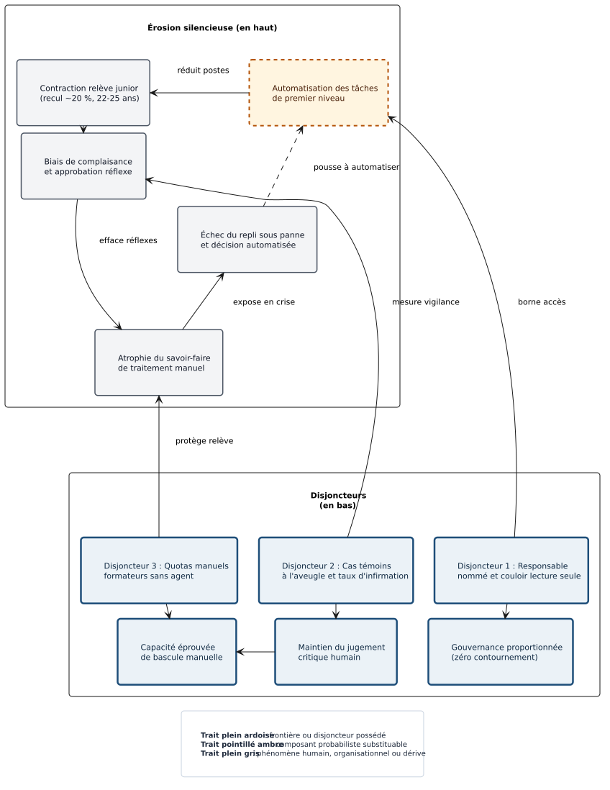

# Chapitre 11 — Les sept pièges de la gouvernance et l'atrophie silencieuse des compétences

*Question directrice : Pourquoi les plans de gouvernance les mieux intentionnés échouent-ils en exécution, et comment empêcher l'automatisation de détruire le filet humain sur lequel elle repose ?*

*Scénario illustratif prospectif.* Imaginons qu'au printemps 2032, une institution financière canadienne d'envergure subisse une double défaillance simultanée : une mise à jour corrompue de sa passerelle d'orchestration et une panne prolongée chez son principal fournisseur infonuagique de modèles de langage. En quelques minutes, les agents chargés de l'instruction préliminaire du crédit, du rapprochement documentaire des sinistres d'assurance et de la préparation des avis de conformité s'arrêtent. Conformément aux manuels de continuité des affaires approuvés par le conseil d'administration, la cellule de crise ordonne le basculement immédiat vers le mode de repli manuel.

À première vue, le dispositif de gouvernance de l'établissement avait tout pour rassurer les vérificateurs. Depuis cinq ans, les procès-verbaux des comités de risque affichaient des indicateurs au vert, un registre central inventoriait chaque flux automatisé et aucun dossier client n'était clos sans le visa électronique d'un analyste humain désigné. Pourtant, dès la première heure de fonctionnement dégradé, l'activité se fige. Privés de leurs synthèses préalables et des alertes de priorité calculées par les agents, les gestionnaires ouvrent des dossiers bruts contenant des dizaines de pièces disparates et constatent qu'ils ne savent plus par quel bout les instruire.

En cinq ans, l'établissement avait cessé d'embaucher des analystes débutants pour les tâches d'extraction, de vérification croisée et de première rédaction, jugeant plus rentable de confier ce travail préparatoire à des collectifs d'agents supervisés par une poignée d'employés aguerris. Quant à ces derniers, habitués depuis des années à valider en quelques secondes des propositions déjà structurées et formulées avec assurance, ils ont perdu les réflexes de calcul manuel, l'œil critique sur les pièces justificatives et la connaissance intime des exceptions réglementaires. Les rares recrues promues à la supervision directe n'ont jamais instruit un dossier complexe de bout en bout sans assistance algorithmique.

La gouvernance de cette institution fictive n'a cédé ni devant une intrusion hostile ni devant une défaillance spectaculaire d'algorithme. Elle a succombé à une érosion endogène que ses propres tableaux de bord avaient rendue invisible : en automatisant l'exécution de premier niveau tout en réduisant le contrôle humain à un geste d'approbation formelle, l'organisation a détruit le terrain d'apprentissage qui forgeait ses futurs vérificateurs et vidé son plan de repli de toute substance réelle. Ce chapitre démonte cette mécanique en deux temps : d'abord les sept pièges internes qui font dérailler les programmes de gouvernance les plus rigoureux, puis l'enchaînement entre approbation réflexe et atrophie de la relève, avant de poser les quatre parades — combinant verrous logiciels et disjoncteurs organisationnels — qui préservent le jugement humain.

## 11.1 Sur-ingénierie initiale et engorgement de la deuxième ligne : comment une gouvernance trop lourde provoque la prolifération d'agents fantômes

Les échecs les plus coûteux d'un programme d'entreprise agentique tiennent rarement à l'absence de politiques écrites. Ils naissent bien plus souvent d'un désalignement entre le formalisme dessiné par les comités centraux et les contraintes quotidiennes des équipes qui doivent livrer des services. À partir des études de terrain et des textes prudentiels publiés jusqu'au gel du 2 décembre 2026 (corpus vérifié au 22 novembre 2026) [7, 8, 15, 16, 21], on peut regrouper ces défaillances internes en **sept modes d'échec endogènes** dont cinq relèvent directement de la gouvernance organisationnelle et sont traités ici. Les deux derniers, de nature économique et cryptographique, sont nommés pour situer la typologie complète et renvoyés aux chapitres propriétaires.

Le premier piège est la **sur-ingénierie initiale**. Sous l'effet d'une prudence légitime devant les risques de l'IA agentique, plusieurs organisations appliquent d'emblée le même parcours d'homologation lourd à tous les usages : un assistant interne qui interroge une base de procédures en lecture seule subit ainsi le même cycle de comités, de revues juridiques et de validation indépendante qu'un agent habilité à modifier des comptes ou à déclencher un décaissement. Or, l'étude *Measuring Agents in Production* (MAP) de Pan *et al.* — menée sur 20 études de cas et 306 répondants à l'enquête dont 86 systèmes déployés en production ou en phase pilote — montre que les déploiements réels reposent d'abord sur la sobriété [8].

En pratique, 68 % des systèmes déployés exécutent au plus 10 étapes avant intervention humaine, 80 % des cas étudiés (16 sur 20) suivent des flux structurés fixes et les équipes privilégient l'usage interne (52 % des usagers contre 40 % de clients externes) afin de contenir le risque [8]. Cette uniformité procédurale contredit même le principe de proportionnalité inscrit dans la ligne directrice E-23 du BSIF (entrée en vigueur fixée au 1er mai 2027), dont les principes 2.2 et 2.3 commandent d'ajuster la rigueur de validation et de suivi à la cote de risque inhérent, allant jusqu'à autoriser une exemption encadrée pour les modèles à risque négligeable [15]. Confondre outil consultatif et automate transactionnel paralyse inutilement l'organisation.

Cette rigidité engendre mécaniquement le deuxième piège : la **prolifération d'agents fantômes** (*shadow AI*). Lorsqu'une équipe attend plusieurs mois une autorisation pour automatiser une synthèse banale, ses membres contournent le cadre officiel par des comptes personnels ou des extensions non déclarées. Les enquêtes canadiennes recueillies au gel du 2 décembre 2026 rendent ce décalage tangible : dans l'analyse de la Banque du Canada conduite par Chawla et Arnburg sur *Le Pouls des leaders d'entreprise* (décembre 2025), 70 % des répondants déclarent utiliser l'IA chaque semaine à titre personnel au travail [7]. En revanche, seules 8 % des firmes rapportent un usage significatif en exploitation, contre 21 % d'usage modéré et 29 % d'expérimentation peu fréquente ou en pilote [7].

Les tableaux de Statistique Canada confirment aux deuxième et troisième trimestres de 2026 cet écart entre expérimentation diffuse et intégration officielle. Sur les douze mois précédents, 19,2 % des entreprises au pays ont utilisé l'IA pour produire des biens ou services, contre 40,4 % dans le secteur *Finance et assurances* (cote C, erreur type de 5,00 % à moins de 7,50 %) [5]. Parmi ces utilisateurs financiers, 28,8 % mobilisent des agents virtuels ou robots conversationnels et 22,7 % des systèmes décisionnels automatisés (proportions portant la cote D, erreur type de 7,50 % à moins de 10,00 %) [5]. Sur les douze mois suivants, 25,2 % de l'ensemble des entreprises prévoient d'y recourir, contre 35,5 % en finance et assurances (cote B) [6].

Ce qui échappe aux canaux formels bascule alors dans l'ombre. Dans l'enquête qualitative de Dhanorkar, Passi et Vorvoreanu auprès de 17 développeurs expérimentés, des praticiens reconnaissent ignorer ce qu'il advient des données clients acheminées vers des outils tiers [21]. Ce contournement viole directement le bulletin de juillet 2026 du BSIF, qui exhorte les institutions à proscrire le traitement de données sensibles dans des outils d'IA publics ou non approuvés [16].

Le troisième piège est la **saturation de la deuxième ligne de défense**. Dans le modèle classique à trois lignes de défense, les équipes opérationnelles (première ligne) exploitent les systèmes, les fonctions de gestion des risques, de conformité et de vie privée (deuxième ligne) exercent la surveillance indépendante, et l'audit interne (troisième ligne) vérifie le tout a posteriori. En acheminant indifféremment vers la deuxième ligne chaque projet d'agent, même dépourvu de pouvoir d'écriture, la direction provoque un engorgement chronique à l'approche du 1er mai 2027, date d'entrée en vigueur fixée par le BSIF pour sa directive E-23 sur le risque de modélisation [15]. Cette échéance coïncide au Québec avec la prise d'effet attendue de la ligne directrice sur l'IA de l'AMF, document primaire en statut bloqué (chapitre 10) dont la date est corroborée par l'agrégateur tiers secondaire AIBanks.ca [18]. Déjà tenue par le principe 1.1 d'E-23 de doter ses équipes de spécialistes maîtrisant l'IA [15], une deuxième ligne submergée par des dossiers bénins n'a plus la bande passante pour examiner en profondeur les cas à fort impact client ou réglementaire.

Le quatrième piège réside dans la **dilution de responsabilité intra-groupe**. Les conglomérats financiers réunissent des activités bancaires, d'assurance et de patrimoine soumises à des cloisons légales strictes (détaillées au chapitre 10). Lorsqu'une équipe centrale héberge un agent générique, qu'une filiale le connecte à ses bases et qu'une autre direction en ajuste les invites, la chaîne d'imputabilité se dissout. Les entretiens de Dhanorkar *et al.* montrent ce morcellement dès l'échelle technique : un participant utilise des agents intégrés par une autre équipe sans pouvoir choisir le modèle, quand un autre ignore quel raisonnement ils mobilisent [21]. Or, le bulletin du BSIF de juillet 2026 met précisément en garde contre une gouvernance floue face aux dépendances externes, en demandant de définir la propriété (*ownership*) sur tout le cycle de vie et de borner l'autonomie [16], tandis que B-10 impose de maîtriser sous-traitance en cascade et concentration chez les tiers [17]. Sans propriétaire unique rattaché à l'entité juridique portant le risque, l'agent devient une boîte noire sans répondant.

Le cinquième piège est la **veille décorative et l'illusion de maîtrise**. Trop souvent, les comités de gouvernance se satisfont d'indicateurs d'activité — nombre d'agents déployés, taux de participation aux formations ou scores sur des bancs d'essai statiques — coupés des coupe-circuits techniques et des budgets. Le bulletin du BSIF de juillet 2026 avertit d'ailleurs que les lacunes de compréhension des dirigeants favorisent une confiance excessive envers les évaluations fournies par les vendeurs, affaiblissant l'examen critique réel [16]. De leur côté, Genewein *et al.* rappellent avec le problème de l'évaluation (*Evaluation Problem*) qu'une forte pression d'optimisation exercée par des essaims d'agents épuise rapidement les bancs statiques et trouve des régimes comportementaux auxquels les évaluateurs automatisés restent aveugles [1]. Parallèlement, Margaret-Anne Storey montre comment la vitesse de génération engendre une **dette cognitive et d'intention** qui prive l'équipe de la compréhension et de la mémoire des contraintes métier [9]. Le pilotage véritable par signaux mesurables reliés aux arbitrages budgétaires relève du chapitre 12 ; ici, la veille décorative masque l'érosion réelle derrière un vernis de conformité.

Deux derniers pièges complètent la typologie tout en appartenant aux chapitres propriétaires selon la partition de l'ouvrage. Le sixième est le **choc tarifaire et la dérive du coût complet**, lorsque la gouvernance autorise l'échelle sur le prix facial des jetons sans mesurer les boucles de réessai et reprises humaines — domaine couvert par la discipline FinOps du chapitre 09. Le septième est la **collision cryptographique**, lorsque le raccourcissement des certificats TLS publics à 100 jours le 15 mars 2027 puis à 47 jours le 15 mars 2029 [11] heurte l'alourdissement des signatures post-quantiques sur des passerelles rigides — sujet traité au chapitre 12. Pris ensemble, ces sept pièges montrent comment une gouvernance mal ajustée crée elle-même contournement et cécité ; dès que la deuxième ligne sature, l'organisation reporte la charge sur les opérateurs de terrain et déclenche le deuxième mécanisme de crise : l'approbation réflexe.

## 11.2 Le paradoxe de la supervision humaine : biais de complaisance, approbation réflexe et requalification juridique d'une révision décorative

Pour légitimer l'automatisation de dossiers sensibles — crédit, indemnisation, lutte antiblanchiment ou conseil —, la solution la plus répandue consiste à insérer un « humain dans la boucle » chargé d'approuver les recommandations de l'agent. Or, la synthèse de la littérature menée par Amit Chandra et Sylvie Michel met en lumière un paradoxe fondamental : plus l'automatisation prend en charge le traitement ordinaire et cantonne l'opérateur à un rôle de surveillance, plus la pratique directe sur laquelle s'appuie son jugement s'érode [20]. Lorsque survient une erreur subtile ou un dysfonctionnement inattendu, cet opérateur éloigné de l'exécution directe doit pourtant détecter l'anomalie et reprendre la main pour la corriger [20, 21].

Les travaux scientifiques réunis au gel du 2 décembre 2026 (corpus vérifié au 22 novembre 2026) montrent que les agents autonomes intensifient ce paradoxe. Dans une étude évaluée par les pairs publiée en août 2026 dans *Nature Scientific Reports*, Maytha AL-Ali et ses coauteurs modélisent la collaboration humain-IA dans un simulateur de maintenance prédictive intégrant l'incertitude épistémique et la pression de production [19]. Tout en rappelant honnêtement que leurs résultats reposent sur un simulateur physique et un modèle comportemental exigeant une validation auprès d'opérateurs humains réels, les auteurs montrent que des probabilités mal calibrées et une confiance statique déstabilisent conjointement le couple humain-machine [19]. Dans leurs essais, la configuration non calibrée échoue dans 12,36 % des cas contre 0,81 % pour une architecture adaptative calibrée par mise à l'échelle de température (*temperature scaling*), et l'analyse de sensibilité identifie le **biais cognitif humain sous pression** — plutôt que la capacité brute du modèle — comme facteur dominant de défaillance [19].

L'observation de terrain vient appuyer ce constat expérimental. Dans l'étude qualitative de Shipi Dhanorkar, Samir Passi et Mihaela Vorvoreanu (*Microsoft Research*, juin 2026) auprès de 17 développeurs expérimentés, la supervision effective se décline en quatre temps : contrôle *a priori* par les consignes et listes d'interdiction, co-planification préalable par lots vérifiables, suivi en temps réel pendant l'exécution et revue *post hoc* [21]. Or, dans la pratique quotidienne, le suivi en temps réel reste presque absent : la plupart des praticiens ne lisent pas les traces de raisonnement en direct et réagissent seulement à des signaux indirects comme une durée d'exécution anormalement longue [21].

Faute d'effort amont suffisant en co-planification, l'essentiel du contrôle retombe ainsi sur une revue *post hoc* alourdie par une distance cognitive croissante face au volume élevé de code et de modifications produit par l'agent [21]. Contraints par la cadence, les opérateurs recourent à quatre heuristiques d'économie d'attention : assimiler le plan initial de l'agent à son exécution réelle, déléguer la vérification au passage de tests automatisés, survoler visuellement les résumés d'agent (*eyeballing*) et s'en remettre à la machine dès que le sujet sort de leur zone familière [21]. Or, les justifications produites par les agents trompent facilement cette lecture rapide : un participant note que son agent se trompe environ 10 % du temps dans ses explications tout en affichant une assurance qui endort le doute [21].

Margaret-Anne Storey éclaire ce mécanisme cognitif sous-jacent en reprenant la notion de **reddition cognitive** (*cognitive surrender*) formulée par Shaw et Nave : à la différence d'un délestage stratégique vers un outil ciblé tel qu'un vérificateur de types ou un analyseur statique, l'utilisateur adopte les sorties de l'IA avec un examen minimal, ce qui gonfle faussement sa confiance même lorsque l'IA a tort [9]. Dans une file de traitement financier, le phénomène se matérialise par l'**approbation réflexe** (*rubber-stamping*) : devant une synthèse claire, polie et bien structurée, le valideur clique en quelques secondes sans rouvrir les pièces primaires ni refaire les calculs. Le contrôle humain reste inscrit sur l'organigramme, mais sa substance s'est évaporée.

Sur le terrain juridique, cette révision purement décorative expose l'organisation à un risque majeur de **requalification**. Au Québec, comme analysé au chapitre 10, la règle de l'article 12.1 insérée dans la loi québécoise encadrant le secteur privé par la *Loi 25* (LQ 2021, c. 25), en vigueur depuis le 22 septembre 2023 (tandis que la portabilité structurée a pris effet le 22 septembre 2024), régit toute **décision fondée exclusivement sur un traitement automatisé** [13]. L'entreprise doit en aviser la personne concernée au plus tard lors de la décision, lui communiquer sur demande les données mobilisées, motifs, principaux facteurs et paramètres retenus, garantir son droit de rectification et lui permettre de présenter ses observations devant un membre du personnel **« en mesure de réviser la décision »** [13]. Dans son *Rapport quinquennal 2026*, la Commission d'accès à l'information du Québec (CAI) relève les risques de modèles au fonctionnement opaque employés pour soutenir la prise de décision ou rendre des décisions entièrement automatisées dans un contexte d'asymétrie informationnelle [14].

Si une enquête démontre qu'un valideur entérine quasi systématiquement les propositions d'un agent sans marge critique ni accès effectif aux pièces brutes, l'organisation risque de voir sa prétendue supervision requalifiée en traitement exclusivement automatisé non déclaré. Un tel manquement aux obligations de l'article 12.1 ouvre la voie aux sanctions administratives pécuniaires de l'article 90.1, paragraphe 5, plafonnées à 10 000 000 \$ CA ou 2 % du chiffre d'affaires mondial (art. 90.12) [13, 14]. S'y ajoutent les amendes pénales pouvant atteindre 25 000 000 \$ CA ou 4 % du chiffre d'affaires mondial pour les infractions de l'article 91, notamment en cas d'utilisation illicite de renseignements personnels ou de non-respect d'une ordonnance de la Commission [13, 14].

Le droit européen aboutit à la même exigence de substance. L'article 14 du Règlement (UE) 2024/1689 (EU AI Act) impose que les systèmes à haut risque soient conçus pour permettre un contrôle effectif par des personnes physiques conscientes du **« biais d'automatisation »** (art. 14(4)(b)), capables d'ignorer ou d'inverser la sortie et d'arrêter le système [12]. L'article 26, paragraphe 2, oblige le déployeur à confier ce contrôle à des personnes dotées **« des compétences, de la formation et de l'autorité nécessaires ainsi que du soutien nécessaire »** [12], rejoignant le bulletin du BSIF de juillet 2026 qui recommande de traiter les sorties d'IA comme des intrants et non comme des décisions définitives sous imputabilité humaine documentée pour les décisions importantes [16]. Comme le relèvent Dhanorkar *et al.*, une tension frontale oppose ces mandats légaux de vigilance effective aux raccourcis adoptés sous pression temporelle [21] : une validation symbolique ne protège ni contre l'erreur opérationnelle ni contre le régulateur.

## 11.3 La crise de la relève : contraction des postes juniors et perte progressive de la capacité réelle de repli manuel

Tandis que l'approbation réflexe émousse la vigilance des employés actuels, un second phénomène compromet la relève à moyen terme : l'érosion des tâches d'entrée de carrière où se formait jusqu'ici l'expertise métier. Dans la banque, l'assurance ou le génie logiciel, l'analyse de premier niveau — réconcilier des relevés, vérifier des pièces justificatives, préparer un premier mémo de conformité ou écrire des tests simples — représentait un passage obligé. C'est en confrontant ses erreurs sur ces dossiers ordinaires que le débutant construisait les repères concrets indispensables pour devenir un vérificateur capable de débusquer une anomalie subtile ou de conduire une reprise manuelle.

Les indicateurs statistiques réunis à la date de gel du 2 décembre 2026 (corpus vérifié au 22 novembre 2026) montrent que cette marche d'entrée s'est déjà rétrécie. Selon l'*AI Index Report 2026* de Stanford HAI, l'emploi des développeurs logiciels américains dans la tranche d'âge des 22 à 25 ans s'est contracté de près de 20 % — depuis 2024 selon la synthèse du rapport, et depuis le pic de fin 2022 jusqu'à septembre 2025 dans sa section analytique 4.4 —, alors même que les effectifs des développeurs plus âgés ont poursuivi leur croissance [2].

Lorsque les professions sont classées selon leur exposition à l'IA en neutralisant les effets propres aux types d'entreprises, l'emploi des travailleurs de 22 à 25 ans affiche dans les métiers les plus exposés un recul relatif d'environ 16 % par rapport aux moins exposés (même fenêtre analytique jusqu'à septembre 2025), parallèlement à une baisse de 11 % des inscriptions universitaires de quatre ans en informatique entre 2024 et 2025 [2]. Le même rapport documente l'apparition de bancs comme *Finance Agent*, élaboré avec des chercheurs de Stanford, une banque d'importance systémique mondiale et des experts du secteur pour évaluer des agents sur des tâches typiques d'analystes financiers débutants [2].

Au Canada, le document analytique de Chawla et Arnburg à la Banque du Canada montre un mouvement convergent dans les perspectives des employeurs [7]. Si l'effet anticipé sur douze mois reste contenu (11 % des firmes prévoyant une baisse d'effectifs contre 8 % une hausse), l'horizon à trois ans bascule nettement : 18 % des entreprises canadiennes anticipent une réduction de leur embauche attribuable à l'IA contre 9 % une hausse, dégageant un solde net négatif [7]. Chez les entreprises de 20 employés et plus, la part prévoyant des réductions double presque entre 2026 (10 %) et les trois années suivantes (21 %), et le secteur de la finance, des assurances, de l'immobilier et de la location projette une contraction nette de l'emploi aux deux horizons [7]. Chawla et Arnburg relèvent simultanément que les firmes qui n'adoptent pas encore l'IA citent le manque de personnel qualifié parmi leurs principaux obstacles opérationnels [7] — paradoxe saisissant d'organisations qui déplorent la pénurie de spécialistes tout en refermant la porte d'entrée qui formait leurs futurs experts.

Le décalage vient de ce que les gains mesurés à court terme masquent ce risque de déqualification. Dans leur essai randomisé publié dans *Science* auprès de 453 professionnels diplômés, Shakked Noy et Whitney Zhang constatent qu'un assistant génératif réduit le temps moyen de rédaction de 40 % et relève la qualité évaluée de 18 %, tout en resserrant l'écart au bénéfice des moins performants au départ [3]. Dans l'industrie logicielle, Cui *et al.* analysent trois expérimentations randomisées totalisant 4 867 développeurs et mesurent une hausse de 26,08 % des tâches complétées, particulièrement marquée chez les recrues à faible ancienneté [4]. Cette progression s'accompagne d'une hausse de 13,55 % des mises à jour de code — toutefois statistiquement non significative aux seuils usuels (erreur type de 10,0 %) — et d'une hausse de 38,38 % des compilations hebdomadaires (erreur type de 12,55 %), Cui *et al.* précisant eux-mêmes que le taux de réussite des compilations n'appuie faiblement l'hypothèse d'un codage par essai et erreur que dans l'essai Accenture [4].

Dans leur revue présentée en mai 2026, Amit Chandra et Sylvie Michel rappellent à la suite de Raisch et Krakowski que ces gains activent le **paradoxe automatisation–augmentation** : privés de pratique directe en profondeur (*deep practice*), les juniors produisent vite sans acquérir maîtrise architecturale ni expertise de débogage, tandis que les seniors risquent l'atrophie par délégation excessive [20].

Margaret-Anne Storey traduit cette dérive en passif d'équipe : lorsque la génération de code ou de dossiers coupe le retour d'expérience entre conception et exécution, l'organisation perd sa **mémoire transactive** et voit chuter son **facteur d'autobus** (*low bus factor*), concentrant la compréhension réelle du système entre quelques vétérans [9]. Genewein *et al.* soulignent d'ailleurs avec l'hypothèse de la « barrière d'abstraction » que les modèles actuels dépendent des concepts abstraits issus de l'expérience humaine du réel [1] : tarir la formation pratique affaiblit la capacité même à repérer les dérives sémantiques.

Cette crise de la relève frappe directement la résilience opérationnelle exigée par les autorités prudentielles. L'article 15, paragraphe 4, de l'EU AI Act requiert la résilience aux défaillances, au besoin par des plans de sauvegarde [12]. Dans la même veine, le bulletin de juillet 2026 du BSIF demande aux institutions de tester des scénarios de panne d'IA et d'établir des **solutions de repli manuel** éprouvées [16], dans le prolongement des plans de sortie de la ligne directrice B-10 [17]. Un plan de repli manuel écrit en comité mais confié à des équipes qui n'ont plus exercé le métier sans agent depuis des années n'est qu'une promesse vide.

## 11.4 Parades organisationnelles : couloir rapide de lecture seule, un seul responsable humain nommé par agent, cas témoins à l'aveugle et quotas formateurs

Corriger ces défaillances exige d'inscrire **quatre parades opérationnelles** dans le modèle à trois lignes de défense. Elles n'offrent pas toutes la même solidité : certaines reposent sur un **verrou logiciel déterministe** (blocage d'écriture, masquage d'interface, liaison cryptographique), d'autres sur des **garde-fous organisationnels** qui cèdent sous la pression dès que la gouvernance relâche sa vigilance.

La première parade — le **couloir rapide en lecture seule** — résorbe simultanément sur-ingénierie, agents fantômes et saturation de la deuxième ligne. Tout agent consultatif limité aux données déjà autorisées emprunte un gabarit pré-approuvé dont le harnais bloque toute écriture et tout appel externe non filtré (chapitres 01 et 04), appliquant la proportionnalité de BSIF E-23 (1er mai 2027) [15], les constats de sobriété de MAP [8] et la règle du maillon le plus élevé (liminaire). La deuxième parade tranche la dilution intra-groupe par **un seul responsable humain nommé par agent** : le refus technique d'émettre un jeton NHI sans titulaire physique (chapitre 07) impose l'imputabilité [16], à condition que ce mandataire exerce réellement le pouvoir d'arrêt prévu par l'EU AI Act (art. 26(2) et 14(4)(e)) [12] et valide l'énoncé d'intention contre la dérive (Storey [9]).

La troisième parade attaque l'approbation réflexe et le risque de requalification sous l'article 12.1 de la *Loi 25* [13] par **verrous ergonomiques, validation hors bande et cas témoins**. L'interface masque la recommandation avant l'ouverture des pièces brutes et soumet les actes pivot à l'approbation hors bande CIBA [10] (chapitre 07), tandis que, contre les heuristiques de survol et les biais sous pression [19, 21], un garde-fou organisationnel injecte à l'aveugle des dossiers témoins à erreur subtile et suspend le flux allégé si le **taux d'infirmation effectif** chute.

La quatrième parade défend la relève et le repli manuel par **des quotas formateurs sans agent et des exercices de bascule**. Faute de verrou logiciel capable de protéger l'apprentissage face aux gains immédiats mesurés par Noy et Zhang [3] et Cui *et al.* [4], la gouvernance protège *deep practice* et vérifications manuelles via des *walkthroughs* juniors [9, 20], traduits en choix d'ingénierie interne par une part plancher sans IA. Pour la continuité, des tests de scénarios de défaillance, la bascule manuelle et les plans de sortie [16, 17] s'exécutent selon une modalité interne de *game days* périodiques.

Le tableau 11.1 synthétise ces quatre parades en distinguant verrou logiciel déterministe, garde-fou organisationnel et point de rupture.

| Parade opérationnelle | Mécanisme concret | Nature du verrou | Condition de rupture ou de contournement |
|---|---|---|---|
| 1. Couloir rapide en lecture seule | Gabarit pré-homologué sans mutation ni appel externe non filtré (BSIF E-23, 2.2–2.3 [15] ; MAP [8]) | **Verrou logiciel déterministe** (blocage d'écriture en lecture seule au harnais) + tri d'homologation | Ajout d'un outil d'écriture au gabarit, ou fuite vers le *shadow AI* si l'accès ralentit |
| 2. Responsable humain unique | Rattachement d'une NHI à un titulaire physique unique habilité à arrêter l'agent (EU AI Act [12] ; BSIF [16]) | **Garde-fou organisationnel** (discipline d'imputabilité), appuyé par un refus logiciel de jeton sans titulaire | Titulaire nominal (« prête-nom ») ou surchargé validant sans relire modèle ni intention [9] |
| 3. Cas témoins, masquage et CIBA | Masquage avant lecture des pièces brutes, validation hors bande CIBA [10], cas témoins et taux d'infirmation contre biais et survol [19, 21] | **Hybride** : **verrou logiciel déterministe** (masquage, liaison CIBA) + **garde-fou organisationnel** (cas témoins, seuils) | Cas témoins éventés, abaissement des seuils sous pression, ou clic réflexe sur CIBA |
| 4. Quotas formateurs et bascules | Part plancher sans agent (pratique interne), *deep practice* et *walkthroughs* juniors [9, 20], scénarios de défaillance, repli manuel et sortie de tiers (BSIF [16, 17]) en *game days* internes | **Garde-fou organisationnel** (discipline de gestion protégeant le temps formatif) | Gel des quotas en pointe de charge, usage clandestin d'outils externes, ou report des tests |

*Tableau 11.1 — Quatre parades opérationnelles : mécanismes, nature du verrou et conditions de rupture.*

Pour situer ces quatre parades dans la boucle d'érosion, la figure 20 (Fig-20) les regroupe en **trois disjoncteurs organisationnels** (D1 à D3) : D1 réunit couloir de lecture seule (parade 1) et responsable nommé (parade 2), D2 porte vigilance et ergonomie (parade 3), et D3 incarne les quotas formateurs sans agent (parade 4).

*Figure 20 — Boucle d'érosion silencieuse des compétences humaines (en haut) et interruption de la dérive par les trois disjoncteurs organisationnels possédés (en bas).*

La figure 20 oblige la direction à trancher contre le mythe d'une automatisation sans entretien du capital humain. Dans la boucle supérieure, l'automatisation de premier niveau (E1, en pointillé ambre) enclenche les quatre dérives humaines et organisationnelles tracées en trait plein gris : contraction de la relève junior (~20 % pour les 22–25 ans, E2), biais de complaisance et approbation réflexe (E3), atrophie du savoir-faire manuel (E4) et échec du repli en crise (E5), qui pousse paradoxalement à automatiser davantage. Sur la partie inférieure, le trait plein ardoise des trois disjoncteurs (D1 à D3) signale une gouvernance possédée par l'organisation, sans pour autant garantir un effet mécanique : briser la dérive exige d'allier les verrous logiciels déterministes de D1 et D2 à une discipline managériale soutenue sur les trois disjoncteurs.

Le tableau 11.2 synthétise les sept pièges endogènes d'un plan de gouvernance et associe à chacun symptôme en exploitation, conséquences et disjoncteur ou renvoi architectural correspondant.

| Piège endogène du plan de gouvernance | Symptôme observable en exploitation | Conséquence systémique ou juridique | Disjoncteur organisationnel ou renvoi |
|---|---|---|---|
| 1. Sur-ingénierie initiale | Un assistant en lecture seule subit le même circuit de comités qu'un agent transactionnel critique | Paralysie des projets bénins, contraire à la proportionnalité de BSIF E-23 [15] | Couloir rapide pré-homologué en lecture seule sans droit de mutation (section 11.4, chap. 04) |
| 2. Agents fantômes (*shadow AI*) | Usage individuel massif (70 % hebdomadaire chez les répondants [7]) hors registre et sans maîtrise des données [21] | Fuites hors périmètre, contournement des ÉFVP [14] et non-conformité BSIF [16] | Offre interne fluide via le couloir rapide + blocage des outils externes non approuvés |
| 3. Saturation de la 2e ligne | Files d'attente prolongées en risque et conformité à l'approche du 1er mai 2027 (BSIF E-23 [15]) | Retard généralisé ou relâchement de l'examen sur les dossiers critiques | Tri par droits de mutation : réserver la 2e ligne aux agents à écriture critique |
| 4. Dilution intra-groupe | Agents boîtes noires intégrés par une autre équipe et utilisés sans maîtrise du modèle ni propriétaire clair [21] | Perte d'imputabilité, transgression des cloisons sectorielles (chap. 10) | Un seul responsable humain nommé par agent rattaché à son entité juridique (section 11.4, chap. 07) |
| 5. Veille décorative | Indicateurs d'adoption au vert et confiance aveugle aux vendeurs [16] sans lien avec les coupe-circuits | Illusion de maîtrise pendant que s'accumule la dette cognitive et d'intention [9] | Relier signaux mesurables, seuils d'arrêt d'urgence et budgets (chap. 12) |
| 6. Choc tarifaire *(nommé ici)* | Facture explosive due aux réessais et reprises malgré la baisse du prix unitaire du jeton | Dépassement budgétaire et effondrement du rendement net | Pilotage au coût complet par résultat conforme et coupe-circuits FinOps (chap. 09) |
| 7. Collision cryptographique *(nommée ici)* | Passerelles rigides incapables d'absorber TLS à 100 j (15 mars 2027) / 47 j (15 mars 2029) [11] et signatures post-quantiques | Pannes de connectivité et rupture d'agilité cryptographique | Rotation automatisée et crypto-agilité préparée dès les 90 premiers jours (chap. 12) |

*Tableau 11.2 — Sept pièges endogènes d'un plan de gouvernance : symptômes, conséquences et disjoncteurs ou renvois.*

En pratique, la neutralisation de ces sept pièges reste indissociable des contrôles de vigilance de D2 et de la discipline formative de D3 : sans cet entretien continu du jugement humain, une gouvernance même parfaitement proportionnée finit par s'éroder dès que la pression de cadence s'accroît.

> **Trois arbitrages sans regret — Chapitre 11**
>
> 1. **Ouvrir un couloir rapide en lecture seule et concentrer la deuxième ligne sur le critique.** Séparez techniquement dès ce trimestre les agents consultatifs sans droit de mutation, homologués rapidement sur gabarit interne sécurisé pour tarir les agents fantômes. Réservez l'examen indépendant de la deuxième ligne aux systèmes à écriture ou décision critique en vue de l'échéance à venir du 1er mai 2027 (BSIF E-23 [15]).
> 2. **Nommer un responsable humain unique par agent et contrôler la vigilance par cas témoins à l'aveugle.** Exigez un mandataire physique nominatif au registre pour chaque agent en production et mesurez le taux d'infirmation effectif. Injectez parallèlement des dossiers témoins annotés dans les files de traitement afin d'empêcher l'approbation réflexe et d'écarter le risque de requalification juridique sous l'article 12.1 de la *Loi 25* [13] ou l'article 14 de l'EU AI Act [12].
> 3. **Sanctuariser la relève par des quotas manuels formateurs et des exercices de bascule sans agent.** Refusez l'assèchement complet du recrutement et de l'apprentissage juniors : maintenez *deep practice* et vérifications manuelles [9, 20] — traduits en interne par une part plancher sans assistance algorithmique — et éprouvez périodiquement scénarios de défaillance, reprise manuelle et plans de sortie répondant aux attentes de résilience du BSIF [16, 17].

Éviter les pièges internes de la gouvernance et préserver le jugement humain assurent la robustesse quotidienne de l'organisation, mais une dernière exigence de direction reste entière : comment séquencer concrètement ces investissements entre l'urgence des quatre-vingt-dix premiers jours et les bascules réglementaires, économiques et post-quantiques attendues entre 2027 et 2035 ? Le chapitre 12 propose une méthode de décision adaptative sous incertitude profonde pour orchestrer cette trajectoire sans parier sur un avenir unique.
