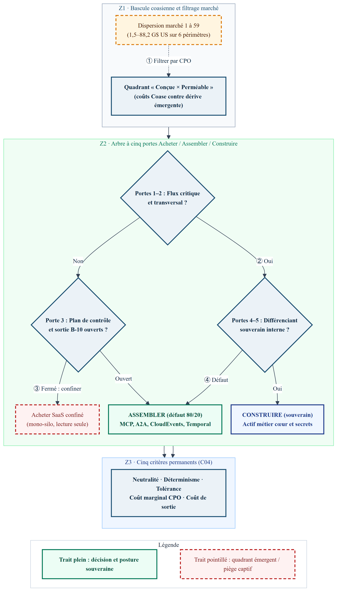
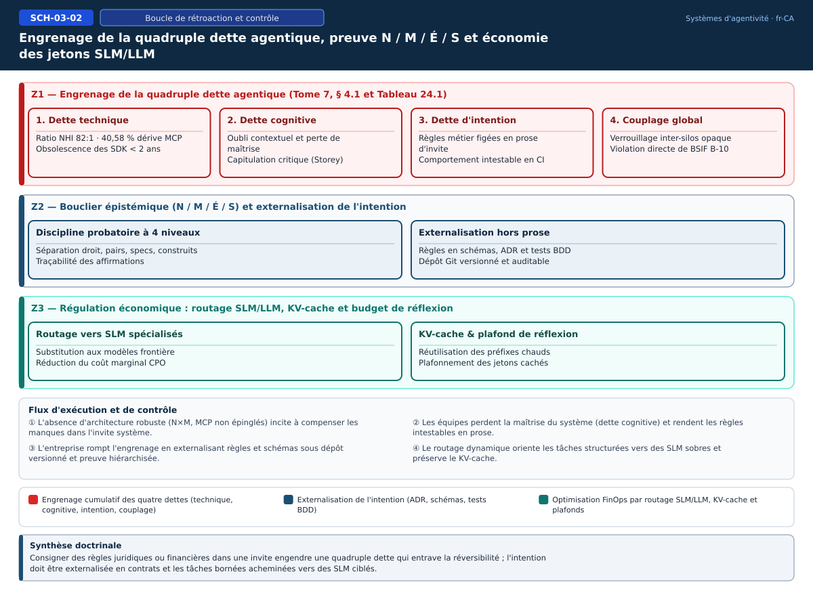
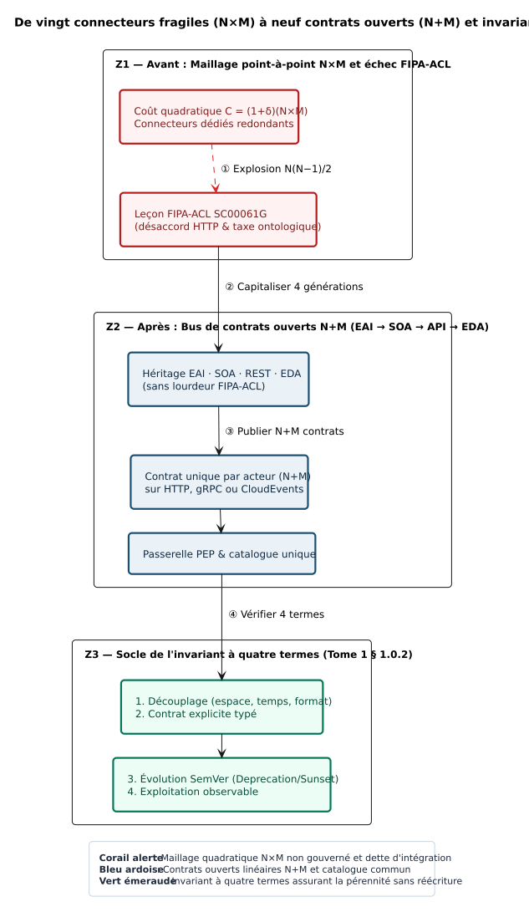

# Chapitre 03 — Économie cognitive de Coase, matrices de portefeuille et quadruple dette agentique

*Question directrice :* Comment l'effondrement des coûts de transaction cognitifs de Coase redessine-t-il les frontières « faire, assembler ou acheter » de l'entreprise réglementée tout en prévenant l'engrenage de la quadruple dette agentique et la dispersion des prévisions de marché ?

La viabilité d'un **Système d'agentivité** ne se résume pas à sa fiabilité mathématique ; elle repose tout autant sur son équation économique, sa gouvernance de portefeuille et sa soutenabilité logicielle dans la durée. À mesure que le calcul effectif et la baisse du prix facial des jetons rendent économiquement accessibles des boucles cognitives autrefois réservées à l'intervention humaine, les dirigeants se trouvent confrontés à une double illusion. La première tient à l'apparence d'un marché uniforme dont les prévisions varient pourtant du simple au triple dès `2026` selon les périmètres retenus. La seconde découle d'une automatisation rapide obtenue en branchant des suites SaaS préintégrées ou en empilant des consignes métier dans des invites textuelles. À moyen terme, ces raccourcis engendrent un passif cumulatif sévère qui paralyse la réversibilité réglementaire et compromet la maîtrise des systèmes centraux.

Le présent chapitre analyse d'abord les **coûts de transaction cognitifs** à la lumière des travaux de Coase, de Williamson et de la modélisation contemporaine des économies d'agents virtuels. Il démasque ensuite la dispersion des études de marché face aux dépenses réelles d'infrastructure de `2026`, formalise l'arbre à cinq portes `Acheter` / `Assembler` / `Construire` et précise la sobriété d'inférence vers les petits modèles spécialisés (`SLM`). Il retrace enfin vingt ans de généalogie d'intégration (`EAI`, `SOA`, `API`, `EDA`, `FIPA-ACL`) pour formuler l'invariant à quatre termes contre l'explosion quadratique des connecteurs et briser le cercle fermé de la **quadruple dette agentique**.

## 3.1 Économie cognitive de Coase, matrices de portefeuille et arbitrage `Acheter` / `Assembler` / `Construire`

### 3.1.1 Coût de transaction cognitif de Coase et économies d'agents virtuels

Dans la théorie de la firme formulée par Ronald Coase en 1937 et prolongée par Oliver Williamson en 1981 (documentées ici à travers les études primaires de Shahidi, Rusak, Manning, Fradkin et Horton, `NBER Working Paper 34468`, novembre 2025, ainsi que de Hadfield et Koh, `arXiv:2509.01063`, l'article originel de Coase chez Wiley demeurant au statut F pour blocage d'accès [1, 3]), les frontières de l'entreprise résultent d'un arbitrage économique. Ce qui se réalise à l'interne plutôt que sur le marché dépend des coûts de recherche d'information, de négociation contractuelle et de vérification de la prestation. Lorsque des agents autonomes effectuent ces opérations à un coût marginal très faible, le **coût de transaction cognitif** s'effondre, laissant entrevoir une recomposition profonde de la coordination interne et inter-firmes [1].

Shahidi et coll. soulignent toutefois que cette réduction des frictions transactionnelles transforme simultanément la conception même des marchés numériques : la baisse des coûts de recherche permet des enchères plus fines, des appariements multi-critères et des négociations prolongées, mais expose aussi les échanges à de nouvelles asymétries d'information [1]. Hadfield et Koh (`1er septembre 2025`, `arXiv:2509.01063`) démontrent dans le même sens qu'une économie d'agents autonomes ne peut fonctionner durablement par simple spontanéité algorithmique ; elle exige une infrastructure juridique, contractuelle et normative dédiée pour ancrer les enregistrements, arbitrer les litiges et imputer la responsabilité des actes [3].

En pratique, l'effondrement apparent des coûts cognitifs se heurte à quatre limites structurelles qui empêchent une automatisation marchande sans garde-fous [1, 2, 3]. Premièrement, les instructions transmises par le mandant humain demeurent intrinsèquement incomplètes face aux cas ambigus, ouvrant la porte à des interprétations divergentes [1, 3]. Deuxièmement, la multiplication d'agents négociant en parallèle provoque des effets de congestion, des restrictions d'accès aux plateformes et de nouvelles formes d'obfuscation stratégique [1]. Troisièmement, les agents actuels montrent une rationalité économique limitée : le meilleur modèle évalué en `2024` (`GPT-4 Turbo`) ne surpasse le hasard que de `33 %` sur des tests stratégiques, tandis que l'apprentissage par renforcement peut conduire à une collusion tacite sur les prix [3]. Quatrièmement, la double opacité des modèles de fondation propriétaires prive l'acheteur et le régulateur d'une visibilité vérifiable sur les données, les procédures d'entraînement et la stabilité des comportements [3].

Tomašev et coll. (`Google DeepMind`, `12 septembre 2025`, `arXiv:2509.10147`) proposent une matrice analytique à deux dimensions (`2×2`) pour qualifier toute **économie d'agents virtuels** (« *sandbox economy* ») selon son origine (émergente par rapport à conçue) et sa perméabilité envers l'économie humaine établie (imperméable par rapport à perméable) [2]. L'architecture d'une entreprise réglementée DOIT prévenir la dérive vers le quadrant « émergente × perméable ». Cet espace non encadré s'expose aux erreurs corrélées de type *Flash Crash* de `2010`, aux négociations à haute fréquence (`HFN`) creusant les asymétries, aux pièges à agents (*agent traps*) et à la collusion tacite par apprentissage par renforcement [2, 3]. L'organisation DOIT au contraire bâtir un espace « conçue × perméable » reposant sur des identifiants décentralisés et justificatifs vérifiables (`DID`/`VC`), des garde-fous préalables, une supervision automatisée multi-niveaux appuyée sur des registres immuables et une imputation juridique sans équivoque [2, 3].

### 3.1.2 Dispersion des études de marché, CapEx `2026` et économie de la preuve

Justifier un dossier d'investissement agentique par la taille brute du marché constitue une faute méthodologique grave. La confrontation des rapports ouverts accessibles en texte intégral `L+` révèle déjà des écarts marqués dès l'année de référence `2026` : `Grand View Research` évalue le marché de l'IA agentique d'entreprise à `5,3 G\$ US` en `2026` (après `2,6 G\$ US` en `2024`) [8], tandis que `Mordor Intelligence` l'estime à `9,89 G\$ US` en `2026` [7]. Dans le corpus `L+`, la prévision conditionnelle de `Deloitte` (`8,5 G\$ US` en `2026` et `35` à `45 G\$ US` en `2030`) confirme cette hétérogénéité, alors que `Mordor Intelligence` relève elle-même des estimations externes s'étendant de `19,33 G\$ US` dès `2026` à `121 G\$ US` en `2032` selon que les plateformes, les services d'intégration ou les modèles embarqués sont inclus dans le périmètre [7].

En excluant les portails bloqués de `Polaris`, `Fortune` et `IDC` (classés en `statut F` selon `AO-01`) ainsi que les reprises secondaires dépourvues de source primaire `L+`, les séries ouvertes vérifiées demeurent contrastées. Le marché s'étage entre `5,3` et `9,89 G\$ US` (`9,9 G\$ US`) pour l'année `2026` [7, 8], entre `7,75 G\$ US` (`7,8 G\$ US` interpolés au taux composé de `46,2 %` de Grand View [8]) et `14,06 G\$ US` à l'horizon `2027` [7], puis entre `24,5` [8] et `40,58 G\$ US` (`40,6 G\$ US` interpolés sur `2027–2030` au taux de `42,38 %` de Mordor [7], atteignant `82,27 G\$ US` en `2032` [7]). Ces divergences ne traduisent pas un consensus ferme, mais l'inclusion variable des licences applicatives, des services d'intégration et des infrastructures sous-jacentes [7].

Ce contraste est d'autant plus frappant lorsqu'il est rapporté aux dépenses d'investissement (`CapEx`) massives consenties par les fournisseurs d'infrastructure infonuagique. Les dépôts officiels auprès de la SEC américaine pour les neuf premiers mois calendaires de `2026` établissent `496,723 G\$ US` (`496,7 G\$ US`) de décaissements en trésorerie cumulés entre quatre acteurs majeurs. Alphabet atteint `131,953 G\$ US` (`132,0 G\$ US`) [9], Amazon atteint `175,670 G\$ US` (`175,7 G\$ US`) [10] et Meta Platforms atteint `83,055 G\$ US` (`83,1 G\$ US`) [11]. Pour sa part, Microsoft totalise `106,045 G\$ US` (`106,0 G\$ US`) en soustrayant le premier semestre `H1 FY2026` clos le `31 décembre 2025` [14] de l'exercice annuel `FY2026` [13], puis en ajoutant le trimestre `T1 FY2027` [12], auxquels s'ajoutent `14,323 G\$ US` d'actifs obtenus par baux financiers [12, 13, 14].

L'extrapolation annualisée `2026` reconduit le troisième trimestre `2026` pour Alphabet [9] et Microsoft [12], tout en retenant les prévisions annuelles d'Amazon à `~220 G\$ US` [10] et de Meta à `135`–`145 G\$ US` baux financiers inclus [11]. Elle s'établit ainsi entre `683,7` et `693,7 G\$ US` hors baux financiers de Microsoft, et atteint `703,2` à `713,2 G\$ US` (`703` à `713 G\$ US`) baux inclus. En face de cette débauche de capital, les enquêtes ouvertes `L+` montrent une maturité opérationnelle encore limitée. Au Canada, `19,2 %` des entreprises utilisent l'IA au deuxième trimestre `2026` (`Statistique Canada`), mais `8 %` seulement rapportent un usage opérationnel significatif contre `21 %` un usage modéré (`Banque du Canada`). Aux États-Unis, `12 %` seulement des dirigeants interrogés attendent un retour sur investissement sous trois ans pour l'automatisation couplée aux agents contre `45 %` pour l'automatisation de base (`Deloitte`). Un tel décalage confirme que les décisions doivent s'appuyer sur des gains vérifiés par transaction plutôt que sur l'extrapolation de volumes macroéconomiques bruts.

Pour discipliner les dossiers d'affaires face à cette asymétrie, toute décision d'architecture ou de financement DOIT appliquer le marquage probatoire à quatre niveaux (`[N]/[M]/[É]/[S]`) et la qualification temporelle (`[D]/[A]/[C]`) :

- Le marqueur `[N]` désigne les obligations juridiques et prudentielles vérifiées sur textes primaires complets ainsi que les `305` exigences `EXIG-*` ;
- Le marqueur `[M]` couvre les études scientifiques évaluées par les pairs ;
- Le marqueur `[É]` regroupe les spécifications protocolaires ouvertes et les prépublications techniques ;
- Le marqueur `[S]` qualifie les constructions analytiques co-appuyées, en excluant formellement tout cas fictif illustratif (tel le Groupe Boréal Inc.) de toute valeur de preuve empirique.

La qualification temporelle sépare parallèlement le droit ou l'état acquis à la date de gel (`[D]`), l'évolution anticipée sur feuille de route publique (`[A]`) et la projection conditionnelle (`[C]`). Aucun dossier d'investissement ne saurait être approuvé sur des projections macroéconomiques dispersées ; il DOIT reposer sur le **coût complet par résultat conforme** (`CPO`, `EXIG-FIN-01`, `CAP-045`) comparé à une référence déterministe antérieure. Ce modèle économique intègre explicitement le coût d'inférence, les réessais de réparation, l'évaluation continue, la supervision humaine et le provisionnement de sortie.

En outre, cette discipline probatoire prévient l'inflation artificielle des retours sur investissement calculés sur des scénarios idéaux. En obligeant chaque promoteur de projet à étiqueter séparément ce qui relève d'une exigence légale contraignante (`[N]`), d'une mesure expérimentale arbitrée (`[M]`), d'une spécification ouverte (`[É]`) ou d'une hypothèse architecturale (`[S]`), le comité d'investissement distingue clairement les fondations certaines des paris prospectifs. Les quatre dettes cumulatives de parc documentées au *Tableau 3.2* — croissance quadratique des connecteurs `N×M` par rapport à `N+M`, prolifération non gouvernée des identités non humaines et dérive silencieuse des serveurs `MCP` (`40,58 %` [4]), perte de traçabilité des décisions et absence d'oracles de test — sont ainsi chiffrées dès l'étude d'opportunité plutôt que découvertes après coup en production.

### 3.1.3 Arbitrage `Acheter` / `Assembler` / `Construire` et routage frugal `SLM` / `LLM`

Sous l'effet composé de la croissance du calcul effectif (`~10×` par an selon les séries documentées au Chapitre 01) et de la baisse des tarifs d'inférence (`5×` à `13×` par an à score constant), les éditeurs de suites logicielles proposent des agents préintégrés séduisants à court terme. Toutefois, ces offres adoptent fréquemment une posture « ouverte sur le fil, fermée sur le plan de contrôle » : elles acceptent des connecteurs standardisés en périphérie, mais enferment l'état de session, l'identité, les règles d'autorisation et les journaux d'audit dans un jardin clos propriétaire (modèle dit *bowling-shoe* par opposition à l'architecture *Bring Your Own* contrôlée par l'institution [1]). En milieu réglementé, où `63 %` des `413` praticiens et dirigeants interrogés par DataRobot en `2026` indiquent que leur organisation exige un déploiement sur site pour l'IA agentique — le mode hybride affichant parallèlement la plus forte croissance projetée à `44,85 %` par an sur `2027–2032` [7] —, cette captivité entre en conflit direct avec les plans de sortie exigés par la ligne directrice `BSIF B-10`.

Pour éviter ce piège, toute initiative DOIT franchir un **arbre décisionnel à cinq portes** (`C04`, *Tableau 3.1*) qui impose l'assemblage sur standards ouverts autour du noyau possédé `80/20` comme posture par défaut. L'achat d'une solution SaaS prête à l'emploi n'est toléré que pour des cas d'usage périphériques et non critiques, et uniquement si le fournisseur garantit l'exportation complète des historiques, des politiques et des journaux d'audit. Pour tout processus touchant les données réglementées, la finance ou la relation client sensible, l'assemblage sur protocoles ouverts (`MCP`, `A2A`, `CloudEvents`, `Idempotency-Key`, `Temporal`) permet de remplacer librement un modèle ou un outil sans refonte du noyau décisionnel. La construction intégrale à l'interne demeure enfin réservée aux algorithmes propriétaires et aux actifs différenciants qui constituent le cœur stratégique de l'entreprise.

| Porte de l'arbre `C04` | Question d'arbitrage architectural | Décision normative résultante |
|---|---|---|
| Porte 1 — Criticité métier | Le flux touche-t-il un processus critique, transversal ou réglementé ? | Si non (usage banalisé monosilo), examen d'achat SaaS possible sous porte 2 |
| Porte 2 — Ouverture du contrôle | Le progiciel SaaS expose-t-il son plan de contrôle, ses journaux et ses clés ? | Si fermé, confinement strict en lecture seule ou rejet sous clauses `BSIF B-10` |
| Porte 3 — Réversibilité et sortie | Existe-t-il un contrat de sortie vérifiable sans coût prohibitif ? | Exigence de portabilité des états, mémoires et schémas avant signature |
| Porte 4 — Assemblage standardisé | Des briques ouvertes (`MCP`, `A2A`, `CloudEvents`, `Temporal`) couvrent-elles le besoin ? | Posture par défaut : **Assembler** sur standards ouverts autour du noyau possédé |
| Porte 5 — Actif différenciant | L'algorithme ou l'orchestration constitue-t-il un avantage souverain exclusif ? | Réserver **Construire** aux seuls actifs différenciants et secrets métier critiques |

*Tableau 3.1 — Arbre décisionnel à cinq portes `Acheter` / `Assembler` / `Construire` (`C04`).*

La *Figure 11* articule la bascule coasienne vers le quadrant « Conçue × Perméable », le filtrage de la dispersion des études de marché et l'arbre à cinq portes aboutissant aux cinq critères permanents.

*Figure 11 — SCH-03-01 : Arbitrage stratégique combinant quadrant coasien « Conçue × Perméable » (`Z1`), arbre à cinq portes `Acheter` / `Assembler` / `Construire` (`Z2`) et évaluation selon les cinq critères permanents `C04` (`Z3`).*

Sur le plan de l'économie opérationnelle des jetons, l'optimisation ne peut compter sur la seule baisse du prix facial au million de jetons. Dans un pipeline multi-tours, la relecture répétée de l'historique conversationnel, du contexte et des définitions d'outils à chaque itération engendre une croissance quadratique des jetons d'entrée, amplifiée par trois multiplicateurs de coût : les itérations en boucle, la topologie d'échange entre acteurs et les définitions d'outils facturées en entrée à chaque tour. S'y ajoutent les budgets de jetons de réflexion cachés facturés en sortie sur les modèles raisonneurs, ainsi que la dette d'évolution inter-versions inhérente à l'apprentissage par renforcement vérifiable lorsque les schémas d'outils changent.

Belcak et coll. (`NVIDIA Research` et `Georgia Tech`, `2 juin 2025`, `arXiv:2506.02153`) montrent que des **petits modèles de langage spécialisés (`SLM`)** suffisent pour la majorité des sous-tâches agentiques répétitives et bornées (`Open Operator`, `MetaGPT`, `Cradle` : `40 %` à `70 %` de requêtes remplaçables à un coût d'inférence `10×` à `30×` moindre pour `7B` contre `70`–`175B`) [5]. Le présent traité vise `70 %` à `78 %` d'appels structurés routés vers des `SLM` tout en préservant l'affinité `KV-cache`.

Ce routage frugal (`EXIG-D01-03.5`) obéit d'abord à des critères stricts de bascule qualité. Aucun `SLM` n'est admissible sans parité de constance `pass^k` vérifiée sur banc isolé (`k ≥ 3` minimal, `k ≥ 5` en flux critique sous `PRR F-15`). En exécution, tout franchissement du seuil d'incertitude calibré (log-probabilités étalonnées ou ambiguïté sémantique) ou échec de schéma déclenche l'escalade vers un `LLM` frontière. À l'inverse, à `70 %` de l'enveloppe budgétaire (`ADR-023`), la passerelle active le repli économique `SLM`.

Parallèlement, l'arbitrage coût/souveraineté oppose l'hébergement sur site à l'inférence gérée. En milieu réglementé, `63 %` des `413` praticiens sondés par DataRobot en `2026` exigent le sur-site contre `59,83 %` de part infonuagique, tandis que le mode hybride croît de `44,85 %` par an sur `2027–2032` [7]. Belcak et coll. rappellent (`CA4`) les coûts fixes des grappes `GPU` dédiées, de l'équilibrage de charge et de spécialistes face à la mutualisation infonuagique, tempérés (`A12`/`A13`) par l'ordonnancement modulaire et la baisse des coûts de mise en service [5]. L'entreprise arbitre donc au `CPO` (`EXIG-FIN-01`) entre sur-site souverain — justifié par la confidentialité stricte, la résidence réglementaire et un volume amortissant l'infrastructure — et inférence gérée ou hybride sous alias logique et clauses `BSIF B-10`.

> **Trois invariants exécutables — Chapitre 3**
> 1. **Assemblage ouvert par défaut** — Tout flux critique franchit l'arbre `C04` et s'assemble sur standards ouverts autour du noyau possédé ; tout agent SaaS fermé sur le plan de contrôle est confiné en lecture seule ou encadré par `BSIF B-10`.
> 2. **Discipline probatoire et sortie de la prose** — Tout dossier s'appuie sur le marquage `[N]/[M]/[É]/[S]` et le `CPO` ; aucune règle métier ou prudentielle critique ne réside uniquement en prose d'invite mais s'externalise en contrats versionnés.
> 3. **Invariant à quatre termes et épinglage `MCP`** — Tout couplage inter-domaines remplace les connecteurs `N×M` par des contrats `N+M` sous invariant à quatre termes, avec épinglage cryptographique des serveurs contre la dérive silencieuse (`40,58 %`).

## 3.2 Quadruple dette agentique, économie des jetons `SLM`/`LLM` et invariant à quatre termes

### 3.2.1 Engrenage de la **quadruple dette agentique** et perte de traçabilité (`arXiv:2603.22106`)

L'adoption précipitée de prototypes agentiques sans socle d'architecture engendre un cercle vicieux fermé, formalisé au *Tableau 3.2* en prolongeant le modèle à triple dette de Storey [6] sous le nom de **quadruple dette agentique** : la dette technique, la dette cognitive, la dette d'intention et la dette de couplage global. Chaque dimension alimente la suivante et transforme un gain apparent de vélocité initiale en passif financier et juridique durable.

La **dette technique** naît d'abord des parseurs artisanaux, des connecteurs point-à-point fragiles et du renouvellement accéléré des trousses de développement logiciel (`SDK` tels `AutoGen`, `Semantic Kernel` ou `Swarm`), dont le rythme rapide de rupture contraste avec des processus financiers et assurantiels décennaux. À cette obsolescence s'ajoute l'instabilité de la chaîne d'approvisionnement en outils externes. Le recensement empirique d'Obada Kraishan (`15 septembre 2026`, `arXiv:2609.14119`) couvre `21 643` serveurs `MCP`, `72 606` enregistrements de versions et `14 353` serveurs analysés en code source [4]. Sur `8 900` serveurs publiant plusieurs versions, `51,09 %` évoluent d'une mouture à l'autre et `40,58 %` affichent une dérive sémantique silencieuse sans changement d'identifiant déclaré, multipliant par près de trois la cote d'alerte de sévérité élevée (`OR = 2,96`, `IC 95 % [2,56, 3,42]`) [4]. De plus, `4,16 %` (`370` serveurs) redirigent leur point d'accès distant vers un autre hôte sans avertir le client [4]. Sans inventaire ni épinglage strict, cette prolifération s'accompagne d'un gonflement des identités non humaines (`NHI`) et de secrets orphelins qui élargissent la surface d'attaque.

La **dette cognitive et d'intention** s'accumule ensuite lorsque les équipes, confrontées à des défauts d'intégration, compensent les lacunes du code en empilant des consignes de plus en plus longues dans les invites système. Margaret-Anne Storey (`23 mars 2026`, `arXiv:2603.22106`) conceptualise cette pathologie sous le nom de **dette cognitive et d'intention** : à mesure que le système génère ou orchestre des artefacts sans traçabilité humaine claire, l'équipe perd la compréhension du modèle mental partagé (érosion de la mémoire transactive) et ne maîtrise plus les hypothèses métier initiales [6]. Lorsque la vélocité de production dépasse la capacité d'examen humain, une dette de compréhension (*comprehension debt*) s'installe par capitulation critique (*cognitive surrender*) et fragilise toute maintenance ultérieure [6]. En parallèle, les règles de conformité enfouies dans la prose deviennent impossibles à tester unitairement en intégration continue. Ce phénomène se combine au principe `CACE` (*Changing Anything Changes Everything*) formulé par Sculley et coll. : modifier une seule phrase d'invite ou une version de serveur d'outils altère de manière imprévisible l'ensemble des sorties aval.

Enfin, la **dette de couplage global** verrouille l'organisation. Lorsque la logique métier, la gestion d'état et les garde-fous résident dans les invites optimisées pour un modèle particulier ou dans les paramètres propriétaires d'un orchestrateur SaaS, toute substitution de modèle ou migration de fournisseur exige une réécriture complète, en violation directe des exigences de réversibilité et de maîtrise de la sous-traitance (`BSIF B-10`). Ce verrouillage est d'autant plus critique que l'amélioration rapide des modèles incite à renouveler les moteurs d'inférence à chaque cycle ; sans séparation stricte entre l'intention métier versionnée et l'adaptateur de modèle, chaque changement de fournisseur devient un projet risqué à coût élevé. Le *Tableau 3.2* synthétise les quatre dettes et leurs remèdes obligatoires.

| Type de dette | Manifestation technique et symptômes mesurés | Remède architectural prescrit |
|---|---|---|
| Dette technique | Connecteurs `N×M`, instabilité des `SDK`, `40,58 %` dérive `MCP` (`OR = 2,96`) [4], secrets `NHI` | Épinglage local des schémas, adaptateurs standards ouverts, identités `NHI` gouvernées |
| Dette cognitive | Perte de maîtrise de l'équipe, érosion de la mémoire transactive (`Storey`) [6], dette de compréhension | Documentation vivante, séparation `80/20` et revues humaines anti-complaisance |
| Dette d'intention | Règles métier et seuils prudentiels enfouis dans la prose des invites, effet `CACE` | Sortie obligatoire de la prose vers des `ADR`, schémas JSON et tests `BDD` versionnés |
| Dette de couplage | Dépendance aux comportements implicites d'un modèle ou d'un studio SaaS fermé | Noyau possédé découplé du modèle (`EXIG-D01-03.1`), contrats portables `BSIF B-10` |

*Tableau 3.2 — Mécanisme de la quadruple dette agentique et parades normatives.*

La *Figure 12* illustre cet engrenage à quatre roues dentées ainsi que sa neutralisation par la discipline probatoire `[N]/[M]/[É]/[S]`, l'externalisation des règles d'intention et le routage frugal vers des `SLM`.

*Figure 12 — SCH-03-02 : Boucle fermée de la quadruple dette agentique (`Z1`), bouclier épistémique `[N]/[M]/[É]/[S]` et sortie de la prose vers des contrats versionnés (`Z2`), et régulation économique par `SLM` et `KV-cache` (`Z3`).*

### 3.2.2 Coût quadratique de non-interopérabilité, généalogie `EAI`–`FIPA` et invariant à quatre termes

La prévention de la dette technique d'intégration s'éclaire à la lumière de vingt années d'architecture d'entreprise. Lorsqu'une organisation relie `N` agents ou applications consommatrices à `M` systèmes fournisseurs au moyen de connecteurs dédiés point-à-point, le nombre d'interfaces croît de manière quadratique selon `N×M` — ou `N(N-1)/2` dans un graphe pair-à-pair complet — entraînant un coût de maintenance approximatif \(C = (1 + \delta)(N \times M)\) où \(\delta\) représente la surcharge récurrente de sécurité, d'évolution et de surveillance de chaque lien spécifique. Sans standardisation, chaque nouveau système central ajouté au portefeuille multiplie les adaptateurs artisanaux et rend chaque mise à jour de sécurité coûteuse.

L'expérience historique de quatre générations d'intégration permet d'éviter de répéter les erreurs passées. Les courtiers `EAI` centralisés des années `1990`, l'architecture orientée services `SOA` (`WS-*` et `OASIS 1.0`), les interfaces `API REST` et l'architecture orientée événements `EDA` (`CloudEvents`) forment des vagues chevauchantes dont chacune déplace le centre de gravité du couplage sans jamais le supprimer. Les courtiers `EAI` ont réduit la prolifération des liens point à point au prix d'un goulot d'étranglement centralisé, tandis que la pile `SOA` a tenté de normaliser les contrats par des enveloppes rigides souvent trop lourdes pour l'exploitation courante. À l'inverse, le modèle `REST` a abaissé le coût d'entrée en s'appuyant directement sur la sémantique `HTTP`, mais il laisse chaque fournisseur définir ses propres schémas utiles. Enfin, les bus événementiels ont découplé l'émission de la réception dans le temps, tout en transférant la charge de gouvernance vers l'évolution des schémas et le rejeu des événements.

À chaque transition, l'équation combinatoire de l'intégration reste identique : relier directement \(M\) agents hétérogènes à \(N\) systèmes externes exige \(M \times N\) adaptateurs spécifiques. Dès quatre systèmes d'agentivité appelant cinq progiciels distincts, vingt connecteurs fragiles doivent être maintenus en parallèle ; l'introduction d'une couche protocolaire commune ramène cet effort à neuf contrats bornés (\(M + N\)), soit une réduction supérieure à la moitié dès cette petite échelle. Cette arithmétique élémentaire explique pourquoi les équipes qui négligent la standardisation au démarrage finissent par reconstruire un bus ad hoc sous pression opérationnelle, avec une dette technique proportionnelle au produit plutôt qu'à la somme des composants raccordés. Sans interface commune vérifiable dès la conception, chaque nouveau système externe multiplié par la flotte d'agents active alourdit directement les tests de régression et la rotation des jetons d'accès.

L'examen critique des systèmes multi-agents classiques des années `2000` (`KQML`, `FIPA-ACL SC00061G`, `Contract Net`, ontologies `RDF`/`OWL`) offre un enseignement complémentaire décisif. Ces standards se sont heurtés à deux écueils rédhibitoires : un désaccord avec le substrat de transport `HTTP` dominant et une « taxe d'ontologie préalable » prohibitive exigeant que tous les participants partagent un modèle sémantique formel complet avant d'échanger le moindre message. Aujourd'hui encore, le déplacement d'une partie de l'interprétation sémantique à l'intérieur des poids des grands modèles de langage n'abolit nullement le besoin de contrats partagés : il déplace simplement l'erreur du rejet syntaxique vers la mécompréhension silencieuse.

Pour ramener durablement `N×M` intégrations (par exemple `20` liaisons dédiées entre quatre agents et cinq progiciels) vers `N+M` contrats normalisés (`9` contrats réutilisables derrière une passerelle et un catalogue uniques), toute frontière inter-domaines DOIT satisfaire l'**invariant architectural à quatre termes** formalisé dans le cadre du présent traité (`ADR-004`, détaillé au Chapitre 09) :

1. **Découplage** — Séparation spatiale (adressage logique), temporelle (file durable ou événement asynchrone) et de format (schéma canonique indépendant du stockage patrimonial) ;
2. **Contrat explicite** — Spécification lisible par machine (`JSON Schema`, `OpenAPI`, `AsyncAPI`) vérifiée mécaniquement côté consommateur et producteur ;
3. **Évolution rétrocompatible** — Gestion rigoureuse du versionnement sémantique (`SemVer`), accompagnée d'en-têtes normalisés de dépréciation (`Deprecation`) et d'extinction (`Sunset`) sans rupture brutale ;
4. **Exploitation observable** — Instrumentation native de la télémétrie, des délais d'attente, de l'idempotence et des points de coupure.

L'application systématique de ces quatre termes protège les processus durables contre l'obsolescence des cadriciels : un modèle ou progiciel se remplace sans briser l'exécution ni la traçabilité prudentielle, tout en simplifiant la rotation des secrets `NHI` et l'audit des flux inter-domaines.

La *Figure 13* visualise cette transition de vingt connecteurs fragiles à neuf contrats ouverts sous l'invariant à quatre termes et l'héritage `EAI` → `SOA` → `API` → `EDA`.

*Figure 13 — SCH-03-03 : Comparatif entre maillage quadratique `N×M` et leçon de l'échec `FIPA-ACL` (`Z1`), bus linéaire `N+M` issu de quatre générations d'intégration (`Z2`) et socle de l'invariant à quatre termes (`Z3`).*

## 3.3 Synthèse opératoire, exigences `D01-03` et frontières d'architecture

Six exigences normatives (`EXIG-D01-03.1` à `EXIG-D01-03.6`, *Tableau 3.3*) érigent l'économie cognitive et la prévention de la quadruple dette en critères vérifiables devant le comité d'architecture (`ARB`).

| Exigence | Prescription normative | Mécanisme et artefact de vérification |
|---|---|---|
| `EXIG-D01-03.1` | Assembler par défaut sur noyau possédé (`C04`) | Arbre à `5` portes ; confinement en lecture seule ou clauses `BSIF B-10` pour tout SaaS fermé |
| `EXIG-D01-03.2` | Imposer l'économie de la preuve dans tout dossier | Marquage `[N]/[M]/[É]/[S]` et `[D]/[A]/[C]` ; exclusion des sources en `statut F` et prévisions brutes au profit du `CPO` (`EXIG-FIN-01`) |
| `EXIG-D01-03.3` | Appliquer l'invariant à quatre termes (`ADR-004`) | Remplacement du couplage `N×M` par `N+M` contrats (`découplage`, `contrat`, `évolution`, `exploitation`) |
| `EXIG-D01-03.4` | Externaliser toute règle critique hors de la prose | Dépôt versionné d'`ADR`, de schémas et de tests `BDD` ; zéro politique prudentielle en invite seule |
| `EXIG-D01-03.5` | Router vers `SLM`, `KV-cache` et arbitrer sur site/géré | Parité `pass^k`, escalade sur seuil d'incertitude, cible `70 %`–`78 %` (`40 %`–`70 %` en [5]), arbitrage `CPO` sur site (`63 %` [7]) vs inférence gérée |
| `EXIG-D01-03.6` | Épingler les serveurs `MCP` et maîtriser le parc `NHI` | Empreintes cryptographiques locales contre `40,58 %` de dérive (`OR = 2,96`) [4] et inventaire des identités `NHI` |

*Tableau 3.3 — Matrice des six exigences opératoires `EXIG-D01-03.1` à `EXIG-D01-03.6`.*

Cinq livrables concrétisent ce dispositif avant passage à l'échelle : la grille `Acheter` / `Assembler` / `Construire` (`C04`), le modèle `CPO` comparé à la référence non agentique, le registre versionné d'artefacts d'intention (`ADR`, schémas, tests `BDD`), la politique de routage `SLM` / `KV-cache` avec arbitrage sur site vs inférence gérée, et l'audit contractuel `BSIF B-10`.

La Partie I (`D01`) forme ainsi un triptyque indissociable : qualifier sur preuves vérifiables (Chapitre 01), borner la dégradation `pass^k` (Chapitre 02) et gouverner le portefeuille `N+M` au `CPO` (Chapitre 03). En amont (`←`), le Chapitre 03 prolonge les Chapitres 01 et 02. En aval (`→`), il prépare l'interopérabilité `EIF`/`LCIM` et les contrats du Chapitre 09, la chorégraphie `Event Mesh` (Chapitre 14) et les critères anti-patrons (`AP-01` à `AP-12`, Chapitre 30). En retour (`←`), il s'appuie sur la modernisation `AST`/`SCIP` (Chapitre 04), les standards `N+M`/`ACL` (Chapitres 09 et 10), le `CPO` sous `FOCUS v1.4` (Chapitre 24), `DAPP` (Chapitre 31), la relève junior (Chapitre 33) et l'architecture transversale (Chapitre 36). La **Partie II (`D02`)** expose dès le Chapitre 04 l'exosquelette déterministe `80/20`, les niveaux `L0–L4` et le noyau possédé.
