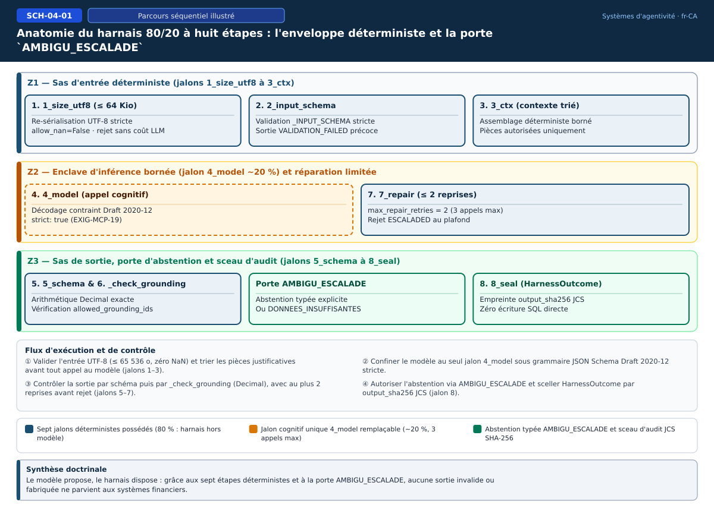
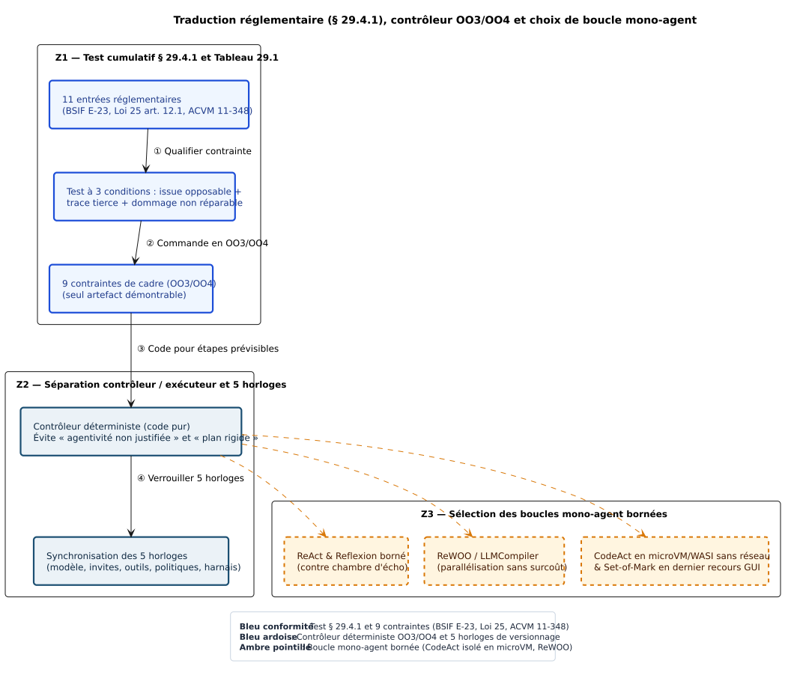
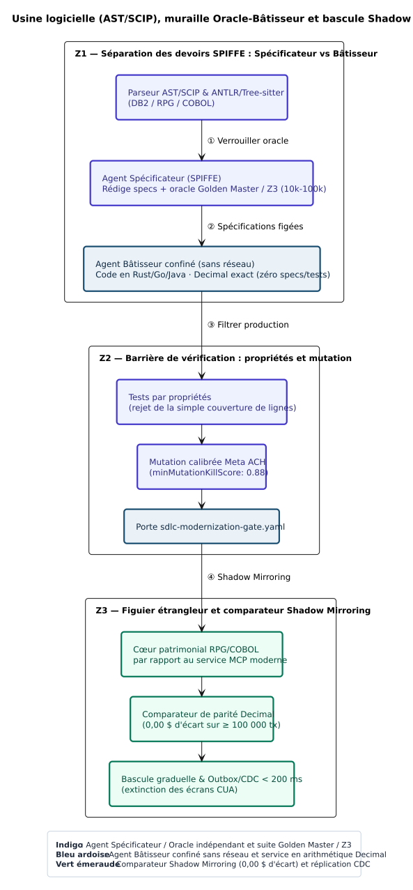

# Chapitre 04 — Partition hybride 80/20, harnais déterministe à huit étapes et usine logicielle

*Question directrice :* Comment confiner l'inférence probabiliste des Systèmes d'agentivité dans un exosquelette déterministe à huit jalons, depuis la traduction des exigences réglementaires jusqu'à l'usine logicielle en miroir ?

## 4.1 De la théorie de la fiabilité à l'enveloppe hybride 80/20

La première partie du traité a établi le diagnostic mathématique et économique des chaînes purement probabilistes : sous l'effet de la loi multiplicative de Lusser, l'empilement de décisions non déterministes dégrade exponentiellement la fiabilité globale, engendre des erreurs sémantiques silencieuses et gonfle la quadruple dette agentique. L'enquête empirique *Measuring Agents in Production* (`MAP`, `arXiv:2512.04123`) confirme d'ailleurs que, parmi les déploiements réels observés, `68 %` exécutent au plus `10` étapes avant toute intervention humaine et `80 %` (`16` cas sur `20`) reposent sur un flux structuré fixe plutôt que sur une planification ouverte [8]. La deuxième partie convertit ce constat en doctrine d'architecture d'entreprise et de solutions pour le domaine `D02` : au lieu de confier la conduite d'un processus métier à un modèle de langage libre, l'organisation enferme la cognition probabiliste dans une charpente logicielle déterministe dont elle conserve l'entière propriété.

Cette doctrine repose sur la **Partition 80/20**, qu'il importe de qualifier avec exactitude : il s'agit d'une heuristique directrice de conception et non d'une constante empirique universelle mesurée sur les systèmes en exploitation. Selon cette heuristique, environ `80 %` de l'architecture d'un système critique relèvent de mécanismes déterministes possédés par l'institution — validation des entrées, transitions d'état durables, arithmétique financière exacte, contrôle d'accès, journalisation d'audit et gestion des reprises — tandis que les `20 %` restants confinent l'inférence probabiliste du modèle à l'interprétation sémantique, à la classification ou à l'extraction structurée sous contrainte. La strate des **Systèmes d'agentivité** (`System of Action`, `SoA`) s'insère ainsi entre les interfaces usagers (`Systems of Engagement`, `SoE`) et les systèmes d'enregistrement patrimoniaux (`Systems of Record`, `SoR`), sans jamais autoriser un modèle ni un agent à exécuter directement du `SQL` ou une mutation non médiatisée sur les registres centraux (`ADR-001`, `EXIG-ARC-14`, `EXIG-ARC-17`, `EXIG-ARC-18`).

Dans le scénario pédagogique illustratif du groupe Boréal (`BSN`/`BCA`) — dont les grandeurs narratives demeurent exclues de la preuve empirique au profit des bancs reproductibles (`DC-P11`, `DC-P12`, `CH-29`) — l'encapsulation d'une cellule cognitive au sein d'une machine à états typée illustre ce mécanisme de stabilisation. Lorsqu'une boucle agentique libre enchaîne seule extraction documentaire, calcul financier et routage décisionnel, une seule déviation syntaxique ou arithmétique sur cinq exécutions invalide la séquence ; ce phénomène rejoint la chute empirique mesurée sur `τ-bench`, où `gpt-4o` fléchit d'environ `61 %` en `pass^1` à moins de `25 %` en `pass^8` (`CH-02`). En rapatriant les règles d'admissibilité, les calculs exacts et les transitions d'état dans l'enveloppe déterministe, le modèle n'assume plus qu'une fonction bornée d'interprétation sémantique afin de viser le seuil cible de qualification `pass^5 ≥ 95 %` (`ADR-022`, `PRR F-15`) et d'intercepter les défaillances en cascade (`OWASP ASI08`) avant toute transmission aval.

> **Trois invariants exécutables — Chapitre 4**
>
> 1. **Enveloppe déterministe obligatoire (`CAP-007`, `C09`, `R-01`)** : toute invocation cognitive critique traverse les huit jalons séquentiels de `DeterministicHarness`, qui bornent la boucle de réparation à `max_repair_retries = 2` (`3` appels au pire cas) et scellent l'issue par empreinte `JCS` `SHA-256` [5].
> 2. **Contrats stricts et abstention typée (`EXIG-ARC-03`, `EXIG-MCP-19`)** : chaque échange structuré obéit au profil `JSON Schema Draft 2020-12` `strict: true` [1] dépourvu de référence réseau, muni des issues explicites `AMBIGU_ESCALADE` et `DONNEES_INSUFFISANTES` ainsi que d'une représentation entière des montants financiers.
> 3. **Séparation des devoirs et parité en miroir (`ADR-029`, `CAP-052`)** : dans l'usine logicielle agentique, l'agent spécificateur-oracle ne partage ni l'identité `SPIFFE` ni les droits d'écriture de l'agent bâtisseur isolé, et la cible de conception subordonne toute bascule patrimoniale à un écart exact de `0,00 $` sur au moins `100 000` transactions réelles en `Shadow Mirroring`.

Sous cette discipline, la robustesse ne provient pas d'invites plus longues ni d'une confiance accordée aux rationalisations textuelles du modèle, mais d'un **harnais d'agent** conçu comme une enveloppe d'exécution durcie hors du modèle de langage. Le présent chapitre déploie cette architecture en trois volets complémentaires : la partition `80/20`, les boucles mono-agents et le **harnais déterministe** à huit étapes (`§ 4.2.1`), le pont réglementaire convertissant les textes canadiens et québécois en contraintes de cadre et en schémas stricts (`§ 4.2.2`), puis l'usine logicielle agentique et le patron du Figuier étrangleur (`§ 4.2.3`), avant de consolider les exigences vérifiables et les interfaces du chapitre (`§ 4.3`).

## 4.2 Architecture du harnais déterministe, séparation contrôleur–exécuteur et usine logicielle

### 4.2.1 Partition 80/20, boucle mono-agent et harnais à huit jalons

La conception d'une cellule agentique commence par l'application rigoureuse du principe de moindre agence (`Least-Agency`, `PRIN-08`, `EXIG-ORC-01`). Toute étape dont le cheminement est anticipable et gouverné par des règles stables relève d'un flux déterministe (`OO1` ou `OO2`), d'une table de décision `DMN` ou d'un automate sans modèle (`N0` selon la concordance `DISC-01` avec le palier `L0`), plutôt que d'une boucle cognitive (`OO3` ou `OO4`). L'architecture dissocie formellement le contrôleur décisionnel de l'exécuteur contractuel selon deux régimes explicites : un régime réactif, où des règles bornées sélectionnent l'enchaînement nominal, et un régime délibératif, mobilisé uniquement lorsque l'ambiguïté sémantique d'une pièce justificative empêche l'écriture d'un arbre statique complet.

Cette séparation évite deux écueils symétriques en conception de systèmes. D'une part, l'anti-patron d'« agentivité non justifiée » consiste à confier au modèle probabiliste une logique fiscale, une validation de format ou un calcul d'admissibilité codable de manière exacte, ce qui introduit latence, surcoût et incertitude sans valeur ajoutée. D'autre part, l'anti-patron du « plan rigide » fige une séquence impérative fragile face à des documents hétérogènes exigeant une interprétation contextuelle préalable avant aiguillage. L'arbre de décision de la partition `80/20` alloue donc chaque sous-tâche au niveau minimal d'inférence exigé par son entropie réelle.

Lorsque la présence d'une véritable incertitude sémantique justifie une boucle mono-agent encapsulée, le choix du patron d'exécution procède d'un arbitrage mesuré entre coût en jetons, latence, traçabilité et confinement. Le patron `ReAct` (`Reasoning and Acting`, `arXiv:2210.03629`) entrelace traces de raisonnement et appels d'outils dans une boucle courte adaptée aux diagnostics exploratoires bornés [2]. Toutefois, lorsque les dépendances entre appels d'outils sont prévisibles dès l'analyse initiale, `ReAct` alourdit la facture cognitive en réinjectant l'historique complet à chaque pas [3]. Le patron `ReWOO` (`Decoupling Reasoning from Observations`, `arXiv:2305.18323`) — parent du patron `Plan-and-Solve` — sépare la planification initiale de l'exécution des outils, atteignant jusqu'à `5×` moins de jetons et `+4 %` de précision sur *HotpotQA* [3] ; il s'accompagne dans la famille de planification en graphe acyclique dirigé du patron `LLMCompiler`.

Pour les tâches admettant une vérification formelle ou un test unitaire reproductible, les patrons `Reflexion` (cité dans [3]) et `Self-Refine` autorisent une rétroaction verbale sur trace d'échec, mais exigent un plafond strict d'essais et un oracle externe afin de conjurer l'auto-validation en chambre d'écho. Enfin, `CodeAct` (`arXiv:2402.01030`) unifie l'espace d'action sous forme de code `Python` exécutable plutôt que de multiples appels `JSON` fragmentés — atteignant jusqu'à `20 %` de taux de réussite absolu supplémentaire avec jusqu'à `30 %` d'actions en moins sur *M3ToolEval* [4] — à condition absolue d'enfermer l'interpréteur dans un bac à sable matériel (`microVM` ou `WASI`) dépourvu de tout accès réseau sortant (`CH-21`). En dernier recours sur des interfaces patrimoniales sans connecteur applicatif, la famille d'ancrage visuel annoté `Set-of-Mark` demeure confinée sous bail strict jusqu'à son remplacement (`CH-12`).

| Patron mono-agent | Mécanisme central | Atout principal | Risque maîtrisé par le harnais |
|---|---|---|---|
| `ReAct` [2] | Entrelacement raisonnement et appels séquentiels | Adaptation itérative aux retours d'outils | Plafonnement strict des tours et du budget de jetons |
| `Plan-and-Solve` / `ReWOO` [3] / `LLMCompiler` | Planification découplée des observations et exécution en graphe | Réduction des jetons et parallélisation des appels | Validation préalable des variables liées avant appel |
| `Reflexion` / `Self-Refine` | Boucle critique–correction sur trace d'échec | Amélioration sur tâches vérifiables | Interdiction d'auto-oracle ; contrôle externe obligatoire |
| `CodeAct` [4] | Émission d'actions en code exécutable unifié | Expressivité et compositionnalité sans verbiage | Confinement en `microVM`/`WASI` sans réseau sortant (`CH-21`) |

*Tableau 4.1 — Arbitrage des patrons de boucle mono-agent selon le coût, la latence et le confinement.*

Le cœur exécutable de la partition `80/20` prend forme dans la classe `DeterministicHarness` du module `harness_proto/pipeline.py` (critères `C09`, `C10`, `R-01` et capacité `CAP-007`), rattachée au `Plan C` de la concordance `DISC-03` aux côtés des modules des `Plans A` et `B` de la trousse. Au lieu d'exposer le modèle de langage en maître d'œuvre, la méthode `run` enserre l'unique jalon probabiliste `4_model` entre sept jalons déterministes audités dans `step_trace`. Avant même d'allouer un seul jeton d'inférence, l'étape `1_size_utf8` re-sérialise la charge d'entrée en `UTF-8` avec l'option `allow_nan=False` afin de rejeter toute valeur flottante non finie et vérifie la limite de `65 536` octets (`64` Kio). L'étape `2_input` confronte l'objet au contrat `_INPUT_SCHEMA` (`reference_dossier` et `texte` de type chaîne non vide, obligatoires et sans propriété additionnelle) ; tout échec aux deux premières portes retourne immédiatement `StepStatus.VALIDATION_FAILED` à coût cognitif nul. L'étape `3_ctx` assemble ensuite un contexte borné dont les clés justificatives (`grounding_records`) sont triées de manière déterministe pour stabiliser l'exécution et l'affinité de cache.

Après l'appel unique `4_model`, l'étape `5_schema` soumet la proposition du modèle au validateur durci `validate_strict_schema` conforme à `JSON Schema Draft 2020-12` [1], combinable en option de déploiement locale (hors code `G0`) avec un décodage contraint par grammaire (`CFG` ou `XGrammar`). L'étape `6_grounding` exécute ensuite la fonction `_check_grounding`, qui contrôle hors modèle la cohérence référentielle et arithmétique : la référence de dossier retournée doit figurer dans `allowed_grounding_ids` (lorsque cet ensemble est renseigné), correspondre à `grounding_records` et concorder avec l'entrée initiale ; de plus, un statut `EXTRAIT` exige un `montant_reclame_cents` non nul en cents entiers n'excédant pas le plafond `max_montant_cents` porté par la pièce justificative.

Si la sortie échoue au schéma ou à l'ancrage, l'étape `7_repair` relance une boucle de réparation bornée par `max_repair_retries = 2`, soit au plus `3` appels au modèle (l'invocation initiale et deux reprises ciblées transmettant la liste exacte des erreurs détectées). En cas de persistance des écarts au-delà de ce seuil, le harnais scelle un verdict `StepStatus.ESCALADED` sans jamais transmettre de charge partielle en aval. À l'inverse, si le statut métier extrait vaut `AMBIGU_ESCALADE` ou `DONNEES_INSUFFISANTES`, le harnais exige un champ `motif_escalade` non vide et achemine le dossier vers une révision humaine ; si tout est conforme, le statut passe à `StepStatus.OK`. Enfin, l'étape `8_seal` calcule le condensat cryptographique `output_sha256` en appliquant la canonisation `JCS` (`RFC 8785`) [5] sur le statut, la charge validée et la trace d'étapes `step_trace`.

<!-- CA-G0-SYNC id="G0-EX-CH01-02" path="Tome 8 - Ingénierie exécutable et homologation vérifiable/trousse/harness_proto/pipeline.py" lines="204-232" sha256="75110799d751ee4b93c58c7aff4e2b6ce0c2c8d29c50b6d1668b4bf895dfc275" -->
```python
    def run(
        self, raw_input: dict[str, Any], grounding_records: dict[str, Any]
    ) -> HarnessOutcome:
        """Execute les 8 etapes deterministes 80/20 hors invite."""
        if (bad := self._check_input(raw_input)) is not None:
            return bad
        schema = json.loads(self._config.schema_path.read_text("utf-8"))
        ctx = {"input": raw_input, "refs": sorted(grounding_records)}
        trace = ["1_size_utf8", "2_input", "3_ctx", "4_model"]
        retries, errs, cand = 0, [], self._model_adapter(ctx, [])
        while True:
            errs = validate_strict_schema(schema, cand) or _check_grounding(
                cand, raw_input, grounding_records,
                self._config.allowed_grounding_ids,
            )
            if not errs or retries >= self._config.max_repair_retries:
                break
            retries += 1
            cand = self._model_adapter(ctx, errs)
        trace.extend(["5_schema", "6_grounding", "7_repair", "8_seal"])
        if errs:
            return _seal_outcome(
                StepStatus.ESCALADED, None, "; ".join(errs), retries, trace
            )
        raw_st = cand["statut_analyse"]
        st = StepStatus.OK if raw_st == "EXTRAIT" else StepStatus(raw_st)
        return _seal_outcome(
            st, cand, cand.get("motif_escalade"), retries, trace
        )
```

La batterie de tests `test_harness_proto.py` (`14/14` tests réussis attestés par le rapport de vérification `G0`) vérifie mécaniquement ces propriétés : acceptation nominale avec intégrité `JCS`, rejet des charges surdimensionnées et des entrées non conformes à `_INPUT_SCHEMA`, blocage de `allOf`, `if`/`then` et des `$ref` réseau, escalade forcée après deux échecs de réparation (`≤ 3` appels), issues `AMBIGU_ESCALADE` / `DONNEES_INSUFFISANTES` et refus d'un montant supérieur au plafond documentaire. En complément, l'option `allow_nan=False` de `pipeline.py` et les `20` vecteurs officiels `rfc8785` vérifiés dans `test_third_party_vectors.py` attestent le rejet des flottants non finis `NaN` et `Infinity` [5], sans dépendre d'un fournisseur d'inférence externe.

Cet enchaînement s'articule impérativement avec une discipline de gestion du cycle de vie à **cinq horloges de versionnage asynchrones** : le modèle sous-jacent (poids et paramètres d'inférence), les invites et gabarits de contexte, les contrats et implémentations d'outils, les politiques d'autorisation hors modèle et le code du harnais évoluent chacun à un rythme distinct et sous des autorités de validation propres. Dissocier ces cinq horloges interdit les déploiements opaques où une mise à jour silencieuse d'invite ou de fournisseur altère le comportement d'un flux homologué. Elle impose également une mise en garde opérationnelle essentielle : un simple retour arrière applicatif (`rollback`) de l'image logicielle du harnais ou de l'invite ne restaure jamais automatiquement les écritures déjà engagées dans les *Systems of Record* ni les inscriptions consolidées en mémoire longue (`CH-11`, `CH-15`). Toute réversion de version exige donc une matrice de compensation transactionnelle préalable et le maintien de l'isolation stricte du `System of Action` vis-à-vis des bases centrales.



*Figure 14 — SCH-04-01 : Anatomie du harnais 80/20 à huit étapes : l'enveloppe déterministe et la porte `AMBIGU_ESCALADE`.*

### 4.2.2 Pont réglementaire, test à trois conditions et contrats JSON Schema Draft 2020-12

Le confinement `80/20` ne relève pas uniquement de la propreté logicielle : il constitue la condition nécessaire pour rendre une exigence juridique ou prudentielle opposable devant un vérificateur externe. Pour éviter toute dérivation spéculative, la méthodologie d'architecture applique la table historique de traduction réglementaire issue du Tome 1 (chapitre 29, `Tableau 29.1`, distincte du chapitre 29 du présent traité consacré aux blueprints et consolidée sur le plan juridique au chapitre 25). Cette grille évalue chaque disposition selon trois critères stricts de provenance : ce que le texte impose, à qui il l'impose et sur quel objet technique. Lorsque l'un de ces trois éléments manque dans la source primaire, aucune contrainte architecturale n'est inférée.

Le décompte exact sur les sources canadiennes et québécoises analysées dans cette grille établit **onze entrées** produisant **neuf contraintes architecturales** portées par le cadre déterministe. Cinq d'entre elles proviennent de la ligne directrice `E-23` du BSIF [6] (entrée en vigueur le `1er mai 2027`), qui attend notamment un inventaire énumérable avant l'appel, une cotation de risque lisible à l'exécution, un point d'arrêt de mise hors service, un usage approuvé opposable et un suivi continu par émission télémétrique.

Trois autres contraintes découlent de l'article `12.1` de la Loi 25 du Québec [7], en vigueur depuis le `22 septembre 2023`. Selon les articles `90.1(5°)` et `90.12`, tout manquement aux devoirs d'avis ou d'observation de l'article `12.1` expose une organisation à une sanction administrative pécuniaire plafonnée à `10 M$ CA` ou à `2 %` du chiffre d'affaires mondial de l'exercice précédent, selon le plus élevé des deux montants [7]. Par ailleurs, l'article `91` prévoit pour les infractions pénales qu'il énumère une fourchette d'amendes allant pour une organisation de `15 000 $ CA` jusqu'à `25 M$ CA`, ou `4 %` du chiffre d'affaires mondial [7]. Enfin, une neuvième contrainte est raccordée à l'Avis `11-348` des `ACVM` (consigné au jalon `ANC-121` du registre chronologique de l'Annexe C et analysé au `CH-25`), afin de distinguer l'adaptation éphémère d'une instance de l'évolution persistante d'un modèle.

Les deux autres entrées de cette table historique jouent un rôle méthodologique précis qui garantit la rigueur probatoire de l'inventaire. La première entrée de `BSIF E-23` [6] établit uniquement un périmètre d'assujettissement en incluant l'apprentissage automatique et l'IA dans la notion de modèle, ouvrant la porte que les cinq attentes suivantes franchissent sans créer d'obligation technique isolée. Quant à l'entrée relative à la ligne directrice sur l'IA de l'Autorité des marchés financiers (`AMF`), elle demeure consignée comme une lacune ouverte à ce stade de dérivation directe : le portail `lautorite.qc.ca` étant exclu en `statut F` (`HTTP 403`) dans le socle documentaire fermé du présent chapitre, aucune contrainte autonome n'en est extrapolée.

Par ailleurs, la synthèse d'origine (Tome 1, chapitre 29) rappelle deux limites de méthode qui prémunissent contre tout biais de confirmation. D'une part, les trois références conceptuelles mobilisées à l'origine du cadre — travaux sur la conformité de processus et patrons industriels associés notamment à Rinderle-Ma et à `IBM` — ne sont pas statistiquement indépendantes. D'autre part, le texte réglementaire ne transfère jamais l'imputabilité juridique de l'institution exploitante vers un modèle ni vers un fournisseur. C'est pourquoi les attentes formulées par `E-23` [6] pour un programme organisationnel de gestion du risque de modélisation ne deviennent exécutables qu'une fois matérialisées par des points de passage déterministes au sein du cadre.

| Source réglementaire | Entrées analysées | Contraintes dérivées sur le cadre | Objet technique déterministe requis |
|---|---|---|---|
| `BSIF E-23` [6] (`1er mai 2027`) | `6` (`1` périmètre + `5` attentes) | `5` contraintes | Inventaire énumérable avant appel, cote de risque lisible à l'exécution, point d'arrêt de mise hors service, usage approuvé opposable, émission télémétrique |
| Loi 25, art. `12.1` [7] (`22 sept. 2023`) | `3` obligations | `3` contraintes | Événement daté d'avis contemporain, trace d'instance émise par le cadre (non par l'agent), point de reprise à effets bornés pour révision humaine |
| Avis `ACVM 11-348` (`ANC-121`) | `1` définition | `1` contrainte | Séparation entre adaptation éphémère d'instance et évolution persistante du modèle de processus |
| Ligne directrice IA `AMF` | `1` repère calendaire | `0` (`statut F` / lacune ouverte) | Portée conservée sans extrapolation tant que le texte intégral demeure bloqué (`lautorite.qc.ca` `HTTP 403`) |

*Tableau 4.2 — Synthèse de la table de traduction réglementaire du Tome 1 (`Tableau 29.1`, `11` entrées vers `9` contraintes de cadre).*

Afin de trancher objectivement si un processus métier peut laisser une marge d'orchestration à un agent ou s'il doit impérativement demeurer sous la commande maîtresse du cadre déterministe (`OO3` ou `OO4`), l'architecte applique le **test cumulatif à trois conditions** (`Tome 1 § 29.4.1`) :

1. Un texte légal ou réglementaire impose un contenu ou un comportement opposable sur le résultat produit ;
2. Un tiers (client, personne concernée ou autorité de surveillance) dispose du droit d'exiger la trace de cette conformité après coup ;
3. Le manquement provoque un préjudice ou une exposition juridique non réparable par une simple réexécution technique.

Dès que ces trois conditions sont réunies simultanément — comme dans l'octroi de crédit, la tarification d'assurance, la convenance en valeurs mobilières ou toute décision automatisée visée par l'article `12.1` de la Loi 25 — le cadre déterministe exerce seul la commande d'orchestration (`OO3`/`OO4`), parce que le code déterministe demeure l'unique artefact dont la conformité soit démontrable avant mise en production. En complément, l'analyse textuelle fine de l'article `12.1` rappelle l'existence d'obligations sur demande supplémentaires (notamment le droit de faire rectifier les renseignements personnels utilisés) qui s'ajoutent en aval sans modifier rétroactivement le cardinal `11 → 9` de la table historique.

Cette traduction juridique se matérialise à la frontière du modèle par le profil durci `JSON Schema Draft 2020-12` (`strict: true`) [1], dont la fonction `validate_strict_schema` vérifie d'abord le méta-schéma via `Draft202012Validator.check_schema`, puis contrôle les invariants structurels du profil avant de valider la charge utile. Le profil proscrit l'extensibilité implicite en imposant `additionalProperties: false` de façon récursive sur chaque objet, exige que `100,0 %` des clés déclarées dans `properties` figurent dans `required` (les champs facultatifs prenant explicitement la forme d'une union avec `"null"`), et interdit à la racine les combinateurs conditionnels ou de composition (`allOf`, `if`, `then`, `else`, pourtant admis en `Draft 2020-12` général [1]).

En vertu de `EXIG-MCP-19`, toute référence `$ref` pointant vers une adresse `http://` ou `https://` est bloquée statiquement pour éliminer les dépendances réseau externes et les altérations dynamiques de contrat. Les montants financiers sont impérativement encodés en entiers représentant des unités mineures (`montant_reclame_cents`) afin d'écarter toute dérive d'arrondi liée aux flottants `IEEE-754`. Enfin, le schéma oblige le modèle à choisir explicitement entre une extraction complète (`EXTRAIT`) et deux issues d'abstention typées — `AMBIGU_ESCALADE` lorsque les pièces se contredisent ou dépassent la règle métier, et `DONNEES_INSUFFISANTES` lorsque des éléments requis font défaut — accompagnées d'un `motif_escalade` vérifié par `_check_grounding`. L'extrait normatif `G0-EX-CH01-01` ci-dessous matérialise ce contrat tel qu'il est validé à la barrière `G0`.

<!-- CA-G0-SYNC id="G0-EX-CH01-01" path="Tome 8 - Ingénierie exécutable et homologation vérifiable/trousse/schemas/harness_extraction.schema.json" lines="1-24" sha256="6b4428a1f8a6abcd2029280cded86b0e983ddb349d0f05c6ba0192c010f95aac" -->
```json
{
  "$schema": "https://json-schema.org/draft/2020-12/schema",
  "title": "HarnessExtraction",
  "x-license": "MIT",
  "type": "object", "additionalProperties": false,
  "required": [
    "statut_analyse", "categorie_sinistre",
    "montant_reclame_cents", "reference_dossier", "motif_escalade"
  ],
  "properties": {
    "statut_analyse": {
      "type": "string",
      "enum": ["EXTRAIT", "AMBIGU_ESCALADE", "DONNEES_INSUFFISANTES"]
    },
    "categorie_sinistre": { "type": "string", "minLength": 1 },
    "montant_reclame_cents": {
      "type": ["integer", "null"], "minimum": 0
    },
    "reference_dossier": {
      "type": "string", "pattern": "^DOS-[0-9]{4,8}$"
    },
    "motif_escalade": { "type": ["string", "null"] }
  }
}
```

La distinction sémantique entre les statuts de ce contrat mérite une attention particulière. `AMBIGU_ESCALADE` et `DONNEES_INSUFFISANTES` représentent des sorties nominales du modèle lorsque l'entrée légitime ne permet pas une décision certaine : le harnais récompense l'abstention explicite au lieu de pousser le modèle à halluciner une réponse plausible. À l'opposé, `VALIDATION_FAILED` sanctionne une charge d'entrée corrompue ou surdimensionnée, tandis qu'`ESCALADED` signale un échec technique persistant du modèle ou de l'ancrage après épuisement des deux reprises autorisées. Cette séparation nette empêche de confondre une prudence métier souhaitable avec une défaillance d'intégration logicielle.



*Figure 15 — SCH-04-02 : Traduction réglementaire (Tableau 29.1), test à trois conditions et choix de boucle ReAct / ReWOO / CodeAct.*

### 4.2.3 Usine logicielle agentique, muraille Oracle–Bâtisseur et Shadow Mirroring

La partition `80/20` ne s'applique pas uniquement à l'exécution des agents métier en production : elle gouverne avec la même rigueur leur fabrication et la modernisation du patrimoine logiciel (`Agentic SDLC`, `ADR-029`, `CAP-052`, `PRR F-11`, `PRR F-12`). Lorsqu'une organisation confie au même agent la génération d'une fonction et l'écriture de ses tests unitaires, le système risque de produire des tests complaisants qui valident ses propres erreurs de logique. Pour briser cette circularité, l'usine logicielle agentique instaure une **muraille de séparation des devoirs** appuyée sur des identités cryptographiques de charge de travail `SPIFFE` distinctes.

L'agent **Spécificateur / Oracle** analyse la base de code existante à l'aide d'arbres syntaxiques abstraits (`AST`) et d'index de symboles sémantiques `SCIP` régénérés à chaque validation `Git`, puis fige les spécifications exécutables, les tests par propriétés et les assertions de conformité dans des répertoires protégés (`specs/**` et `tests/**`). De l'autre côté de la frontière, l'agent **Bâtisseur** exécute la synthèse et la compilation du code applicatif dans un environnement confiné privé d'accès Internet (`INTERNAL_ARTIFACTORY_ONLY`, s'appuyant exclusivement sur un miroir interne de paquets pour contrer le *slopsquatting*) et techniquement bloqué en écriture sur `specs/**`, `tests/**` et les fichiers d'intégration continue.

Dans cette chaîne, la simple mesure de couverture de lignes (`line coverage`) est jugée insuffisante : un code même couvert à `95 %` (à titre d'exemple) par des assertions triviales peut laisser passer des inversions de conditions ou des fautes de bord. Le portail d'intégration continue associe donc aux tests par propriétés une campagne de **tests de mutation** inspirée de la démarche ciblée `Meta ACH`, dont le seuil cible — sans valeur empirique universelle — est calibré par criticité de module après exclusion des mutants équivalents (par exemple une cible de conception `minMutationKillScore` de `0,88` dans le gabarit `ADR-029` sur les différentiels modifiés). Cette exigence oblige le code produit par l'agent bâtisseur à résister à des altérations synthétiques ciblées des opérateurs logiques, arithmétiques et de bornes, sous le contrôle du gabarit de porte `sdlc-modernization-gate.yaml`.

La même discipline de conception encadre la modernisation de cœurs transactionnels historiques écrits en `COBOL` ou, par extension d'architecture, en `RPG` (`IBM i`). Plutôt que de traduire ligne à ligne un programme ancien à l'aide d'un modèle de langage générique — pratique exposée aux omissions subtiles et aux erreurs de précision numérique — le patron prescrit un analyseur syntaxique déterministe biparti (`ANTLR` / `Tree-sitter`) extrayant le graphe de contrôle réel et un oracle combiné `Golden Master` et solveur `Z3` visant de `10 000` à `100 000` vecteurs d'exécution représentatifs des règles comptables historiques. Dans ce patron interne (`ADR-029`), les services cibles sont générés dans des langages typés (`Rust`, `Go` ou `Java`) en utilisant exclusivement l'arithmétique décimale exacte (`Decimal` ou `rust_decimal`), bannissant toute conversion en virgule flottante binaire sur les montants, taux d'intérêt ou primes d'assurance.

Une fois validé hors ligne contre l'oracle `Golden Master`, le nouveau service est exposé derrière une façade `MCP` reliée au système central par réplication transactionnelle (`Outbox` et `Debezium`, avec un objectif de conception d'une latence inférieure à `200` millisecondes) selon le patron du Figuier étrangleur (*Strangler Fig*). Sous la cible de conception **`Shadow Mirroring`** (`ADR-029`, `F-12`, patron de double exécution en ombre sans norme externe associée), aucune bascule de trafic critique n'est autorisée avant que le cœur patrimonial et le service modernisé traitent en parallèle les mêmes flux réels sous le regard du comparateur déterministe de référence `shadow_parity_judge.py` opérant en type `Decimal`. Le basculement graduel exige alors comme critère de décision un écart cumulé strictement égal à `0,00 $` sur au moins `100 000` transactions observées pendant au moins un cycle d'affaires complet (incluant clôtures mensuelles, fins de mois et cas limites fiscaux). Ce n'est qu'après cette démonstration de parité que les anciens ponts d'automatisation d'écran (`CUA` sur terminaux `5250`/`3270`, traités au chapitre 12) peuvent être définitivement mis hors service.



*Figure 16 — SCH-04-03 : Usine logicielle agentique (`AST`/`SCIP`), muraille Oracle–Bâtisseur et bascule `RPG`/`COBOL` en `Shadow Mirroring`.*

## 4.3 Exigences vérifiables, interfaces systémiques et livrables d'acceptation

L'ensemble des prescriptions architecturales, syntaxiques et industrielles du chapitre se consolide dans six exigences vérifiables (`EXIG-D02-01.1` à `EXIG-D02-01.6`), dont la satisfaction conditionne le passage des portes d'homologation `G0` à `G5`. Sur le plan méthodologique, l'ensemble des analyses réglementaires exposées dans les tableaux précédents relève exclusivement de l'ingénierie des systèmes et ne constitue ni un avis juridique ni une consultation prudentielle au sens de la clause `non-avis` (`AO-05`). Les sources ouvertes vérifiées en format intégral et scellées par empreinte `SHA-256` ([1] à [8]) fondent chaque prescription. En revanche, les ressources inaccessibles au gel du `2 décembre 2026` — nommément le portail législatif `legisquebec` (`HTTP 403`), le site de l'Autorité des marchés financiers (`lautorite.qc.ca`, blocage `WAF` `HTTP 403`) et le document bloqué sur `hbs.edu` (`HTTP 403`) — demeurent consignées en `statut F` et strictement écartées de l'évidence probante, la Loi 25 étant directement ancrée sur son texte sanctionné intégral [7].

| Exigence | Objet normatif | Preuve déterministe exigée | Ancrage et porte associée |
|---|---|---|---|
| `EXIG-D02-01.1` | Harnais à huit jalons et réparation bornée | `step_trace` (`1_size_utf8` → `8_seal`), `max_repair_retries = 2`, empreinte `JCS` `SHA-256` [5] | `harness_proto/pipeline.py` (`G0-EX-CH01-02`), `CAP-007`, `C09`, `R-01` |
| `EXIG-D02-01.2` | Contrats `Draft 2020-12` `strict: true` et abstention [1] | `additionalProperties: false`, `100 %` `required`, zéro `$ref` réseau (`EXIG-MCP-19`), `AMBIGU_ESCALADE` | `harness_extraction.schema.json` (`G0-EX-CH01-01`), `EXIG-ARC-03` |
| `EXIG-D02-01.3` | Moindre agence et séparation contrôleur–exécuteur | Flux `OO1`/`OO2` ou `DMN` par défaut, bac à sable sans réseau pour `CodeAct` [4] | `PRIN-08`, `EXIG-ORC-01`, `CH-13`, `CH-21` |
| `EXIG-D02-01.4` | Maîtrise des cinq horloges asynchrones | Versionnage disjoint modèle / invites / outils / politiques / harnais et procédures de compensation | `EXIG-ARC-14`, `EXIG-ARC-17`, `CH-15` |
| `EXIG-D02-01.5` | Pont réglementaire sous test `Tome 1 § 29.4.1` | Matrice des `9` contraintes issues de `E-23` [6], Loi 25 [7] et `ACVM 11-348` (`ANC-121`) ; commande `OO3`/`OO4` | `Tome 1 Tableau 29.1`, `CH-25` |
| `EXIG-D02-01.6` | Usine logicielle `SDLC` et `Shadow Mirroring` | Séparation `SPIFFE`, `AST`/`SCIP`, mutation (`Meta ACH`), cible de parité `0,00 $` sur `≥ 100 000` transactions | `ADR-029`, `CAP-052`, `F-11`, `F-12` |

*Tableau 4.3 — Exigences du chapitre (`EXIG-D02-01.1` à `EXIG-D02-01.6`), preuves attendues et portes d'homologation.*

Sur le plan des interfaces inter-chapitres, le présent chapitre exerce un rôle charnière au sein du traité. Vers l'amont, il opérationnalise les constats mathématiques et économiques de la Partie I. L'enveloppe typée du harnais vise à hisser la constance multi-essais `pass^5` au seuil cible `≥ 95 %` (`ADR-022`, `PRR F-15`) en bloquant les cascades silencieuses analysées au chapitre 2 (`CH-02`). Elle arbitre également le recours aux boucles mono-agents face au surcoût `15×` du multi-agent (`CH-02`), réduit la dette technique et d'intention par la modernisation sous oracle (`CH-03`), et comprime la facture énergétique et financière mesurée au chapitre 24 (`CPO`, `CH-24`).

Vers l'aval, cette partition prépare directement l'architecture de l'autonomie graduée et de la supervision traitée au chapitre 5 (`CH-05`), en fondant la séparation entre flux déterministe `N0` et boucle agentique. Elle alimente aussi l'aiguillage cognitif à trois paliers sur passerelle au chapitre 9 (`CH-09`), fournit les bases du retrait des automates d'écran au chapitre 12 (`CH-12`), confie la commande maîtresse au moteur durable `OO1`–`OO4` au chapitre 13 (`CH-13`) et s'appuie sur le confinement éphémère en `microVM` ou `WASI` détaillé au chapitre 21 (`CH-21`).

Enfin, le chapitre s'articule avec les chapitres de gouvernance transversale et de vérification exécutable : les cycles cognitifs de mémoire `CoALA` (`CH-11`), la traduction réglementaire québécoise et fédérale (`CH-25`), la proscription des anti-patrons d'ingénierie (`CH-30`), la prévention du contournement vers les studios SaaS hors registre (`CH-32`) et les concordances `DISC-01` et `DISC-03` (`CH-36`). Les artefacts vérifiés à la barrière `G0` — `harness_proto/pipeline.py`, `validate_strict_schema`, `harness_extraction.schema.json` et la suite `test_harness_proto.py` (`14/14` tests) — forment le socle exécutable repris au chapitre 35 (`CH-35`) dans la trousse du Tome 8, complétés ici par les gabarits de conception `sdlc-modernization-gate.yaml`, `shadow_parity_judge.py` (`ADR-029`) et la matrice des cinq horloges.
