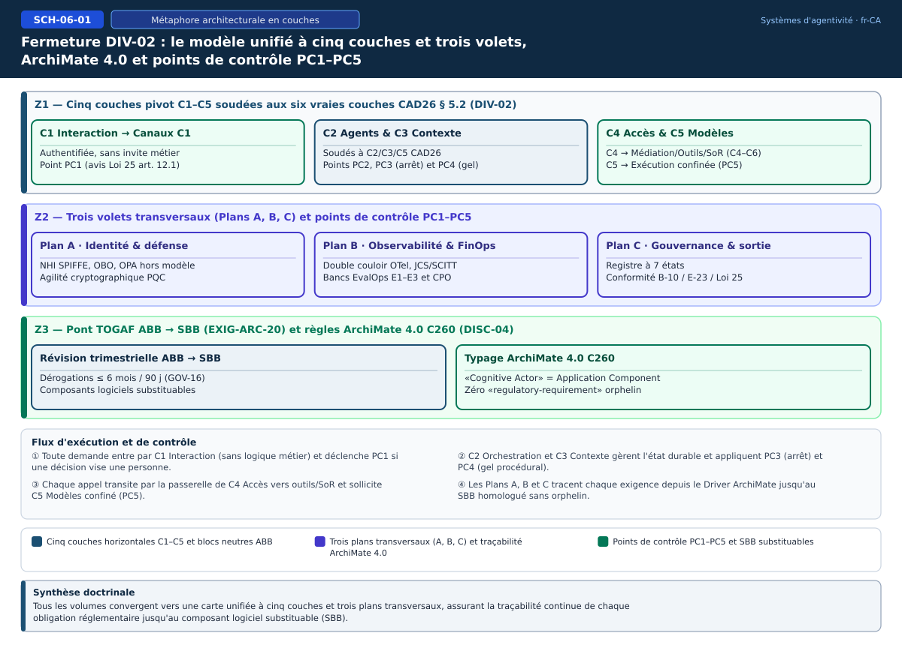
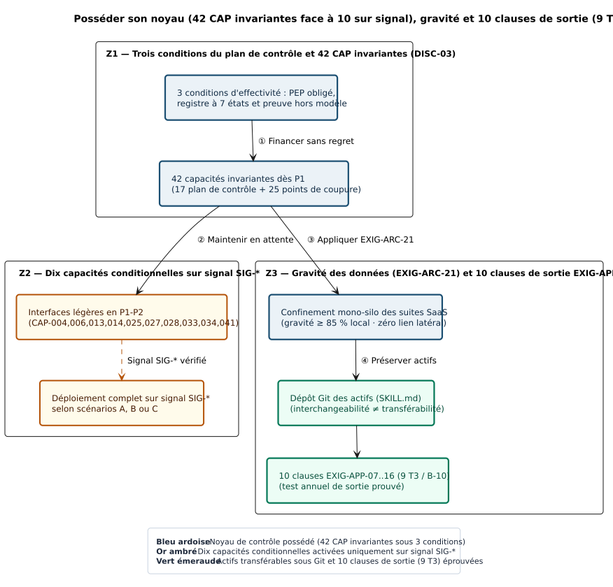
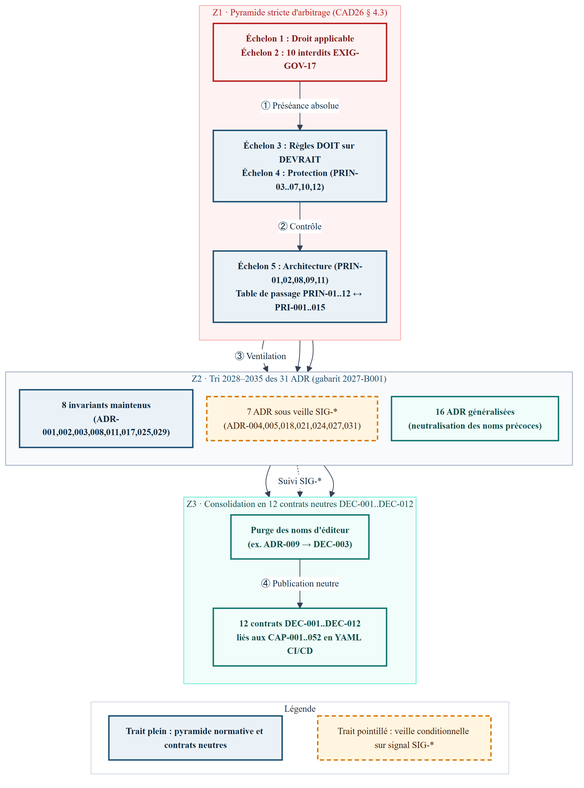
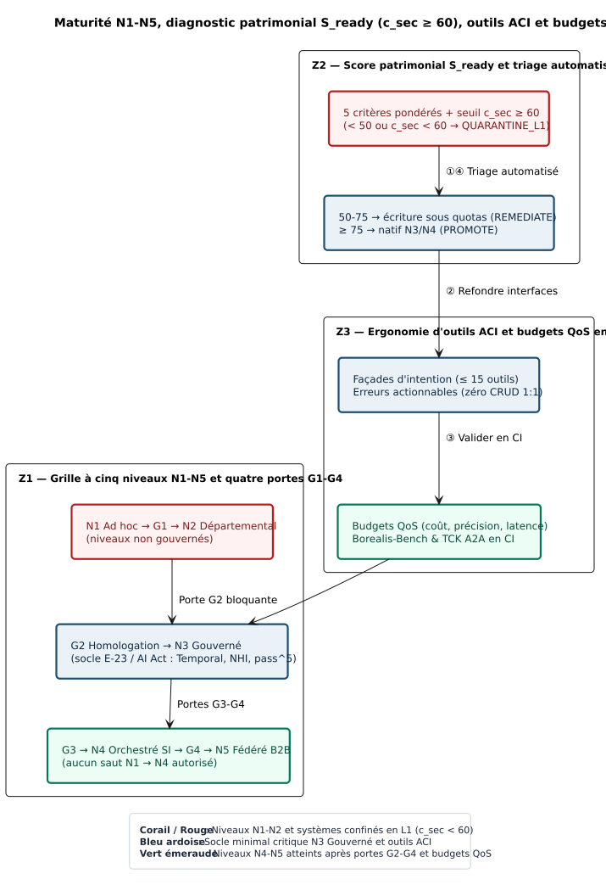

# Chapitre 06 — Architecture de référence unifiée, noyau possédé (42 CAP) et douze décisions neutres

*Question directrice :* Comment unifier les découpages architecturaux en un noyau de contrôle déterministe possédé par l'institution (`42` capacités invariantes et `12` décisions neutres), tout en garantissant l'arbitrage normatif, le diagnostic patrimonial et la réversibilité contractuelle ?

## 6.1 Souveraineté architecturale et fermeture de la divergence DIV-02

L'encapsulation d'un agent dans un harnais à huit jalons (`CH-04`) et la gradation de son autonomie (`CH-05`) demeureraient fragiles si chaque projet redéfinissait à sa guise les plans de l'architecture d'entreprise, les standards de communication ou les critères d'approvisionnement. En pratique, l'obsolescence rapide des trousses de développement logicielles (`SDK`) — souvent remaniées en moins de douze mois — et la stratégie des suites infonuagiques fermées sur le plan de contrôle exposent l'institution à une captivité structurelle. Pour y parer, le présent chapitre (domaine `D02`) arrête l'ossature de référence unifiée de l'entreprise agentique et sanctuarise le **noyau de contrôle déterministe** que l'organisation doit détenir en propre.

Cette unification règle d'emblée un écart majeur de concordance entre les volumes fondateurs du corpus, identifié sous le code `DIV-02`. Elle soude sur pièce le modèle pivot à cinq couches (`C1`–`C5`) et trois volets transversaux (`Plans A`, `B` et `C`) aux six vraies couches du cadre normatif de 2026 (`CAD26 § 5.2–5.3`), tout en réconciliant les quatre plans du système d'information et les quatre plans du noyau possédé sous `DISC-03` ainsi que les profils `ArchiMate 3.2` et `4.0` (`C260`) sous `DISC-04`.

Sur cette assise, l'institution délimite `42` capacités invariantes sans regret face à `10` capacités conditionnelles activées uniquement sur signal externe (`SIG-*`). Elle convertit également les `31` fiches de décisions d'architecture (`ADR-001` à `ADR-031`) en `12` contrats neutres exempts de tout nom de produit (`DEC-001` à `DEC-012`), hiérarchise les principes directeurs (`PRIN-01..12` et `PRI-001..015`), puis formalise le diagnostic patrimonial `S_ready` ainsi que dix clauses contractuelles de sortie vérifiables.

> **Trois invariants exécutables — Chapitre 6**
>
> 1. **Effectivité du noyau possédé (`42 CAP`, `EXIG-ARC-01`, `EXIG-ARC-19`, `EXIG-GOV-07..08`)** : l'institution détient ses schémas, politiques, clés, registre à sept états (distinct du catalogue de découverte), double couloir probatoire et passerelles `PEP` sous trois conditions cumulatives : chemin réseau obligé, registre unique faisant foi et preuve immuable hors modèle.
> 2. **Raccordement `DIV-02`, arbitrage `CAD26 § 4.3` et `12 DEC` neutres (`EXIG-ARC-20`, `PRI-003`)** : tout bloc d'architecture (`ABB`) pointe vers un bloc de solution (`SBB`) révisé trimestriellement, les conflits entre principes cèdent devant la hiérarchie normative stricte et les `16` `ADR` couplées à des éditeurs sont remplacées par `DEC-001` à `DEC-012` au gabarit `2027-B001`.
> 3. **Diagnostic `S_ready` et réversibilité éprouvée (`BSIF B-10` [4], `c_sec ≥ 60`)** : aucun système patrimonial n'accède à l'écriture `L2+` si \(S_{\text{ready}} < 50\) ou si la clause éliminatoire \(c_{\text{sec}} < 60\) échoue, et les actifs portables sous `Git` sont protégés par les dix clauses contractuelles minimales (`EXIG-APP-07` à `EXIG-APP-16`) éprouvées annuellement.

## 6.2 Architecture cible, noyau possédé, principes d'arbitrage et maturité

### 6.2.1 Fermeture DIV-02, noyau possédé (42 CAP), clauses de sortie et douze décisions neutres

La fermeture de `DIV-02` dissipe trois erreurs fréquentes d'alignement entre le modèle cible à cinq couches (`C1`–`C5`) traversées par trois volets (`Plans A`, `B`, `C`) et les six couches de `CAD26` (`§ 5.2–5.3`). Premièrement, les modèles de langage, le routage d'inférence et les bacs à sable matériels (`C5 modeles`) siègent en Couche 3 de `CAD26` (*Agents et exécution cognitive*), et non en Couche 6 comme une lecture hâtive pouvait le suggérer. Deuxièmement, aucune Couche 3 nommée « Connaissance » n'existe dans `CAD26` : le volet `C3 contexte-connaissance` agrège en réalité la mémoire de travail (Couche 2), la mémoire procédurale (Couche 3) et la couche des outils et données (Couche 5). Troisièmement, les systèmes d'enregistrement patrimoniaux (`SoR`) résident en Couche 6 de `CAD26` et sont strictement encapsulés sous le périmètre de `C4 acces` (médiation et connectivité) ; les quatre rectifications éditoriales associées de `CAD26 v1.2` relèvent de la concordance générale (→ Chapitre 36).

| Couche ou volet pivot | Raccordement exact à `CAD26 § 5.2–5.3` | Écart `DIV-02` rectifié | Capacités `CAP` rattachées |
|---|---|---|---|
| `C1` : Interaction | Couche 1 : Canaux et déclencheurs | Zéro logique agent dans les canaux UI | `CAP-001` à `CAP-006` |
| `C2` : Agents et orchestration | Couche 2 : Orchestration et état + volet Agents (`C3`) | Dissociation orchestration durable et coordination `A2A` | `CAP-007` à `CAP-014` |
| `C3` : Contexte et connaissance | Couche 2 (travail), Couche 3 (procédurale), Couche 5 (données) | Suppression de la Couche 3 « Connaissance » fictive | `CAP-015` à `CAP-021` |
| `C4` : Accès | Couche 4 (Médiation), Couche 5 (Outils), Couche 6 (`SoR`) | Encapsulation stricte des `SoR` en Couche 6 | `CAP-022` à `CAP-028` |
| `C5` : Modèles | Couche 3 : Exécution cognitive et confinement | Placement des modèles et bacs en Couche 3 (non Couche 6) | `CAP-029` à `CAP-034` |
| `Plan A` : Identité et sécurité | Plan transversal `A` (Zero-Trust, `NHI`, `OPA`, `PQC`) | Alignement direct avec `CAD26 § 5.3` | `CAP-035` à `CAP-041` |
| `Plan B` : Observabilité et `FinOps` | Plan transversal `B` (`OTel`, `EvalOps`, `CPO`) | Alignement direct avec `CAD26 § 5.3` | `CAP-042` à `CAP-046` |
| `Plan C` : Gouvernance et registre | Plan transversal `C` (Registre, conformité, contrats) | Volet dédié unifiant registre et conformité | `CAP-047` à `CAP-052` |

*Tableau 6.1 — Table de concordance fermant `DIV-02` entre le modèle à cinq couches, `CAD26` et les `52` capacités.*

Cette ossature commande la traçabilité d'architecture de bout en bout entre blocs génériques (`ABB`) et blocs logiciels concrets (`SBB`). Conformément à `EXIG-ARC-20` et `EXIG-GOV-18`, `100,0 %` des composants soumis en revue d'architecture (`ARB`) doivent démontrer leur raccordement `ABB → SBB` sur standards ouverts, avec révision trimestrielle et plafonnement de toute dérogation à six mois au plus (ou `90` jours au plus par délégation à l'architecture d'entreprise pour un agent de classe faible sous `EXIG-GOV-16`).

Dans la modélisation visuelle d'entreprise, `DISC-04` assure la compatibilité bidirectionnelle entre les profils `ArchiMate 3.2` et la spécification `ArchiMate 4.0` (`C260`, publiée le `27 avril 2026`). Il rappelle simultanément que les manuels propriétaires `TOGAF 10 ADM` demeurent hors évidence probante ouverte (rangés en `statut F` doctrinal) et qu'aucun artefact d'outil commercial n'est exigé à la barrière `G0`. En appliquant le mécanisme de spécialisation (`Specialization`) et les profils `W172`, l'architecte doit typer chaque acteur cognitif (`«Cognitive Actor»`) comme un `Application Component`, et jamais comme un `Business Actor`, afin de maintenir la séparation entre imputabilité humaine et exécution logicielle.

Les sept patrons de modélisation associés verrouillent ainsi la traçabilité de bout en bout. Ils relient explicitement les stéréotypes `«Cognitive Actor»`, `«Guardrail Policy»` et `«Human-on-the-Loop»` à la couche applicative et aux contrôles d'autorisation, interdisent tout flux direct (`Flow`) contournant l'approbateur humain et exigent zéro exigence réglementaire (`«regulatory-requirement»`) orpheline le long de la chaîne `Driver → Assessment → Requirement → Exécution`. Chaque obligation prudentielle ou légale aboutit ainsi à un composant d'exécution mesurable et vérifiable.

*Figure 20 — SCH-06-01 : Fermeture `DIV-02` : le modèle unifié à cinq couches et trois volets, `ArchiMate 4.0` et points de contrôle `PC1–PC5`.*

Au cœur de cette architecture, la sanctuarisation du **noyau de contrôle déterministe** — en cohérence avec la notion de garde-fous techniques (*AI harnessing*) formulée par le bulletin technologique du BSIF [5] — empêche que les fournisseurs de modèles ou de plateformes infonuagiques n'exercent le monopole sur la logique métier. L'effectivité réelle de ce plan de contrôle repose sur trois conditions non dérogeables (`EXIG-ARC-01`, `EXIG-GOV-07`, `EXIG-GOV-08`, `EXIG-OBS-11`, `EXIG-OBS-12`) :

- **Chemin réseau obligé** : aucune invocation de modèle ni d'outil ne contourne la passerelle d'exécution des politiques (`PEP`) ;
- **Registre central faisant seul autorité** : un registre à sept états gouverne la mise en service, les mandats et la révocation des agents, en demeurant strictement distinct du catalogue produit de découverte ;
- **Preuve immuable hors modèle** : les journaux d'audit canonisés et les traces d'exécution résident hors du domaine d'administration des agents et des fournisseurs de modèles.

La séparation entre le registre central d'autorité et le catalogue de découverte mérite d'être soulignée. Le catalogue de découverte permet aux équipes de repérer des services, des schémas ou des compétences disponibles, alors que le registre à sept états (`proposé`, `en conception`, `en construction`, `pilote`, `production`, `suspendu`, `retiré` selon `CAD26 § 11.2` et `CH-32`) conditionne l'accès réseau effectif et l'émission de jetons d'identité. Lorsqu'un agent bascule à l'état `suspendu` ou `retiré`, la passerelle bloque ses appels (cible d'arrêt `< 10` s) sans attendre la mise à jour d'un annuaire documentaire.

Sous la concordance `DISC-03`, les quatre plans du système d'information (Tome 6 `C03`) et les quatre plans du noyau possédé (Tome 7 : registre et `NHI`, passerelle et routeur, mémoire gouvernée, journal durable) convergent exactement avec les volets `Plans A`, `B` et `C` et les quatre modules exécutables de la trousse du Tome 8 (`PRI-015`, `DEC-007`). Sur les `52` capacités cibles (`CAP-001` à `CAP-052`), l'institution sanctuarise les **`42` capacités invariantes sans regret** dans les trois scénarios stratégiques `A`, `B` et `C` (`29` ciblées dès le Palier `P1` et `13` échelonnées au Palier `P2`). Elles se répartissent entre `17` capacités de plan de contrôle pur (registre d'autorité, délégation `NHI`/`OBO`, évaluation `OPA`, télémétrie, évaluation `pass^k`, `FinOps` et gouvernance) et `25` points de coupure opérationnelle (harnais `80/20`, exécution durable, sagas, façades `MCP`, isolation `CoALA`, encapsulation `ACL`, sandboxing et repli bimodèle).

Symétriquement, les **`10` capacités conditionnelles** (`CAP-004` vocal multimodal, `CAP-006` agents externes entrants, `CAP-013` fédération multi-plateformes, `CAP-014` négociation `B2B`, `CAP-025` sas `CUA`, `CAP-027` connecteurs d'espaces fédérés, `CAP-028` sas `OT` déconnecté, `CAP-033` enclaves `TEE`, `CAP-034` distillation compilée et `CAP-041` identité légale externe) reçoivent uniquement une interface légère préparatoire. Leur déploiement complet est conditionné au franchissement d'un signal `SIG-*` vérifié selon les scénarios stratégiques `A` (socle étendu), `B` (archipel fédéré) ou `C` (blocs souverains). Par ailleurs, cinq capacités (`CAP-025`, `CAP-028`, `CAP-033`, `CAP-046` comptabilité carbone et `CAP-052` usine logicielle) comblent explicitement les lacunes relevées lors de l'audit initial de 2026.

Cette répartition s'appuie sur la loi de **gravité des données** : au moins `85 %` des traitements d'agents spécialisés s'exécutent à proximité immédiate des données métiers locales. Lorsqu'une institution exploite des suites `SaaS` dotées d'agents intégrés mono-silo, ces derniers sont confinés sous les contrôles cumulatifs `EXIG-ARC-21` (interdiction d'appels transversaux directs vers d'autres silos), tandis que toute orchestration inter-silos doit être rapatriée dans le moteur durable possédé en propageant l'étiquette immuable d'entité juridique (`EXIG-CON-06`).

Cette règle évite de transformer une plateforme commerciale fermée en plaque tournante de l'architecture d'entreprise. Les quatre plans applicatifs du système d'information (interaction, orchestration, connaissance, médiation) restent découplés des quatre plans du noyau possédé sous `DISC-03`, afin qu'aucune suite logicielle externe ne cumule l'exécution des tâches métier avec la détention des journaux d'audit, des clés cryptographiques et des règles de conformité. Si un éditeur modifie unilatéralement sa tarification ou ses interfaces, l'institution conserve la maîtrise complète des flux transversaux.

En parallèle, la gouvernance financière de ce portefeuille de capacités distingue le financement garanti dès le premier jour des options stratégiques. Les `42` capacités invariantes constituent le socle incompressible sans regret à financer en priorité dès le `Palier 1` (notamment l'identité `NHI`, les passerelles `PEP` et le double couloir probatoire pour les `29` capacités fondatrices, puis au `Palier 2` pour les `13` compléments structurels), car tout retard sur ces contrôles accroît mécaniquement l'exposition réglementaire. Les `10` capacités conditionnelles restent financées à coût marginal nul par de simples interfaces d'attente jusqu'à ce qu'un seuil mesurable déclenche leur activation en comité de gouvernance.

La maîtrise du noyau reste toutefois incomplète sans une doctrine explicite de réversibilité contractuelle et technique. L'ouvrage distingue formellement l'**interchangeabilité** — capacité d'appeler un pair ou un outil via un protocole ouvert tel que `MCP`, `A2A` ou `Open Responses` — de la **transférabilité**, qui désigne la faculté réelle de migrer l'état, les graphes d'orchestration, les règles et la mémoire vers une plateforme concurrente. Parmi les sept classes d'actifs d'un portefeuille agentique, cinq relèvent de l'actif souverain géré dans un dépôt `Git` interne : les instructions d'agents de programmation (`AGENTS.md`), les compétences normalisées (`SKILL.md`, rattachées à l'`AAIF` le `22 octobre 2026`), les gabarits d'invites, les schémas `JSON Schema` [7] et les suites d'essais `EvalOps`. Les deux classes restantes — la mémoire consolidée (qui doit pouvoir être reconstruite à partir des sources textuelles canoniques) et la configuration propre à l'interface d'un éditeur — sont traitées comme captives par défaut.

Pour contrer ce risque de captivité, la gestion des tiers s'appuie sur la ligne directrice `B-10` du BSIF [4], qui exige un inventaire complet des sous-traitants, la continuité d'activité et des plans de sortie ordonnée comme sous contrainte. Ces obligations convergent avec les repères de portabilité et d'interdiction des frais de changement de fournisseur issus du Chapitre VI du Règlement `(UE) 2023/2854` (*Data Act*, consigne doctrinale `ANC-003` du Tome 3 § 27.5 sans texte intégral `L+` propre ici, applicable depuis le `12 septembre 2025` avec transition de `30` jours civils à `7` mois et interdiction des frais au `12 janvier 2027`, sous clause `non-avis`).

Ensemble, ces deux cadres fondent les neuf clauses de négociation du Tome 3 (illustrées à la Figure 21) et leur consolidation en **dix clauses contractuelles minimales** (`EXIG-APP-07` à `EXIG-APP-16`, détaillées au chapitre 27). Celles-ci imposent l'exportabilité complète en formats ouverts sans perte sémantique, une assistance bornée durant la migration, le plafonnement puis la suppression des frais de sortie et un avis écrit préalable en cas de recours ou de substitution de sous-traitant (`BSIF B-10` [4]). Elles exigent également l'accès garanti aux journaux probatoires, la réversibilité des clés de chiffrement, l'effacement vérifiable post-migration, la ségrégation des environnements et le droit d'exécuter un test réel de bascule hors ligne chaque année (`POR-016`).

*Figure 21 — SCH-06-02 : Posséder son noyau (`42` capacités invariantes par rapport à `10` sur signal), gravité des données et clauses de sortie (`9` clauses de négociation Tome 3 consolidées en `10` `EXIG-APP-07..16`).*

Sur la base de ce noyau possédé, l'architecture passe en revue les **`31` décisions d'architecture de 2027** (`ADR-001` à `ADR-031`) afin d'en préserver les invariants tout en éliminant toute dépendance nominative envers des produits commerciaux ou des projets encore immatures. L'audit applique un tri systématique selon la ventilation **`8 / 7 / 16`** :

- **Huit `ADR` maintenues comme invariants** (`ADR-001`, `002`, `003`, `008`, `011`, `017`, `025`, `029`) : elles verrouillent des frontières pérennes indépendantes des éditeurs, telles que la préservation des registres centraux (`ADR-001`), l'enveloppe déterministe (`ADR-002`), le registre bloquant (`ADR-003`), le filtrage d'autorisation avant récupération (`ADR-008`), le catalogue fermé de topologies (`ADR-011`), le sas cyber-physique (`ADR-017`), l'imputabilité humaine instrumentée (`ADR-025`) et la muraille oracle–bâtisseur (`ADR-029`) ;
- **Sept `ADR` placées sous veille par signal `SIG-*`** (`ADR-004`, `005`, `018`, `021`, `024`, `027`, `031`) : cette catégorie prévient l'adoption prématurée de spécifications encore en cours de normalisation. Elle vise notamment les brouillons IETF relatifs aux identités de charges de travail et aux échanges inter-domaines (`WIMSE` et `ID-JAG`), ainsi que les conventions d'observabilité cognitive `OpenTelemetry` en statut développement. Elle englobe également le déploiement matériel des enclaves confidentielles sur accélérateurs graphiques et le seuil de rentabilité de la distillation vers de petits modèles, chaque bascule étant déclenchée uniquement sur signal vérifié ;
- **Seize `ADR` remplacées par douze décisions fonctionnelles neutres (`DEC-001` à `DEC-012`)** : chaque contrat `DEC` formule une exigence agnostique raccordée aux capacités `CAP-001..052` et aux révisions `SIG-*`, sans jamais nommer un fournisseur ni un cadriciel particulier.

| Décision neutre | `ADR` généralisées | Objet fonctionnel neutre | Capacités `CAP` |
|---|---|---|---|
| `DEC-001` | `ADR-006` | Délégation inter-agents ouverte, annuaire signé et canal crypto-agile | `CAP-012`, `CAP-040`, `CAP-047` |
| `DEC-002` | `ADR-007` | Interfaces génératives sur catalogue déclaratif fermé sans script libre | `CAP-001`, `CAP-002`, `CAP-004` |
| `DEC-003` | `ADR-009` | Couche sémantique neutre et médiation vers `ISO 20022` / ontologies | `CAP-015`, `CAP-016` |
| `DEC-004` | `ADR-010` | Mémoire persistante parcimonieuse, bi-temporelle et purge sélective | `CAP-019`, `CAP-021` |
| `DEC-005` | `ADR-012`, `013` | Exécution durable, saga à point pivot, tampon et sobriété événementielle | `CAP-008`, `CAP-009`, `CAP-011` |
| `DEC-006` | `ADR-014` | Plan d'inférence neutre, routage frugal et continuité bimodèle | `CAP-029`, `CAP-031`, `CAP-046` |
| `DEC-007` | `ADR-015` | Fédération par gravité, noyau possédé et cloisonnement inter-entités | `CAP-013`, `CAP-021`, `CAP-036`, `CAP-051` |
| `DEC-008` | `ADR-016`, `028` | Encapsulation décimale du patrimoine, extinction `CUA` et mode déconnecté | `CAP-006`, `CAP-024`, `CAP-025`, `CAP-028` |
| `DEC-009` | `ADR-019`, `020` | Politiques hors modèle, confinement sans réseau et épinglage d'outils | `CAP-022`, `CAP-023`, `CAP-030`, `CAP-037`–`039` |
| `DEC-010` | `ADR-022`, `030` | Qualification `pass^k`, quarantaine de données et remédiation sans *shell* | `CAP-020`, `CAP-043`, `CAP-050`, `CAP-052` |
| `DEC-011` | `ADR-023` | Pilotage séquencé au coût complet par résultat conforme (`CPO`) | `CAP-045` |
| `DEC-012` | `ADR-026` | Continuité probante post-quantique des mandats et fédération `B2B` | `CAP-014`, `CAP-027`, `CAP-040`, `041`, `049` |

*Tableau 6.2 — Conversion des seize `ADR` couplées à des produits en douze décisions fonctionnelles neutres `DEC-001` à `DEC-012`.*

Chaque décision `ADR` et `DEC` inscrite au registre interne est matérialisée en intégration continue par le gabarit déclaratif YAML `2027-B001` (`schemas/adr_2027_b001.schema.json`, dont l'extrait exécutable `G0-EX-CH04-03` est inspecté au chapitre 34). Ce schéma valide par machine le plafond d'autonomie (`L0`–`L4`, aligné sur `N0`–`N4`), l'empreinte réglementaire (`BSIF E-23`, `Loi 25`, `EU AI Act`), l'enveloppe budgétaire maximale `CPO`, le critère minimal d'évaluation (illustré par `pass^5` en YAML) et le coupe-circuit du centre opérationnel de sécurité (`SOC`). Il appuie ainsi les cinq domaines de la grille `PRR-75` et les huit critères d'architecture d'entreprise `C01` à `C08` (arrimage, stéréotypes `ArchiMate`, quatre plans, réversibilité, registre, séparation `3LoD`, coexistence `BPMN`/`RPA` et trajectoire *Strangler Fig*).

Ce gabarit consigne également les réserves d'alignement issues de la révision du corpus (dont la neutralisation des seize `ADR` couplées à des produits). Chaque fiche `ADR` ou `DEC` consigne obligatoirement son périmètre de juridiction, sa date de prochaine révision, le signal `SIG-*` qui gouverne son évolution éventuelle et les preuves de tests associées. Toute omission ou non-conformité d'une rubrique requise — notamment sur l'enveloppe budgétaire `CPO`, l'identifiant d'arrêt d'urgence `SOC` ou l'imputabilité nominative du métier — bloque automatiquement le déploiement en intégration continue avant l'examen par le comité d'homologation.

L'articulation entre les huit `ADR` invariantes, les sept `ADR` sous veille et les douze contrats `DEC` évite ainsi deux écueils symétriques : figer prématurément l'entreprise sur un cadriciel de développement éphémère ou, à l'inverse, laisser chaque équipe réinventer ses propres règles de résilience, d'identité et de journalisation. La gouvernance de portefeuille gagne ainsi en prévisibilité tout en préservant une substituabilité complète des fournisseurs d'inférence.

*Figure 22 — SCH-06-03 : Pyramide d'arbitrage (`12 PRIN` / `15 PRI`) et conversion des `31 ADR` de 2027 en `12 DEC` sans nom de produit.*

### 6.2.2 Six couches, principes d'arbitrage, ergonomie d'outils et maturité patrimoniale N1–N5

Sur le plan structurel, la doctrine unifie deux représentations complémentaires du système d'information. D'une part, la vue à **six couches horizontales et deux piliers transversaux** du Tome 3 aligne la connectivité et le plan de données, la couche sémantique et mémorielle, la coordination horizontale (`A2A`/`AGNTCY`), l'orchestration durable et événementielle, l'interface homme–machine (`HITL`/`HOTL`) ainsi que la gouvernance, le commerce et la conformité, le tout traversé par le pilier *Zero-Trust / NHI* et le pilier *AgentOps / FinOps*. Contrairement aux cadres descriptifs généralistes proposés dans la littérature (`Lu et coll.`, `Megagon`, `SALLMA`, `CSA` ou `Futurum`), cette grille inscrit en règle dure le principe `PRI-003` de **non-substituabilité** entre l'appel vertical d'un outil (`MCP`) et la délégation asynchrone horizontale à un pair (`A2A`).

D'autre part, la synthèse du Tome 1 (Tableau 43.1) fusionne les vues à quatre et trois couches dans six strates unifiées en levant la collision terminologique entre la fabrique d'identités de charge de travail et la fabrique de déploiement d'agents. Elle positionne cinq points de contrôle opposables (`PC1` à `PC5`), distincts des étapes techniques d'émission, d'admission et de sauvegarde d'état.

Concrètement, `PC1` consigne l'avis contemporain horodaté requis par l'article `12.1` de la Loi 25, tandis que `PC2` émet la trace causale d'instance (`Z1`) et `PC3` impose l'arrêt préventif humain (`Z2`). En aval, `PC4` trace la frontière entre adaptation éphémère et évolution persistante du modèle (`Z3`, sous `ACVM 11-348` et `BSIF E-23` [6]), et `PC5` garantit le confinement matériel local (`Z5`). L'ensemble est complété par la couche d'abstraction d'outil en `Z4` et par la matrice d'interopérabilité `LCIM` retenue sur cinq paliers en pile agentique (Tome 1, Tableau 7.1) : technique (connectivité réseau), syntaxique (contrats de format), sémantique (glossaires univoques), pragmatique (engagements et intentions d'action) et dynamique (découverte et négociation à l'exécution). Cette échelle s'emboîte exactement entre la synthèse opérationnelle à quatre paliers (Tome 1, Tableau 43.4) et le modèle académique complet à sept niveaux (`0` sans interopérabilité à `6` conceptuel, détaillé au Chapitre 09).

Cette double lecture du modèle de référence procure un langage commun aux architectes d'entreprise, aux juristes et aux équipes d'exploitation. Aucun point de contrôle réglementaire n'est relégué à une vérification documentaire postérieure : chacun s'ancre à une frontière logicielle précise (`Z1` à `Z5`) sans nécessiter de passeport d'agent propriétaire.

Dans le prolongement de cette concordance, l'alignement entre les douze principes `PRIN-01..12`, les quinze principes `PRI-001..015` et les dix décisions structurantes `CAD26` supprime les contradictions lors des revues de conception. Lorsqu'un projet soumet une nouvelle architecture au comité `ARB`, la grille de passage impose d'abord la vérification trimestrielle `ABB → SBB` (`EXIG-ARC-20`, `EXIG-GOV-18`), puis la preuve qu'aucune exigence réglementaire ne repose sur une promesse verbale d'éditeur plutôt que sur un contrat vérifiable du noyau possédé. Si un signal `SIG-*` vient à basculer — par exemple lors de la stabilisation d'une spécification `IETF` ou de la disponibilité commerciale d'enclaves matérielles attestées — la décision placée sous veille est réouverte en comité et traduite en bloc logiciel normalisé sans rompre les interfaces amont et aval.

Pour gouverner ces couches sans arbitraire local, les douze principes directeurs **`PRIN-01` à `PRIN-12`** (`CAD26` chapitre 4) s'organisent en six paires complémentaires :

1. **Interopérer par des contrats ouverts** : standards ouverts avant connecteurs propriétaires (`PRIN-01`) et contrat typé préalable à toute implémentation (`PRIN-02`) ;
2. **Borner le pouvoir d'agir** : identité `NHI` propre, moindre privilège et moindre agence (`PRIN-03`, repris en `OWASP` [8]) conjugués à l'autonomie proportionnée au risque (`PRIN-04`) ;
3. **Maîtriser les effets** : réversibilité par conception et idempotence (`PRIN-05`), traçabilité causale et imputabilité économique (`PRIN-06`) ;
4. **Contenir le modèle** : défiance systématique envers toute donnée reçue (`PRIN-07`) et déterminisme autour du modèle selon la simplicité d'abord (`PRIN-08`) ;
5. **Garder la maîtrise** : découplage des fournisseurs et propriété de la logique (`PRIN-09`), parrain humain nommément imputable (`PRIN-10`) ;
6. **Concevoir pour durer et défaillir** : séparation du raisonnement, de l'action et de la mémoire (`PRIN-11`), et dégradation maîtrisée en mode fermé vers l'avant (`PRIN-12`).

En cas de conflit entre ces principes ou avec une contrainte de projet, l'arbitrage obéit à un **ordre de préséance strict** (`CAD26 § 4.3`). Le droit et les règlements applicables priment sur les dix interdictions sans dérogation (`EXIG-GOV-17`), qui priment elles-mêmes sur les exigences de force `DOIT` avant celles de force `DEVRAIT`, la source unique désignée avant le renvoi et la disposition spéciale avant la générale. Ces règles arbitrent ensuite le bloc de protection (`PRIN-03` à `PRIN-07`, `PRIN-10` et `PRIN-12`) avant le bloc architectural (`PRIN-01`, `PRIN-02`, `PRIN-08`, `PRIN-09`, `PRIN-11`), toute exception temporaire exigeant une dérogation formelle bornée (`EXIG-GOV-16`).

En prolongement prospectif (`2028–2035`), ces douze principes se déclinent en **quinze principes falsifiables `PRI-001` à `PRI-015`** répartis en quatre familles et reliés terme à terme aux `10` décisions structurantes `CAD26`. La première famille consacre la primauté du contrôle déterministe, la validité contractuelle aux frontières et la non-substituabilité protocolaire (`PRI-001` à `PRI-003`, `PRI-005`). La deuxième ancre l'identité cryptographique non humaine, l'autonomie bornée par la classe de risque et la supervision humaine substantielle (`PRI-004`, `PRI-006`, `PRI-007`). La troisième régit la gouvernance sémantique de la connaissance, la mémoire bi-temporelle vérifiable et le cloisonnement juridique entre entités (`PRI-008` à `PRI-010`). Enfin, la quatrième famille sécurise la souveraineté sur les six substrats d'état, l'agilité post-quantique, le double couloir probatoire, la sobriété `CPO` et la fédération par gravité (`PRI-011` à `PRI-015`).

La qualité de l'architecture dépend ensuite directement de l'**ergonomie cognitive des outils** exposés aux agents. La littérature fondatrice sur l'usage d'outils par les modèles de langage éclaire ce point de manière convergente. Les travaux sur *Toolformer* (`arXiv:2302.04761`) ont montré comment des modèles apprennent à invoquer des interfaces externes via un balisage syntaxique strictement borné [1]. L'étude *Gorilla* (`arXiv:2305.15334`) a ensuite démontré que l'ancrage documentaire des signatures réduit drastiquement les hallucinations d'arguments et de noms d'opérations [2]. Enfin, *ToolLLM* (`arXiv:2307.16789`) a illustré la nécessité de mécanismes hiérarchiques et de recherche sémantique lorsque le catalogue dépasse plusieurs milliers de fonctions (`16 000+` interfaces réelles) [3].

En entreprise réglementée, un outil exposé doit donc être conçu comme un contrat cognitif univoque plutôt que comme un simple miroir d'une interface `REST` générée automatiquement. Il importe d'aligner chaque outil sur une intention métier atomique, d'encadrer sa signature par un contrat `JSON Schema` strict [7] et de rédiger des gloses ainsi que des descriptions de paramètres exemptes d'ambiguïté. La passerelle doit en outre imposer l'idempotence et des budgets maximaux d'appels. Elle doit enfin retourner des **messages d'erreur structurés et actionnables** (précisant le champ fautif, la règle violée et la voie de reprise sûre) afin de guider une correction bornée en boucle sans épuiser le contexte.

Chaque choix de composant, de modèle ou de routage sur ces outils est évalué à l'aune des **cinq critères permanents** de l'ouvrage :

- **Neutralité de gouvernance** : absence de dépendance envers une plateforme fermée pour le registre, les identités ou les politiques ;
- **Déterminisme des frontières** : capacité à valider schémas, autorisations et invariants hors du modèle probabiliste ;
- **Tolérance aux pannes** : comportement prévisible en mode fermé face aux délais dépassés, réessais et interruptions ;
- **Coût marginal en latence et en jetons** : sobriété d'inférence mesurée sous charge réelle ;
- **Coût de sortie** : effort technique et contractuel nécessaire pour remplacer la brique évaluée.

Ces cinq critères s'incarnent au plan de données dans des budgets explicites de qualité de service (`QoS`) par classe de tâche — plafond de coût par requête, plancher de constance `pass^k`, cible de latence au `99e` centile `p99` — mesurés de façon reproductible en intégration continue grâce au banc synthétique reproductible `Borealis-Bench`, aux bancs `OpenEnv` et `AgentArcEval` et à la trousse ouverte de conformité `TCK A2A` (`CH-23`).

Enfin, la transformation d'un système d'information existant est cadencée par une **grille de maturité à cinq niveaux `N1` à `N5`** : `N1` ad hoc (expérimentations isolées sans registre), `N2` départemental (premiers harnais locaux), `N3` gouverné (socle conforme à `BSIF E-23` [6] et à l'`EU AI Act`), `N4` orchestré à l'échelle du système d'information, et `N5` fédéré `B2B`. Cette grille évalue le portefeuille selon six dimensions — stratégie et gouvernance, architecture et protocoles, données et mémoire, sécurité et identité, observabilité et évaluation, exploitation `FinOps` — et verrouille la progression par quatre portes bloquantes `G1` à `G4` qui proscrivent tout saut direct `N1 → N4`.

Chaque porte impose des preuves système cumulatives avant toute promotion. La porte `G1` valide l'inventaire et l'identité sans secret partagé ; `G2` exige la façade déterministe, l'idempotence et la constance `pass^5 ≥ 0,95` avant toute écriture ; `G3` vérifie la résilience durable, le double couloir probatoire et l'étalonnage continu ; enfin, `G4` conditionne les échanges fédérés `B2B` aux attestations cryptographiques externes.

Préalablement à toute autorisation d'écriture `L2+` sur un système d'enregistrement patrimonial, l'équipe d'architecture doit calculer l'indice quantitatif de préparation **`S_ready`**. Cet indice pondère cinq caractéristiques mesurées sur `100` (`c_1` idempotence transactionnelle de poids `0,25`, `c_sec` propagation granulaire d'identité de poids `0,25`, `c_3` fraîcheur sémantique de poids `0,20`, `c_4` primitives de compensation de poids `0,15`, `c_5` fidélité du bac à sable de poids `0,15`), assorti d'une **clause éliminatoire de sécurité** fixée à \(\tau_{\min} = 60\) :

\[
S_{\text{ready}} = \left(0{,}25\,c_1 + 0{,}25\,c_{\text{sec}} + 0{,}20\,c_3 + 0{,}15\,c_4 + 0{,}15\,c_5\right) \times \mathbb{I}\!\left(c_{\text{sec}} \ge 60\right)
\]

La fonction indicatrice \(\mathbb{I}(c_{\text{sec}} \ge 60)\) joue un rôle de verrou éliminatoire : aucune robustesse en idempotence ou en fraîcheur événementielle ne saurait compenser l'absence de propagation nominative d'identité. Si \(S_{\text{ready}} < 50\) ou si \(c_{\text{sec}} < 60\), le cœur patrimonial reste impérativement confiné en lecture seule (`L1`). Pour autoriser une montée en écriture, l'organisation doit d'abord déployer une façade `MCP` gérant, en dehors du cœur central, la journalisation nominative d'audit, la limitation de concurrence (*bulkhead*) et le registre transactionnel `ACID` d'idempotence. Ce sas préserve la disponibilité des mécanismes de verrouillage pessimiste sur `SAP` (`ENQUEUE`) et des sous-systèmes interactifs sur `IBM i` (`QINTER`), qu'une rafale synchronisée de réessais d'agents saturerait en quelques secondes.

À titre d'illustration chiffrée, un patrimoine obtenant les notes `(40, 70, 65, 55, 60)` atteint `S_ready = 57,75`. Ce score l'autorise à passer en écriture bornée (palier `50` à `75`) sous quotas stricts et recul exponentiel temporisé (*full jitter*), tandis qu'un score `≥ 75` qualifie le système comme natif `N3`/`N4`. Sur cette base, un moteur automatisé d'audit de portefeuille classe chaque initiative selon quatre verdicts explicites : `DECOMMISSION` (remplacement d'un agent superflu par une règle déterministe), `QUARANTINE_L1` (blocage en lecture seule faute de `NHI`, d'idempotence ou d'isolation `PII`), `REMEDIATE` (mise à niveau vers l'exécution durable et `pass^5 ≥ 0,95`), ou `PROMOTE` vers la production encadrée.

*Figure 23 — SCH-06-04 : Maturité `N1–N5`, diagnostic patrimonial `S_ready` (`c_sec ≥ 60`), ergonomie d'outils et budgets `QoS`.*

## 6.3 Exigences vérifiables, interfaces systémiques et livrables d'acceptation

Les prescriptions d'architecture d'entreprise de ce chapitre se traduisent en six exigences vérifiables (`EXIG-D02-03.1` à `EXIG-D02-03.6`), dont la portée analytique demeure soumise à la clause `non-avis` (`AO-05`) : la mention des lignes directrices prudentielles (`BSIF B-10` [4], `BSIF E-23` [6], bulletin technologique BSIF [5]) et des règlements européens relève de l'ingénierie des systèmes au gel du `2 décembre 2026` et ne constitue pas une consultation juridique. L'ensemble des énoncés probatoires s'appuie sur les huit sources ouvertes intégrales `SHA-256` ([1] à [8]). À l'inverse, la norme payante inaccessible (`iso.org/standard/81230.html`, `HTTP 403`) et la page Web `genai.owasp.org` (`HTTP 403`, compensée intégralement par le document officiel complet [8]) sont consignées en `statut F` (`AO-01`), tandis que les guides propriétaires `TOGAF 10 ADM` (signalés sous `DISC-04`) demeurent hors évidence ouverte `L+` et écartés de toute exigence exécutable en barrière `G0`.

| Exigence | Objet architectural | Critère de vérification déterministe | Ancrage et portée |
|---|---|---|---|
| `EXIG-D02-03.1` | Effectivité du noyau possédé (`42 CAP`) | Chemin réseau `PEP` obligé, registre 7 états distinct du catalogue, preuve hors modèle | `EXIG-ARC-01`, `EXIG-ARC-19`, `EXIG-GOV-07..08` |
| `EXIG-D02-03.2` | Pont `ABB → SBB` et gravité des données | Révision trimestrielle `ARB`, dérogations `≤ 6` mois / `90` j (`classe faible`), gravité `≥ 85 %` local | `EXIG-ARC-20`, `EXIG-ARC-21`, `EXIG-CON-06` |
| `EXIG-D02-03.3` | Arbitrage `CAD26 § 4.3` et `ArchiMate 4.0` | Hiérarchie `Droit > GOV-17 > DOIT > DEVRAIT`, `«Cognitive Actor»` en `Application Component` | `PRIN-01..12`, `PRI-001..015`, `DISC-04` |
| `EXIG-D02-03.4` | Conversion `31 ADR → 12 DEC` et `PRI-003` | Ventilation `8/7/16`, gabarit `2027-B001`, non-substituabilité outil/pair | `DEC-001..012`, `Toolformer`/`Gorilla`/`ToolLLM` [1, 2, 3] |
| `EXIG-D02-03.5` | Maturité `N1–N5` et indice `S_ready` | Zéro saut `N1 → N4`, confinement `L1` si `S_ready < 50` ou `c_sec < 60`, triage automatisé | `G1`–`G4`, `SAP ENQUEUE` / `QINTER` |
| `EXIG-D02-03.6` | Actifs sous `Git` et `10` clauses de sortie | `AGENTS.md`/`SKILL.md` sous `Git`, `10` clauses `EXIG-APP-07..16` (`9` de négociation `T3`) / `BSIF B-10` [4] et essai annuel | `POR-016`, `CAP-051` |

*Tableau 6.3 — Exigences du chapitre (`EXIG-D02-03.1` à `EXIG-D02-03.6`), critères vérifiables et renvois.*

À l'échelle de l'ouvrage, ce chapitre assure la jonction structurelle entre la fondation conceptuelle et les domaines spécialisés. Il répond aux arbitrages de latence et de supervision posés au chapitre 5 (`CH-05`), ancre le registre faisant autorité et la non-substituabilité protocolaire pour les passerelles `PEP` du chapitre 9 (`CH-09`), généralise le contrat sémantique `ADR-009` vers `DEC-003` au chapitre 10 (`CH-10`) et s'appuie sur les bancs `Borealis-Bench`, `OpenEnv`, `AgentArcEval` et `TCK A2A` du chapitre 23 (`CH-23`) pour chiffrer les budgets `QoS`.

Sur le plan juridique et sectoriel, ce socle matérialise les exigences de gestion des tiers (`BSIF B-10` [4]) ainsi que les jalons réglementaires canadiens et européens (`CH-25`, `CH-26`). Il s'instancie concrètement dans les trois architectures sectorielles `C1`–`C8` et le fil rouge Groupe Boréal (`CH-29`), alimente le moteur de triage `N1`–`N5` contre les anti-patrons (`CH-30`), verrouille les six priorités des `90` premiers jours (`CH-31`) et structure le modèle opérationnel en étoile `AE ↔ AS` (`CH-32`). Enfin, il se décline dans les `305 EXIG-*` et les `75 PRR` (`CH-34`) tout en clôturant la concordance inter-tomes `DIV-02`, `DISC-03` et `DISC-04` au chapitre 36 (`CH-36`).

Les livrables qui sanctionnent l'achèvement de ce chapitre pour les portes `G1` à `G5` se répartissent en cinq artefacts auditables. Ils comprennent d'abord la matrice trimestrielle `DIV-02` / `ABB → SBB` vérifiée en comité d'architecture ainsi que les vues `ArchiMate 4.0` (`3.2` compatibles) exemptes de toute exigence réglementaire orpheline. S'y ajoutent le portefeuille financé des `42` capacités invariantes et `10` conditionnelles sous veille `SIG-*`, le registre YAML CI/CD des `31 ADR` et `12 DEC` aligné sur `2027-B001`, les manifestes *Brownfield Readiness* (`S_ready` avec `c_sec ≥ 60`) et le procès-verbal annuel de répétition de l'essai de sortie `BSIF B-10` [4].

Ces cinq livrables forment le socle de preuve directement consommable par les équipes de deuxième ligne de défense et d'audit interne. En réunissant la modélisation structurelle, les capacités invariantes du noyau possédé, les contrats fonctionnels neutres et la métrologie patrimoniale `S_ready`, la Partie II clôt l'architecture de référence qui soutiendra le tissu conjonctif protocolaire examiné dans la **Partie III (`D03`)** (→ Chapitre 07).
