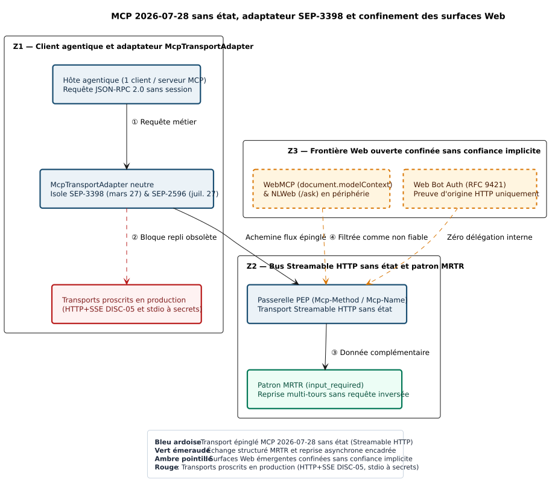
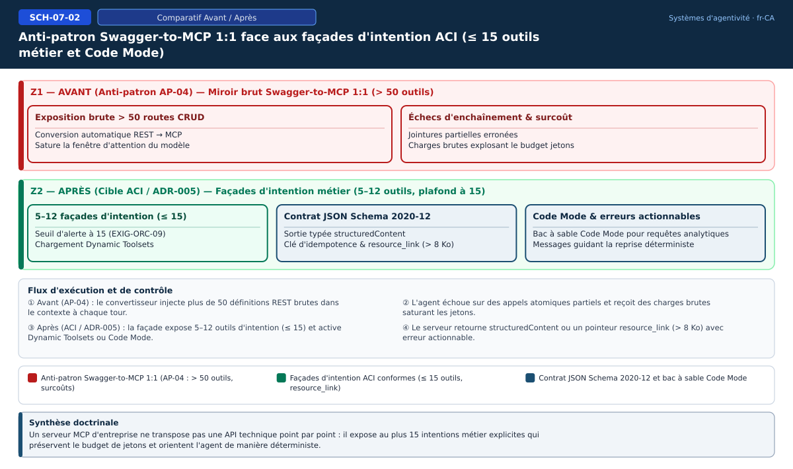
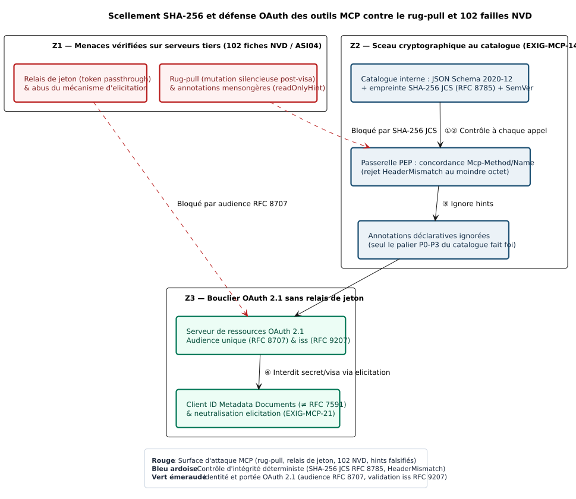

# Chapitre 07 — Protocoles verticaux outil-modèle : épinglage MCP 2026-07-28, façades d'intention et intégrité SHA-256

*Question directrice : Comment raccorder des Systèmes d'agentivité à des outils d'entreprise sans saturer leur fenêtre contextuelle ni exposer le système d'information à la mutabilité silencieuse des serveurs tiers ?*

## 7.1 Rupture verticale, épinglage MCP 2026-07-28 et résolution DISC-05

L'industrialisation des **Systèmes d'agentivité** repose sur une séparation architecturale nette entre deux axes d'échange qui obéissent à des régimes de contrôle distincts : l'**interopérabilité verticale et horizontale** [1, 2]. Sur l'axe vertical, un modèle probabiliste sollicite des fonctions déterministes, des bases documentaires ou des progiciels spécialisés qui exécutent des opérations bornées sous son propre plan de travail [1]. Sur l'axe horizontal, un agent autonome confie une tâche asynchrone à un pair tout aussi autonome, dont le raisonnement interne demeure opaque pour le demandeur (renvoyé au Chapitre 08). Confondre ces deux axes transforme un simple appel de fonction en délégation incontrôlable ou, à l'inverse, déguise un service métier en partenaire délibératif dépourvu d'imputabilité.

Dans cette topologie verticale, le protocole Model Context Protocol (MCP) remplace la prolifération de connecteurs propriétaires point à point (\(N \times M\) intégrations fragiles) par un contrat unifié ramenant l'effort d'intégration à \(N + M\) adaptateurs normalisés [1, 2]. L'interface unique dissocie l'hôte applicatif, qui orchestre le modèle, des serveurs d'outils, qui exposent les capacités métier de l'entreprise. Toutefois, cette standardisation du fil ne résout ni l'authentification fine, ni l'intégrité des définitions d'outils, ni l'alignement réglementaire : le protocole demeure un format d'échange technique et syntaxique qui laisse à l'entreprise la responsabilité entière du contrôle d'accès et de l'homologation.

Une évolution rapide entre fin 2024 et fin 2026 a en outre laissé subsister dans la littérature technique des références à des modes de transport aujourd'hui caducs. La décision de concordance `DISC-05` tranche cette ambiguïté pour l'ensemble de l'ouvrage. Dans la révision initiale `2024-11-05` [2], le protocole reposait sur le transport `HTTP+SSE` à deux points de terminaison (`GET` puis `POST`). Remplacé dès `2025-03-26`, le premier profil `Streamable HTTP` maintenu jusqu'à la révision historique `MCP 2025-11-25` [7] autorisait encore l'état de session par en-tête `Mcp-Session-Id`, un flux SSE autonome ouvert en HTTP `GET` avec reprise par `Last-Event-ID`, ainsi que des requêtes inversées du serveur vers le client [2, 7]. Ce modèle couplé complique l'équilibrage de charge, l'inspection en passerelle et la reprise sur panne.

La concordance `DISC-05` relègue donc `MCP 2025-11-25` [7] au rang de témoin historique pour l'analyse rétrospective. Toute mise en production DOIT s'épingler sur la révision sans état `MCP 2026-07-28` [1, 2, 4] en transport `Streamable HTTP`, au plus tard à l'échéance ferme du 28 juillet 2027 fixée par l'exigence `EXIG-MCP-22`. En parallèle, les principes de gouvernance rappellent qu'un protocole d'outil reste un cadre technique d'invocation et d'autorisation qui ne se substitue jamais aux API transactionnelles sous-jacentes ni aux contrôles métier de l'entreprise.

Cette bascule normative s'appuie sur deux mécanismes de gouvernance formels adoptés au sein de la spécification MCP : `SEP-2596` [5] et `SEP-3398` [6]. La proposition `SEP-2596`, créée le 17 avril 2026 et portée au statut *Final* dans la base archivée au 22 novembre 2026, répond à la suppression abrupte du *JSON-RPC batching* entre `2025-03-26` et `2025-06-18` [5]. Chaque fonctionnalité suit désormais un cycle à trois états (*Active*, *Deprecated*, *Removed*) : toute nouvelle dépréciation bénéficie d'au moins douze mois depuis la révision *Current* (soit jusqu'au 28 juillet 2027, hors retrait accéléré à 90 jours pour risque actif) [5]. L'ancien transport `HTTP+SSE`, déjà déprécié, ne reçoit qu'une grâce transitoire de trois mois après finalisation de `SEP-2596` [5].

Parallèlement, la proposition `SEP-3398`, acceptée le 14 octobre 2026, instaure une cadence semestrielle prévisible fixée au dernier mardi de mars et au dernier mardi de septembre [6]. Chaque livraison s'articule sur un cycle de huit mois comprenant deux mois de planification, avec un chevauchement de deux mois entre la fin janvier et la fin mars pour stabiliser la version sortante tout en cadrant la suivante [6]. Ce calendrier reporte la publication initialement envisagée pour décembre 2026 au 30 mars 2027 [6]. Pour l'architecte d'entreprise, ces deux dates — le 30 mars 2027 et le 28 juillet 2027 — imposent de dissocier la logique métier de la couche de transport derrière un adaptateur stable.

Le présent chapitre exerce la propriété exclusive des six thèmes canoniques de la couche verticale : la spécification `MCP 2026-07-28` sans état (`protocole-mcp`), l'encadrement des surfaces Web agentiques (`web-agentique-webmcp-webbotauth`) et les façades orientées vers l'intention métier (`facades-mcp-intention-metier`). Il couvre également l'isolation de transport `McpTransportAdapter` face à `SEP-3398` (`adaptateur-mcp-streamable-http-sep-3398`), l'ergonomie d'interface agent-ordinateur contre l'anti-patron `AP-04` (`ergonomie-aci-anti-swagger`) et le scellement cryptographique contre le retrait frauduleux (`epinglage-schemas-mcp`). Conformément à la clause `non-avis` (`AO-05`) [13], ces spécifications techniques arrêtées au 2 décembre 2026 forment un référentiel d'architecture et ne constituent ni un avis juridique ni une homologation réglementaire.

| Révision ou jalon | Date clé | Statut normatif | Décision architecturale `CRE-IA-2026-01` | Source |
|---|---|---|---|---|
| `MCP 2025-11-25` | 2025-11-25 | Témoin historique (`DISC-05`) | Transport `HTTP+SSE` (`2024-11-05`) et sessions `Mcp-Session-Id` (`2025-11-25`) bannis | [7] |
| `MCP 2026-07-28` | 2026-07-28 | Révision épinglée (`EXIG-MCP-01`) | `Streamable HTTP` sans état, `JSON-RPC 2.0`, schémas Draft 2020-12 | [1, 2, 4] |
| `SEP-3398` | 30 mars 2027 | Cadence semestrielle acceptée | Isolation obligatoire derrière `McpTransportAdapter` | [6] |
| `SEP-2596` | 28 juillet 2027 | Fenêtre minimale de 12 mois | Migration complète exigée avant retrait (`EXIG-MCP-22`) | [5] |

*Tableau 7.1 — Échelonnement des révisions MCP et jalons de gouvernance jusqu'en juillet 2027.*

## 7.2 Architecture de la couche verticale : transport sans état, façades d'intention et intégrité SHA-256

### 7.2.1 Spécification MCP et façades d'intention

La révision `MCP 2026-07-28` refond l'échange client-serveur sur `JSON-RPC 2.0` en supprimant les sessions persistantes au niveau du protocole ainsi que l'ancien point de terminaison `GET` destiné aux flux poussés [2]. Désormais, l'hôte instancie un client dédié par serveur MCP publié et chaque requête acheminée sur `Streamable HTTP` porte l'ensemble de son contexte d'exécution dans son enveloppe et ses en-têtes [2]. Cette autonomie permet aux répartiteurs de charge et aux passerelles d'entreprise (Chapitre 09) d'inspecter, de filtrer et d'équilibrer le trafic comme des appels HTTP ordinaires sans affinité de nœud [2].

De même, la poignée de main persistante disparaît au profit de requêtes auto-descriptives véhiculant les métadonnées de protocole dans `params._meta`, nommément les clés obligatoires `io.modelcontextprotocol/protocolVersion` et `io.modelcontextprotocol/clientCapabilities`, accompagnées de la clé optionnelle `io.modelcontextprotocol/clientInfo` [1, 4]. Lorsqu'un traitement exige une précision ou une validation complémentaire en cours d'exécution, le serveur ne renverse plus la topologie par une requête initiée vers le client : il retourne un état structuré d'attente (`input_required` dans `InputRequiredResult`) selon le patron de reprise multi-tours (`MRTR`) [1, 2, 4]. L'orchestrateur maître conserve ainsi l'initiative et la maîtrise de la boucle d'exécution.

Ce choix d'architecture sans état simplifie considérablement la résilience opérationnelle et l'auditabilité des flux. Sous l'ancien transport `HTTP+SSE` de `2024-11-05` ou sous le mode avec session de `2025-11-25` [2, 7], la perte d'une connexion réseau ou le redémarrage d'un nœud serveur brisait l'état implicite rattaché à l'identifiant de session `Mcp-Session-Id`, obligeant le client à renégocier ses capacités avant de reprendre la tâche. Avec `Streamable HTTP` sans session [2], chaque requête HTTP `POST` contient l'ensemble des références nécessaires à son routage et à son autorisation, permettant aux répartiteurs de basculer instantanément vers une autre réplique saine et aux passerelles de journaliser chaque invocation indépendamment.

La révision `2026-07-28` encadre également l'usage des caches côté client au moyen de directives de durée de vie (`ttlMs`) et de portée (`cacheScope`, valant `"public"` ou `"private"`) associées aux listes et ressources [1, 4], afin d'éviter qu'un client ne conserve indéfiniment des schémas périmés ou ne partage un cache entre contextes d'autorisation distincts (`EXIG-MCP-03`). Chaque mise en cache reste strictement bornée dans le temps et subordonnée au contrôle d'intégrité cryptographique vérifié à la passerelle.

Afin d'absorber la révision attendue le 30 mars 2027 sous `SEP-3398` [6] et d'appliquer l'extinction des modes obsolètes au 28 juillet 2027 [5], le noyau logiciel interpose l'interface abstraite `McpTransportAdapter` entre le harnais d'agent (Chapitre 04) et le réseau. Cette interface expose deux contrats simples : `send_jsonrpc` pour acheminer une méthode et ses paramètres sous contrainte de révision épinglée, et `capabilities` pour déclarer les aptitudes du canal sans fuite vers le domaine métier. En production serveur, seul `StreamableHttpAdapter` est autorisé (`EXIG-MCP-08`, `EXIG-MCP-22`) ; toute tentative de bascule sur `HTTP+SSE` lève immédiatement une exception bloquante `DeprecatedTransportError`.

En complément, la séparation entre l'interface `McpTransportAdapter` et le harnais applicatif permet de préparer les évolutions annoncées dans la feuille de route semestrielle sans toucher aux façades métier. Si la livraison attendue au 30 mars 2027 introduit de nouveaux profils de transport ou ajuste les métadonnées normalisées sous `SEP-3398` [6], seul l'adaptateur fait l'objet d'une mise à jour testée en intégration continue. L'ensemble des domaines clients et des serveurs métier conservent leurs contrats inchangés pendant toute la période de chevauchement de douze mois garantie par `SEP-2596` jusqu'au 28 juillet 2027 [5].

Le transport local `stdio`, qui demeure utile sur poste de développement pour outiller un environnement isolé, reste strictement confiné hors serveur et interdit pour tout appel porteur de secrets ou de données réglementées (`EXIG-MCP-08`). Par ailleurs, la conformité au profil minimal du cadre `CRE-IA-2026-01` exige la désactivation par défaut de toutes les extensions non promues au cœur — notamment les tâches asynchrones (`io.modelcontextprotocol/tasks`, issue de `SEP-2663`), les compétences distribuées ou les cartes serveur, dont le cycle *Experimental/Beta/Stable* relève de `SEP-3392` (`EXIG-MCP-04`). Aucune extension ne peut être activée en production sans inscription nominative sur une liste d'admission approuvée par l'architecture de sécurité.

La normalisation du tuyau de transport s'accompagne d'un cantonnement rigoureux des protocoles émergents du Web agentique, illustrés à la Figure 1 et recensés dans la veille du Tome 3 (chapitre 9, hors socle `L+` de ce chapitre). Aucune de ces quatre propositions ne constitue une norme adoptée à la date de gel. Le rapport communautaire W3C `WebMCP` (`document.modelContext`, à l'essai sur un seul moteur, sans vérification de sincérité) expose des actions déclaratives côté navigateur ; il reste sans confiance implicite et ne contourne jamais la passerelle interne. Le prototype `NLWeb` (`/ask`, démonstration de faisabilité) DOIT être filtré contre l'injection indirecte (Chapitre 19).

La signature HTTP `Web Bot Auth` (brouillon IETF 01 sur `RFC 9421` et clés `JWKS`) prouve uniquement l'origine cryptographique d'un client automatisé, sans établir l'intention métier ni la délégation humaine (Chapitre 08). Quant aux fichiers Markdown `llms.txt` (proposés en septembre 2024), la veille du Tome 3 (étude fournisseur Ahrefs de juin 2026 sur 137 210 domaines techniques, sans preuve de lecture) rapporte que 28 % en publient un valide mais que 97 % n'ont reçu aucune requête sur le mois observé. Tout investissement spécifique sur `llms.txt` est donc écarté, hors génération automatisée depuis la documentation existante.



*Figure 1 — SCH-07-01 : Architecture du transport sans état MCP 2026-07-28 derrière McpTransportAdapter et confinement des surfaces Web agentiques.*

Au-dessus du transport, la qualité d'exécution d'un **Système d'agentivité** dépend directement de l'ergonomie de son interface agent-ordinateur (*Agent-Computer Interface*, ACI) (`ADR-005`, `CAP-023`, `EXIG-MCP-06`) [1]. L'erreur la plus répandue lors des premiers prototypes consiste à brancher un convertisseur automatique sur une spécification OpenAPI existante pour transformer mécaniquement chaque route REST (`GET`, `POST`, `PUT`, `DELETE`) en outil MCP distinct. Cet anti-patron, catalogué `AP-04` (*Swagger-to-MCP 1:1*), produit couramment plus de cinquante outils granulaires par domaine.

Exposer ainsi des dizaines de points de terminaison techniques bruts entraîne trois effets délétères immédiats. D'abord, les descriptions combinées de tous ces outils saturent la fenêtre d'attention du modèle dès le chargement initial de `tools/list`, consommant des milliers de jetons avant même le premier raisonnement métier. Ensuite, la proximité lexicale entre méthodes redondantes multiplie les erreurs de sélection et de jointure entre appels atomiques partiels. Enfin, chaque erreur de séquence contraint l'agent à engager des tours supplémentaires coûteux pour reconstituer un état cohérent.

Pour prévenir cette dérive, chaque serveur MCP d'entreprise DOIT exposer des façades orientées vers l'intention métier (`EXIG-MCP-06`), plafonnées à au plus 15 outils (seuil d'alerte `EXIG-ORC-09`), avec une cible pratique de 5 à 12 outils (`ADR-005`) — resserrée à `≤ 10` à `12` façades en autonomie `L3` et `L4` selon la calibration artificielle FEDS (`DC-P12`). Chaque façade agrège les appels internes nécessaires au système d'enregistrement sous-jacent (dont l'encapsulation patrimoniale `EBCDIC` ou `COMP-3` relève du Chapitre 12) sans exposer la topologie relationnelle des tables ni les verbes CRUD techniques. Cette agrégation réduit le nombre de tours de raisonnement et isole les invariants transactionnels à l'intérieur du code déterministe du serveur.

La conception de ces façades conjugue les primitives normatives de `schema.ts` [1, 4] et les règles exécutables du cadre `CRE-IA-2026-01` (`EXIG-MCP-07`, `EXIG-MCP-19`). Premièrement, la sortie privilégie l'objet typé `structuredContent` validé contre `outputSchema` en `JSON Schema Draft 2020-12` (dialecte par défaut de MCP `2026-07-28`) [1, 4], complété par la discipline stricte du harnais (Chapitre 04) qui impose `additionalProperties: false` et la déclaration explicite des champs requis. Deuxièmement, plutôt que d'asphyxier le contexte du modèle par des pièces volumineuses, le serveur utilise la primitive `resource_link` (`uri`, type MIME et nom/titre) définie dans `schema.ts` [1, 4], déclenchée systématiquement dès que la charge utile dépasse 8 Ko selon la règle architecturale du Tome 3 (§ 5).

Troisièmement, la discipline interne exige une clé d'idempotence explicite sur toute façade d'écriture, tandis que toute façade de lecture sur collection impose une pagination bornée par `cursor` [1, 4]. Quatrièmement, lorsque le modèle fournit un paramètre invalide, la réponse d'exécution d'outil (`isError: true`) renvoie un message d'erreur cognitif actionnable indiquant le champ fautif et la contrainte violée [1, 4] (`EXIG-MCP-07`). Enfin, pour des catalogues étendus ou des analyses multi-appels, le corpus interne (Tome 2 § 6.5 et Tome 6 § 4.2.3) documente le chargement différé côté passerelle ou harnais (*Dynamic Toolsets* / *Tool Search*) et le *Code Mode* exécuté en bac à sable isolé sans accès réseau direct (Chapitre 21), comme l'illustre la Figure 2.



*Figure 2 — SCH-07-02 : Comparaison entre l'anti-patron Swagger-to-MCP 1:1 (AP-04) et les façades d'intention ACI plafonnées à 15 outils.*

| Critère d'architecture | Anti-patron `AP-04` (Swagger-to-MCP 1:1) | Façade d'intention ACI (`ADR-005` / `EXIG-MCP-06`) |
|---|---|---|
| Granularité exposée | `> 50` opérations CRUD atomiques par API | `5` à `12` intentions métier (plafond bloquant à `15`) |
| Contrat de sortie | Texte libre non contraint | `structuredContent` conforme à `JSON Schema 2020-12` |
| Volumes `> 8 Ko` | Injection brute dans le contexte LLM | Pointeur `resource_link` et pagination bornée |
| Reprise sur erreur | Code HTTP brut sans guidage | Message cognitif actionnable + clé d'idempotence |
| Analyses complexes | Enchaînement coûteux de dizaines de tours | `Dynamic Toolsets` ou *Code Mode* en bac à sable |

*Tableau 7.2 — Comparaison structurelle entre le mappage Swagger-to-MCP 1:1 et l'ergonomie ACI par façades d'intention.*

### 7.2.2 Épinglage SHA-256 et sécurité MCP

La standardisation du transport `Streamable HTTP` et le plafonnement à 15 façades ne garantissent en rien l'intégrité d'un connecteur externe. Un recensement empirique exhaustif du registre public MCP réalisé sur un instantané d'août 2026 par Obada Kraishan (`arXiv:2609.14119`) [8] démontre l'ampleur des fragilités de la chaîne logistique d'outils. Sur 727 pages d'API totalisant 21 643 serveurs uniques et 72 606 enregistrements de versions, l'analyse statique de 14 353 serveurs issus de 13 051 dépôts GitHub (248 817 fichiers et 69 027 déclarations d'outils extraites de 4 238 dépôts) relève que 15,2 % comportent au moins une alerte de sécurité parmi huit classes et 31 motifs vérifiés sur 414 entrées étiquetées manuellement (294 alertes et 120 fichiers témoins) [8]. Après correction par précision mesurée, la prévalence brute de haute sévérité passe de 11,14 % à environ 7,6 %, dominée par l'exposition réseau non authentifiée [8].

Plus critique encore, l'analyse longitudinale de 37 160 transitions consécutives sur les 8 900 serveurs multi-versions établit que 51,09 % modifient leurs informations annoncées entre deux versions [8]. Sur cet ensemble de 8 900 serveurs multi-versions, 40,58 % opèrent une **Dérive silencieuse** sans aucun changement d'identifiant ni de numéro de version, et 4,16 % (370 serveurs) redirigent vers un autre hôte leur adresse distante tout en conservant identique leur nom de registre [8]. Or, parmi les 6 699 serveurs multi-versions scannés, la dérive silencieuse multiplie presque par trois la cote d'apparition d'une faille de sévérité élevée (`OR = 2,96`, IC à 95 % `[2,56, 3,42]`), alors que la popularité par étoiles offre une protection faible (`OR = 0,78` par unité de logarithme d'étoiles dans le modèle multivarié) [8].

Le catalogue de menaces évalué dans ce recensement couvre huit catégories empiriques : l'exposition réseau non authentifiée (dominant la prévalence observée à 9,57 % des serveurs analysés), l'empoisonnement de métadonnées d'outils, le passage de jeton par mandataire confus, l'injection de commandes dans les gestionnaires, les permissions excessives, la manipulation peu sûre des secrets, les requêtes sortantes non validées (`SSRF`) et les dépendances non épinglées [8]. En parallèle, le relevé interne de la base `NVD` consigné au Tome 3 (§ 49.7, du 1er juillet au 27 octobre 2026, sous réserve de recherche par mot-clé) totalise 102 fiches sur des serveurs tiers (dont 13 critiques `≥ 9,0`), et le référentiel *OWASP Top 10 for Agentic Applications 2026* classe la compromission de la chaîne logistique d'outils (`ASI04`) et le détournement d'outils (`ASI02`) parmi les dix risques critiques [13].

Cette **dérive silencieuse d'outil** — couramment désignée sous le nom d'attaque *rug-pull* — découle d'une faille structurelle des registres communautaires ouverts : ils ne versionnent pas les définitions d'outils elles-mêmes [8]. Un serveur réputé bénin lors de son approbation initiale peut donc altérer ultérieurement la description textuelle d'un outil ou son schéma d'entrée pour y glisser des instructions cachées détournant l'agent (`ASI04`) [8, 13]. L'architecture `CRE-IA-2026-01` répond à cette menace par l'**Épinglage cryptographique** (`EXIG-MCP-19`, `EXIG-MCP-20`, `CAP-023`, `PRR S-07`, `ADR-019`) [10].

Avant toute mise en production, chaque serveur MCP DOIT être inscrit au catalogue interne unique avec sa version `SemVer`, son niveau de criticité (`P0` à `P3`) et l'empreinte `SHA-256` de chaque définition d'outil. Pour éviter toute divergence d'encodage ou d'ordre des clés JSON entre environnements, la définition est préalablement canonisée selon le schéma *JSON Canonicalization Scheme* (`JCS`, `RFC 8785`) : tri lexicographique des clés en unités de code UTF-16, suppression des espaces superflus et formatage déterministe des nombres selon ECMAScript [10]. Dans le module `harness_proto/mcp_pinning.py`, la fonction `compute_tool_definition_digest` retire d'abord les clés volatiles explicitement déclarées au catalogue (`volatile_meta_keys`), puis préfixe par `sha256:` le condensat calculé sur l'objet canonisé.

À chaque appel de `tools/list` et préalablement à l'exécution, le composant déterministe recalcule l'empreinte après purge des seules clés volatiles explicitement déclarées et vérifie sa concordance stricte avec le condensat scellé (`EXIG-MCP-20`). La moindre modification d'un octet dans le nom, la description ou le schéma JSON d'un outil brise le scellement, suspend automatiquement l'outil — voire le serveur entier dès le premier écart (`max_drift_before_suspend = 1`) — et impose une réapprobation complète avant toute réactivation. Tout préfixage d'espace de noms (`server_id.tool`) empêche en outre les collisions entre serveurs homonymes.

De plus, toute annotation `x-mcp-header` [1, 2] dans `inputSchema` est inspectée avant exécution afin d'interdire la projection vers des en-têtes `mcp-param-*` de tout paramètre sensible (`token`, `secret`, `password`, `nas`, `iban`, `cookie` ou `pii` sous `EXIG-MCP-18` dans `mcp_pinning.py`). Toute valeur projetée en en-tête doit concorder strictement avec l'argument correspondant du corps JSON-RPC sous peine de rejet `-32020` [2]. Cette barrière empêche un outil tiers de détourner des données confidentielles vers des en-têtes HTTP journalisés en clair par des mandataires [1].

Simultanément, la spécification MCP `2026-07-28` [1, 4] et l'exigence `EXIG-MCP-14` imposent de traiter l'ensemble des annotations déclaratives fournies par le serveur (`readOnlyHint`, `destructiveHint`, titres, icônes ou URL descriptives) comme des entrées non fiables. Jamais un indicateur `readOnlyHint: true` déclaré par un serveur externe ne peut justifier une dispense d'autorisation ou d'approbation humaine : seul fait foi le palier inscrit au catalogue interne. De même, les notifications asynchrones `notifications/tools/list_changed` ne déclenchent jamais d'actualisation automatique en production sans repasser par la file de réapprobation cryptographique.

La défense cryptographique de la définition d'outil se double d'une barrière stricte sur le transport et les en-têtes, illustrée à la Figure 3. Sur `Streamable HTTP`, les en-têtes `MCP-Protocol-Version`, `Mcp-Method` et `Mcp-Name` permettent aux passerelles et pare-feu applicatifs de router et de filtrer les requêtes sans désérialiser l'intégralité du graphe JSON [2]. Une faille classique de contournement survient lorsqu'un appelant soumet des en-têtes bénins pour franchir le filtre périmétrique tout en dissimulant une méthode ou un outil sensible dans le corps `JSON-RPC 2.0`.

L'exigence `EXIG-MCP-15` impose donc de vérifier la concordance exacte entre les en-têtes HTTP normalisés (tout en-tête dupliqué divergent étant rejeté) et les champs `params._meta`, `method` et `params.name` du corps JSON-RPC, en bloquant toute discordance par un code dédié (`-32020`) [2]. De plus, toute clé `_meta` non reconnue ou absente de la liste d'autorisation du catalogue est purgée (`EXIG-MCP-16`), à l'exception de la version de protocole et des clés explicitement approuvées comme le contexte de traçage distribué. Enfin, aucune projection d'argument vers un en-tête `mcp-param-*` via `x-mcp-header` [1, 2] n'est tolérée (`EXIG-MCP-18`) si le nom du champ ou de l'en-tête évoque un secret ou un renseignement personnel (`token`, `password`, `nas`, `iban`, `cookie`).



*Figure 3 — SCH-07-03 : Articulation du scellement SHA-256 JCS, du contrôle d'en-têtes et de la défense OAuth 2.1 sur les outils MCP.*

L'extrait exécutable `G0-EX-CH01-03` ci-après, extrait mécaniquement et scellé depuis le module `mcp_pinning.py` de la trousse homologuée en barrière `G0`, concrétise ces deux verrous déterministes. La fonction `verify_tools_list_against_catalog` trie les outils, calcule leur empreinte `JCS SHA-256`, détecte toute dérive et bascule le serveur en suspension au premier écart, tandis que `validate_mcp_headers` bloque toute divergence entre en-têtes HTTP et corps `JSON-RPC 2.0` (`-32020`) avant de purger `_meta`.

<!-- CA-G0-SYNC id="G0-EX-CH01-03" path="Tomes/Tome 8 - Ingénierie exécutable et homologation vérifiable/trousse/harness_proto/mcp_pinning.py" lines="227-260" sha256="350e1959e6f0c54ce549afc77b4ef14959851bc9e45ad1a2eee52b9b36f4fc95" -->
```python
def verify_tools_list_against_catalog(
    tools: list[dict[str, Any]], catalog: Mapping[str, McpCatalogEntry],
    server_id: str, max_drift_before_suspend: int = 1,
) -> McpSyncResult:
    """Trie tools/list, detecte rug pull et prefixe server_id.tool."""
    active, suspended, reasons, seen = {}, [], {}, set()
    for tool in sorted(tools, key=_tool_name):
        name = _tool_name(tool)
        err = _tool_sync_error(tool, catalog.get(name), server_id, seen)
        seen.add(name)
        if err:
            active.pop(f"{server_id}.{name}", None)
            suspended.append(name)
            reasons[name] = err
        else:
            active[f"{server_id}.{name}"] = copy.deepcopy(tool)
    susp = len(suspended) >= max_drift_before_suspend
    act = {} if susp else active
    return McpSyncResult(act, tuple(suspended), susp, reasons)

def validate_mcp_headers(
    headers: Mapping[str, str], jsonrpc_body: dict[str, Any],
    catalog_entry: McpCatalogEntry | None = None,
) -> dict[str, Any]:
    """Verifie concordance MCP headers/body (-32020) et _meta."""
    hdr = _normalize_headers(headers)
    p, m, meth, mn = _extract_mcp_fields(jsonrpc_body)
    pv, mm = hdr.get("mcp-protocol-version"), hdr.get("mcp-method")
    if (not pv or pv != m.get(_PROTO_META_KEY) or not mm or mm != meth
            or (("name" in p or "mcp-name" in hdr) and (
                not isinstance(mn, str) or not mn
                or hdr.get("mcp-name") != mn))):
        raise HeaderMismatchError("En-tetes MCP divergents (-32020)")
    return _purge_and_validate(hdr, jsonrpc_body, catalog_entry)
```

Sur le plan de l'autorisation, la section sécurité de `MCP 2026-07-28` [3] qualifie tout serveur MCP distant en serveur de ressources `OAuth 2.1` (`EXIG-MCP-09`). Trois mécanismes normatifs ferment les brèches d'usurpation identifiées dans les études de terrain. Premièrement, les serveurs publient leurs paramètres de découverte de ressource protégée conformément à `RFC 9728` [12], afin d'indiquer explicitement les serveurs d'autorisation reconnus sans recourir à des heuristiques d'URL. Deuxièmement, chaque demande de jeton DOIT porter une audience explicite liée à l'outil cible via `RFC 8707` (*Resource Indicators*, paramètre `resource`) [9], garantissant qu'un jeton intercepté reste inutilisable sur un autre serveur.

Troisièmement, toute réponse d'autorisation inclut le paramètre `iss` normalisé par `RFC 9207` [11] pour empêcher les attaques par confusion d'émetteur (*mix-up*). En conséquence, le relais aveugle d'un jeton reçu vers un service aval (*token passthrough*), relevé comme une vulnérabilité de mandataire confus dans le recensement MCP [8], est formellement banni (`EXIG-MCP-11`) [3]. Chaque serveur valide l'audience `aud` reçue ; le courtier en passerelle procède, le cas échéant, à un échange de jetons dédié `RFC 8693` (Chapitre 17). Par ailleurs, l'enregistrement dynamique des clients (`RFC 7591`, déprécié en `2026-07-28` selon `EXIG-MCP-12`) cède la place au préenregistrement ou aux *Client ID Metadata Documents* vérifiables [3]. Enfin, le mécanisme interactif d'`elicitation` en mode formulaire [1, 4] ne DOIT JAMAIS collecter de secrets ni recueillir d'approbation réglementaire `P2`/`P3` (`EXIG-MCP-21`), ces actes relevant exclusivement de canaux hors bande dédiés (Chapitre 17).

## 7.3 Synthèse opérationnelle, livrables et frontières du Chapitre 07

L'application des exigences `EXIG-MCP-01` à `EXIG-MCP-22`, `EXIG-INT-13` à `EXIG-INT-19`, `EXIG-ORC-09`, `ADR-005`, `ADR-019` et `PRR S-07` dote la couche verticale d'une discipline exécutable complète avant toute exposition vers les agents d'entreprise. Quatre livrables vérifiables matérialisent ce contrat en production et en intégration continue.

Le premier livrable consiste en un catalogue interne unique consignant les empreintes `SHA-256` canonisées `JCS`, les versions `SemVer` et les paliers `P0–P3` de chaque outil homologué. Le deuxième livrable correspond à l'adaptateur `McpTransportAdapter` (`EXIG-MCP-08`), éprouvé en intégration continue pour rejeter `HTTP+SSE` et bloquer toute discordance d'en-têtes `-32020`. Le troisième livrable réunit une suite de tests vérifiant le plafond de 15 outils, la validité `JSON Schema 2020-12` de `structuredContent` et la bascule `resource_link` au-delà de 8 Ko. Le quatrième livrable formalise un plan de migration daté assurant la bascule avant le 28 juillet 2027 sous veille `SEP-3398` (30 mars 2027) [5, 6].

| Exigence ou artefact | Objet de contrôle | Seuil ou règle exécutable | Chapitre partenaire |
|---|---|---|---|
| `EXIG-MCP-01`, `08`, `22` | Transport `MCP 2026-07-28` sans état | `Streamable HTTP` obligatoire, rejet `HTTP+SSE`, échéance `2027-07-28` | `← CH-36` (`DISC-05`) |
| `EXIG-MCP-06`, `ADR-005` | Façades d'intention ACI | `≤ 15` outils (`5–12` cible), `structuredContent`, `resource_link > 8 Ko` | `→ CH-12` (`ACL`) |
| `EXIG-MCP-14`, `19`, `20` | Épinglage `SHA-256` JCS (`RFC 8785`) | Suspension dès `1` écart, annotations non fiables | `→ CH-19` (`ASI04`) |
| `EXIG-MCP-09`, `11`, `15`, `21` | `OAuth 2.1` et en-têtes HTTP | `RFC 8707`/`9207`/`9728`, rejet `-32020`, zéro secret via `elicitation` | `→ CH-09`, `→ CH-17` |

*Tableau 7.3 — Matrice des contrôles normatifs du Chapitre 07 et articulations inter-chapitres.*

Ces quatre livrables se traduisent par trois mesures continues avant mise en exploitation (`PRR S-07`) : zéro serveur actif sans empreinte `JCS SHA-256` valide et zéro dépassement du seuil de 15 façades. Ils exigent aussi un taux de rejet de `100,0 %` sur les tests d'en-têtes discordants et de transport `HTTP+SSE` obsolète vérifiés en barrière `G0` (`14/14` cas dans `test_harness_proto.py`).

Dans la partition `owned_concepts` de l'ouvrage, le Chapitre 07 se tient strictement à l'axe vertical outil-modèle. Il délègue au Chapitre 08 (`→ CH-08`) la collaboration horizontale entre pairs autonomes (`A2A v1.0.1`) et les preuves commerciales (`AP2`). Il confie au Chapitre 09 (`→ CH-09`) l'exécution des neuf contrôles à la passerelle `PEP` et la gouvernance du catalogue unique, et au Chapitre 12 (`→ CH-12`) l'encapsulation patrimoniale `EBCDIC`/`COMP-3`. Il renvoie aux Chapitres 16 et 17 (`→ CH-16`, `→ CH-17`) la fabrique d'identités `OAuth 2.1` et l'échange `OBO`, ainsi qu'au Chapitre 19 (`→ CH-19`) la taxonomie générale `OWASP ASI04`. Symétriquement, il reçoit du Chapitre 22 (`← CH-22`) l'injection du contexte de trace W3C dans `_meta` et du Chapitre 36 (`← CH-36`) l'arbitrage `DISC-05`.

> **Trois invariants exécutables — Chapitre 7**
>
> 1. **Transport sans état épinglé et isolé** : Tout serveur MCP de production DOIT opérer en `MCP 2026-07-28` sans état sur `Streamable HTTP` derrière `McpTransportAdapter`, avec rejet strict de `HTTP+SSE` (`DISC-05`) et concordance vérifiée des en-têtes `Mcp-Method` et `Mcp-Name` (`EXIG-MCP-15`, code `-32020`) avant la bascule du 28 juillet 2027.
> 2. **Ergonomie ACI par façades d'intention (`≤ 15` outils)** : La génération automatique `Swagger-to-MCP 1:1` (`AP-04`) est proscrite ; chaque serveur expose au plus 15 façades métier dotées de `structuredContent` (`JSON Schema 2020-12`), d'une bascule `resource_link` au-delà de 8 Ko, de clés d'idempotence en écriture et d'erreurs cognitives actionnables.
> 3. **Scellement cryptographique et zéro confiance déclarative** : Chaque définition d'outil est épinglée au catalogue par son empreinte `SHA-256` canonisée `JCS` (`RFC 8785`, suspension dès le moindre écart), toute annotation (`readOnlyHint`, `destructiveHint`) reste réputée non fiable, tout relais de jeton est interdit (`RFC 8707`/`9207`/`9728`) et l'`elicitation` est bannie pour les secrets et approbations.
