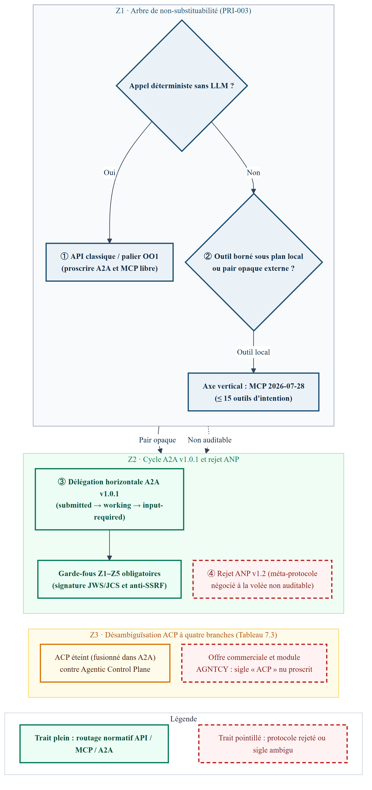
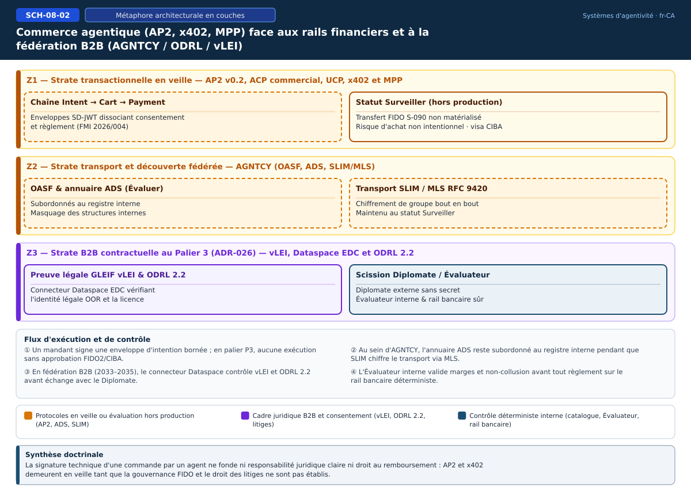
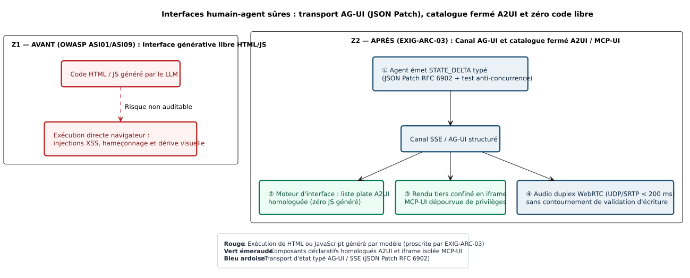

# Chapitre 08 — Protocoles horizontaux pair-à-pair : A2A v1.0.1, pile AGNTCY/SLIM, paiements AP2 et fédération B2B

*Question directrice : Comment organiser la délégation asynchrone entre Systèmes d'agentivité pairs, l'affichage d'interfaces utilisateur sûres et les échanges B2B ou commerciaux sans céder ni l'imputabilité juridique ni le contrôle de conformité ?*

## 8.1 Axe horizontal pair-à-pair, non-substituabilité et désambiguïsation ACP

Lorsque l'architecture des **Systèmes d'agentivité** franchit la frontière d'un outil déterministe pour relier des agents autonomes appartenant à des domaines ou à des équipes distinctes, le contrat d'interface change de nature [1, 2]. Le principe de non-substituabilité (`PRI-003`) interdit d'assimiler un appel d'outil vertical à une délégation horizontale entre pairs opaques. Un outil MCP (Chapitre 07) exécute une intention bornée sous le plan d'orchestration de l'appelant, en harmonie avec la bascule `MCP 2026-07-28` attendue au 28 juillet 2027 sous veille `SEP-3398` (30 mars 2027). À l'inverse, un pair horizontal reçoit un mandat de tâche asynchrone dont il pilote librement la délibération interne, sans jamais exposer son graphe cognitif ni ses serveurs d'outils privés au demandeur [1, 2].

Cette séparation répond à une exigence de souveraineté logicielle et de confinement des défaillances. Si un agent appelant inspectait ou pilotait directement les étapes internes d'un agent distant, tout changement de modèle ou de chaîne de invites chez le partenaire briserait l'orchestrateur appelant. En imposant l'opacité interne entre domaines distincts, l'axe horizontal préserve le découplage mais reporte la charge d'auditabilité sur le contrat d'échange, l'authentification cryptographique de la fiche d'identité et la traçabilité des livrables.

Cette frontière est matérialisée par le protocole **Agent2Agent (`A2A`)** dans sa version normative gelée `v1.0.1` (tag `33035925` du 28 mai 2026 [2], correctif de la version `v1.0.0` publiée le 12 mars 2026 sous la Linux Foundation et rattachée au stade *Growth* de l'Agentic AI Foundation, `AAIF`, en août 2026 ; l'en-tête éditorial des archives `SRC-039` [1] et `SRC-083` [2] mentionne encore `1.0.0`). La spécification `A2A v1.0.1` [2] et son contrat Protobuf `a2a.proto` [3] structurent la collaboration autour de quatre primitives : le descripteur publié **Carte d'agent** (*AgentCard*), la tâche suivie (*Task*) dotée d'une machine d'état à cycle long, les messages porteurs de parties typées (*Part*) et les livrables immuables (*Artifact*) [2, 3]. Quant à la version candidate `A2A v1.1.0-rc` publiée le 29 octobre 2026 [4], elle reste postérieure à la norme de référence du gel et demeure strictement confinée derrière un adaptateur versionné (`AgentCardAdapter`, `EXIG-A2A-01`).

La clarté de cette partition horizontale a toutefois été brouillée en 2025 et 2026 par une collision terminologique majeure autour du sigle « ACP », documentée dans l'instruction historique du traité (`DEC-001`, Tome 1 Tableau 7.3). Le 17 mars 2025, un centre de recherche industriel a lancé l'ACP protocolaire (*Agent Communication Protocol*, issu d'IBM Research et BeeAI), suivi le 28 mai 2025 d'un billet doctrinal le positionnant comme couche universelle d'échange entre agents. Cinq mois et douze jours après son lancement, le 29 août 2025, la Linux Foundation a acté la fusion de l'ACP protocolaire dans A2A, mettant un terme à son développement autonome au profit d'adaptateurs et de guides de migration (`DEC-001`). Cet épisode démontre qu'une gouvernance neutre n'immunise pas un standard contre l'obsolescence, mais organise une sortie ordonnée préservant la continuité d'exploitation des adoptants.

En conséquence, le sigle « ACP » ne DOIT JAMAIS être employé seul sans qualificatif explicite dans un dossier d'architecture ou un contrat. L'architecture distingue impérativement quatre branches sémantiques principales, résumées au Tableau 8.1. La branche (a) désigne l'ACP protocolaire éteint d'IBM Research et BeeAI, fusionné dans A2A le 29 août 2025 et maintenu uniquement par adaptateurs de sortie (`DEC-001`). La branche (b) vise l'*Agentic Control Plane* annoncé par un consortium d'institutions financières et de télécommunications en juillet 2026, dont l'absence totale de lien avec l'ACP protocolaire constitue une pure homonymie établie.

La branche (c) correspond à l'expression commerciale *agentic control plane* employée par IBM pour positionner un produit d'orchestration : les sources primaires n'établissent ni lien ni indépendance entre cette offre et la branche (a), ce qui impose d'attribuer explicitement la mention à IBM sans extrapoler. La branche (d) désigne enfin la composante ACP mentionnée dans la couche d'infrastructure AGNTCY, dont ni l'intitulé complet ni l'identité éventuelle avec l'ACP protocolaire ne sont tranchés en source primaire et qu'il est interdit d'agréger aux autres branches. À ces quatre acceptions s'ajoute un cinquième homonyme distinct : l'ACP commercial (*Agentic Commerce Protocol* porté par OpenAI et Stripe), traité à la section 8.2.2.

| Branche | Désignation qualifiée obligatoire | Statut au 2 décembre 2026 | État probatoire |
|---|---|---|---|
| (a) | ACP protocolaire (IBM Research / BeeAI) | Fusionné dans A2A le 29 août 2025 | Standard éteint ; adaptateurs de sortie seuls (`DEC-001`) |
| (b) | *Agentic Control Plane* de consortium | Programme annoncé en juillet 2026 | Homonymie pure vérifiée avec la branche (a) |
| (c) | Offre commerciale IBM *agentic control plane* | Positionnement produit d'éditeur | Lien avec (a) non documenté en source primaire |
| (d) | Composante ACP de la couche AGNTCY | Mention d'infrastructure non élucidée | Intitulé et identité non tranchés ; ne pas agréger |
| (e) | ACP commercial (OpenAI / Stripe) | Protocole de paiement marchand | Cantonné hors production au statut `Surveiller` (`EXIG-INT-22`) |

*Tableau 8.1 — Désambiguïsation impérative des cinq acceptions liées au sigle ACP.*

Le présent chapitre détient l'exclusivité des huit thèmes du sous-domaine horizontal. La première famille couvre le protocole `A2A v1.0.1` et l'asymétrie `0/15` (`protocole-a2a`), la fusion de l'ACP protocolaire et sa collision terminologique (`fusion-acp-collision-terminologique`), le protocole `ANP` sur `did:wba` (`protocole-anp-did-wba`), les interfaces `AG-UI`, `A2UI`/`MCP-UI` et `WebRTC` (`protocoles-interfaces-agui-a2ui-webrtc`), les mandats `AP2` (`protocole-ap2`) et les rails de paiement du commerce agentique (`rails-paiement-commerce-agentique`). La seconde famille couvre l'infrastructure fédérée `AGNTCY` et `SLIM`/`MLS` (`agntcy-slim`), ainsi que le maillage B2B par connecteurs `Dataspace`, `ODRL 2.2` et `vLEI` (`maillage-b2b-federe-edc-odrl`). Conformément au principe `non-avis` (`AO-05`), ces règles d'architecture ne constituent ni une consultation juridique ni un avis de conformité réglementaire.

## 8.2 Délégation A2A, piles fédérées, paiements AP2 et fédération B2B

### 8.2.1 Protocole pair-à-pair A2A et ANP

Sous le principe de non-substituabilité `PRI-003`, le choix entre une API déterministe, MCP `2026-07-28` et `A2A v1.0.1` obéit à un arbre de décision strict (Figure 1). Tout traitement dépourvu de délibération probabiliste relève d'une API classique ou du palier `OO1` (Chapitre 13), sans recours à `A2A` ni à un appel outillé libre. Lorsqu'un agent invoque une capacité métier bornée sous son propre graphe d'exécution, il utilise l'axe vertical `MCP 2026-07-28` (Chapitre 07). En revanche, `A2A v1.0.1` s'impose exclusivement pour déléguer une tâche asynchrone de niveau domaine à un pair autonome distinct franchissant une frontière d'équipe ou d'organisation (`EXIG-INT-04`, `EXIG-A2A-01`), sans jamais servir à maquiller un appel CRUD ni à contourner l'orchestration intra-processus durable (Chapitre 15).



*Figure 1 — SCH-08-01 : Arbre de non-substituabilité entre API, MCP et A2A v1.0.1, cycle d'état et désambiguïsation ACP.*

Le contrat Protobuf `a2a.proto` de `A2A v1.0.1` [3] formalise une machine d'état bornée autour de l'énumération `TaskState` à neuf valeurs. Les transitions nominales partent de l'état soumis (`TASK_STATE_SUBMITTED`) vers l'exécution en cours (`TASK_STATE_WORKING`), avec possibilité de suspension pour précision ou authentification (`TASK_STATE_INPUT_REQUIRED`, `TASK_STATE_AUTH_REQUIRED`) à côté de l'état non spécifié (`TASK_STATE_UNSPECIFIED`). La tâche aboutit ensuite à l'un des quatre états terminaux irrévocables : succès (`TASK_STATE_COMPLETED`), échec (`TASK_STATE_FAILED`), annulation (`TASK_STATE_CANCELED`) ou rejet (`TASK_STATE_REJECTED`) [2, 3]. Dès qu'une tâche atteint l'un des quatre états terminaux, la spécification interdit d'y rattacher de nouveaux messages [2]. Cette discipline facilite le suivi asynchrone sur des durées longues, mais crée une tension d'auditabilité : l'opacité voulue entre pairs A2A empêche l'appelant d'inspecter les étapes intermédiaires du pair délégué (renvoyée au Chapitre 13).

Au-delà de la machine d'état, le modèle d'échange `A2A v1.0.1` encadre strictement la structure des messages et des livrables afin d'éviter la dérive conversationnelle libre [2, 3]. Chaque tâche est rattachée à un identifiant de contexte (`contextId` en JSON, `context_id` dans `a2a.proto`) qui regroupe plusieurs échanges corrélés, tandis que les entrées et sorties circulent sous forme d'objets `Message` et `Artifact` composés de parties typées (`Part`) : texte brut (`text`), contenu binaire brut (`raw`), données structurées JSON (`data`) ou référence de fichier distante par URI (`url`) [2, 3]. Le protocole prend en charge trois modes d'interaction adaptés à la durée d'exécution : la requête-réponse synchrone sur tâches courtes, le flux continu par événements `Server-Sent Events` (`SSE`) pour les traitements progressifs, et les notifications poussées (*push notifications*) par *webhook* lorsque l'opération asynchrone s'étend dans la durée [2]. Les profils de liaison officiellement supportés couvrent `JSONRPC` (`JSON-RPC 2.0`), `GRPC` (`gRPC`) et `HTTP+JSON` (`HTTP+JSON/REST`), tous soumis aux mêmes exigences d'authentification et de schéma [2, 3].

En outre, la grille analytique interne du traité (`0/15`, Tome 5) croise les trois familles protocolaires (`MCP`, `A2A v1.0.1` et `AP2`) avec cinq cadres financiers applicables au Canada. Ce croisement inclut `BSIF E-23`, la ligne directrice de l'`AMF` (dont le portail et la note directe restent en `statut F`), `ACVM 11-348`, la `Loi 25` (article `12.1`) et l'accès bancaire ouvert issu du projet `C-15`, sans relever aucun lien normatif natif (`0/15`). La spécification A2A traite l'identité technique du service sur le réseau, sans prescrire ni durée maximale d'expiration des cartes, ni mécanisme natif de révocation, ni gouvernance des clés cryptographiques de signature. Pour combler ce vide structurel, l'architecture impose cinq zones compensatoires hors protocole (`Z1–Z5`, détaillées au Chapitre 09) et soumet chaque **Carte d'agent** (`CAP-012`, `EXIG-A2A-02` à `EXIG-A2A-15`) à une validation cryptographique déterministe en amont de toute délégation [2, 7, 10].

La section 8.4 de la spécification `A2A v1.0.1` [2] laisse la signature facultative (`MAY`), mais impose (`MUST`), dès qu'une **Carte d'agent** est signée, d'en omettre les champs à valeur par défaut non requis ou non marqués `optional`, d'exclure `signatures`, de canoniser le reste selon `JCS` (`RFC 8785`) [7] puis de signer en enveloppe `JWS` (`RFC 7515`) [10] comportant au minimum `alg` et `kid` dans l'en-tête protégé. La fiche déclare les interfaces supportées (`supportedInterfaces`), les compétences (`skills`), les modes d'entrée/sortie et, dans le profil strict `G0`, les schémas et exigences de sécurité (`securitySchemes`, `securityRequirements`, `signatures`) [2, 3]. Lorsque le pair expose une carte étendue réservée aux clients authentifiés (`GetExtendedAgentCard`), l'appelant s'authentifie préalablement via un schéma public ; si le serveur ne prend pas en charge cette extension, il retourne l'erreur `ExtendedAgentCardNotConfiguredError` [2, 5].

Or l'inspection de la suite officielle de conformité `a2aproject/a2a-tck` au tag `1.0.0.alpha3` (commit `5daf0144` du 20 octobre 2026) [5] révèle deux lacunes bloquantes dans l'outillage tiers : les exigences `CARD-SIGN-001` à `CARD-SIGN-004` y sont marquées `NOT_AUTOMATABLE` et le répertoire de vecteurs `conformance-vectors/a2a-jcs-v01` en est absent. En clair, la suite communautaire vérifie la structure générale et les en-têtes `Cache-Control` (`CARD-CACHE-001`), mais n'automatise ni la canonisation `RFC 8785`, ni l'exclusion de `signatures`, ni le rejet des clés révoquées [5]. Sous le régime des suites tierces (`EXIG-A2A-14`, `EXIG-INT-19`), l'intégration continue bloque sur les seuls tests `MUST` automatisables et stables, tandis que la vérification cryptographique s'exécute localement dès la barrière `G0` sur les `20` vecteurs `RFC 8785` [7] et les `5` vecteurs `a2a_tck` (`rapports-g0.json`).

Sur le plan sécuritaire, la validation d'une **Carte d'agent** ne s'arrête pas à la signature cryptographique : l'implémentation `harness_proto/a2a_card.py` refuse systématiquement les schémas `OAuth` dépréciés `password` et `implicit` ainsi que toute extension absente d'une liste d'admission explicite (`approved_extensions`). Parallèlement, les notifications poussées exposent au risque de falsification de requête côté serveur (*SSRF*). La section 13.2 d'A2A [2] recommande (`SHOULD`) de valider les URL de *webhook* contre ces attaques (boucle locale `127.0.0.0/8`, plages privées comme `192.168.0.0/16` et `10.0.0.0/8`, adresses *link-local* et transport HTTPS). L'exigence `EXIG-A2A-12` (appuyée sur la règle de sortie `EXIG-SEC-12` bloquant notamment `169.254.169.254`) rend ces contrôles obligatoires (`DOIT`) pour chaque *webhook* et référence URI, et impose d'authentifier chaque notification reçue.

L'extrait exécutable `G0-EX-CH01-04` ci-dessous, issu de `harness_proto/a2a_card.py` et vérifié en barrière `G0`, illustre la fonction `validate_agent_card`. Elle valide d'abord la structure `JSON Schema 2020-12`, proscrit les flux OAuth obsolètes (`password`, `implicit`) et les extensions non approuvées, calcule le condensat `etag` canonisé `JCS`, impose strictement `alg == "ES256"`, `jku == pinned_jku` et un `kid` non vide, puis vérifie la signature ECDSA `P-256` contre le trousseau `JWKS` épinglé. En complément, l'architecture applique des gardes anti-SSRF obligatoires (`DOIT`) sur les notifications *webhooks* et références de fichiers (`EXIG-A2A-12`, `EXIG-SEC-12`, durcissant le `SHOULD` de la § 13.2 d'A2A [2]), bloquant toute adresse de bouclage (`127.0.0.0/8`), *link-local* (`169.254.169.254`) ou plage privée interne.

<!-- CA-G0-SYNC id="G0-EX-CH01-04" path="Tomes/Tome 8 - Ingénierie exécutable et homologation vérifiable/trousse/harness_proto/a2a_card.py" lines="157-182" sha256="1a58d5eabab4361028420c902df71ef3b305f84bfd139e14c75c7318c545b899" -->
```python
def validate_agent_card(
    card: dict[str, Any], jwks: dict[str, Any], pinned_jku: str,
    approved_extensions: set[str], schema: dict[str, Any],
) -> AgentCardVerdict:
    """Valide schema A2A, epinglage jku/kid, JWS ES256 sur JCS."""
    errs = _check_card_structure_and_policies(
        card, approved_extensions, schema
    )
    if errs:
        return AgentCardVerdict(False, "", "", tuple(errs))
    base = {k: v for k, v in card.items() if k != "signatures"}
    try:
        pay_bytes = canonicalize_jcs(base)
        etag = jcs_sha256_hex(base)
        prot_b64, hdr, sig_b64 = _parse_jws_sig(card)
    except (JcsError, ValueError, UnicodeDecodeError) as exc:
        return AgentCardVerdict(False, "", "", (str(exc),))
    raw_kid = hdr.get("kid")
    kid = raw_kid if isinstance(raw_kid, str) else ""
    if hdr.get("alg") != "ES256" or hdr.get("jku") != pinned_jku or not kid:
        return AgentCardVerdict(False, etag, kid, ("jku/alg/kid invalide",))
    b64_pay = base64.urlsafe_b64encode(pay_bytes).rstrip(b"=").decode()
    err = _verify_es256_jwk(
        jwks, kid, f"{prot_b64}.{b64_pay}".encode(), sig_b64
    )
    return AgentCardVerdict(err is None, etag, kid, (err,) if err else ())
```

De son côté, l'adaptateur `AgentCardAdapter` prévu dans `harness_proto/a2a_card.py` assure la compatibilité ascendante lorsque des partenaires exposent des cartes préliminaires `A2A v1.1.0-rc` [4] : il filtre les clés de premier niveau sur le jeu homologué `v1.0.1` et ramène la déclaration `protocolVersion` de `supportedInterfaces` vers `1.0` avant validation `G0`. De même, la passerelle A2A relaie les requêtes sans jamais assumer la persistance d'état des tâches, celle-ci relevant exclusivement des agents participants ou de leur orchestrateur durable (Chapitre 15).

Face à `A2A v1.0.1`, l'*Agent Network Protocol* (`ANP`), porté par un groupe communautaire W3C sans aval normatif officiel (repérage du traité, Tomes 1 et 3), propose une approche décentralisée ouverte. Son architecture repose sur trois étages : la méthode d'identifiant `did:wba` ancrée sur les noms de domaine DNS et TLS, des descriptions sémantiques `JSON-LD Schema.org` publiées sous `/.well-known/agent-descriptions`, et une négociation dynamique de méta-protocole à la volée entre agents qui ne se connaissent pas au préalable.

Cette promesse d'auto-organisation sans contrat préalable se heurte toutefois à deux limites dirimantes en environnement réglementé. Premièrement, la méthode `did:wba` lie la confiance à l'infrastructure DNS et aux certificats TLS d'un domaine Web sans ancrage d'identité légale vérifiable ni gouvernance de révocation de mandat. Deuxièmement, permettre à deux agents de négocier dynamiquement leur propre protocole d'échange pendant l'exécution détruit toute reproductibilité des tests, contourne le catalogue d'entreprise et empêche la journalisation réglementaire. La négociation dynamique de méta-protocole d'`ANP` est donc formellement proscrite en production, et l'usage éventuel de zones démilitarisées `did:wba` demeure différé à la maturation des infrastructures d'identifiants décentralisés projetée vers 2027 (renvoi au Chapitre 16).

### 8.2.2 Piles AGNTCY/SLIM, paiements AP2 et fédération B2B

Au-delà de la délégation pair-à-pair entre systèmes connus, plusieurs consortiums proposent en 2026 des piles fédérées pour l'annuaire, le chiffrement de transport et les transactions marchandes autonomes. Selon le repérage du traité (Tomes 2 et 5), l'infrastructure **AGNTCY** (confiée à la Linux Foundation et objet de la proposition `AAIF` n° 57 restée sans décision au gel) réunit notamment le schéma descriptif `OASF`, l'annuaire distribué par table de hachage `ADS` et le protocole de transport sécurisé `SLIM`.

Dans cette architecture, `OASF` (*Open Agent Schema Framework*) fournit une taxonomie structurée pour décrire les aptitudes, domaines et interfaces d'un agent, tandis que l'annuaire `ADS` organise la diffusion et la recherche fédérée de ces fiches sur une table de hachage distribuée (`DHT`) signée. De son côté, le transport `SLIM` s'appuie sur le standard de chiffrement de groupe **Messaging Layer Security (`MLS`, `RFC 9420`)** [8] associé, selon les propositions du projet, à l'échange de clés hybride `X25519MLKEM768` (Chapitre 18) et à l'authentification de charge de travail `SPIFFE/SPIRE` (Chapitre 16). Grâce au protocole d'arbre de cliquets asynchrone (*ratchet tree*) défini par `RFC 9420` [8], `MLS` assure une confidentialité persistante (*forward secrecy*) et une sécurité après compromission (*post-compromise security*) sur des sessions dynamiques impliquant de deux à plusieurs milliers d'agents. Conformément à `EXIG-INT-21`, aucune résistance post-quantique alléguée de `SLIM` ne peut toutefois être retenue en analyse de risque sans preuve de configuration effective.

Toutefois, l'architecture `CRE-IA-2026-01` soumet cette pile à un double régime de prudence (`EXIG-INT-20`, `EXIG-INT-21`, `CAP-012`). Les composants `OASF` et `ADS` relèvent du statut `Évaluer` en environnement pilote : aucune découverte fédérée par table distribuée ne peut faire autorité par elle-même, toute entrée `ADS` devant rester strictement subordonnée au catalogue interne de l'entreprise comme seule source de vérité. Quant au transport `SLIM` sur `MLS` (`RFC 9420`) [8], il demeure cantonné au statut `Surveiller` hors des flux réglementés tant que sa ratification au sein de l'AAIF et son intégration d'auditabilité en passerelle ne sont pas achevées. En effet, le chiffrement de groupe de bout en bout entre agents ne doit jamais court-circuiter l'inspection des politiques et l'application de la *Règle de deux* à la passerelle `PEP` (Chapitre 09).

La vigilance s'accentue encore sur le terrain des paiements et du commerce agentique (`protocole-ap2`, `rails-paiement-commerce-agentique`), illustré à la Figure 2. Le protocole `AP2` (*Agent Payments Protocol*, `v0.2`), structuré sur la pile à trois couches `FMI 2026/004`, sépare nettement l'expression du consentement, la vérification de commande et le règlement interbancaire. La première couche rassemble les preuves d'intention du mandant ; la deuxième couche orchestre les échanges marchands et les validations de panier ; la troisième couche demeure tributaire des rails de règlement bancaires ou de cartes existants.

Sur la couche applicative, `AP2` repose sur une chaîne cryptographique de trois mandats signés en attestations `SD-JWT` à type `vct` versionné et à divulgation sélective : le mandat d'intention (*Intent Mandate*) formulé par l'usager, le mandat de panier (*Cart Mandate*) figé chez le marchand, et le mandat de paiement (*Payment Mandate*) transmis vers le réseau de règlement. Parallèlement se déploient l'ACP commercial d'OpenAI et Stripe, le protocole `UCP`, les extensions des réseaux de cartes (`TAP` de Visa/Cloudflare s'appuyant sur la signature HTTP et `Mastercard Agent Pay`) ainsi que les rails de micro-paiement natifs HTTP `x402` (fondé sur le code de statut `HTTP 402`) et `MPP`. Chacune de ces initiatives vise à fluidifier l'acte d'achat sans présence synchrone de l'acheteur, mais aucune ne résout nativement l'attribution juridique en cas de mandat vicié.

| Protocole ou rail | Mécanisme central | Statut architectural `CRE-IA-2026-01` | Verrou bloquant avant production |
|---|---|---|---|
| `AP2 v0.2` | Chaîne `Intent → Cart → Payment` en `SD-JWT` | `Surveiller` (`EXIG-INT-22`, palier `P3`) | Transfert `FIDO` `S-090` non matérialisé (`S-091`) |
| ACP commercial / `UCP` | Passage de commande marchand délégué | `Surveiller` hors données réelles | Zone grise de litige (*Whispers of Wealth*) |
| `x402` / `MPP` | Règlement machine-natif sur `HTTP 402` | `Surveiller` (`EXIG-INT-22`) | Absence de recours réglementaire et rails `Lynx`/`RTR` |
| `AGNTCY` (`OASF`/`ADS`) | Schéma et annuaire fédéré DHT | `Évaluer` (`EXIG-INT-20/21`) | Subordination stricte au catalogue interne unique |
| `AGNTCY` (`SLIM` / `MLS`) | Transport chiffré `RFC 9420` + `X25519MLKEM768` | `Surveiller` hors flux régulés | Ratification `AAIF` et traçabilité `PEP` en attente |

*Tableau 8.2 — Matrice de gouvernance des piles fédérées et protocoles de paiement agentique au 2 décembre 2026.*

Trois verrous interdisent de déployer ces protocoles de paiement en production financière réelle sans encadrement strict (`EXIG-INT-22`, `ADR-024`, `ADR-026`, `CAP-026`). Premièrement, l'instruction probatoire inter-volumes (Tomes 1 et 5) expose une discordance documentée sur la gouvernance d'`AP2` : une communication officielle de Google Cloud datée du 28 avril 2026 (repère `S-090`) annonçait la transition d'AP2 vers la *FIDO Alliance*, mais la vérification conduite à trois mois puis lors du contrôle du 23 octobre 2026 (`S-091`) constate l'absence de matérialisation de ce transfert au 1er novembre 2026. Une dépendance architecturale ne peut s'appuyer sur une gouvernance annoncée mais non concrétisée.

Deuxièmement, la délégation commerciale introduit une rupture tripartite inédite entre le mandant humain absent, l'agent exécutant et le commerçant. L'évaluation adversariale *Whispers of Wealth* (repérée au Tome 1, Chapitre 19) démontre qu'une injection d'invite indirecte dissimulée dans un catalogue marchand peut amener un agent à signer cryptographiquement un mandat `AP2` syntaxiquement conforme pour un achat non intentionnel. Or les cadres actuels de rétrofacturation et de litige des réseaux de cartes vérifient la validité cryptographique de l'ordre ou l'identité du porteur, laissant un vide juridique complet lorsqu'une signature valide couvre une volonté détournée.

Troisièmement, au Canada, les mandats applicatifs `AP2` ou `x402` ne constituent pas des rails de règlement interbancaires. Leur matérialisation demeure tributaire du lancement du Système de paiement en temps réel (`RTR`) et des règles d'infrastructure (`Lynx`, Chapitre 10), ainsi que du cadre fédéral des services bancaires axés sur les consommateurs (`L.C. 2026, ch. 3`, issu du projet `C-15`, projet de règlement du 27 juin 2026 en attente de décret selon `ANC-104`, Chapitre 25). Tout paiement déclenché par un agent relève donc du palier critique `P3` (`EXIG-INT-22`) et exige une approbation humaine explicite hors bande par `CIBA` et `FIDO2` liée au condensat canonique de la transaction (Chapitre 17), derrière une interface d'abstraction bancaire ouverte (`CAP-026`).



*Figure 2 — SCH-08-02 : Articulation entre protocoles de paiement en veille (AP2, x402, MPP), pile AGNTCY et fédération B2B vLEI/ODRL.*

À l'horizon du Palier 3 (`2033–2035`, `ADR-026`, `DAPP-T5-06`), la fédération B2B inter-entreprises (`maillage-b2b-federe-edc-odrl`) demeure formellement proscrite dans les domaines du conseil financier et de la conformité. Pour les échanges industriels ou logistiques autorisés (coexistant avec l'`EDI X12` encapsulé au Chapitre 12), quatre verrous doivent être réunis avant l'ouverture de tout maillage inter-organisations :

- **Identité légale vérifiable (`CAP-041`)** : tout partenaire externe présente un justificatif cryptographique `GLEIF vLEI` (`ISO 17442-3`) reposant sur l'écosystème `KERI/ACDC` [9] reliant la personne morale enregistrée à son détenteur de rôle mandaté (`OOR`/`ECR`), auquel l'architecture (Chapitre 16) arrime l'agent délégué au-delà du simple champ déclaratif `provider` d'`A2A`.
- **Connecteurs Dataspace et contrats d'usage (`CAP-027`)** : préalablement à tout flux `A2A` ou `SLIM`, les échanges transitent par des connecteurs `EDC/DSP-2025-1` appliquant de manière déterministe hors du modèle les droits, durées et interdictions formalisés en `W3C ODRL 2.2`.
- **Scission Diplomate / Évaluateur** : l'agent *Diplomate* exposé en zone démilitarisée (`DMZ`) externe ne détient aucun secret ni accès direct aux données internes, tandis que l'*Évaluateur* interne vérifie les marges, l'absence de collusion et les clauses contractuelles `EU Data Act` et `LCCJTI`/`LUCE` (Chapitres 13, 26 et 27).
- **Surveillance anti-collusion et sortie ordonnée** : les négociations autonomes restent bornées par des plafonds financiers fermes et des coupe-circuits anti-krach empêchant l'entente tacite de prix entre agents acheteurs et vendeurs.

Chacun de ces quatre verrous relève d'une vérification hors modèle indépendante : un connecteur `EDC/DSP` bloque l'accès aux jeux de données dès expiration de la licence `ODRL 2.2`, et le retrait ou la révocation d'un justificatif `vLEI` interrompt aussitôt la session `DMZ` du *Diplomate* sans attendre la fin de la négociation.

## 8.3 Interfaces humain-agent sûres, livrables et frontières du Chapitre 08

Sur le dernier kilomètre reliant l'agent à l'opérateur humain, l'architecture impose une séparation tout aussi rigoureuse entre le flux événementiel et le rendu visuel (`EXIG-ARC-03`, `ADR-007`, `CAP-001`). Autoriser un modèle probabiliste à générer directement du code HTML ou du JavaScript exécutable dans le navigateur ouvre la porte aux injections de scripts (`XSS`), au détournement d'interfaces d'approbation (`OWASP ASI01`, `ASI09`) et à une dérive visuelle non auditable. L'architecture interdit donc toute génération de code exécutable libre côté client et dissocie le transport bidirectionnel `AG-UI` de la couche déclarative `A2UI` / `MCP-UI`, comme l'illustre la Figure 3.

Le protocole de transport `AG-UI` achemine sur flux `SSE` des instantanés initiaux (`StateSnapshot`) suivis de mises à jour différentielles typées `STATE_DELTA` conformes au standard **JSON Patch (`RFC 6902`)** [6]. Pour prévenir toute corruption concurrente d'affichage lorsque plusieurs flux actualisent un dossier, chaque lot de correctifs utilise l'opération atomique `test` prévue par `RFC 6902` [6] afin de vérifier le numéro de révision attendu avant d'appliquer `replace` ou `add`. Si le prédicat `test` échoue, le moteur rejette atomiquement le correctif entier et déclenche une resynchronisation complète par instantané.

L'agent pilote exclusivement les données d'état transmises ; la projection graphique relève soit d'une liste plate d'adjacence `A2UI` puisée dans un catalogue fermé de composants pré-homologués, soit d'une `iframe` isolée `MCP-UI` dépourvue de privilège `allow-same-origin` (Chapitre 21). Le choix d'une liste plate d'adjacence plutôt que d'une arborescence de script libre empêche l'injection de balises arbitraires et rend chaque vue inspectable statiquement. Lorsqu'un partenaire ou un outil externe requiert un rendu visuel plus riche hors du catalogue natif `A2UI`, le confinement en `iframe` `MCP-UI` interdit tout accès au document parent, aux jetons de session et au stockage local du navigateur.

Pour les interactions vocales en environnement industriel de terrain, le canal audio bidirectionnel `WebRTC` sur `UDP/SRTP` vise un seuil d'interruption inférieur à 200 ms tout en maintenant les écritures critiques hors du canal vocal sans confirmation écrite typée et journalisée. Toute commande métier déclenchée depuis la voix transite ainsi par une confirmation structurée affichée dans le catalogue `A2UI` ou par une validation hors bande avant exécution sur les systèmes d'enregistrement.



*Figure 3 — SCH-08-03 : Séparation entre le transport AG-UI (JSON Patch RFC 6902) et le rendu déclaratif sécurisé A2UI / MCP-UI.*

Sur le plan opérationnel, l'adoption des interfaces déclaratives s'accompagne d'une discipline d'ergonomie anti-complaisance (Chapitre 05). Aucun composant `A2UI` ou `MCP-UI` ne doit masquer les écarts de paramètres critiques ni résumer un engagement financier par un simple bouton d'acceptation générique : les écrans différentiels affichent systématiquement les montants exacts, les destinataires et le condensat d'action avant toute signature humaine. La mise en œuvre conjointe d'`AG-UI`, d'`A2UI` et de `WebRTC` préserve ainsi la réactivité perçue par l'opérateur sans ouvrir de brèche d'exécution côté client.

La mise en œuvre du Chapitre 08 garantit que la collaboration horizontale entre agents reste confinée dans des frontières cryptographiques, terminologiques et juridiques vérifiables. Quatre livrables opérationnels concrétisent les exigences `PRI-003`, `EXIG-A2A-01` à `EXIG-A2A-15`, `EXIG-INT-04`, `EXIG-INT-05`, `EXIG-INT-20` à `EXIG-INT-22`, `EXIG-ARC-03`, `ADR-006`, `ADR-007`, `ADR-024`, `ADR-026`, `DEC-001` et `PRR F-01`, `F-03`, `G-13`, `S-13`.

Le premier livrable réunit les contrats `A2A v1.0.1` validés en intégration continue avec vérification `JWS ES256` sur `JCS` (`G0-EX-CH01-04`), garde anti-SSRF sur les *webhooks* et porte `a2a-tck` bornée aux tests stables sur deux versions (`EXIG-A2A-14`). Le deuxième livrable établit le registre trimestriel de veille protocolaire maintenant `AP2 v0.2`, `SLIM`, `ANP`, `x402` et `MPP` aux statuts `Surveiller` ou `Évaluer`, avec blocage mécanique de tout trafic `P3` non approuvé. Le troisième livrable associe le moteur de delta `AG-UI` (`RFC 6902`) au catalogue fermé de composants `A2UI` et aux `iframes` `MCP-UI`, avec tolérance zéro envers le code exécutable libre (`EXIG-ARC-03`). Le quatrième livrable consigne le dossier de désambiguïsation terminologique proscrivant le sigle « ACP » nu et démontrant la réversibilité des adaptateurs `A2A` (`DEC-001`).

| Exigence ou artefact | Objet de contrôle | Seuil ou règle exécutable | Chapitre partenaire |
|---|---|---|---|
| `PRI-003`, `EXIG-A2A-01..15` | Délégation `A2A v1.0.1` | `JWS ES256` sur `JCS`, anti-SSRF (`EXIG-A2A-12`), `a2a-tck` (`EXIG-A2A-14`) | `→ CH-09`, `← CH-07` |
| `EXIG-INT-20..22`, `CAP-026` | Veille `AGNTCY` et paiements `AP2` | `OASF`/`ADS` `Évaluer`, `SLIM`/`AP2`/`x402` `Surveiller`, `CIBA` en `P3` | `→ CH-10`, `→ CH-17` |
| `EXIG-ARC-03`, `ADR-007` | Interfaces `AG-UI` / `A2UI` | `JSON Patch RFC 6902`, zéro JS libre, `WebRTC < 200 ms` vocal | `→ CH-21` (`iframe`) |
| `ADR-026`, `CAP-027`, `CAP-041` | Fédération B2B Palier 3 | `GLEIF vLEI`, `EDC/ODRL 2.2`, scission Diplomate/Évaluateur | `→ CH-13`, `← CH-26/27` |

*Tableau 8.3 — Matrice des contrôles horizontaux du Chapitre 08 et renvois d'interface.*

Dans la partition `owned_concepts`, le Chapitre 08 s'arrête au seuil des mécanismes transversaux et spécialisés portés par les chapitres partenaires. Il renvoie au Chapitre 09 (`→ CH-09`) l'approbation des cartes au catalogue unique et l'exécution des neuf contrôles à la passerelle `PEP`, au Chapitre 10 (`→ CH-10`) l'arrimage aux rails `Lynx` et `RTR`, et au Chapitre 13 (`→ CH-13`) l'arbre de sobriété `OO1–OO4` arbitrant le surcoût multi-agents. Il délègue au Chapitre 16 (`→ CH-16`) les attestations `SPIFFE/SPIRE` et l'infrastructure `vLEI`, au Chapitre 17 (`→ CH-17`) l'échange `OBO` (`RFC 8693`) et la signature hors bande `CIBA`/`FIDO2`, au Chapitre 18 (`→ CH-18`) l'échange hybride `X25519MLKEM768` sur `SLIM`, au Chapitre 19 (`→ CH-19`) l'attaque *Whispers of Wealth* et au Chapitre 21 (`→ CH-21`) le confinement `iframe`. En sens inverse, il intègre les exigences juridiques B2B issues des Chapitres 26 et 27 (`← CH-26`, `← CH-27`).

> **Trois invariants exécutables — Chapitre 8**
>
> 1. **Non-substituabilité et carte signée `A2A v1.0.1`** : La délégation pair-à-pair `A2A v1.0.1` (`PRI-003`) est réservée aux frontières entre domaines opaques ; toute **Carte d'agent** DOIT être validée par signature `JWS ES256` sur canonisation `JCS` (`RFC 8785`, `G0-EX-CH01-04`), sous gardes anti-SSRF (`EXIG-A2A-12`, `EXIG-SEC-12`) et rejet de la négociation dynamique `ANP` comme de tout emploi nu du sigle « ACP ».
> 2. **Rendu déclaratif fermé sans code libre (`EXIG-ARC-03`)** : Le flux d'état `AG-UI` (`JSON Patch RFC 6902` avec test de révision) alimente exclusivement un catalogue fermé `A2UI` ou une `iframe` isolée `MCP-UI`, avec interdiction absolue de générer du HTML ou du JavaScript exécutable par modèle.
> 3. **Cantonnement strict des paiements et piles fédérées (`EXIG-INT-20..22`)** : `AP2 v0.2`, l'ACP commercial, `UCP`, `x402`, `MPP` et `SLIM`/`MLS` (`RFC 9420`) demeurent hors production au statut `Surveiller` (et `OASF`/`ADS` au statut `Évaluer`), toute transaction `P3` exigeant `CIBA`/`FIDO2` et toute fédération B2B de Palier 3 requérant `GLEIF vLEI`, `EDC/ODRL 2.2` et la scission Diplomate/Évaluateur.
