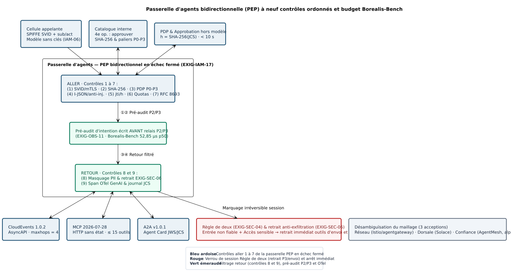
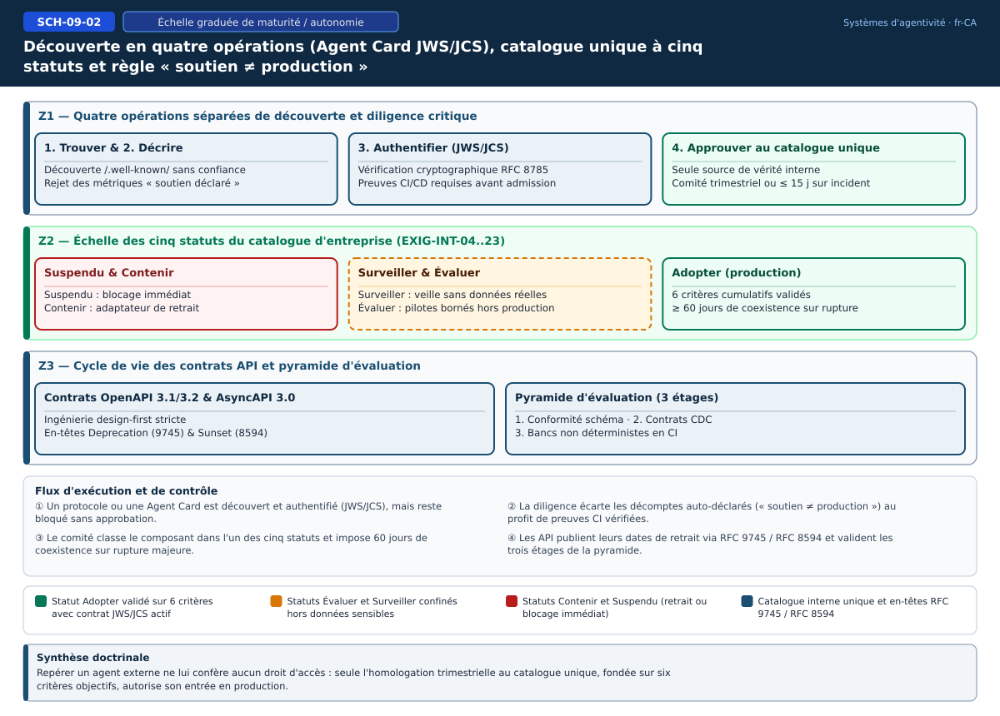
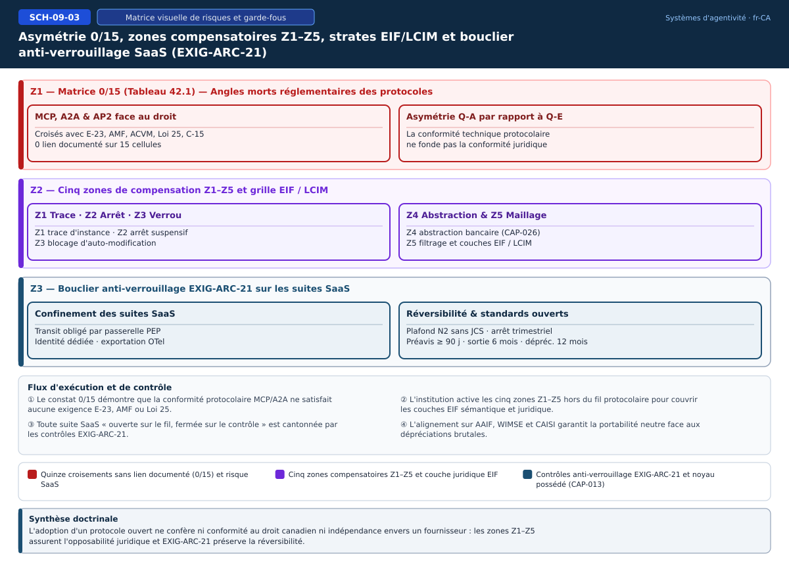
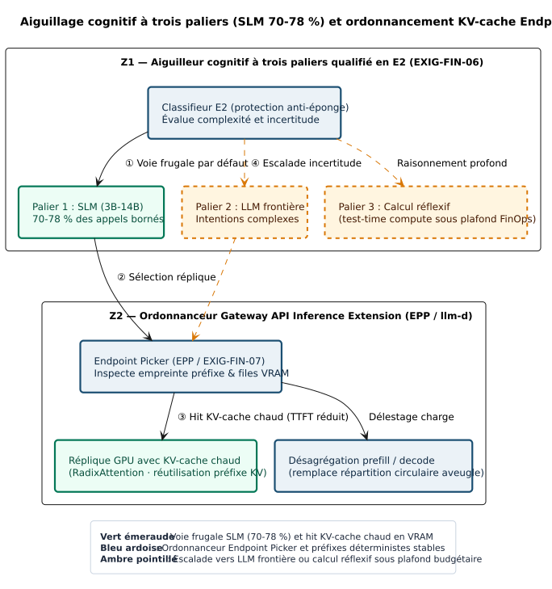

# Chapitre 09 — Passerelles PEP à neuf contrôles, découverte gouvernée, routage d'inférence et anti-verrouillage

*Question directrice : Comment unifier l'application des politiques de sécurité, la découverte des agents, l'aiguillage d'inférence et la prévention du verrouillage fournisseur sans transformer la passerelle en goulot d'étranglement opaque ?*

## 9.1 Médiation bidirectionnelle PEP à neuf contrôles et séparation des plans

Les chapitres précédents ont établi que ni l'axe vertical `MCP 2026-07-28` (Chapitre 07) ni l'axe horizontal `A2A v1.0.1` (Chapitre 08) ne portent nativement les garanties d'autorisation fine, d'auditabilité ou de conformité exigées en environnement réglementé. Pour résorber ce déficit sans dupliquer la logique de sécurité dans chaque agent probabiliste, l'architecture d'entreprise interpose un point d'application des politiques unique et bidirectionnel : la passerelle d'agents (`PEP`, `CAP-022`, `EXIG-ARC-01`, `EXIG-IAM-17`, `SBB-GUARDRAILS-ENGINE`). Tout trafic `MCP`, tout échange `A2A` sortant du domaine local et toute action classée aux paliers `P2` ou `P3` DOIVENT traverser cette passerelle en mode d'échec fermé (*fail-closed*). Seule une fonction locale de palier `P0` ou `P1` exécutée dans la même unité de déploiement et le même domaine, dûment inscrite au catalogue, peut s'en dispenser sous le contrôle strict de l'exigence `EXIG-IAM-17`.

Dans cette topologie inspirée de la confiance zéro (*Zero Trust*), aucune décision d'accès prise en début de session ne vaut autorisation permanente : chaque invocation est réévaluée requête par requête au passage de la frontière réseau (`EXIG-ARC-11`). L'agent d'un partenaire externe qui interroge l'entreprise et l'agent interne qui sollicite une suite infonuagique franchissent exactement la même frontière de confiance. L'évaluation des règles métier et sécuritaires demeure externalisée hors du modèle probabiliste auprès d'un point de décision déterministe (`PDP`) s'appuyant sur `OPA/Rego` (`default allow := false`) [8] ou `Cedar` (Chapitre 20). La passerelle agit ainsi comme le point de coupure obligatoire qui transforme des règles déclaratives en blocage effectif sur le fil.

Sur le plan architectural, la passerelle opère symétriquement comme mandataire inverse (*reverse proxy*) devant les serveurs `MCP` internes et les points d'accès `A2A` exposés aux partenaires, et comme mandataire sortant (*egress proxy*) pour toute requête émise vers des outils ou pairs externes. Si le service `PDP` ou le canal de diffusion des révocations et suspensions (`EXIG-IAM-18`) devient momentanément inaccessible, la passerelle bascule immédiatement en échec fermé et maintient en mémoire locale la liste de suspension signée la plus récente. Aucun projet métier ne peut déployer de passerelle parallèle ni ouvrir un accès direct contournant ce point d'application unique (`CAP-022`).

La séquence normative exécute neuf contrôles ordonnés à chaque traversée, décomposés en sept filtres à l'aller et deux filtres au retour (Figure 1). À l'aller, les quatre premiers contrôles sécurisent la frontière entrante. Le premier vérifie l'identité cryptographique de la charge de travail (`SPIFFE SVID`, `mTLS` ou `DPoP`), la signature de message HTTP (`RFC 9421`) [4] et la limitation de débit. Le deuxième valide l'inscription au catalogue interne unique et l'intégrité de l'empreinte `SHA-256` canonisée `JCS` (`RFC 8785`) [3]. Le troisième interroge le `PDP` sur le couple autonomie `N1–N4` et palier d'outil `P0–P3` [8]. Le quatrième contrôle applique la validation `I-JSON` (`JSON Schema Draft 2020-12`) [6] et le filtrage anti-injection bilingue.

Les trois contrôles suivants achèvent la séquence aller avant l'invocation aval. Le cinquième contrôle vérifie le jeton d'approbation (hors bande `CIBA` sur tout palier `P3`) et l'unicité atomique de `jti` lié au condensat `h = SHA-256(JCS)` lorsque l'opération `P2` ou `P3` l'exige, tout en retenant ce jeton à la passerelle hors de portée du modèle. Le sixième applique les quotas et budgets par session et par mandant. Le septième exécute l'échange de jetons à audience ciblée (`RFC 8693`) [2] avec rétention des secrets hors du modèle (`EXIG-IAM-19`) et écriture du pré-audit synchrone `EXIG-OBS-11` avant tout effet irréversible.

Au retour de l'outil ou du pair `A2A`, les contrôles (8) et (9) ferment le périmètre de fuite et assurent la traçabilité. Le huitième contrôle caviarde les renseignements personnels (`RP/PII`), marque toute donnée externe comme non fiable et applique de manière déterministe la *Règle de deux* (`EXIG-SEC-06`, implémentée notamment dans `policies_opa/rule_of_two.rego`) : dès qu'une session combine lecture d'entrée non fiable et accès à des données sensibles, tout outil d'exfiltration ou d'écriture `P3` lui est retiré jusqu'à la fin de la session. Le neuvième contrôle émet un *span* OpenTelemetry exempt de données brutes et scelle la trace probatoire en canonisation `JCS` [3] (Chapitre 22).

*Figure 1 — SCH-09-01 : Séquence des neuf contrôles ordonnés de la passerelle bidirectionnelle PEP, budget Borealis-Bench et désambiguïsation du maillage.*

L'objection récurrente opposée aux architectures à neuf contrôles concerne le surcoût de latence introduit sur le chemin critique. Pour y répondre par des mesures reproductibles sans extrapoler vers une infrastructure bancaire en exploitation, l'étalonnage interne `Borealis-Bench` (banc d'évaluation artificielle FEDS documenté dans la synthèse du corpus, distinct des essais Python et Rego de la trousse exécutable) mesure l'exécution en processus Go des neuf contrôles sur 2 000 requêtes. La latence médiane s'établit à `52,85 µs` (`p50`), pour `202,83 µs` au 95e centile (`p95`) et `234,06 µs` au 99e centile (`p99`), avec un plafond maximal observé de `255,94 µs`.

L'analyse poste par poste montre que la quasi-totalité de la moyenne en processus (`64,01 µs` sur `68,30 µs`) provient du filtre bilingue anti-injection, tandis que la validation `JSON Schema`, la vérification `DPoP`, l'échange de jetons et l'évaluation `OPA/Rego` s'exécutent en quelques microsecondes. Sur 1 000 requêtes locales transitant sur pile HTTP/TCP complète, le temps atteint `59,09 µs` (`p50`), `1 006,70 µs` (`p95`) et `3 523,10 µs` (`p99`). Il importe de distinguer rigoureusement cette latence intrinsèque en processus du budget cible d'architecture `[S]` pour la traversée synchrone `PEP` des opérations `P2` et `P3` (environ `35 ms` `p50` et `98 ms` `p95`, hors temps d'inférence du modèle et attente `CIBA`). Parallèlement, le coupe-circuit `POR-003` interrompt les mutations en moins de 10 s ; il est étalonné à `0,050 ms` au maximum en processus sur dix exercices concurrents sans fuite post-déclenchement.

| Segment de contrôle | Position dans le flux | Rôle normatif principal | Références clés |
|---|---|---|---|
| Contrôles 1 à 3 | Aller (entrée `PEP`) | `AuthN` (`RFC 9421`), catalogue `JCS SHA-256`, `PDP` `OPA/Cedar` | `EXIG-ARC-12`, `EXIG-IAM-17`, [3, 4, 8] |
| Contrôles 4 à 6 | Aller (validation) | Schéma `Draft 2020-12`, `jti`/`h` `CIBA`, plafonds budgétaires | `EXIG-SEC-04`, [6] |
| Contrôle 7 | Aller (sortie `PEP`) | Échange `RFC 8693` sans fuite au LLM, pré-audit `EXIG-OBS-11` | `EXIG-IAM-19`, [2] |
| Contrôles 8 et 9 | Retour (assainissement) | Masquage `RP/PII`, retrait `P3` (`EXIG-SEC-06`), trace `OTel`/`JCS` | `EXIG-SEC-06`, `POR-003`, [3] |

*Tableau 9.1 — Répartition des neuf contrôles ordonnés de la passerelle bidirectionnelle PEP.*

En parallèle, la médiation protocolaire doit empêcher tout contournement par le bus d'événements asynchrones (`EXIG-ARC-13`). Tout sujet produit ou consommé par un agent DOIT figurer au catalogue avec son contrat `CloudEvents 1.0.2` [7] et son schéma `AsyncAPI`, tandis que le courtier applique en bordure le même retrait des droits de publication qu'un outil d'envoi lors d'une session contaminée. Toute action `P2` ou `P3` déclenchée à la réception d'un événement retraverse obligatoirement la passerelle `PEP` (renvoi au Chapitre 14 pour la chorégraphie événementielle).

Parallèlement à la séquence `PEP`, le terme « maillage agentique » (*Agent Mesh*) recouvre trois réalités techniques qu'il faut dissocier pour éviter les erreurs d'achat et de déploiement (`maillage-agentique-trois-acceptions`). Premièrement, le **maillage réseau et passerelle** (`agentgateway` de Solo.io ou extensions `Istio` / `Envoy`, aux côtés de passerelles d'entreprise comme Azure API Management, Amazon Bedrock AgentCore Gateway, ContextForge ou Kong AI Gateway) assure le routage L7 des appels `MCP`, `A2A` et `LLM` à la bordure. Deuxièmement, la **dorsale événementielle** (`Solace Agent Mesh`) orchestre les flux asynchrones persistants `CloudEvents 1.0.2` [7] entre producteurs et consommateurs (Chapitre 14). Troisièmement, la **bibliothèque de confiance** (`AgentMesh` dans l'Agent Governance Toolkit de Microsoft, encore cotée *alpha* au gel) vise à embarquer identifiants, scores de confiance et délégations dans le code applicatif.

Surtout, un *service mesh* TCP/HTTP traditionnel (`Istio` ou `Envoy` nu) ne suffit jamais à gouverner un **Système d'agentivité**. Un maillage de microservices raisonne sur l'identité binaire d'un pod appelant un port réseau. À l'inverse, chaque appel agentique lie trois identités distinctes — l'usager humain mandant (`sub`), l'agent intermédiaire (`act`) [2] et le fournisseur d'outils — tout en exigeant une décision au grain fin du paramètre d'outil sur des trajectoires non déterministes. Seule la passerelle `PEP` couplée au `PDP` hors modèle possède la visibilité syntaxique nécessaire pour arbitrer ces trois dimensions.

Le présent chapitre détient la propriété exclusive des onze thèmes du sous-domaine transversal. La première famille réunit la découverte en quatre opérations (`agent-card-decouverte`), le catalogue d'entreprise unique (`contrats-interfaces-catalogue-entreprise`), les contrats d'API et la pyramide d'essai (`contrats-api-versionnement-conformite`), le plan de données d'inférence `KV-cache` (`plan-donnees-inference-kv-cache`) et le routage cognitif à trois paliers (`routage-cognitif-hybride-3-paliers`). La seconde famille regroupe le confinement anti-verrouillage (`anti-verrouillage-standards`), la passerelle `PEP` (`passerelle-mcp-ai-gateway`), les strates `EIF/LCIM` (`cadre-eif-4-couches`), la lecture critique des métriques de soutien (`metriques-soutien-vs-production`), les trois acceptions du maillage (`maillage-agentique-trois-acceptions`) et la matrice `0/15` (`matrice-protocoles-exigences-reglementaires`). En vertu du régime `non-avis` (`AO-05`), ces spécifications arrêtées au 2 décembre 2026 ne constituent ni un avis juridique ni une homologation réglementaire.

## 9.2 Découverte gouvernée, matrice compensatoire et routage d'inférence

### 9.2.1 Découverte Agent Card, catalogue unique et contrats d'API

L'interopérabilité à l'échelle de l'entreprise échoue dès que la recherche dynamique d'un partenaire sur le réseau se confond avec l'autorisation de l'appeler. Tirant les leçons de l'échec historique des annuaires ouverts de services Web (`UDDI`) dans les architectures `SOA`, l'architecture scinde la découverte en quatre opérations indépendantes et ordonnées (`agent-card-decouverte`) : **trouver** un candidat sur le réseau, **décrire** ses capacités et schémas, **authentifier** cryptographiquement l'émetteur de la fiche, puis **approuver** son usage dans le système d'information.

En pratique, les mécanismes ouverts de repérage — chemin bien connu `/.well-known/agent-card.json` (`RFC 8615`), proposition *Agentic Resource Discovery* (`ARD v0.91` du 26 août 2026) exposant `/.well-known/ard.json` avec recherche `POST /search` obligatoire et exploration par facettes facultative, ou travaux de normalisation IETF `DAWN` et `AGENTPROTO` — ne couvrent au mieux que les deux premières opérations. Même lorsque la fiche comporte une signature cryptographique répondant à la troisième opération, celle-ci établit l'authenticité technique du signataire sans jamais valoir habilitation d'exploitation. Aucun annuaire public ni aucune découverte automatique ne confère le droit d'invoquer un agent.

La quatrième opération — **approuver** — relève exclusivement du **catalogue d'entreprise unique** (`EXIG-INT-17`, `EXIG-ARC-12`), seule source de vérité alimentant la liste d'autorisation de la passerelle `PEP`. Toute liste locale propre à un projet ou maintenue dans un outil tiers finit inévitablement par diverger ; l'unicité du catalogue garantit au contraire qu'une décision de suspension ou de révocation retire partout, instantanément, un outil ou un pair compromis. Toute **Carte d'agent** (`A2A v1.0.1`) publiée sous `/.well-known/` reste exposée au typosquattage de domaine et à la substitution silencieuse tant qu'elle n'est pas vérifiée contre ce catalogue. Avant toute inscription, le dépositaire valide la structure `JSON Schema Draft 2020-12` [6], exige une signature `JWS` (`RFC 7515`) [1] calculée sur la représentation canonique `JCS` (`RFC 8785`) [3] selon le patron exécutable `validate_agent_card` de `harness_proto/a2a_card.py` (Chapitre 08), et consigne l'empreinte `SHA-256` ainsi que l'identifiant de clé `kid` dans un cache interne à durée bornée (`EXIG-A2A-02` à `EXIG-A2A-06`).

La veille sur la découverte s'appuie en parallèle sur le calendrier de l'IETF (`ANC-024` à `ANC-029`). Pour le groupe `AGENTPROTO`, les jalons annoncés ciblent l'adoption des brouillons de protocole de gestion de dialogue en mars 2027 puis la soumission comme norme proposée au 31 mars 2028. Pour le groupe `DAWN`, l'agenda prévoit une soumission optionnelle de terminologie au 30 juin 2027, suivie des spécifications protocolaires fin 2027 et des documents d'architecture au 31 janvier 2028. Tant que ces travaux demeurent à l'état de brouillons, aucune dépendance de production ne peut y être contractée.

Le catalogue unique classe chaque protocole, connecteur ou agent selon un cycle de vie fermé à cinq statuts formels (`contrats-interfaces-catalogue-entreprise`, `EXIG-INT-14`, `EXIG-GOV-18` à `EXIG-GOV-20`), représenté à la Figure 2 :

- **Adopter** : réservé aux standards ayant satisfait six critères cumulatifs (`EXIG-GOV-19` : spécification ouverte versionnée pourvue d'une politique de compatibilité et de retrait, pilotage multipartite neutre, publication stabilisée, existence de deux implémentations distinctes ou d'une suite de conformité automatisée en `CI`, modèle de sécurité documenté compatible avec le présent cadre, et licence libre de redevances), à l'instar de `MCP 2026-07-28` et `A2A v1.0.1`.
- **Évaluer** : ouvert uniquement aux pilotes bornés hors données sensibles sous adaptateur réversible (comme `OASF` et `ADS` d'`AGNTCY`).
- **Surveiller** : veille active sans trafic de production autorisé (`AP2 v0.2`, `SLIM/MLS`, `x402`, `ANP`, `IETF DAWN` et `AGENTPROTO` suivis via les jalons `ANC-024` à `ANC-029` entre mars 2027 et mars 2028).
- **Contenir** : maintien temporaire de solutions existantes sous plafond d'autonomie `N2` et plan de retrait daté (`EXIG-ARC-21` ou `MCP 2025-11-25` jusqu'à son extinction au 28 juillet 2027).
- **Suspendu** : blocage immédiat propagé à la passerelle `PEP` sur canal signé (`EXIG-IAM-18`), même en cas de perte du plan de contrôle.

Ce registre est révisé chaque trimestre en comité d'architecture, et sous au plus 15 jours ouvrables lorsqu'un incident ou une vulnérabilité survient (`EXIG-GOV-18`). Tout changement majeur d'interface ou bascule protocolaire impose une période de coexistence minimale de 60 jours (`EXIG-INT-14`) ainsi que le suivi nominatif des consommateurs actifs. Cette exigence de traçabilité des abonnés empêche de retirer un point d'accès tant qu'un agent métier dépend encore de l'ancienne version en production, assurant une migration maîtrisée plutôt qu'une rupture silencieuse.

Cette discipline est complétée sur les interfaces REST et événementielles par une ingénierie orientée contrat (*design-first*) sous `OpenAPI 3.1.x` / `3.2.x` et `AsyncAPI 3.0` (`contrats-api-versionnement-conformite`). Afin d'empêcher les retraits brusques, toute API dépréciée DOIT émettre l'en-tête normalisé **`Deprecation`** (`RFC 9745`) [5] — portant une date structurée (*Structured Field Date*, horodatage Unix) à titre d'indice de dépréciation, accompagné d'un en-tête `Link` (`rel="deprecation"`) vers la documentation de migration — ainsi que **`Sunset`** (`RFC 8594`), qui annonce la date d'arrêt définitif non antérieure à `Deprecation`. En complément de la `RFC 9745` [5], la politique interne de la passerelle relaie ces signaux vers l'observabilité afin d'alerter automatiquement les propriétaires d'agents avant la date de retrait.

La vérification de ces contrats dissocie rigoureusement la conformité isolée de l'interopérabilité relationnelle au moyen d'une pyramide d'essai à trois étages. Le premier étage contrôle la conformité syntaxique et sémantique isolée d'un serveur face à sa spécification (`OpenAPI`, `AsyncAPI`, `a2a-tck`). Le deuxième étage exécute des tests pilotés par le consommateur (*consumer-driven contract testing*) entre implémentations hétérogènes afin de détecter les divergences d'interprétation réelles sur le fil. Le troisième étage déploie des bancs de tâches non déterministes évaluant la réussite bout en bout des enchaînements agentiques avant toute promotion au statut `Adopter`.

Ce troisième étage confirme qu'une simple validation de schéma `JSON` ne garantit pas qu'un agent interprétera correctement le contrat métier dans des conditions de charge ou d'ambiguïté réelles. Seule la réussite cumulative des trois étages autorise l'inscription au statut `Adopter` et l'ouverture du routage en production derrière la passerelle `PEP`.

*Figure 2 — SCH-09-02 : Quatre opérations de découverte, cycle à cinq statuts du catalogue unique et diligence « soutien déclaré ≠ production ».*

En parallèle de ce tri technique, la gouvernance du catalogue applique une règle stricte de diligence métrique : **« soutien déclaré ≠ production »** (`metriques-soutien-vs-production`). Les annonces de consortiums publiées en 2025 et 2026 font état de plus de 150 organisations soutenant `A2A`, plus de 65 entreprises ralliées à `AGNTCY` et plus de 60 partenaires cités pour `AP2`. Or ces décomptes sont auto-déclarés, dépourvus de définition normalisée de ce que recouvre un « soutien » (simple mention de communiqué, expérimentation en laboratoire ou déploiement client) et relevés à des dates hétérogènes qui interdisent de les comparer entre eux. Aucun cas publié de niveau probatoire maximal ne documente encore `MCP` ou `A2A` en production bancaire à grande échelle au gel du 2 décembre 2026. L'architecte d'entreprise fonde donc l'inscription au statut `Adopter` sur la composition nommée des comités techniques, les résultats vérifiables de conformité et la présence d'adaptateurs de sortie, jamais sur le volume promotionnel des logos affichés.

### 9.2.2 Matrice 0/15, strates EIF/LCIM, anti-verrouillage SaaS et routage d'inférence

L'architecture relie la couche protocolaire aux obligations légales grâce à deux grilles analytiques complémentaires : l'échelle stratifiée `EIF / LCIM` (`cadre-eif-4-couches`) et la matrice à 15 cellules protocoles × régulation (`matrice-protocoles-exigences-reglementaires`), illustrées à la Figure 3. Le cadre européen d'interopérabilité (`EIF`), adossé à l'*Interoperable Europe Act* (`Règlement (UE) 2024/903`, entré en application le 12 juillet 2024 avec évaluation d'interopérabilité obligatoire applicable depuis le 12 janvier 2025 pour les services publics transfrontaliers européens), structure l'intégration en quatre couches : technique, sémantique (qui englobe la syntaxe), organisationnelle et juridique, traversées par une gouvernance transversale. En les croisant avec le modèle `LCIM` à sept niveaux (*Levels of Conceptual Interoperability Model* : sans interopérabilité, technique, syntaxique, sémantique, pragmatique, dynamique et conceptuelle) et la typologie d'interopérabilité intégrée, un constat s'impose : en 2026, `MCP 2026-07-28` et `A2A v1.0.1` couvrent efficacement les niveaux technique et syntaxique (`N + M`), mais se heurtent au verrou sémantique-pragmatique dès qu'il s'agit d'accorder les concepts métier (Chapitre 10) et les effets juridiques opposables (Chapitre 26).

Ce verrou s'exprime brutalement dans la matrice croisant trois familles protocolaires (`MCP`, `A2A`, `AP2`) avec cinq cadres réglementaires ou prudentiels canadiens (`BSIF E-23`, ligne directrice IA de l'`AMF`, `Avis 11-348` des `ACVM`, `Loi 25` article 12.1 et cadre bancaire ouvert issu du projet de loi `C-15`). Sur les 15 cellules résultantes, l'instruction probatoire relève exactement **0/15 lien documenté** : quatre absences cherchées directement en source et onze absences constatées au socle documentaire (`4 + 11 = 15`), formant une double partition qu'il convient de ne pas confondre avec la répartition des états de cellule (`6` cellules non vides consignant soit un fait négatif de vocabulaire, soit une prise technique insuffisante, contre `9` cellules vides). Fait notable, les textes dont les échéances sont les plus rapprochées — la `Loi 25` en vigueur depuis 2023, la ligne directrice `E-23` du BSIF et l'encadrement de l'AMF prenant effet le 1er mai 2027 — sont précisément ceux dont les croisements protocolaires restent les plus vides.

Il importe de formuler la portée exacte de ce constat sans l'exagérer. La matrice n'établit pas que `MCP`, `A2A` ou `AP2` violeraient les cadres canadiens examinés ; elle établit que la conformité n'est pas une propriété intrinsèque d'un format d'échange sur le fil. Le protocole résout la question technique `Q-A` (*qui émet le message sur le fil*), alors que le régulateur pose la question juridique `Q-E` (*quelle personne physique ou morale répond de la décision et comment l'expliquer ou la suspendre*). Aucun choix d'un meilleur protocole sur le fil ne peut refermer seul cet écart ; la compensation est structurelle et s'opère hors protocole dans l'architecture de contrôle.

Un phénomène comparable se vérifie dans l'étude des cadres internationaux d'interopérabilité et d'assurance qualité : les normes de gouvernance organisationnelle existent en parallèle des spécifications de transport, mais aucune norme internationale publiée au gel ne spécifie à la fois l'enveloppe réseau, la sémantique financière et l'imputabilité juridique d'un acte agentique. Cette séparation des plans confirme le rôle irremplaçable de la passerelle `PEP` comme point d'ancrage unique des mécanismes compensatoires.

Pour combler cet écart structurel indépendamment des évolutions attendues le 30 mars 2027 (`SEP-3398`) et le 28 juillet 2027 (`SEP-2596`), la passerelle `PEP` et son noyau environnant déploient **cinq zones de compensation hors fil (`Z1–Z5`)** :

- **Zone `Z1` (Identité d'instance et trace)** : chaque appel relie l'instance d'agent (`SPIFFE SVID`) au mandat utilisateur (`sub`/`act` `RFC 8693`) [2] et au journal scellé `JCS` [3] (Chapitres 16, 17 et 22).
- **Zone `Z2` (Arrêt et révision humaine)** : la suspension `CIBA` et les dossiers explicables garantissent le droit d'intervention et de réexamen exigé notamment par l'article 12.1 de la `Loi 25` (Chapitres 05 et 25).
- **Zone `Z3` (Blocage de l'auto-modification)** : les politiques hors modèle interdisent à un agent d'altérer ses propres bornes ou poids sans passage en fabrique homologuée (Chapitre 20).
- **Zone `Z4` (Abstraction bancaire ouverte `CAP-026`)** : aucune application financière critique ne dépend directement d'un format de commerce expérimental comme `AP2` (Chapitre 08).
- **Zone `Z5` (Filtrage par maillage et contenu)** : le contrôle d'intégrité `SHA-256` et la *Règle de deux* contrent les injections et l'empoisonnement que le format du protocole ne peut détecter (Chapitre 19).

*Figure 3 — SCH-09-03 : Matrice 0/15, zones compensatoires Z1–Z5, strates EIF/LCIM et confinement anti-verrouillage SaaS EXIG-ARC-21.*

Le même impératif d'indépendance fonde la doctrine **anti-verrouillage (`EXIG-ARC-21`, `PRI-015`, `CAP-013`, `DEC-007`)**. Le retrait effectif de l'*Assistants API* d'OpenAI le 26 août 2026 (après un préavis d'un an jour pour jour annoncé le 26 août 2025) illustre la vulnérabilité des entreprises couplées aux interfaces propriétaires à état géré par l'éditeur, tout comme le basculement progressif vers `/v1/responses` crée un risque de verrouillage inverse face à la portabilité de `/v1/chat/completions`. Plus largement, de nombreuses suites SaaS se déclarent « ouvertes sur le fil » en adoptant `MCP` ou `A2A`, tout en demeurant « fermées sur le contrôle » : journaux captifs, identités propriétaires non fédérables, catalogues déclaratifs isolés et politiques verrouillées dans le nuage de l'éditeur.

Pour empêcher cette capture architecturale sans paralyser les métiers, l'exigence `EXIG-ARC-21` (rectifiée dans la concordance `DIV-02` depuis la coquille historique `EXIG-ARC-02`) soumet toute suite SaaS agentique à six contrôles compensatoires obligatoires. Premièrement, tout accès d'un agent SaaS aux systèmes d'enregistrement internes DOIT transiter par la passerelle `PEP` comme client externe non privilégié. Deuxièmement, l'agent externe opère sous une identité non humaine distincte et révocable instantanément par l'entreprise. Troisièmement, la suite exporte ses traces vers le collecteur OpenTelemetry interne afin de préserver la souveraineté d'audit.

Quatrièmement, chaque connecteur SaaS confiné réussit un **test d'arrêt trimestriel** fixé par `EXIG-ARC-21` et `EXIG-SEC-26` afin de prouver la continuité d'activité en cas de coupure ou de sortie, conformément aux exigences de continuité et de réversibilité de la ligne directrice `B-10` du BSIF [10]. Cet exercice vérifie en conditions réelles la révocation du jeton dédié en passerelle, le basculement vers le traitement manuel ou local de repli et la récupération complète des journaux d'audit sans perte de trace. Cinquièmement, son autonomie reste plafonnée au niveau `N2` en l'absence de scellement `JCS` vérifiable, excluant toute délégation irréversible non contresignée. Sixièmement, les clauses d'approvisionnement (Chapitre 27) imposent un préavis écrit minimal de 90 jours avant tout changement ou retrait de modèle (`EXIG-APP-13`) ainsi qu'une période cible de transition de six mois en réversibilité (`EXIG-APP-14`), en phase avec le suivi des fenêtres de dépréciation de 12 mois côté standards (`MCP SEP-2596`) et des travaux de l'`AAIF`, de `WIMSE` et de `NIST CAISI`.

Ce confinement empêche qu'un éditeur de suite logicielle ne transforme l'ouverture syntaxique d'un connecteur `MCP` ou `A2A` en rente captive sur les politiques de sécurité, l'identité des agents ou l'historique d'exploitation. En conservant la passerelle `PEP`, le catalogue unique et la télémétrie dans le noyau possédé par l'entreprise, le changement de plateforme ou de fournisseur de modèles demeure une opération d'ingénierie bornée plutôt qu'une refonte systémique.

Enfin, l'architecture unifie sous la passerelle d'entreprise la médiation vers les serveurs de modèles grâce au **plan de données d'inférence sensible au `KV-cache`** (`plan-donnees-inference-kv-cache`) et au **routage cognitif à trois paliers** (`routage-cognitif-hybride-3-paliers`, `ADR-014`, `O-10`, `O-11`, `EXIG-FIN-06`, `EXIG-FIN-07`), représentés à la Figure 4. Un répartiteur HTTP circulaire (*round-robin*) classique détruit la localité mémoire des préfixes système communs entre requêtes, obligeant les cartes GPU à recalculer intégralement les vecteurs d'attention (*prefill*) à chaque appel. Ce gaspillage alourdit la latence et gonfle la facture de calcul dès que les invites système et les schémas d'outils dépassent plusieurs milliers de jetons.

L'adoption de l'extension normalisée Kubernetes **Gateway API Inference Extension** (`InferencePool` et sélecteur `Endpoint Picker`, `EPP`, mise en œuvre notamment dans `llm-d 1.0` et `SGLang RadixAttention`) permet à la passerelle de diriger chaque requête vers la réplique de modèle qui détient déjà le préfixe chaud en mémoire vidéo (`KV-cache`) tout en tenant compte de la saturation de file d'attente et de l'occupation mémoire (`VRAM`). Couplée à la désagrégation *prefill/decode* et à la hiérarchisation multi-niveaux du cache, cette affinité réduit nettement le temps jusqu'au premier jeton (`TTFT`) et la consommation énergétique par transaction. Sur le plan de l'exploitation, la passerelle communique avec l'`EPP` au moyen du protocole de traitement externe d'Envoy, séparant ainsi le filtrage réseau de l'ordonnancement fin des serveurs de modèles.

Cette séparation impose toutefois une distinction nette entre deux modes de déploiement. Une configuration autonome exécutée dans un processus adjacent convient aux déploiements mono-locataires ou dédiés à une tâche isolée, mais ne gère pas la ressource `InferencePool`. Pour les déploiements d'entreprise partagés, la passerelle conforme à Gateway API interroge le service `EPP` dédié qui sélectionne dynamiquement le point d'accès optimal de l'`InferencePool` selon l'état réel de la file et du cache de préfixes.

*Figure 4 — SCH-09-04 : Routage cognitif à trois paliers (SLM 70–78 %, LLM frontière, calcul réflexif) et ordonnancement KV-cache EPP.*

Au-dessus de ce plan d'inférence, l'aiguilleur cognitif ventile les requêtes entrantes entre trois paliers calibrés sur banc hermétique `E2` (Chapitre 23) et désignés exclusivement par alias logiques dans la passerelle (`EXIG-ARC-09`) :

- **Palier 1 — Petits modèles spécialisés (`SLM`, `3B–14B`)** : conformément aux travaux de Belcak et collègues (`arXiv:2506.02153`) [9] — qui qualifient de petits modèles ceux de moins de `10B` paramètres et estiment de `40 %` à `70 %` la part de sous-tâches agentiques substituables sur trois systèmes évalués —, l'architecture cible `[S]` calibre des `SLM` spécialisés `3B–14B` pour absorber de `70 %` à `78 %` des appels sur des tâches répétitives et bornées.
- **Palier 2 — Modèles généralistes frontière (`LLM`)** : réservés aux requêtes présentant une ambiguïté contextuelle ou une synthèse multi-sources dépassant le seuil de confiance du palier 1.
- **Palier 3 — Calcul réflexif (*test-time compute*)** : mobilisé uniquement sur les arbitrages critiques ou vérifications complexes sous enveloppe budgétaire stricte.

Cet aiguillage est protégé par trois garde-fous déterministes. Premièrement, la décision d'escalade repose sur une calibration vérifiée des log-probabilités (ou classificateurs étalonnés en `E2`), tout routeur fragile face aux reformulations syntaxiques étant écarté : une reformulation équivalente d'une même requête métier ne doit jamais provoquer une dérive erratique vers un palier plus onéreux. Deuxièmement, des plafonds de jetons et de coût par requête neutralisent les attaques d'éponge budgétaire (*sponge attacks*) visant à forcer l'escalade systématique vers le palier 3. Troisièmement, la désignation par alias logique en passerelle (`EXIG-ARC-09`) permet la bascule entre modèles ou fournisseurs par configuration sans modification du code métier, tandis que la trousse exécutable (`harness_proto/pipeline.py`, `harness_proto/jcs.py`, `harness_proto/a2a_card.py` et `policies_opa/rule_of_two.rego`) vérifie de manière déterministe la validation de schéma, l'épinglage `MCP`, la canonisation `JCS`, la signature d'*AgentCard* et la *Règle de deux* `OPA` hors modèle. De surcroît, cette gouvernance centralisée ferme le contournement *Shadow AI* en ramenant 100 % des appels modèles sous les quotas FinOps et les filtres de conformité.

L'association de l'aiguillage vers les petits modèles spécialisés (`SLM`) et de l'affinité `KV-cache` portée par `Endpoint Picker` résout simultanément deux tensions majeures de l'architecture : elle abaisse le coût marginal par résultat conforme (renvoyé au Chapitre 24) tout en conservant la réversibilité immédiate des fournisseurs d'inférence derrière des alias logiques stables.

| Palier d'inférence | Part cible du trafic | Critère d'aiguillage | Garde-fou `EXIG-FIN-06/07` |
|---|---|---|---|
| Palier 1 : `SLM` (`3B–14B`) | `70 %` à `78 %` `[S]` (fondé sur [9]) | Tâches bornées, schémas fermés | Parité `pass^5` vérifiée en `E2`, affinité `KV-cache` `EPP` |
| Palier 2 : `LLM` frontière | `17 %` à `24 %` `[S]` | Ambiguïté sémantique, synthèse multi-actes | Alias logique découplé, plafonds de jetons et débit |
| Palier 3 : Calcul réflexif | `3 %` à `7 %` `[S]` | Arbitrages complexes à fort impact | Budget dur anti-éponge, coupe-circuit `POR-003` |

*Tableau 9.2 — Répartition opérationnelle du routage cognitif à trois paliers et garde-fous d'inférence.*

## 9.3 Synthèse opérationnelle, livrables et frontières du Chapitre 09

L'intégration de la passerelle `PEP` à neuf contrôles, du catalogue unique à cinq statuts, du confinement `EXIG-ARC-21` et du routage d'inférence sensible au `KV-cache` transforme des protocoles syntaxiques hétérogènes en un plan d'accès gouverné de bout en bout. Quatre livrables concrétisent ce contrat exécutable.

Le premier livrable porte sur le déploiement de la passerelle bidirectionnelle `PEP` en mode d'échec fermé, accompagnée des repères d'étalonnage `Borealis-Bench` (`52,85 µs` `p50` en processus) et du budget cible `[S]` d'environ `98 ms` au `p95` en traversée synchrone `PEP` (hors inférence et `CIBA`) avec coupure `< 10 s`. Le deuxième livrable correspond au catalogue interne trimestriel à cinq statuts, assorti des preuves `JWS`/`JCS` des cartes autorisées, du respect des en-têtes `Deprecation`/`Sunset` et de la coexistence minimale de 60 jours (`EXIG-INT-14`, `EXIG-INT-17`). Le troisième livrable réunit le tableau de bord de routage cognitif et d'affinité `Endpoint Picker` validant la part cible `SLM` `[S]` (`70 %` à `78 %`) sans dégradation sous reformulation. Le quatrième livrable formalise la fiche compensatoire `Z1–Z5` et le procès-verbal du test d'arrêt trimestriel `EXIG-ARC-21` aligné sur les exigences de continuité de la ligne directrice `BSIF B-10` [10] pour chaque suite SaaS confinée.

| Exigence ou artefact | Objet de contrôle | Seuil ou règle exécutable | Chapitre partenaire |
|---|---|---|---|
| `CAP-022`, `EXIG-ARC-01`, `EXIG-IAM-17..19` | Passerelle `PEP` à 9 contrôles | Échec fermé, `52,85 µs` `p50` interne, coupure `< 10 s` | `→ CH-20`, `→ CH-22` |
| `EXIG-INT-14/17`, `EXIG-GOV-18..20` | Catalogue unique à 5 statuts | Revue trimestrielle (`≤ 15 j` sur incident), coexistence `≥ 60 j` | `← CH-07`, `← CH-08` |
| `ADR-014`, `O-10`, `O-11`, `EXIG-FIN-06/07` | Routage 3 paliers et `EPP` | `70–78 %` `SLM` `[S]` [9], affinité `KV-cache`, anti-éponge | `→ CH-23`, `→ CH-24` |
| `EXIG-ARC-21`, `PRI-015`, `DEC-007` | Confinement SaaS et `Z1–Z5` | Test d'arrêt trimestriel [10], plafond `N2`, préavis `≥ 90 j` / sortie `6 mois` | `→ CH-25/26/27`, `→ CH-32` |

*Tableau 9.3 — Matrice des contrôles transversaux du Chapitre 09 et articulations inter-chapitres.*

Sur le plan de la transition temporelle, ces livrables préparent directement les deux jalons MCP de 2027 : la publication cible `SEP-3398` du 30 mars 2027 et la fin de fenêtre de dépréciation `SEP-2596` du 28 juillet 2027. En centralisant l'épinglage, les alias de modèles et les listes d'admission au sein de la passerelle `PEP` et du catalogue unique, l'organisation absorbe ces évolutions par simple mise à jour de configuration gouvernée sans réécrire les agents métier.

Dans la partition `owned_concepts` du traité, le Chapitre 09 reçoit l'assise de la doctrine `80/20` (← Chapitre 04) et du noyau de contrôle possédé (← Chapitre 06) pour gouverner la médiation des protocoles verticaux (← Chapitre 07) et horizontaux (← Chapitre 08). Il délègue à la **Partie IV (`D04`)** l'accord sémantique métier, la mémoire `CoALA` et l'encapsulation patrimoniale (→ Chapitre 10), au Chapitre 14 (`→ CH-14`) la chorégraphie asynchrone sur `Event Mesh`, au Chapitre 20 (`→ CH-20`) la rédaction des politiques `OPA/Rego` et de la *Règle de deux*, au Chapitre 22 (`→ CH-22`) l'instrumentation `OpenTelemetry` et le scellage `SCITT`, et au Chapitre 24 (`→ CH-24`) la comptabilité FinOps `FOCUS v1.4` et `CPO`. Il renvoie enfin aux Chapitres 25, 26 et 27 (`→ CH-25`, `→ CH-26`, `→ CH-27`) les fondements juridiques et les clauses contractuelles `EXIG-APP-07..16`, ainsi qu'au Chapitre 32 (`→ CH-32`) la parade contre la capture par rente SaaS.

> **Trois invariants exécutables — Chapitre 9**
>
> 1. **Passage obligé PEP à neuf contrôles en échec fermé (`CAP-022`, `EXIG-ARC-01`)** : Tout appel `MCP`, `A2A` ou `P2`/`P3` traverse la passerelle bidirectionnelle exécutant les sept contrôles aller et les deux contrôles retour (dont le retrait `P3`/exfiltration sous *Règle de deux* `EXIG-SEC-06`), sous politique `default allow := false` et coupe-circuit `< 10 s`.
> 2. **Séparation découverte / approbation au catalogue unique (`EXIG-INT-17`, `EXIG-A2A-02..06`)** : Aucune carte `/.well-known/` ni métrique promotionnelle (« soutien déclaré ≠ production ») ne fait foi ; seule l'approbation inscrite au catalogue à cinq statuts (avec signature `JWS`/`JCS`, en-têtes `RFC 9745`/`8594` et coexistence `≥ 60 j`) autorise l'appel.
> 3. **Compensation `Z1–Z5`, routage `EPP` et confinement SaaS (`EXIG-ARC-21`)** : L'asymétrie réglementaire `0/15` est comblée hors fil par `Z1–Z5`, le routage `EPP` préserve l'affinité `KV-cache` sur trois paliers (`SLM 70–78 %`), et toute suite SaaS reste confinée sous identité propre, export `OTel`, plafond `N2` et test d'arrêt trimestriel.
