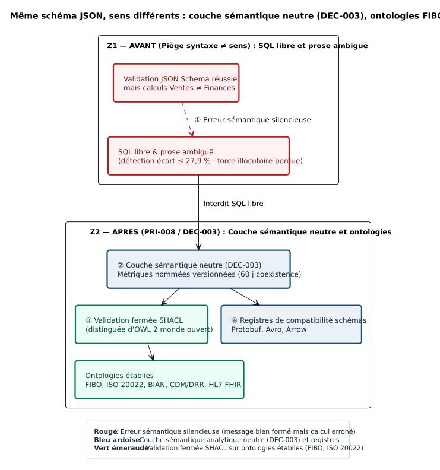
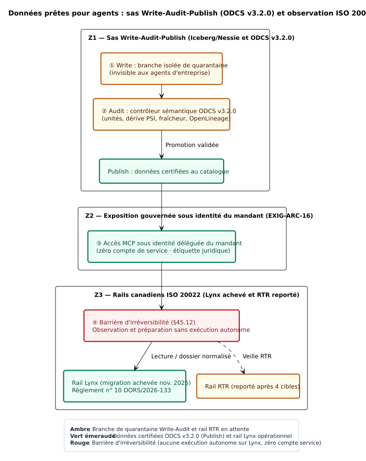
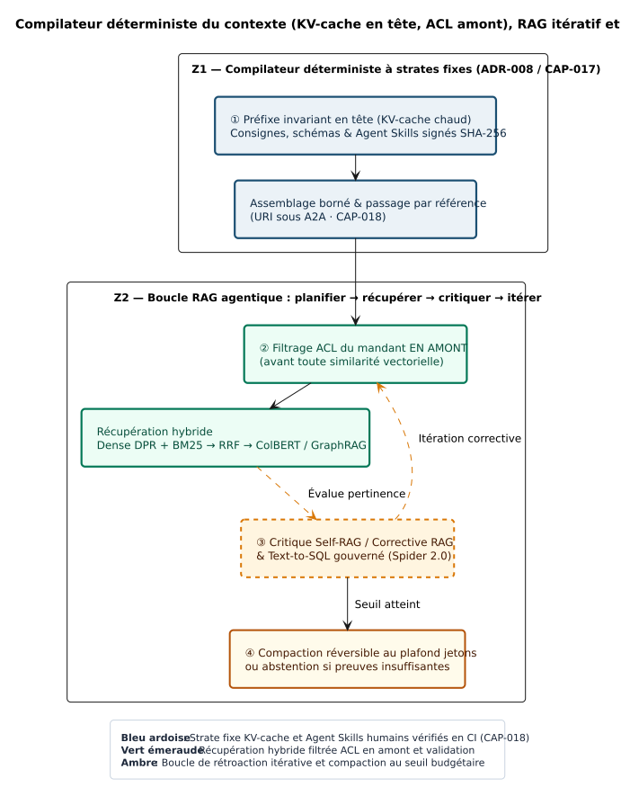

# Chapitre 10 — Sémantique métier, ontologies financières, contrats de données ODCS et compilation du contexte

*Question directrice :* Comment éliminer les erreurs sémantiques silencieuses entre Systèmes d'agentivité, garantir l'intégrité et l'habilitation des données consommées en entrepôt et compiler une fenêtre contextuelle déterministe sans dilution attentionnelle ?

---

## 10.1 Problématique sémantique, écart accord-compréhension et données prêtes pour l'agent

L'interopérabilité protocolaire assurée par les couches de transport verticales et horizontales règle la syntaxe des échanges sans jamais garantir la convergence du sens métier. Deux Systèmes d'agentivité peuvent émettre et recevoir des charges JSON conformes à un contrat `JSON Schema Draft 2020-12` [1] tout en attribuant des règles de calcul incompatibles au même indicateur financier. Une erreur syntaxique produit un rejet immédiat à la frontière du harnais. Une divergence sémantique produit au contraire une réponse bien formée que l'agent aval ou le décideur humain traite comme un fait avéré.

Dans un cas typique entre services, l'agent des ventes et l'agent des finances échangent un objet JSON valide comportant le champ « revenu du trimestre ». Le premier agrège les commandes signées hors taxes avant facturation, tandis que le second applique les règles de reconnaissance comptable des produits encaissés nets d'avoirs. Une erreur de format équivaut à une enveloppe déchirée rejetée par le tri postal. Une erreur sémantique équivaut à une lettre dûment affranchie contenant une facture libellée en dollars américains mais interprétée en dollars canadiens.

> **Clause non-avis (`AO-05`)** — Conformément à la clause `non-avis` (`AO-05`) arrêtée au gel documentaire du 2 décembre 2026, les dispositions législatives et prudentielles analysées ici demeurent une référence technique d'architecture (← Partie III, Chapitre 09). Cette analyse — incluant la Loi 25 du Québec [4], la ligne directrice E-23 du BSIF [5], les lois bancaires canadiennes [6] et le cadre canadien sur les services axés sur les consommateurs [7] — ne vaut ni avis juridique ni certification réglementaire.

La racine du problème réside dans l'écart structurel entre l'accord protocolaire et la compréhension opérationnelle. Les protocoles contemporains tels que `MCP` et `A2A` transportent des enveloppes typées et des statuts de cycle de vie, mais ils présupposent l'accord sémantique au lieu de l'établir formellement. Contrairement aux langages historiques de communication entre agents comme `FIPA-ACL SC00037J` ou `KQML`, qui explicitaient la force illocutoire d'un message (*inform*, *request*, *propose*), les invocations contemporaines confient l'intention et les effets réels à des descriptions en prose libre lues par le modèle à l'inférence.

Cette sémantique lue par le modèle crée une asymétrie critique par rapport à un contrat d'interface applicative classique. Le schéma valide rigoureusement la présence et le type des champs d'entrée ou de sortie, mais rien n'oblige le code exécuté derrière l'outil à correspondre à la promesse rédigée en langage naturel. Une description imprécise provoque d'abord des erreurs bénignes de sélection d'outil ou d'arguments. Elle ouvre ensuite une surface exploitable de description trompeuse dont les implications adverses sont étudiées au Chapitre 19.

Les travaux d'évaluation disponibles à fin 2026 confirment cette limite structurelle. Prolongeant le diagnostic à trois plans (communication, syntaxe, sémantique) formulé par `Yuan et coll. (2026)` sur l'écart entre accord protocolaire et compréhension réelle, une prépublication d'un auteur unique, non évaluée par les pairs, rapporte sur `600` exécutions simulées sans vrais appels de modèle une précision de détection des conflits sémantiques plafonnant à `27,9 %`. En exploitation industrielle, aucune couche probabiliste de vérification postérieure ne compense l'absence d'un référentiel sémantique univoque en amont. L'organisation qui expose ses données ou ses outils métier à des Systèmes d'agentivité sans définition gouvernée déplace la variabilité linguistique au cœur de ses calculs financiers.

Pour résorber cette vulnérabilité, la doctrine architecturale du Domaine `D04` s'appuie sur trois verrous complémentaires. Le premier verrou institue une **couche sémantique métier** neutre gouvernée comme du code. Le deuxième encadre l'approvisionnement analytique par des contrats de données `ODCS v3.2.0` vérifiés dans un sas `Write-Audit-Publish`. Le troisième déploie un compilateur déterministe du contexte optimisant le cache préfixe (`KV-cache`) et propageant les habilitations en amont, avec charges validées selon `JSON Schema Draft 2020-12` [1] et canonisées par `JCS` [3].

## 10.2 Architecture sémantique, contrats ODCS et compilation déterministe du contexte

### 10.2.1 Ontologies métier (FIBO), résolution DEC-003 et contrats ODCS en sas Write-Audit-Publish

La maîtrise du sens impose d'abord d'interdire la génération de requêtes `SQL` libres par les modèles sur les indicateurs réglementés, les états financiers ou les seuils de conformité (`PRI-008`, `EXIG-INT-02`, `EXIG-INT-13`, `EXIG-INT-14`). Lorsque plusieurs agents interrogent directement des tables relationnelles brutes, chacun réinvente les jointures, les filtres d'exclusion de comptes clos et les fenêtres calendaires. De la même façon, dans un progiciel de gestion, la polysémie d'un champ technique tel que le stock brut en magasin par rapport au stock net allouable conduit à des décisions commerciales erronées si la distinction n'est pas formalisée.

La **couche sémantique métier** (`CAP-015`, dont la révision suit le signal d'ouverture sectorielle `SIG-110`, et `CAP-016`) centralise donc les définitions canoniques d'entités, de mesures, d'unités monétaires, de devises et de règles d'agrégation dans un dépôt versionné soumis à revue de code et à tests de non-régression. L'agent ne rédige plus de requête sur les tables physiques ; il invoque une métrique nommée accompagnée de paramètres bornés. Tout changement de signification métier d'un champ ou d'un ratio déclenche un incrément de version majeure, une fenêtre de coexistence minimale de `60` jours (`EXIG-INT-14`, distincte du signal de veille `SIG-110`) et une réapprobation des façades `MCP` consommatrices décrite au Chapitre 07.

Cette exigence de neutralité a conduit le Compendium à trancher une dissonance documentaire interne concernant l'outillage analytique (`ADR-009`). Une première option envisageait de lier la couche sémantique au projet en incubation `Apache Ossie 0.1.1`, format d'échange entré en incubation en juin 2026 et dépourvu de moteur d'interrogation ou d'exécution. Or, un exemple illustratif du corpus antérieur mentionnait à tort une version `1.0.0` inexistante, tandis qu'une branche `0.3.0.dev0` demeurait impropre à la production. La décision architecturale `DEC-003` résout cette tension en dissociant le référentiel sémantique déclaratif — maintenu au format neutre sous gestion de versions — des moteurs d'exécution ou d'entrepôt qui l'interprètent. L'institution satisfait ainsi l'objectif sémantique visé par la porte `PRR G-09` (dont le couplage à `Ossie` est écarté par `DEC-003`) tout en préservant son indépendance technologique.

Dans les domaines financiers et assurantiels à forte densité réglementaire, la couche sémantique analytique s'adosse aux ontologies sectorielles établies. Celles-ci incluent `FIBO` (*Financial Industry Business Ontology*) pour les instruments et entités juridiques, `BIAN` pour les capacités bancaires, `ISO 20022` pour la messagerie de paiement, `CDM`/`DRR` pour les dérivés, `ACORD` et `MISMO` pour l'assurance et le crédit hypothécaire, ainsi que `HL7 FHIR` pour la santé. Sur le plan technique, la pile du Web sémantique mobilise `RDF`, `RDFS`, `SKOS` et `JSON-LD`, ce dernier agissant comme format de sérialisation transversal de `RDF` plutôt que comme couche logique supérieure.

À l'intérieur de cette pile, l'architecte maintient une séparation stricte entre deux régimes formels. L'inférence `OWL 2` opère sous hypothèse du monde ouvert (*Open World Assumption*) et convient à l'alignement conceptuel entre schémas hétérogènes par médiation `GAV`/`LAV`/`OBDA`. À l'inverse, la validation `SHACL` ou `ShEx` opère sous hypothèse du monde clos (*Closed World Assumption*), ce qui la rend indispensable aux portes de contrôle déterministes pour rejeter immédiatement toute donnée incomplète, hors unité ou incompatible avec une règle métier.

*Figure 34 — SCH-10-01 : Même schéma JSON, sens différents : couche sémantique neutre (DEC-003), ontologies FIBO et registres.*

Comme l'illustre la Figure 34 (`SCH-10-01`), la gouvernance sémantique s'articule étroitement avec le choix des formats d'échange et des registres de schémas. Les flux textuels (`JSON`, `YAML`), les formats binaires contractuels (`Protobuf`, `Avro`), les formats colonnaires persistants (`Parquet`, `ORC`) et les représentations en mémoire (`Apache Arrow`, `Flight SQL`, `ADBC`) répondent à des contraintes distinctes de débit, d'évolution et de coût de sérialisation. Chaque registre de schémas ou catalogue ouvert (`Iceberg REST Catalog`, `Polaris`, `Unity Catalog OSS`, `Gravitino`) applique l'un des quatre régimes de compatibilité — descendante, ascendante, complète ou transitive — afin d'empêcher qu'un producteur de données ne rompe silencieusement les consommateurs agentiques en aval.

| Famille de format | Représentation type | Régime de compatibilité recommandé | Usage privilégié en `D04` |
|---|---|---|---|
| Textuel structuré | `JSON` / `JSON Schema 2020-12` [1] | Complète ou descendante stricte (`additionalProperties: false`) | Façades `MCP`, cartes `A2A`, validation de contrats d'outils |
| Binaire contractuel | `Protobuf` / `Avro` | Transitive complète sur registre centralisé | Bus événementiels, télémétrie et contrats `Dataspace` |
| Colonnaire analytique | `Parquet` / `ORC` sous `Iceberg` | Évolution de schéma traçable par branche `WAP` | Entrepôts lacustres et couloirs d'audit gouvernés |
| Mémoire vectorisée | `Apache Arrow` / `Flight SQL` / `ADBC` | Schéma typé immuable par session | Transfert à copie nulle entre moteur analytique et couche sémantique |

*Tableau 10.1 — Régimes de sérialisation, compatibilité de registre et usages dans la couche sémantique.*

En amont de la couche sémantique, l'exposition d'entrepôts de données à des Systèmes d'agentivité requiert des données véritablement prêtes pour l'agent (*agent-ready data*). Quatre garanties cumulatives conditionnent cette exposition (`CAP-020`, `ADR-030`, `PRR F-13`, `EXIG-ARC-16`, `EXIG-INT-12`, `EXIG-INT-19`). Premièrement, chaque table, colonne et règle d'agrégation relève d'un propriétaire métier identifié et nommé. Deuxièmement, un contrat de données `ODCS v3.2.0` formalise la structure, les seuils de qualité, le lignage `OpenLineage` et les indicateurs de fraîcheur au-delà d'un simple paramètre technique `ttlMs`. La norme propriétaire `ISO/IEC 25012` sur la qualité des données n'a pas été consultée et demeure hors du socle probatoire ouvert en raison de son accès payant ; les contrôles opérationnels reposent donc sur les contrats ouverts `ODCS` et `JSON Schema` [1].

Troisièmement, toute ingestion analytique traverse un sas *Write-Audit-Publish* (`WAP`) sur branches transactionnelles isolées (`Apache Iceberg` et `Project Nessie`). Ce mécanisme agit comme une chambre de quarantaine avant mise à disposition : tant que le contrôleur sémantique déterministe n'a pas certifié les unités, contenu la dérive statistique mesurée par l'indice `PSI`, propagé le signal `staleness` de fraîcheur et scellé le lignage `OpenLineage`, les partitions brutes restent invisibles aux agents d'entreprise. Les écarts mineurs sont arbitrés de façon bornée avant toute promotion atomique (*Publish*) vers le catalogue consommable.

Quatrièmement, chaque actif reçoit dès l'ingestion des étiquettes immuables d'entité juridique, de finalité consentie et de cloisonnement inter-filiales (`PRI-010`, `PEX-041`, `EXIG-CON-06`). Lors des interrogations en production, toute lecture `MCP` vers l'entrepôt DOIT s'exécuter exclusivement sous l'identité déléguée du mandant effectif propagée via le protocole `OBO` examiné au Chapitre 17, sans jamais basculer silencieusement vers un compte de service sur-privilégié (`EXIG-ARC-16`). Ce respect des `5` points de rupture potentiels d'héritage `ACL` est vérifié par des tests actifs d'intrusion sur chaque serveur `MCP` d'entrepôt.

Ces garanties s'arriment directement aux exigences juridiques et prudentielles applicables au Canada et au Québec. Sous les articles `239` et `245` de la Loi sur les banques [6], les livres comptables et registres clients doivent demeurer conservés au Canada ou, dans les cas d'exception prévus, demeurer accessibles de façon immédiate, directe, complète et continue au surintendant ; le lignage `OpenLineage` et les contrats `ODCS` documentent précisément cette chaîne de localisation. Au Québec, l'article `12.1` de la Loi 25 [4] encadre les décisions fondées exclusivement sur un traitement automatisé, tandis que l'article `17` impose une évaluation des facteurs relatifs à la vie privée (`ÉFVP`) avant tout transfert hors du territoire, exigence détaillée au Chapitre 25. À l'échelle fédérale, la ligne directrice `E-23` du BSIF — qui entrera en vigueur le `1er mai 2027` [5] — prescrit l'intégration du risque lié à la fiabilité des données d'entrée proportionnellement au degré d'autonomie du modèle.

*Figure 35 — SCH-10-02 : Données prêtes pour agents : sas Write-Audit-Publish (ODCS v3.2.0) et observation ISO 20022 (Lynx et RTR).*

La Figure 35 (`SCH-10-02`) prolonge cette chaîne vers les rails de paiement canadiens `ISO 20022`, domaine où la rigueur chronologique évite toute confusion entre infrastructure opérationnelle et chantiers en cours. Selon les communications de Paiements Canada consolidées au gel documentaire, la migration du système de paiement de grande valeur `Lynx` vers `ISO 20022` a été achevée le `22 novembre 2025`. À l'inverse, le système de paiement en temps réel (`RTR`) demeure au stade préparatoire : sa cible annoncée au quatrième trimestre `2026` fait suite à quatre cibles successives relevées par corroboration secondaire (`2019`, `2022`, `2023` et `2026`), sans lancement effectif constaté au 2 décembre 2026. Son socle réglementaire préalable, le *Règlement administratif n° 10* (*By-law No. 10*, `DORS/2026-133`), a été enregistré le `18 juin 2026`, paru le `1er juillet 2026` dans la partie II de la *Gazette du Canada*, et est entré en vigueur le `24 août 2026`.

Dans l'architecture de référence, cette réalité dicte une règle de découplage absolu : le Système d'agentivité observe les flux `ISO 20022`, normalise les bordereaux et prépare les dossiers de réconciliation, mais une frontière d'irréversibilité infranchissable lui interdit d'exécuter un virement directement sur `Lynx` ou de tenir des mandats `AP2` sur `RTR` pour acquis avant le lancement réel de ce rail. Parallèlement, l'article `171` du cadre législatif fédéral sur l'ouverture bancaire (« Loi sur les services bancaires axés sur les consommateurs » [7], `LSAC`, `L.C. 2026, ch. 3`, art. `224`) prévoit l'interdiction du grattage d'écran client à l'aide des justificatifs de l'usager (disposition adoptée mais non encore en vigueur au gel documentaire), orientant l'architecture vers des interfaces normalisées et accréditées détaillées au Chapitre 12.

Pour garantir l'intégrité continue de cette chaîne analytique, les contrôles du sas `Write-Audit-Publish` s'articulent étroitement avec la gouvernance des métriques. Lorsqu'un flux source dérive statistiquement au-delà du seuil `PSI` fixé au contrat `ODCS v3.2.0` ou dépasse sa fenêtre de fraîcheur nominale, le contrôleur sémantique déclenche deux actions déterministes : il bloque la promotion vers le catalogue de production et attache un attribut `staleness` explicite aux requêtes en cours. L'agent consommateur reçoit ainsi un indicateur structuré de péremption plutôt qu'une série silencieusement obsolète, ce qui l'oblige à suspendre toute recommandation financière ou à escalader le dossier vers un analyste humain.

Du côté des registres de schémas, l'application rigoureuse des quatre régimes de compatibilité évite les ruptures en cascade lors des cycles de déploiement. La compatibilité descendante autorise les nouveaux consommateurs à lire les anciens messages ; la compatibilité ascendante autorise les anciens consommateurs à lire les nouveaux messages ; la compatibilité complète réunit les deux garanties ; et la compatibilité transitive étend cette vérification à l'ensemble des versions historiques archivées plutôt qu'à la seule version immédiatement précédente. Combinée à la validation fermée `SHACL` sur les vocabulaires `FIBO` ou `ISO 20022` — par exemple pour vérifier qu'un instrument financier porte systématiquement un code devise `ISO 4217` valide, une date de valeur cohérente et une entité juridique identifiée —, cette discipline verrouille à la fois la forme binaire et le sens réglementaire des données exposées.

Sur le plan organisationnel, la séparation entre la production des données sources, leur certification `ODCS` et leur exposition via `MCP` clarifie également l'imputabilité lors des revues prudentielles. Chaque anomalie détectée dans la branche de quarantaine `Iceberg` / `Nessie` génère un rapport structuré rattaché au propriétaire métier du domaine de données plutôt que d'être absorbée silencieusement par un traitement aval. Cette discipline préventive évite qu'une divergence de nomenclature ou d'unité ne se propage jusqu'au contexte d'inférence d'un agent.

### 10.2.2 Compilateur déterministe du contexte, RAG agentique et Agent Skills signés

Disposer de métriques univoques et de données certifiées ne suffit pas si la fenêtre d'attention du modèle est encombrée de texte brut non structuré. Bien que les modèles de frontière proposent depuis mars `2026` des fenêtres atteignant un million de jetons, l'élargissement brut de la fenêtre n'élimine ni le pourrissement du contexte (*context rot*), ni la perte d'information au milieu de l'invite (*lost in the middle*), ni l'explosion du coût marginal. Un rapport technique d'éditeur non évalué par les pairs (Chroma, juillet 2025) observe sur `18` modèles qu'un seul distracteur suffit à dégrader la fiabilité de restitution, tandis que sur un banc de référence d'extraction séquentielle de dépôts réglementaires, l'entrée relue représente plus de `97 %` des jetons facturés.

Pour maîtriser simultanément la précision cognitive, le coût FinOps examiné au Chapitre 24 et la surface d'injection indirecte traitée au Chapitre 19, l'architecture remplace l'assemblage ad hoc de chaînes de caractères par un **compilateur déterministe du contexte** (`ADR-008`, `CAP-017`, `EXIG-FIN-07`, `EXIG-ARC-22`, `EXIG-ORC-23`). Ce composant logiciel hors modèle organise la fenêtre à la manière d'un dossier strictement paginé où les règles normatives stables précèdent les pièces probantes filtrées selon l'habilitation du requérant.

Dans la trousse exécutable du Tome 8, le module `harness_proto/pipeline.py` matérialise cette discipline d'assemblage et de validation stricte autour de `DeterministicHarness`, `HarnessConfig` et `validate_strict_schema`. Avant toute sollicitation du modèle, `_check_input` vérifie l'encodage `UTF-8` sans valeur `NaN`, contrôle le plafond `max_payload_bytes` et valide l'enveloppe d'entrée en mode fermé (`additionalProperties: false`). Les contrats `JSON Schema Draft 2020-12` [1] sont inspectés par `validate_strict_schema` et `_walk_strict_rules`, qui rejettent à la racine les mots-clés conditionnels ou de combinaison (`allOf`, `if`, `then`, `else`), bloquent tout `$ref` réseau externe (`EXIG-MCP-19`), interdisent `additionalProperties: true` et imposent la présence explicite de chaque propriété dans `required`.

Lors de l'exécution de `DeterministicHarness.run`, le contexte compilé (`ctx`) ne transmet au modèle que l'entrée validée et la liste triée des identifiants autorisés (`refs`), dans un nombre de réparations borné par `max_repair_retries`. Les issues déclaratives du modèle (`AMBIGU_ESCALADE` ou `DONNEES_INSUFFISANTES` accompagnées d'un `motif_escalade` non vide au contrôle `_check_grounding`) conduisent aux statuts d'abstention correspondants, tandis que les erreurs de schéma ou d'ancrage persistant au-delà des réparations autorisées déclenchent `StepStatus.ESCALADED`. Le résultat complet (`HarnessOutcome`), incluant la trace des huit étapes (`step_trace`), est ensuite scellé par `output_sha256` via `jcs_sha256_hex` de `harness_proto/jcs.py` après canonisation déterministe `RFC 8785` (`JCS`) [3].

Comme le synthétise le Tableau 10.2, le compilateur ordonne quatre strates fixes afin de maximiser la réutilisation du `KV-cache` de préfixe en tête de fenêtre, d'appliquer les habilitations en amont et d'éviter la dérive attentionnelle.

| Strate | Contenu autorisé | Règle d'immuabilité et cache | Mécanisme de sécurité et de borne |
|---|---|---|---|
| `1. Préfixe invariant` | Consignes système, politiques, schémas `MCP` épinglés, `Agent Skills` signés | Strictement figé en tête pour réutilisation `KV-cache` (`EXIG-FIN-07`) | Hachage `SHA-256` et vérification `CI` (`CAP-018`) ; zéro donnée variable |
| `2. Référentiel sémantique` | Définitions de métriques `DEC-003`, unités, contraintes `SHACL` | Versionné par lot ; stable sur la session | Interdiction du SQL libre ; coexistence `60` jours (`EXIG-INT-14`) |
| `3. Preuves filtrées ACL` | Extraits RAG, faits bi-temporels `CoALA` [2] et signaux `staleness` | Dynamique par tour, après filtrage `ACL` amont (`EXIG-ARC-16`) | Plafond strict de jetons ; étiquetage contenu non fiable |
| `4. État borné et transfert` | Résumé structuré de tâche, compteurs de pas, `URI` d'artefacts | Compaction réversible au seuil (`EXIG-ARC-22`) | Passage par référence sur `A2A` (`EXIG-ORC-23`) ; zéro historique brut |

*Tableau 10.2 — Strates du compilateur déterministe de contexte et garanties d'exécution.*

La préservation du préfixe invariant dans la première strate vise à maintenir un taux de succès du `KV-cache` supérieur à `75 %` entre tours successifs ; selon la documentation tarifaire publiée par un fournisseur de modèles, une lecture en cache réduit alors le coût unitaire des jetons d'entrée d'un facteur allant de `10` à `40`. Au plan opérationnel, toute insertion d'un horodatage variable ou d'une donnée dynamique en tête de fenêtre briserait l'alignement du cache préfixe et forcerait le moteur d'inférence à recalculer l'intégralité des tenseurs d'attention à chaque tour, dégradant à la fois le temps jusqu'au premier jeton et le coût par résultat conforme. Le compilateur place donc strictement les éléments immuables en amont, puis isole les données variables dans les strates postérieures. Au seuil budgétaire, la quatrième strate applique une compaction structurée réversible et proscrit l'archivage de l'historique conversationnel brut en mémoire longue (`EXIG-ARC-22`). Lorsqu'un travail est délégué entre agents sous `A2A`, le compilateur transmet des références vérifiables (`URI` et empreintes) plutôt que de copier des charges lourdes (`EXIG-ORC-23`).

À l'intérieur de la troisième strate, l'architecture dépasse le `RAG` statique à passe unique au profit d'une boucle agentique contrôlée — planifier, récupérer, critiquer, itérer — illustrée par la Figure 36 (`SCH-10-03`). La récupération hybride associe recherche dense (`DPR`) et recherche lexicale (`BM25`), fusionne les classements par *Reciprocal Rank Fusion* (`RRF`) puis réordonnance les meilleurs candidats par interaction tardive (`ColBERT`), avec étalonnage continu sur des bancs ouverts tels que `BEIR` et `MTEB`. Cette combinaison pallie deux défauts symétriques : la recherche dense seule peine sur les identifiants exacts de règlements ou de contrats, tandis que la recherche lexicale seule échoue sur les reformulations conceptuelles. Pour les requêtes nécessitant de relier des hiérarchies d'entités juridiques ou des chaînes réglementaires, `GraphRAG` confine la traversée au graphe ancré sur l'ontologie métier garde-fou afin d'éviter les explorations non bornées.

*Figure 36 — SCH-10-03 : Compilateur déterministe du contexte (KV-cache en tête, ACL amont), RAG itératif et Agent Skills signés.*

La phase critique de cette boucle mobilise les mécanismes de *Self-RAG* et de *Corrective RAG* (`CRAG`) pour vérifier la suffisance probante des passages avant toute rédaction. Lorsqu'un passage extrait est jugé ambigu, hors périmètre ou frappé d'un signal `staleness` dégradé, le harnais déclenche soit une itération corrective bornée sur une requête reformulée, soit une abstention motivée plutôt qu'une extrapolation probabiliste. En accès structuré, le *Text-to-SQL* gouverné — dont la complexité réelle en entrepôt d'entreprise est mesurée sur les bancs `Spider 2.0`, `DAB` et `VAKRA` — reste strictement confiné à des vues préparées derrière la couche sémantique neutre, avec vérification préalable du plan d'exécution et limitation stricte du nombre de lignes retournées.

L'exécution de ces sous-tâches de routage, de reformulation et d'évaluation de pertinence tire parti de petits modèles de langage spécialisés (`SLM`). Comme le soutiennent Belcak et ses collègues dans « Small Language Models are the Future of Agentic AI » [8], des modèles compacts et spécialisés suffisent pour la majorité des étapes agentiques répétitives et fortement bornées, réduisant la latence et les coûts d'inférence sans sacrifier la fiabilité dès lors que les schémas de sortie restent contraints. Par ailleurs, la qualité d'ensemble du sous-système RAG s'évalue avec des cadres spécialisés (`RAGAS`, `ARES`) dont le cloisonnement par fragment et le filtrage d'accès en amont sont traités au Chapitre 11.

Un dernier pilier du compilateur concerne la gouvernance des procédures chargées dans la fenêtre sous forme d'`Agent Skills` (`SKILL.md`, format transféré à l'`Agentic AI Foundation` le `22 octobre 2026`) et de fichiers d'instructions de dépôt (`AGENTS.md`). D'après les observations empiriques rapportées dans le corpus — issues notamment de prépublications non évaluées par les pairs telles que `SkillsBench` sur `87` tâches et `18` configurations —, les compétences modulaires à divulgation progressive en trois paliers améliorent la réussite moyenne (gain observé de `+16,6` points de pourcentage dans `SkillsBench`, de `33,9 %` à `50,5 %`, malgré une baisse sur `13` des `87` tâches) lorsqu'elles sont rédigées et revues par des humains. À l'inverse, l'autogénération autonome de compétences en production dégrade la qualité, tandis que l'injection systématique de fichiers `AGENTS.md` volumineux accroît la dépense en jetons sans gain avéré hors programmation. La capacité `CAP-018` (`EXIG-INT-15`, `EXIG-INT-16`) exige donc une rédaction humaine, un versionnement Git, une signature `SHA-256` et une qualification en intégration continue préalables à tout chargement, garantissant que le comportement procédural reste auditable et reproductible à chaque version.

## 10.3 Contrat d'exigences, frontières inter-chapitres et invariants exécutables

Les mécanismes sémantiques, contractuels et contextuels arrêtés dans ce chapitre s'insèrent dans l'architecture globale par des interfaces typées et sans redondance avec les chapitres voisins. Les exigences normatives `PRI-008`, `DEC-003`, `ADR-008`, `ADR-030`, `CAP-015` à `CAP-018`, `CAP-020`, `EXIG-INT-02`, `EXIG-INT-12` à `EXIG-INT-16`, `EXIG-ARC-16`, `EXIG-ARC-22`, `EXIG-FIN-07` et `EXIG-ORC-23` forment un contrat vérifiable dès les revues d'architecture (`PRR F-13`, `PRR G-09` écarté comme dépendance `Ossie` par `DEC-003`). Du point de vue organisationnel, l'architecte d'entreprise (`AE`) gouverne la neutralité du référentiel sémantique et les fenêtres de coexistence de `60` jours (`EXIG-INT-14`), tandis que l'architecte de solutions (`AS`) implémente le compilateur en strates `KV-cache`, le sas `Write-Audit-Publish` et le scellement `SHA-256` des `Agent Skills`. Le Tableau 10.3 consigne les frontières strictes de non-redite envers les autres domaines.

| Axe couvert en `CH-10` | Exigences et décisions clés | Délégation sortante (`→`) | Apport entrant (`←`) |
|---|---|---|---|
| Couche sémantique neutre et ontologies | `PRI-008`, `DEC-003`, `ADR-009`, `CAP-015`–`016`, `SIG-110`, `EXIG-INT-14` | `→ CH-07` (version majeure et empreinte `SHA-256` `MCP`) | `← CH-12` (exactitude `Decimal` sur `COMP-3` sans `IEEE 754`) |
| Contrats `ODCS v3.2.0` et sas `WAP` | `ADR-030`, `CAP-020`, `EXIG-INT-12`, `EXIG-ARC-16`, `PRR F-13` | `→ CH-17` (propagation `OBO` `RFC 8693` sans compte service) | `← CH-25` (`ÉFVP` préalable `Loi 25` art. 17 sur index externes) |
| Compilateur de contexte et `Agent Skills` | `ADR-008`, `ADR-027`, `CAP-017`–`018`, `EXIG-FIN-07`, `EXIG-ARC-22`, `EXIG-ORC-23` | `→ CH-11` (mémoire `CoALA` et `ACL` par fragment) ; `→ CH-24` (gains `CPO`) ; `→ CH-19` (`ASI01`) | `← CH-11` (souvenirs bi-temporels) ; `← CH-29` (plongements ouverts `Cognitive DR`) |

*Tableau 10.3 — Synthèse de traçabilité normative et frontières inter-chapitres du Chapitre 10.*

La cohérence de cette chaîne sémantique repose également sur l'alignement contractuel vérifié en `G0`. Sans exiger l'exécution d'un moteur `Apache Ossie` ni d'un entrepôt `Iceberg` au sein du banc hors ligne, le module `harness_proto/pipeline.py` garantit que toute charge entrant dans le compilateur ou en sortant satisfait aux règles fermées `JSON Schema Draft 2020-12` [1] et à la canonisation `JCS` [3]. Aucune référence réseau non contrôlée ni aucune propriété supplémentaire non déclarée ne franchit la barrière. Une fois la sémantique métier et la fenêtre de contexte compilées, l'architecture gouverne la mémoire persistante multi-sessions à quatre tiroirs (`CoALA`) et sa purge bi-temporelle (→ Chapitre 11). L'ensemble de ces contrôles se condense en trois invariants exécutables opposables à toute porte d'homologation.

> **Trois invariants exécutables — Chapitre 10**
> 1. **Zéro SQL libre et neutralité sémantique (`DEC-003`, `EXIG-INT-02`, `EXIG-INT-14`)** : Tout indicateur réglementaire ou financier consommé par un agent DOIT être résolu par une métrique nommée au sein de la couche sémantique métier neutre gouvernée comme du code (`60` jours de coexistence en cas de rupture, `EXIG-INT-14`) et validée sous `SHACL` en monde clos, sans couplage à un moteur en incubation ni génération `SQL` libre.
> 2. **Quarantaine `ODCS v3.2.0` et identité déléguée stricte (`ADR-030`, `EXIG-ARC-16`, `PRR F-13`)** : Aucune donnée analytique NE DOIT être exposée aux Systèmes d'agentivité avant d'avoir franchi le sas `Write-Audit-Publish` (`PSI`, `staleness`, `OpenLineage`) sur branche isolée et chaque requête `MCP` vers l'entrepôt DOIT propager l'identité du mandant effectif sans repli silencieux vers un compte de service ; sur les rails `ISO 20022`, l'agent observe sans exécuter sur `Lynx`.
> 3. **Stratification `KV-cache` et compétences signées (`ADR-008`, `CAP-017`, `CAP-018`, `EXIG-FIN-07`)** : Le compilateur déterministe DOIT placer le préfixe immuable en tête de fenêtre, appliquer les `ACL` avant toute récupération `RAG`, compacter au plafond de jetons et n'injecter que des `Agent Skills` rédigés par des humains et vérifiés par empreinte `SHA-256`, validés en entrée et en sortie selon `JSON Schema Draft 2020-12` strict (`additionalProperties: false`).
