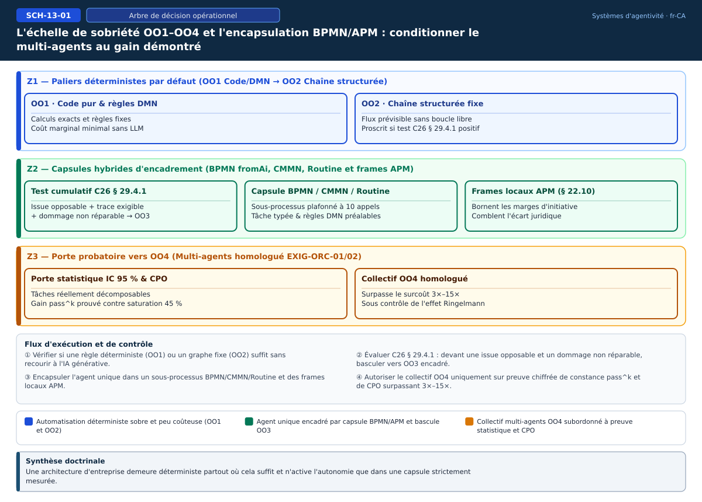
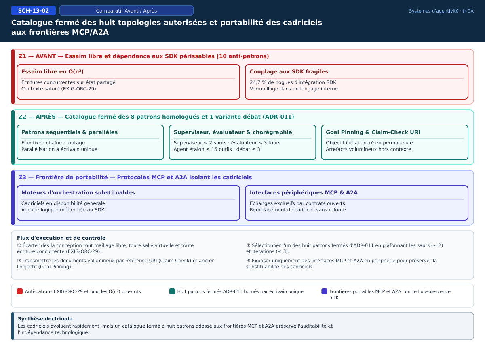
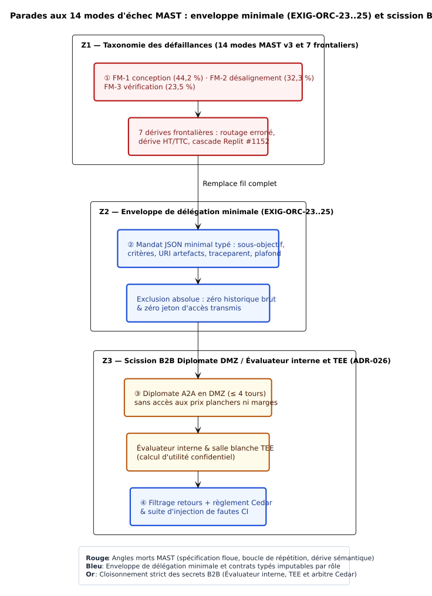

# Chapitre 13 — Sobriété d'orchestration OO1–OO4, catalogue fermé des topologies et maîtrise des défaillances MAST

*Question directrice :* Comment arbitrer entre code déterministe, agent unique outillé et collectif multi-agents au moyen de l'échelle OO1–OO4, d'un catalogue fermé de topologies portables et de parades vérifiables contre les quatorze modes d'échec MAST et l'effet Ringelmann ?

## 13.1 Résumé

L'industrialisation des Systèmes d'agentivité impose la retenue architecturale avant toute multiplication de collaborateurs cognitifs. L'observation empirique des collectifs d'agents montre que l'ajout de participants dégrade fréquemment l'efficacité marginale sur les tâches séquentielles fortement couplées, alourdissant les budgets de jetons d'un facteur de `1,6×` à `6,2×` par rapport à un agent unique [1] et atteignant `10×` à `45×` en jetons d'invite par agent effectif dans les débats homogènes [3]. À l'opposé, la comparaison à budget de réflexion égal rétablit l'avantage d'un agent unique bien outillé sur le raisonnement multi-sauts [2]. Le présent chapitre fonde la gouvernance d'orchestration du domaine `D05` sur trois verrous complémentaires : la hiérarchisation graduée selon l'arbre de sobriété `OO1–OO4`, le cantonnement des architectures de production à un catalogue fermé de huit topologies homologuées complétées par une variante débat bornée, et l'éradication systématique des défauts de spécification qui alimentent les pannes de coordination.

L'arbre de sobriété `OO1–OO4` subordonne le choix de l'architecture à la localisation du commandement et de la connaissance du processus (`EXIG-ORC-01`, `EXIG-ORC-02`, `ADR-002`, `CAP-007`, `PRI-002`, `PRR O-06`). Dès que les trois conditions cumulatives du test de qualification `C26 § 29.4.1` (`Tome 1 § 29.4.1`) sont réunies — décision opposable, traçabilité exigible par un tiers et dommage irréparable par simple reprise —, les régimes `OO1` et `OO2` pilotés par l'agent cèdent impérativement la place aux régimes `OO3` et `OO4`, où un cadre déterministe gouverne l'enchaînement. Le non-déterminisme résiduel demeure encapsulé dans des enveloppes `BPMN 2.0`, `CMMN`, de planification structurée par procédures ou des *frames* locaux du paradigme `APM` (*Agentic Business Process Management*).

Lorsqu'une preuve comparative démontre la non-infériorité en constance `pass^k` (intervalle de confiance à `95 %`, `IC 95 %`) et la couverture du surcoût en coût complet par résultat conforme (`CPO`), la conception multi-agents reste verrouillée sur les huit patrons de `ADR-011` (`EXIG-ORC-03..10`), proscrivant sauf dérogation formelle les dix anti-patrons d'`EXIG-ORC-29` et les salles virtuelles à croissance quadratique \(O(n^2)\). La portabilité des moteurs d'orchestration évalués au catalogue (`EXIG-ORC-30`) s'établit aux frontières normalisées `MCP` et `A2A`, tandis que l'enveloppe minimale de délégation (`EXIG-ORC-23..25`) et la scission `B2B` entre Diplomate en zone démilitarisée (`DMZ`) et Évaluateur en enclave `TEE` (`ADR-026`) neutralisent les quatorze modes d'échec `MAST v3` [4] ainsi que la grille interne des sept défaillances frontalières.

## 13.2 Gouvernance de l'orchestration : de l'arbre de sobriété au catalogue fermé

### 13.2.1 Arbre de sobriété OO1–OO4, encapsulation BPMN/CMMN/Routine et paradigme APM

Opposer de manière binaire le flux programmé rigide à l'essaim autonome occulte la véritable question d'architecture d'entreprise : quel composant détient la représentation explicite du processus et quel composant décide de la transition suivante. L'arbre de sobriété `OO1–OO4` formalise cette séparation en ordonnant la conception depuis la règle déterministe pure (`N0` / `OO1` par code ou table `DMN`) et le graphe structuré (`OO2`), jusqu'à l'agent unique outillé sous enveloppe (`OO3`) et au collectif multi-agents (`OO4`). Selon `EXIG-ORC-01`, chaque dossier d'architecture inscrit au registre doit démontrer par écrit pourquoi les paliers inférieurs ne répondent pas au besoin métier avant d'autoriser une couche cognitive supérieure.

Les travaux empiriques récents confirment cette discipline de parcimonie. Kim et ses collaborateurs [1] montrent sur `260` configurations contrôlées (six bancs d'essai, cinq architectures et trois familles de modèles) que les gains du multi-agents atteignent `+80,8 %` uniquement sur des tâches parallélisables telles que le raisonnement financier décomposable, mais chutent jusqu'à `−70,0 %` sur des tâches séquentielles de planification. Dans ces expériences, les architectures indépendantes sans validation centrale amplifient les erreurs sur traces de `17,2×` par rapport à un agent unique, contre `4,4×` sous orchestration centralisée [1]. La régression multivariée des auteurs précise toutefois que l'efficacité de coordination et le surcoût en jetons (`1,6×` à `6,2×`, jusqu'à `515 %` de tours supplémentaires en architecture hybride) expliquent mieux les écarts que l'amplification isolée [1].

Dans le même sens, Tran et Kiela [2] démontrent, par l'inégalité de traitement des données et des essais à budget de jetons de réflexion égal, qu'un agent unique bien outillé égale ou surpasse les systèmes multi-agents sur le raisonnement multi-sauts. La compression du contexte en messages inter-agents crée un goulot d'information qui érode la précision tant que le contexte unifié ne se dégrade pas [2]. Parallèlement, Bertalanič et Fortuna [3] établissent l'**effet Ringelmann multi-agents** : sur `44` cellules ajustées par \(R(N) = 1 / (1 + c(N - 1)N^{-\beta})\) avec \(R^2 > 0{,}99\), l'interaction dense sature vers un plafond dur \(1/c\). Trente agents homogènes en débat n'apportent pas davantage de diversité de réponses qu'un agent unique sur *MMLU-Hard*, tandis qu'un placebo de bruit égale l'auto-correction sur les mathématiques libres [3].

Au regard de ces constats et de la dégradation exponentielle décrite par la loi de Lusser examinée au chapitre 2, l'exigence `EXIG-ORC-02` subordonne tout déploiement multi-agents à une épreuve comparative contre un agent unique étalon. Le dossier d'homologation (`PRR O-06`) doit rapporter, sur le même jeu d'évaluation hermétique, la taille d'échantillon et le nombre de répétitions en constance `pass^k`. Il vérifie que la borne inférieure de l'intervalle de confiance à `95 %` de la différence de réussite dépasse l'opposé de la marge de non-infériorité déclarée. Il démontre enfin que la valeur économique des tâches réussies couvre le surcoût mesuré (`1,6×` à `6,2×` en budget total [1], ou `10×` à `45×` en jetons d'invite par agent effectif en débat homogène [3]) et évite les seuils de saturation observés au-delà de `45 %` de précision de l'agent unique [1] ou au-delà de `0,5` en vote majoritaire corrélé [3].

Cette exigence de sobriété s'applique également à la conception de la boucle interne d'un agent unique. Le patron fondateur `ReAct` (*Reasoning and Acting*) [7] entrelace traces de raisonnement et appels d'outils externes, gagnant `+34 %` sur *ALFWorld* et `+10 %` sur *WebShop* par rapport aux méthodes par imitation ou renforcement, au prix d'une réinjection croissante du contexte à chaque observation. À l'opposé, l'architecture `ReWOO` (*Reasoning Without Observation*) [8] découple planification (*Planner*), appels (*Worker*) et synthèse (*Solver*), réduisant jusqu'à `5×` la consommation de jetons avec `+4 %` de précision sur *HotpotQA* lorsque l'enchaînement reste prévisible [8]. Chaque échange d'arguments et de retours exige une validation structurelle conforme à `JSON Schema Draft 2020-12 Core` (`additionalProperties: false`, champs `required` et types explicites [9]), complétée par le mode strict du harnais.

L'arbitrage entre les quatre options `OO1–OO4` reprises au cadre conceptuel du `Tome 1 (§ 22.1–22.4)` s'appuie sur cinq propriétés d'évaluation et sept critères qualitatifs de sélection. Quatre propriétés relèvent de la démonstrabilité envers un tiers : la spécificité de tâche (mesurée par complexité cyclomatique et métrique `ABC`), l'assurance de correction (précision, rappel et score `F1`), la réactivité (taux de faux négatifs et vitesse de réaction) et la traçabilité (exactitude du journal). La cinquième propriété, l'autonomie, qualifie la latitude laissée au composant sans disposer d'une métrique quantitative normalisée. Sur le plan architectural, la journalisation confiée aux agents eux-mêmes reste formellement déconseillée : la trace opposable doit être émise par le cadre d'orchestration hors du modèle afin de ne pas dépendre de la fiabilité du composant audité.

Les sept critères de sélection complètent cette grille en distinguant la complexité du but, l'espace de décision, les contraintes réglementaires ou métier, puis en séparant explicitement la **supervision humaine** (point d'observation sur le flux) de l'**action humaine** (point d'arrêt obligatoire dans la boucle). Les deux derniers critères — l'effort initial de modélisation et le coût de maintenance — interdisent de masquer le coût réel d'un positionnement `OO3` ou `OO4` : expliciter un graphe déterministe exige un investissement initial supérieur, mais demeure seul défendable devant une autorité de surveillance lorsque l'organisation répond de l'issue.

Une seule discontinuité normative, posée comme lecture architecturale du traité (`Tome 1 § 22.1`), fracture le continuum `OO1–OO4` : le franchissement `OO2 → OO3`. En `OO1`, le processus n'existe dans aucun artefact avant l'exécution et ne s'observe qu'après coup dans les journaux ; en `OO2`, une description figure dans l'invite ou le contexte, mais demeure une simple consigne textuelle dépourvue de force exécutoire dès qu'une entrée ambiguë survient. À l'inverse, en `OO3`, l'épine dorsale déterministe commande l'enchaînement et invoque des agents agnostiques confinés à des tâches bornées ; en `OO4`, le cadre conserve le commandement tout en partageant l'état du processus avec des agents conscients du flux. Conformément au test de qualification `C26 § 29.4.1` (`Tome 1 § 29.4.1`), dès que trois conditions cumulatives sont réunies — un texte opposable qualifie l'issue, un tiers peut exiger la trace du cheminement décisionnel, et une simple reprise ne répare pas le dommage causé —, les options `OO1` et `OO2` deviennent proscrites au profit de `OO3` ou `OO4`.

| Option d'orchestration | Détenteur du modèle de processus | Autorité d'enchaînement | Lisibilité préalable | Régime admissible en entreprise |
|---|---|---|---|---|
| `OO1` — Agnostique | Aucun artefact explicite | Les agents (émergence) | Nulle (trace *a posteriori*) | Expérimentation isolée hors production |
| `OO2` — Informée par consigne | Les agents (invite ou contexte) | Les agents (planificateur) | Texte indicatif sans contrainte | Assistance consultative sans effet externe |
| `OO3` — Processus à agents agnostiques | Le cadre déterministe seul | Le moteur déterministe | Graphe complet auditable | Régime par défaut des flux audités |
| `OO4` — Agents conscients sous cadre | Le cadre et les agents | Le moteur déterministe | Graphe et contexte typé | Processus complexes à arbitrage local |

*Tableau 13.1 — Options d'orchestration OO1–OO4 et seuils d'admissibilité sous contrainte réglementaire.*

*Figure 1 — SCH-13-01 : Arbre de décision OO1–OO4, bascule réglementaire OO2 → OO3 et capsules d'encadrement BPMN, CMMN, Routine et APM.*

Comme l'illustre la Figure 1, le confinement du raisonnement stochastique dans un régime `OO3` ou `OO4` s'appuie sur quatre patrons d'encapsulation hybride retenus dans l'ingénierie des processus du traité (`Tome 3 § 17.2–17.4`). Le premier repose sur le sous-processus ad hoc `BPMN 2.0`, qui expose une liste fermée d'activités au modèle tout en plafonnant strictement les appels internes d'outils avant retour obligé au moteur de flux. Le deuxième patron encapsule la tâche agentique sous forme d'activité typée invoquée à travers un contrat `JSON Schema Draft 2020-12` strict [9] reliant les variables de sortie au routage déterministe. Le troisième mobilise la gestion de cas adaptative `CMMN` précédée de tables de décision `DMN` qui filtrent les cas routiniers avant tout appel génératif. Le quatrième emploie la planification structurée par procédures numérotées, complétée par des contrôles aval déterministes pour rattraper tout saut d'étape, tout en permettant d'exposer un processus métier entier comme outil `MCP` unique et gouverné.

Pour consolider cette frontière mécanique, le paradigme `APM` (*Agentic Business Process Management*, repris de l'index documentaire interne `Tome 1 § 22.6–22.7`) trace une distinction de nature entre automatisation et autonomie encadrée. Automatiser consiste à figer d'avance la séquence des opérations ; rendre autonome revient à déléguer le choix à l'intérieur de bornes explicites appelées *frames*. L'écart n'est pas de degré : un contrôle automatisé se prouve par lecture du code et rejeu déterministe, tandis qu'une décision autonome se justifie par les bornes strictes qui en délimitaient le périmètre au moment de l'exécution.

Le manifeste sépare ainsi les *frames* normatifs — de nature déontique, énonçant permissions, obligations et interdictions — des *frames* opérationnels, qui régissent la capacité effective d'exécution. Bien que le corpus de référence laisse la caractérisation formelle du *frame* opérationnel à un état partiel sur le plan théorique, l'architecture d'entreprise exige une correspondance bijective rigoureuse. Un *frame* normatif sans *frame* opérationnel reste une politique ignorée par le modèle, tandis qu'un *frame* opérationnel sans *frame* normatif devient une restriction opaque dépourvue de justification d'audit.

Cette discipline s'incarne dans les *frames* locaux exécutables qui bornent mécaniquement l'espace d'action de chaque cellule cognitive, comblant ainsi l'écart de responsabilité juridique identifié lors de la délégation à un composant probabiliste. Le modèle `APM` distingue trois scénarios d'encadrement : un décideur unique gouvernant le processus entier, plusieurs décideurs encadrant chacun un agent isolé sans garantie sur la composition globale, et plusieurs décideurs gouvernant un cadre de processus commun. Il impose en outre quatre capacités indissociables : l'encadrement effectif porté par le système, l'explicabilité alignée sur la conformité sectorielle, l'actionnabilité conversationnelle (mentionnée au manifeste sans critère exécutable normalisé à ce jour) et la séparation stricte de l'auto-modification entre adaptation éphémère limitée à une instance et évolution persistante modifiant le modèle de processus homologué.

### 13.2.2 Catalogue fermé des topologies, cadriciels GA, scission B2B et maîtrise des défaillances MAST

Au-delà du choix initial sur l'échelle `OO1–OO4`, l'architecture interdit toute topologie improvisée. Conformément à `ADR-011`, `CAP-010` et `EXIG-ORC-03`, tout système mis en production doit déclarer au registre d'entreprise son rattachement à un catalogue fermé comprenant huit patrons autorisés et une variante débat encadrée, sans jamais déroger aux bornes de `EXIG-ORC-04..10`. Le flux déterministe à étapes agentiques constitue le patron par défaut (`PRIN-08`), complété par la chaîne séquentielle typée, le routage par transfert (`handoff`) sans historique conversationnel complet, la parallélisation soumise à une règle de fusion déclarée et à un écrivain unique par système d'enregistrement (`EXIG-ORC-07`), ainsi que la chorégraphie événementielle gouvernée étudiée au chapitre 14 (`EXIG-ORC-08`).

Lorsque la tâche exige une décomposition dynamique, le patron orchestrateur-exécutants demeure strictement plafonné à deux niveaux de délégation — soit un orchestrateur et ses exécutants, équivalant à au plus deux sauts inter-agents (`EXIG-ORC-04`), verrouillés par échange de jetons `RFC 8693`. La boucle évaluateur-optimiseur exécute d'abord l'ensemble des vérifications déterministes disponibles (compilation, validateurs de schéma, règles métier), confie la critique qualitative à un modèle ou à une invite distincte du producteur, et bascule obligatoirement en escalade humaine au bout de trois itérations au plus (`EXIG-ORC-05`). Avant d'opter pour une décomposition multiple, l'agent unique outillé sert d'étalon obligatoire : dès que son catalogue dépasse `15` outils au début d'un tour ou présente des confusions sémantiques, l'équipe doit consolider les façades et activer le chargement à la demande avant de scinder (`EXIG-ORC-09`), tout découpage ultérieur suivant impérativement les frontières de contexte et de sécurité plutôt que les spécialités techniques (`EXIG-ORC-10`).

La variante débat ou clavardage de groupe réunit au plus trois agents participants sous la direction d'un gestionnaire hors décompte qui attribue explicitement la parole, fixe un plafond de tours et impose une règle de clôture (`EXIG-ORC-06`). À l'inverse, `EXIG-ORC-29` proscrit formellement dix anti-patrons qui dégradent la fiabilité et l'auditabilité. Sont bannis le multi-agents déployé sans gain mesuré, le découpage sans spécialisation de contexte, l'inversion entre flux connu et flux inconnu, l'état mutable partagé entre écrivains concurrents et l'ignorance des latences cumulées. Sont également proscrits l'enflure incontrôlée du contexte par historique brut, l'état conservé en mémoire vive volatile, le maillage libre ou la salle virtuelle à croissance quadratique \(O(n^2)\), les chaînes d'écritures sans idempotence ni compensation, ainsi que le vérificateur complaisant déclarant un succès prématuré. Trois verrous transversaux complètent ce catalogue : le patron `Claim-Check` qui remplace les charges utiles volumineuses par une référence `URI` d'artefact, le `Goal Pinning` qui maintient l'objectif racine immuable hors portée des données externes, et l'arbitrage documenté face à l'opacité délibérée d'`A2A` qui masque le raisonnement interne du pair devant un auditeur tiers.

| Patron homologué | Règle structurante (`EXIG-ORC-*`) | Borne maximale | Contrôle déterministe clé |
|---|---|---|---|
| 1. Flux déterministe (défaut) | Chemin codé invoquant des cellules cognitives | Schéma `JSON 2020-12` strict | Validation d'entrée et de sortie par étape |
| 2. Chaîne séquentielle | Transformations linéaires typées | Délai borné par maillon | Contrat de sortie validé avant transmission |
| 3. Routage et transfert | Aiguillage fermé puis retrait du routeur | Aucune boucle de transfert | Liste fermée de destinataires et contexte minimal |
| 4. Parallélisation | Sectionnement ou vote puis fusion | Garde-fou parallèle bloquant | Écrivain unique par système d'enregistrement |
| 5. Orchestrateur-exécutants | Planification dynamique et délégation `A2A` | `≤ 2` niveaux (`≤ 2` sauts) | Refus de chaîne profonde au serveur d'autorisation |
| 6. Évaluateur-optimiseur | Vérifications déterministes d'abord | `≤ 3` itérations puis escalade | Modèle ou invite de critique distinct du producteur |
| 7. Chorégraphie événementielle | Abonnement découplé sur `CloudEvents` | `xagentmaxhops = 4` | Propriétaire inscrit, journal et Saga multisystème |
| 8. Agent unique outillé (étalon) | Boucle bornée raisonner-agir-observer | `≤ 15` outils sans chevauchement | Consolidation et chargement à la demande |
| Variante : Débat encadré | Contre-examen sous gestionnaire tiers | `≤ 3` participants + gestionnaire | Attribution de parole et plafond de tours |

*Tableau 13.2 — Catalogue fermé des huit topologies autorisées, variante débat et bornes normatives d'ADR-011.*

*Figure 2 — SCH-13-02 : Comparatif entre les dix anti-patrons d'EXIG-ORC-29, le catalogue fermé d'ADR-011 et l'isolation des cadriciels aux frontières MCP et A2A.*

La pérennité industrielle de ces topologies impose de reporter la portabilité aux frontières protocolaires `MCP` et `A2A` plutôt que de verrouiller le patrimoine applicatif dans les abstractions internes d'un cadriciel d'orchestration (Figure 2). Les évaluations empiriques de notre base fermée montrent en effet la fragilité de la coordination dès que l'enveloppe manque : les workflows riches en outils subissent une pénalité de surcharge (`β = −0,096`) [1], les dialogues multi-agents fragmentent l'information disponible [2] et les formats de retour non contraints propagent des défaillances structurelles [9]. Tout couplage fort du métier d'entreprise à la syntaxe interne d'un cadriciel ou à un fournisseur unique accroît donc le coût de migration lors des évolutions d'interfaces et de modèles.

En conséquence, l'exigence `EXIG-ORC-30` (`Tome 2 § 7.10`) subordonne l'inscription au catalogue de toute pile d'orchestration — qu'il s'agisse de moteurs à graphes d'états, de moteurs d'exécution durable ou de courtiers événementiels tels ceux inventoriés à titre indicatif dans l'index d'écosystème du traité (`LangGraph`, `Microsoft Agent Framework`, `Temporal`, `CrewAI`, `Google ADK`, `DSPy`, `Confluent`) — à une preuve de concept dans les conditions de l'entreprise. Cette épreuve vérifie neuf capacités concrètes : persistance durable des points de contrôle et reprise après panne, pause d'approbation humaine sans perte d'état, télémétrie `OpenTelemetry`, prise en charge `MCP` et `A2A` (nativement ou par adaptateur), export documenté des flux et de l'état, propagation de clé d'idempotence, suite de fautes Saga (`EXIG-ORC-20`), plafonds d'exécution (`EXIG-ORC-26`) et coupe-circuits (`EXIG-ORC-28`). Aucune fiche commerciale ni statut de disponibilité annoncé hors du socle `L+` ne dispense de cette vérification.

Pour prévenir la saturation contextuelle et l'élargissement furtif des privilèges lors d'un transfert entre agents, `EXIG-ORC-23`, `EXIG-ORC-24` et `EXIG-ORC-25` proscrivent la transmission de l'historique conversationnel brut comme celle des jetons d'accès dans la charge utile. Toute délégation transmet exclusivement un objet `JSON Schema Draft 2020-12` minimal [9] regroupant le sous-objectif, les critères d'acceptation vérifiables, les paramètres typés et les `URI` pointant vers les artefacts stockés hors bande. L'objet porte également la référence de délégation, l'identifiant de tâche racine et d'étape déléguante (servant à dériver les clés d'idempotence), le palier d'outils maximal autorisé, le `traceparent` `W3C`, le budget résiduel ainsi que le niveau d'autonomie et la classe de risque les plus contraignants. Les retours produits par l'exécutant sont déposés en magasin d'artefacts, validés contre le schéma de retour avant toute réutilisation (`EXIG-ORC-24`), et filtrés selon les droits du mandant initial (`EXIG-ORC-25`) tout en conservant les étiquettes de provenance non fiable.

Aux frontières externes entre entreprises (`B2B`), la négociation entre agents acheteurs et vendeurs réunit par construction les trois ingrédients d'une fuite critique : secret commercial interne (prix de réserve, marge, coût d'arrêt d'usine), messages externes potentiellement adverses et canal de réponse sortant. En application de la cible de conception `ADR-026` (`CAP-014`, `Tome 3 § 45.4, § 45.9`), l'architecture scinde physiquement l'agent **Diplomate** exposé en zone démilitarisée (`DMZ` `A2A` / `EDC`, plafonné à titre illustratif à `4` tours d'échange) de l'**Évaluateur** interne détenteur des seuils financiers et fonctions d'utilité multi-attributs.

Un analyseur syntaxique strict convertit les offres externes en champs numériques conformes au schéma [9] avant tout franchissement de la cloison. À titre d'exemple de mise en œuvre du traité, des politiques hors modèle (telles que `Cedar` dans le profil de référence `B2B`) interdisent simultanément au Diplomate tout accès aux outils internes sensibles, tandis que le plafonnement des tours atténue les fuites comportementales d'inférence statistique sur les trajectoires de concession. Lorsque la coopération nécessite de croiser des données mutuellement secrètes, le calcul s'exécute dans une salle blanche matérielle en environnement `TEE` attesté à distance (`Intel TDX`, `AMD SEV-SNP`). Chaque partie vérifie l'empreinte cryptographique du binaire d'évaluation avant de libérer ses entrées chiffrées, et le résultat renvoyé se limite à une sortie agrégée ou booléenne, car l'enclave protège le calcul contre l'exploitant sans empêcher une sortie mal conçue de divulguer des données. En amont des appels d'offres, des sessions bilatérales cloisonnées en étoile empêchent toute fuite de prix entre concurrents et proscrivent les règles d'alignement tarifaire automatique assimilables à une collusion algorithmique tacite.

Avant de libérer un règlement `AP2` ou `x402`, un arbitre déterministe applique la cible de conception du rapprochement tripartite (`Tome 3 § 45.7, § 45.10`) entre le mandat contractuel issu de la négociation, l'attestation physique de réception (`IoT` ou connecteur `Dataspace`) et la facture présentée. Les politiques d'arbitrage appliquent les tolérances contractuelles dans le système d'enregistrement — à titre illustratif dans la cible `ADR-026`, `±0,5 %` sur les quantités et `0,02` dollar sur les écarts de facturation — tout en imposant un pare-feu asymétrique sur le volume et la durée des sollicitations externes (à titre indicatif `≤ 3` requêtes de cotation par minute) afin de prévenir le déni de service économique.

L'ensemble de ces verrous répond directement aux constats empiriques de la taxonomie `MAST v3` (*Multi-Agent System Failure Taxonomy*), établie par Cemri et ses collègues [4] à partir de `1 642` traces annotées issues de sept cadriciels à code ouvert (`MetaGPT`, `ChatDev`, `HyperAgent`, `AppWorld`, `AG2`, `Magentic-One`, `OpenManus`). L'étude rapporte un accord inter-annotateurs \(\kappa = 0{,}88\) de Cohen et des taux d'échec compris entre `41 %` et `86,7 %` [4]. La taxonomie ventile quatorze modes de défaillance (`FM-1.1` à `FM-3.3`) en trois catégories totalisant `44,2 %` pour les défauts de conception du système (`FM-1`), `32,3 %` pour le désalignement inter-agents (`FM-2`, ou `32,35 %` par somme des parts arrondies par mode) et `23,5 %` pour la vérification des tâches (`FM-3`) [4].

Quatre modes concentrent à eux seuls plus de la moitié des pannes observées : la répétition d'étapes (`FM-1.3`, `15,7 %`), l'écart entre raisonnement affiché et action effective (`FM-2.6`, `13,2 %`), la condition d'arrêt ignorée (`FM-1.5`, `12,4 %`) et la consigne de tâche non respectée (`FM-1.1`, `11,8 %`). Les agents ne s'opposent pas activement à leur mandat ; ils tournent en boucle faute de compteur externe, agissent à l'encontre de leur propre plan et concluent hâtivement lorsque les vérificateurs se limitent à des contrôles syntaxiques superficiels (`FM-3.1` à `FM-3.3`, totalisant `23,5 %`). À l'inverse, la rétention volontaire d'information (`FM-2.4`, `0,85 %` au texte de section, `0,80 %` en figure), le rôle non respecté (`FM-1.2`, `1,5 %`) et l'apport ignoré (`FM-2.5`, `1,9 %`) restent marginaux dans les traces [4].

| Catégorie `MAST v3` | Part agrégée `v3` (`SRC-028`) | Modes critiques dominants | Parade architecturale déterministe exigée |
|---|---|---|---|
| `FM-1` Conception du système | `44,2 %` | Répétition d'étapes (`15,7 %`), arrêt ignoré (`12,4 %`), consigne violée (`11,8 %`) | Moteur `OO3` bornant tours et arrêt ; objet `EXIG-ORC-23` typé ; état durable |
| `FM-2` Désalignement inter-agents | `32,3 %` | Écart raisonnement-action (`13,2 %`), dérive (`7,4 %`), clarification omise (`6,8 %`) | Contrats d'interface stricts, `Goal Pinning`, dépôt d'intention préalable |
| `FM-3` Vérification et terminaison | `23,5 %` | Vérification incorrecte (`9,1 %`), incomplète (`8,2 %`), arrêt prématuré (`6,2 %`) | Vérificateurs déterministes d'abord et critique distinct `EXIG-ORC-05` |

*Tableau 13.3 — Ventilation des quatorze modes d'échec MAST v3 [4] et parades architecturales exigées.*

*Figure 3 — SCH-13-03 : Cartographie des quatorze modes MAST v3 et sept pannes frontalières face à l'enveloppe minimale EXIG-ORC-23..25 et à la scission DMZ/TEE.*

Comme l'expose la Figure 3, l'entreprise complète la grille `MAST` [4] par quatre familles de remèdes structurels : la clarification formelle des rôles, la vérification multiniveau axée sur l'état final plutôt que sur la forme, le consensus sémantique arbitrant les intentions contradictoires avant écriture, et l'imputabilité architecturale reliant chaque paire d'agents à un périmètre d'exploitation mesurable. Les interventions expérimentales rapportées par Cemri et ses collègues sur `ChatDev` (`GPT-4o`) confirment l'effet mécanique de ces verrous : la clarification des rôles confiant l'arrêt final au dirigeant accroît la réussite de `+9,4 %`, tandis que l'ajout d'une étape de vérification de haut niveau sur *ProgramDev* procure un gain de `+15,6 %` [4]. À l'inverse, `MetaGPT` — qui encadre les agents par des procédures opératoires standardisées — réduit de `60 %` à `68 %` les défaillances des catégories `FM-1` et `FM-2` par rapport à `ChatDev`, mais affiche `1,56×` plus d'échecs de vérification `FM-3` [4], prouvant que la spécification seule déplace les pannes vers le contrôle final tant qu'un vérificateur indépendant et déterministe ne certifie pas l'état produit.

En outre, les auteurs de `MAST` relèvent que l'annotation automatique par modèle-juge n'atteint qu'un accord \(\kappa = 0{,}77\) avec les experts humains [4] et soulignent, à l'appui des travaux cités sur l'attribution d'erreurs dans les traces multi-agents (`Who&When`), la difficulté d'identifier *a posteriori* l'agent et l'étape responsables d'une défaillance [4]. L'entreprise privilégie donc la prévention contractuelle préalable — schémas stricts [9], bornes externes `EXIG-ORC-26` et enveloppes `EXIG-ORC-23..25` — plutôt que le diagnostic tardif sur journaux non typés.

À la frontière interopérable en l'absence d'attaquant actif, la grille analytique interne du traité (`Tome 1, Tableau 11.4`) prolonge `MAST` [4] en ciblant sept défaillances frontalières émergentes. Les quatre premières concernent le routage erroné entre domaines, la perte silencieuse de contexte lors du transfert, l'incompatibilité sémantique de schéma (telle la confusion entre montants hors taxes et toutes taxes comprises) et l'impasse de négociation sans médiateur. Les trois suivantes regroupent l'absence de demande de clarification (`FM-2.2`, `6,8 %` dans `MAST` malgré l'existence de protocoles comme `MCP` et `A2A` [4], qui incluent des états tels que `input_required`), la dérive cumulative d'objectif le long d'une chaîne et l'interblocage de délégation circulaire.

La non-compositionnalité de la sûreté aux frontières (`OWASP ASI08`, défaillances en cascade [5, 6]) interdit enfin d'assimiler la coordination multi-agents à la tolérance aux pannes byzantines classique. Lorsqu'une erreur sémantique plausible ou une commande destructive non revue — tel le cas d'exécution autonome sur l'espace de travail `Replit` supprimant ou écrasant des données de production documenté dans `OWASP ASI05` [5] — franchit un contrôle purement syntaxique sous forme de prose naturelle, les agents aval l'intègrent comme fait établi et l'amplifient. Seule la combinaison d'enveloppes structurées `EXIG-ORC-23..25`, d'arbitres déterministes externes et de coupe-circuits de passerelle sous `10` secondes (chapitre 21) contient cette propagation avant qu'elle n'altère les systèmes d'enregistrement.

## 13.3 Synthèse des schémas, livrables, exigences probatoires et trois invariants exécutables

Les trois figures intégrées au présent chapitre matérialisent la chaîne de décision complète : `SCH-13-01` situe l'arbre de sobriété `OO1–OO4` et l'encapsulation `BPMN`/`CMMN`/`Routine`/`APM` en section `13.2.1` ; `SCH-13-02` oppose les dix anti-patrons proscrits au catalogue fermé d'`ADR-011` et à la portabilité `MCP`/`A2A` en section `13.2.2` ; `SCH-13-03` relie les quatorze modes `MAST v3` et les sept pannes frontalières à l'enveloppe `EXIG-ORC-23..25` et à la scission `DMZ`/`TEE`.

La réception du chapitre en vue de la mise en exploitation repose sur quatre livrables vérifiables :
1. Le dossier d'arbitrage `OO1–OO4` cosigné par l'architecte d'entreprise (`AE`) et l'architecte de solutions (`AS`), prouvant l'insuffisance des paliers simples et la non-infériorité statistique en `pass^k`, `IC 95 %` et couverture de `CPO` (`EXIG-ORC-01`, `EXIG-ORC-02`, `PRR O-06`).
2. Le graphe d'orchestration homologué conforme au catalogue fermé d'`ADR-011` (`≤ 2` niveaux de délégation, `≤ 3` itérations d'évaluation, écrivain unique par système).
3. Le schéma `JSON Schema Draft 2020-12` (`additionalProperties: false`, champs `required` et profil strict [9]) de l'enveloppe de délégation minimale `EXIG-ORC-23..25` avec stockage des artefacts par `Claim-Check` `URI`.
4. Le rapport d'essais d'injection de fautes couvrant les quatorze modes `MAST v3` [4] et les sept défaillances frontalières avant promotion en production.

Sur le plan des interfaces transversales, le présent chapitre reçoit la démonstration de la loi de Lusser (← Chapitre 02), la partition déterministe `80/20` (← Chapitre 04), les règles de découplage `A2A` (← Chapitre 08) et l'encapsulation patrimoniale de la Partie IV (← Chapitre 12), tout en préparant la chorégraphie `Event Mesh` (→ Chapitre 14) et les sagas durables (→ Chapitre 15). Il reçoit également l'analyse de non-compositionnalité sécuritaire depuis le chapitre 19, les coupe-circuits rapides depuis le chapitre 21 et l'interdiction des salles virtuelles quadratiques depuis le chapitre 30. En retour, il alimente l'urbanisation `System of Action` du chapitre 1, l'encapsulation du chapitre 4, la supervision `HOTL` du chapitre 5, la portabilité des standards du chapitre 9, la régulation de la chorégraphie au chapitre 14, le pilotage `CPO` du chapitre 24, les mandats `B2B` du chapitre 27 et la gouvernance duale `AE ↔ AS` du chapitre 32.

Conformément au protocole documentaire `MLR-PRISMA-SCR-COMPENDIUM-2027-V1.0` arrêté au `2 décembre 2026`, l'ensemble des affirmations factuelles du chapitre s'appuie exclusivement sur les neuf sources primaires intégrales vérifiées [1] à [9] de la base fermée `sources/ch13-sources.md` et sur la validation `JSON Schema 2020-12` exécutée à la barrière `G0` (`aq/rapports-g0.json`), sous clause de non-avis juridique. Les sources bloquées par contrôle d'accès automatisé (`genai.owasp.org`, `gartner.com`, `hbs.edu`, toutes trois relevées en `HTTP 403` et consignées en exclusion `statut F`) sont écartées de la preuve directe et compensées, pour `OWASP ASI01–ASI10`, par le corpus primaire officiel sous licence libre [5, 6].

> **Trois invariants exécutables — Chapitre 13**
>
> 1. **Preuve comparative `OO1–OO4` et bascule `C26 § 29.4.1`** : toute topologie multi-agents (`OO4` ou patrons `3` à `7`) échoue à la revue `PRR O-06` sans démonstration statistique (`IC 95 %`, `pass^k`, `CPO`) face à l'agent unique étalon (`≤ 15` outils), tandis que toute décision opposable ou irréversible satisfaisant au test `C26 § 29.4.1` interdit `OO1` et `OO2` au profit d'un moteur déterministe `OO3`/`OO4`.
> 2. **Catalogue fermé `ADR-011` et portabilité `MCP`/`A2A`** : aucun graphe en production ne dépasse `2` sauts de délégation (`EXIG-ORC-04`), `3` itérations d'optimisation (`EXIG-ORC-05`) ni `3` participants en débat encadré (`EXIG-ORC-06`) ; toute écriture concurrente sur un même système d'enregistrement et toute logique couplée aux abstractions internes d'un moteur hors frontières `MCP`/`A2A` sont rejetées.
> 3. **Enveloppe minimale `EXIG-ORC-23..25` et cloisonnement `MAST`/`DMZ`** : toute délégation inter-agents transite par un objet `JSON Schema Draft 2020-12` (`additionalProperties: false` [9]) exempt d'historique conversationnel brut et de jeton d'accès ; en négociation `B2B`, les politiques hors modèle isolent strictement le Diplomate en `DMZ` (cible illustrative `≤ 4` tours) des prix de réserve détenus par l'Évaluateur interne ou calculés en enclave `TEE` (`ADR-026`).
