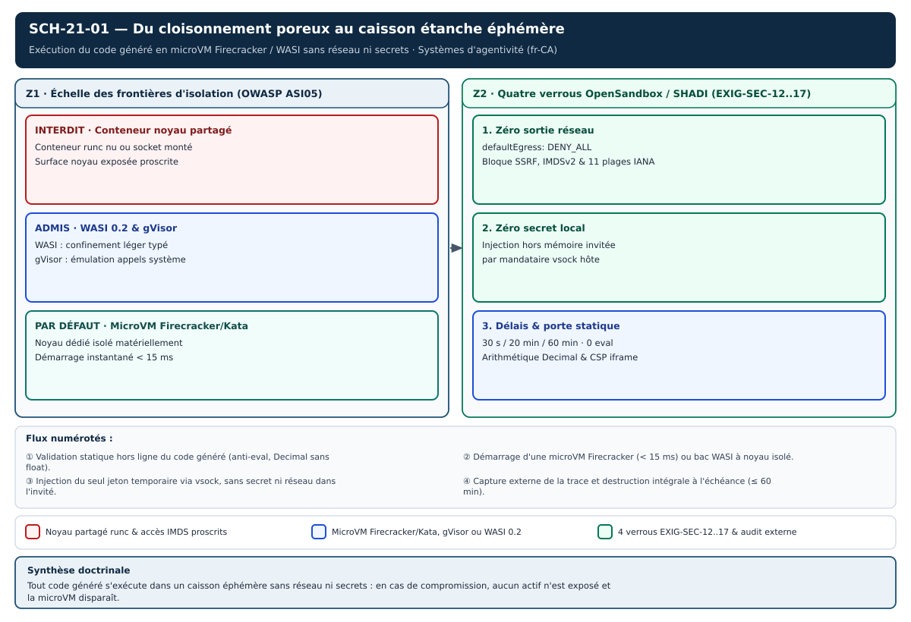
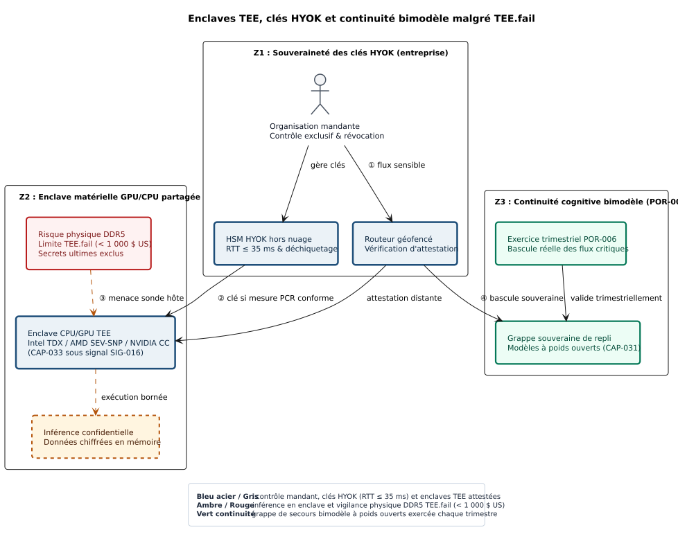
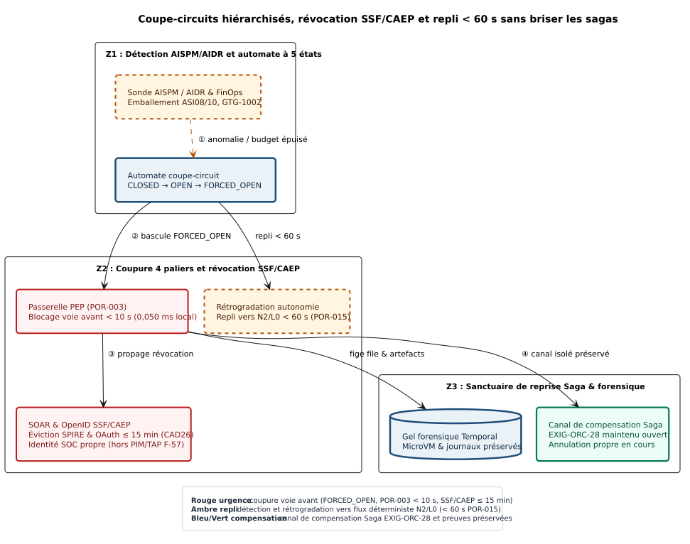

# Chapitre 21 — Confinement éphémère (SHADI/microVM/WASI), enclaves TEE/HYOK et coupe-circuit SOC/SOAR

*Question directrice : Comment confiner physiquement le code généré et les composants tiers sans exposer le noyau hôte ni les secrets, préserver la souveraineté matérielle sur les infrastructures partagées et interrompre en quelques secondes un agent déviant sans rompre l'intégrité transactionnelle des sagas en cours ?*

Lorsqu'une injection indirecte ou un outil corrompu amène un Système d'agentivité à produire et exécuter du code, la frontière logicielle des politiques `Rego` et `Cedar` ne suffit plus à elle seule à protéger l'infrastructure hôte. Un conteneur standard à noyau partagé (`runc`, proscrit par `EXIG-ARC-10`) laisse exposée une surface d'appels système étendue : toute évasion de bac à sable, toute lecture d'un jeton en variable d'environnement ou toute requête vers le service de métadonnées infonuagiques (`IMDS`, bloqué par `EXIG-SEC-13`) expose le nœud de calcul et les comptes d'infrastructure adjacents (`OWASP ASI05`) [1]. La troisième ligne de défense du domaine D07 repose donc sur l'isolation physique ou matérielle de l'exécution éphémère, la confidentialité cryptographique des charges sensibles et le bouclage opérationnel automatisé vers le centre de sécurité (`SOC`/`SOAR`).

Cette défense concilie l'isolation hermétique avec arrêt rapide (`OWASP ASI08`, `ASI10`) [1] et la préservation des données souveraines comme des écritures engagées. Détruire aveuglément les environnements laisserait des transactions orphelines sans traces forensiques ; l'architecture hiérarchise donc le confinement, encadre les enclaves matérielles par une continuité bimodèle et orchestre un coupe-circuit fermant la voie avant tout en maintenant ouvert le canal de compensation isolé `Saga`.

Ce chapitre clôt la Partie VII (domaine D07) au gel factuel du 2 décembre 2026. Il ancre ses spécifications sur les référentiels `OWASP Top 10 for Agentic Applications 2026` [1], le cadre systémique `STAMP/STPA` [2], les références `OPA v1.22.4` [3, 4], les principes d'admission attestée [5] et le règlement européen `DORA` (UE) 2022/2554 [6], sous clause `non-avis` (`AO-05`) et avec exclusion formelle en statut `F` du portail `genai.owasp.org` [1]. Respectant les frontières d'interface, il ne réécrit pas la logique des politiques `rule_of_two.rego` et `camel_taint.rego` (← Chapitre 20) ni la mécanique interne du journal `Outbox` des sagas (← Chapitre 15), mais garantit leur intégrité d'exploitation face aux pannes et incidents. Conformément au périmètre assigné, ce chapitre ne contient aucun bloc de code clôturé.

## 21.1 Résumé exécutif : caisson étanche, souveraineté réaliste et frein d'urgence sélectif

Trois dispositifs complémentaires forment la troisième ligne de défense déterministe du domaine D07. Premièrement, tout code généré par un modèle, tout script `Agent Skill` et toute interface tierce `MCP-UI` (issus du repérage antérieur du traité, hors socle `L+`) DOIVENT s'exécuter dans un bac à sable éphémère à noyau isolé [1]. Selon les choix techniques internes du traité (`ADR-020`), ce caisson repose sur une microVM `Firecracker` ou `Kata` (cible `< 15 ms` depuis cliché instantané sur `/dev/kvm`), un émulateur `gVisor` ou un environnement `WASI 0.2` sous `OpenSandbox` ou sur poste durci `SHADI` (`EXIG-ARC-10`, `EXIG-SEC-08` à `EXIG-SEC-17`, `CAP-030`, `PRR S-11`). Le recours à un conteneur `runc` nu à noyau partagé ou au montage d'une chaussette (*socket*) Docker est proscrit.

En barrière `G0`, le contrat déclaratif `sandbox_manifest.py` et la politique `OPA` `sandbox_confinement.rego` vérifient ces verrous sous règle `default allow := false` et `opa test --coverage` à `100,0 %` [3, 4]. Ils contrôlent le mode réseau fermé (`network.mode == "none"`, noté `defaultEgress: DENY_ALL` sous `OpenSandbox`), le blocage d'`IMDS` (`169.254.169.254`) et des `11` plages spéciales `IANA`, ainsi que l'absence de secrets en environnement (`env_secrets == []`). Ils imposent enfin une racine en lecture seule, l'interdiction du shell (`allow_shell == false`) et les trois plafonds temporels (`30 s` / `1 200 s` / `3 600 s`), complétés par le quatrième verrou de journalisation immuable hors bac à sable (`EXIG-SEC-16`), `decimal_money.py` (`Decimal`) et la porte statique `EXIG-SEC-17` anti-`eval` (`ASI05`) [1].

Deuxièmement, lorsque des charges réglementées exploitent des infrastructures infonuagiques partagées, la confidentialité matérielle associe les enclaves `TEE` CPU/GPU (`Intel TDX`, `AMD SEV-SNP`, `NVIDIA Confidential Computing`) au séquestre de clés `HYOK` (*Hold Your Own Key*, repère externe `RTT ≤ 35 ms` issu du repérage antérieur hors socle `L+`) permettant le déchiquetage cryptographique instantané (`CAP-033`, `PRI-011`, `DEC-006`). Toutefois, le risque physique sur bus mémoire `DDR5` décrit pour `TEE.fail` (`< 1 000 $ US` selon ses auteurs au repérage antérieur, hors socle `L+`) interdit d'accorder aux enclaves partagées une confiance absolue : les secrets souverains ultimes demeurent exclus des serveurs tiers et toute architecture de classe `3`–`5` maintient une grappe de secours bimodèle à poids ouverts exercée trimestriellement (`CAP-031`, `POR-006`).

Troisièmement, l'organisation doit contrer les attaques autonomes documentées au repérage antérieur (`GTG-1002`, hors socle `L+`), les incidents de réentrance et l'emballement en boucle (`ASI08`, `ASI10` [1] et `LLM10` de l'édition 2025 hors socle `L+`). La boucle défensive `SOC`/`SOAR`, équipée de capteurs `AISPM`/`AIDR` et guidée par `CoSAI AI IR 1.0` (repérages antérieurs hors socle `L+`), déploie un coupe-circuit hiérarchisé sur quatre paliers et cinq états (`EXIG-IAM-20`, `EXIG-SEC-23` à `EXIG-SEC-26`, `CAP-039`, `PRR S-14`) [2, 6]. La coupure `PEP` vise `< 10 s` (`POR-003` ; `0,050 ms` max local en Campagne `1` de `Borealis-Bench`), ferme les routes du mandataire `vsock`, étend l'éviction `SPIRE` et `OpenID SSF/CAEP` sous `≤ 15 min` (`CAD26`), rétrograde vers `N2`/`L0` en `< 60 s` (`POR-015`) et préserve le canal `Saga` (`EXIG-ORC-28`) ainsi que les preuves `DORA` (art. `10`–`11`) [6].

## 21.2 Confinement matériel, enclaves et boucle défensive SOC/SOAR

### 21.2.1 Confinement éphémère SHADI, OpenSandbox (microVM / WASI) et enclaves TEE/HYOK

La vulnérabilité `OWASP ASI05` (*Unexpected Code Execution*) [1] survient dès qu'un agent dispose de la faculté de générer ou d'interpréter du code — pour l'analyse de données, l'automatisation ou l'exécution de scripts — et qu'une entrée contaminée détourne cette capacité vers l'exécution de logique contrôlée par l'attaquant, menant à l'évasion du bac à sable ou à la compromission de l'hôte ou du conteneur [1]. Dans un conteneur Linux conventionnel reposant sur `runc`, tous les processus partagent le même noyau hôte ; une simple vulnérabilité d'appel système, un privilège résiduel ou une erreur de configuration des espaces de noms ouvre l'accès au nœud sous-jacent, aux jetons d'orchestration et aux autres locataires. Par conséquent, l'exigence `EXIG-ARC-10` proscrit sans dérogation les conteneurs `runc` nus et le montage de sockets de gestion de conteneurs pour toute charge contenant du code généré ou tiers (`CAP-030`, `PRR S-11`).

Sous l'abstraction **`OpenSandbox`** (`AAIF`, `ADR-020`) pour les grappes serveur et le harnais **`SHADI`** (*Sandboxed Harness for Agentic Development & Isolation*, `AGNTCY`) sur poste de travail (repérages antérieurs hors `L+`), l'arbitrage technique gradue trois moteurs selon l'empreinte, `/dev/kvm` et le repli (`EXIG-SEC-08` à `EXIG-SEC-11`, `Tome 2 § 9.7`, `Tome 3 § 32.6`) :

- **`Firecracker` / `Kata Containers` (`/dev/kvm`, défaut réglementé)** : noyau invité dédié (~`50 000` lignes Rust pour `Firecracker`, `< 5` Mio base 2020 et `~25–45` Mo actif au `Tome 3 § 32.6`, `< 125 ms` à froid, cible `< 15 ms` sur *WarmPool*). Exigeant `/dev/kvm` (métal nu ou virtualisation imbriquée, → Chapitre 09), il alourdit la flotte mais demeure requis par défaut pour Python, Bash, `Agent Skills` et `CUA`.
- **`gVisor` (`runsc`, repli sans `/dev/kvm` et GPU)** : noyau Go en espace utilisateur (`~35–60` Mo, `200–500 ms`, `~97 %` de compatibilité Linux avec surcoût d'E/S). Il sert de repli sans `/dev/kvm` ou porte les bacs GPU sous analyse `EXIG-SEC-10`, car `nvproxy` relaye les `ioctl` sans valider les tampons `DMA` contrairement au passage direct `IOMMU`.
- **`WASI 0.2` (`Component Model`, `wasm32-wasip2`)** : confinement par capacités (`1–5` Mo, `0,2–2 ms`), réservé aux parseurs et transformations pures dans un processus confiné (`EXIG-SEC-08`), avec vigilance sur les débordements linéaires et canaux auxiliaires (`Tome 2 § 9.7`).

Sans `/dev/kvm`, le basculement vers `gVisor` ou `WASI 0.2` maintient intacts les invariants du manifeste vérifiés en `G0` par `schemas/sandbox_manifest.schema.json`, `sandbox_manifest.py` et `sandbox_confinement.rego` (`EXIG-SEC-08` à `EXIG-SEC-17`, sous `default allow := false` et `opa test --coverage` à `100,0 %` [3, 4]).

*Figure 67 — SCH-21-01 : Échelle des frontières d'isolation proscrivant les conteneurs à noyau partagé (runc) au profit de WASI 0.2, gVisor et des microVM Firecracker (< 15 ms), articulée sur les quatre verrous cumulatifs OpenSandbox / SHADI incluant le journal d'exécution immuable hors bac (EXIG-SEC-16).*

Quel que soit le moteur d'isolation sélectionné, la solidité du caisson repose sur quatre verrous cumulatifs et non négociables (`EXIG-SEC-12` à `EXIG-SEC-16`), doublés d'une porte statique séparant génération et exécution (`EXIG-SEC-17`) :

1. **Zéro sortie réseau par défaut et blocage `IMDSv2` / `IANA` (`EXIG-SEC-12`–`13`)** : conformément aux recommandations d'isolement de sortie d'`OWASP` [1], le manifeste `G0` impose `network.mode == "none"` avec `allowlist == []` (noté `defaultEgress: DENY_ALL` sous `OpenSandbox`, ou liste blanche nominative sans joker `*`, vérifiée en `Rego` avec `default allow := false` [3]). En `G0`, `sandbox_manifest.py` bloque `169.254.169.254` (avec `IMDSv2` et limite de sauts `PUT = 1` sur AWS selon `EXIG-SEC-13`), `metadata.google.internal`, `localhost`, `ip6-localhost`, les six plages IPv4 spéciales `IANA` et les cinq préfixes IPv6 spéciaux correspondants. Il rejette aussi `0.0.0.0/8` et `::/128`, tandis que `sandbox_confinement.rego` double ce contrôle sur `imds_blocked` et `special_iana_blocked` contre `SSRF` [1, 3].
2. **Zéro secret invité et mandataire `vsock` / `SSF-CAEP` (`EXIG-SEC-14`)** : `env_secrets == []` et `read_only_root == true` (contrôlés en `G0`) excluent clés et jetons `OAuth` de l'environnement, du disque et de la RAM invitée. Sans interface réseau routable, la microVM échange uniquement via `virtio-vsock` avec le mandataire hôte (*Credential Vault Proxy* / `agentgateway`), qui vérifie liste blanche et `OPA`/`Cedar` et injecte les jetons hors du bac ; sur révocation `OpenID SSF 1.0`/`CAEP 1.0` ou bascule `FORCED_OPEN`, ce mandataire coupe immédiatement les routes `vsock`.
3. **Triple délai et isolation `GPU` (`EXIG-SEC-15`, `EXIG-SEC-10`)** : vérifié en `G0` par `sandbox_manifest.py` et `sandbox_confinement.rego`, toute exécution est bornée à `30 s` par appel d'outil, `1 200 s` (`20 min`) par boucle et `3 600 s` (`60 min`) au total avant destruction [3, 4], avec isolation `IOMMU` sur `GPU` (`EXIG-SEC-10`).
4. **Journal d'exécution immuable tenu hors du bac à sable (`EXIG-SEC-16`, `DOIT`)** : hors de l'environnement invité, le mandataire de sortie DOIT enregistrer toute requête réseau issue d'un caisson vers un registre d'exécution dédié — séparé tant des traces télémétriques que du grand livre d'audit — écrit en ajout seul sur un support inaltérable (`EXIG-OBS-13`) et corrélé à la tâche par son identifiant de trace (`Tome 2 § 9.7`). Les commandes lancées et écritures disque DOIVENT être captées côté hôte (interception d'appels système `gVisor` ou différentiel de système de fichiers à la destruction) ou expédiées sans délai depuis une racine en lecture seule ; ce registre ne contient aucun secret et suit la rétention `EXIG-CON-10` afin qu'un code compromis ne puisse jamais altérer ses propres preuves (`OWASP ASI05`, `ASI10` [1]).

En complément de ces quatre verrous d'exécution, l'exigence **`EXIG-SEC-17`** sépare la génération de l'exécution par une porte statique `AST` qui rejette `eval`/`exec` (`OWASP ASI05` [1]) avant tout démarrage, tandis que `G0` proscrit le shell libre (`allow_shell == false` [3, 4]) et que `policy_saga/decimal_money.py` impose l'arithmétique `Decimal` (rejet `TypeError` sur `float` et `bool`).

Ce même principe d'herméticité s'étend jusqu'à l'interface utilisateur lorsque des serveurs distants restituent des composants visuels interactifs via `MCP-UI` (← Chapitre 08, patron issu du repérage antérieur hors socle `L+`), prolongeant les principes de confinement contre l'exécution de code inattendue (`OWASP ASI05`) [1]. Dans cette architecture cible, chaque composant tiers s'affiche dans un cadre `iframe` isolé, dépourvu de l'attribut `allow-same-origin` et verrouillé par une politique de sécurité de contenu (`CSP`) imposant `connect-src 'none'`, empêchant tout script visuel malveillant d'accéder au stockage local du navigateur ou d'exfiltrer l'état de session de l'opérateur.

Au-delà de l'isolation des outils et des scripts, les organisations financières et réglementées doivent maîtriser la souveraineté cryptographique des données qui traversent les moteurs d'inférence eux-mêmes, particulièrement lorsqu'elles recourent à des grappes infonuagiques mutualisées (`PRI-011`, `DEC-006`, `CAP-033`, → Chapitre 12). La réponse architecturale repose sur la combinaison des **enclaves matérielles confidentielles (`TEE` CPU/GPU)** — telles `Intel TDX`, `AMD SEV-SNP` et `NVIDIA Confidential Computing` (repérage `Tome 3 § 46.2`, hors socle `L+`) — avec une gestion de clés détenue exclusivement par le client (**`HYOK`**, *Hold Your Own Key*, repérage `Tome 3 § 46.3`).

Dans ce schéma, le routeur géofencé n'oriente une charge sensible vers une enclave distante qu'après vérification cryptographique de son attestation matérielle (mesures `PCR` signées par la racine de confiance du processeur et du `GPU`), transposant par analogie architecturale aux moteurs d'inférence le principe d'admission attestée préalable démontré par Metere sur les serveurs d'outils `MCP` [5]. Les clés de déchiffrement demeurent séquestrées au sein du module matériel de sécurité (`HSM`) appartenant à l'entreprise, hors de l'infrastructure du fournisseur infonuagique (avec une cible réseau indicative `RTT ≤ 35 ms` reprise du repérage `AWS XKS`, hors socle `L+`). Cette séparation confère au mandant un pouvoir de **déchiquetage cryptographique instantané** : révoquer la clé `HYOK` rend immédiatement illisibles les charges chiffrées en transit ou au repos, même face à un fournisseur tiers ou à une réquisition étrangère.

Une rigueur probatoire stricte interdit toutefois d'ériger les `TEE` en garantie absolue : l'attaque physique **`TEE.fail`** (`Tome 3 § 46.2`, hors `L+`) sur bus `DDR5` (`< 1 000 $ US`) montre qu'un accès matériel aux barrettes permet d'extraire des secrets d'une enclave mutualisée. En conséquence, `CAP-033` reste conditionnelle sous veille `SIG-016` sans secrets souverains ultimes sur matériel tiers, et toute classe élevée maintient une **continuité cognitive bimodèle (`CAP-031`, `POR-006`)** sur grappe souveraine à poids ouverts, exercée chaque trimestre face aux failles `TEE`, révocations `HYOK` ou ruptures de fournisseur.

*Figure 68 — SCH-21-02 : Architecture de souveraineté cognitive associant le séquestre de clés HYOK (RTT ≤ 35 ms) aux enclaves matérielles CPU/GPU attestées (TDX, SEV-SNP, NVIDIA CC), tout en intégrant la limite physique DDR5 TEE.fail par la bascule trimestrielle vers une grappe souveraine à poids ouverts.*

### 21.2.2 Défense SOC/SOAR, analyse de contrôle STPA et coupe-circuit hiérarchisé

Lorsque les barrières préventives d'admission (← Chapitre 19), les politiques hors modèle (← Chapitre 20) et le confinement en microVM ont encadré l'exécution nominale, l'organisation doit encore se prémunir contre les dérives émergentes, les cascades d'erreurs et agents déviants (`OWASP ASI08`, `ASI10` [1] et `LLM10` de l'édition 2025 hors socle `L+`) ainsi que contre les intrusions rapides pilotées par des agents adverses. Le seuil critique a été relevé au repérage antérieur (`Tome 1`, hors socle `L+`) : des campagnes documentées exploitant `MCP` (opération `GTG-1002`) et des incidents `OAuth` (`F-21`) montrent que des agents offensifs enchaînent reconnaissance, mouvement latéral et exploitation d'API à une vitesse incompatible avec une analyse manuelle en centre opérationnel de sécurité (`SOC`).

Pour soutenir cette symétrie temporelle entre attaque et défense sans créer de nouveaux angles morts, l'instrumentation défensive réunit une télémétrie spécialisée (**`AISPM`** pour la gestion de posture de sécurité de l'IA et **`AIDR`** pour la détection et la réponse en temps réel) ainsi que des cadres issus du repérage antérieur hors socle `L+` (`CoSAI AI IR 1.0`, `MITRE ATLAS` éditions 2026 et projet conceptuel `NIST CAISI`/`NCCoE`). Un piège identitaire guette toutefois les équipes qui déploient des agents de triage ou de réponse automatisée au sein du `SOC` : un agent défenseur qui analyse des courriels d'hameçonnage ou des alertes ingère des entrées hostiles. Lui attribuer un compte d'administrateur humain temporaire via `PIM`/`TAP` s'avère incompatible avec les exécutions autonomes en arrière-plan (lacune `F-57` relevée au `Tome 1`, hors socle `L+`) ; chaque agent du `SOC` DOIT donc posséder sa propre identité non humaine (`NHI`) parrainée et bornée par `SPIFFE` et `OPA`/`Cedar` (← Chapitre 16).

La conception des seuils d'alerte et des disjoncteurs s'appuie sur l'**analyse de contrôle STPA** issue des travaux systémiques `STAMP`/`STPA` [2] (en tenant compte du fait que Barrett et al. bornent leur exploration à un archétype simple en exploitation et placent les systèmes multi-agents complexes hors de portée directe). L'approche `STPA` caractérise les pertes de contrôle comme des boucles de rétroaction dégradées où les capteurs retournent un état incomplet ou retardé pendant que le contrôleur poursuit ses actions [2]. Chaque action de contrôle dangereuse — réémission en boucle, épuisement budgétaire ou dérive d'appel — dicte un seuil de disjoncteur et une bascule dégradée. Cette discipline répond aux articles `10` et `11` du règlement européen `DORA` (UE) 2022/2554 [6], qui imposent la détection rapide des activités anormales, la définition de seuils d'alerte multi-niveaux, l'activation sans retard de mesures d'endiguement et la continuité des fonctions critiques.

Au cœur de cette boucle `SOC`/`SOAR`, l'exigence `EXIG-IAM-20`, l'exigence `EXIG-SEC-26` et la capacité `CAP-039` (`PRR S-14`, décisions `ADR-011` et `ADR-013`) instaurent un **coupe-circuit hiérarchisé** capable d'interrompre une dérive sans paralyser l'ensemble de l'entreprise ni corrompre l'état transactionnel. L'automate du coupe-circuit suit cinq états déterministes (`CLOSED`, `HALF_OPEN`, `OPEN`, `DEGRADED`, `FORCED_OPEN`) et s'applique sur quatre paliers de granularité croissante :

1. **Palier `1` — Saga ou tâche isolée** : arrêt ciblé d'une instance d'exécution unique dépassant son plafond de tours (`max_turns`), son budget de jetons ou son seuil de déviation.
2. **Palier `2` — Connecteur `MCP` ou outil spécifique** : mise en quarantaine immédiate d'un outil présentant une dérive d'empreinte ou un taux d'échec anormal, tout en laissant fonctionner les autres connecteurs sains.
3. **Palier `3` — Blueprint ou classe d'agents** : révocation chirurgicale par `ClusterSPIFFEID` d'un gabarit d'agent compromis ou victime d'un emballement récursif entre plateformes SaaS (← Chapitre 29).
4. **Palier `4` — Domaine ou région complète** : bascule d'urgence globale vers le mode fermé (`FORCED_OPEN`) lors d'une compromission transversale ou d'un incident systémique `S1`/`S2`.

La maîtrise des délais d'intervention requiert de concilier deux horizons temporels complémentaires déjà relevés dans l'analyse de concordance inter-tomes (→ Chapitres 34 et 36). Le premier correspond à la cible technique locale de coupure à la passerelle `PEP` exigée par `POR-003` en **moins de `10 s`** (démontrée en `p50 = 50,00 µs`, `max = 0,050 ms` sur `10` essais concurrents lors de la Campagne `1` du banc expérimental interne `Borealis-Bench` avec bail local cible `TTL ≤ 5 s`, en évaluation artificielle sans mesure de production bancaire). Le second fixe l'enveloppe normative globale d'éviction propagée aux fédérations d'identité à **`≤ 15 min`** (`CAD26`). La passerelle (`agentgateway`) coupe toute requête avant et les routes du mandataire `vsock` dès `FORCED_OPEN`, tandis que `SOAR` diffuse la révocation `OpenID SSF/CAEP` (← Chapitre 17) et l'éviction `SPIFFE` sous `15` minutes, complétées par le repli `POR-015` vers `N2`/`L0` en **moins de `60 s`**.

| Palier / Mécanisme | Portée et déclencheur (`STPA` / `AISPM`) | Délai cible et preuve mesurée | Effet sur la voie avant et les sagas (`EXIG-ORC-28`) |
|---|---|---|---|
| Coupe-circuit `PEP` (`POR-003`) | Bascule `FORCED_OPEN` et coupure `vsock` (`GTG-1002` hors `L+`) | `< 10 s` cible (`0,050 ms` max local `Borealis-Bench` C1) | Bloque immédiatement toute nouvelle mutation ou sortie réseau |
| Diffusion `SOAR` (`SSF`/`CAEP` + `SPIRE`) | Éviction globale des mandats OAuth et `SVID` sur incident `S1`/`S2` | `≤ 15 min` global (`CAD26`) ; `TTL` bail local `≤ 5 s` | Révocation terminale `REVOKED` sans attente d'expiration naturelle |
| Rétrogradation d'autonomie (`POR-015`) | Rupture du budget d'erreur ou dérive comportementale soutenue | `< 60 s` vers palier `N2` ou flux déterministe `L0` | Maintien du service métier en mode déterministe de repli |
| Sanctuaire `Saga` et gel forensique | Préservation des écritures en cours et des preuves d'incident | Immédiat et continu (`EXIG-ORC-17`, `EXIG-ORC-28`) | File `Temporal` et microVM gelées pour audit (`10/10` en C1) ; canal de compensation maintenu ouvert |

*Tableau 21.1 — Architecture temporelle et fonctionnelle du coupe-circuit hiérarchisé et de la rétrogradation d'autonomie.*

*Figure 69 — SCH-21-03 : Boucle complète de détection AISPM/AIDR et d'intervention SOAR montrant le passage à l'état FORCED_OPEN (< 10 s au PEP / 0,050 ms local), l'éviction SSF/CAEP (≤ 15 min), le repli vers N2/L0 (< 60 s) et le maintien ouvert du canal de compensation Saga EXIG-ORC-28.*

Une contrainte d'intégrité comptable domine l'architecture du coupe-circuit : **l'arrêt d'urgence de la voie avant NE DOIT JAMAIS interrompre le canal de compensation isolé `Saga`** (`EXIG-ORC-17`, `EXIG-ORC-28`, ← Chapitre 15). Lorsqu'un agent financier engagé dans une séquence multi-étapes est stoppé par le coupe-circuit à mi-parcours d'une écriture réversible avant le point pivot, couper aveuglément toutes ses permissions laisserait des débits ou réservations orphelins dans les systèmes d'enregistrement. En séparant physiquement l'identité et le budget de la voie de compensation (`EXIG-ORC-28`) et en gelant simplement la progression avant de l'automate `Temporal` sans détruire les microVMs ni les journaux, l'organisation permet aux opérations inverses idempotentes d'achever proprement l'annulation tout en conservant intactes les preuves numériques pour l'examen post-incident et la notification des incidents majeurs prévus par `DORA` (art. `11`–`12` et `19`, → Chapitre 26) [6].

Enfin, la fiabilité de ces coupe-circuits et des bascules de souveraineté ne se décrète pas : l'exigence `EXIG-SEC-23` impose des **exercices trimestriels chronométrés** validant en conditions réelles le respect des seuils `< 10 s` (`POR-003`), `< 60 s` (`POR-015`) et de bascule bimodèle (`POR-006`), complétés par un exercice annuel complet de `Red Team` impliquant les équipes de sécurité, d'exploitation `SRE` et de gouvernance des risques.

## 21.3 Synthèse architecturale, livrables et portes de contrôle

Le présent chapitre achève l'architecture de défense en profondeur hors modèle du domaine D07 en reliant le confinement matériel de bas niveau au pilotage opérationnel de crise. En amont, il consomme les artefacts de compilation et scripts `Agent Skills` émis par l'usine logicielle (← Chapitre 04), les rendus `A2UI`/`MCP-UI` (← Chapitre 08) et les identités `ClusterSPIFFEID` permettant la révocation chirurgicale par classe d'agent (← Chapitre 16). Il intègre aussi l'automate de révocation `SSF 1.0`/`CAEP 1.0` (← Chapitre 17), le canal de compensation isolé `Saga` (← Chapitre 15), l'inventaire des menaces `ASI05`/`ASI08`/`ASI10` (← Chapitre 19) et la traduction des boucles `STPA` issue du cœur décisionnel (← Chapitre 20).

En aval, ce dispositif protège les six substrats d'état (→ Chapitre 12), isole `Event Mesh` et `MAST` (→ Chapitres 13 et 14), nourrit `EvalOps` (→ Chapitre 23), contient `FinOps` (→ Chapitre 24), encadre les boucles SaaS (→ Chapitre 29), déclenche `DORA` (art. `10`–`11` [6]) et `Loi 25` (→ Chapitres 25 et 26) et alimente `PRR` `S-11` et `S-14` (→ Chapitres 34 et 36). Sans bloc de code clôturé ici, `sandbox_manifest.py` et `sandbox_confinement.rego` valident `18` tests `pytest` (`test_policy_saga.py`) et `45` assertions `OPA` à `100,0 %` en `G0` (`rapports-g0.json`) [3, 4].

En pratique, la convergence de ces trois lignes de défense — modélisation causale et épinglage cryptographique (← Chapitre 19), politiques déterministes hors modèle en mode fermé (← Chapitre 20), et confinement physique accompagné de coupe-circuits sélectifs — dote l'organisation d'une maîtrise vérifiable de son rayon d'impact. Chaque frontière matérielle et logique demeure vérifiable en intégration continue comme en exploitation trimestrielle sans reposer sur une hypothétique fiabilité morale du modèle sous-jacent.

| Livrable d'ingénierie | Exigences et contrats couverts | Vérification et porte d'acceptation (`G0`–`G1`) |
|---|---|---|
| Profils déclaratifs `OpenSandbox` / `SHADI` & politique `CSP` `MCP-UI` | `EXIG-ARC-10`, `EXIG-SEC-08..17`, `CAP-030`, `ADR-020`, `C18`, `C29`, `PRR S-11` | `sandbox_manifest.py` & `sandbox_confinement.rego` (`G0`) : `mode: "none"` (`DENY_ALL`), `IMDSv2` (`hop = 1`) + `11` plages `IANA`, `0` secret, `30/1200/3600 s`, journal externe immuable (`EXIG-SEC-16`), `allow_shell == false`, `Decimal` et `AST` anti-`eval` (`EXIG-SEC-17`, `ASI05`) [1, 3, 4] |
| Matrice `TEE`/`HYOK` et plan de continuité bimodèle | `CAP-031`, `CAP-033`, `PRI-011`, `DEC-006`, `POR-006`, `SIG-016` | Principe d'attestation transposé de [5], cible `RTT HYOK ≤ 35 ms` et limite `TEE.fail` (repérage hors `L+`), exercice trimestriel à poids ouverts |
| Guides `SOAR` et automate coupe-circuit à `4` paliers | `EXIG-IAM-20`, `EXIG-SEC-23..26`, `EXIG-ORC-28`, `CAP-039`, `POR-003`, `POR-015`, `PRR S-14` | Cible `< 10 s` `PEP` (`0,050 ms` max interne `Borealis-Bench`), `≤ 15 min` `SSF`/`CAEP`, `< 60 s` repli `N2`/`L0`, `STPA` [2], `DORA` [6], canal `Saga` intact |

*Tableau 21.2 — Livrables d'ingénierie, exigences normatives et critères de vérification du Chapitre 21.*

> **Trois invariants exécutables — Chapitre 21**
>
> 1. **Caisson éphémère hermétique sans `runc` nu (`EXIG-ARC-10`, `EXIG-SEC-08..17`, `CAP-030`)** : Tout code généré ou script `Agent Skill` s'exécute en microVM `Firecracker`/`Kata` (cible `< 15 ms`), `gVisor` ou `WASI 0.2` sous `network.mode == "none"` (`DENY_ALL` `OpenSandbox`), blocage `IMDSv2` (`hop = 1`) et `11` plages `IANA`, `env_secrets == []`, `30 s` / `1 200 s` / `3 600 s`, journal d'exécution immuable hors bac à sable (`EXIG-SEC-16`), porte anti-`eval` (`EXIG-SEC-17`, `ASI05`) et arithmétique `Decimal`.
> 2. **Souveraineté `TEE`/`HYOK` avertie de `TEE.fail` et continuité bimodèle (`CAP-031/033`, `POR-006`)** : Les clés `HYOK` demeurent sous contrôle exclusif client (cible `RTT ≤ 35 ms` hors `L+`) pour le déchiquetage instantané, les secrets ultimes restent hors matériel partagé vulnérable au risque `TEE.fail` (repérage hors `L+`), et la bascule vers une grappe à poids ouverts est exercée chaque trimestre.
> 3. **Coupe-circuit hiérarchisé préservant la compensation `Saga` (`EXIG-IAM-20`, `EXIG-ORC-28`, `POR-003`, `POR-015`)** : Le disjoncteur à cinq états bascule en `FORCED_OPEN` sous cible `< 10 s` au `PEP` (`≤ 15 min` global `SSF`/`CAEP`), rétrograde en `< 60 s` vers `N2`/`L0` et préserve impérativement le canal isolé de compensation `Saga` et les traces forensiques, sous exercices trimestriels chronométrés, ouvrant sur l'observabilité et les bancs de la **Partie VIII (`D08`)** (→ Partie VIII, Chapitre 22).
